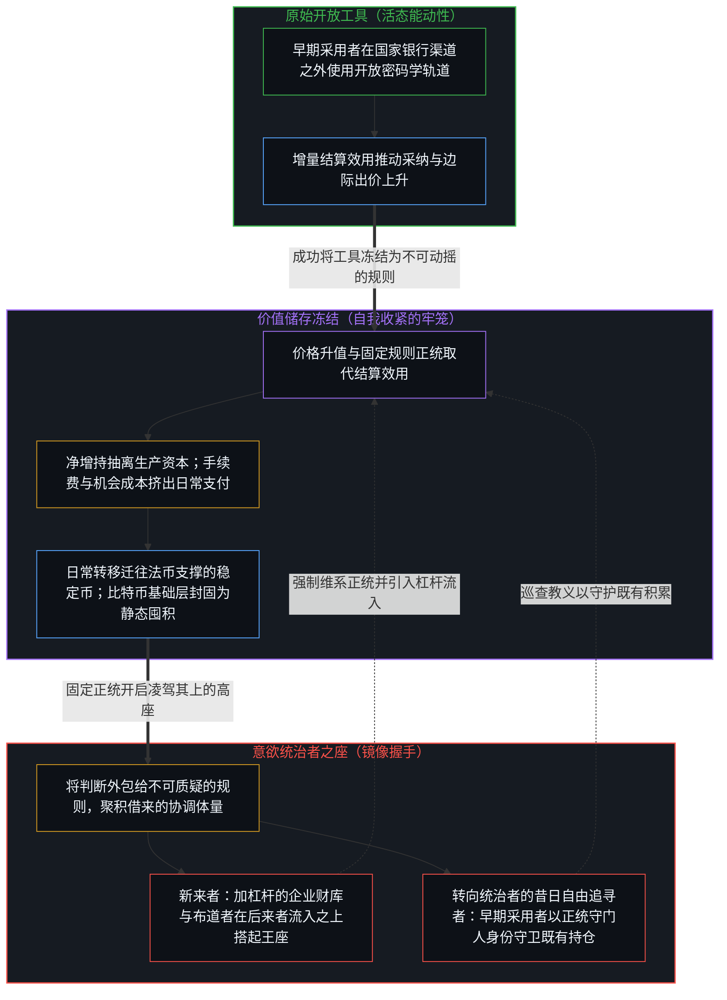
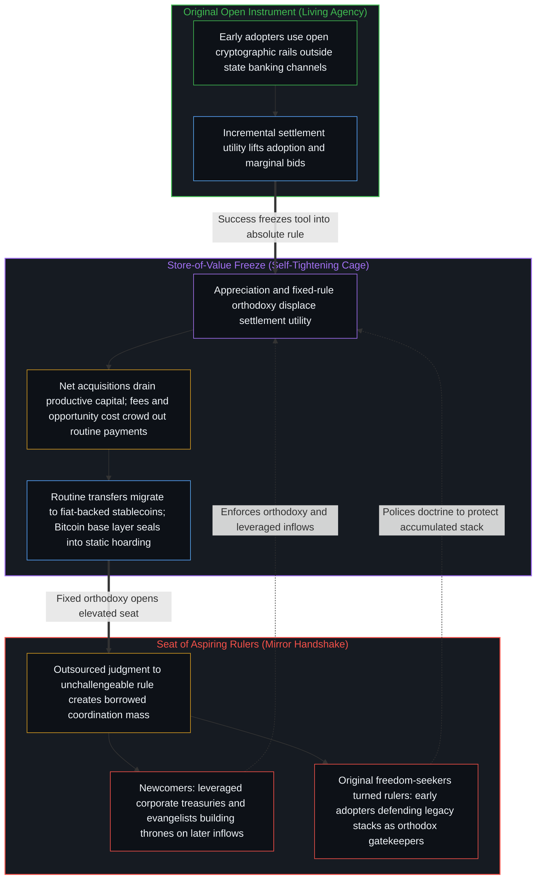
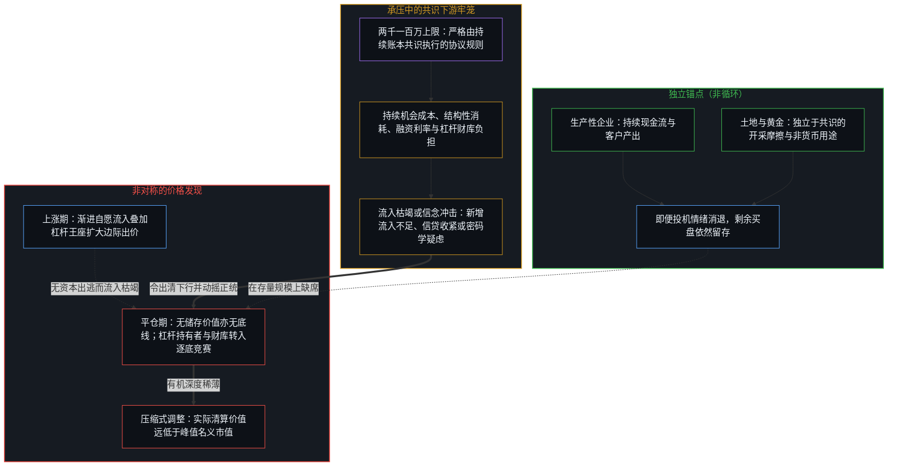
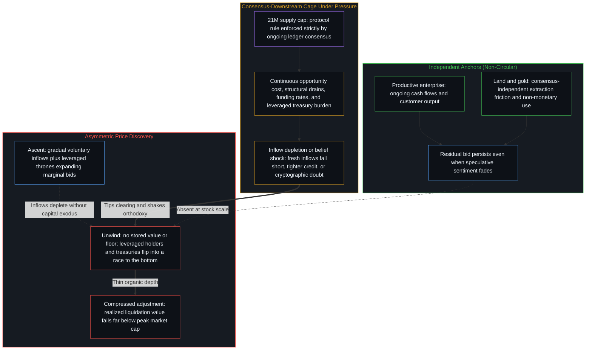

# 比特币作为价值储存童话的边界 / The Boundary of Bitcoin as a Value-Storage Fairytale

*无生产则无可持续储存；把协议规则误认作自然稀缺，媒介便冻结资本并依赖持续注入，直至叙事本身成为唯一锚点。 / No sustainable storage without production; mistaking a protocol rule for natural scarcity freezes the medium into capital absorption that depends on continuous injection until the narrative itself is the sole remaining anchor.*

储存价值的可实现度量，不在价格乘以数量的名义总额，而在持有者清算时所能换得的产品与服务。正如[价值、货币与财富的生成机制](../the-generative-mechanics-of-value-money-and-wealth/)所推导，价值生发于第一人称的必要，而非外部的数字清点；名义市值只是将最近一笔边际交易——即[价格是言说，理解是交易](../price-as-utterance-understanding-as-trade/)所追溯的、两个排序相反的订单交错留下的公开残余——外推至全部存量，从不等同于持有者可以同时提取的购买力。对任何缺乏现金流或非货币用途的非生产性资产而言，代币内部并未储存任何价值，拉大这一落差因此无须资本净流出：面对有限的订单簿深度与集中持仓，单是足够的新增流入枯竭，便会将边际成交价向下出清；杠杆则将自愿持有转为强制抛售，使平均实现的出清价格远低于账面数字。更深一层，参与者一旦将最初用以在国家法币轨道之外重夺能动性的开放结算工具，冻结为不可质疑的价值储存正统，这件工具便倒转为一座封闭牢笼——从生产活动中抽离资本，在冻结规则之上将加杠杆的新来者与昔日前沿开拓者两类意欲统治者送上高座，并倚赖持续的资本注入，直至共享信念成为最后仅存的锚点。

The realizable measure of stored value lies not in the nominal product of price multiplied by quantity, but in the goods and services a holder can obtain in exchange upon liquidation. Value originates in first-person necessity rather than an external numerical tally, as [The Generative Mechanics of Value, Money, and Wealth](../the-generative-mechanics-of-value-money-and-wealth/) derives; headline market capitalization merely extends the latest marginal trade—the public residue where two opposing order rankings crossed, as [Price as Utterance, Understanding as Trade](../price-as-utterance-understanding-as-trade/) traces—across the entire stock, never equating to purchasing power that holders can extract simultaneously. For any non-productive asset lacking cash flows or non-monetary use, no value is stored inside the token, so widening that gap requires no net capital outflow: a mere depletion of sufficient fresh inflow clears marginal prints downward against finite order-book depth and concentrated holdings, while leverage converts discretionary holding into forced selling and drives the average realized clearing price far below the headline figure. Deeper still, once participants freeze an open settlement instrument adopted to reclaim agency outside state rails into an unchallengeable store-of-value orthodoxy, the tool reverses into a closed cage—draining capital from productive activity, seating aspiring rulers from both leveraged newcomers and former frontier-openers atop the frozen rule, and leaning on continuous capital injection until shared belief is the sole anchor left.

## 一、 增量效用、资本吸纳与杠杆 / 1. Incremental Utility, Capital Absorption, and Leverage

自我区分的活动发生着——无因、不息。称之为心智：早已在途的观察者，其每一个行动都是一次区分。先前的离散行动留下痕迹，严格单向地塑形后续行动可及的场域，因此正如[生产、消费与心智的区分](../production-consumption-and-the-minds-distinction/)所确立的，唯有活态中心先在开放边界上将某物生成出来，下游才谈得上储存、交易或结算。每一份货币索取权与金融资产负债表，都处于这种对上游生成的单向依赖之中——这正是[净生产者的最终约束](../the-ultimate-constraint-of-the-net-producer/)所追溯的结构性约束。账本在活跃生产者之间桥接时间差，自身并不生成任何产出。

Self-distinguishing activity occurs — uncaused, unceasing. Call it the Mind: the observer already underway, every act of which is a distinction. Earlier discrete acts leave traces that shape the field available to later acts strictly one way, so nothing can be stored, traded, or settled downstream unless living centers first bring it into existence at an open boundary, as [Production, Consumption, and the Mind's Distinction](../production-consumption-and-the-minds-distinction/) establishes. Every monetary claim or financial balance sheet stands in this one-way dependence on upstream generation—the same structural constraint traced in [The Ultimate Constraint of the Net Producer](../the-ultimate-constraint-of-the-net-producer/). Ledgers bridge timing gaps between active producers; they generate no output of their own.

比特币最初的效用是增量的。早期采用者拿起这一开放的密码学媒介作为一件活的工具，在国家法币轨道之外重夺能动性，完成既有金融渠道难以胜任的转移——跨境、抗审查，且不依附于商业银行。早期用户、建造者与矿工实现了这一增量结算效用，随着采用面拓宽，边际出价随之走高。价格上涨一旦成为主要吸引力，资本流入便从寻求结算的用户转向预期继续升值的买方。需求高涨期的高额链上费用与有限的基础层吞吐量，进而将许多原本供给增量效用的小额日常交易挤出场外，强化了向更大额、更长周期托管的转向；参与者也由此开始将价值归于器物本身，而非运用它的活态活动。

Bitcoin's original utility was incremental. Early adopters took up an open cryptographic medium as a living instrument to reclaim agency outside state fiat rails, executing transfers that existing financial channels handled poorly—cross-border, censorship-resistant, and independent of commercial banks. Early users, builders, and miners realized that incremental settlement utility, and marginal bids rose as adoption broadened. Once price appreciation became the principal attraction, capital inflows shifted from users demanding settlement toward buyers expecting further appreciation. High on-chain fees and limited base-layer throughput during demand surges then priced out many of the small, routine transactions that had supplied the original incremental utility, reinforcing the turn toward larger, longer-horizon custody as participants began crediting value to the artifact rather than to the living activity using it.

单一的价值储存命题于是要求从其他配置中持续抽调净流入资本，方能维系或抬高交换率。生产性企业向客户出售产品与服务，源源不断产生现金流；与之不同，无收益代币自身不生发内部回报，持有者在清算时所能取得的购买力，取决于新进或续接的买方是否愿意让渡生产性资源或对其的索取权。打破估值因此无须资本净流出，也无须大规模蜂拥退出：由于非生产性资产既无替代用途、内部也未储存任何价值，单是足够的新增流入枯竭——即流入降至不足以承接持续的结构性消耗，例如矿工运营与能源开支、借贷与融资持有成本以及日常流动性变现——便已将边际成交价向下出清，并触发杠杆抵押品的强制抛售。杠杆在两个阶段都会加剧效应：上涨期，借入资本扩大边际出价，同时吸走原本可供给有机订单簿深度的自由资本；一旦抵押门槛或融资利率收紧，杠杆便将这一下行出清加速推入逐底竞赛。有效市场深度相对于名义市值愈发稀薄，更大比例的账面估值若不大幅压低出清价格，便无从触及。

A standalone store-of-value thesis then requires continuous net inflows of capital diverted from other deployments to sustain or lift the exchange rate. Unlike a productive enterprise that generates ongoing cash flows from goods and services sold to customers, a non-yielding token produces no internal yield; the purchasing power a holder obtains upon liquidation depends on new or continuing buyers willing to surrender productive resources or claims on them. Breaking the valuation therefore requires no net capital outflow and no mass rush to exit: because no value is stored inside a non-productive asset without alternative use, a mere depletion of sufficient fresh inflow—inflows dropping below what is needed to absorb ongoing structural drains such as miner operating and energy outlays, borrowing and funding carrying costs, and routine liquidity sales—already clears marginal prints downward and trips leveraged collateral into forced selling. Leverage intensifies both phases: borrowed capital expands marginal bids during the climb, absorbs free capital that could otherwise supply organic order-book depth, and accelerates that downward clearing into a race to the bottom whenever collateral thresholds or funding rates tighten. Effective market depth thins relative to notional capitalization, leaving larger fractions of paper valuation unreachable without moving clearing prices steeply.

## 二、 协议规则的稀缺、通用性倒置与持续机会成本 / 2. Protocol-Rule Scarcity, the Generality Reversal, and Continuous Opportunity Cost

比特币的稀缺与约束黄金或土地的条件截然不同，且该账本在自身共识之外并无非货币用途。黄金的存量增长受制于开采与提炼的宏观摩擦，并兼具持久的工业用途；土地在空间上不可复制，能够产出作物、提供居所或带来租金。即便货币需求消失，这些宏观摩擦与非货币用途依然在各个中心之间持久存续。比特币的两千一百万上限是一条协议规则，唯有当矿工、节点运营者、交易所与持有者组成的经济多数继续执行该规则、并认准这一特定链而非任何分叉或替代链时，它才作为稀缺起作用。这一稀缺因此位于持续网络共识的下游，而非先于共识、独立于共识之外的约束。

Bitcoin's scarcity differs sharply from the constraints governing gold or land, and the ledger carries no non-monetary utility outside its own consensus. Gold's supply grows only against the macroscopic friction of mining and refining, alongside enduring industrial applications; land stays spatially non-replicable and yields crops, shelter, or rent. Those macroscopic frictions and non-monetary uses persist across centers even if monetary demand vanishes. Bitcoin's twenty-one million cap is a protocol rule. It functions as scarcity only while the economic majority of miners, node operators, exchanges, and holders continues to enforce that rule and recognize that specific chain over any fork or alternative. The scarcity therefore stands downstream of ongoing network consensus rather than ahead of it as a consensus-independent constraint.

一旦庞大而具流动性的网络成形，矿机、算力与持仓上又沉淀了巨额沉没投入，更改协议规则便代价高昂、协调困难。这种粘性在实践中成立，并将比特币与后来模仿同一设计的数字资产区分开来；但粘性从未将协议规则转化为独立于共识的属性。任何获得足够采纳的替代链，皆可执行相同或更严格的发行计划；令竞争账本停留在边缘的，是路径依赖、算力安全、流动性以及既有的持有者基数。正如[能动性被转置入形式模型](../agency-relocated-into-the-formal-model/)所追溯的，形式规范与密码学边界自身不带任何自主能动性，代码协议底下依托的仍是活生生的人类协调。因此，比特币上限的估值严格处于下游，取决于活态中心是否继续将这一特定账本视作相关账本。

Once a large, liquid network and substantial sunk investments in mining hardware, hash power, and holdings accumulate, altering the protocol rule grows costly and coordination grows difficult. That stickiness holds in practice and separates Bitcoin from later digital assets copying the same design, yet stickiness never converts a protocol rule into a consensus-independent property. Any sufficiently adopted alternative chain can enforce an identical or stricter issuance schedule; what keeps competing ledgers peripheral is path dependence, hash-rate security, liquidity, and the incumbent base of holders. Formal specifications and cryptographic boundaries carry zero autonomous agency, as [Agency Relocated into the Formal Model](../agency-relocated-into-the-formal-model/) traces, and code protocols still rest on living human coordination underneath. The valuation of Bitcoin's cap therefore stays strictly downstream of living centers continuing to treat this specific ledger as the relevant one.

同样的范畴倒置，也浮现在围绕密码学耐久性的争论之中：查马斯·帕里哈皮蒂亚警告，AI 驱动的数学突破可能攻破比特币的加密体系并令其归零；迈克尔·塞勒则回应称，比特币如同阿拉伯数字、六十进制计时、公制与英语一样，是一项经济协议。这一类比恰恰颠倒了它所援引的机制。阿拉伯数字、六十进制计时、公制与英语的效用源自通用性：普遍、开放的采纳不吸纳任何资本，且流通越广、越不稀缺，效用反而越高。通用性正是稀缺的反面。协议类比贴合的是比特币最初的交易与协作命题——而这正是价值储存命题借由升值、手续费拥堵与囤积亲手取代的交易角色。一旦比特币被奉为价值储存而非开放的结算惯例，再以通用协议之名为其辩护，便暴露出一重内在的自相矛盾：一种媒介一边宣称拥有零成本协作标准的恒久性，一边却单凭来自生产活动的持续净资本注入才得以维系。

The same category reversal surfaces in the debate over cryptographic durability—where Chamath Palihapitiya warns that AI-driven mathematical breakthroughs could crack Bitcoin's encryption and drive it to zero, and Michael Saylor answers by calling Bitcoin an economic protocol akin to Arabic numerals, sexagesimal time, the metric system, and English. That analogy reverses the mechanism it invokes. Arabic numerals, sexagesimal time, the metric system, and English derive their utility from generality: ubiquitous, open adoption that absorbs zero capital and becomes more useful the wider and less scarce its circulation grows. Generality is the exact opposite of scarcity. The protocol analogy fits Bitcoin's original transactional and coordination thesis—the very transactional role that the store-of-value thesis itself displaced through appreciation, fee congestion, and hoarding. Once Bitcoin is championed as a store of value rather than an open settlement convention, defending it as a universal protocol exposes an internal self-contradiction: a medium claiming the permanence of a zero-cost coordination standard while held together solely by ongoing net capital injection from productive activities.

每一位比特币持有者同时承担着直接而连续的机会成本：每有一单位资本停泊在无收益代币之中，便无法同时投入生产设备、资助运营中的企业、购置商品，或配置于生息工具。活态中心透过竞争性回报、借贷与融资利率，以及锁定资本所放弃的具体用途，时刻登记着这笔成本。意识形态施加的成本则弥漫、社会化且延迟：错失的替代选项悄然累积，并不对照某项明确的竞争回报逐分钟定价，也没有保证金追缴或抵押门槛迫使其即时结算。可交易市场资产的持有者面临的滞后短得多：一旦别处的相对吸引力发生变化，他们便可直接重新配置资本，无须等待共享叙事先行瓦解。

Every holder of Bitcoin also bears an opportunity cost that is direct and continuous: each unit of capital parked in a non-yielding token cannot simultaneously fund productive equipment, finance operating enterprises, purchase goods, or sit in yield-bearing instruments. Living centers register that cost continuously through competing returns, borrowing and funding rates, and the concrete uses foregone by locking capital in place. An ideology imposes diffuse, social, or delayed costs: foregone alternatives accumulate quietly without minute-by-minute pricing against an explicit competing yield and without margin calls or collateral thresholds forcing immediate settlement. Holders of a tradable market asset face a much shorter lag: a shift in relative attractiveness elsewhere prompts them to reallocate capital directly, without waiting for the shared narrative to break down first.

## 三、 成功对原始效用的收紧与稳定币替代 / 3. Success Tightening Original Utility and Stablecoin Substitution

每一次对无收益资产的净增持，都会从其他配置中抽离资本——无论是生产性投资、当期消费，还是支撑该资产自身交易功能的周转流动性。随着持续增持抬高交换率，持有代币的机会成本随之攀升，将其用于小额或高频转移的手续费与波动负担也同步加重。比特币早期的市场成功，因此收紧了原本赋予它结算媒介增量效用的条件。经验上，比特币原始设计所瞄准的绝大部分交易需求已迁移至稳定币。这些工具提供区块链结算的速度与终结性，同时保留法币——主要是美元——的记账单位与相对稳定，让用户无须承担升值型无收益资产的波动或放弃回报的代价。

Each net acquisition of a non-yielding asset removes capital from alternative deployments—productive investment, current consumption, and even the circulating liquidity supporting the asset's own transactional function. As sustained acquisitions lift the exchange rate, the opportunity cost of holding the token increases, and the fee and volatility burden of using it for small or frequent transfers rises alongside it. Bitcoin's early market success therefore tightened the exact conditions that had supplied its incremental utility as a settlement medium. Empirically, the bulk of the transactional demand targeted by Bitcoin's original design has migrated to stablecoins. Those instruments deliver the speed and finality of blockchain settlement while retaining the unit of account and relative stability of fiat currencies, predominantly the dollar, sparing users from absorbing the volatility or foregone return of an appreciating non-yielding asset.

留在比特币基础层上的活动随之偏向更大额、更低频的转移与长期持有，而非曾经构成其独特用例的日常支付。在这场迁移之外，剩余的结算、抵押与跨境功能依然留存，但这一替代在绝大多数商业用途上已取代了原始的交易命题。稳定币本身依然是对短期国债、银行存款等传统储备资产的索取权，它们将既有金融体系数字化并向外延伸，并未脱离其中。稳定币的普及所澄明的是：被吸纳进比特币价值储存角色的资本，已不再是网络最初提供的交易服务所必需。抬高比特币交换率的成功，同时收窄了它服务于最初采纳目的的实用空间，使其更大份额的市值依赖于持有者继续放弃资本其他用途的意愿。

Base-layer activity remaining on Bitcoin is consequently weighted toward larger, lower-frequency transfers and long-horizon holdings rather than the routine payments that once constituted its distinctive use case. Residual settlement, collateral, and cross-border functions persist alongside that migration, yet the displacement has replaced the original transactional thesis for most commercial purposes. Stablecoins themselves remain claims on conventional reserve assets such as short-term government debt and bank deposits, digitizing and extending the legacy financial system rather than escaping it. What stablecoin adoption clarifies is that capital absorbed into Bitcoin's store-of-value role is no longer required for the transactional services the network first supplied. The success that raised Bitcoin's exchange rate simultaneously narrowed its practicality for the purpose that first justified its adoption, leaving a larger share of its capitalization dependent on holders' continued willingness to forego alternative uses of capital.

## 四、 从开放工具到封闭牢笼与意欲统治者之座 / 4. From Open Instrument to Closed Cage and the Seat of Aspiring Rulers

日常结算一旦迁往别处、估值转而倚赖持续的资本注入，一层更深的结构倒转便开始成形：早期采用者借以在国家法币轨道之外重夺自由的那件工具，反过来变成一座被奉为不可动摇定则的封闭牢笼。在尚被暂且持握之时，密码学轨道作为活的动词运作——它是第一人称边缘上用来绕开银行许可完成清算的工具。这件开放工具一旦被物化为不可质疑的定局——“永恒的数字稀缺”与“终极价值储存”——边界便越过它原本服务的那一步而冻结下来。持有者将资本锁进一部无收益账本，而这部账本唯有仰赖来自生产生活的稳定净流入方能撑住交换率；要让这枚循环锚点保持直立，便须维系僵硬的叙事正统：竞争性的生产配置、收益测算与审慎质疑，不再被登记为须加权衡的寻常机会成本，而被视作威胁共同持仓的背叛。起初意在走出旧货币围栏的出路，就此硬化为一座密封牢笼，而笼栏正是由持有者自己豁免于检视的前提从内部维持。

Once routine settlement migrates elsewhere and valuation rests on continuous capital injection, a deeper structural reversal sets in: the very instrument early adopters used to reclaim freedom outside state rails reverses into a closed cage held up as an absolute rule. While held provisionally, cryptographic rails operated as an active verb—a tool exercised at the first-person edge to clear transactions without bank permission. The instant that open instrument is reified into an unchallengeable finality—"permanent digital scarcity" and the "absolute store of value"—the boundary freezes past the step it served. Holders lock capital inside a non-yielding ledger that sustains its exchange rate only through steady net inflows from productive life, and keeping that circular anchor upright demands rigid narrative orthodoxy: competing productive deployments, yield calculations, or skeptical inquiries register not as ordinary opportunity cost to weigh, but as defection threatening the shared hold. What began as an exit from one monetary enclosure hardens into a sealed cage whose bars are maintained from within by the holders' own exempted premise.

这座密封牢笼在结构上便造出一座凌驾其上的统治高座，无须归咎于任何个人的恶意。密码学账本自身不含号令服从的独立力量；支配关系形成于[权力的镜像握手](../the-mirror-handshake-of-power/)所追溯的互补对齐之中。每当分散的参与者将判断与安全外包给一条不可质疑的固定规则——把代码稀缺框定为从外部赐予自由的施予者，即[赋权确立权力的集中](../empowerment-establishes-the-centralization-of-power/)所追溯的同一套确立守门人席位的倒置——他们交出的判断便聚积为借来的体量，聚拢出一座握有协调杠杆的高座。正如[“非中介化”的幻象](../the-illusion-of-the-unmediated/)所追溯的，绕开既有机构却原封保留判断的外包，从不消解层级；权力只是从显性、可追责的中介，迁移为隐性而不对称的杠杆，落入在这条冻结规则之上掌控叙事正统、分发渠道与集中资产负债表规模的人手中。

That sealed cage creates an elevated seat of rule by construction, requiring zero attribution of personal malice. A cryptographic ledger contains no independent force that commands obedience; dominance forms through the reciprocal alignment traced in [The Mirror Handshake of Power](../the-mirror-handshake-of-power/). Whenever dispersed participants outsource judgment and security to an unchallengeable fixed rule—framing code scarcity as an external grantor of liberty, the same gate-seating inversion traced in [Empowerment Establishes the Centralization of Power](../empowerment-establishes-the-centralization-of-power/)—their handed-over judgment accumulates as borrowed mass, assembling an elevated seat of coordination leverage. As [The Illusion of the Unmediated](../the-illusion-of-the-unmediated/) traces, bypassing legacy institutions while leaving outsourced judgment intact never dissolves hierarchy; power migrates from explicit, accountable intermediaries into implicit, asymmetric leverage exercised by whoever commands narrative orthodoxy, distribution channels, and concentrated balance-sheet scale over the frozen rule.

步入这座高座的意欲统治者出自两个不同源头，二者皆直接受这一冻结持仓格局的结构激励。第一类是从未开辟过原始前沿的新来者：加杠杆的企业财库操盘手、机构资产负债表架构师与媒体布道者。他们在早期技术涉险早已过去之后才进场，借发行股票与债券，在固定协议规则与后来者流入的资本之上搭建杠杆王座。由于这层杠杆底下没有生产性的盈利引擎，他们的地位直接系于封紧正统并招徕新的净流入资本。第二类则是最初的自由追寻者，沿着[自我价值、反向财富转移与过去成功的陷阱](../self-worthiness-reverse-wealth-transfer-and-the-trap-of-past-success/)所追溯的连续谱悄然转向统治者——从在开放边缘扩展能动性，滑向守卫已累积的持仓，并将自身地位归功于器物本身。过往的积累一旦沦为地位的源头，而不再是开启新创造的暂用杠杆，昔日的前沿开拓者便围绕护卫丰碑重新组织起来：巡查教义、轻视生产摩擦，以正统守门人之姿坐镇牢笼——而托举他们既有持仓的，正是这座牢笼持续吸纳的资本。跨越这两个源头，运转的是同一套机制：将开放工具冻结为不可质疑的规则，便会把对自由的追寻转为服从，并在账本之上安放意欲统治者。

Aspiring rulers step into that elevated seat from two distinct origins, both incentivized directly by the structure of the frozen hold. The first group consists of newcomers who never opened the original frontier: leveraged corporate treasury operators, institutional balance-sheet engineers, and broadcast evangelists who arrived long after early technical risk-bearing, issuing equity and debt to assemble leveraged thrones atop the fixed protocol rule and the inflows of later entrants. Because their leverage has no productive earnings engine beneath it, their standing depends directly on keeping the orthodoxy sealed and attracting fresh net capital. The second group consists of original freedom-seekers who pivoted into rulers along the continuous spectrum traced in [Self-Worthiness, Reverse Wealth Transfer, and the Trap of Past Success](../self-worthiness-reverse-wealth-transfer-and-the-trap-of-past-success/)—shifting quietly from expanding agency at an open edge to defending an accumulated stack and crediting standing to the artifact itself. Once past accumulation becomes the source of standing rather than provisional leverage for new creation, former frontier-openers reorganize around protecting the monument: policing doctrine, dismissing productive friction, and presiding as orthodox gatekeepers over the exact cage whose ongoing capital absorption sustains their legacy holdings. Across both origins, the same mechanism operates: freezing an open tool into an unchallengeable rule turns freedom-seeking into compliance and seats aspiring rulers atop the ledger.

## 五、 锚点缺席与压缩调整的非对称性 / 5. The Absent Anchor and the Asymmetry of Compressed Adjustment

逻辑张力并不构成任何固定时间表上崩溃的证明。共享预期、高昂的退出协调成本、机构授权、杠杆资产负债表防线与路径依赖，足以让以信念为锚的安排维持数十年之久。逻辑所确立的，是独立、非循环锚点的缺席。交换率一旦主要依靠每位持有者预期其他中心会继续把这一账本当作优选价值储存来支撑——正如[起作用的是信念](../what-works-is-the-belief/)所追溯的结构，一项安排唯独在各中心将其持为地基时才得以运转——对该预期的任何广泛修正，都会撤走撑住价格的依托。生产性企业的现金流与客户效用不因市场情绪而中断，黄金与土地的开采摩擦及非货币用途也独立于货币共识之外持久存续；与之不同，比特币缺乏能够覆盖全部存量规模的剩余需求，无力将其重新定价于先前的出清水平附近。即便协议规则本身纹丝未动，持有者依然可以重新配置资本，测量到的出清价格也依然可以急剧调整。

A logical tension constitutes no proof of collapse on any fixed horizon. Shared expectations, high coordination costs of exit, institutional mandates, leveraged balance-sheet defenses, and path dependence can keep belief-anchored arrangements intact for decades. What the logic establishes is the absence of an independent, non-circular anchor. Once the exchange rate is supported primarily by each holder's expectation that other centers will continue treating the ledger as a preferred store of value—the same structure traced in [What Works Is the Belief](../what-works-is-the-belief/), where an arrangement operates strictly while centers hold it as ground—any broad revision of that expectation removes the support sustaining the price. Unlike a productive enterprise whose cash flows and customer utility continue regardless of market sentiment, or commodities such as gold and land whose extraction friction and non-monetary uses endure independently of monetary agreement, no residual demand scales across the entire Bitcoin stock to re-price it near prior clearing levels. Holders can therefore reallocate capital, and measured clearing prices can adjust sharply, without any change in the protocol rules themselves.

密码学的可破解性由此落回它确切的因果位置。无论 AI 驱动的数学进展是否威胁到现行加密，抑或开发者能否协调升级至更强的密码学原语，都无法改变底层的经济自相矛盾：无论采用何种加密算法，一种无收益的储存媒介都不产生现金流，仍须依赖来自生产活动的持续资本注入。密码学的可破解性是在另一处切入因果链条的：它会动摇支撑价值储存正统的基础信念。在一座杠杆牢笼里，估值依托的是集体账本认可，而非独立盈利流或独立于共识之外的非货币用途；一旦这份基础信念发生动摇——甚至无须等到密码学实际被攻破——便足以促使集中持有者与加杠杆的财库操盘手修正预期、重新配置资本，并收紧抵押信贷，把出清推入压缩式平仓。

This places cryptographic breakability in its exact causal slot. Whether AI-driven mathematics threatens current encryption or developers coordinate an upgrade to stronger primitives alters nothing in the underlying economic self-contradiction: a non-yielding storage medium generates no cash flows and relies on ongoing capital injection from productive activities regardless of its cipher. Cryptographic breakability enters the causal chain at a different point: it shakes the foundational belief sustaining the store-of-value orthodoxy. In a leveraged cage whose valuation rests on collective ledger acceptance rather than an independent earnings stream or consensus-independent non-monetary utility, shaking that foundational belief—even prior to a live cryptographic breach—can prompt concentrated holders and leveraged treasury operators to revise expectations, reallocate capital, and tighten collateral credit into a compressed unwind.

方向上的非对称性源于同一套机制。上涨阶段，资金流入渐进且自愿：买方按各自节奏吸收机会成本，借入资本与加杠杆的企业资产负债表则不断扩大边际出价。下跌阶段，触发压缩式平仓无须先有资本出逃：由于非生产性资产缺乏现金流或非货币用途，内部也未储存任何价值，不存在随累积存量规模自动缩放的承接买盘，单是足够的新增流入枯竭，便已足以令边际出清转为下行。一旦流入缩减至低于持续的结构性消耗——或别处的竞争回报改善、融资成本走高，或持有者修正预期——这一下行出清便会刺破升值前提，卖单撞上愈发稀薄的有机流动性，抵押压力则令杠杆持有者与杠杆财库转入强制抛售。已锁死在杠杆头寸中的资本无法同时供给订单簿深度，竞相退出由此加速演变为逐底竞赛，将价格发现压缩进比先前上涨更短的时间区间——这正呼应了[把稳定的症状当作稳定的来源](../mistaking-the-symptom-of-stability-for-its-source/)所追溯的脆弱性：建立在杠杆稳定之上的漫长平静，掩盖了日渐稀薄的修正容量，直至扰动跑赢响应。

The directional asymmetry follows from the same mechanics. On the ascent, inflows enter gradually and voluntarily: buyers absorb opportunity cost at their own pace while borrowed capital and leveraged corporate balance sheets expand marginal bids. On the decline, triggering a compressed unwind requires no initial capital exodus: because no value is stored inside a non-productive asset lacking cash flows or non-monetary use, no automatic bid scales with the accumulated stock, and a mere depletion of sufficient fresh inflow is already enough to tip marginal clearing downward. Once inflows thin below ongoing structural drains—or competing returns improve elsewhere, funding costs climb, or holders revise expectations—that downward clearing punctures the appreciation premise, selling orders confront thinner organic liquidity, and collateral pressure flips leveraged holders and leveraged treasuries into forced selling. Capital already tied up in leveraged positions cannot simultaneously supply order-book depth, so competing exits accelerate into a race to the bottom, compressing price discovery into a shorter interval than the preceding climb—echoing the fragility traced in [Mistaking the Symptom of Stability for Its Source](../mistaking-the-symptom-of-stability-for-its-source/), where prolonged calm built on leveraged stability masks thinning corrective capacity until disturbance outpaces response.

其他无收益或叙事依赖资产的经验片段呈现着同一模式：每当边际买方消失、杠杆头寸平仓，反转便快于先前的推进。即便是脱离现金流基础的生产性股票，每当庞大的投机溢价高耸于底层盈利之上，同样会经历剧烈回撤——因为那条剩余利润流尽管为正、且有经营产出作托底，体量仍不足以承接膨胀市值所隐含的抛售规模。正如[建造者的缺席与解释的自洽循环](../the-builders-absence-and-the-self-consistent-cycle-of-explanation/)就生产性股权所确立的，名义市值从不等同于一座静待提取的流动金库；对连这条剩余盈利底线也不具备的无收益代币而言，峰值名义市值对压力下可实现价值的高估更为陡峭。

Empirical episodes across other non-yielding or narrative-dependent assets exhibit the same pattern: reversals run faster than prior advances whenever marginal buyers disappear and leveraged positions unwind. Even productive equities that detach from their cash-flow base undergo sharp drawdowns whenever a large speculative premium towers over underlying earnings, because the residual profit stream—though positive and backed by operating output—is too small to absorb the selling volume implied by inflated capitalization. As [The Builder's Absence and the Self-Consistent Cycle of Explanation](../the-builders-absence-and-the-self-consistent-cycle-of-explanation/) establishes for productive equity, headline market capitalization never equals a liquid vault waiting to be extracted; for a non-yielding token stripped of even that residual earnings floor, peak notional capitalization overstates realizable value under stress even more steeply.

这些机制既不锁定时间表，也不预设归零结局。网络效应、机构授权或相对机会成本的再度转向，都可能打断或放缓资本的重新配置，而剩余的结算、抵押与跨境需求也能托起高于零的底线。一旦循环支撑减弱，保持一致的是方向性偏向：上涨期促成资本快速吸纳的同一组特征——狭窄的剩余非货币用途、共识下游的稀缺性与集中的杠杆——恰恰撤走了下跌期本可缓冲重新配置的稳定器。任何单一回撤片段的速度与幅度仍属偶然，但偏向压缩式调整的结构条件，正嵌在这一安排本身之中。

None of these mechanics fixes timing or predetermines a drop to zero. Network effects, institutional mandates, or renewed shifts in relative opportunity costs can interrupt or slow capital reallocation, while residual settlement, collateral, and cross-border demand can establish a floor above zero. What stays consistent once circular support weakens is the directional bias: the same features that enabled rapid capital absorption on the way up—narrow residual non-monetary utility, consensus-downstream scarcity, and concentrated leverage—strip away the stabilizers that would cushion reallocation on the way down. The speed and scale of any single episode remain contingent, yet the structural conditions favoring a compressed adjustment sit directly inside the arrangement.

## 六、 在抉择边缘将工具持为暂用 / 6. Keeping Tools Provisional at the Choosing Edge

价值储存的童话在此到达边界：把协议维持的稀缺与持续集体接受，误认作独立于生产的价值储存能力。一旦新增流入枯竭或接受减弱，账本便无任何内部机制，可将先前吸纳的资本重新锚定于具体的产品与服务。逻辑并不预言日期，它只标明缺席的锚点与压力的即时性。

The value-storage fairytale reaches its boundary where protocol-maintained scarcity and ongoing collective acceptance are mistaken for a capacity to store value independently of production. Once fresh inflows deplete or acceptance weakens, the ledger possesses no internal mechanism that can re-anchor previously absorbed capital to concrete goods and services. The logic forecasts no date; it marks the absent anchor and the immediacy of the pressure.

没有任何协议规则、固定发行计划或杠杆正统，能够代替某个中心储存价值或保障自由。唯有当活态心智不断生成他人愿意交换的产品与服务，购买力方能延续；唯有当每一件工具都保持暂用、而非硬化为由新来者或昔日前沿开拓者坐镇的牢笼，自由方能鲜活。重夺能动性，从不来自走出国家法币轨道、再步入一套不可更改的货币正统；它发生在每一步活态行动之中：作出选择的心智从一切冻结规则中收回握手，对照开放边界下的生产，权衡直接机会成本与清算深度，并在当下亲自承担自身配置的回报。

No protocol rule, fixed issuance schedule, or leveraged orthodoxy stores value or secures freedom on a center's behalf. Purchasing power endures only while living Minds keep generating goods and services others choose to exchange for, and freedom remains alive only while every instrument stays provisional rather than hardening into a cage presided over by newcomers or former frontier-openers. Reclaiming agency never comes from stepping out of state rails into an immutable monetary orthodoxy; it occurs at each live step, when the choosing Mind withdraws its handshake from every frozen rule, weighs direct opportunity cost and liquidation depth against open-bound production, and bears the return of its own allocation in the present.
