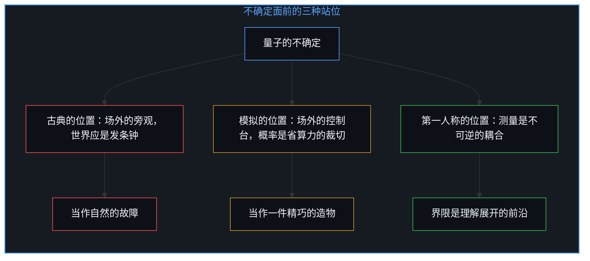
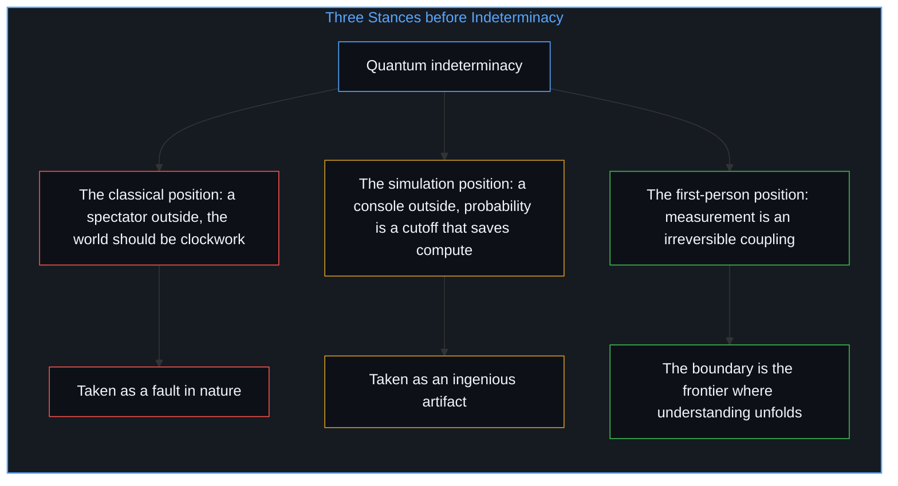
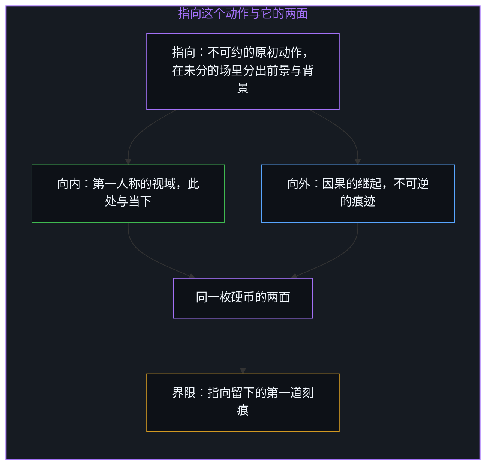
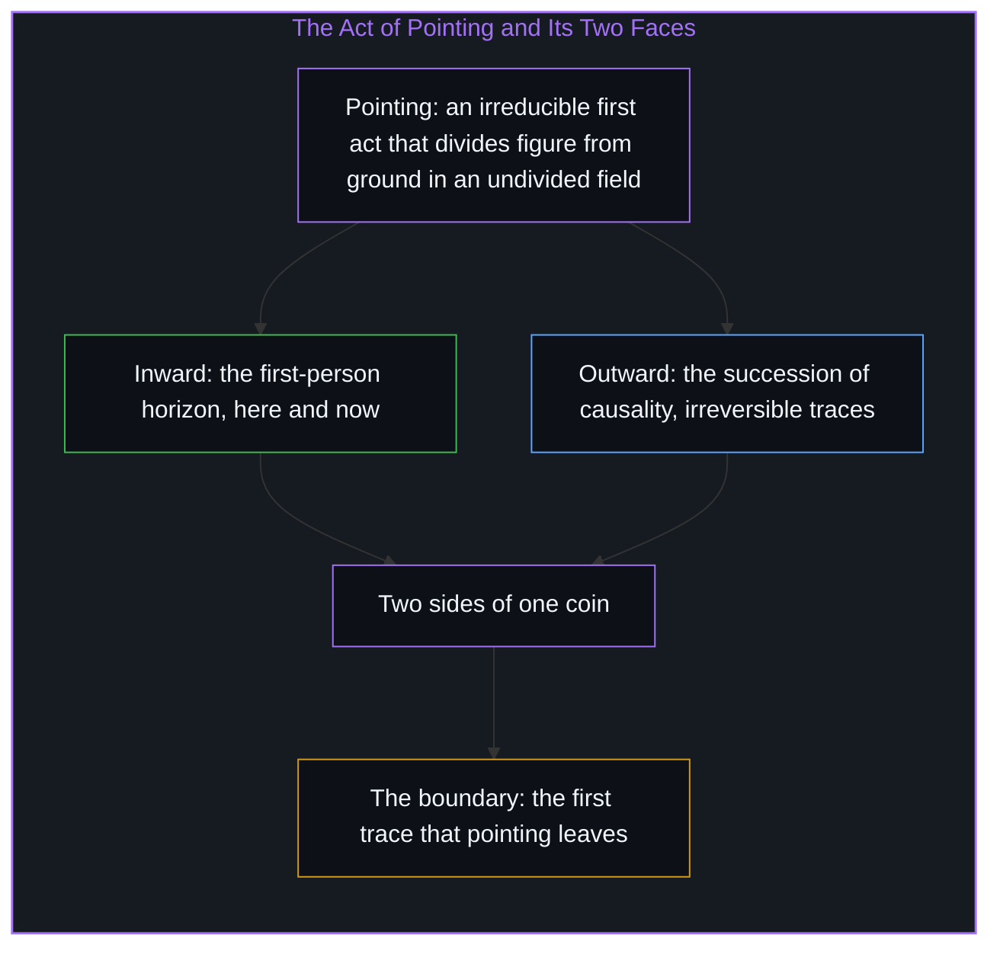
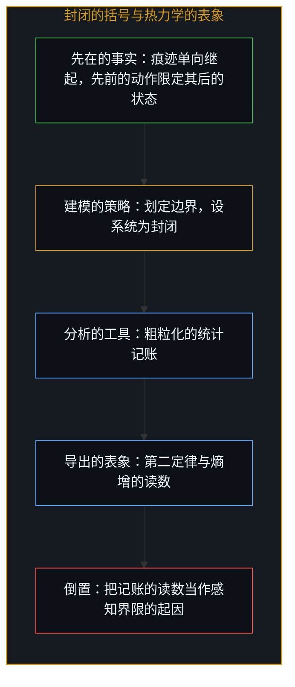
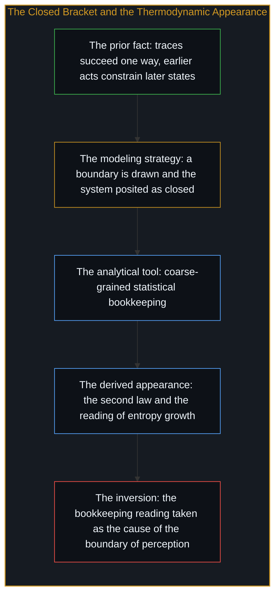
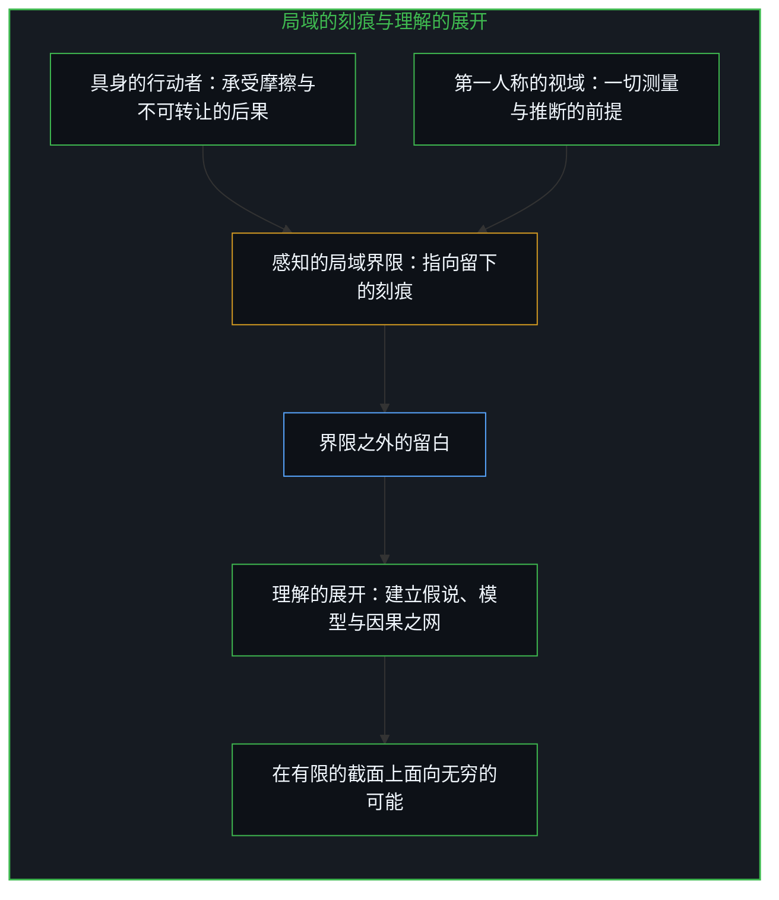
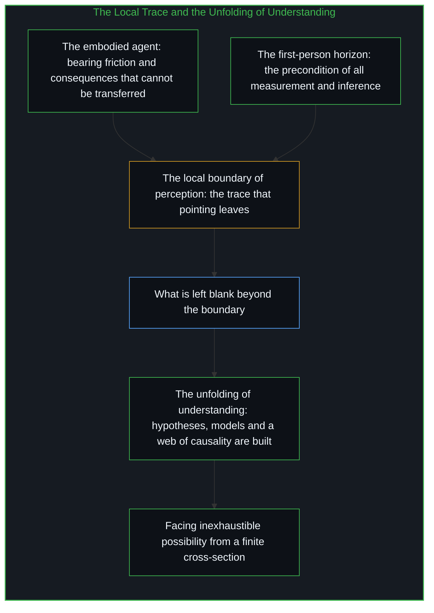

# 感知的界限与理解的无限 / The Boundary of Perception and the Infinity of Understanding

*指向必有所分，感知的界限是这一分的刻痕，理解由此展开 / To point is to divide, the boundary of perception is the trace of that division, and understanding unfolds from it*

量子力学里的不确定，可以在三个位置上被接住：把它当作自然的故障，把它当作模拟器省算力的裁切，或者把它认作内嵌于世界的认知者发起测量时留下的刻痕。前两个位置都预设了一条站在场外的视线。从第一人称的位置去找，找不到一个可以被独立指到的本体，找到的是指向这个动作：向内是第一人称的视域，向外是因果的继起。指向必有所分，感知的界限是这一分的刻痕，理解在界限之外展开。

The indeterminacy of quantum mechanics can be received from three positions: as a fault in nature, as the cutoff by which a simulator saves compute, or as the trace left when a knower embedded in the world initiates a measurement. The first two positions both presuppose a line of sight standing outside the scene. A search from the first-person position finds no ontology that can be pointed to on its own; it finds the act of pointing: inwardly the first-person horizon, outwardly the succession of causality. To point is to divide, the boundary of perception is the trace of that division, and understanding unfolds beyond the boundary.

## 一、 不确定面前的三种站位 / 1. Three Stances before Indeterminacy

微观的量子现象与经典决定论不合，对此流传着三种回应。第一种是古典写实的位置：面对叠加态与测量时的坍缩，感到理智失灵，因为世界理应像一座严丝合缝的发条钟，观察者是在场外的包厢里掀开幕布的观众。第二种是数字工程的位置：把微观的概率看作一台超级模拟器的优化策略，波函数的演化类似游戏引擎在玩家视线之外的惰性求值与视锥剔除。两种姿态看似相反，底下是同一个预设：一条居高临下的“无视角之视线”，现实被客体化为一座独立于认知动作之外的现成剧场或运转中的程序。

Microscopic quantum phenomena do not agree with classical determinism, and three responses to this are in circulation. The first is the position of classical realism: faced with superposition and collapse on measurement, reason feels itself fail, because the world ought to be like a seamless clockwork, with the observer a spectator lifting the curtain from a box outside the scene. The second is the position of digital engineering: microscopic probability is seen as the optimization strategy of a vast simulator, and the evolution of the wavefunction resembles a game engine's lazy evaluation and frustum culling beyond the player's line of sight. The two postures look opposed, and beneath them lies one presupposition: a "view from nowhere" looking down from above, with reality objectified into a ready-made theater or a running program independent of the act of knowing.

放下旁观的预设、站回参与其中的观察者的位置，第三种站位就出现了：感知的界限是理解的无限潜能的另一面。测量在这里是一次不可逆的耦合，不是被动的旁观。古典的位置要求不经相互作用的无限分辨率，模拟的位置把宇宙看作场外的程序员写下的代码；第一人称的位置认出，量子的界限标出的是有限的感知工具与理论推演的生成空间相接的那条前沿。

When the presupposition of the spectator is set down and the position of an observer who takes part is resumed, a third stance appears: the boundary of perception is the other side of the infinite potential of understanding. Measurement here is an irreversible coupling, not passive witnessing. The classical position asks for infinite resolution without interaction, and the simulation position sees the cosmos as code written by a programmer outside the scene; the first-person position recognizes that the quantum boundary marks the frontier where the finite instrument of perception meets the generative space of theoretical reasoning.

[抉择本身并不沉重](../choice-itself-has-no-inherent-weight/)与[因果的自反性与物理的无源假定](../causality-is-irreducible-the-physical-is-a-view-from-nowhere/)剖析过，把观察者从因果的舞台上抹去，抹去的一步会回到抹的人身上。古典的位置要的是一个不必由自己承担观察之责的现成世界，模拟的位置用一位造物者的故事盖住了自己作为观察者的在场。面对海森堡不确定性原理与贝尔不等式的检验，两种回避都撑不住。回到那个正在测量、正在记录、正在承受推论后果的第一人称的立足点，量子的不确定就从一场危机转成认知自主的起点。

[Choice Itself Has No Inherent Weight](../choice-itself-has-no-inherent-weight/) and [Causality is Irreducible; The Physical is a View from Nowhere](../causality-is-irreducible-the-physical-is-a-view-from-nowhere/) have shown that when the observer is erased from the causal stage, the step of erasing returns upon the one who erases. The classical position wants a ready-made world in which the responsibility of observing need not be borne, and the simulation position covers its own presence as observer with the story of a maker. Before the Heisenberg uncertainty principle and the tests of Bell's inequality, neither evasion holds. On returning to the first-person footing, the one that is measuring, recording and bearing the consequences of inference, quantum indeterminacy turns from a crisis into the starting point of cognitive autonomy.

## 二、 指向这个动作 / 2. The Act of Pointing

形而上学长久的诱惑，是越过认识的边界去抓住一个脱开一切知觉而独立固存的“终极本体”。机械唯物论的微粒碰撞与唯心论的先验实体都预设：可以伸出一根不受干扰的概念的手指，点中那个称为客观存在的基座。这个要求在结构上自相抵触：凡被辨识、测量、命名的对象，都已在特定的符号体系与实验约束之内。找不到一个可以被确定指到的独立本体；在经验与理性相交之处，发生着的是指向这个动作。

The long temptation of metaphysics is to cross the boundary of knowing and seize an "ultimate ontology" that subsists on its own, detached from all perception. The particle collisions of mechanical materialism and the transcendental entities of idealism both presuppose that an undisturbed conceptual finger can be extended to touch the base called objective existence. The demand contradicts itself in its structure: whatever object is identified, measured or named is already within a particular system of symbols and a particular set of experimental constraints. No standalone ontology that can be definitely pointed to is found; where experience and reason meet, what is occurring is the act of pointing.

指向是一个不可分的动作，在两个面上显出：向内体认，是第一人称的视域；向外投射，是因果。这不是两样在空间里相碰的东西，是同一个动作的内与外。第一人称的视域给出意向的焦点，给出此处与当下，没有它，前景与背景分不出来。因果是同一个指向在时间里刻下的结构：每一次动作不可逆地限定其后的可能，留下一条不对称的后果之迹。去掉第一人称，因果只剩一套没有起点的关系句法；去掉因果，第一人称成了一个碰不到阻力的唯我的影子。

Pointing is one indivisible act that shows on two faces: taken inwardly it is the first-person horizon; projected outwardly it is causality. These are not two things colliding in space but the inside and the outside of one act. The first-person horizon gives the focus of intention, the here and the now, without which figure and ground could not be told apart. Causality is the structure the same pointing inscribes in time: each act irreversibly constrains the possibilities that follow and leaves an asymmetric trail of consequences. With the first person removed, causality is left as a relational syntax without an origin; with causality removed, the first person becomes a solipsistic shadow that touches no resistance.

指向在几何上是一次切分。指向一个目标，其余的维度就留在未被聚焦的暗处；选择测量粒子的位置，按算符的对易关系就放下了对动量的精确追踪。所谓感知的界限，因此不是某个外部实体立下的禁令，而是“发起指向”这个动作去不掉的几何副产物；界限落在哪里，是指向者的抉择，[割点可移不可除](../the-cut-moves-but-never-vanishes/)说明割点可以移动，却不会消失。[主体性不曾涌现](../agency-does-not-arise/)阐述过，没有界限的知觉等于没有知觉，一幅包含一切而无差别的平滑全景给不出任何信息。界限是指向留下的第一道刻痕，它确立了第一人称，并在刻痕的两侧分出局域的知觉经验与辽阔的未知。

Geometrically, pointing is a division. To point at one target leaves the remaining dimensions in an unfocused dark; to choose to measure a particle's position is, by the commutation relations of the operators, to set down the exact tracking of its momentum. What is called the boundary of perception is therefore not a prohibition laid down by some outside entity but the geometric by-product that the act of "initiating a pointing" cannot shed; where the boundary falls is the choice of the one who points, and [The Cut Moves but Never Vanishes](../the-cut-moves-but-never-vanishes/) shows that the cut can be moved and does not disappear. [Agency Does Not Arise](../agency-does-not-arise/) has set out that perception without a boundary equals no perception, since a smooth panorama that contains everything without difference yields no information. The boundary is the first trace that pointing leaves; it establishes the first person, and on the two sides of the trace it parts local perceptual experience from a wide unknown.

指向还在每一个确定性的模型内部留下一个不易察觉的位置。[没有固定者的固定](../fixed-by-nothing/)展开过：任何确定性的描述都依赖一个它自己生成不了的初始条件；选这个系统、这个尺度、这组变量、这个起点，正是建模者的指向被放进模型、随后被忘掉的地方。规则可以从起点严格地推演，却推不出起点；这个不被系统内任何东西固定的给定，相对于模型是未被决定的。决定论的模型在它的范围内可靠，它是建立在这个未决的给定之上的一段借来的闭合，不是指向之外一座自足的钟表。

Pointing also leaves, inside every deterministic model, a place that is easily overlooked. [Fixed by Nothing](../fixed-by-nothing/) has developed this: every deterministic description depends on an initial condition it cannot generate itself; choosing this system, this scale, these variables and this starting point is exactly where the modeler's pointing was put into the model and then forgotten. The rule can deduce rigorously from the starting point and cannot deduce the starting point; this given, fixed by nothing within the system, is undetermined relative to the model. A deterministic model is reliable within its range, and it is a borrowed closure resting on this undetermined given, not a self-sufficient clockwork standing outside the pointing.

## 三、 封闭的括号与热力学的表象 / 3. The Closed Bracket and the Thermodynamic Appearance

为感知的界限找客观的解释时，最常被征引的是热力学：测量伴随能量的耗散与熵的增加，所以观察者的感知受热力学定律的约束。热力学在它的范围内极有用，热机、制冷与化学平衡都靠它算准。这个论证的问题在次序：它把一个导出的表象当作了起因。[时间之箭的伪悖论与对称模拟的边界](../the-mirage-of-times-arrow-and-the-boundaries-of-simulation/)拆解过，热力学从一开始就立在一个人为的假定上：所考察的场域可以划成一个边界隔绝、不与外部交换质量与能量的封闭系统；第二定律是在这个方法的预设之下导出的宏观统计表象。

When an objective explanation is sought for the boundary of perception, thermodynamics is what is most often cited: measurement is accompanied by the dissipation of energy and the increase of entropy, and so the observer's perception is bound by thermodynamic law. Within its range thermodynamics is extremely useful; heat engines, refrigeration and chemical equilibrium are all computed by it. The trouble with the argument is its order: it takes a derived appearance for the originating cause. [The Mirage of Time's Arrow and the Boundaries of Symmetric Simulation](../the-mirage-of-times-arrow-and-the-boundaries-of-simulation/) has taken this apart: from the beginning thermodynamics has stood on an artificial assumption, that the field under study can be marked off as a closed system with an isolating boundary that exchanges neither mass nor energy with what is outside; the second law is a macroscopic statistical appearance derived under this presupposition of method.

因果先于热力学。每一次宏观的观察都立在一件事上：先前的介入不可逆地限定其后的状态，痕迹的分布因此不对称。把这种不可逆的因果投到“封闭系统”这个抽象的前提上，又因为追踪不了每一个微观自由度而用统计的粗粒化来记账，构型向概率最大处的扩散就显为熵的增长。说热力学规定了感知的界限，是循环的：热力学之所以有，正因为一个分辨率有限的观察者在一个设为封闭的流形上作统计的记账。把观察者的认知界限说成热耗散的副产物，是让脚手架的影子去生出搭脚手架的心智。

Causality comes before thermodynamics. Every macroscopic observation stands on one thing: an earlier intervention irreversibly constrains the states that follow, and so the distribution of traces is asymmetric. When this irreversible causality is projected onto the abstract premise of a "closed system," and statistical coarse-graining is used for the bookkeeping because each microscopic degree of freedom cannot be tracked, the spreading of configurations toward the most probable appears as the growth of entropy. To say that thermodynamics sets the boundary of perception is circular: there is thermodynamics at all because an observer of finite resolution does statistical bookkeeping on a manifold posited as closed. To call the observer's cognitive boundary a by-product of heat dissipation is to have the shadow of a scaffold bring forth the Mind that put the scaffold up.

[“普通人视角”的解释陷阱](../the-explanatory-trap-of-the-ordinary-perspective/)指出，统计是帮助心智理解微观聚合表象的脚手架，不是世界的属性。找不到宇宙外面一堵隔热的墙，也找不到一位站在容器之外测量全局状态的记录员。把实验室容器里的记账规则不加审视地推到整个存在上，在物理学内部造出了需要额外假设去修补的宇宙学低熵问题。认出热力学是表象之后，感知的局域界限便不必归给熵增；界限的来处不在能量的损耗，而在有限的指向者介入无穷的现实时免不了的几何构型。

[The Explanatory Trap of the "Ordinary Perspective"](../the-explanatory-trap-of-the-ordinary-perspective/) points out that statistics is a scaffold that helps a Mind understand the appearance of microscopic aggregates, not a property of the world. No heat-insulating wall is found outside the cosmos, and no recorder is found standing outside the container measuring the global state. Extending the bookkeeping rules of a laboratory container, unexamined, to the whole of existence produces within physics the cosmological low-entropy problem that needs further assumptions to mend. Once thermodynamics is recognized as an appearance, the local boundary of perception need not be assigned to entropy growth; the boundary comes not from the loss of energy but from the geometric configuration that cannot be avoided when a finite one who points enters an inexhaustible reality.

## 四、 局域的刻痕与理解的展开 / 4. The Local Trace and the Unfolding of Understanding

一切论述里最不该被藏起或抽象掉的，是那个正在思考与决断的第一人称。它有时被构造成没有肉身的先验统觉，有时被缩成可替换的神经算法。在因果的世界里它有双重的同一：它是有具体的生命轨迹、在世界里承受摩擦并自负不可转让之后果的行动者，也是一切测量、推理与概念建模得以展开的视域本身。[意识的魔术戏法与推断的非对称性](../the-sleight-of-hand-of-consciousness-and-the-asymmetry-of-inference/)与[抽象的苦难与真实的饥饿](../abstract-pain-and-living-hunger/)阐明过，正是这个具身的第一人称，以代谢的负担与生存的抉择，使机械决定论的自洽合不上。

What should least be hidden or abstracted away in any discourse is the first person who is thinking and deciding. It is sometimes constructed as a transcendental apperception without a body and sometimes shrunk to a replaceable neural algorithm. In the causal world it has a double identity: it is the agent with a particular course of life, bearing friction in the world and answering for consequences that cannot be transferred, and it is the horizon itself within which all measurement, reasoning and conceptual modeling unfold. [The Sleight of Hand of Consciousness and the Asymmetry of Inference](../the-sleight-of-hand-of-consciousness-and-the-asymmetry-of-inference/) and [Abstract Pain and Living Hunger](../abstract-pain-and-living-hunger/) have made clear that it is this embodied first person who, with the burden of metabolism and the choices of survival, keeps the self-consistency of mechanical determinism from closing.

站在这个立足点上，可以看清为何感知的界限是理解潜能的另一面。设想一张没有任何阻碍的全知的视网膜：宇宙所有的微观自由度在一瞬间以无限的精度灌入感官，“理解”这个动作就没有必要了。没有留白，就不需要概念的抽象；没有阻隔，就不需要因果的假说；没有不确定，心智退成一块感光板。全知的感官不催生智慧，它终结智慧。正因为感知止于特定的局域截面，心智才走出感官的被动接收，在未见之域里建立几何、构想定律、发射探测器、迭代认知的模型。

From this footing it becomes clear why the boundary of perception is the other side of the potential of understanding. Imagine an all-knowing retina with no obstruction at all: every microscopic degree of freedom in the cosmos pours into the senses in an instant with infinite precision, and the act of "understanding" is no longer needed. With nothing left blank, no conceptual abstraction is needed; with no barrier, no causal hypothesis is needed; with no indeterminacy, a Mind falls back into a photographic plate. All-knowing senses do not bring forth wisdom; they end it. Because perception stops at a particular local cross-section, a Mind steps out of the passive reception of the senses and, in the region not seen, builds geometry, conceives laws, launches probes and iterates its models of knowing.

感知的界限是第一人称在此处与当下的定锚，理解的无限是心智向彼处与未来的开辟；两者是同一个生命运动在不同维度上的显影。微观的不确定没有关上理性的路，它使“主体是一枚齿轮”的机械图景合不上，开放与创造留在每一个不可约的第一人称那里。站在感知清晰的边缘，面前是由不确定守着的辽阔的未知；心智以不断更迭的因果模型，在那里写下它对存在的体认。

The boundary of perception is the anchoring of the first person in the here and now, and the infinity of understanding is the opening a Mind makes toward the there and the future; the two are one movement of life showing on different dimensions. Microscopic indeterminacy has not closed the road of reason; it keeps the mechanical picture in which "the subject is a cog" from closing, and openness and creation remain with each irreducible first person. Standing at the clear edge of perception, what lies ahead is a wide unknown kept by indeterminacy; there a Mind, with causal models that keep being renewed, writes down its recognition of existence.
