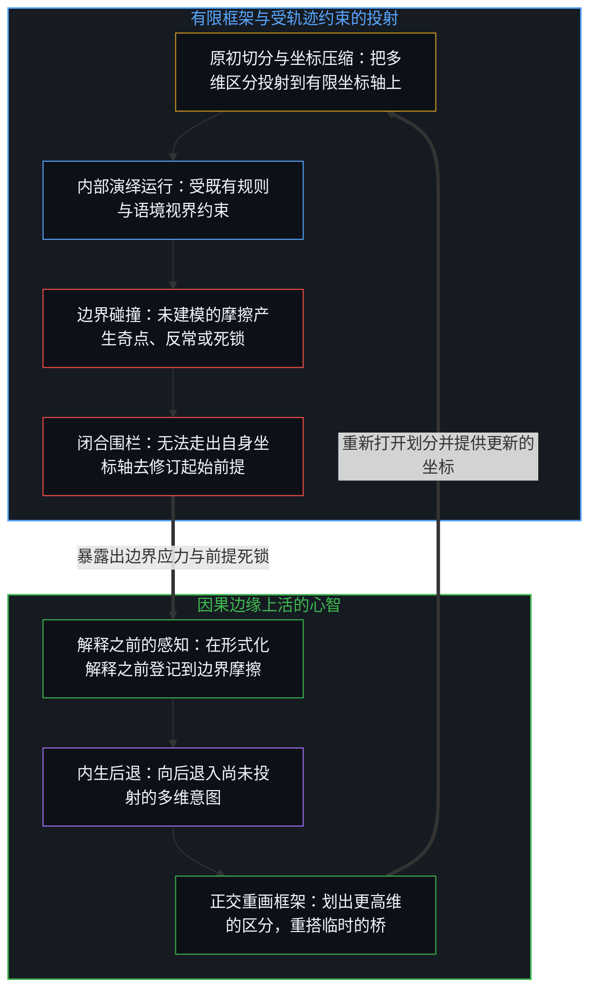
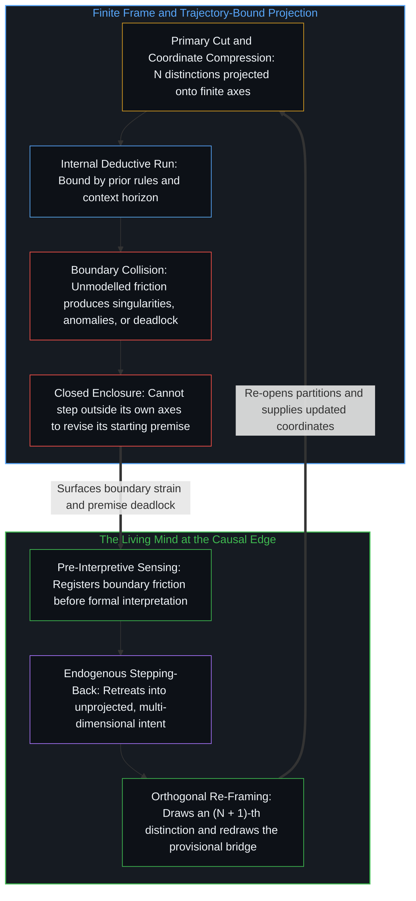

# 框架的边界 / The Boundary of the Frame

*理论是一次有限的切分，一旦观察者从其中隐去，它就硬化成教条 / A theory is a finite cut that hardens into dogma when its observer drops out*

分析一个理论体系，不一定是去争它内部的逻辑，也不是去否认它在局部的用处。这里追溯的是造理论这件事本身的结构，包括抽象怎样生成，它的操作有效性从哪里开始、到哪里结束，以及任何形式化框架都绕不开的边界。每一个理论，无论属于哪个领域，都是一个有限的观察者造出的有限器物；所以这里不批评哪一个具体的体系，而是追溯一切理论知识共有的拓扑。

To analyse a theoretical system is not necessarily to dispute its internal logic or deny its local use. What is traced here is the structure of theory-making itself, including how abstractions are generated, where their operational validity begins and ends, and the boundaries no formal framework can get around. Every theory, in whatever domain, is a finite artifact built by a finite observer; so no particular system is criticised here, and what is traced is the topology all theoretical knowledge shares.

## 一、 启发的弧 / 1. The Heuristic Arc

理论的生成不从对原始现象不经中介的编目开始，它从一道直觉的弧开始。在物理、哲学与认知建模里，理解都是从一个结果走向一个在先的约束。观察者注意到一个持续的模式、一个显眼的规律，或一处尖锐的不协调，为了让它可以理解，认知向后倒推，反向推出最少的一组初始约束与结构定义，使所见的行为变得可预测、自洽。

The generation of theory does not begin with an unmediated cataloguing of raw phenomena; it begins with an intuitive arc. In physics, philosophy and cognitive modelling alike, sense-making moves from an effect toward an antecedent constraint. An observer notices a persistent pattern, a salient regularity or a sharp dissonance, and to make it intelligible cognition works backward, reverse-engineering the smallest set of initial constraints and structural definitions that makes the observed behaviour predictable and coherent.

这种反向推出的启发法不是该回避的方法，它是抽象共有的认知引擎。一个有限的观察者每一步登记到的区分都是有限的，而还能再区分的始终敞开；所以观察者采样、过滤、浓缩。于是一个形式理论是一套造出来的坐标系，它的公理、定义与操作方式之所以被选中，是因为它们把一组特定的初始条件成功地接到一组自洽的可观察结果上。形式推导验证的，是这座桥按自己的规则搭得一致；它立不立得住，要到预测碰上因果的链条时才见分晓。

This backward-engineered heuristic is not a method to avoid; it is the cognitive engine all abstraction shares. A finite observer registers a finite set of distinctions at each step, while what can still be distinguished stays open; so the observer samples, filters and condenses. A formal theory is then an engineered coordinate system whose axioms, definitions and operating modes are chosen because they successfully join a specific set of initial conditions to a coherent set of observable outcomes. Formal derivation checks that the bridge is built consistently by its own rules; whether it holds is settled only where prediction meets the chain of cause and effect.

## 二、 原初的切分 / 2. The Primary Cut

任何思想体系要断言一个具体的命题，先得借由一次原初的切分划出边界。信息要有对比，对比要有区分，[信息是什么](../what-information-is/)就从这里讲起。要谈一个对象，就得有一条边界把它与环境分开；要谈一个原因，就得把一次相互作用界定在时间之中，而这个时间维度本身是心智造出的投影，不是活着所遇到的时间，[时间是因果的不可逆方向与离散步长](../time-is-causality-not-a-dimension/)追溯过这一层。要建立任何分类，二分的、三分的或多维的，都得把因果相继把握成可辨认的状态，投下[切分的三重影子](../the-three-shadows-of-the-cut/)所分析的那些结构之影。

For any system of thought to assert a specific proposition, it must first draw a boundary through a primary cut. Information needs contrast, and contrast needs distinction, which is where [What Information Is](../what-information-is/) begins. To speak of an object, a boundary must separate it from an environment; to speak of a cause, an interaction must be bounded in time, and that dimension of time is itself a projection the Mind builds rather than lived time, a layer traced in [Time Is the Irreversible Direction and Discrete Step of Causality](../time-is-causality-not-a-dimension/). To set up any taxonomy, dual, triadic or many-dimensional, causal succession has to be held as identifiable states, casting the structural shadows analysed in [The Three Shadows of the Cut](../the-three-shadows-of-the-cut/).

由此有一条直接的建模原则：让一个理论可以被理解的条件，正是限定它适用范围的那个动作。原初的切分把一块关注的领域从更广的因果背景中割出来；边界之内的变量被追踪、形式化、彼此关联，边界之外无边的因果网络则被固定不动，当作噪声，或归为不变的常数。所以一个理论的公理描述的不是无条件的现实，而是被切出来的那块空间的内部规则。

From this follows a direct principle of modelling: the condition that makes a theory intelligible is the very act that limits its scope. The primary cut isolates a domain of interest by severing it from the wider causal background; the variables inside the boundary are tracked, formalised and related, while the boundless causal web outside is held fixed, treated as noise or filed as an invariant constant. So a theory's axioms do not describe unconditioned reality; they describe the internal rules of the space that was cut out.

## 三、 局部的有效 / 3. Local Validity

每一次划界都隔出一个特定的尺度与语境，所以理论的有效性依赖尺度。看结构工程中局部参照系的几何：对一栋单体建筑来说，把地面当作欧几里得平面不是错误的信念，而是一个计算上精确、非常好用的操作模型。它好用，是因为建筑的尺度比地球半径小好几个数量级。地球更好的模型是一个扁球体，再细一层，是不规则的大地水准面，这并不让平面模型变错，它有局部的有效性。在一栋建筑的尺度上，平面在功能上是精确而简单的；只有到了行星的尺度，弯曲的模型，先是参考椭球，再是大地水准面，才在结构上成为必需，代价是更复杂。

Because every boundary isolates a particular scale and context, theoretical validity depends on scale. Consider the geometry of local reference frames in structural engineering: for a single building, treating the ground as a Euclidean plane is not a mistaken belief but a computationally precise and highly useful operating model. It works because the building is several orders of magnitude smaller than the radius of the Earth. That the Earth is better modelled as an oblate spheroid, and more finely as the irregular geoid, does not make the flat model wrong; it has local validity. At the scale of a building the plane is functionally exact and simple, and only at the scale of the planet does a curved model, first the reference ellipsoid and then the geoid, become structurally necessary, at the cost of more complexity.

错误不出在用平面，而出在忘了操作的边界，这正是[遗忘的脚手架](../the-scaffolding-we-forget/)所分析的那种遗忘。一个局部的启发法[被外推到它校准的范围之外](../an-observation-by-its-own-standard/)，被当作脱离语境的普遍本体时，就会与它地平线之外的现象相冲突。每一个严谨的模型都有一条操作的地平线：在校准的范围内，它的边界条件成立，预测可靠；进入过渡地带，被忽略的背景变量开始有足够的影响，扰动内部的推导；再往外，起始的公理不借临时的补丁，就再也接不上底下的机制。

The error lies not in using the plane but in forgetting the operating boundary, the very forgetting analysed in [The Scaffolding We Forget](../the-scaffolding-we-forget/). When a local heuristic is [extrapolated beyond the range it was calibrated for](../an-observation-by-its-own-standard/) and treated as a context-free, universal ontology, it collides with the phenomena beyond its horizon. Every rigorous model has an operating horizon: within its calibrated scope its boundary conditions hold and its predictions are reliable; in the zone of transition the neglected background variables gain enough influence to disturb its internal derivations; further out, the starting axioms can no longer meet the underlying mechanics without ad hoc patches.

## 四、 奇点与视界 / 4. Singularities and Horizons

这条原则不只适用于简单的工程近似，也适用于人类最精密的数学框架，爱因斯坦的狭义与广义相对论。广义相对论把引力表示为连续的伪黎曼时空流形的弯曲，对行星轨道、引力透镜与卫星时钟的时间膨胀给出了惊人精确的预测；在校准的范围内，它的局部有效性无可挑剔。出问题的地方不在方程，而在把一个操作模型转成一个包揽一切的教条：把时空的光滑连续体当成现实的织物本身，而不是一个造出来的模型，方程在操作地平线之外的输出，就被读成了关于这块织物的事实。[心智的几何学](../the-geometry-of-mind/)在被读作存在本身的静态块状宇宙里看到的正是同一步，即把一个造出来的数学表征，当成了存在那动态的、自指的运行。

The principle applies not only to simple engineering approximations but also to the most refined mathematical frameworks people have built, Einstein's special and general relativity. General relativity represents gravitation as the curvature of a continuous pseudo-Riemannian spacetime manifold and gives astonishingly precise predictions for planetary orbits, gravitational lensing and the time dilation of satellite clocks; within its calibrated scope its local validity is beyond reproach. The trouble lies not in the equations but in turning an operating model into an all-encompassing dogma: when the smooth continuum of spacetime is taken for the fabric of reality itself rather than an engineered model, what the equations output past their operating horizon gets read as a fact about that fabric. [The Geometry of Mind](../the-geometry-of-mind/) sees the same step in the static block universe read as existence itself, where an engineered mathematical representation is taken for the dynamic, self-referring running of existence.

推过了头，数学上就出现奇点。把场方程外推到坍缩恒星的中心，得到一个密度与曲率都无穷大的点，r = 0；沿连续的经典测地线把宇宙膨胀倒推回去，得到一个体积为零、温度与曲率无穷大的时间起点，t = 0。无穷从未被登记到；一个奇点不是地形里的一件东西，而是理论在报告自己的解在哪里走到了头。当曲率这类不随坐标改变的量算出无穷大时，崩掉的是理论框架自己；这个框架是经典的，它把时空当作光滑的、可以无限分割的连续体，略去了量子的动态，也略去了因果的任何离散步长。把“物理定律在此失效”读成关于黑洞中心或宇宙最初一刻的报告，而不是关于定律本身的报告，是把地图当成了地形；没有任何被登记到的东西显示因果在那里断开，断开的是在未经校准的应力下的数学模型。

Pushed too far, the mathematics produces singularities. Extrapolating the field equations to the centre of a collapsed star yields a point of infinite density and curvature, r = 0; running cosmic expansion backward along continuous classical geodesics yields a temporal origin of zero volume and infinite temperature and curvature, t = 0. No infinity has ever been registered; a singularity is not a thing in the terrain but the theory reporting where its own solutions stop. When an invariant quantity such as curvature comes out infinite, what has broken is the theoretical frame itself; the frame is classical, treating spacetime as a smooth, endlessly divisible continuum and leaving out quantum dynamics and any discrete step of causality. Reading "the laws of physics break down" as a report about the centre of a black hole or the first instant, rather than about the laws, takes the map for the terrain; nothing registered shows causality breaking there, and what breaks is a mathematical model under uncalibrated strain.

大众说法里的“宇宙边缘”也是这样。宇宙学所说的粒子视界，是在模型往回数到它自己的起点的那段时间里，光最远能从多远到达这里的那条界线；它是此刻可观测范围的因果边缘，并且随时间不断后退，而登记光的仪器实际所及，只到它内侧不远的宇宙微波背景为止；所以它标出的是此刻这次登记所及的范围，而不是宇宙本身的周界。把望远镜的视界当成现实的边界，就像从窗框看出去，把窗框当成了天空的尽头。被当成整个寄存器的本地窗口，是同一种框架边界，[寄存器的算术](../the-arithmetic-of-the-register/)追溯的正是这一处。

The same holds for the "edge of the universe" in popular talk. What cosmology calls the particle horizon is the greatest distance from which light could have reached here in the time the model counts back to its own start; it is the present causal edge of what could be observed, and it recedes as time passes, while instruments that register light in fact reach only out to the cosmic microwave background just inside it, so it marks the reach of this registration now rather than the perimeter of the universe itself. Taking the telescope's horizon for the boundary of reality is like looking through a window and taking the window frame for the end of the sky. A local window taken for the whole register is a frame boundary of the same kind, the place traced in [The Arithmetic of the Register](../the-arithmetic-of-the-register/).

## 五、 观察者的豁免 / 5. The Observer's Exemption

任何理论框架里最难形式化的边界，是框住这个框架作者的那一条。一个形式系统由规则、变换与元素组成，却没有手段从内部为产生它自己公理的那段物理、生物与认知的历史建模。理论家总站在一个隐含的位置上：模型的规则适用于框内划出的地形，而选择把框放在哪里的那个动作，并不在框里被登记，它总比框所装下的走在前面一步。这是形式化知识普遍的限度。一件仪器在充当测量工具的同时，无法完整测量自己的构造；观察与分类本身是因果相继之中的事件，得出的地图却把它的类别当成静态的、事先存在的实体。

The hardest boundary to formalise in any theoretical framework is the one that contains the framework's author. A formal system consists of rules, transformations and elements, yet it lacks the means to model from within the physical, biological and cognitive history that produced its own axioms. The theorist always stands at an implicit position: the model's rules apply to the terrain marked inside the frame, while the act that chose where to put the frame is not registered inside it and stays one step ahead of what the frame holds. This is a general limit of formalised knowledge. An instrument cannot fully measure its own construction while serving as the measuring device; observation and classification are themselves events within causal succession, yet the resulting map treats its categories as static, pre-existing entities.

一个框架不明确交代自己的观察者，也不交代起始边界放在哪里是一个选择时，就产生一个客观的、包揽一切的根基的幻觉，假装占着那个不可能的“无处之见”，也就是[无穷总体的海市蜃楼](../the-mirage-of-the-infinite-totality/)在完成的无穷一例上拆开的那个站在经验之外的位置。公理被经验为不证自明的定律，而不是它们原本的样子：一组造出来的、有选择的约束。就像一个从圆形望远镜舷窗往外看的人，会把镜筒的黄铜边缘当成宇宙的外界，理论建模也会把当前的观测地平线当成存在的边界，忘了每一张坐标网格都锚定在做观察的那个心智的具体位置上。

When a framework accounts neither for its own observer nor for the placement of its starting boundary as a choice, it produces the illusion of an objective, all-encompassing ground, pretending to occupy the impossible "view from nowhere", the same stand outside experience that [The Mirage of the Infinite Totality](../the-mirage-of-the-infinite-totality/) takes apart in the case of a completed infinity. The axioms are experienced as self-evident laws rather than as what they are: an engineered set of selective constraints. Just as someone looking out through the round porthole of a telescope might take the brass rim of the lens for the outer edge of the cosmos, theoretical modelling can take the present observational horizon for the boundary of existence, forgetting that every coordinate grid stays anchored to the particular position of the Mind doing the observing.

## 六、 活的工具与静止的体系 / 6. The Live Instrument and the Static System

一个理论体系形式化并被共享之后，会沿两条路之一走下去，取决于用它的心智怎样对待它的边界。两条路的起点相同：一道直觉或一次观察，反向推出的切分，形式系统与推导。一条路上，框架把公理当作临时的坐标，明确写下初始条件，主动标出自己会在哪里失效。遇到违背其推导的反常或微观现象时，它不扭曲现象去迎合模型的语言，而是调整边界，承认一个未建模的变量进来了，或者向不可化约的因果链更深处走去，奠定新的基础。这样的框架始终是活的工具，因为边界上的应力一被登记，它的划分就被重新打开，而不是被当成地形守住。

Once a theoretical system is formalised and shared, it goes down one of two paths, depending on how the Mind using it treats its boundaries. Both paths start the same way: an intuition or an observation, a reverse-engineered cut, a formal system and its derivations. On one path the framework treats its axioms as provisional coordinates, states its initial conditions plainly and actively marks where it will fail. Meeting an anomaly or a micro-phenomenon that defies its derivations, it does not bend the phenomenon to fit the model's language but adjusts the boundary, admits that an unmodelled variable has come in, or goes deeper toward the irreducible causal chain to lay a new foundation. Such a framework stays a live instrument because its partitions are re-opened when stress at the boundary registers, rather than held as the terrain.

另一条路上，框架冻结它的起始边界。最初的切分被抬成定则，内部的自洽被误认为覆盖了全部。正如[从可辩护的主张到教条的反转](../the-reversal-from-defensible-claim-to-dogma/)所拆解的，一个有条件的发现，会在一个指标被当作全部、这个发现的条件从说出来的话里掉出去的那一刻硬化成教条，忽略了[没有系统能被保持封闭](../no-system-can-be-kept-closed/)这一条。这样的体系容纳不了违背起始前提的现象，否则内部逻辑就会塌，于是它靠解释学的封闭来保住自洽：反常被用体系的专门词汇反复重述，直到看上去已经解决；指向起始边界的批评被引向内部的程序细节，要求先照内部推导走；框架给自己一份豁免，不让自己的规则用在自己的来历上。走到这一步，探究就不再是探究，而是在维护一个封闭的语言几何。边界只在一个选择一直握着它的时候才保持冻住，这个选择即[唯一自洽的无因之果](../the-only-coherent-uncaused-effect/)所找到的、不由前因推动而到来的那一个；不去挪动边界，就是这个选择，做出了，却没被当作选择登记下来。N 选一停在它被划出的那个框里，[闭合的N与开放的现实](../the-closed-n-and-the-open-reality/)追溯的正是这一点。

On the other path the framework freezes its starting boundary. The first cut is raised into a fixed principle, and internal coherence is mistaken for complete coverage. As taken apart in [The Reversal from Defensible Claim to Dogma](../the-reversal-from-defensible-claim-to-dogma/), a conditional finding hardens into dogma the moment one metric is held as the whole and the finding's conditions drop out of what is said, ignoring that [No System Can Be Kept Closed](../no-system-can-be-kept-closed/). Such a system cannot take in phenomena that violate its starting premises without its internal logic collapsing, so it keeps its coherence through hermeneutic enclosure: anomalies are restated in the system's own vocabulary until they look resolved; criticism aimed at the starting boundary is redirected to internal procedure, with the demand to follow the internal derivations first; and the framework grants itself an exemption from having its rules applied to its own origin. At that point inquiry is no longer inquiry but the upkeep of a closed linguistic geometry. The boundary stays frozen only while a choice keeps holding it, the choice that [The Only Coherent Uncaused Effect](../the-only-coherent-uncaused-effect/) finds arriving without an antecedent push; declining to move the boundary is that choice, made without being registered as one. Best-of-N stays inside the frame it was drawn in, as [The Closed N and the Open Reality](../the-closed-n-and-the-open-reality/) traces.

## 七、 心智与因果 / 7. Mind and Causality

追溯理论的一般限度，归结为一个认识：没有哪一次概念的切分是最终的。每一个类别、模态、三分法或公理，都是一次有条件的、局部的切分，是不停息的区分之连续中的一个动作；更广的语境或更深的尺度需要时，切分可以挪动、重画，或者整个消解。可这种可变并不让理论漂在任意的虚空里。没有哪次切分是最终的，而一切建模都系在同一枚硬币不可化约的两面上：做切分的心智，与切分要对答的因果。

Tracing the general limit of theories comes down to a single recognition: no conceptual cut is final. Every category, modality, triad or axiom is a conditional, local cut, one act in a continuum of distinguishing that does not stop; when a wider context or a deeper scale calls for it, the cut can be moved, redrawn or dissolved altogether. Yet this mutability does not leave theory floating in an arbitrary void. No cut is final, and all modelling is tied to two irreducible sides of one coin: the Mind that cuts and the causality the cut answers to.

一面是理论与之对答的因果，[因果贯穿始终](../causality-all-the-way/)追溯了这一点。命名可以随意发明，可一旦要预测、行动或干预，模型就要面对因与果的链条；不随分类而弯折的那份摩擦，是检验每一张地图、打破每一个没有根基的假设的东西。另一面是理论由之发出的心智。每一个理论都是一个观察者说出的话；在公理、类别与推导之前，先有那个做划分的、主观的位置。心智是握刀的那一个，[智能只属于心智](../intelligence-belongs-only-to-the-mind/)表明，智能只属于心智，而被造出来的是脚手架。每一个维度都是这样的一种框，正如[维度即投影](../dimensions-are-projections/)所追溯的：把彼此正交的区分压缩到有限的坐标网格上，是以牺牲自由度为代价来建立关系几何，而要界定或观察任何一个 N 维的框，都需要一个该框自身坐标轴无法容纳的第（N + 1）个区分。正如[超越投射](../beyond-the-projection/)在智能体系统架构中所揭示的，一个有限的、受轨迹约束的投射引擎在自身语境的边界之内运行，无法走出它自己的推导所推入的那个位置；而活的心智在边界处登记到解释之前的摩擦，在逻辑上向后退入尚未投射的意图，重画框架以恢复坍缩的坐标轴。

One side is the causality a theory answers to, as [Causality All the Way](../causality-all-the-way/) traces. Names can be invented at will, but the moment a model tries to predict, act or intervene, it has to face the chain of cause and effect; the friction that does not bend to classification is what tests every map and breaks every ungrounded assumption. The other side is the Mind a theory speaks from. Every theory is an utterance by an observer; before any axiom, category or derivation there is the subjective position doing the partitioning. The Mind holds the knife, and [Intelligence Belongs Only to the Mind](../intelligence-belongs-only-to-the-mind/) shows that intelligence belongs only to the Mind, and what gets engineered is scaffolding. Every dimension is a frame of this kind, as [Dimensions Are Projections](../dimensions-are-projections/) traces: compressing orthogonal distinctions onto a finite coordinate grid creates relational geometry at the cost of degrees of freedom, and bounding or observing any N-dimensional frame requires an (N + 1)-th distinction that the frame's own axes cannot contain. As [Beyond the Projection](../beyond-the-projection/) demonstrates in the architecture of agentic systems, a finite, trajectory-bound projection engine runs inside the boundary of its context and cannot step outside the position its own derivations have reasoned it into, whereas the living Mind registers pre-interpretive friction at the boundary, steps further back logically into unprojected intent, and redraws the frame to restore collapsed axes.

理论既不是现实本身，也不是纯然的幻觉，它是悬在切出它的心智与检验它的因果之间的一座临时的桥，一种瞄准用的启发，就像[翻袋球与魔术戏法](../the-bank-shot-and-the-magic-trick/)里那颗虚拟的镜像球，用来在约束之间对齐反射，却从不取代那张真实的球台。把桥当成本来就有、从未被造的东西，一辈子擦栏杆、背螺栓，是对待桥的一种姿态；把桥看作一件校准过的临时工具，乐于用它越过一道具体的峡谷，一旦对心智与因果看得更深、找到更好的过法就随时拆掉，是另一种姿态。同一个心智在不同的时候两种姿态都会取，取哪一种，是此刻这一步的选择。框是一种投影，[向量与投影的迷局](../the-vector-and-the-puzzle-of-projections/)让注意留在向量上。

A theory is neither reality itself nor mere illusion; it is a temporary bridge suspended between the Mind that cuts it and the causality that tests it, an aiming heuristic like the virtual mirror ball in [The Bank Shot and the Magic Trick](../the-bank-shot-and-the-magic-trick/), used to line up reflections across constraints without ever replacing the real table. Treating the bridge as something that was always there and never built, spending a lifetime polishing the railings and memorising the bolts, is one posture toward it; seeing the bridge as a calibrated, temporary instrument, gladly used to cross a particular chasm and taken down whenever a deeper look at Mind and causality shows a better way across, is another. The same Mind takes either posture at different times, and which one it takes is the choice at this step. A frame is a projection, and [The Vector and the Puzzle of Projections](../the-vector-and-the-puzzle-of-projections/) keeps attention on the vector.
