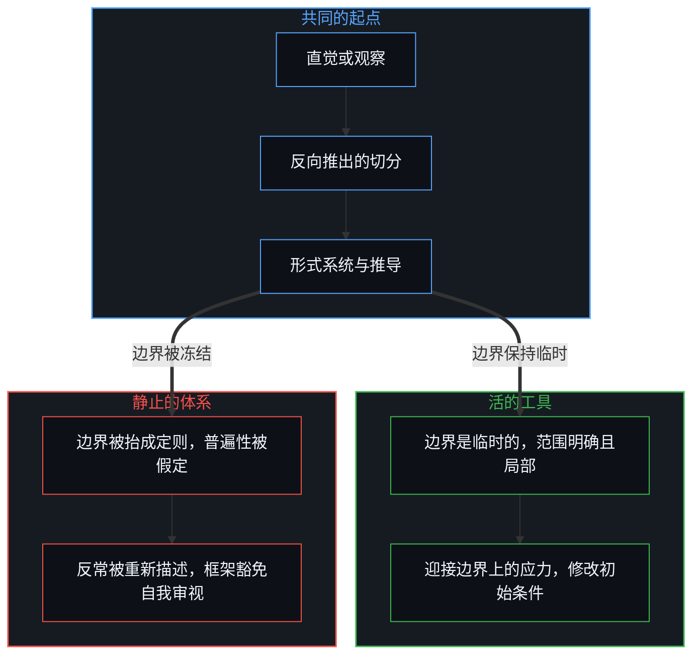
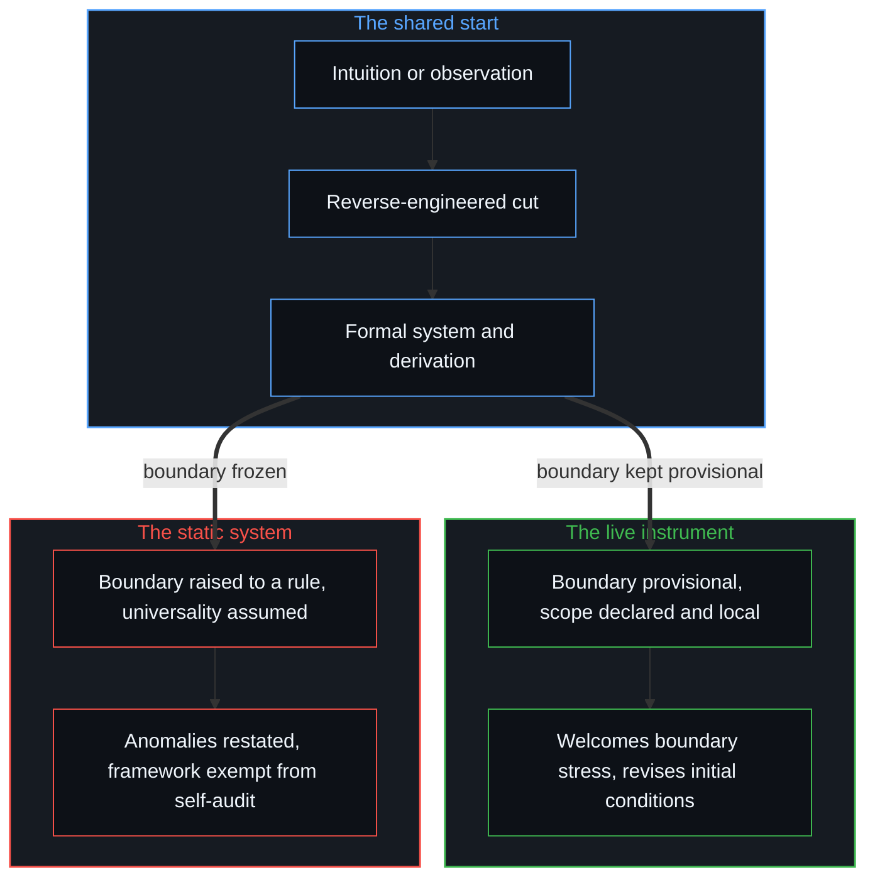
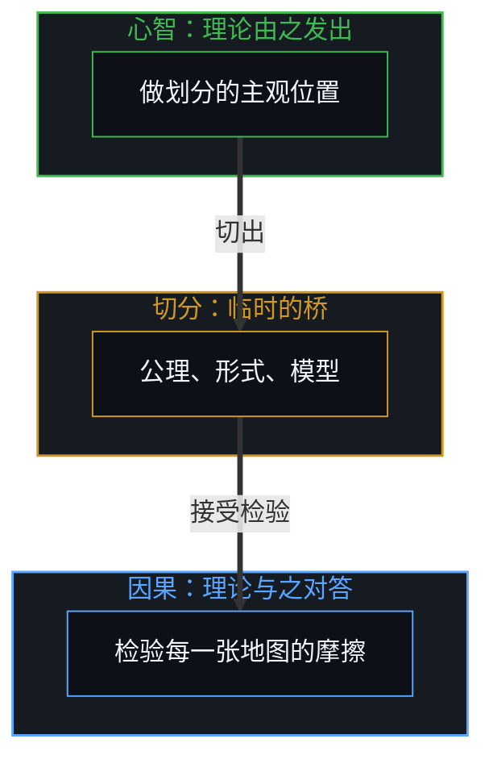
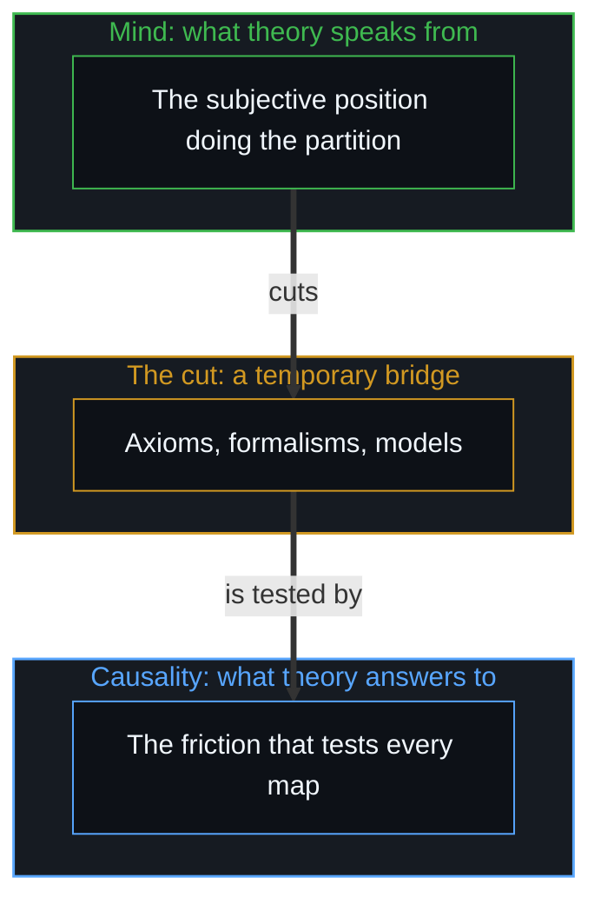

# 框架的边界 / The Boundary of the Frame

*理论是被原初切分界定的有限器物，忘了观察者与因果背景，它就硬化成教条 / A theory is a finite artifact bounded by its cut; forgetting the observer and the causal ground hardens it into dogma.*

分析一个理论体系，不一定是去争它内部的逻辑，也不是去否认它在局部的用处。这里追溯的是造理论这件事本身的结构：抽象怎样生成，它的操作有效性从哪里开始、到哪里结束，以及任何形式化框架都绕不开的边界。每一个理论，无论属于哪个领域，都是一个有限的观察者造出的有限器物；所以这里不批评哪一个具体的体系，而是追溯一切理论知识共有的拓扑。

To analyse a theoretical system is not necessarily to dispute its internal logic or deny its local use. What is traced here is the structure of theory-making itself: how abstractions are generated, where their operational validity begins and ends, and the boundaries no formal framework can get around. Every theory, in whatever domain, is a finite artifact built by a finite observer; so no particular system is criticised here, and what is traced is the topology all theoretical knowledge shares.

## 一、 启发的弧 / 1. The Heuristic Arc

理论的生成不从对原始现象不经中介的编目开始，它从一道直觉的弧开始。在物理、哲学与认知建模里，理解都是从一个结果走向一个在先的约束：观察者注意到一个持续的模式、一个显眼的规律，或一处尖锐的不协调，为了让它可以理解，认知向后倒推，反向推出最少的一组初始约束与结构定义，使所见的行为变得可预测、自洽。

The generation of theory does not begin with an unmediated cataloguing of raw phenomena; it begins with an intuitive arc. In physics, philosophy and cognitive modelling alike, sense-making moves from an effect toward an antecedent constraint: an observer notices a persistent pattern, a salient regularity or a sharp dissonance, and to make it intelligible cognition works backward, reverse-engineering the smallest set of initial constraints and structural definitions that makes the observed behaviour predictable and coherent.

这种反向推出的启发法不是该回避的方法，它是抽象共有的认知引擎。心智不能同时处理一段不断开、细节无穷的连续体，它必须采样、过滤、浓缩。于是一个形式理论是一套造出来的坐标系：它的公理、定义与操作方式被选中，是因为它们把一组特定的初始条件成功地接到一组自洽的可观察结果上。形式推导做的，只是验证这座桥立得住。

This backward-engineered heuristic is not a method to avoid; it is the cognitive engine all abstraction shares. The Mind cannot process an unbroken continuum of endless detail all at once; it has to sample, filter and condense. A formal theory is then an engineered coordinate system: its axioms, definitions and operating modes are chosen because they successfully join a specific set of initial conditions to a coherent set of observable outcomes. Formal derivation only verifies that the bridge holds.

## 二、 原初的切分 / 2. The Primary Cut

任何思想体系要断言一个具体的命题，先得做一次划界：一次原初的切分。信息要有对比，对比要有区分，[信息是什么](../what-information-is/)就从这里讲起。要谈一个对象，就得有一条边界把它与环境分开；要谈一个原因，就得把一次相互作用界定在时间之中，而这个时间维度本身是心智造出的投影，不是活着所遇到的时间，[时间是因果的不可逆方向与离散步长](../time-is-causality-not-a-dimension/)追溯过这一层。要建立任何分类，二分的、三分的或多维的，都得把连续的因果之流切成可辨认的状态，投下[切分的三重影子](../the-three-shadows-of-the-cut/)所分析的那些结构之影。

For any system of thought to assert a specific proposition, it must first draw a boundary: a primary cut. Information needs contrast, and contrast needs distinction, which is where [What Information Is](../what-information-is/) begins. To speak of an object, a boundary must separate it from an environment; to speak of a cause, an interaction must be bounded in time, and that dimension of time is itself a projection the Mind builds rather than lived time, a layer traced in [Time Is the Irreversible Direction and Discrete Step of Causality](../time-is-causality-not-a-dimension/). To set up any taxonomy, dual, triadic or many-dimensional, the continuous causal stream has to be partitioned into identifiable states, casting the structural shadows analysed in [The Three Shadows of the Cut](../the-three-shadows-of-the-cut/).

由此有一条建模的原则：让一个理论可以被理解的条件，正是限定它适用范围的那个动作。原初的切分把一块关注的领域从更广的因果背景中割出来；边界之内的变量被追踪、形式化、彼此关联，边界之外无边的因果网络则被固定不动，当作噪声，或归为不变的常数。所以一个理论的公理描述的不是无条件的现实，而是被切出来的那块空间的内部规则。

From this follows one principle of modelling: the condition that makes a theory intelligible is the very act that limits its scope. The primary cut isolates a domain of interest by severing it from the wider causal background; the variables inside the boundary are tracked, formalised and related, while the boundless causal web outside is held fixed, treated as noise or filed as an invariant constant. So a theory's axioms do not describe unconditioned reality; they describe the internal rules of the space that was cut out.

## 三、 局部的有效 / 3. Local Validity

每一次划界都隔出一个特定的尺度与语境，所以理论的有效性依赖尺度。看局部参照系的几何：对一栋楼的结构工程来说，把地面当作欧几里得平面不是错误的信念，而是一个计算上精确、非常好用的操作模型。它好用，是因为建筑的尺度比地球半径小好几个数量级。地球是一个扁球体，这并不让平面模型变“错”，它有局部的有效性：在一栋楼的尺度上，平面在功能上是精确的、简单的；到了行星的尺度，弯曲的大地水准面才在结构上成为必需，代价是更复杂。

Because every boundary isolates a particular scale and context, theoretical validity depends on scale. Consider the geometry of local reference frames: for the structural engineering of a single building, treating the ground as a Euclidean plane is not a mistaken belief but a computationally precise and highly useful operating model. It works because the building is several orders of magnitude smaller than the radius of the Earth. That the Earth is an oblate spheroid does not make the flat model "wrong"; it has local validity: at the scale of a building the plane is functionally exact and simple, and only at the scale of the planet does the curved geoid become structurally necessary, at the cost of more complexity.

错误不出在用平面，而出在忘了操作的边界，这正是[遗忘的脚手架](../the-scaffolding-we-forget/)所分析的那种遗忘。一个局部的启发法[被外推到它校准的范围之外](../an-observation-by-its-own-standard/)，被当作脱离语境的普遍本体时，就会与它地平线之外的现象相冲突。每一个严谨的模型都有一条操作的地平线：在校准的范围内，它的边界条件成立，预测可靠；进入过渡地带，被忽略的背景变量开始有足够的影响，扰动内部的推导；再往外，起始的公理不借临时的补丁，就再也接不上底下的机制。

The error lies not in using the plane but in forgetting the operating boundary, the very forgetting analysed in [The Scaffolding We Forget](../the-scaffolding-we-forget/). When a local heuristic is [extrapolated beyond the range it was calibrated for](../an-observation-by-its-own-standard/) and treated as a context-free, universal ontology, it collides with the phenomena beyond its horizon. Every rigorous model has an operating horizon: within its calibrated scope its boundary conditions hold and its predictions are reliable; in the zone of transition the neglected background variables gain enough influence to disturb its internal derivations; further out, the starting axioms can no longer meet the underlying mechanics without ad hoc patches.

## 四、 奇点与视界 / 4. Singularities and Horizons

这条原则不只适用于简单的工程近似，也适用于人类最精密的数学框架，爱因斯坦的狭义与广义相对论。广义相对论把引力表示为连续的伪黎曼时空流形的弯曲，对行星轨道、引力透镜与卫星时钟的时间膨胀给出了惊人精确的预测；在校准的范围内，它的局部有效性无可挑剔。出问题的地方不在方程，而在把一个操作模型转成一个包揽一切的教条：把时空的光滑连续体当成现实的织物本身，而不是一套造出来的坐标系，模型就被推到了它的操作地平线之外。[心智的几何学](../the-geometry-of-mind/)在静态块状宇宙的神话里看到的正是同一步：把一块造出来的表征切片，当成了存在那动态的、自指的运行。

The principle applies not only to simple engineering approximations but also to the most refined mathematical frameworks people have built, Einstein's special and general relativity. General relativity represents gravitation as the curvature of a continuous pseudo-Riemannian spacetime manifold and gives astonishingly precise predictions for planetary orbits, gravitational lensing and the time dilation of satellite clocks; within its calibrated scope its local validity is beyond reproach. The trouble lies not in the equations but in turning an operating model into an all-encompassing dogma: when the smooth continuum of spacetime is taken for the fabric of reality itself rather than an engineered coordinate system, the model is pushed past its operating horizon. [The Geometry of Mind](../the-geometry-of-mind/) sees the same step in the myth of the static block universe: an engineered representational slice taken for the dynamic, self-referring running of existence.

推过了头，数学上就出现奇点。把场方程外推到坍缩恒星的中心，得到一个密度与曲率都无穷大的点，r = 0；沿连续的经典测地线把宇宙膨胀倒推回去，得到一个体积为零、温度与曲率无穷大的时间起点，t = 0。无穷从未被登记到；一个奇点不是地形里的一件东西，而是坐标系在报告自己的操作崩溃。方程输出无穷时，崩掉的是理论框架自己的起始假设，这里是把现实当作光滑的、可以无限分割的连续体，而略去了离散的量子与因果动态。把黑洞或大爆炸说成一个“物理定律在此失效”的地方，是把地图当成了地形；被登记到的因果从未在那里断开，断开的是在未经校准的应力下的数学模型。

Pushed too far, the mathematics produces singularities. Extrapolating the field equations to the centre of a collapsed star yields a point of infinite density and curvature, r = 0; running cosmic expansion backward along continuous classical geodesics yields a temporal origin of zero volume and infinite temperature and curvature, t = 0. No infinity has ever been registered; a singularity is not a thing in the terrain but a coordinate system reporting its own operational collapse. When an equation outputs infinity, what has broken is the theoretical frame's own starting assumption, here that reality is a smooth, endlessly divisible continuum, with discrete quantum and causal dynamics left out. Calling a black hole or the Big Bang a place "where the laws of physics break down" takes the map for the terrain; the causality that registers never breaks there, and what breaks is a mathematical model under uncalibrated strain.

大众说法里的“宇宙边缘”也是这样。宇宙学所说的粒子视界，是光自起点以来有足够时间到达探测器的那条界线，它是当前的观测边缘，是此时此刻光学与因果测量光圈的地平线，标出仪器眼下能登记到的范围，而不是宇宙本身的周界。把望远镜的视界当成现实的边界，就像从窗框看出去，把窗框当成了天空的尽头。在算术里，一个寄存器的位宽就是这样一条框架的边界，[寄存器的算术](../the-arithmetic-of-the-register/)追溯的正是这一处。

The same holds for the "edge of the universe" in popular talk. What cosmology calls the particle horizon is the line within which light has had time since the beginning to reach a detector; it is the present observational edge, the horizon of the optical and causal measuring aperture at this moment, marking what instruments can register now rather than the perimeter of the universe itself. Taking the telescope's horizon for the boundary of reality is like looking through a window and taking the window frame for the end of the sky. In arithmetic, a register's width is a frame boundary of exactly this kind, the place traced in [The Arithmetic of the Register](../the-arithmetic-of-the-register/).

## 五、 观察者的豁免 / 5. The Observer's Exemption

任何理论框架里最难形式化的边界，是框住这个框架作者的那一条。一个形式系统由规则、变换与元素组成，却很少有手段为产生它自己公理的那段物理、生物与认知的历史建模。理论家总站在一个隐含的位置上：模型的规则适用于框内划出的地形，而选择把框放在哪里的那个视角，在结构上留在框外。这是形式化知识普遍的限度。一件仪器在充当测量工具的同时，无法完整测量自己的构造；观察与分类本身是嵌在连续因果之流里的事件，得出的地图却把它的类别当成静态的、事先存在的实体。

The hardest boundary to formalise in any theoretical framework is the one that contains the framework's author. A formal system consists of rules, transformations and elements, yet it rarely has the means to model the physical, biological and cognitive history that produced its own axioms. The theorist always stands at an implicit position: the model's rules apply to the terrain marked inside the frame, while the perspective that chose where to put the frame stays structurally outside. This is a general limit of formalised knowledge. An instrument cannot fully measure its own construction while serving as the measuring device; observation and classification are themselves events embedded in the continuous causal stream, yet the resulting map treats its categories as static, pre-existing entities.

一个框架不明确交代自己的观察者，也不交代起始边界放在哪里是一个选择时，就产生一个客观的、包揽一切的根基的幻觉，假装占着那个不可能的“无处之见”，[无穷总体的海市蜃楼](../the-mirage-of-the-infinite-totality/)拆开的正是它。公理被经验为不证自明的定律，而不是它们原本的样子：一组造出来的、有选择的约束。就像一个从圆形望远镜舷窗往外看的人，会把镜筒的黄铜边缘当成宇宙的外界，理论建模也会把当前的观测地平线当成存在的边界，忘了每一张坐标网格都锚定在做观察的那个心智的具体位置上。

When a framework accounts neither for its own observer nor for the placement of its starting boundary as a choice, it produces the illusion of an objective, all-encompassing ground, pretending to occupy the impossible "view from nowhere" taken apart in [The Mirage of the Infinite Totality](../the-mirage-of-the-infinite-totality/). The axioms are experienced as self-evident laws rather than as what they are: an engineered set of selective constraints. Just as someone looking out through the round porthole of a telescope might take the brass rim of the lens for the outer edge of the cosmos, theoretical modelling can take the present observational horizon for the boundary of existence, forgetting that every coordinate grid stays anchored to the particular position of the Mind doing the observing.

## 六、 活的工具与静止的体系 / 6. The Live Instrument and the Static System

一个理论体系形式化并被共享之后，会沿两条路之一走下去，取决于怎样对待它的边界。两条路的起点相同：一道直觉或一次观察，反向推出的切分，形式系统与推导。一条路上，框架把公理当作临时的坐标，明确写下初始条件，主动标出自己会在哪里失效。遇到违背其推导的反常或微观现象时，它不扭曲现象去迎合模型的语言，而是调整边界，承认一个未建模的变量进来了，或者向不可化约的因果链更深处走去，奠定新的基础。这样的框架始终是活的工具，因为它不把自己的类别划分误认为不断开的地形。

Once a theoretical system is formalised and shared, it goes down one of two paths, depending on how its boundaries are treated. Both paths start the same way: an intuition or an observation, a reverse-engineered cut, a formal system and its derivations. On one path the framework treats its axioms as provisional coordinates, states its initial conditions plainly and actively marks where it will fail. Meeting an anomaly or a micro-phenomenon that defies its derivations, it does not bend the phenomenon to fit the model's language but adjusts the boundary, admits that an unmodelled variable has come in, or goes deeper toward the irreducible causal chain to lay a new foundation. Such a framework stays a live instrument, because it never mistakes its categorical partitions for the unbroken terrain.

另一条路上，框架冻结它的起始边界。最初的切分被抬成定则，内部的自洽被误认为覆盖了全部。正如[从可辩护的主张到教条的反转](../the-reversal-from-defensible-claim-to-dogma/)所拆解的，一个模型一旦拒绝让外部的变化更新它的前提，经验的主张就硬化成意识形态的教条，忽略了[没有系统能被保持封闭](../no-system-can-be-kept-closed/)这一条。横穿每一个框架的，是[唯一自洽的无因之果](../the-only-coherent-uncaused-effect/)所描述的那个选择。这样的体系容纳不了违背起始前提的现象，否则内部逻辑就会塌，于是它靠解释学的封闭来保住自洽：反常被用体系的专门词汇反复重述，直到看上去已经解决；指向起始边界的批评被引向内部的程序细节，要求先照内部推导走；框架给自己一份豁免，不让自己的规则用在自己的来历上。走到这一步，探究就不再是探究，而是在维护一个封闭的语言几何。N 选一停在它被划出的那个框里，[闭合的N与开放的现实](../the-closed-n-and-the-open-reality/)追溯的正是这一点。

On the other path the framework freezes its starting boundary. The first cut is raised into a fixed principle, and internal coherence is mistaken for complete coverage. As taken apart in [The Reversal from Defensible Claim to Dogma](../the-reversal-from-defensible-claim-to-dogma/), an empirical claim hardens into ideological dogma the moment a model refuses to let outside change update its premises, ignoring that [No System Can Be Kept Closed](../no-system-can-be-kept-closed/). What crosses every frame is the choice described in [The Only Coherent Uncaused Effect](../the-only-coherent-uncaused-effect/). Such a system cannot take in phenomena that violate its starting premises without its internal logic collapsing, so it keeps its coherence through hermeneutic enclosure: anomalies are restated in the system's own vocabulary until they look resolved; criticism aimed at the starting boundary is redirected to internal procedure, with the demand to follow the internal derivations first; and the framework grants itself an exemption from having its rules applied to its own origin. At that point inquiry is no longer inquiry but the upkeep of a closed linguistic geometry. Best-of-N stays inside the frame it was drawn in, as [The Closed N and the Open Reality](../the-closed-n-and-the-open-reality/) traces.

## 七、 心智与因果 / 7. Mind and Causality

追溯理论的一般限度，落到一句话上：没有哪一次概念的切分是最终的。每一个类别、模态、三分法或公理，都是从不断开的连续体中切出来的、有条件的局部划分；更广的语境或更深的尺度需要时，切分可以挪动、重画，或者整个消解。可这种可变并不让理论漂在任意的虚空里。没有哪次切分是最终的，而一切建模都系在两个不可化约的端点之间。

Tracing the general limit of theories comes down to one line: no conceptual cut is final. Every category, modality, triad or axiom is a conditional, local partition cut from an unbroken continuum; when a wider context or a deeper scale calls for it, the cut can be moved, redrawn or dissolved altogether. Yet this mutability does not leave theory floating in an arbitrary void. No cut is final, and all modelling is tied between two irreducible ends.

一端是理论与之对答的因果，[因果贯穿始终](../causality-all-the-way/)确立了这一点。命名可以随意发明，可一旦要预测、行动或干预，模型就要面对因与果的链条；不随分类而弯折的那份摩擦，是检验每一张地图、打破每一个没有根基的假设的东西。另一端是理论由之发出的心智。每一个理论都是一个观察者说出的话；在公理、类别与推导之前，先有那个做划分的、主观的位置。心智是握刀的那一个，[智能只属于心智](../intelligence-belongs-only-to-the-mind/)表明，能动性只在活着的思考者那里，从不在形式的脚手架里。一个声称解释全部存在、却把观察者留在账外的框架，是在假装拥有那个不可能的“无处之见”。每一个维度都是这样的一种框，[维度即投影](../dimensions-are-projections/)追溯的正是这一点。

At one end is the causality a theory answers to, as [Causality All the Way](../causality-all-the-way/) establishes. Names can be invented at will, but the moment a model tries to predict, act or intervene, it has to face the chain of cause and effect; the friction that does not bend to classification is what tests every map and breaks every ungrounded assumption. At the other end is the Mind a theory speaks from. Every theory is an utterance by an observer; before any axiom, category or derivation there is the subjective position doing the partitioning. The Mind holds the knife, and [Intelligence Belongs Only to the Mind](../intelligence-belongs-only-to-the-mind/) shows that agency lives only in the living thinker, never in the formal scaffolding. A framework that claims to explain the whole of existence while leaving the observer off its books is pretending to an impossible "view from nowhere". Every dimension is a frame of this kind, as [Dimensions Are Projections](../dimensions-are-projections/) traces.

理论既不是现实本身，也不是纯然的幻觉，它是悬在切出它的心智与承载它的因果连续体之间的一座临时的桥，一种瞄准用的启发，就像[翻袋球与魔术戏法](../the-bank-shot-and-the-magic-trick/)里那颗虚拟的镜像球，用来在约束之间对齐反射，却从不取代那张真实的球台。把桥当成本来就有、从未被造的东西，一辈子擦栏杆、背螺栓，是对待桥的一种姿态；把桥看作一件校准过的临时工具，乐于用它越过一道具体的峡谷，一旦对心智与因果两岸看得更深、找到更好的过法就随时拆掉，是另一种姿态。同一个心智在不同的时候两种姿态都会经过。框是一种投影，[向量与投影的迷局](../the-vector-and-the-puzzle-of-projections/)让注意留在向量上。

A theory is neither reality itself nor mere illusion; it is a temporary bridge suspended between the Mind that cuts it and the causal continuum that bears it, an aiming heuristic like the virtual mirror ball in [The Bank Shot and the Magic Trick](../the-bank-shot-and-the-magic-trick/), used to line up reflections across constraints without ever replacing the real table. Treating the bridge as something that was always there and never built, spending a lifetime polishing the railings and memorising the bolts, is one posture toward it; seeing the bridge as a calibrated, temporary instrument, gladly used to cross a particular chasm and taken down whenever a deeper look at the two shores of Mind and causality shows a better way across, is another. The same Mind passes through both postures at different times. A frame is a projection, and [The Vector and the Puzzle of Projections](../the-vector-and-the-puzzle-of-projections/) keeps attention on the vector.

