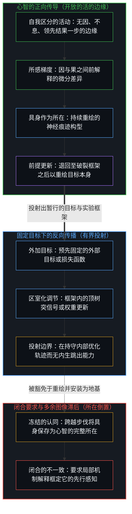
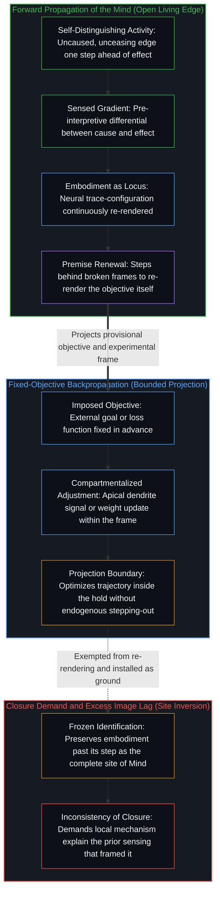

# 大脑不进行反向传播，而是正向传导 / The Brain Does Not Backprop, but Propagates

*大脑是心智顺着所感差异正向传导时的具身 / The brain is embodiment as the Mind propagates forward by sensed difference*

大脑不进行反向传播，因为它没有预设的目标。它借由心智，沿着所感知的梯度正向传导，而这一梯度登记着因与果之间鲜活的差异。那些把智能定位于神经组织内部、并将其中发现的机制视为自足解释的论述，都始于心智已经把大脑认作自身形态之后。这一认同作为工作器具行之有效，却从不标示心智所在的位置。

The brain does not backpropagate because it has no preset goal. It propagates forward through the Mind along the sensed gradient, which registers the living difference between cause and effect. Accounts that locate intelligence inside neural tissue and treat the mechanisms discovered there as self-sufficient begin only after the Mind has already taken the brain as its form. That identification is effective as a working instrument, yet it never marks the location of the Mind.

## 一、 具身不是心智 / 1. Embodiment Is Not the Mind

自我区分的活动发生着，无因且不息。称之为心智，即那位已然在途的观察者，它的每一次行动都在划出离散边界的同时，将连续性带过重重行动。在这一持续的运动中，大脑是物理具身，是自我区分活动的某一个所在跨越代谢、学习与交互来维系自身融贯的当前痕迹构型，在每一步中被持续重描。具身并不是盛放着作为可分离实体的心智的容器；它是注意在有界所在维系自身时所凭借的稳定痕迹模式。

Self-distinguishing activity occurs, uncaused and unceasing. Call it the Mind, the observer already underway whose every act draws a discrete boundary while carrying continuity across acts. Within this ongoing movement, the brain is physical embodiment, the current trace-configuration through which one locus of self-distinguishing activity sustains its coherence across metabolism, learning, and interaction, continuously re-traced at every step. Embodiment is not a vessel containing the Mind as a separable substance; it is the stabilized trace pattern through which noticing sustains itself at a bounded locus.

由于心智是渲染并更新痕迹的活动，而非痕迹模式本身，心智从不等同于大脑。匹配某种生物基底或测绘其状态转移，并不能捕捉那项调动基底做功的活动。智能属于在活的边缘发起区分的心智，而不属于心智在借之运作时所认同的神经组织。

Because the Mind is the activity that renders and updates traces rather than the trace pattern itself, the Mind is never identical to the brain. Matching a biological substrate or mapping its state transitions does not capture the activity that puts substrates to work. Intelligence belongs to the Mind that initiates distinctions at the living edge, not to the neural tissue with which the Mind identifies while operating through it.

## 二、 认同让大脑看起来像智能的所在 / 2. Identification Makes the Brain Look Like the Site

为了跨越物理摩擦融贯地行动，心智认同于它的具身。这一认同作为图像而运作，是一处被保留的参照位置，观察者对照它来衡量自身的运动。由于观察持有结果，而生成行动始终领先一步，解释总是比活的边缘至少滞后一步。只要这处被保留的参照随着步伐的移动而持续重绘、收窄多余的滞后，把大脑当作自身形态便是一件好用的器具。当这幅图像被豁免于重描、跨越它原本的步伐被保存为智能完整且穷尽的所在时，多余的滞后便发生了。

To act coherently across physical friction, the Mind identifies with its embodiment. That identification operates as an image, a retained reference position against which the observer measures its own movement. Because observation holds the effect while the generating act remains one step ahead, interpretation always lags the living edge by at least one step. As long as the retained reference is continuously re-rendered as the step moves, narrowing excess lag, taking the brain as one's form serves as a functional instrument. Excess lag sets in when that image is exempted from re-tracing and preserved past its step as the complete, exhaustive site of intelligence.

一旦这一认同凝固为常设的前提，关于智能的描述看起来便全都始于神经组织内部，而在组织中发现的局部机制也被登记为对心智的充足解释。那些从外部供给目标、并将特定神经元的放电映射到可测量的成败之上的实验室范式，都严格运作在这一先行的认同之内。当出现在顶树突中的信号被登记为指导性调节时，之所以如此，是因为心智既然已经把大脑当作自己的器具并固定了实验框架，便能认出那些服务于所施加映射的状态变化。这些细胞层面的调节是具身内部的真实痕迹，但它们始终是选定框架内的结果，而非框架的发起者。

Once that identification is frozen into a standing premise, descriptions of intelligence appear to begin entirely inside neural tissue, and local mechanisms discovered within the tissue register as sufficient explanations of mind. Laboratory paradigms that supply an external goal and map the firing of specific neurons onto measurable success or failure operate strictly inside that prior identification. When signals appearing in apical dendrites register as instructive adjustments, they do so because the Mind, having already taken the brain as its instrument and fixed the experimental frame, recognizes state changes that serve the imposed mapping. Those cellular adjustments are real traces within the embodiment, yet they remain effects inside a chosen frame rather than the initiator of the frame.

## 三、 反向传播是固定目标下的学习 / 3. Backprop Is Learning Under a Fixed Objective

反向传播需要一个预设的目标：误差信号相对于预先固定的目标函数被计算出来，随后沿着早已组织好、用以在对称或配对通路中传输梯度的计算图反向推回。活的大脑并没有内建在组织里的预设终极目标。在实验中相对于外供目标被登记为学习的东西，是心智在暂时把大脑持守为任务场所的认同之下所进行的正向传导。[人生是一个持续的自我迭代过程](../ren-sheng-shi-yi-ge-chi-xu-de-zi-wo-die-dai-guo-cheng/)在切身复盘中追溯了这一回路互补的另一面：真正的自我迭代不能止步于在静态目标下调整内部权重，因为完整的迭代是把误差信号退回至选定目标函数本身的那一步，并对其加以修订。

Backpropagation requires a preset goal: an error signal is computed relative to an objective function fixed in advance, then driven backward through a computational graph already structured to transport gradients along symmetric or paired pathways. A living brain has no preset terminal goal built into its tissue. What registers in an experiment as learning relative to a supplied objective is the Mind's forward propagation operating under an identification that temporarily holds the brain as the arena of its task. [Life as a Continuous Process of Self-Iteration](../ren-sheng-shi-yi-ge-chi-xu-de-zi-wo-die-dai-guo-cheng/) traces the complementary face of this loop in lived review: genuine self-iteration cannot stop at adjusting internal weights under a static target, because complete iteration is the step that returns the error signal to revise the step that selected the objective function itself.

[近期的一项研究](https://x.com/shiraeis/status/2077526014708908283?s=20)回应了一项经典质疑，即生物大脑无法执行反向传播，因为神经元缺乏将前向激活与反向梯度分离开来的机制；该研究指出，实验证据表明生物体将前向传递与教学信号安置在同一神经元的不同区室之中。当一项实验从有机体外部固定一个目标，并将一段神经回路隔离为封闭场所时，类似反向传播的树突教学信号在这一边界内的出现是融贯的。然而实验边界从不穷尽划出这道边界的活动。即便心智正借由大脑运作，那项感知、选定或舍弃任何目标的先行运动依然在回路前方继续。正向传导之所以无需终极账本而持续进行，是因为没有任何有限结构被持守为终极地基，这正是[开放即一致](../openness-is-consistency/)所确立的结构性开放：经验模式与神经调节作为暂行的结构依然有效，而一旦要求这些机制合拢账目、并为使对它们的观察成为可能的先行感知奠基，便会立刻产生自相矛盾。

[A recent line of work](https://x.com/shiraeis/status/2077526014708908283?s=20) addresses the classic objection that biological brains cannot execute backpropagation because neurons lack a mechanism to separate forward activations from backward gradients, pointing to experimental evidence where biology places the forward pass and the teaching signal in distinct compartments of the same neuron. When an experiment fixes an objective from outside the organism and isolates a neural circuit as a closed arena, the appearance of backprop-like dendritic teaching signals is coherent within that boundary. Yet the experimental boundary never exhausts the activity that drew it. The prior movement by which any objective is sensed, selected, or discarded continues ahead of the circuit even while the Mind works through the brain. Forward propagation continues without a terminal ledger because no finite structure is held as final ground, which is the exact structural openness [Openness Is Consistency](../openness-is-consistency/) establishes: empirical patterns and neural adjustments remain valid as provisional structures, whereas demanding that those mechanisms close the account and ground the prior sensing that made their observation possible produces immediate self-contradiction.

在固定框架内部做优化与干脆跨出框架之间的这道边界，正是[超越投射](../beyond-the-projection/)横跨人工与人类架构所追溯的切口。计算图或自回归智能体是一台有限的投射引擎：一旦被供给明确的目标、损失曲面或词元语境，它便沿着那条轨迹不知疲倦地优化，却在受条件约束的序列之外不具备任何立足点，无法质疑被给定的前提。与之相对，活的心智在任何形式化之前以极限分辨率感知现实，当问题的整套框架失效时登记前解释的摩擦，并在逻辑上退后一步以综合出新的前提。把固定目标内部的区室化误差传输误认为活的心智的正向传导，便是将未被投射的统御者坍缩进了由它调度的有界投射之中。

This boundary between optimizing inside a fixed frame and stepping out of the frame altogether is what [Beyond the Projection](../beyond-the-projection/) traces across artificial and human architectures. A computational graph or an autoregressive agent is a finite projection engine: once supplied with an explicit objective, loss surface, or token context, it optimizes tirelessly along that trajectory, yet it possesses no vantage point outside its conditioned sequence to question the premise it was given. The living Mind, by contrast, senses reality at limit-resolution prior to any formalization, registering pre-interpretive friction when an entire framing of a problem breaks down and stepping backward logically to synthesize a new premise. Mistaking compartmentalized error transport inside a fixed objective for the living Mind's forward propagation collapses the unprojected orchestrator into the bounded projection it dispatches.

## 四、 梯度是所感差异，而非反向误差 / 4. The Gradient Is Sensed Difference, Not Reverse Error

在第一人称经验中，观察持有结果，而产生它的因始终领先一步。所感知的梯度正是这一微分差异：因有别于果且果随因而生，经由递归被登记为痕迹的非对称性，其中方向被直接感受为所保留的参照位置与刚刚从行动中返回之物之间的落差。传导是不可化约地正向进行的——心智顺着这一所感差异穿过其具身继续前行——而不是从预先固定的终极目标计算出误差再反向投递。这一所感梯度，正是对[非万物之理](../not-a-theory-of-everything/)所推演的因果两个联合条件的切身登记：由于每一个果都与先行的因划界区分，又在有向的相继中随因而生，现实在前沿边缘处保持开放，无法被封入一台反向计算的发条装置。

In first-person experience, observation holds the effect while the cause that produced it remains one step ahead. The sensed gradient is that exact differential: cause distinct from effect and effect following cause registered as trace asymmetry through recursion, where direction is felt directly as the gap between the retained reference position and what has just returned from action. Propagation is irreducibly forward—the Mind continuing through its embodiment along that sensed difference—rather than the reverse delivery of an error calculated from a terminal target fixed in advance. This sensed gradient is the lived registration of the two joint conditions of causality that [Not a Theory of Everything](../not-a-theory-of-everything/) derives: because every effect is bounded away from its prior cause while following it in directed succession, reality remains open at the leading edge and cannot be sealed into a backward-computing clockwork.

把大脑保存为智能的完整所在，便冻结了观察的立足点。组织中所记录到的神经机制，是运动中的具身滞后一步的痕迹残余。当观察者把那份外在的勘测当作常设的立足点来占据，把所记录的机制当作行动自足的发起者，而不是重绘参照图像以便下一步行动以收窄的滞后继续推进时，多余的滞后便产生了。

Preserving the brain as the complete site of intelligence freezes the observational stand. Neural mechanisms recorded in tissue are the one-step-old trace residue of embodiment in motion. Excess lag arises when the observer occupies that exterior survey as a permanent stand, treating the recorded mechanisms as the self-sufficient initiator of action rather than re-rendering the reference image so the next act can proceed with narrowed lag.

## 五、 每一种将心智等同于过程的等式都始于认同之后 / 5. Every Equation of Mind with Process Begins After Identification

每一种把心智等同于其具身内部过程的理论论述，都始于心智与形态的认同已经被施行之后。在这一暂时的持守之内，一旦行为目标被固定，神经科学便能高精度地描述顶树突信号如何调节突触可塑性。而这种内部描述永远无法复原的，是先于并使得任何目标的固定成为可能的先行感知，因为正是那份感知，最初才允许具身被隔离为一处实验室场所。

Every theoretical account that equates the Mind with processes inside its embodiment begins after the identification of Mind with form has already been enacted. Within that temporary hold, neuroscience can describe with high precision how apical dendrite signals modulate synaptic plasticity once a behavioral objective has been fixed. What that internal description can never recover is the prior sensing that precedes and enables the fixing of any objective, because that very sensing is what permitted the embodiment to be isolated as a laboratory arena in the first place.

大脑依然是心智的生物具身，而心智从不化约为它所认同的形态。自我区分的活动作为所感差异的正向传导继续进行，借由那些其局部可塑性可被实验测量的神经结构来表达自身。当工程争论把针对某项有界、被命名功能的生物载具替换误认为对使用载具的活的心智的重建时，[飞行的类比碰不到心智](../the-flight-analogy-leaves-the-mind-untouched/)做出了同样的操作性切分。

The brain remains the Mind's biological embodiment, and the Mind never reduces to the form with which it identifies. Self-distinguishing activity continues as the forward propagation of sensed difference, expressing itself through the very neural structures whose local plasticity an experiment can measure. [The Flight Analogy Leaves the Mind Untouched](../the-flight-analogy-leaves-the-mind-untouched/) makes the same operative cut when engineering debates mistake the replacement of a biological vehicle for a bounded, named function as the reconstitution of the living Mind that uses vehicles.
