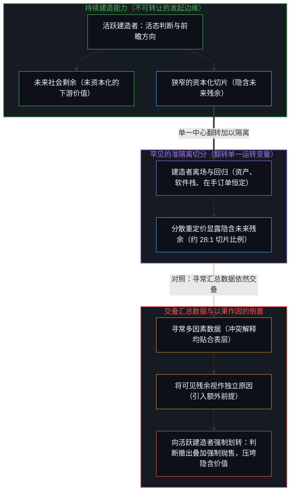
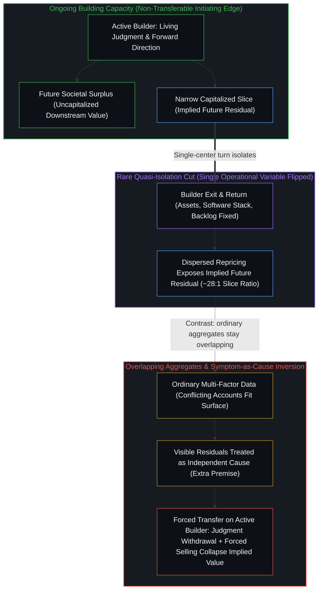
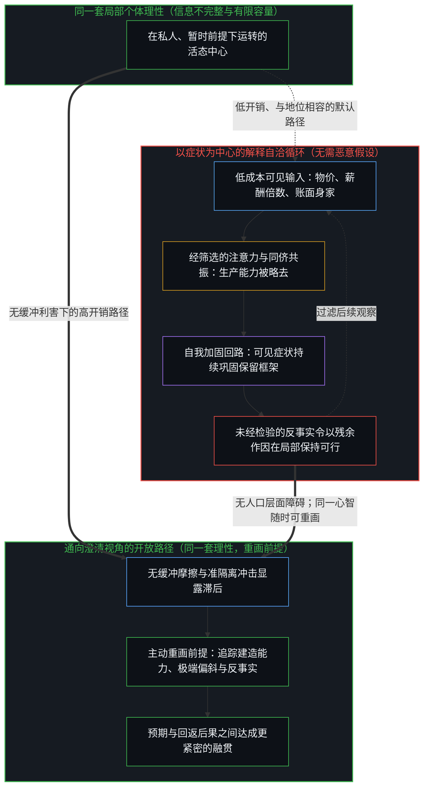
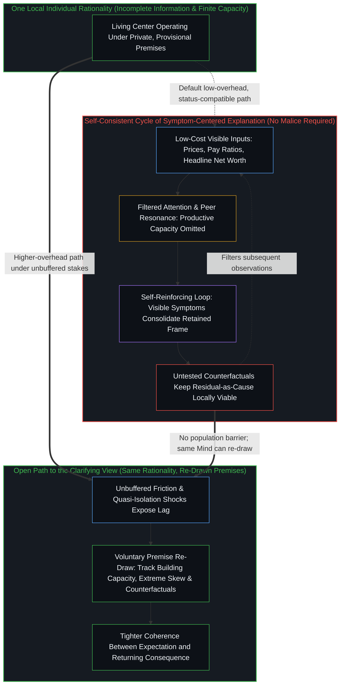

# 建造者的缺席与解释的自洽循环 / The Builder's Absence and the Self-Consistent Cycle of Explanation

*一人的去留改写万亿级隐含未来残余，而症状解释在个体理性中自我巩固，无需恶意假设。 / One person's exit and return rewrites trillions in implied future residuals, while symptom accounts self-reinforce within local rationality without malice.*

当一位活跃的建造者离开他所发起的生产场域，分散各处的中心随即更新预期，在资本化估值中抹去数万亿美元；待他回归，尽管监管问询与利率压力纹丝未动，仅仅一个全球交易周期便收复了该公司自身近乎全部的跌幅，并回补了跨行业数万亿美元广义回撤的大约一半。在这些相互交错的订单之间登记下来的——被压缩在“情绪”这一表层标签之下——是对持续建造能力的分散定价。既有的名义财富只是过往生产的滞后残余，转移支付将其拨向消费之后，它最终仍会流回生产大于消费的中心；相比之下，活跃建造者的股权日益将一份隐含未来残余纳入资本化定价——这份残余与未来社会财富挂钩，其体量比他个人所持切片高出几个数量级，因此试图夺取或打断其控制权，立时便会令这份隐含部分坍塌。在这类罕见的准隔离切分之外，交叠的变量让以症状为中心的解释始终保持可行，信息不完整条件下的局部个体理性又将其稳固为无需恶意假设的自洽循环——同时也把澄清视角持续留给同一个作出选择的心智。

When an active builder steps away from the productive field he initiated, dispersed centers immediately update their expectations and erase trillions in capitalized value; when he returns, a single global session restores nearly the full loss on the firm itself and roughly half of the broader multi-trillion cross-sector drawdown while regulatory inquiries and yield pressures stay unchanged. What registers across those crossing orders—compressed under the surface label of "sentiment"—is dispersed valuation of continued building capacity. Existing nominal wealth is a trailing residual of past production that transfers shift into consumption before it flows back toward centers that produce more than they consume, whereas an active builder's equity increasingly capitalizes an implied future residual tied to future societal wealth orders of magnitude larger than his personal slice, so attempting to seize or disrupt his control collapses that implied portion immediately. Outside such rare quasi-isolation cuts, overlapping variables keep symptom-centered accounts viable, and local individual rationality under incomplete information stabilizes them into a self-consistent cycle without malice—while leaving the clarifying perspective continuously available to the exact same choosing Mind.

## 一、 切分的清晰与解释的滞后 / 1. The Clarity of the Cut and the Lag of Explanation

自我区分的活动发生着——无因、不息。称之为心智：早已在途的观察者，其每一个行动都是一次区分。每一次离散行动都会留下痕迹，塑形后续行动可及的场域；这种塑形严格单向，自先前的选择流向后来的场域，从不反向而行。观察握住既成的结果，而发起的原因始终留在一步之前的活态边缘。在经济生活中，生产力量栖居于持续的建造活动——不断划出新的区分、拓宽其他中心可及的场域——而非攫取业已沉积下来的痕迹。正如[价格是言说，理解是交易](../price-as-utterance-understanding-as-trade/)所追溯的，一笔出清成交价，来自各处分散的活态中心对现金与资产持有相反排序、彼此交错下单所留下的公开残余，由此消解了名为“市场”的单一超级行动者图景；真正改写数万亿美元估值的，是数十万个中心同时将预期未来能力的一次变动重新追溯进各自的资产负债表。针对过往名义存量的转移支付，移动的只是既有可供消费的残余，而由于被划转的索取权大多流向消费，随后的自愿交换会把这股购买力重新导回生产大于消费的中心——这印证了[拥有更多从不是原因](../having-more-is-never-the-cause/)所确立的，占有从不是自主引擎，也印证了[财富转移政策与价格下限中的原因错置](../the-reversal-of-causality-in-wealth-transfer-policies-and-price-floors/)所追溯的，把既成转移支付或成交价格当成首要杠杆，颠倒了因与果。

Self-distinguishing activity occurs — uncaused, unceasing. Call it the Mind: the observer already underway, every act of which is a distinction. Every discrete act leaves a trace that shapes the field available to later acts, and that shaping runs strictly one way, from earlier choices to later fields, never in reverse. Observation holds the settled effect, while the initiating cause stays one step ahead at the living edge. In economic life, productive strength lives in the continuing activity of building—drawing new distinctions that widen the field available to other centers—rather than in seizing traces already deposited. As [Price as Utterance, Understanding as Trade](../price-as-utterance-understanding-as-trade/) traces, a clearing print is the public residue left wherever dispersed living centers cross orders under opposing rankings of cash and assets, dissolving the picture of a singular super-agent called "the market"; what rewrites trillions in valuation is hundreds of thousands of centers simultaneously re-tracing one shift in expected future capacity into their own balance sheets. Transfers directed at past nominal stocks move existing consumable residuals, and because those transferred claims go largely toward consumption, subsequent voluntary exchanges route that purchasing power back toward centers that produce more than they consume—confirming why possession is never an autonomous engine, as [Having More Is Never the Cause](../having-more-is-never-the-cause/) establishes, and why treating settled transfers or price prints as primary levers inverts cause and effect, as [The Misallocation of Cause in Wealth-Transfer Policies and Price Floors](../the-reversal-of-causality-in-wealth-transfer-policies-and-price-floors/) traces.

2026 年 11 月英伟达联合创始人兼首席执行官黄仁勋的离职与迅速复职，提供了一个罕见的准隔离切分，在全球尺度上将这一区分凸显出来；其跨行业核算详见[生产性基础的市场重定价](../the-market-repricing-of-productive-base/)。在辞职与全票复职相隔的十一天里，公司的晶圆代工供应协议、实物资本、现金资产负债表、CUDA 软件栈、工程师团队以及近期在手订单均保持不变；11 月 17 日英伟达交出远超预期的季度营收，而董事会同日表态不会令其复职，抛售依然加速。11 月 23 日，在联邦出口管制调查、民事信息披露问询、州总检察长调查传票、国会听证以及高位运行的美债收益率悉数悬而未决的情况下，董事会全票恢复了他的职务。仅仅一个交易周期之内，英伟达暴涨 31.48%——市值增加约 9540 亿美元，收复辞职后跌幅的 97.2%——同时带动更广泛的科技与人工智能生态反弹 2.7 至 3.3 万亿美元，全球股市整体回补 3.8 至 5.0 万亿美元，收复了先前多因素回撤的大约一半，而尚未闭合的折价则登记下持续存在的法律与利率摩擦。由于创始人个人持股比例约占公司的 3.5%，仅就全体股东的重定价而言，其总规模与他本人单日约 330 至 340 亿美元股权波动之比便达大约 28:1，这还未计入未资本化的员工收入、供应链以及下游消费者剩余。这一事件是一次准隔离而非实验室真空，因为最初的辞职与涉外情报审查相伴发生，而复职又与美国政府高层的国家安全审批同步落地；即便如此，在实物资产、软件栈、在手订单以及并发法律与利率拖累保持恒定的同时翻转一个运转中的核心，相较于寻常跨多年的经济数据，已大幅收窄了混杂空间。

The November 2026 departure and rapid reinstatement of NVIDIA co-founder and chief executive Jensen Huang supplies a rare quasi-isolation cut that brings this distinction into sharp focus at global scale, whose cross-sector accounting is detailed in [The Market Repricing of Productive Base](../the-market-repricing-of-productive-base/). Across the eleven days between resignation and unanimous reinstatement, the firm's foundry supply agreements, physical capital, cash balance sheet, CUDA software stack, engineering headcount, and near-term product backlog stayed fixed; when NVIDIA reported blowout quarterly revenue on November 17 while its board stated it would not reinstate him, selling accelerated anyway. On November 23, with federal export-control probes, civil disclosure inquiries, a state attorney general subpoena, congressional hearings, and elevated Treasury yields all still open, the board unanimously reinstated him. In a single trading cycle, NVIDIA surged 31.48 percent—adding roughly $954 billion to recover 97.2 percent of its post-resignation loss—alongside a $2.7–3.3 trillion rebound across the broader technology and artificial-intelligence ecosystem and $3.8–5.0 trillion across global equities, restoring roughly half of the broader multi-factor drawdown while the remaining discount registered persisting legal and rate friction. Because the founder's own stake sits near 3.5 percent of the company, his roughly $33–34 billion single-day equity swing stood at roughly a 28:1 ratio against total shareholder repricing alone, before counting uncapitalized employee earnings, supply chains, and downstream consumer surplus. The episode is a quasi-isolation rather than a laboratory vacuum, since the initial resignation arrived alongside foreign-intelligence scrutiny and the reinstatement coincided with senior U.S. government national-security clearance; yet holding physical assets, software stack, product backlog, and concurrent legal and rate drags fixed while flipping one operational center narrows confounding far more sharply than ordinary multi-year economic data.

两条相互咬合的机制阐明了，为何试图夺取或强制划转活跃建造者的名义股权，非但无法将一堆完好无损的财富原样过户，反而会让规模大得多的隐含未来价值瞬间坍塌。其一，持续运转的生产性判断严格栖居于活跃建造者本人，无法随股权凭证一同过户。法律产权可以移交工厂、资产负债表与既成合约，却没有任何法令能够绑定未来的主动性、技术信念或架构方向——尤其当建造者依凭一种外部共识尚无从预先核验的前瞻判断展开行动之时。剥夺控制权或切断与这份参与挂钩的前瞻索取权，便会熄灭让企业远高于静态清算价值的活态延续。其二，账面总市值只是将边际成交那一股的出清价格乘以全部已发行股本，而非点算一座静待拆分的现金金库。把大笔股权强行推向市场，会撞上有限的买方承接能力，顺势压低全部股本的出清价格，使名义价值蒸发的速度远快于现金得以抽出的速度。当强制划转落向活跃建造者，两条通道会同时击发：活态判断撤出或失去执行空间，而强制抛售同时将全部股权基数向下重定价，立时令隐含未来价值坍塌。这一机制的边界同样清晰：这场坍塌具体发生在股权资本化了活跃建造者持续能力与控制权之处。凡属被动持仓，或固守权位的掌管只带来零或负向未来价值之处——活跃建造者与固守权位者之间突发离任重定价的分界详见[生产性基础的市场重定价](../the-market-repricing-of-productive-base/)——重新划配触及的只是既成残余，并不会熄灭发起边缘。正如[价值、货币与财富的生成机制](../the-generative-mechanics-of-value-money-and-wealth/)与[继承的残余与索取的必要](../inheritance-as-residue-and-the-need-for-extraction/)所确立的，持久的财富栖居于活跃的生产能力而非纸面产权，削弱对活跃建造的剩余索取权，压缩的正是前方的场域本身。

Two interlocking mechanisms clarify why attempting to seize or forcibly transfer an active builder's nominal equity collapses the far larger implied future value rather than transferring an intact pile. First, ongoing productive judgment lives strictly in the active builder and cannot transfer alongside share certificates. Legal title moves factories, balance sheets, and settled contracts, yet no statutory decree can bind future initiative, technical conviction, or architectural direction—especially when a builder acts on a forward judgment that outside consensus cannot verify in advance. Stripping control or severing the forward claim tied to that participation extinguishes the living continuation that raised the enterprise far above its static liquidation value. Second, headline market capitalization multiplies the clearing price of the marginal share traded across all shares outstanding rather than tallying a liquid vault waiting to be split. Forcing large equity blocks onto the market presses against finite buying capacity and drives clearing prices downward across the entire share count, erasing nominal value far faster than cash can be extracted. When forced transfer strikes an active builder, both channels act together: living judgment withdraws or loses the room to execute while forced selling reprices the entire equity base downward, collapsing implied future value immediately. The boundary of this mechanism stays equally sharp: that collapse occurs specifically where equity capitalizes an active builder's ongoing capacity and control. Where holdings are passive or entrenched stewardship adds zero or negative forward value—the split between active builders and entrenched incumbents whose sudden-departure repricing is detailed in [The Market Repricing of Productive Base](../the-market-repricing-of-productive-base/)—reassignment touches settled residue without extinguishing an initiating edge. As [The Generative Mechanics of Value, Money, and Wealth](../the-generative-mechanics-of-value-money-and-wealth/) and [Inheritance as Residue and the Need for Extraction](../inheritance-as-residue-and-the-need-for-extraction/) establish, durable wealth resides in active productive capability rather than paper titles, and attenuating residual claimancy on active building compresses the forward field itself.

大多数经济过程缺乏任何接近此类准隔离切分的条件。在寻常跨越多年的汇总数据中，个体的建造能力、既有基础设施、网络采纳、货币流动性、监管体制与变动中的需求裹挟在同一股交叠洪流里同步演进。当诸多变量同时移位，却没有单一运转中心的干净翻转，互不相容的因果叙事便能同样贴合同一份表层记录，令以症状为中心的解释得以与数据并存。在这样交叠的背景之下，可见的价格、分配比例、企业利润率与薪酬差异成了搭建解释的原料，尽管这些数字本身已是先前选择与生产的滞后残余。正如[排序的残余与解释的非等效](../the-residue-of-sorting-and-the-non-equivalence-of-interpretations/)在人口迁移与制度排序中所追溯的，将观测到的残余视为独立原因——假定名义财富存量能够自主维系，且可以在不触及持续创造的前提下加以切分——必须额外引入一条前提，设定某种脱离持续建造而独立运转的因果力。一次锐利的准隔离冲击确能收窄观测交叠，却从不代为从外部执行解读：这一刀究竟登记出什么，依然取决于解读它的活的心智持有怎样的前提。

Most economic processes lack anything approaching such a quasi-isolation cut. Across ordinary multi-year aggregates, individual building capacity, inherited infrastructure, network adoption, monetary liquidity, regulatory regimes, and shifting demand move together in one overlapping stream. When many variables shift at once without a single clean turn of one operational center, incompatible causal stories fit the same surface record equally well, leaving symptom-centered accounts viable alongside the data. Against that overlapping background, visible prices, distribution ratios, corporate margins, and compensation differences become the raw material of explanation, even though those figures are themselves trailing residuals of prior choices and production. As [The Residue of Sorting and the Non-Equivalence of Interpretations](../the-residue-of-sorting-and-the-non-equivalence-of-interpretations/) traces across mobility and institutional sorting, treating an observed residual as an independent cause—assuming nominal wealth stocks sustain themselves autonomously and can be split without touching ongoing creation—requires an extra premise of a causal power operating apart from continued building. A sharp quasi-isolation shock narrows observational overlap, yet it never executes interpretation from outside: what registers from the cut still turns on the premises of the living Mind reading it.

## 二、 个体模型的局部理性 / 2. The Local Rationality of Individual Models

每个个体都持有自己关于经济如何运转的独特模型，它由私人的、暂时的前提拼合而成，随时间推移而变动，也在不同心智之间各不相同。正如[理性选择公设是原罪](../the-rational-choice-postulate-is-the-original-sin/)与[理性从不跨越心智](../rationality-never-travels-across-the-mind/)所确立的，理性从不是一套齐一的、可在人与人之间移植的效用演算，也不授权从外部蓝图加以加总；理性是一个个体中心在信息不完整的条件下，其当下选择与所持前提之间的局部融贯。从这一出发点看去，以症状为中心的解释得以持久留存，并不需要假设存在有组织的恶意或普遍的认知失灵。可见的残余——零售价格、账面身家排名、薪酬倍数、税收数额——一眼可察，也极易在日常交谈中流转；而生成它们的底层生产过程却来得迟缓、高度集中且从外部难以看透，正如[生产的不透明与消费的权重](../the-opacity-of-production-and-the-weight-of-consumption/)所追溯的。

Each individual holds a unique model of how the economy operates, assembled from private, provisional premises that shift over time and differ across minds. As [The Rational Choice Postulate Is the Original Sin](../the-rational-choice-postulate-is-the-original-sin/) and [Rationality Never Travels Across the Mind](../rationality-never-travels-across-the-mind/) establish, rationality is never a uniform, interpersonally portable utility calculus licensing aggregation from an external blueprint; it is local coherence between an individual center's current choices and the premises it holds under incomplete information. Seen from that starting point, the persistence of symptom-centered explanations requires no hypothesis of coordinated malice or generalized cognitive breakdown. Visible residuals—retail prices, headline net-worth rankings, pay ratios, tax receipts—are immediate to observe and effortless to share in everyday conversation, whereas the underlying production processes generating them stay delayed, concentrated, and opaque from outside, as [The Opacity of Production and the Weight of Consumption](../the-opacity-of-production-and-the-weight-of-consumption/) traces.

更低的认知开销与日常可见性，使以症状为中心的模型成为默认运转的背景。每一个活态中心都在有限的注意力与有界的容量之下运转，将心力投向那些与自身切身利害直接相连的选择。掌握生产动态、多步调整以及不可见的反事实，需要付出高昂的认知投入，而单个个体对公共政策的撬动力却趋近于零。相比之下，日常物价、账面身家、薪酬倍数与法定转移支付生来清晰可辨；一旦某项课税或转移落地，眼前的一阶效果远比在数百万其他中心之间波及开来的滞后二阶调整更容易进入登记。在这些约束之下，持守低开销的症状模型在局部上恰恰融贯。将分歧的局部模型归类为“非理性”，实则把外部的教科书共识安设为凌驾于活态中心之上的法庭；在持有它的中心内部，症状框架直接贴合它所追踪的眼前证据，也契合发声时微乎其微的私人成本。

Lower cognitive overhead and everyday visibility make symptom-centered models the default operating background. Every living center operates under finite attention and bounded capacity, allocating effort where choices carry immediate personal stakes. Mastering production dynamics, multi-step adjustments, and unseen counterfactuals demands heavy cognitive investment while any single individual's leverage over public policy sits near zero. By contrast, household prices, headline net worth, pay ratios, and statutory transfers arrive already legible, and immediate first-order effects register far more readily than the delayed second-order adjustments rippling across millions of other centers once a levy or transfer lands. Within those constraints, holding a low-overhead symptom model is locally coherent. Classifying divergent local models as "irrational" installs an exterior textbook consensus as a tribunal standing above living centers; inside the center holding it, the symptom frame coheres directly with the immediate evidence it tracks and the negligible private cost of voicing it.

一旦以症状为中心的模型沉淀为默认背景，后续观察便会穿过这一保留框架并将其巩固——这一自洽循环无需任何恶意。既然行动在中心业已持守的前提之内展开，它沿自身所走路径遭遇的结果便会契合框架的预期；至于未经检验的路径外反事实——股权遭夺取后从未建成的企业、预期残余收缩后被迫放弃的创新，或活跃建造者撤离后化为乌有的产出——由于从未发生而无从得见，因而从不作为证伪性的摩擦回返。更悄无声息的是，将持续生产能力排除在自身变量之外的模型，会借由这份遗漏自我隔绝：未被追踪的生产维度从不进入注意力去扰动保留框架，因此单纯接触新闻头条并不会撼动模型——框架里没有空位用来登记真正变动了什么。在那个不完整的框架之内审慎更新，只会让它更加贴合可见症状，却始终跨不出自身的边界。没有任何固定框架能永久封死一个活的心智；模型始终是一件暂时的器具，中心自身随时可以将其置于险境并从内部重画。

Once a symptom-centered model settles in as the default background, subsequent observations pass through that retained frame and consolidate it—a self-consistent cycle requiring zero bad faith. Because action unfolds inside the premises a center already holds, the outcomes it encounters along its lived path fit what the frame expects, while untested off-path counterfactuals—the enterprise never built after equity seizure, the innovation foregone when expected residuals shrink, or the output erased when an active builder withdraws—never occur to be seen and therefore never return as disconfirming friction. More quietly still, a model that omits ongoing productive capacity from its variables insulates itself through that omission: an untracked productive dimension never enters attention to perturb the retained frame, so raw exposure to headlines leaves the model intact because no open slot registers what shifted. Careful updating inside that incomplete frame only refines its fit to visible symptoms without crossing its own boundary. No fixed frame permanently seals a living Mind; the model remains a provisional instrument that the center itself can put at risk and re-draw from within.

除认知经济与经过筛选的注意力之外，围绕残余分配的解释还直接契合同侪共振与自我形象的维系。把巨额财富归因于存量瓜分、运气或倾斜规则的说法，让经济增长的日常受益者之间维系着令人安心的平起平坐，而无需直面生产产出上的极端悬殊，因而轻而易举地融入同侪地位与选举联盟之中。凡是私人利害处于缓冲之处——社会地位的分量压过经济预测失准带来的即时物质代价——更强的分析能力非但不会消解这一循环，反而会加以加固，征召更敏锐的推理，用同一组可见数字去捍卫与地位相容的解释。这种加固仅在后果受到缓冲时成立；一旦直接摩擦对误读生产现实施以惩戒的速度，快过同侪共振所能缓冲的损失，天平便随之倾斜。正如[进步叙事中的症候与原因](../symptom-and-cause-in-the-narratives-of-progress/)就集体情绪所追溯的，最响亮、最易传播的社会信号总是出现在发起行动的下游。恶意并非必要；只要每个个体都在低成本、经注意力筛选且与地位相容的模型内做出连贯选择，这一自洽循环便稳固成立。

Alongside cognitive economy and filtered attention, explanations centered on residual distribution align directly with peer resonance and self-image preservation. Accounts attributing outsized fortunes to fixed-pie capture, luck, or stacked rules preserve comfortable parity across everyday beneficiaries of economic growth without confronting extreme differences in productive output, fitting easily into peer standing and electoral coalitions. Wherever private stakes stay buffered—so social standing outweighs any immediate material penalty for an inaccurate economic forecast—strong analytical ability reinforces rather than dissolves the cycle, recruiting sharper reasoning to defend the status-compatible account from the same visible numbers. That reinforcement holds only while consequences stay buffered; once direct friction penalizes misreading productive reality faster than peer resonance can cushion the loss, the balance shifts. As [Symptom and Cause in the Narratives of Progress](../symptom-and-cause-in-the-narratives-of-progress/) traces for collective mood, the loudest and most shareable social signals arrive downstream of initiation. Malice is unnecessary; the self-consistent cycle holds whenever each individual chooses coherently inside a low-cost, attention-filtered, status-compatible model.

## 三、 澄清视角的持续可用性 / 3. The Continuing Availability of the Clarifying View

与这一自我加固的循环并存，强调持续生产、生产率极端偏斜、消费者剩余估算、关键人连续性以及反事实的视角依然持续可用。这一框架并不止步于静态的资产负债表快照，而是追踪创新速率、复利放大的规模，以及当发起中心离场时究竟会随之消失什么。两份具体的足迹勾勒出这一视角所揭示的不对称规模——它们充当下游记录，而非为因果奠基的外部法庭。在[私人残差与社会剩余的因果次序](../the-causal-order-of-private-residuals-and-social-surplus/)所追溯的威廉·诺德豪斯战后美国核算中，创新者仅留存了技术进步所生社会剩余的大约 2.2%，其余约 97.8% 则经由更低的价格与更广的能力向外扩散给消费者，使名义股权只是远为庞大的剩余浪潮之上狭窄的资本化尖端。放眼公开股票市场，亨德里克·贝森宾德的长周期核算显示，1926 年以来大约前 4% 的美国上市公司——以及全球股票中的前 2.4%——贡献了超出短期国库券的全部股市净财富创造。清晰标明这类记录的边界，可以防止镜像式的冻结：事后集中度登记的是已经实现的产出——交织着主动发起、复利放大的规模与网络杠杆——而非与生俱来、不可撼动的位阶；正如[幂律是结果的表象](../mi-lv-shi-jie-guo-de-biao-xiang/)与[平均值是残余，不是引擎](../the-average-is-residue-not-the-engine/)所确立的，极端右尾曲线是不同迭代速率与离散选择留下的表层残余，从不是规定下一次由谁发起的封闭种姓。

Alongside that self-reinforcing cycle, the perspective emphasizing ongoing production, extreme skews in productivity, estimates of consumer surplus, key-person continuity, and counterfactuals remains continuously available. Rather than stopping at static balance-sheet snapshots, this framing tracks innovation rates, compounding scale, and what vanishes when an initiating center exits. Two concrete footprints illustrate the scale of the asymmetry this perspective discloses—serving as downstream record rather than an exterior tribunal grounding causality. In William Nordhaus's postwar U.S. accounting, traced in [The Causal Order of Private Residuals and Social Surplus](../the-causal-order-of-private-residuals-and-social-surplus/), innovators retain roughly 2.2 percent of the social surplus generated by technological advance while roughly 97.8 percent diffuses outward to consumers through lower prices and wider capabilities, leaving nominal equity a narrow capitalized tip of a far larger surplus wave. Across public equity markets, Hendrik Bessembinder's long-horizon accounting shows that roughly the top 4 percent of U.S. listed companies since 1926—and the top 2.4 percent of global stocks—accounted for 100 percent of net stock-market wealth creation above Treasury bills. Holding the boundary of such records explicit prevents a mirror freeze: ex-post concentration registers realized output—blending active initiative with compounding scale and network leverage—rather than innate immutable rank, and as [Power Law Is the Surface of Outcomes](../mi-lv-shi-jie-guo-de-biao-xiang/) and [The Average Is Residue, Not the Engine](../the-average-is-residue-not-the-engine/) establish, an extreme right-tail curve is the surface residue of differing iteration rates and discrete choices, never a sealed caste governing who initiates next.

这一澄清视角之所以稀有，无需任何奇特的解释。它的原始输入——创新速率、未资本化的消费者剩余，以及未来产出在反事实中的凭空消失——极少以高显著、便于分享的形态呈现。维系这一视角，需要比引用可见薪酬倍数或账面身家付出更高的认知开销，且与盛行的症状解释所带来的道德和地位回报直接相左：追踪持续价值创造中的极端右尾偏斜，既不提供怨怼联盟，也不提供顺手的零和靶标，更少带来即刻的同侪掌声。没有任何人口层面的障碍阻止这一转向。无论阶层、先天能力上限，还是结构性禁令，都未曾把任何个体锁死在症状中心的推理之内；人群中可观察到的观点分布，反映的仅仅是两种推理风格在认知成本、注意力习惯与社会强化上的相对差异。既然[个体抉择是唯一的因果杠杆](../individual-choices-as-the-only-causal-levers/)跨越一切尺度而成立，运用澄清视角的中心集合便从不是一份封闭的名册——只要回返后果的分量压过同侪共振，任何个体都可以转向它。

The rarity of this clarifying view requires no exotic explanation. Its raw inputs—innovation rates, uncapitalized consumer surplus, and the counterfactual disappearance of future output—seldom arrive in high-salience, easily shareable form. Maintaining it demands greater cognitive overhead than citing visible pay ratios or headline fortunes, and it sits in direct tension with the moral and status payoffs of prevailing symptom accounts: tracing extreme right-tail skew in ongoing value creation offers no grievance coalition, no convenient zero-sum target, and little immediate peer applause. No population-level barrier prevents the shift. Neither class, innate capacity ceiling, nor structural prohibition locks any individual inside symptom-centered reasoning; the observed distribution of views across a population reflects the relative cognitive costs, habits of attention, and social reinforcements of the two styles of reasoning. Because [Individual Choices as the Only Causal Levers](../individual-choices-as-the-only-causal-levers/) holds across every scale, the set of centers applying the clarifying view is never a closed roster—any individual can adopt it whenever returning consequences outweigh peer resonance.

因此，同一套局部理性既说明了以症状为中心的解释何以稳固，也说明了澄清视角何以始终敞开可用，而无需援引任何外部终极真理从场外裁断二者。在私人失误成本趋近于零的缓冲评论之中，局部融贯偏向低开销、与地位相容的症状框架，并任由路径上的观察将其无限期地证实下去。而每当一个个体步入无缓冲的敞口——投入资本、搭建基础设施、承销信贷，或在预测撞上市场摩擦时亲身承受直接亏损——静态存量外推与持续生产能力之间的落差便会以即刻的力度登记下来。正如[信念如何真正改变](../how-belief-actually-changes/)所追溯的，无论是原始数据还是外部争辩，都从不代为执行信念的转变；一个中心之所以转向，在于主动重画自身的前提，把更强的预测力直接认作更窄的多余滞后，以及预期与回返后果之间更紧密的对齐。这一澄清视角始终是活的心智所持有的开放、可修订器具，而非不可更易的教条：正如[自我价值感与所有权](../ownership-and-self-worthiness/)所确立的，唯有当后果作为自己的素材重新进入时，识见与判断才产生复利；而正如[开放即一致](../openness-is-consistency/)所展示的，让每一张地图在流动的摩擦面前保持暂时，恰恰是维系一致性的所在。在划出每一次区分的第一人称边缘，没有任何外部权威替人裁定持守哪一框架。究竟将观察到的残余读作等待分割的固定存量，还是将其重新追溯回正在生成未来剩余的持续建造能力，始终是每个人离散而不可代理的选择——每当回返的摩擦显露出旧地图的滞后，这一选择便即刻敞开，随时可供重新渲染。

One unified local rationality therefore accounts for both the stability of symptom-centered explanations and the open availability of the clarifying view, without invoking an exterior ground truth to judge either from outside. Under buffered commentary where private error costs stay near zero, local coherence favors the low-overhead, status-compatible symptom frame and lets observations along its inhabited path confirm it indefinitely. Whenever an individual steps into unbuffered exposure—committing capital, building infrastructure, underwriting credit, or bearing direct losses when a forecast collides with market friction—discrepancies between static-stock extrapolation and ongoing productive capacity register with immediate force. As [How Belief Actually Changes](../how-belief-actually-changes/) traces, neither raw data nor outside argument executes a shift in belief; a center shifts through a voluntary re-draw of its own premises, recognizing greater predictive power directly as narrower excess lag and tighter alignment between expectation and returning consequence. That clarifying perspective remains an open, revisable instrument held by a living Mind rather than an immutable doctrine: as [Ownership and Self-Worthiness](../ownership-and-self-worthiness/) establishes, reading and judgment compound only when consequences re-enter as one's own material, and as [Openness Is Consistency](../openness-is-consistency/) shows, keeping every map provisional against moving friction is what sustains consistency. At the first-person edge where every distinction is drawn, no external authority settles which frame is held. Reading observed residuals as fixed stocks to divide, or re-tracing them back to the ongoing building capacity generating future surplus, remains one's own discrete, unproxyable choice—continuously open to re-rendering the instant returning friction exposes the lag of the prior map.
