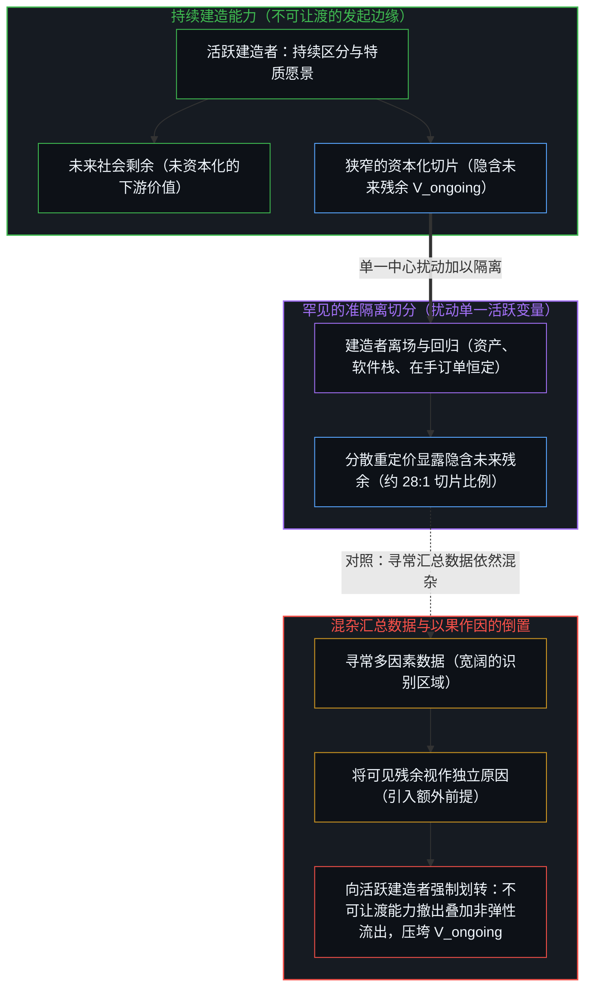
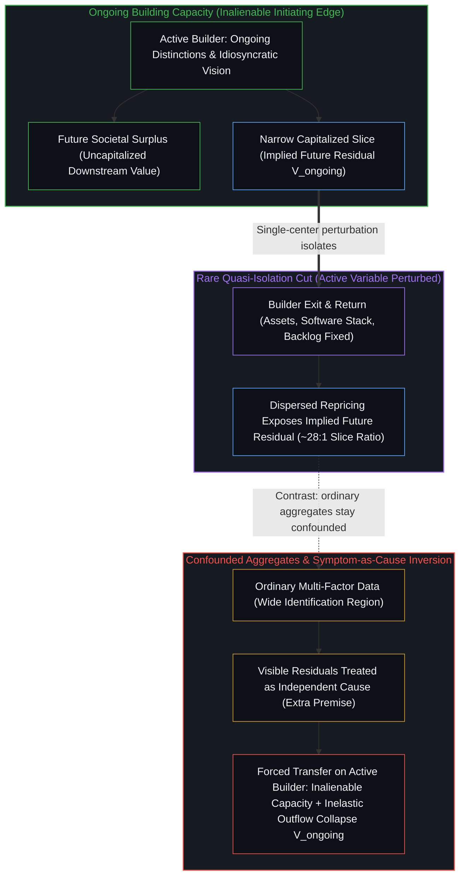
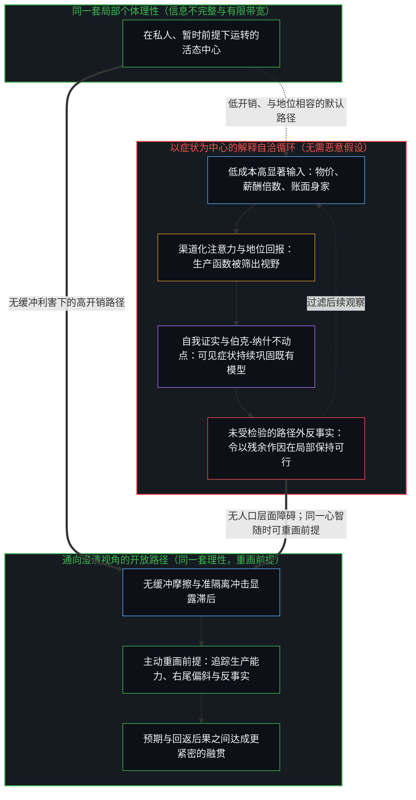

# 建造者的缺席与解释的自洽循环 / The Builder's Absence and the Self-Consistent Cycle of Explanation

*一人的去留改写万亿级隐含未来残余，而症状解释在个体理性中自我巩固，无需恶意假设。 / One person's exit and return rewrites trillions in implied future residuals, while symptom accounts self-reinforce within local rationality without malice.*

当一位活跃的建造者离开他所发起的生产场域，分散各处的中心随即更新预期，在资本化估值中抹去数万亿美元；待他回归，尽管监管问询与利率压力纹丝未动，仅仅一个全球交易周期便收复了该公司自身近乎全部的跌幅，并回补了跨行业数万亿美元广义回撤的大约一半。在这些相互交错的订单之间登记下来的——被压缩在“情绪”这一表层标签之下——是对持续建造能力的分散定价。既有的名义财富只是过往生产的滞后残余，转移支付将其拨向消费之后，它最终仍会流回生产大于消费的中心；相比之下，活跃建造者的股权日益将一份隐含未来残余纳入资本化定价——这份残余与未来社会财富挂钩，其体量比他个人所持切片高出几个数量级，因此试图夺取或打断其控制权，立时便会令这份隐含部分坍塌。在这类罕见的准隔离切分之外，交叠的变量让以症状为中心的解释始终保持可行，信息不完整条件下的局部个体理性又将其稳固为无需恶意假设的自洽循环——同时也把澄清视角持续留给同一个作出选择的心智。

When an active builder steps away from the productive field he initiated, dispersed centers immediately update their expectations and erase trillions in capitalized value; when he returns, a single global session restores nearly the full loss on the firm itself and roughly half of the broader multi-trillion cross-sector drawdown while regulatory inquiries and yield pressures stay unchanged. What registers across those crossing orders—compressed under the surface label of "sentiment"—is dispersed valuation of continued building capacity. Existing nominal wealth is a trailing residual of past production that transfers shift into consumption before it flows back toward centers that produce more than they consume, whereas an active builder's equity increasingly capitalizes an implied future residual tied to future societal wealth orders of magnitude larger than his personal slice, so attempting to seize or disrupt his control collapses that implied portion immediately. Outside such rare quasi-isolation cuts, overlapping variables keep symptom-centered accounts viable, and local individual rationality under incomplete information stabilizes them into a self-consistent cycle without malice—while leaving the clarifying perspective continuously available to the exact same choosing Mind.

## 一、 切分的清晰与解释的滞后 / 1. The Clarity of the Cut and the Lag of Explanation

自我区分的活动发生着——无因、不息。称之为心智：早已在途的观察者，其每一个行动都是一次区分。每一次离散行动都会留下痕迹，塑形后续行动可及的场域；这种塑形严格单向，自先前的选择流向后来的现场，从不反向而行。观察握住既成的结果，而发起的原因始终留在一步之前的活态边缘。在经济生活中，生产力量栖居于持续的建造活动——不断划出新的区分、拓宽其他中心可及的场域——而非攫取业已沉积下来的痕迹。正如[价格是言说，理解是交易](../price-as-utterance-understanding-as-trade/)所追溯的，一笔出清成交价，来自无数分散的活态中心对现金与资产持有相反排序、彼此交错下单所留下的公开残余，由此消解了名为“市场”的单一超级行动者图景；真正改写数万亿美元估值的，是数十万个中心同时将预期未来能力的一次变动重新追溯进各自的资产负债表。针对过往名义存量的转移支付，移动的只是既有可供消费的残余，而由于被划转的索取权大多流向消费，随后的自愿交换会把这股购买力重新导回生产大于消费的中心——这印证了[拥有更多从不是原因](../having-more-is-never-the-cause/)所确立的，占有从不是自主引擎，也印证了[财富转移政策与价格下限中的原因错置](../the-reversal-of-causality-in-wealth-transfer-policies-and-price-floors/)所追溯的，把既成转移支付或成交价格当成首要杠杆，颠倒了因与果。

Self-distinguishing activity occurs — uncaused, unceasing. Call it the Mind: the observer already underway, every act of which is a distinction. Every discrete act leaves a trace that shapes the field available to later acts, and that shaping runs strictly one way, from earlier choices to later fields, never in reverse. Observation holds the settled effect, while the initiating cause stays one step ahead at the living edge. In economic life, productive strength lives in the continuing activity of building—drawing new distinctions that widen the field available to other centers—rather than in seizing traces already deposited. As [Price as Utterance, Understanding as Trade](../price-as-utterance-understanding-as-trade/) traces, a clearing print is the public residue left wherever dispersed living centers cross orders under opposing rankings of cash and assets, dissolving the picture of a singular super-agent called "the market"; what rewrites trillions in valuation is hundreds of thousands of centers simultaneously re-tracing one shift in expected future capacity into their own balance sheets. Transfers directed at past nominal stocks move existing consumable residuals, and because those transferred claims go largely toward consumption, subsequent voluntary exchanges route that purchasing power back toward centers that produce more than they consume—confirming why possession is never an autonomous engine, as [Having More Is Never the Cause](../having-more-is-never-the-cause/) establishes, and why treating settled transfers or price prints as primary levers inverts cause and effect, as [The Misallocation of Cause in Wealth-Transfer Policies and Price Floors](../the-reversal-of-causality-in-wealth-transfer-policies-and-price-floors/) traces.

2026 年 11 月英伟达联合创始人兼首席执行官黄仁勋的离职与迅速复职，提供了一个罕见的准隔离切分，在全球尺度上将这一区分凸显出来；其跨行业核算详见[生产性基础的市场重定价](../the-market-repricing-of-productive-base/)。在辞职与全票复职相隔的十一天里，公司的晶圆代工供应协议、实物资本、现金资产负债表、CUDA 软件栈、工程师团队以及近期在手订单均保持不变；11 月 17 日英伟达交出远超预期的季度营收，而董事会同日表态不会令其复职，抛售依然加速。11 月 23 日，在联邦出口管制调查、民事信息披露问询、州总检察长调查传票、国会听证以及高位运行的美债收益率悉数悬而未决的情况下，董事会全票恢复了他的职务。仅仅一个交易周期之内，英伟达暴涨 31.48%——市值增加约 9540 亿美元，收复辞职后跌幅的 97.2%——同时带动更广泛的科技与人工智能生态反弹 2.7 至 3.3 万亿美元，全球股市整体回补 3.8 至 5.0 万亿美元，收复了先前多因素回撤的大约一半，而尚未闭合的折价则登记下持续存在的法律与利率摩擦。由于创始人个人持股比例约占公司的 3.5%，仅就全体股东的重定价而言，全体股东重定价总规模与他本人单日约 330 至 340 亿美元股权波动之比便达大约 28:1，这还未计入未资本化的员工收入、供应链以及下游消费者剩余。在识别口径上保持精确，才能维持这一刀的锐度：此事件是一次*准隔离*，而非实验室真空，因为最初的辞职与涉外情报审查相伴发生，而复职又与美国政府高层的国家安全审批同步落地。即便如此，在实物资产、软件栈、在手订单以及并发法律与利率拖累保持恒定的同时翻转一个运转中的核心，相较于寻常跨多年的经济数据，已大幅收窄了混杂空间。

The November 2026 departure and rapid reinstatement of NVIDIA co-founder and chief executive Jensen Huang supplies a rare quasi-isolation cut that brings this distinction into sharp focus at global scale, whose cross-sector accounting is detailed in [The Market Repricing of Productive Base](../the-market-repricing-of-productive-base/). Across the eleven days between resignation and unanimous reinstatement, the firm's foundry supply agreements, physical capital, cash balance sheet, CUDA software stack, engineering headcount, and near-term product backlog remained fixed; when NVIDIA reported blowout quarterly revenue on November 17 while its board stated it would not reinstate him, selling accelerated anyway. On November 23, with federal export-control probes, civil disclosure inquiries, a state attorney general subpoena, congressional hearings, and elevated Treasury yields all still open, the board unanimously reinstated him. In a single trading cycle, NVIDIA surged 31.48 percent—adding roughly $954 billion to recover 97.2 percent of its post-resignation loss—alongside a $2.7–3.3 trillion rebound across the broader technology and artificial-intelligence ecosystem and $3.8–5.0 trillion across global equities, restoring roughly half of the broader multi-factor drawdown while the remaining discount registered persisting legal and rate friction. Because the founder's own stake sits near 3.5 percent of the company, his roughly $33–34 billion single-day equity swing stood at roughly a 28:1 ratio against total shareholder repricing alone, before counting uncapitalized employee earnings, supply chains, and downstream consumer surplus. Precision on identification keeps the cut sharp: the episode is a *quasi-isolation* rather than a laboratory vacuum, because the initial resignation co-varied with foreign-intelligence scrutiny and the reinstatement coincided with senior U.S. government national-security clearance. Holding physical assets, software, backlog, and concurrent legal and rate drags constant while flipping one operational center still narrows confounding dramatically relative to ordinary multi-year economic data.

两条相互咬合的机制阐明了，为何试图夺取或强制划转活跃建造者的名义股权，非但无法将一堆完好无损的财富原样过户，反而会让规模大得多的隐含未来价值瞬间坍塌。其一，持续运转的生产性判断无法随股权凭证一同过户。在桑福德·格罗斯曼、奥利弗·哈特与约翰·穆尔（1986、1990、1994）的不完备契约框架中，法律产权赋予的是对可让渡实物资产的剩余控制权，而人力资本严格不可让渡：建造者无法将未来的主动性与判断力绑定为终身劳役，因此企业在其自愿持续参与下的价值（`V_ongoing`），高于失去该参与后的延续或清算价值（`V_liquidation`）。佐哈尔·戈申与阿萨夫·哈姆达尼（2016）则在公司治理一面借*特质愿景*标出了同一道边界：当建造者依凭一种关于未来技术架构、外部共识尚无从预先核验的信念展开行动时，过早剥夺其控制权，便会直接熄灭这份愿景所承载的前瞻期权价值。其二，账面总市值只是将边际出清价格乘以全部已发行股本，而非点算一座静待拆分的现金金库。按泽维尔·加贝克斯与拉尔夫·科伊延（2021）的非弹性市场假说，机构投资授权把套利约束得极为紧密，以致每 1 美元的强制资金流出便会以接近 `M ≈ 5`（大致介于 3 至 8 之间）的乘数压低总股市值，名义财富的坍塌速度远高于现金能够被抽出的速度。当强制划转落向活跃建造者，两条通道会同时击发——人力资本撤出与非弹性价格冲击齐发，立时将 `V_ongoing` 压向 `V_liquidation`。标出这一机制的确切边界，同时也标出了所引诸模型的适用止境：不完备契约与特质愿景模型刻画的是依赖控制权的活跃建造者，若泛化至被动持仓或固守权位的财富便止步于此；而法提赫·古韦宁及其合作者（2023）的异质回报财富税模型之所以能得出重配收益，前提恰在于被动持仓转向更高回报的经营者，且未打断活跃建造者的控制权、未逼退不可让渡的人力资本。突发离世的实证数据同样勾勒出这道分界：德克·延特、叶戈尔·马特维耶夫与卢卡斯·罗斯在美国上市公司中发现，较年轻创始人的突发离世引发剧烈股权下跌（平均异常收益 `−8.82%`），而年迈且固守权位的创始人突发离世反而平均录得上涨（`+5.26%`）。强制划转之所以导致巨额隐含剩余坍塌，具体发生在股权资本化了活跃建造者不可让渡的持续能力与控制权之处；至于那些掌管本身只带来零或负向未来价值的被动持仓或固守权位资产，则落在这场坍塌之外。正如[价值、货币与财富的生成机制](../the-generative-mechanics-of-value-money-and-wealth/)与[继承的残余与索取的必要](../inheritance-as-residue-and-the-need-for-extraction/)所确立的，持久的财富栖居于活跃的生产能力而非纸面产权，削弱对活跃建造的剩余索取权，压缩的正是前方的场域本身。

Two interlocking mechanisms clarify why attempting to seize or forcibly transfer an active builder's nominal equity collapses the far larger implied future value rather than transferring an intact pile. First, ongoing productive judgment cannot be transferred alongside share certificates. In the incomplete-contracts framework of Sanford Grossman, Oliver Hart, and John Moore (1986, 1990, 1994), legal title confers residual rights of control over alienable physical assets, yet human capital stays strictly inalienable: a builder cannot bind future initiative and judgment into servitude, so enterprise value under voluntary ongoing participation (`V_ongoing`) exceeds continuation or liquidation value without that participation (`V_liquidation`). Zohar Goshen and Assaf Hamdani (2016) locate the governance face of the same edge in *idiosyncratic vision*: when a builder acts on a non-verifiable conviction about future technological architecture that outside consensus cannot verify in advance, stripping control rights prematurely extinguishes the forward option value carried by that vision. Second, headline market capitalization multiplies a marginal clearing price across all outstanding shares rather than counting a liquid vault waiting to be split. Under Xavier Gabaix and Ralph Koijen's (2021) Inelastic Markets Hypothesis, institutional mandates constrain arbitrage so tightly that every $1 of forced outflow depresses aggregate equity value by a multiplier near `M ≈ 5` (ranging roughly 3 to 8), collapsing nominal wealth far faster than cash can be extracted. When forced transfer strikes an active builder, both channels fire together—human-capital withdrawal and inelastic price impact collapse `V_ongoing` toward `V_liquidation` at once. Naming the exact boundary of this mechanism marks where each cited model stops as well: incomplete-contract and idiosyncratic-vision models capture control-dependent active builders yet stop short when generalized to passive or entrenched fortunes, while heterogeneous-return wealth-tax models such as Fatih Guvenen and co-authors (2023) obtain reallocation gains only where passive holdings shift toward higher-return operators without disrupting active builders' control or withdrawing inalienable human capital. Empirical sudden-death data trace the exact same split: Dirk Jenter, Egor Matveyev, and Lukas Roth find across U.S. public firms that sudden deaths of younger founders trigger steep equity losses (`−8.82%` mean abnormal return) whereas sudden deaths of older, entrenched founders average gains (`+5.26%`). Forced transfer collapses massive implied surplus specifically where equity capitalizes an active builder's inalienable ongoing capacity and control, whereas passive or entrenched holdings whose stewardship adds zero or negative forward value sit outside that collapse. As [The Generative Mechanics of Value, Money, and Wealth](../the-generative-mechanics-of-value-money-and-wealth/) and [Inheritance as Residue and the Need for Extraction](../inheritance-as-residue-and-the-need-for-extraction/) establish, durable wealth resides in active productive capability rather than paper titles, and attenuating residual claimancy on active building compresses the forward field itself.

大多数经济过程缺乏任何接近此类准隔离切分的条件。在寻常跨越多年的宏观汇总数据中，个体的建造能力、既有基础设施、网络采纳、货币流动性、监管体制与长期需求浪潮交织变动，彼此混杂。在特里夫·哈维尔莫（1944）的结构方程框架与查尔斯·曼斯基（1995、2003）的部分识别分析中，只要互不相容的因果结构在观测到的汇总变量上生成相同的联合分布，它们便始终处于*观测等效*状态；缺乏外科手术式的干预——即朱迪亚·珀尔区分的 `P(Y | do(X))` 与被动条件分布 `P(Y | X)`——观测数据便会留下一片宽阔的*识别区域*，令相互冲突的解释在其中均不被证伪。在这样混杂的背景之下，可见的价格、分配比例、企业利润率与薪酬差异成了搭建解释的原料，尽管这些原料本身已是先前选择与生产的残余。正如[排序的残余与解释的非等效](../the-residue-of-sorting-and-the-non-equivalence-of-interpretations/)在人口迁移与制度排序中所追溯的，将观测到的残余视为独立原因——假定名义财富存量能够自主维系，且可以在不触及持续创造的前提下加以切分——必须额外引入一条前提，设定某种不依赖持续建造的独立因果力。即便上述计量经济学识别框架本身，一旦被奉为抽离于外的统计法庭，同样会触及边界：一次锐利的准隔离冲击确能收窄观测歧义，但它究竟是否登记为确证，依然取决于解读它的活的心智持有怎样的前提。

Most economic processes lack anything approaching such a quasi-isolation cut. Across ordinary multi-year aggregates, individual building capacity, inherited infrastructure, network adoption, monetary liquidity, regulatory regimes, and secular demand waves move together as entangled confounders. In Trygve Haavelmo's (1944) structural framework and Charles Manski's (1995, 2003) partial-identification analysis, incompatible causal structures remain *observationally equivalent* whenever they generate the same joint distribution over observed aggregates; without a surgical intervention—what Judea Pearl distinguishes as `P(Y | do(X))` versus passive conditioning `P(Y | X)`—observational data leave a wide *identification region* inside which conflicting accounts remain unfalsified. Against that confounded background, visible prices, distribution ratios, corporate margins, and compensation differences become the raw material of explanation, even though those materials are themselves residuals of prior choices and production. As [The Residue of Sorting and the Non-Equivalence of Interpretations](../the-residue-of-sorting-and-the-non-equivalence-of-interpretations/) traces across mobility and institutional sorting, treating an observed residual as an independent cause—assuming nominal wealth stocks sustain themselves autonomously and can be split without touching ongoing creation—requires an additional premise of a causal power independent of continued building. Even these econometric identification frameworks reach their boundary when treated as a detached statistical court: a sharp quasi-isolation shock narrows observational ambiguity, yet whether it registers as proof still turns on the premises of the living Mind interpreting it.

## 二、 个体模型的局部理性 / 2. The Local Rationality of Individual Models

每个个体都持有自己关于经济如何运转的独特模型，它由私人的、暂时的前提拼合而成，随时间推移而变动，也在不同心智之间各不相同。正如[理性选择公设是原罪](../the-rational-choice-postulate-is-the-original-sin/)与[理性从不跨越心智](../rationality-never-travels-across-the-mind/)所确立的，理性从不是一套齐一的、可在人与人之间移植的效用演算，也不授权从外部蓝图加以加总；理性是一个个体中心在信息不完整的条件下，其当下选择与所持前提之间的局部融贯。从这一出发点看去，以症状为中心的解释得以持久留存，并不需要假设存在有组织的恶意或普遍的认知失灵。可见的残余——零售价格、账面身家排名、薪酬倍数、税收数额——一眼可察，也极易在日常交谈中流转；而生成它们的底层生产过程却来得迟缓、高度集中且从外部难以看透，正如[生产的不透明与消费的权重](../the-opacity-of-production-and-the-weight-of-consumption/)所追溯的。

Each individual holds a unique model of how the economy operates, assembled from private, provisional premises that shift over time and differ across minds. As [The Rational Choice Postulate Is the Original Sin](../the-rational-choice-postulate-is-the-original-sin/) and [Rationality Never Travels Across the Mind](../rationality-never-travels-across-the-mind/) establish, rationality is never a uniform, interpersonally portable utility calculus licensing aggregation from an external blueprint; it is local coherence between an individual center's current choices and the premises it holds under incomplete information. Seen from that starting point, the persistence of symptom-centered explanations requires no hypothesis of coordinated malice or generalized cognitive breakdown. Visible residuals—retail prices, headline net-worth rankings, pay ratios, tax receipts—are immediate to observe and effortless to share in everyday conversation, whereas the underlying production processes generating them stay delayed, concentrated, and opaque from outside, as [The Opacity of Production and the Weight of Consumption](../the-opacity-of-production-and-the-weight-of-consumption/) traces.

更低的认知开销使症状中心的模型成为默认运转的背景。安东尼·唐斯（1957）借*理性无知*点明了基本的成本不对称：钻研生产函数、一般均衡弹性与反事实推演需要耗费高昂的时间与精力，而单个公民对公共政策的边际撬动力却趋近于零，因此不作投入在局部上恰恰融贯。克里斯托弗·西姆斯（2003）借香农信道容量将同一有限性表述为*理性疏忽*：面对有限的信息处理带宽，一个中心会把注意力分配给与当下决策直接相关的信号——个人薪水、日常物价、肉眼可见的差距——而将演进缓慢的结构变量压缩滤去。埃内斯托·达尔·博、佩德罗·达尔·博与埃里克·艾斯特（2018）进一步补上了*均衡盲视*这一感知层级：人们按政策倡议的即时一阶直接效果——例如针对可见存量的法定转移或课税——来加以评估，却略去了其他中心随之作出的二阶行为调整。布莱恩·卡普兰（2001、2007）将唐斯的成本结构推进为*理性非理性*，指出当发表失准经济评论所承担的私人物质代价趋近于零时，个体只需付出微乎其微的成本，便能顺从印证自身世界观的信念。唐斯与西姆斯的成本模型解释的是粗粒度的注意力分配，而非笃定且带有指向性的叙事；卡普兰的前提则恰恰在他的命名之处触及边界：将分歧模型冠以“非理性”之名，实则把教科书式的学术共识安设为凌驾于活态中心之上的外部法庭。在持有该模型的中心内部，症状中心的模型登记为与可见证据局部一致，而非刻意背离理性。

Lower cognitive overhead makes symptom-centered models the default operating background. Anthony Downs (1957) located the basic cost asymmetry in *rational ignorance*: mastering production functions, general-equilibrium elasticities, and counterfactuals demands steep time and effort while any single citizen's marginal leverage over public policy sits near zero, making non-investment locally coherent. Christopher Sims (2003) formulated the same boundedness through Shannon channel capacity as *rational inattention*: facing finite processing bandwidth, a center allocates attention to signals with immediate decision relevance—personal paychecks, household prices, visible disparities—while compressing away slower structural variables. Ernesto Dal Bó, Pedro Dal Bó, and Erik Eyster (2018) add the perceptual layer of *equilibrium blindness*: evaluating proposals by their immediate first-order direct effect—a statutory transfer or levy on a visible stock—while omitting second-order behavioral adjustments across other centers. Bryan Caplan (2001, 2007) extended Downs's cost structure into *rational irrationality*, observing that when private material penalties for mistaken economic commentary approach zero, individuals indulge worldview-affirming beliefs at negligible personal cost. Downs's and Sims's cost models explain coarse attention rather than confident directional narratives, while Caplan's premise reaches its boundary right at its label: naming divergent models "irrationality" installs textbook academic consensus as an exterior tribunal standing above living centers. Inside the center holding it, a symptom-centered model registers as locally consistent with visible evidence rather than as a deliberate departure from reason.

一旦症状中心的模型沉淀为默认背景，后续观察便在这一背景内部被过滤并反过来将其巩固——这一自洽循环无需任何恶意。形式化的学习模型追溯了这一不动点如何单凭理性更新便自行锁死。在德鲁·富登伯格与戴维·莱文（1993）的*自我证实均衡*中，行动者依照主观信念连贯行事，并在其行动生成的均衡路径上不断遇到与信念相吻合的经验结果；至于路径之外的反事实——夺取控制权后未能建成的剩余，或活跃建造者撤离后化为乌有的产出——由于从未被抽样，因而始终不被证伪。伊格纳西奥·埃斯庞达与德米安·波佐（2016）的*伯克-纳什均衡*更进一步表明，即便行动者的模型族全然遗漏了实际的数据生成结构，严格的贝叶斯更新仍会收敛至这一误设模型族内的某个参数，使其与自身行动所诱发均衡结果之间的散度最小：学习者系统性地更新判断，看见该模型对可见症状的拟合不逊于框架内的任何设定，却始终走不出这一误设模型族。约书亚·施瓦茨斯坦（2014）以及特里斯坦·加尼翁-巴奇、马修·拉宾与约书亚·施瓦茨斯坦（2026）则在*渠道化注意力*下剥离出维系该循环的注意力不对称：单纯接触到事件，并不等同于将修订模型所需的统计量编码入内。*遗漏*活跃因果维度的模型——将生产函数、关键人连续性与消费者剩余筛出视野——在注意力上远比塞入多余伪变量的模型更为稳固，因为被遗漏的变量从未得到追踪，其协变也就从不登记，即便利害攸关，也无从扰动既有框架。这些形式均衡框架各自都在同一处触及不完备的边界：它们把候选模型族或默认注意力过滤器当成交给行动者的外生固定集合，漏掉了活的心智将自身前提置于险境、并从内部重新绘制框架的能力。

Once a symptom-centered model settles in as the default background, subsequent observations are filtered within that background and consolidate it—a self-consistent cycle requiring zero bad faith. Formal learning models trace how this fixed point locks in under rational updating alone. In Drew Fudenberg and David Levine's (1993) *Self-Confirming Equilibrium*, agents act coherently given their subjective beliefs and encounter empirical outcomes matching those beliefs along the equilibrium path their actions produce, while off-path counterfactuals—the surplus never built after seizure, or the output erased when an active builder withdraws—remain unsampled and therefore undisconfirmed. Ignacio Esponda and Demian Pouzo's (2016) *Berk-Nash Equilibrium* shows further that even when an agent's model class omits the actual data-generating structure altogether, strict Bayesian updating converges to the parameter inside that misspecified class minimizing divergence against the equilibrium outcomes induced by those actions: the learner updates systematically, observes the model fit visible symptoms as closely as anything inside its frame, and never exits the misspecified class. Joshua Schwartzstein (2014) and Tristan Gagnon-Bartsch, Matthew Rabin, and Joshua Schwartzstein (2026) isolate the attentional asymmetry stabilizing that loop under *channeled attention*: raw exposure to events does not equal encoding the statistics needed to revise a model. Models that *omit* an active causal dimension—screening production functions, key-person continuity, and consumer surplus out of attention—are far more attentionally stable than models that over-include spurious variables, because an omitted variable is never tracked and its covariance never registers to perturb the frame, even under high stakes. Each of these formal equilibrium frameworks reaches its own boundary of incompleteness where it takes the candidate model class or default attention filter as an exogenous set handed to the agent, leaving out a living Mind's capacity to put its own premises at risk and re-draw the frame from within.

除认知经济与渠道化注意力之外，围绕残余分配的解释还直接契合地位竞争与自我形象维护。罗兰·贝纳布与让·梯若尔（2006、2016）将信念建模为一种功能性资产，除决策准确度外，还产出身份认同与社会地位回报：把巨额财富归因于存量瓜分、运气或规则不公的说法，既让经济增长的受益者之间维系着令人安心的平起平坐，又无需直面生产产出上的极端方差，从而兼顾了在同侪与选举联盟中感到自身尚足的日常诉求。这一激励结构解释了为何单靠分析技能无法消解该循环。在丹·卡汉、埃伦·彼得斯、埃丽卡·道森与保罗·斯洛维奇（2017）关于*动机性数理推理*的实验中，当面对与阵营敏感议题挂钩的同一张数据表时，数理能力最强的受试者反而呈现出更剧烈的极化：只要维护同侪地位的私人回报高过私人准确度利害，更高的分析能力就会被理性地征召过来，用以加固与地位相容的症状叙事。只要私人纠错代价处于缓冲状态，动机性信念框架便能准确捕捉这种保护身份的更新机制；而一旦直接、无缓冲的摩擦对失准预测施以惩戒的速度，快过同侪地位所能提供的缓冲，这一框架便到达了边界。正如[进步叙事中的症候与原因](../symptom-and-cause-in-the-narratives-of-progress/)就集体情绪所追溯的，最响亮、最易传播的社会信号总是出现在发起行动的下游。恶意并非必要；这一稳定循环所需的，仅仅是每个个体在低成本、注意力受渠道引导、且与地位相容的模型内做出连贯选择。

Alongside cognitive economy and channeled attention, explanations centered on residual distribution align directly with status competition and self-image preservation. Roland Bénabou and Jean Tirole (2006, 2016) model beliefs as functional assets yielding identity and standing payoffs alongside decision accuracy: accounts attributing outsized fortunes to fixed-pie extraction, luck, or unfair rules preserve comfortable parity across beneficiaries of economic growth without confronting extreme variance in productive output, balancing the everyday desire to feel adequate among peers and electoral coalitions. That incentive structure explains why analytical skill alone fails to dissolve the cycle. In Dan Kahan, Ellen Peters, Erica Dawson, and Paul Slovic's (2017) experiments on *motivated numeracy*, subjects with the highest quantitative proficiency exhibit sharper polarization when interpreting identical numerical tables tied to coalition-salient issues: whenever the private return to peer standing outweighs any private accuracy stake, higher analytical capacity is rationally recruited to reinforce the status-compatible symptom narrative. Motivated-belief frameworks capture this identity-protective updating wherever private error penalties stay buffered, reaching their boundary once direct, unbuffered friction penalizes inaccurate forecasts faster than peer standing can cushion them. As [Symptom and Cause in the Narratives of Progress](../symptom-and-cause-in-the-narratives-of-progress/) traces for collective mood, the loudest and most shareable social signals arrive downstream of initiation. Malice is unnecessary; the stable cycle requires only that each individual make coherent choices within a low-cost, attention-channeled, status-compatible model.

## 三、 澄清视角的持续可用性 / 3. The Continuing Availability of the Clarifying View

与这一自我证实的循环并存，强调生产函数、生产率极端偏斜、消费者剩余、关键人风险以及反事实的视角依然持续可用。这一框架并不止步于静态的资产负债表快照，而是追踪创新速率、规模互补效应，以及当发起中心离场时究竟会随之消失什么。横跨多个领域的经验记录都登记下这一视角所预见的陡峭不对称——它们充当下游的遥测足迹，而非为因果奠基的外部法庭。在[私人残差与社会剩余的因果次序](../the-causal-order-of-private-residuals-and-social-surplus/)所追溯的威廉·诺德豪斯（2004）战后美国经济核算中，创新者仅捕获了技术进步所生社会剩余的约 2.2%，其余约 97.8% 则经由更低的价格与更广的能力向外耗散给消费者，使名义股权仅是一股庞大得多的剩余浪潮之上狭窄的资本化尖端。重尾集中一再重现于金融市场、宏观经济尺度与个体产出之中：亨德里克·贝森宾德（2018、2023）记录显示，1926 年以来约前 4% 的美国上市公司——以及 1990 至 2020 年间逾 64000 只全球股票中的前 2.4%——贡献了超出短期国库券的全部股市净财富创造，而逾半数上市企业的回报不及现金；泽维尔·加贝克斯（2011）证明，由于企业规模服从齐普夫分布、无法在加总中相互抵消，美国前 100 家大型企业的特质冲击便解释了总体 GDP 波动的约三分之一；欧内斯特·奥博伊尔与赫尔曼·阿吉尼斯（2012）横跨 198 组样本、涵盖 633263 名个体的研究则表明，个体产出系统性地服从帕累托幂律而非高斯钟形曲线，而在企业尺度上，这一偏斜又经由舍温·罗森（1981）以及泽维尔·加贝克斯与奥古斯丁·朗迪耶（2008）所剖析的才能与规模互补效应进一步放大。清晰标明这些统计数据的前提边界，可以防止镜像式的冻结：事后幂律登记的是已经实现的产出——交织着个体主动性与乘法规模、网络杠杆——而非与生俱来、不可撼动的身份；正如[幂律是结果的表象](../mi-lv-shi-jie-guo-de-biao-xiang/)与[平均值是残余，不是引擎](../the-average-is-residue-not-the-engine/)所确立的，右尾曲线是不同迭代速率与离散选择留下的表层残余，从不是规定下一次由谁发起的封闭种姓。

Alongside that self-confirming cycle, the perspective emphasizing production functions, extreme skews in productivity, consumer surplus, key-person risk, and counterfactuals remains continuously available. Rather than stopping at static balance-sheet snapshots, this framing tracks innovation rates, scale complementarity, and what vanishes when an initiating center exits. Empirical records across domains register the steep asymmetry this perspective anticipates—serving as downstream telemetry rather than as an exterior court grounding causality. In William Nordhaus's (2004) postwar U.S. accounting, traced in [The Causal Order of Private Residuals and Social Surplus](../the-causal-order-of-private-residuals-and-social-surplus/), innovators capture roughly 2.2 percent of the social surplus generated by technological advance while roughly 97.8 percent dissipates outward to consumers through lower prices and wider capabilities, leaving nominal equity a narrow capitalized tip of a vastly larger surplus wave. Heavy-tailed concentration recurs across financial markets, macroeconomic scale, and individual output: Hendrik Bessembinder (2018, 2023) documents that roughly the top 4 percent of U.S. listed companies since 1926—and the top 2.4 percent of over 64,000 global stocks from 1990 to 2020—accounted for 100 percent of net shareholder wealth creation above Treasury bills while more than half of listed firms underperformed cash; Xavier Gabaix (2011) demonstrates that idiosyncratic shocks to the top 100 U.S. firms account for roughly one-third of aggregate GDP fluctuations because Zipf-distributed firm sizes do not average out; and Ernest O'Boyle and Herman Aguinis (2012) show across 198 samples spanning 633,263 individuals that output systematically follows Paretian power laws rather than Gaussian bell curves, amplified at enterprise scale by the talent-scale complementarity analyzed by Sherwin Rosen (1981) and Xavier Gabaix and Augustin Landier (2008). Keeping the premise boundary of these statistics explicit prevents a mirror freeze: ex-post power laws register realized output—blending individual initiative with multiplicative scale and network leverage—rather than innate immutable status, and as [Power Law Is the Surface of Outcomes](../mi-lv-shi-jie-guo-de-biao-xiang/) and [The Average Is Residue, Not the Engine](../the-average-is-residue-not-the-engine/) establish, the right-tail curve is the surface residue of differing iteration rates and discrete choices, never a sealed caste governing who initiates next.

这一澄清视角之所以稀有，无需任何奇特的解释。它的原始输入——创新速率、未资本化的消费者剩余，以及未来产出在反事实中的凭空消失——极少以高显著、便于分享的形态呈现。维系这一视角，需要比引用可见薪酬倍数或账面身家付出更高的认知开销，且与盛行的症状解释所带来的道德和地位回报直接相左：追踪持续价值创造中的极端右尾偏斜，既不提供怨怼联盟，也不提供顺手的零和靶标，更少带来即刻的同侪掌声。没有任何人口层面的障碍阻止这一转向。无论阶层、先天能力上限，还是结构性禁令，都未曾把任何个体锁死在症状中心的推理之内；人群中可观察到的观点分布，反映的仅仅是两种推理风格在认知成本、注意力渠道与社会强化上的相对差异。既然[个体抉择是唯一的因果杠杆](../individual-choices-as-the-only-causal-levers/)跨越一切尺度而成立，运用澄清视角的中心集合便从不是一份封闭的名册——只要回返后果的分量压过同侪共振，任何个体都可以转向它。

The rarity of this clarifying view requires no exotic explanation. Its raw inputs—innovation rates, uncapitalized consumer surplus, and the counterfactual disappearance of future output—seldom arrive in high-salience, easily shareable form. Maintaining it demands greater cognitive overhead than citing visible pay ratios or headline fortunes, and it sits in direct tension with the moral and status payoffs of prevailing symptom accounts: tracing extreme right-tail skew in ongoing value creation offers no grievance coalition, no convenient zero-sum target, and little immediate peer applause. No population-level barrier prevents the shift. Neither class, innate capacity ceiling, nor structural prohibition locks any individual inside symptom-centered reasoning; the observed distribution of views across a population reflects the relative cognitive costs, attention channels, and social reinforcements of the two styles of reasoning. Because [Individual Choices as the Only Causal Levers](../individual-choices-as-the-only-causal-levers/) holds across every scale, the set of centers applying the clarifying view is never a closed roster—any individual can adopt it whenever returning consequences outweigh peer resonance.

因此，同一套局部理性既说明了以症状为中心的解释何以稳固，也说明了澄清视角何以始终敞开可用，而无需援引任何外部终极真理从场外裁断二者。在私人失误成本趋近于零的缓冲评论之中，局部融贯偏向低开销、与地位相容的症状框架，并任由路径上的观察将其无限期地证实下去。而每当一个个体步入无缓冲的敞口——投入资本、搭建基础设施、承销信贷，或在预测撞上市场摩擦时亲身承受直接亏损——静态存量外推与持续生产能力之间的落差便会以即刻的力度登记下来。正如[信念如何真正改变](../how-belief-actually-changes/)所追溯的，无论是原始数据还是外部争辩，都从不代为执行信念的转变；一个中心之所以转向，在于主动重画自身的前提，把更强的预测力直接认作更窄的多余滞后，以及预期与回返后果之间更紧密的对齐。这一澄清视角始终是活的心智所持有的开放、可修订器具，而非不可更易的教条：正如[自我价值感与所有权](../ownership-and-self-worthiness/)所确立的，唯有当后果作为自己的后果重新进入时，判断与识见才产生复利；而正如[开放即一致](../openness-is-consistency/)所展示的，让每一张地图在流动的摩擦面前保持暂时，恰恰是维系一致性的所在。在划出每一次区分的第一人称边缘，没有任何外部权威替人裁定持守哪一框架。究竟将观察到的残余读作等待分割的固定存量，还是将其重新追溯回正在生成未来剩余的持续建造能力，始终是每个人离散而不可代理的选择——每当回返的摩擦显露出旧地图的滞后，这一选择便即刻敞开，随时可供重新渲染。

One unified local rationality therefore accounts for both the stability of symptom-centered explanations and the open availability of the clarifying view, without invoking an exterior ground truth to judge either from outside. Under buffered commentary where private error costs stay near zero, local coherence favors the low-overhead, status-compatible symptom frame and lets on-path observations confirm it indefinitely. Whenever an individual steps into unbuffered exposure—committing capital, building infrastructure, underwriting credit, or bearing direct losses when a forecast collides with market friction—discrepancies between static-stock extrapolation and ongoing productive capacity register with immediate force. As [How Belief Actually Changes](../how-belief-actually-changes/) traces, neither raw data nor outside argument executes a shift in belief; a center shifts through a voluntary re-draw of its own premises, recognizing greater predictive power directly as narrower excess lag and tighter alignment between expectation and returning consequence. That clarifying perspective remains an open, revisable instrument held by a living Mind rather than an immutable doctrine: as [Ownership and Self-Worthiness](../ownership-and-self-worthiness/) establishes, reading and judgment compound only when consequences re-enter as one's own material, and as [Openness Is Consistency](../openness-is-consistency/) shows, keeping every map provisional against moving friction is what sustains consistency. At the first-person edge where every distinction is drawn, no external authority settles which frame is held. Reading observed residuals as fixed stocks to divide, or re-tracing them back to the ongoing building capacity generating future surplus, remains one's own discrete, unproxyable choice—continuously open to re-rendering the instant returning friction exposes the lag of the prior map.
