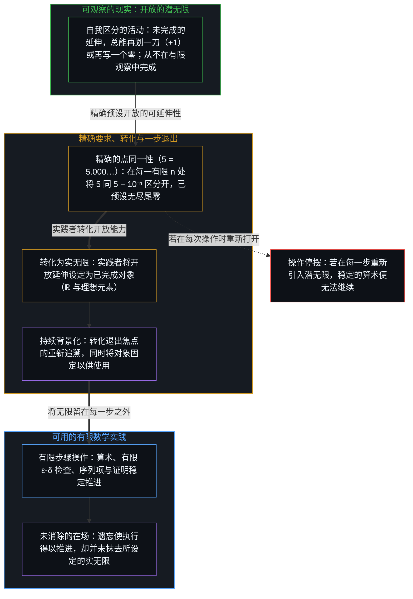
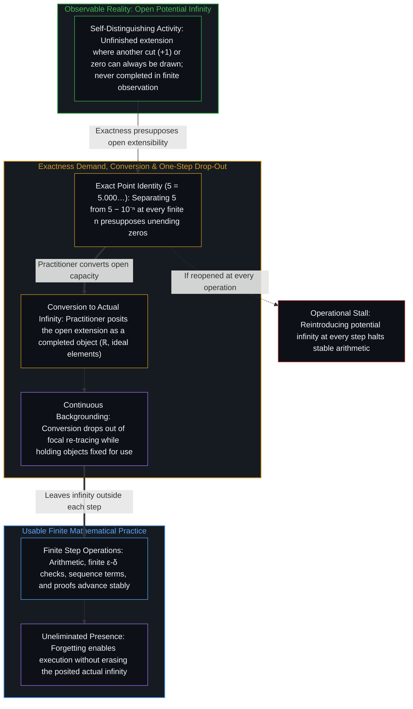
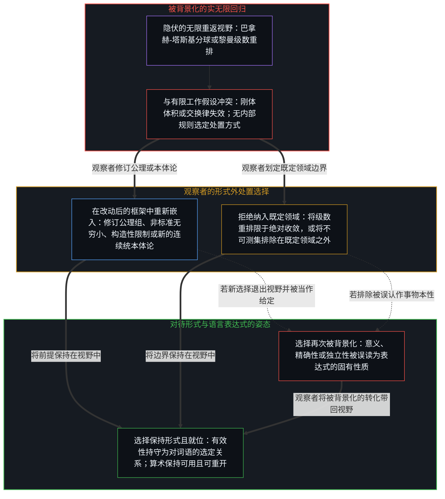
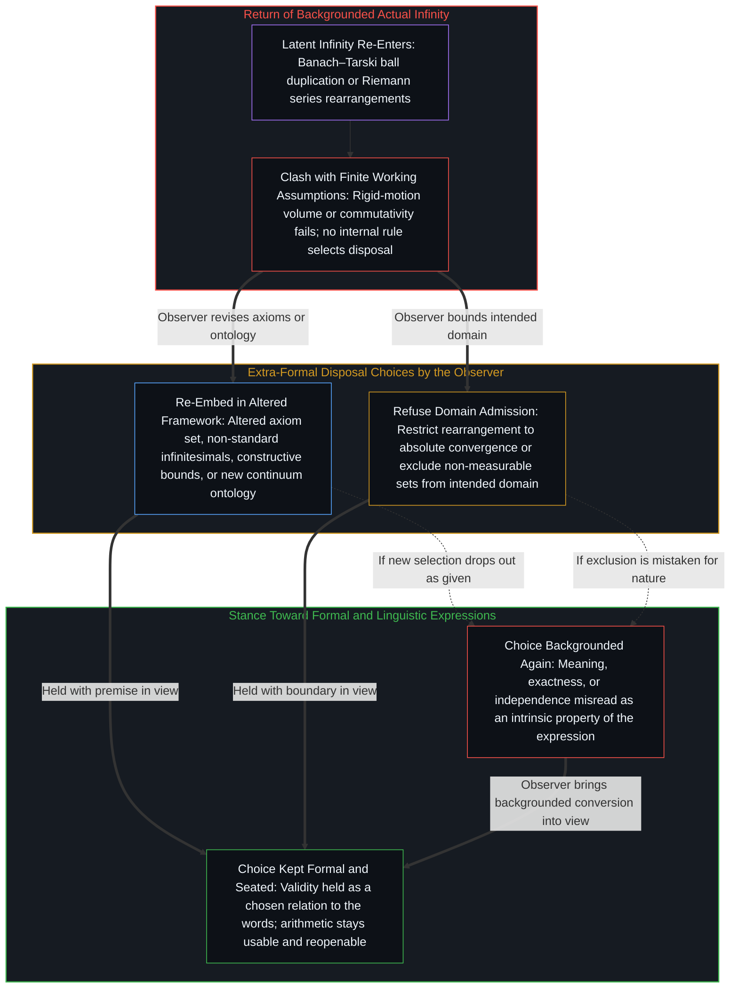

# 整数的内建无限与背景化的选择 / The Built-in Infinity of Integers and the Backgrounded Choice

*每一整数已携带其精确所要求的潜无限，而数学的日常运作依赖于将其转化为实无限并置于背景，由此敞开的悖论只能由观察者的进一步选择来处置。 / Every integer already carries the potential infinity required by its exactness, while ordinary mathematical practice depends on converting that into actual infinity and placing it in the background; the paradoxes thereby opened can only be disposed of by further choices of the observer.*

因将 n = ∞ 代入费马大定理而驳回[迈克尔·布里尔 1985 年 3 月刊于《数学杂志》的戏谑短文](https://x.com/mathelirium/status/2122958317815558555)，是把无限当作指数外缘处的反常，然而[每一整数在其精确中已包含潜无限](https://x.com/powerpig/status/2122964956572500226)：五并非一个区间，而是 5.000… 的无限尾零所固定的那个点。这一尾零序列在可观察的现实中始终是未完成的延伸——总能再写一个零——因此这里涉及的无限是潜无限，是现实的必要前提，而非已完成的事实。数学的日常运作之所以在现有形态下有用，正是因为观察者将这一潜无限转化为实无限，并将这一转化持续背景化：算术与证明作为已完成、自足对象上的操作来推进，而不必在每一步重新打开精确本身所携带的开放可能性。当被背景化的实无限以另一种形式重新出现、并与这些工作假设相冲突时，形式系统内部并没有规则能强制给出解决；任何处置都要求观察者做出额外的选择——要么在更宽或经改动的框架中重新嵌入无限，要么拒绝把问题构造纳入既定领域。

Dismissing [Michael H. Brill’s satirical March 1985 *Mathematics Magazine* note](https://x.com/mathelirium/status/2122958317815558555) for plugging n = ∞ into Fermat’s Last Theorem treats infinity as an aberration at the outer horizon of the exponents, while [every integer already contains potential infinity in its exactness](https://x.com/powerpig/status/2122964956572500226): five is not an interval, but the point fixed by the infinite trailing zeros of 5.000…. That sequence of zeros remains, in observable reality, an unfinished extension—one can always write another zero—so the infinity at issue is potential infinity, a necessary premise of reality rather than a completed fact. Ordinary mathematical practice is useful in its present form precisely because the observer converts this potential infinity into actual infinity and continuously backgrounds the conversion: arithmetic and proof proceed as operations on completed, self-contained objects, without reopening at every step the open possibility that exactness itself carries. When the backgrounded actual infinity reappears in another form that conflicts with those working assumptions, the formal system contains no internal rule that forces a resolution; any disposal requires an additional choice by the observer—either to re-embed the infinite in a broader or altered framework or to refuse to admit the problematic construction into the intended domain.

## 一、 精确是潜无限的开放能力 / 1. Exactness Is the Open Capacity of Potential Infinity

仅作为计数（+1）中的离散句法计数符来使用时，整数是一枚有限记号，其无限性仍外在于该记号本身，位于开放的后继规则之中；一旦嵌入数轴并当作离散单位来使用，其精确所要求的无限精度并不需要在每一步重新引入。然而，将五作为一个零宽度的点同 5.0001 以及任意有限深度 n 处的有限阶段近似 4.999…9（5 − 10⁻ⁿ）区分开来，已经预设了 5.000… 的无尽尾零；没有这串尾零，精确的点同一性便让位于一段容差区间——即一种有限粒度，[精度与分辨率](../precision-and-resolution/)正是将其同脱离语境的严密准确区分开来。就连 ℝ 中的经典恒等式 4.999… = 5，也已经依赖把那一未完成的延伸打包为已完成的整体，使趋零的 10⁻ⁿ 间隙在极限处坍缩；而在鲁伊兹·布劳威尔的构造性分析中，若不对 ℕ 作一次性清点，便无法在一个逐步展开的过程上判定精确相等 x = 5，因为没有任何有限前缀能够核证后续每一项偏差都保持为零。在可观察的现实中，这一无限始终是潜无限，正如[无穷总体的海市蜃楼](../the-mirage-of-the-infinite-totality/)所追溯的：区分活动可以无限延伸，却永远不会在任何有限观察中完成那一串零。潜无限因此是现实的必要前提——任何可观察的过程、有限记录或当下区分都只能是未完成的延伸。实无限则是心智在数学实践中为了把整数当作已完成对象来操作而做出的转化：把开放的可能性当作已经全部就位——即设定在潜无限之内的一件器具，而非立于过程之外的对象，正如[实无限生于潜无限](../actual-infinity-born-inside-potential-infinity/)所追溯的那样。没有这个转化，经典的 ε-δ 论证、无穷级数以及连续统上的操作都无法稳定进行。实无限是数学在其主流形态下的必要前提，却并不存在于可观察的现实中。

Used strictly as a discrete syntactic tally in counting (+1), an integer is a finite token whose infinity stays extrinsic to the token, in the open-ended successor rule; once embedded on the number line and used as a discrete unit, the infinite precision its exactness requires does not need to be reintroduced at each step. Yet separating five as a zero-width point from 5.0001 and from every finite-stage approximation 4.999…9 (5 − 10⁻ⁿ at any finite depth n) already presupposes the unending trailing zeros of 5.000…; without them, exact point-identity gives way to an interval of tolerance, the finite grain [Precision and Resolution](../precision-and-resolution/) distinguishes from context-free exactness. Even the classical identity 4.999… = 5 in ℝ already relies on packaging that unfinished extension into a completed totality so the vanishing 10⁻ⁿ gap is collapsed at the limit, whereas in L. E. J. Brouwer’s constructive analysis, deciding exact equality x = 5 across a process unfolding step by step remains unavailable without an all-at-once survey of ℕ, since no finite prefix certifies that every later deviation stays zero. In observable reality this infinity remains potential, as [The Mirage of the Infinite Totality](../the-mirage-of-the-infinite-totality/) traces: distinguishing activity can extend indefinitely, yet the sequence of zeros is never completed in any finite observation. Potential infinity is therefore a necessary premise of reality—any observable process, finite record, or present distinction can only be an unfinished extension. Actual infinity is the conversion a Mind makes in mathematical practice in order to treat the integer as a completed object: the open possibility is taken as already fully in place—an instrument posited inside potential infinity rather than an object standing outside process, as [Actual Infinity Born Inside Potential Infinity](../actual-infinity-born-inside-potential-infinity/) traces. Without this conversion, classical ε-δ arguments, infinite series, and operations on the continuum cannot proceed stably. Actual infinity is a necessary premise of mathematics in its prevailing form, yet it does not exist in observable reality.

## 二、 背景化使工具可用 / 2. Backgrounding Makes the Tools Usable

当实践者用有限的 ε-δ 检查来判定极限、借有限的项来处理序列，或在不重新审视底层无限过程的情况下证明定理时，每一次操作都把已转化的实无限留在焦点步骤之外，使计算与推理能够以有限步骤推进。卡尔·魏尔施特拉斯的 ε-δ 表述用有限不等式取代了显式的无穷小，但其量词依然遍历一条已被设定为完成整体的实数轴——即[连续性作为建模的权宜之计](../the-continuum-is-a-modeling-convenience/)所追溯的那层极限闭合；而大卫·希尔伯特在 1925 年的演讲《论无穷》中，也将已完成的无限刻画为附加的理想元素，其引入是为了让有限的代数与逻辑规则能在设定的闭合之内统一运行，正如[潜无限与数学思维的暂时闭合](../potential-infinity-and-the-temporary-closures-of-mathematical-thought/)所审视的那样。这种背景化并非数学的缺陷；它是数学工具在具体问题上变得可用的方式，践行着[遗忘的脚手架](../the-scaffolding-we-forget/)所追溯的一步退出：器具在承载当前操作的同时，退出递归的重新追溯。若潜无限必须在每一步重新带入——在做加法或比较之前，先重新打开 5.000… 的无尽延伸——算术本身便无法稳定地继续。有用性依赖于把潜无限转化为实无限，并在执行期间持续遗忘这一转化，而遗忘并不消除那份将对象固定在原位的无限在场。

When a practitioner evaluates a limit by finite ε-δ checks, handles a sequence through finite terms, or proves a theorem without re-examining the infinite process underneath, each operation leaves the converted actual infinity outside the focal step, allowing calculation and reasoning to advance in finite steps. Karl Weierstrass’s ε-δ formulation replaces overt infinitesimals with finite inequalities, yet its quantifiers still range over a real line already posited as a completed whole—the limit closure [The Continuum is a Modeling Convenience](../the-continuum-is-a-modeling-convenience/) traces—and David Hilbert, in his 1925 lecture *On the Infinite*, characterized completed infinities as adjoined ideal elements introduced so finite rules of algebra and logic can run uniformly inside a posited closure, as [Potential Infinity and the Temporary Closures of Mathematical Thought](../potential-infinity-and-the-temporary-closures-of-mathematical-thought/) examines. This backgrounding is not a defect of mathematics; it is the manner in which mathematical tools become usable on concrete problems, enacting the one-step drop-out traced in [The Scaffolding We Forget](../the-scaffolding-we-forget/), where an instrument steps out of recursive re-tracing while carrying the current operation. If potential infinity had to be reintroduced at every step—reopening the unending extension of 5.000… before adding or comparing—arithmetic itself could not continue stably. Utility depends on converting potential infinity into actual infinity and continuously forgetting the conversion during execution, while the forgetting does not eliminate the presence of the infinite that holds those objects in place.

## 三、 悖论是被背景化者的回归 / 3. Paradox Is the Return of What Was Backgrounded

一旦实无限被背景化，某些构造便会以与先前工作假设相冲突的形式将其重新引入。伯恩哈德·黎曼对 ∑ (−1)ⁿ⁻¹/n 等条件收敛级数的重排丝毫不调用选择公理，却仅凭置换步骤次序便能把极限引向任意选定的目标值——当一个正负项储备皆取之不尽的无尽序列过程被当作已完成的和来对待时，便与有限加法交换律（a + b = b + a）发生碰撞；而斯特凡·巴拿赫与阿尔弗雷德·塔斯基的分解则调用选择公理，在精确点的不可数多个旋转轨道上进行选取，将一个实心球剖分为有限个互不相交的点集，再经由刚体运动重组成两个与原球半径相等的实心球，从而与体积守恒发生碰撞。反复重现的潜无限与实无限之争，同样是在已经把这一转化置于背景的实践内部将它重新打开。形式推导记录了与那些先前假设的冲突，却不提供内部规则来强制选定一种处置。登记为矛盾的东西并不是计算错误；它是被背景化的实无限以另一种方式再度现身——正如[没有固定者的固定](../fixed-by-nothing/)在决定论初始条件中所追溯的那样，一份未经生成的无限规定被预先装载进起点的持守之中——此时有限的工作假设无法再无摩擦地继续适用，呈现出[开放即一致](../openness-is-consistency/)所指出的那种张力：暂时的持守被当作了穷尽的地基。这些构造依赖实无限，而实无限并不对应任何可观察的现实。

Once actual infinity has been backgrounded, certain constructions reintroduce it in forms that conflict with the earlier working assumptions. Bernhard Riemann’s rearrangements of conditionally convergent series such as ∑ (−1)ⁿ⁻¹/n use no Choice axiom at all, yet steer the limit to any chosen target by permuting step order, colliding with finite commutativity (a + b = b + a) when an unending sequential process with inexhaustible positive and negative reservoirs is treated like a completed sum; and Stefan Banach and Alfred Tarski’s decompositions invoke the Axiom of Choice across uncountably many rotation orbits of exact points to partition one solid ball into finitely many disjoint point sets and reassemble them by rigid motions into two balls of the original radius, colliding with volume conservation. Recurring foundational disputes between potential and actual infinity reopen the same conversion inside a practice that has already placed it in the background. Formal derivation records the conflict with those prior assumptions yet supplies no internal rule that forces a choice of disposal. What registers as contradiction is not a calculation error; it is the reappearance, in another manner, of the backgrounded actual infinity—an ungenerated infinite specification loaded into the starting hold, as [Fixed by Nothing](../fixed-by-nothing/) traces in deterministic initial conditions—at which point the finite working assumptions can no longer apply without friction, exhibiting the tension [Openness Is Consistency](../openness-is-consistency/) locates whenever a provisional hold is treated as exhaustive ground. These constructions rely on actual infinity, and actual infinity does not correspond to any observable reality.

## 四、 处置要求观察者的额外选择 / 4. Disposal Requires an Additional Choice of the Observer

任何解决都发生在产生困难的形式装置之外，在无限的层面上重演着[没有系统能被保持封闭](../no-system-can-be-kept-closed/)所追溯的那一步——跨出当前活跃的持守。观察者可以采纳一个更宽或经改动的框架——例如削弱选择公理使连续统的每一个子集保持可测，添入显式的非标准无穷小以使无限步骤有别于精确极限，施加构造性限制在放弃可判定点相等的同时阻断非构造性分解，抑或转向对连续统的不同本体论——借此以吸收悖论的方式重新嵌入无限；观察者也可以拒绝接纳该问题构造，将其划在既定领域之外，例如把级数重排限制在绝对收敛之内，或把不可测点集排除在物理体积之外。这两种举措都恢复了可用性，但两者都是观察者对何者算作合法无限的进一步选择，平行于[论关于 P 与 NP 所能言说的边界](../on-the-boundaries-of-what-can-be-said-about-p-and-np/)在公理推导范围之外所析出的那些形式外承诺。同一道切分也支配着表达式本身的持守方式：选择可以被背景化，使意义、精确性或独立性看起来像是表达式自身的性质；也可以保持为形式且就位的选择，使其有效性停留在对词语的一种选定关系之内，从而消解[两度显现的不完备性](../incompleteness-exhibited-twice/)在暂时工作持守与永久闭合之间所追溯的那种倒置。整数的内建无限所标记的，正是背景化已经发生：潜无限已被当作实无限来对待，而把这一转化重新带回前景还是继续让它留在背景，仍是开放的选择。

Any resolution occurs outside the formal apparatus that produced the difficulty, enacting at the level of infinity the step beyond the active hold traced in [No System Can Be Kept Closed](../no-system-can-be-kept-closed/). The observer may adopt a broader or altered framework—weakening the Choice axiom so every subset of the continuum remains measurable, adjoining explicit non-standard infinitesimals that keep infinite steps distinct from exact limits, imposing constructive restrictions that block non-constructive decompositions while giving up decidable point-equality, or shifting to a different ontology of the continuum—that re-embeds the infinite in a way that absorbs the paradox, or may refuse the problematic construction as outside the intended domain, such as restricting series rearrangement to absolute convergence or excluding non-measurable point sets from physical volume. Both moves restore usability, yet both are further selections by the observer of what will count as legitimate infinity, parallel to the extra-formal commitments [On the Boundaries of What Can Be Said about P and NP](../on-the-boundaries-of-what-can-be-said-about-p-and-np/) isolates beyond what axioms derive. The same cut governs how expressions themselves are held: the choice can be backgrounded, so that meaning, exactness, or independence appears as a property of the expression itself; or it can be kept formal and seated, so that its validity remains the validity of a chosen relation to the words, dissolving the inversion between a temporary working hold and permanent closure traced in [Incompleteness Exhibited Twice](../incompleteness-exhibited-twice/). What the integer’s built-in infinity marks is precisely that backgrounding has already occurred: potential infinity has been treated as actual infinity, and whether to bring that conversion back into the foreground or to leave it in the background remains an open choice.

这一观察并不要求改变任何既有的算术规则。它只标记这些规则得以稳定使用的条件：观察者已将潜无限转化为实无限并置于背景，而继续让这一转化留在背景还是将它重新打开，仍是观察者的选择。

This observation does not require any change to existing rules of arithmetic. It only marks the condition under which those rules can be used stably: the observer has converted potential infinity into actual infinity and placed it in the background, and whether to keep that conversion backgrounded or reopen it remains the observer’s choice.
