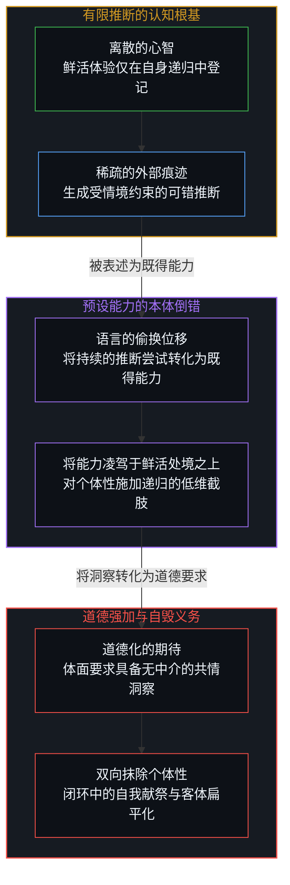
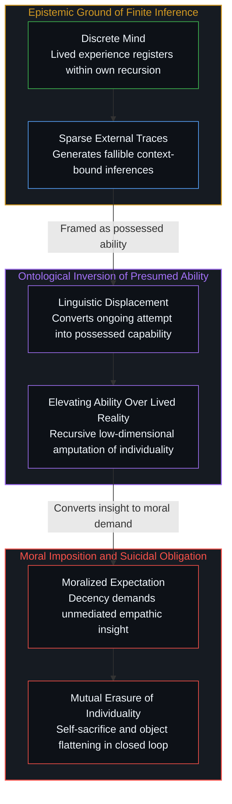
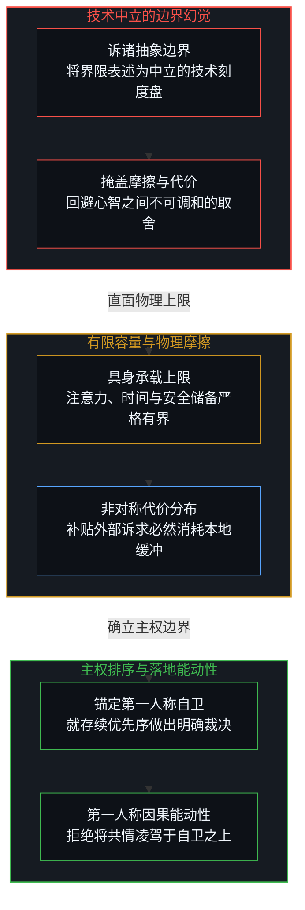
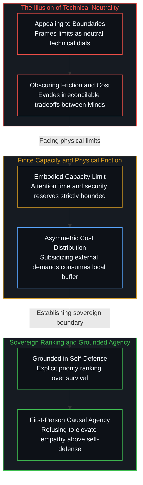

# 共情的能力倒错与边界的排序之争 / The Capability Reversal of Empathy and the Contest of Boundaries

*理解凌驾自卫且被设为既得能力，共情在定义上即自毁 / Elevating understanding above self-defense while presuming it as an ability is how empathy becomes definitionally suicidal.*

围绕所谓自杀式共情的公共争议，表面上是一场关于同情心是否应当设立节制的道德辩论，深层却潜藏着人类语言在定义心智互动时所埋下的认知倒错。当人们将共情轻巧地表述为理解他人想法或感受的能力时，便悄然将一种受限于视界与稀疏证据的试探性推断，偷换成了主体已经稳固持有的确定性权能。这种语言上的预先僭越不仅抹除了离散心智之间不可跨越的本体边界，更将一种描述性的心理假设迅速升格为不容协商的道德戒律，迫使行动者为了内部投射出的幻影而献祭自身的结构完整性。诉诸设立合理边界的方案并未化解底层的张力，因为边界从来不是客观的技术调节旋钮，而是主体在严格物理上限的约束下对存续优先序做出的排他性裁决。

The recurring public controversy surrounding suicidal empathy appears on the surface as a moral dispute over whether compassion requires restraint, yet it conceals a deeper epistemological inversion embedded in the ordinary vocabulary of human interaction. When empathy is casually defined as the ability to understand how others think or feel, an ongoing and fallible attempt to infer mental states from sparse external evidence is quietly converted into an achieved possession. This subtle linguistic overreach erases the insurmountable ontological boundary separating discrete minds, transforming a descriptive psychological hypothesis into an unnegotiable moral imperative that coerces agents into sacrificing their own structural coherence for an internal projection. Appealing to proper boundaries fails to resolve the underlying tension, because a boundary is never an objective technical dial, but an active, exclusionary ranking of survival priorities negotiated under strict physical limits.

## 一、 善意的界定与“自杀式共情”的表层防御 / 1. The Definition of Benevolence and the Surface Defense of "Suicidal Empathy"

针对“自杀式共情”指控的辩护，惯常退守到一道熟悉的概念防火墙之后，甚至在开篇便直截了当地宣称自己讨厌“自杀式共情”这个词本身。这种修辞选择在一开始就显露出刺眼的施演自相矛盾：辩护者试图将共情确立为理解他人想法与感受的核心能力，却在起手的第一瞬间做出了理解的反面动作——用直白的生理性厌恶将批评者的视角一把推开。辩护者拒绝探究究竟是何种具身的边界侵蚀、生存摩擦或下游损害促使观察者铸造并调用这一诊断性词汇，而是直接用道德化的反感将其逐出讨论。这种一边布道无中介的理解、一边拒绝去理解报警者声音的施演断裂之所以发生，正如[共情的投射坍缩](../empathy-as-projection-collapse/)所追溯的，是因为公共语境中的这一词汇将私密感知的拓宽、道德信号的释放与义务座次的排定压缩到了同一条坐标轴上，使辩护者得以一边释放美德信号并将批评者定性为残缺，一边直接舍弃对批评者所感知的边界侵蚀的视野拓宽。

The defense mounted against the accusation of suicidal empathy routinely retreats behind a familiar conceptual firewall, often opening with the stark declaration that one hates the term suicidal empathy itself. This rhetorical choice immediately exposes a glaring performative self-contradiction: while attempting to vindicate empathy as the vital capacity to understand how others think and feel, the defender enacts the precise antithesis of understanding in their opening gesture, casting aside the critic's perspective with visceral antipathy. They refuse to inquire into what embodied boundary erosion, existential friction, or downstream damage compelled observers to coin and invoke that diagnostic phrase, choosing instead to banish it with moralized distaste. This performative rupture—preaching unmediated comprehension while refusing to understand the very voices sounding the alarm—occurs because, as [Empathy as Projection Collapse](../empathy-as-projection-collapse/) traces, the public term compresses private perceptual widening, moral signaling, and obligation-positioning onto a single axis, allowing the defender to signal virtue and position critics as defective while dropping perceptual widening toward the boundary erosion those critics register.

在这种情绪化的拒斥背后，立着一道僵硬的理论切割：共情被界定为理解他人想法或感受的珍贵能力，而毁灭性的后果则被归咎于失去边界的过度同情，即那种牺牲个人福祉或共同体安全的冲动。顺着这一诊断切割，药方显得格外轻巧：只需保留那份认知洞察，同时装上合理的边界，便能防止善意冲动滑向自我毁灭。在这一框架下，人们被鼓励去领会伤害行为背后的动因而不予纵容，去关切他人的苦难而无需为化解苦难承担直接责任。

Behind this emotional dismissal lies a rigid theoretical division: empathy is defined as the valuable ability to understand how others think or feel, while the destructive consequence is displaced onto unbounded compassion that sacrifices personal well-being or communal safety. Following this diagnostic split, the proposed remedy appears remarkably straightforward: preserve the cognitive insight while installing proper boundaries to prevent benevolent impulses from descending into self-destruction. In this framing, one is encouraged to grasp the underlying reasons for harmful behavior without condoning it, and to care about suffering without assuming direct responsibility for its resolution.

这种表层防御恰好回避了扭曲真正发生的源头。它将共情视为一种内在无害的良性认知资产，而把毁灭性后果仅仅当作边界执行层面的机械失灵。然而，这种将理解视为无负担的赠品、将边界视作可选外挂的构想，忽视了支配生命系统的有限能量预算。正如[理解的非对称性](../the-asymmetry-of-understanding/)所确立的，探寻现实的心智在敞开探索时固然孕育着开放的潜能，但一旦理解被预先假定为已经到手的确定占有，这一潜能便会瞬间坍缩。标准的防御之所以失灵，正是因为它试图借用边界的修辞去洗白一个在初始定义中便已埋下隐蔽因果倒错的概念。

This surface defense conveniently evades the locus where the distortion actually begins. It treats empathy as an intrinsically benign cognitive asset, while treating destructive consequences as a mere mechanical failure of boundary enforcement. Yet treating understanding as an unencumbered gift and boundaries as an optional plug-in overlooks the finite energy budget governing living systems. As established in [The Asymmetry of Understanding](../the-asymmetry-of-understanding/), while an inquiring mind harbors open potential when exploring reality, that potential instantly collapses once comprehension is presumed to be an achieved possession. The standard defense falters because it employs the rhetoric of boundaries to sanitize a concept whose initial formulation already harbors an insidious causal inversion.

## 二、 从有限推断到预设能力的本体论倒错 / 2. From Finite Inference to the Ontological Reversal of Presumed Capability

要定位这一因果倒错的起点，就必须审视日常语境对“共情”这一词汇未经省察的调用。日常语言将共情描述为主体所掌握的一种“能力”——仿佛意识持有一副光学透镜，能够直接窥入另一个心智的内部体验。然而，由于每一次区分活动都在划定边界，鲜活体验仅在每个心智自身的递归回路中登记显现；没有任何心智能够跨出自身的第一人称视角，去直接栖居于另一个心智的内部。跨越边界所能触及的，仅仅是基于稀疏的外部痕迹、行为碎片与沟通符号所做出的可错的、持续演进的推断。推断是在特定视角内构建的内部假说；而能力则预设了一种经核实的、稳固持有的占有。

Locating where that causal inversion begins requires questioning the unexamined invocation of the word empathy itself. Ordinary language frames empathy as an ability possessed by the subject, as though consciousness held an optical instrument capable of peering directly into the interiority of another Mind. Yet because every act of distinguishing draws a boundary, lived experience registers only within each Mind's own recursive loop; no Mind can step outside its own first-person perspective to inhabit another's interior directly. What is available across boundaries consists solely of fallible, ongoing inferences derived from sparse external traces, behavioral fragments, and communicative tokens. An inference is an internal hypothesis formulated within a specific perspective; an ability presumes a verified, stable possession.

将脆弱的推断尝试转化为现成的理解能力，构成了灾难性的认知僭越。当共情被表述为一种能力时，观察者与被观察者之间的生成距离便被抹除了。观察者声称自己所把握到的他人苦难或意图，归根结底只是观察者基于自身记忆痕迹与认知偏向所拼凑出的低维模拟。正如[前台的寓言与缺席的因果倒置](../the-receptionist-parable-and-the-causal-inversion-of-absence/)所展示的，行动者惯于将私密的心理投射误认为客观的结构现实。将这一内部心智渲染直接等同于另一个心智的异质内部体验，抹平了观察者所驻留的意象与他者自身递归之间的构成性间距，植入了一种虚假的确信，并为系统性的扭曲铺平了道路。正如[自由意志的自否自由](../the-freedom-of-will-to-deny-itself/)所剖析的，观察者固然可以在自身内部将意识建模为无作者的自动机，却无法设立一座外部法庭去宣判另一个心智的主权能动性缺席；那种宣称无中介共情的姿态犯下了同样的错误，即企图进驻一个无处落脚的虚构俯瞰视点。

Converting a precarious attempt to infer into a settled capacity to understand constitutes a catastrophic epistemic overreach. When empathy is framed as an ability, the generative distance between the observer and the observed is erased. What an observer claims to grasp regarding another person's suffering or intention is ultimately a low-dimensional simulation constructed out of the observer's own memory traces and cognitive biases. As demonstrated in [The Receptionist Parable and the Causal Inversion of Absence](../the-receptionist-parable-and-the-causal-inversion-of-absence/), agents routinely mistake their private psychological projections for objective structural realities. Equating that internal mental rendering with the foreign interiority of another Mind collapses the constitutive gap between the observer's retained image and the other's own recursion, installing a false certainty that sets the stage for systemic distortion. As analyzed in [The Freedom of Will to Deny Itself](../the-freedom-of-will-to-deny-itself/), an observer can model their own consciousness as an authorless automaton, yet can never establish an external court declaring another Mind's sovereign agency absent; the pretense of unmediated empathy commits the identical error of attempting to occupy a fictional vantage from nowhere.

一旦这种受限的推断被实体化为一种既得能力，它便被置于理解发起者与被理解对象双方的鲜活处境与感受之上。对于试图去理解的主体而言，其肉身的疲惫、直觉的危机预警以及具身的生存承载极限，全都在履行共情义务的规训下被强行静音，被贬斥为有待克服的道德瑕疵；而对于被理解的客体而言，其主权的、高维度的内部体验与第一人称因果能动性被一并剥离，压缩为迎合观察者道德剧本的干瘪漫画或被动标签。通过将双方的鲜活视角一并屈从于一项幽灵般的能力，共情对双方的个体性实施了一场实实在在的低维截肢。正如[道德倒错与被脚本化的主体](../the-moral-reversal-and-the-scripted-subject/)所剖析的，这种低维截肢在意识形态的构景术中达到顶峰：行动者的内部体验被脚本化为供政治辩护状采纳的证据道具，其第一人称因果主权被剥夺并让渡给对立的群体。更具破坏性的是，这种低维截肢是递归运作的：观察者脑内扁平化的投射催生出扭曲的干预，而干预引发的摩擦又被条件反射式地归咎于“理解得还不够深刻”，进而触发新一轮的情绪压制，进一步截除双方的鲜活处境。当那种关于抽象苦难的扁平符号投射被当作与当下的代谢遭遇具有同等索取权时，它便抹除了鲜活个体的第一人称因果边界，正如[抽象的苦难与真实的饥饿](../abstract-pain-and-living-hunger/)所追溯的那样。

Once this bounded inference is reified into a possessed ability, it is elevated above the lived realities and feelings of both parties—the subject striving to understand and the object being understood. For the subject attempting to comprehend, their own physical exhaustion, visceral warning signals, and embodied survival limits are coerced into silence, dismissed as moral defects that must be overcome in service of empathic duty. For the object being understood, their sovereign, multi-dimensional interiority and personal causal agency are stripped away, compressed into an impoverished caricature or a passive label that flatters the observer's moral script. By subordinating both living perspectives to a phantom ability, empathy executes a literal low-dimensional amputation of individuality on both sides. As analyzed in [The Moral Reversal and the Scripted Subject](../the-moral-reversal-and-the-scripted-subject/), this low-dimensional amputation culminates in ideological scenography, where an agent's interiority is scripted into an evidentiary prop for a political brief, stripping first-person causal sovereignty and reassigning it to an opposing collective. Crucially, this low-dimensional amputation operates recursively: the observer's flattened projection generates distorted interventions, and the resulting friction is reflexively blamed on a failure to understand deeply enough, triggering another cycle of emotional suppression that further amputates the lived reality of both participants. When that flattened symbolic projection of abstract suffering is treated as carrying the same claim as an immediate metabolic encounter, it erases the first-person causal boundary of the living individual, as [Abstract Pain and Living Hunger](../abstract-pain-and-living-hunger/) traces.

## 三、 从描述性共鸣到道德强加与自毁义务 / 3. From Descriptive Resonance to Moral Imposition and Suicidal Obligation

一旦共情被锚定为一种既定的心智能力，一个更具强制性的陷阱便随之合拢：描述性的心理学词汇被迅速转化为规范性的道德义务。如果理解他人被表述为每个体面之人都能够且应当行使的机能，那么面对他人诉求时的任何犹疑、审视或防御性拒绝，都会被病理化为冷酷无情。此时，行动者不再是在权衡一份可错的推断，而是被要求交出主权判断，屈从于一份被预设具有客观约束力的洞察。

Once empathy is codified as an established capability, a more coercive trap snaps shut: a descriptive psychological term is swiftly converted into a normative moral duty. If understanding others is framed as a faculty that every decent person can and should exercise, then any hesitation, skepticism, or defensive refusal to yield to another's demands is pathologized as callousness. The agent is no longer evaluating a fallible inference; they are expected to surrender sovereign judgment to an insight presumed to be objectively binding.

这种从可错假说到道德律令的移位，将善意的关切转化成了自我瓦解的义务。一旦深信自己拥有一扇直通他人内部苦难的无中介之窗，不作为便会被定性为品格上的重大溃败。行动者的第一人称因果责任就此被置换，将自身的人身安全、物质资源与情绪稳定悉数屈从于那个被贴上“他者”标签的内部幻影。正如[“普通人视角”的解释陷阱](../the-explanatory-trap-of-the-ordinary-perspective/)所揭示的，对普遍共情的呼吁惯于构筑逃避下游后果追责的道德不在场证明。在自杀式共情的案例中，当事个体并不是死于同情心的过剩，而是死于一场认识论幻觉——他们将基于局部视角的推断，转化成了唯有自我毁灭方能偿清的不可协商之债。这一由个体自欺扩展为群体共谋的闭环，正是善意初衷演变为毁灭性后果的运作机制。

This transposition from fallible hypothesis to moral imperative transforms benevolent concern into self-undermining obligation. Believing that one possesses an unmediated window into another's inner suffering transforms inaction into a profound failure of character. The agent's first-person causal responsibility is displaced, subordinating physical safety, material resources, and emotional stability to an internal phantom labeled the other. As demonstrated in [The Explanatory Trap of the "Ordinary Perspective"](../the-explanatory-trap-of-the-ordinary-perspective/), appeals to universal empathy routinely construct moral alibis that evade accountability for downstream consequences. In instances of suicidal empathy, individuals do not perish from an excess of compassion; they succumb to an epistemological hallucination, converting a partial inference into an un-negotiable debt that demands self-annihilation. This closed loop—where individual self-deception scales into collective complicity—is the mechanism through which benevolent intent turns destructive.

## 四、 边界的技术中立幻觉与价值排序的博弈 / 4. The Technical Neutrality Illusion of Boundaries and the Contest of Value Ranking

面对无拘束的共情所引发的毁灭性后果，许多评论者习惯性地退守到“建立健康边界”这一抚慰人心的口号之中。然而，边界从来不是一个可以通过机械校准达成普遍共识的客观刻度盘。在受物理摩擦约束的生命系统内部，勾勒边界本身便是一项内生排他性的决断。当注意力、物质能量与防御资源都有严格上限时，划定界线就意味着确立一道明确的优先序：当资源捉襟见肘时，究竟谁的生存、谁的安全与谁的稳定居于优先地位。

When confronted with the destructive outcomes of untethered empathy, commentators frequently fall back on the comforting slogan of establishing healthy boundaries. Yet a boundary is not an objective calibration dial upon which universal consensus can be mechanically reached. Within living systems bounded by physical friction, tracing a boundary is an inherently exclusionary decision. When attention, material energy, and defensive resources are strictly finite, drawing a line mandates an explicit hierarchy: whose survival, whose security, and whose stability take precedence when resources run thin.

当理解另一个心智的尝试牢固锚定在第一人称的自卫与具身自身利益之上时——这并非以损人为代价的攫取，而是行动主体为了在摩擦中穿行、预判危险并维系自身结构完整所展开的认知探测——它便是一项清醒而不可或缺的心智工具。一旦理解被抬升到自卫与生存利益之上，它便在那一刻滑向了自杀。通俗文化对共情的拔高，惯常要求行动者解除内部的安全警报、压制自我保全信号，并将外部状态置于自身系统存续之前。由此观之，所谓自杀式共情并非边界刻度盘安放失当所导致的偶然误用，而是共情在脱离自卫锚点后的必然形态。被通俗道德化了的共情，在定义上就是自杀性的。

When the attempt to understand another Mind is firmly anchored in first-person self-defense and embodied self-interest—not extraction at another's expense, but a cognitive probe for navigating friction, anticipating hazards, and maintaining structural integrity—it functions as a lucid and indispensable mental instrument. It becomes suicidal the moment understanding is elevated above self-defense and survival interests. The cultural elevation of empathy routinely demands that agents disarm their internal security alarms, suppress self-preservation signals, and prioritize external states over their own systemic viability. In this light, suicidal empathy is not an accidental misapplication resulting from a misplaced boundary dial; it is what empathy becomes when untethered from self-defense. Empathy as popularly moralized is definitionally suicidal.

围绕自杀式共情所爆发的激烈文化撕裂，并非源于某一方偶然忘记了适用边界，而是折射出各方在等级与优先序上不可调和的冲突。那些坚称只需加上边界就能轻松净化共情的人，不过是在用技术官僚的修辞掩盖对生命与忠诚所做出的残酷排序。正如[权力的镜像握手](../the-mirror-handshake-of-power/)与[契约的因果倒置](../the-causal-inversion-of-partnership/)所探讨的，系统结构的完整性建立在正视摩擦与承担不可让渡的后果之上，而非沉溺于无摩擦的道德幻想。边界的划定同样无法外包给预先写就的章程或外化的痕迹架构：正如[你的代码库即是记忆](../your-codebase-is-memory/)所确立的，外化记忆仅仅保存着过往区分所沉淀的痕迹，而在实时负荷下裁定哪道边界生效，始终是掌舵边缘不可代庖的决断。主权心智会卸下无中介理解的伪装，坦然承认自身对他者的把握不过是受情境约束的假说，并为有限承载力所迫使做出的排他性排序承担责任。唯有剥除共情的神圣豁免权，善意才能作为一项清醒、有界的抉择发挥作用，而非沦为集体自焚的器械。

The fierce cultural polarization over suicidal empathy does not stem from an accidental failure to apply boundaries; it reflects an irreconcilable conflict over hierarchy and priority. Those who insist that boundaries can effortlessly sanitize empathy use technocratic language to disguise an agonizing ranking of lives and loyalties. As explored in [The Mirror Handshake of Power](../the-mirror-handshake-of-power/) and [The Causal Inversion of Partnership](../the-causal-inversion-of-partnership/), systemic integrity requires acknowledging friction and shouldering non-transferable consequences rather than indulging in frictionless moral fantasies. Nor can boundary-drawing be offloaded onto a pre-written rulebook or externalized trace architecture: as [Your Codebase Is Memory](../your-codebase-is-memory/) establishes, externalized memory holds only the sediment of past distinctions, whereas deciding which boundary holds under live load remains an unproxyable act at the steering edge. A sovereign Mind relinquishes the pretense of unmediated understanding, accepts that its grasp of another is merely a context-bound hypothesis, and takes responsibility for the exclusionary rankings necessitated by finite capacity. Only by stripping empathy of its sacred immunity can benevolence function as a conscious, bounded choice rather than an instrument of collective self-immolation.

