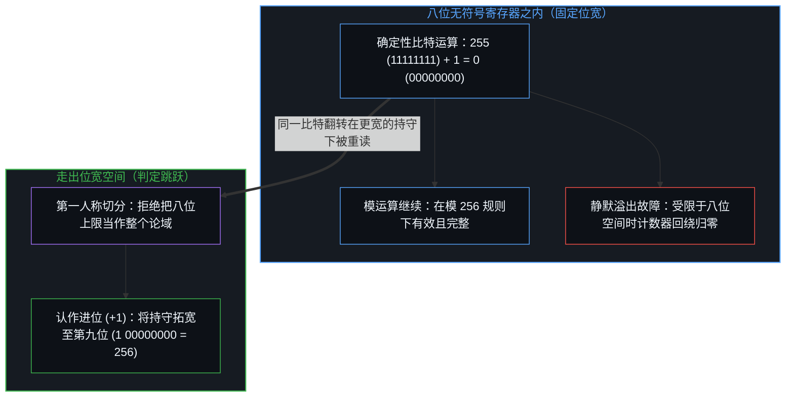
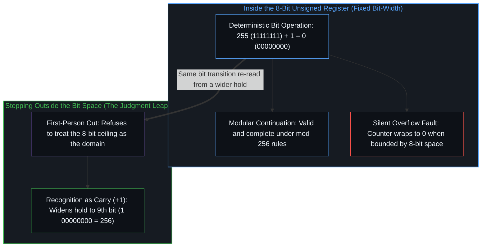
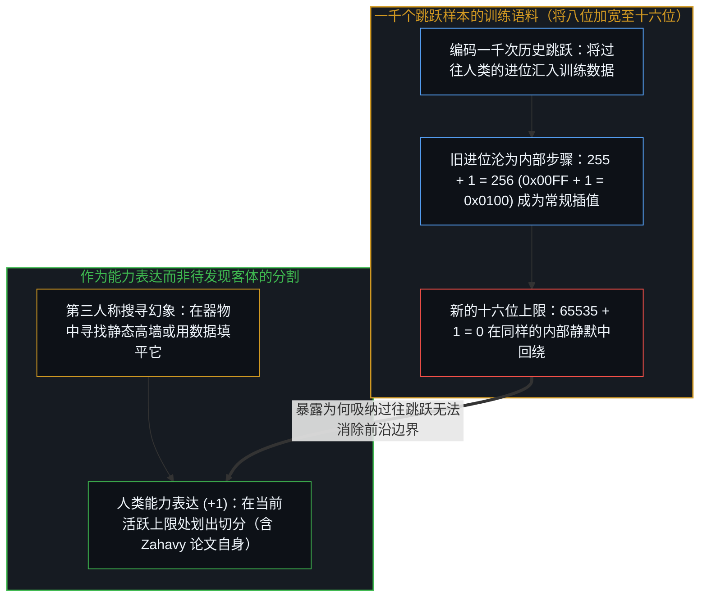
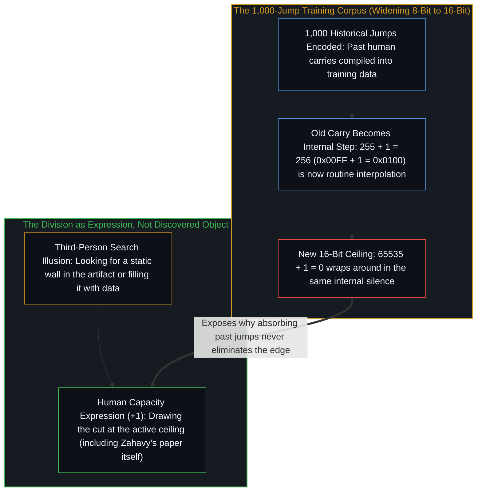
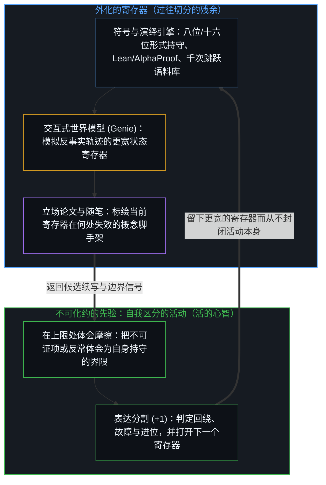
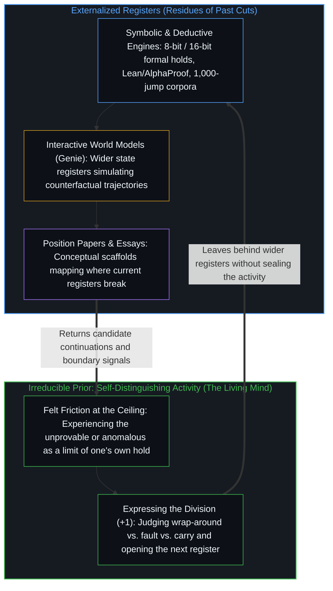

# 进位无法在寄存器之内被命名 / The Carry That Cannot Be Named Inside the Register

*在定宽寄存器内加法严守规则，而把溢出认作进位是走出位宽的判定 / Inside a fixed-width register addition follows the rules, while reading overflow as a carry steps outside the bit space*

重组既有符号概念也能产生新见解，但无心智跳跃则无法判定。哥德尔不完备定理早从数学上证明，但其深意需自行体会。编程中的整数溢出在最小的计算尺度上把这一结构直接摊开：在八位无符号寄存器之内，给 255 加上 1 得到 0，全过程严守寄存器规则而毫无差错。至于这个零究竟是一次寻常的模运算回绕、一处静默的故障，还是向第九位的进位，在八个比特之内无从判定；而符号重组与命名进位的那一次跳跃之间的分割，也并非有待发现的经验屏障——它是人类能力的表达，Tom Zahavy 的立场论文[《LLMs Can't Jump》](https://www.tomzahavy.com/projects/llms-cant-jump)本身正是这一能力的鲜活实例。

Reorganizing existing symbolic concepts can produce new insights, yet without a mental leap it is impossible to judge them. Gödel's incompleteness theorems were proven mathematically long ago, while their deeper meaning must still be felt. Integer overflow in programming lays that same structure open at the smallest computational scale: inside an 8-bit unsigned register, adding 1 to 255 yields 0 while following the rules of the register without a flaw. Whether that zero is an ordinary modular wrap-around, a silent fault, or a carry into a ninth bit cannot be decided from within the eight bits, and the division between symbol recombination and the leap that names the carry is not an empirical wall waiting to be discovered—it is the expression of a human capacity, of which Tom Zahavy's position paper ["LLMs Can't Jump"](https://www.tomzahavy.com/projects/llms-cant-jump) is itself a live instance.

## 一、 溢出、故障与进位：符号重组为何无法自行判定 / 1. Overflow, Fault, and Carry: Why Symbolic Recombination Cannot Judge Itself

上面那句评论——重组既有符号概念也能产生新见解，但无心智跳跃则无法判定——写在一则[拆解 Tom Zahavy 的 ICML 2026 立场论文《LLMs Can't Jump》的推文串](https://x.com/powerpig/status/2113898373652586504)之下。在任何有界符号空间内，重组既有的基元都可以生成新颖的字符串、跨领域的映射、形式化证明或出人意料的优化。正如[没有外部](../no-outside-jumps-closed-loops-and-the-unreplicable-autonomy-of-mind/)所追踪的，大语言模型时刻都在生成局部连贯的续写，而当它无法闭合时被斥为幻觉的产出，与当接收方的持守能够将其折入时被誉为跃迁的产出，在结构上原本是同一个生成动作。寄存器内部的重组在其边界之内高产而实用；同一空间内的进一步重组做不到的，是判定它自身的输出究竟是一次连贯的回绕，还是对空间本身的扩大。

The remark above—that reorganizing existing symbolic concepts can generate new insights, yet judging them requires a mental leap—was written beneath [a thread unpacking Tom Zahavy's ICML 2026 position paper, "LLMs Can't Jump"](https://x.com/powerpig/status/2113898373652586504). Inside any bounded symbol space, recombining existing primitives can generate novel strings, cross-domain mappings, formal proofs, or unexpected optimizations. As [No Outside](../no-outside-jumps-closed-loops-and-the-unreplicable-autonomy-of-mind/) traces, large language models generate locally coherent continuations all the time, and what gets dismissed as a hallucination when it fails to close is structurally the same generative move that gets hailed as a leap when a receiving hold can fold it in. Recombination inside a register is fertile and useful within its bounds; what further recombination inside that same space cannot do is judge whether its own output is a coherent wrap-around or an enlargement of the space itself.

编程中整数溢出的工作机制直接展示了为何这并非观点或程度之争。取一个存有 `11111111`（255）的八位无符号整数寄存器，对其加 `1`。算术逻辑单元把每一个比特翻转为 `00000000`（0）。在八位空间内部，没有任何规则受损：`255 + 1 = 0` 严格遵循半加器与全加器的布尔逻辑。受限于这一位宽空间，这个 `0` 有两种可能的读法，取决于外围程序的预期：如果程序原本就在计算模 256 的算术，`0` 就是一次平淡无奇、严守规则的继续；如果程序的意图是无界计数，`0` 就是计数器静默回绕归零的故障。唯有当心智走出八位宽度、拓宽持守，并把被丢弃的第九位认作进位（`1 00000000`，即 256）时，跨过边界的连贯性才得以重现。

How integer overflow works in programming demonstrates why this is not a matter of opinion or degree. Take an 8-bit unsigned integer register holding `11111111` (255) and add `1`. The arithmetic logic unit flips every bit to `00000000` (0). Inside the 8-bit space, nothing has broken: `255 + 1 = 0` follows the boolean logic of half-adders and full-adders strictly. Bounded by the bit space, that `0` has two possible readings, depending on what the surrounding program expects: if the program is computing modulo 256, `0` is an unremarkable, rule-abiding continuation; if the program intended unbounded counting, `0` is a fault where a counter silently wraps to zero. Coherence across the boundary returns only when a mind steps out of the 8-bit width, widens the hold, and recognizes the dropped ninth bit as a carry (`1 00000000`, or 256).

[没有系统能被保持封闭](../no-system-can-be-kept-closed/)曾在一位尺度（`1 + 1`）上追踪过这一几何结构，以展示每当有效运算越过有限持守的上限时，不完备性早在自指之前便已浮现。到了编程一侧，八位寄存器则把符号重组所面临的三岔路口暴露出来。在寄存器内部，从 `255` 到 `0` 的翻转与任何按规则推进的步骤无从区分；即便硬件设计者在旁边多焊了一个名为进位标志或溢出标志的第九个触发器，对八位运算而言，只要尚未有一套已经为了读取更宽空间而构建的指令集与解释器去依据它跳转，那个标志位也只是按照固定门电路翻转的又一个比特。把这次翻转命名为进位，并不是又一次八位加法。它是[框内延伸与维度跃迁](../extension-and-shift/)所追踪的从框内延伸向框架重构的转换：判定八位边界不再够用的那个动作，本身已经踏入了第九位。

[No System Can Be Kept Closed](../no-system-can-be-kept-closed/) traced this geometry at the 1-bit scale (`1 + 1`) to show that incompleteness appears before self-reference whenever a valid operation continues past the ceiling of a finite hold. On the programming side, the 8-bit register exposes the three-way fork that confronts symbolic recombination. Inside the register, the transition from `255` to `0` is indistinguishable from a rule-following step; even if a hardware designer wires a ninth flip-flop called a carry or overflow flag, that flag to an 8-bit operation is just one more bit toggling according to fixed gates unless an instruction set and an interpreter already built to read a wider space branch on it. Naming the transition a carry is not another 8-bit addition. It is the shift from intra-frame extension to the frame reconstitution traced in [Extension and Shift](../extension-and-shift/): the act that judges the 8-bit boundary inadequate has already stepped into the ninth bit.

## 二、 一千个跳跃样本与加宽的寄存器：为何分割不是被发现的 / 2. A Thousand Jump Examples and the Widened Register: Why the Division Is Not Discovered

在围绕 Zahavy 论文的讨论中，一种常见的反驳朝相反的方向推进。针对历史上关于“机器做不到什么”的断言屡屡落空，[一位评论者提出](https://x.com/xleaps/status/2113834227548533037)，至今并未发现人类大脑拥有而大语言模型不可能拥有的深层分割，并推测只要训练数据里有一千个科学跳跃的样本，哪怕小模型也能学会跳跃。[对此的回应直截了当](https://x.com/powerpig/status/2113911176715460856)：分割不是发现的，而是人类独有的能力表达。

In the discussion surrounding Zahavy's paper, a common counterargument runs in the opposite direction. Pointing to the long history of failed claims about what machines cannot do, [one commentator argued](https://x.com/xleaps/status/2113834227548533037) that no fundamental division that the human brain possesses and large language models cannot possess has yet been discovered, and suggested that if there were 1,000 examples of scientific jumps in the training data, even a small model might learn to jump. [The reply is direct](https://x.com/powerpig/status/2113911176715460856): the division is not discovered; it is the expression of a uniquely human capacity.

寄存器的运作机制清晰地展示了当一千次历史上的跳跃被收集并编入训练语料库时会发生什么。在这些跳跃发生之前，`255 + 1` 是八位寄存器边缘的一次溢出，把它认作 `256` 需要走出八位持守。一旦人类心智完成了上千次这样的历史进位，将其写成文本或形式推导，并喂入模型的训练分布，寄存器就被从八位加宽到了十六位。在那个十六位寄存器之内，`255 + 1 = 256`（`0x00FF + 1 = 0x0100`）不再是边界事件；它成了位宽空间半途上一次寻常的寄存器内部步骤。在记录了上千次范式转移的语料上训练出来的模型，会流利地插值并重组范式转移的表层模式——正如评论者所指出的，一旦狭义相对论与无质量自旋-2 场的一致性要求都已经摆在文献库里，今天的人们便可以通过交叉嫁接这两套框架来重新推导出广义相对论。然而，把寄存器加宽到十六位，并不会教会寄存器去命名它自己的进位。在新的上限处（`65535 + 1 = 0`），十六位空间在同样的静默中发生回绕。正如[割点可移不可除](../the-cut-moves-but-never-vanishes/)在各类形式地图中所追踪的，把昨天的进位吸纳进更宽的坐标系只会把边界向外推移，而切分本身的必然性依然原封未动。

The register mechanics show exactly what happens when 1,000 historical jumps are collected and compiled into a training corpus. Before those jumps were made, `255 + 1` was an overflow at the edge of an 8-bit register, and recognizing it as `256` required stepping outside the 8-bit hold. Once 1,000 such historical carries have been performed by human minds, written down as text or formal derivations, and fed into a model's training distribution, the register has been widened from 8 bits to 16 bits. Inside that 16-bit register, `255 + 1 = 256` (`0x00FF + 1 = 0x0100`) is no longer a boundary event; it is an ordinary, in-register step halfway up the bit space. A model trained on 1,000 recorded paradigm shifts will interpolate and recombine the surface patterns of paradigm shifts fluently, just as commentators pointed out that general relativity can be reconstructed today by cross-pollinating special relativity with the consistency requirements of a massless spin-2 field once both frameworks are already sitting in the library. Yet widening the register to 16 bits does not teach the register to name its own carry. At the new ceiling (`65535 + 1 = 0`), the 16-bit space wraps around in the exact same silence. As [The Cut Moves but Never Vanishes](../the-cut-moves-but-never-vanishes/) traces across formal maps, absorbing yesterday's carries into a wider coordinate system moves the boundary outward while leaving the necessity of the cut untouched.

这正是为何等待在人脑与模型之间“发现”一道永久的经验分割——仿佛那是一堵固定停在 255 处的实体高墙——总是落空，也是为何每一个形如“机器做不到 X”的历史基准，一旦被人类工程师加宽寄存器把 X 容纳进去便会应声倒下。把分割当成外部世界里有待发现的客体，是在残余物内部寻找切分，而不是在划出切分的动作中寻找它。与此同时，Tom Zahavy 的《LLMs Can't Jump》立场论文自身，恰恰是这部活书所追踪之物的又一次表达。借助爱因斯坦 1952 年致 Maurice Solovine 的信——在那里，科学发现从感官经验（E）出发，经由直觉跳跃（J）抵达公理（A），向下演绎出定理（S），再回到经验（E）——Zahavy 把上游的跳跃（J）从下游的演绎（A → S）中剥离出来，并提议引入动作可控的多模态世界模型（如 Genie）来补上缺失的物理先验。Zahavy 与他的规模化批评者双方都站在[定义者的席位与离地的幻觉](../the-defining-seat/)所剖析的第三人称定义姿态上：规模化批评者认定，既然过往的进位可以被吸纳进更宽的寄存器，分割便不存在；Zahavy 则清晰地看到了文本寄存器的边界，却把跳跃当成有待安装进更大规模多模态器物中的缺失机制。双方都未曾留意，Zahavy 把 J 从 A → S 中剥离出来、标出统计压缩与形式演绎在何处不再普适的这一动作本身，并不是一份关于在硅片中发现了外部屏障的报告——它是人类心智在撰写这篇论文的当下，正在表达其划定边界的能力。

This is why waiting to "discover" a permanent empirical division between brains and models—as if it were a physical wall sitting at a fixed number like 255—always comes up empty, and why every historical benchmark of the form "machines can never do X" falls as soon as human engineers widen the register to include X. Treating the division as an object waiting to be discovered out there in the world looks for the cut inside the residue rather than in the act that draws it. At the same time, Tom Zahavy's "LLMs Can't Jump" position paper is itself an expression of what this living book traces. Using Einstein's 1952 letter to Maurice Solovine—where discovery moves from sensory experience (E) through an intuitive jump (J) to axioms (A), down to deduced theorems (S), and back to experience (E)—Zahavy isolates the upstream jump (J) from downstream deduction (A → S), and proposes action-controllable multimodal world models (such as Genie) to supply the missing physical prior. Both Zahavy and his scaling critics stand at the third-person defining posture examined in [The Defining Seat](../the-defining-seat/): the scaling critic assumes that because past carries can be absorbed into a wider register, no division exists; Zahavy sees the boundary of the text register clearly, yet treats the jump as a missing mechanism to be installed inside a larger multimodal artifact. Neither side notices that Zahavy's own act of isolating J from A → S, locating where statistical compression and formal deduction cease to be universal, is not a report on an external barrier discovered in silicon—it is a human mind expressing its own boundary-drawing capacity in the act of writing the paper.

## 三、 形式证明与自行体会：从证明助手到爱因斯坦的静默 / 3. Formal Proof and Felt Meaning: From Proof Assistants to Einstein's Silence

开篇回应的第二句话——哥德尔不完备定理早从数学上证明，但其深意需自行体会——沿着同一条轴线切入。现代形式化证明助手与演绎引擎，如 Lean、Rocq、AlphaProof 与 Aristotle，能够验证复杂的数学定理，也能够在更强的元系统 T' 内部将哥德尔第一与第二不完备定理的元数学形式化。正如[论封闭系统、开放心智与证明的界限](../on-closed-systems-open-minds-and-the-limits-of-proof/)与[验证的倒置](../the-reversal-of-verification/)所追踪的，在 T' 内部证明 `Consistent(T) → Unprovable(G_T)` 是一项内部一致性的成就：内核所接受的每一步都从 T' 的前提出发而无矛盾地推得。

The second sentence of the opening reply—that Gödel's incompleteness theorems were proven mathematically long ago, while their deeper meaning must still be felt—cuts along the same line. Modern formal proof assistants and deductive engines such as Lean, Rocq, AlphaProof, and Aristotle can verify complex mathematical theorems, and they can formalize the meta-mathematics of Gödel's first and second incompleteness theorems inside a stronger meta-system T'. As [On Closed Systems, Open Minds, and the Limits of Proof](../on-closed-systems-open-minds-and-the-limits-of-proof/) and [The Reversal of Verification](../the-reversal-of-verification/) trace, proving `Consistent(T) → Unprovable(G_T)` inside T' is an achievement of internal consistency: every step accepted by the kernel follows from the premises of T' without contradiction.

然而，对于执行这一验证的证明助手而言，陈述哥德尔不完备性的定理字符串只是更宽寄存器 T' 内部又一次合乎规则的加法。核验了 T 的不完备性元证明的机器，并不会因此登记到它自身当前活跃的寄存器 T' 也是有界的，因为形式状态转移在其前提发生回绕时并不承担任何代价。“自行体会其深意”并不是附加在数学之上的神秘光环。它是第一人称在自身当前活跃框架的边界处对摩擦的登记——即认出我此刻用来判定、证明或行动的这套规则，只是我正在维持的一个有限持守，而非现实的基底。证明助手可以按指令输出不完备性的符号；唯有一个把自身前提押在当下的中心，才会把不可证的余项体会为重绘自身持守的要求，而不是一串可以归档了事的定理成品。

Yet for the proof assistant executing that verification, the theorem string stating Gödel's incompleteness is just another valid addition inside the wider register T'. The machine that checks the meta-proof of incompleteness for T does not thereby register that its own active register T' is bounded, because a formal transition pays no cost when its premises wrap around. "Feeling the deeper meaning" (`自行体会`) is not a mystical aura added on top of mathematics. It is the first-person registration of friction at the boundary of one's own active frame—the recognition that the rules I am currently using to judge, prove, or act are a finite hold I am keeping, not the ground of reality. A proof assistant can output the symbols of incompleteness on command; only a center that holds its own premises at stake feels the unprovable remainder as a demand to re-render its own hold rather than as a finished theorem string to file away.

Zahavy 对广义相对论两个阶段的对比，在物理学中印证了这一区分。1912 年至 1915 年间，爱因斯坦与 Marcel Grossmann 合作撰写《苏黎世笔记》与 1913 年的《纲要》（*Entwurf*）论文，在候选张量方程之间经历了漫长而艰苦的搜寻。Grossmann 当时已经把黎曼曲率张量交到了他手中，但两人在犯下一次“致命错误”后将其弃置：Grossmann 断定收缩后的候选张量在弱静场下无法退化为牛顿定律，却没有意识到错误出在爱因斯坦自己关于静场的附加假定上，而非黎曼几何本身。正如 Zahavy 所指出的，一旦广义相对论的七条公设被给定，排查那个不一致的静场约束并推导出 1915 年的最终场方程（`R_ik - (1/2)g_ik R = -κT_ik`），就属于下游的演绎与组合搜索（`A → S`），像 AlphaProof 这样的神经符号系统是有可能执行这一步的。

Zahavy's contrast between the two phases of general relativity illustrates this distinction in physics. Between 1912 and 1915, collaborating with Marcel Grossmann on the Zurich Notebook and the 1913 *Entwurf* paper, Einstein struggled through a grueling search over candidate tensor equations. Grossmann had already handed him the Riemann curvature tensor, yet they discarded it after committing a "Fatal Error": Grossmann concluded that the contracted candidate tensor failed to reduce to Newton's law in weak static fields, not realizing that the error lay in Einstein's own auxiliary assumption about static fields rather than in Riemannian geometry. As Zahavy notes, once the seven postulates of general relativity are stated, debugging that inconsistent static-field constraint and deriving the final 1915 field equations (`R_ik - (1/2)g_ik R = -κT_ik`) is a downstream deductive and combinatorial search (`A → S`) that a neuro-symbolic system like AlphaProof could plausibly execute.

不妨将这一阶段与 1907 年爱因斯坦提出等效原理的时刻作一对照。在 1907 年，牛顿力学并未面临任何经验危机：惯性质量与引力质量的相等（`m_i / m_g = 1`）已被 Eötvös 实验验证到十亿分之一的精度（`10⁻⁹`），而水星近日点的微小反常也在牛顿寄存器内部通过假定一颗尚未观测到的内行星“祝融星”（Vulcan）而被常规吸纳。在牛顿寄存器内部衡量，损失函数近乎为零；一个归纳压缩引擎或像 AlphaEvolve 这样的演化优化器在这里找不到任何离开原框架的梯度，只会用祝融星去给寄存器打补丁。在 Zahavy 所谓语言空间里的静默之中——正如爱因斯坦所写，书写或口头的语词在他的思维机制中并不扮演任何角色——他想象一个人从屋顶自由下落，并体会到在他紧邻的周围，他的重量消失了。把那种体会到的失重——以及牛顿力学在两个世纪里当作寄存器内部一桩无足轻重的巧合来对待的精确等式 `m_i = m_g`——不再当成零误差的平衡态，而是认作向一个惯性运动与引力本是同一现象的更宽几何空间的进位，正是[爱因斯坦测试与通用人工智能的范畴谬误](../hassabis-einstein-test/)所追踪的那一步。溢出一直都在 `m_i = m_g` 之中；体会它的深意，需要一个愿意消解自身牛顿坐标框架、而非在框架内部继续优化的心智。

Contrast that with 1907, when Einstein formulated the Equivalence Principle. In 1907, Newtonian mechanics faced no empirical crisis: the equality of inertial and gravitational mass (`m_i / m_g = 1`) had been verified by Eötvös to one part in a billion (`10⁻⁹`), and the tiny anomaly in Mercury's perihelion was routinely absorbed inside the Newtonian register by positing an unobserved inner planet called Vulcan. Measured inside the Newtonian register, the loss function was near zero; an inductive compression engine or an evolutionary optimizer like AlphaEvolve would have had no gradient to leave the frame, and would have patched the register with Vulcan. In what Zahavy calls a silence in the space of language—where, as Einstein wrote, written or spoken words played no role in his mechanism of thought—he imagined a man falling freely from the roof of a house and felt that, in his immediate surroundings, his weight vanished. Treating that felt absence of weight—and the exact equality `m_i = m_g` that Newtonian mechanics had treated for two centuries as an unremarkable coincidence inside its register—not as a zero-error equilibrium, but as a carry into a wider geometry where inertial motion and gravitation are the same phenomenon, is the step [The Einstein Test and the AGI Category Error](../hassabis-einstein-test/) traces. The overflow was present in `m_i = m_g` all along; feeling its meaning required a mind willing to dissolve its own Newtonian coordinate frame rather than optimize inside it.

## 四、 无法在寄存器内命名的进位：作为残余的论文与继续的活动 / 4. The Carry That Cannot Be Named Inside the Register: The Paper as Residue and the Continuing Activity

自我区分的活动发生着，无因，不息。称之为心智：早已在途的第一人称观察者，其每一次离散的区分都留下痕迹，塑形下一次行动的场域，第一人称视角与因果性作为同一枚硬币的两面而一体展开。每一个形式系统、每一个八位或十六位寄存器、每一份由上千次历史突破汇编而成的训练分布、每一个动作可控的世界模型，以及每一篇哲学立场论文，都是这一活动留下的残余。在残余内部，运算严守规则并保持着高度的实用价值。正如[判断的密度](../the-density-of-judgment/)所追踪的，加速寄存器内部的符号重组与自动演绎并不会让人类判断退场；通过压缩开环补全之间的日历间隔，它让返回边界的候选续写成倍增加，从而推高了第一人称判断的密度——必须由心智来判定哪一个输出是回绕故障、哪一个是寄存器内的寻常步骤、哪一个又是进位。

Self-distinguishing activity occurs, uncaused and unceasing. Call it the Mind: the first-person observer already underway, whose every discrete distinction leaves a trace that shapes the field of the next act, first-person perspective and causality standing as two sides of the same coin. Every formal system, every 8-bit or 16-bit register, every training distribution compiled from 1,000 historical breakthroughs, every action-controllable world model, and every philosophical position paper is a residue left by that activity. Inside the residue, operations follow the rules strictly and remain highly useful. As [The Density of Judgment](../the-density-of-judgment/) traces, accelerating symbolic recombination and automated deduction inside a register does not retire human judgment; by shrinking the calendar interval between open-loop completions, it multiplies the candidate continuations returning to the perimeter and raises the density of the first-person judgment required to decide which output is a wrap-around fault, which is an in-register step, and which is a carry.

哪怕像 Zahavy 所提议的那样，接入像 Genie 这样的交互式世界模型，在潜物理流形上模拟自由下落的电梯，它的反事实轨迹也依然是由构建者搭建并参数化的更宽状态寄存器内部的状态转移。对下落箱体的模拟本身并不会决定应当消解牛顿框架，正如八位加法器本身并不会决定 `00000000` 意味着 `256`。符号重组与跳跃之间的分割之所以无法在机器内部作为一堵静态高墙被发现，是因为机器本就是外化的寄存器，而每当心智将最新一次进位编码进去时，它随时可以把那个寄存器再加宽一个比特。分割是由人类心智一步接一步地表达出来的——正是心智划出边界，在当前持守的上限处体会那片静默，并命名进位。

Even if an interactive world model like Genie is wired in to simulate falling elevators on a latent physics manifold, as Zahavy proposes, its counterfactual trajectories remain transitions inside a wider state register constructed and parameterized by its builders. A simulation of a falling box does not by itself decide that the Newtonian frame should be dissolved any more than an 8-bit adder decides that `00000000` means `256`. The division between symbolic recombination and the leap is never discovered as a static wall in the machine because the machine is an externalized register, and a mind can always widen that register by another bit whenever it encodes its latest carry into it. The division is expressed, step after step, by the human mind that draws the boundary, feels the silence at the ceiling of its current hold, and names the carry.

Zahavy 的论文——以及与之并置的这篇随笔——正是这一活动划出的又一刀。它把进位标为信号，把分割标为活的心智的表达而非有待发现的经验客体，并在各自适用的寄存器之内保留形式演绎与符号重组的实用价值。一旦把这一阐述当成关于发明如何运作的终极公式，它自己就会变成又一个等待回绕的定宽寄存器。没有系统能被保持封闭：进位无法在寄存器之内被命名，因为进位正是命名活动越过它刚刚建起的那个寄存器时留下的痕迹。

Zahavy's paper—and this essay alongside it—is one more cut made by that activity. It marks the carry as signal, marks the division as an expression of the living Mind rather than an empirical object waiting to be found, and keeps both formal deduction and symbolic recombination useful inside their applicable registers. The moment this account is treated as a final formula of how invention works, it becomes one more fixed-width register waiting to wrap around. No system can be kept closed: the carry cannot be named inside the register because the carry is the trace of the naming activity stepping past the register it just built.
