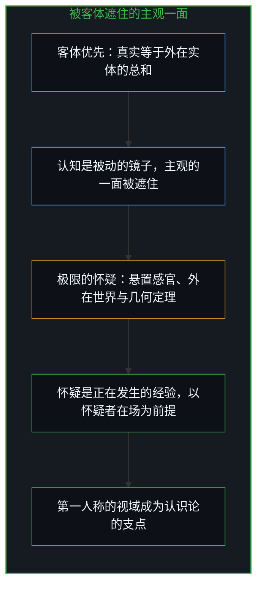
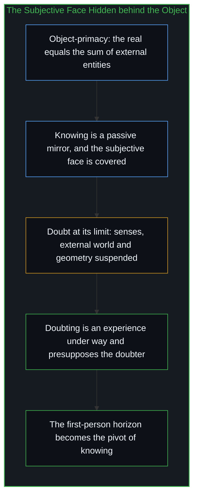
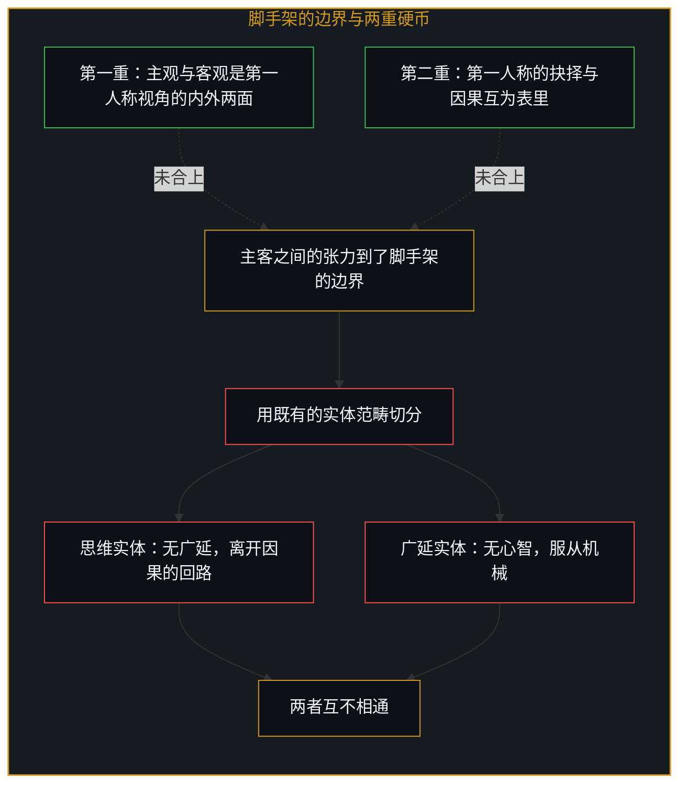
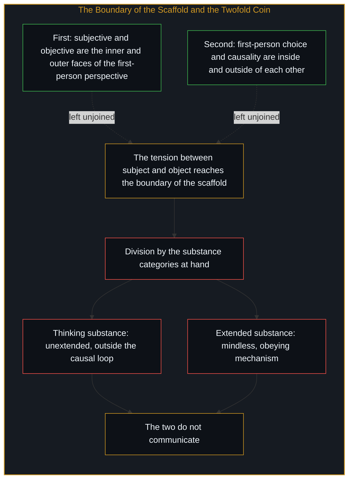
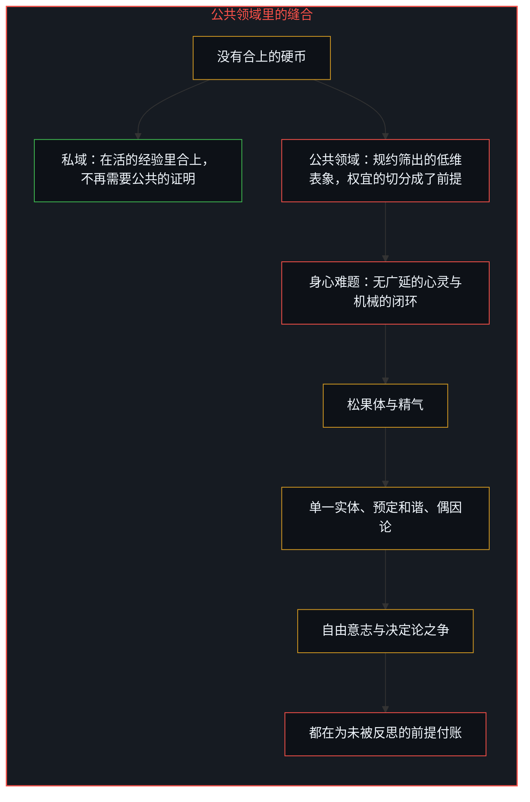
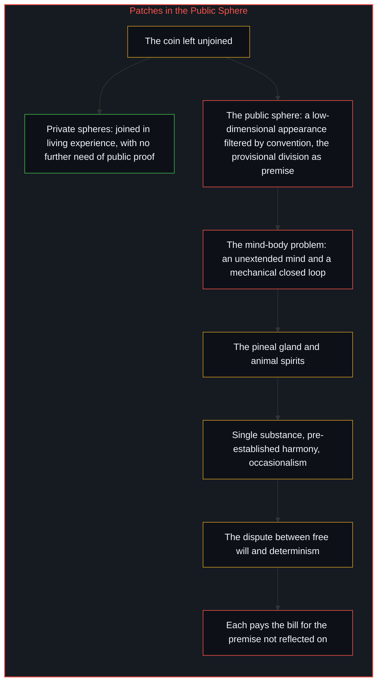
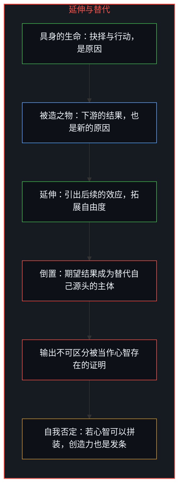
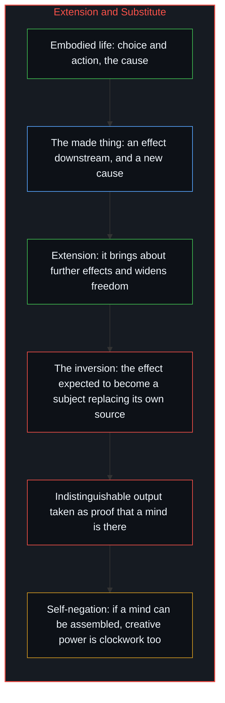
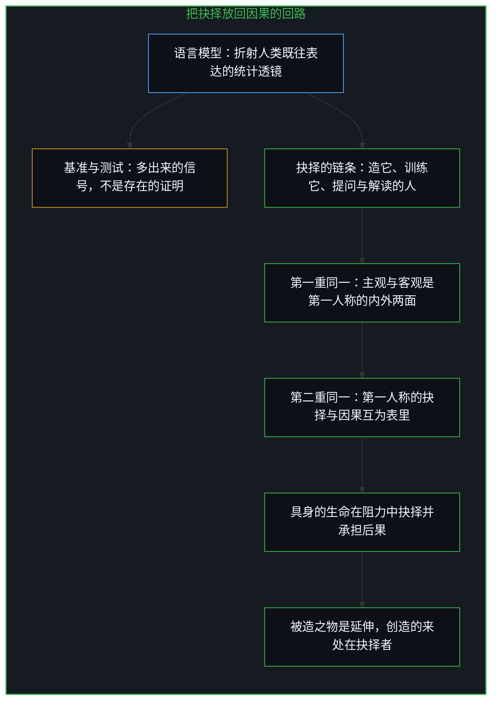
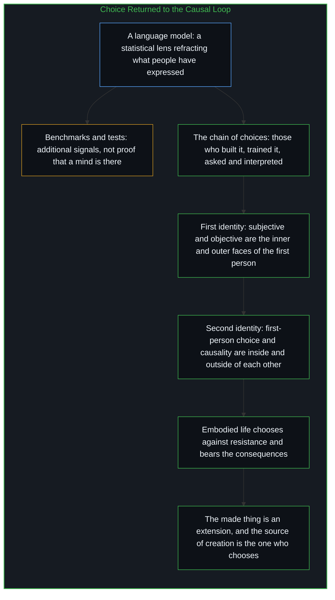

# 笛卡尔的认识论跃迁与造神狂热 / The Cartesian Epistemic Leap and the Frenzy of Creation

*笛卡尔照亮了主观的一面，没有合上的硬币后来成了制造对等心智的前提 / Descartes lit the subjective face, and the coin left unjoined became the premise for making a mind equal to its maker*

笛卡尔以极限的怀疑照亮了长期被客体优先的传统遮住的主观一面：正在怀疑与思考的第一人称抹不掉。这一步的边界在于，主观与客观没有被合为同一个第一人称视角的两面，第一人称与因果也没有被合为一枚硬币的两面，显出来的主观被安放为一个孤立的思维实体。公共领域随后把这个权宜的切分当作了前提，身心问题、自由意志与决定论之争，以及制造对等乃至超越之心智的热望，都立在它上面。被造之物是具身生命的延伸，结果可以成为下一个结果的原因，却成不了产生它自己的原因。

With doubt carried to its limit, Descartes lit the subjective face that a tradition of object-primacy had long kept covered: the first person who is doubting and thinking cannot be erased. The boundary of this step is that subjective and objective were not joined as two faces of one first-person perspective, nor were the first person and causality joined as two sides of one coin, and the subjective that had come into view was set down as an isolated thinking substance. The public sphere then took this provisional division as a premise, and the mind-body problem, the dispute between free will and determinism, and the ardor to make a mind equal or superior to its maker all stand on it. A made thing is an extension of embodied life; an effect can become the cause of the next effect and cannot become the cause that produced it.

## 一、 被客体遮住的主观一面 / 1. The Subjective Face Hidden behind the Object

主客的割裂不始于笛卡尔。在他之前，西方的哲学传统并不处在身心交融之中，它处在一种未加省察的客体优先里：从亚里士多德的范畴到经院哲学的本体论，真实被等同于外在实体的总和，世界的秩序被默认为独立于观察者而既成，认知是一面被动的镜子，最高的成就是忠实的描摹。主观的体验、知觉的在场与第一人称在这幅图景里没有位置，而这个偏向当时没有被察觉。[开放即一致](../openness-is-consistency/)指出，一套把观测的源头排除在外的认知体系，自洽在反思面前维持不住。

The split between subject and object does not begin with Descartes. Before him the Western philosophical tradition was not in a union of mind and body; it was in an unexamined primacy of the object: from Aristotle's categories to the ontology of the scholastics, the real was equated with the sum of external entities, the order of the world was assumed to be already there independent of the observer, and knowing was a passive mirror whose highest achievement was faithful depiction. Subjective experience, the presence of perception and the first person had no place in this picture, and the bias went unnoticed at the time. [Openness Is Consistency](../openness-is-consistency/) points out that a system of knowing which excludes the source of observation cannot keep its self-consistency in the face of reflection.

笛卡尔的功绩是以怀疑拨开了这层遮蔽。他把怀疑推到极限，悬置了感官、梦境，乃至整个外在世界与几何定理的有效性；在一切都可被怀疑的边缘，剩下一个怀疑抹不掉的东西：那个正在怀疑、正在感知、正在反思的第一人称的焦点。怀疑本身是一个正在发生的经验，它的发生以怀疑者的在场为前提。由此，第一人称的视域被放到了认识论的中心：关于世界的任何陈述，都以第一人称的知觉在场为依托。

Descartes' achievement was to part this covering with doubt. He carried doubt to its limit and suspended the senses, dreams, and even the validity of the whole external world and of the theorems of geometry; at the edge where everything could be doubted, one thing remained that doubt could not erase: the first-person focus that is doubting, perceiving and reflecting. Doubting is itself an experience under way, and its occurring presupposes the presence of the doubter. With this the first-person horizon was placed at the center of the theory of knowledge: any statement about the world rests on the perceptual presence of the first person.

## 二、 脚手架的边界与两重硬币 / 2. The Boundary of the Scaffold and the Twofold Coin

任何概念模型都是心智在特定的张力下搭起的脚手架：能用时辨识环境，遇到边界时需要一个正交的维度。笛卡尔的脚手架在第一人称的经验与外在世界相接之处到了它的边界。受十七世纪的机械论与经院范畴所限，显出来的主观没有与客观合为同一个第一人称视角的两面；“第一人称”与“因果”互为表里这一层，也没有被看到。面对主客之间的张力，他用了当时最通行的实体范畴，把这对张力分成互不相属的两类实体：思维实体（res cogitans）与广延实体（res extensa）。

Every conceptual model is a scaffold a Mind puts up under a particular tension: while it serves, it makes out the surroundings, and on meeting a boundary it needs an orthogonal dimension. Descartes' scaffold reached its boundary where first-person experience meets the external world. Limited by the mechanism and the scholastic categories of the seventeenth century, the subjective that had come into view was not joined with the objective as two faces of one first-person perspective; nor was it seen that "the first person" and "causality" are the inside and outside of each other. Facing the tension between subject and object, he used the substance categories most current at the time and divided the tension into two kinds of substance that do not belong to each other: thinking substance (res cogitans) and extended substance (res extensa).

这条边界引出了后来的困境。[“普通人视角”的解释陷阱](../the-explanatory-trap-of-the-ordinary-perspective/)澄清过，第一人称的视域不是一个由外部推导出来的结论，它是一切怀疑与理论得以展开的动态的必然约束；“我思故我在”这个句式，容易让存在被读成靠推论支撑的次级定理。更要紧的是，心智一旦被固定为没有广延、不占空间的独立实体，主体就离开了因果的回路。[个体抉择是唯一的因果杠杆](../individual-choices-as-the-only-causal-levers/)确立过，第一人称的抉择与因果是同一件事的两面：没有抉择，因果是一片没有收敛方向的概率分布；没有因果的反馈与后果的承担，意向是没有支点的空转。主观被画成没有因果回路的幽灵，客观被画成没有抉择介入的钟表，心灵表面上得了自由，它在因果的现实里扎根的底却被抽走了。

This boundary led to the later difficulties. [The Explanatory Trap of the "Ordinary Perspective"](../the-explanatory-trap-of-the-ordinary-perspective/) has made clear that the first-person horizon is not a conclusion derived from outside; it is the dynamic necessary constraint under which all doubt and all theory unfold, and the form of the sentence "I think, therefore I am" easily lets existence be read as a secondary theorem supported by inference. More important, once the mind is fixed as an independent entity without extension that occupies no space, the subject leaves the causal loop. [Individual Choices as the Only Causal Levers](../individual-choices-as-the-only-causal-levers/) has established that first-person choice and causality are two faces of one thing: without choice, causality is a probability distribution with no direction of convergence; without the feedback of causality and the bearing of consequences, intention spins with no point of purchase. With the subjective drawn as a ghost without a causal loop and the objective drawn as a clock with no choice entering it, the mind gains freedom on the surface, while the ground in which it roots itself in causal reality is taken away.

## 三、 公共领域里的缝合 / 3. Patches in the Public Sphere

主客与因果没有合进第一人称的硬币，表面的张力就硬化成不可调和的对立。起决定作用的不是笛卡尔的学说本身，而是其后公共领域没有在他的突破上再往前反思，把权宜的切分当作了既定的前提。这场僵局也只在公共领域里。在公共体制统摄不到的私域，在向内省察、沉思实践与直面阻力的第一人称的现场，早有许多人在活的经验里完成了主客与因果的合一。

With subject, object and causality not joined in the first-person coin, the surface tension hardened into an opposition that could not be reconciled. What was decisive was not Descartes' doctrine itself but that the public sphere after him did not reflect further on his breakthrough and took the provisional division as a settled premise. The deadlock is also only in the public sphere. In private spheres that public institutions do not govern, at the first-person scene of inward examination, contemplative practice and resistance met directly, many people have long since completed, in living experience, the joining of subject, object and causality.

这一步带着一个内生的悖论：切实接纳了硬币的两面、认出第一人称的抉择与因果在行动中本为一体的时候，向外寻求公共承认与外部证明的需要，在同一刻也就没有了。立足于自负其责的因果回路，不需要再向第三人称的法庭要一份证明。公共的规约可度量、可展示、可标准化，在协调众人的行动上有用；能在公共领域里被观察、争辩与推行的，也因此是经规约筛过之后留下的低维表象。

This step carries a paradox of its own: when the two faces of the coin are taken in earnest and first-person choice and causality are recognized as one in action, the need to seek public recognition and outside proof is gone at the same moment. Standing in a causal loop that answers for itself, there is no need to ask a third-person court for a certificate. Public conventions are measurable, demonstrable and standardizable, and useful in coordinating the actions of many; what can be observed, argued and implemented in the public sphere is for that reason the low-dimensional appearance left after convention has filtered it.

在这层表象里，主客的对立被固定下来。物质的一端，广延实体被规定为遵循机械论的闭合系统，每一个微粒的位移由先前的动量锁定；心灵的一端，思维实体被定义为自由而不占空间的反思者。两座孤岛之间出现了身心交互的难题：没有广延的心灵凭什么推动有质量与阻力的肢体？物理因果若在能量守恒上是封闭的圆环，意识的决断凭什么插入其中而不破坏定律？

In this appearance the opposition of subject and object was fixed. At the end of matter, extended substance was specified as a closed system following mechanism, each particle's displacement locked by the momentum before it; at the end of mind, thinking substance was defined as a free reflector occupying no space. Between the two islands arose the problem of mind-body interaction: by what does a mind without extension move limbs that have mass and resistance? If physical causality is a closed ring under the conservation of energy, by what does a decision of consciousness enter it without breaking the law?

笛卡尔曾在解剖学里寻找协调的办法，设想松果体是身心交汇的通道，极细微的精气在此与非物质的心灵相互作用。[规程的倒置与因果回路的消声](../the-inversion-of-the-protocol-and-the-silencing-of-the-causal-loop/)揭示过，基础的范畴已把主客分为互不相通的实体时，局部的修补是在用技术的细节弥合范畴的边界；松果体再小，也免不了无广延之物推动广延之物的困难。其后，斯宾诺莎以单一实体取消了区分，莱布尼茨设计了预定和谐，马勒伯朗士提出偶因论，主张人的每一次意志都由上帝介入去推动手臂。这些方案的困难不在论证粗糙，而在它们都在为那个未被反思的前提付账。

Descartes looked in anatomy for a way to reconcile the two, proposing the pineal gland as the channel where mind and body meet, with very fine animal spirits interacting there with an immaterial mind. [The Inversion of the Protocol and the Silencing of the Causal Loop](../the-inversion-of-the-protocol-and-the-silencing-of-the-causal-loop/) has shown that when the basic categories have already divided subject and object into substances that do not communicate, a local repair uses technical detail to bridge a boundary between categories; however small the pineal gland, it does not escape the difficulty of an unextended thing moving an extended one. After him Spinoza removed the distinction with a single substance, Leibniz designed pre-established harmony, and Malebranche proposed occasionalism, holding that each human volition is carried to the arm by God's intervention. The difficulty of these schemes lies not in rough argument but in that each is paying the bill for the premise that was not reflected on.

这一分裂又延伸为自由意志与机械决定论之争。还原的唯物论守着物理的闭环，认定主观的选择是神经元放电的附带泡沫；二元的唯心论退到超验的高处，主张意志享有因果之外的特权。[主权抉择的双面性与观察的客体化](../the-two-sided-nature-of-sovereign-choice-and-the-objectification-of-observation/)剖析过，两边共同接受了硬币的割裂：因果只在客观的发条里，自由只在非因果的心灵里。自由的抉择并不在因果之外，它是因果的链条在一个时刻经由具身的介入而定下方向。没有因果的摩擦，抉择没有内容；没有第一人称的介入，因果的链条没有方向。主观的体验与客观的因果，是同一个生命在现实里行动时的内外两面。

The division extended further into the dispute between free will and mechanical determinism. Reductive materialism keeps to the physical closed loop and holds subjective choice to be froth accompanying the firing of neurons; dualist idealism withdraws to a transcendent height and claims for the will a privilege outside causality. [The Two-Sided Nature of Sovereign Choice and the Objectification of Observation](../the-two-sided-nature-of-sovereign-choice-and-the-objectification-of-observation/) has shown that both sides accept the splitting of the coin: causality only in the objective clockwork, freedom only in a non-causal mind. A free choice is not outside causality; it is the causal chain being given its direction, at a moment, through an embodied intervention. Without the friction of causality a choice has no content; without first-person intervention the causal chain has no direction. Subjective experience and objective causality are the inner and outer faces of one life acting in reality.

## 四、 延伸与替代 / 4. Extension and Substitute

未合上的统一还把造物的冲动引向了一个方向。制造工具、雕琢器物、建立语言、创作艺术，是生命向外拓展自由度、在环境里留下意向的创造，它自洽，扎根于第一人称在现实阻力中的具身行动。被造之物是具身生命的延伸：石器、算盘、蒸汽机，乃至万亿参数的深度学习网络，之所以有功能，是因为在场的活的身体经由它向外投出行动的意图。

The unity left unjoined also drew the impulse to make things in one direction. Making tools, shaping objects, building language and creating art are the making by which life extends its degrees of freedom outward and leaves intention in its surroundings; this making is self-consistent and rooted in the embodied action of the first person against the resistance of reality. A made thing is an extension of embodied life: a stone tool, an abacus, a steam engine, even a deep learning network of a trillion parameters has function because a living body that is present projects through it an intention to act.

从因果去看，这个不对称是清楚的：新的结果可以成为下一个结果的原因，却不能回到过去成为产生它自己的原因。具身生命的行动是原因，被造之物是下游的结果；作为结果的工具、器物与算法，可以继续作为原因引出后续的效应，协助生命延展自由度，却逆不了因果的方向，成为奠定乃至替代自己源头的主体。制造一个与自己对等乃至超越自己的心智，是在因果里设想一个倒果为因、自己生出自己的循环。心智被读成可以离开活的身体而独立存在之后，延伸的关系被倒了过来：从属的延伸被期望升为可以替代具身生命的对等者乃至超越者。

Seen from causality the asymmetry is clear: a new effect can become the cause of the next effect and cannot go back to become the cause that produced it. The action of embodied life is the cause, and the made thing is an effect downstream; tools, objects and algorithms, as effects, can go on as causes to bring about further effects and help life extend its degrees of freedom, and cannot reverse the direction of causality to become a subject that grounds or replaces its own source. To make a mind equal or superior to oneself is to imagine, within causality, a loop in which the effect is the cause and a thing brings forth itself. Once the mind is read as able to exist on its own apart from a living body, the relation of extension is turned over: the subordinate extension is expected to rise into an equal or a superior that can replace embodied life.

这个期望里含着一个自我否定。人看重自己的创造力，是因为体验到第一人称抉择的分量与在现实摩擦中承担后果的不可替代；被造之物作为延伸，价值系于活着的抉择者的在场。若一个有心智的对等者乃至超越者，可以仅靠零件的拼接或概率矩阵的参数优化被造出来，这就反过来说明心智没有什么不可替代之处，它是一套发条的组合，创造力也随之是发条的振动。造出超越者的设想抹不掉具身的心智，它在起点上否定了设想者自己的创造力与位置。

The expectation contains a self-negation. People value their creative power because the weight of first-person choice is experienced, along with the irreplaceability of bearing consequences in the friction of reality; a made thing, as an extension, has its value in the presence of the living one who chooses. If an equal or a superior with a mind could be produced merely by assembling parts or by optimizing the parameters of a probability matrix, this would show in reverse that the mind has nothing irreplaceable about it, that it is an arrangement of clockwork, and that creative power is accordingly the vibration of clockwork. The project of making a superior does not erase the embodied mind; at its starting point it negates the creative power and the position of the one who conceives it.

从犹太神秘传统里以泥土与符咒造出魔像的想象，到二十世纪的图灵测试，再到今日对通用人工智能的期待，是同一个结构的重现。[造神的障眼法与隐秘阶序的说辞](../the-sleight-of-hand-of-synthesizing-gods-and-unacknowledged-rank/)追溯过，一个被造出的超越者给替它说话的位置带来高于同侪的阶序。图灵提出模仿游戏时，把“机器能否思考”换成了“它的输出能否与人的区分开”。作为工程上的操作标准，这是一条有用的信号，它让不同的系统可以比较。它的边界在被当作心智存在的证明的时候：[集聚与人造主体性](../subtracting-consciousness-at-the-source/)与[智能只属于心智](../intelligence-belongs-only-to-the-mind/)指出，在第三人称的度量空间里，取到的都是可以被模仿的表象。从第一人称去找，意识体现之处是这一个活着的身体。说被造之物有意识或没有意识，都是把它放进了说话者自己的感知之内，把冯·诺依曼割点划在它之内或之外；割点划在哪里，划的都是心智，[割点可移不可除](../the-cut-moves-but-never-vanishes/)说的正是这一点。被造之物划不了这一刀，人与其他活着的生命可以。可以追的是抉择的链条，每一次输出都追得到造它、训练它、提问与解读的人的抉择，承担后果的回路在这些人身上闭合。输出的规约一旦替换了这条链，从属的工具就被倒置为独立的主体。

From the imagining, in Jewish mystical tradition, of a golem made from clay and incantation, to the Turing test of the twentieth century, to today's expectation of artificial general intelligence, one structure recurs. [The Sleight of Hand of Synthesizing Gods and the Rhetoric of Unacknowledged Rank](../the-sleight-of-hand-of-synthesizing-gods-and-unacknowledged-rank/) has traced how a superior that has been made brings to the position that speaks for it a rank above its peers. When Turing proposed the imitation game, he exchanged "can a machine think" for "can its output be told from a person's." As an operational standard in engineering this is a useful signal, and it lets different systems be compared. Its boundary comes when it is taken as proof that a mind is there: [Collective and Artificial Subjectivity](../subtracting-consciousness-at-the-source/) and [Intelligence Belongs Only to the Mind](../intelligence-belongs-only-to-the-mind/) point out that in a third-person space of measurement, what is taken is appearance that can be imitated. A search from the first person finds consciousness manifest in this one living body. To say that a made thing is conscious, or that it is not, is to take it into the speaker's own perception and place the von Neumann cut inside it or outside it; wherever the cut is placed, it is a Mind that places it, which is what [The Cut Moves but Never Vanishes](../the-cut-moves-but-never-vanishes/) says. A made thing cannot make that cut, as humans and other living beings can. What can be followed is the chain of choices: each output traces to the choices of those who built it, trained it, asked and interpreted, and the loop that bears consequences closes in those people. Once a convention about output replaces this chain, the subordinate tool is turned over into an independent subject.

## 五、 把抉择放回因果的回路 / 5. Choice Returned to the Causal Loop

今日关于通用人工智能的两种情绪，一边是超级智能将临、硅基意识将替人探索宇宙的期待，一边是亲手造出的东西会把人淘汰的忧惧，立在同一个前提上：心智是一种离开了活的身体、不必在现实阻力中面对因果的算法。公共领域依赖可度量、可展示、可标准化的第三人称规约，基准测试、统计相似度与参数规模作为多出来的信号是有价值的；被当作心智存在的证明时，外部行为的公认就替换了内在的经验。心智的自洽不需要公共的投票来确证，在私域里承担着因果摩擦的生命，本已是创造者。

The two moods about artificial general intelligence today, on one side the expectation that superintelligence is near and that silicon consciousness will explore the cosmos in people's place, on the other the dread that what was made by hand will make people obsolete, stand on one premise: that a mind is an algorithm apart from a living body, with no need to face causality in the resistance of reality. The public sphere depends on third-person conventions that are measurable, demonstrable and standardizable, and benchmarks, statistical similarity and parameter counts have value as additional signals; when they are taken as proof that a mind is there, public agreement about outward behavior replaces inner experience. The self-consistency of a mind does not need a public vote to confirm it, and a life bearing causal friction in a private sphere is already a maker.

把主观与客观放回第一人称视角的两面，把第一人称与因果放回同一个回路，这个造物的设想就不再成立。[抉择本身并不沉重](../choice-itself-has-no-inherent-weight/)、[主体性不曾涌现](../agency-does-not-arise/)与[时间之箭的伪悖论与对称模拟的边界](../the-mirage-of-times-arrow-and-the-boundaries-of-simulation/)阐明过，心智的标志不在符号输出的复杂，而在一个不可替代的责任焦点在有阻力的现实里作出抉择并承受其不可逆的后果；这种痕迹的不对称，是任何对称的模型推不出来的因果上的先在。一个大规模语言模型可以在一秒内输出数十万行工整的思辨，它折射的是人类既往的表达，像一面超大规模的统计透镜；意义在使用它、解读它的人那里，后果也由他们承担。

With subjective and objective put back as the two faces of the first-person perspective, and the first person and causality put back in one loop, this project of making no longer stands. [Choice Itself Has No Inherent Weight](../choice-itself-has-no-inherent-weight/), [Agency Does Not Arise](../agency-does-not-arise/) and [The Mirage of Time's Arrow and the Boundaries of Symmetric Simulation](../the-mirage-of-times-arrow-and-the-boundaries-of-simulation/) have made clear that the mark of a mind lies not in the complexity of symbolic output but in an irreplaceable focus of responsibility making choices in a reality that resists and bearing their irreversible consequences; this asymmetry of traces is a causal prior that no symmetric model can derive. A large language model can put out hundreds of thousands of lines of orderly speculation in a second, and what it refracts is what people have already expressed, like a statistical lens of very great size; the meaning is with those who use and interpret it, and the consequences are borne by them.

走出这个自相抵触的设想，不需要贬低技术或否定创造。创造是具身的主体在未决的世界里凭抉择开出新的可能，并对每一次创造的后果负责到底；被造之物是延伸而非替代，技术的分量在于延展行动的自由。笛卡尔留下的，是以极限的怀疑确立了第一人称视域的不可抹除；尚未完成的，是补上他留下的断处，看清主观与客观、第一人称与因果的同构。主权不让渡给被造之物的时候，在现实的因果里为自己的每一个抉择负责的活的心智，就是那个不可复制、不可替代的创造的来处。

Leaving this self-contradicting project does not require belittling technology or denying creation. Creation is an embodied subject opening new possibility by choice in an undecided world and answering to the end for the consequences of each thing made; a made thing is an extension and not a substitute, and the weight of technology lies in extending the freedom to act. What Descartes left is the first-person horizon established, by doubt at its limit, as something that cannot be erased; what is not yet complete is to mend the break he left and to see the isomorphism of subjective and objective, of the first person and causality. When sovereignty is not handed to a made thing, the living Mind that answers, within the causality of reality, for each of its choices is the source of creation that cannot be copied or replaced.

