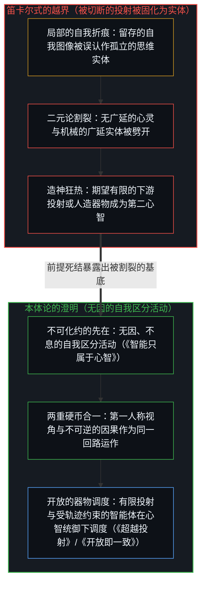
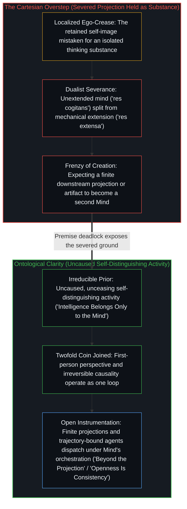

# 笛卡尔的认识论跃迁与造神狂热 / The Cartesian Epistemic Leap and the Frenzy of Creation

*笛卡尔照亮了主观一面却未合上硬币，为合成心智的狂热埋下了前提 / Descartes lit the subjective face and left the coin unjoined, seeding synthetic minds*

笛卡尔以推至极限的怀疑，照亮了长期被客体优先传统遮蔽的主观一面，显明那个正在怀疑与思考的第一人称无法被抹除。这一步的边界在于，显露出来的主观并未与客观合为同一个第一人称视角的两面，第一人称与因果也未合为同一枚硬币的两面，觉察的活动反而被实体化为一个孤立的思维实体。公共领域随后将这一权宜的切分当作毋庸置疑的前提，身心交互难题、自由意志与机械决定论之争，以及制造与造物主对等乃至超越造物主之心智的狂热，全都建立在它上面。被造之物是延展具身生命的持久痕迹；结果可以成为下一个结果的原因，却永远无法逆转因果之箭，回头成为产生它自身的发起活动。

With doubt carried to its limit, Descartes lit the subjective face that a tradition of object-primacy had long kept covered, showing that the first person who is doubting and thinking cannot be erased. The boundary of this step lies where the subjective that had come into view was not joined with the objective as two faces of one first-person perspective, nor were the first person and causality joined as two sides of one coin, leaving the noticing activity reified into an isolated thinking substance. The public sphere subsequently took that provisional division as an unquestioned premise, and the mind-body problem, the dispute between free will and mechanical determinism, and the ardor to manufacture a mind equal or superior to its maker all stand upon it. A made thing is a durable trace extending embodied life; an effect can become the cause of the next effect, yet it can never reverse the causal arrow to become the initiating activity that produced it.

## 一、 被客体遮住的主观一面 / 1. The Subjective Face Hidden behind the Object

主客的割裂并不始于笛卡尔。在他之前，西方哲学传统并非处在身心未分的交融之中，而是运作在一种未经省察的客体优先里。从亚里士多德的范畴到经院哲学的本体论，真实被等同于外在实体的总和，世界的秩序被假定为独立于观察者而完备自足，认知则被当作一面被动的镜子，其最高成就是忠实的描摹。主观体验、知觉在场与第一人称视域在这幅图景里没有位置，而这一遗漏之所以未被察觉，是因为观看本身遗忘了自己。[开放即一致](../openness-is-consistency/)追溯过，任何把自身观测的源头排除在外的认知体系，一旦反思折回框架本身，就再也维持不住自洽。

The split between subject and object does not begin with Descartes. Before him, the Western philosophical tradition did not dwell in an undivided union of mind and body; it operated inside an unexamined primacy of the object. From Aristotle's categories to the ontology of the scholastics, the real was equated with the sum of external entities, the order of the world was assumed to stand complete independent of the observer, and knowing was treated as a passive mirror whose highest achievement was faithful depiction. Subjective experience, perceptual presence, and the first-person vantage had no locus in this picture, and the omission went unnoticed because the look had forgotten itself. [Openness Is Consistency](../openness-is-consistency/) traces why any system of knowing that excludes the source of its own observation cannot sustain self-consistency once reflection turns back upon the frame.

笛卡尔的功绩，在于以方法论式的怀疑拨开了这层遮蔽。他将怀疑推到极限，悬置了感官的证言、梦境的连贯，乃至整个外在世界与几何定理的有效性。在一切所持图像都可被怀疑的边缘，剩下一个怀疑抹不掉的活动：当下正在怀疑、正在感知、正在反思的第一人称焦点。怀疑本身就是一个正在进行的离散区分行动，它的发生早已预设了区分者的在场。否定在当场践行着它试图否定的活动。通过登记这一事实，笛卡尔将第一人称视域安放在认识论的支点上，确立了关于世界的任何陈述都以心智直接的知觉在场为依托。

Descartes' achievement was to part this covering through methodical doubt. Carrying doubt to its limit, he suspended the testimony of the senses, the coherence of dreams, and even the validity of the external world and the theorems of geometry. At the edge where every held image could be doubted, one activity remained that doubt could not erase: the first-person focus that is doubting, perceiving, and reflecting right now. Doubting is itself a discrete act of distinguishing already underway, and its occurrence presupposes the presence of the distinguisher. Denial performs what it attempts to deny. By registering this, Descartes placed the first-person horizon at the pivot of epistemology, establishing that every statement about the world rests on the immediate perceptual presence of the Mind.

## 二、 脚手架的边界与两重硬币 / 2. The Boundary of the Scaffold and the Twofold Coin

任何概念模型都是心智在特定张力下搭起的脚手架；在支撑得住的地方，它帮助辨析周遭的场域，而在摩擦中绷紧的地方，它的边界便呼唤迈出正交的一步。笛卡尔的脚手架，恰好在第一人称感知与外在世界相接的缝隙处触及了边界。受十七世纪机械论与经院哲学实体范畴的制约，他的表述没有将刚刚照亮的主观一面与客观世界合为同一个第一人称视角的内外两面，也没有认出第一人称与因果是同一枚硬币的两面。面对怀疑的目光与被度量的世界之间的张力，笛卡尔取用了手头的实体本体论，把连续的活动劈成两个互斥的实体：无广延的思维实体与无心智的广延实体。

Every conceptual model is a scaffold that the Mind erects under a particular tension; while it holds, it resolves the surrounding field, and where it strains against friction, its boundary calls for an orthogonal step. Descartes' scaffold reached its boundary at the exact seam where first-person sensing meets the external world. Constrained by seventeenth-century mechanism and scholastic substance categories, his formulation did not join the newly illuminated subjective face with the objective world as inner and outer faces of one first-person perspective, nor did it recognize that the first person and causality are two sides of the same coin. Facing the tension between the doubting look and the measured world, Descartes reached for the substance ontology at hand and split the continuous activity into two mutually exclusive entities: unextended thinking substance (`res cogitans`) and mindless extended substance (`res extensa`).

这一笛卡尔式的越界——将留存自我图像中局部的自我折痕或有限的概念投射误认作独立实体，同时将其与因果摩擦切断——滋生了后世一连串的哲学死结。[“普通人视角”的解释陷阱](../the-explanatory-trap-of-the-ordinary-perspective/)表明，第一人称视域并非从先验三段论里推导出来的结论，而是一切怀疑与推论得以展开的动态、无因的活动；“我思故我在”的命题句式，却让人轻易把存在读成依托前提支撑的次级定理。更关键的是，一旦心智被冻结为在因果场中不占位置的无广延实体，观察者便从因果回路中被切断了。[个体抉择是唯一的因果杠杆](../individual-choices-as-the-only-causal-levers/)确立过，第一人称抉择与因果是同一个运动的两次显现：没有离散的发起区分，因果只是一片没有收敛方向的可能性散布；没有因果不可逆的能量代价与回传摩擦，意向便成了在虚空中找不到着力点的空转。二元论的切分把主观画成游离于因果回路之外的幽灵，把客观画成没有抉择介入的封闭钟表，在纸面上赐予心灵虚幻的豁免，却抽空了主体性在现实中掌舵的根基。

This Cartesian overstep—mistaking the localized ego-crease in the retained self-image, or a finite conceptual projection, for a standalone entity while severing it from causal friction—bred the philosophical deadlocks that followed. [The Explanatory Trap of the "Ordinary Perspective"](../the-explanatory-trap-of-the-ordinary-perspective/) shows that the first-person horizon is not a conclusion deduced from a prior syllogism; it is the dynamic, uncaused activity under which all doubt and inference unfold, whereas the propositional form of "I think, therefore I am" invites reading existence as a secondary theorem resting on a premise. More decisively, once the Mind is frozen into an unextended substance occupying no locus in the causal field, the observer is severed from the causal loop. [Individual Choices as the Only Causal Levers](../individual-choices-as-the-only-causal-levers/) establishes that first-person choice and causality are one movement seen twice: without discrete initiating distinctions, causality is an undirected spread of possibilities; without the irreversible energy cost and returning friction of causality, intention spins in a void with no point of purchase. By drawing the subjective as a ghost outside the causal circuit and the objective as a closed clockwork devoid of choice, the dualist split granted the mind an illusory exemption on paper while stripping away the ground where agency actually steers.

## 三、 公共领域里的缝合 / 3. Patches in the Public Sphere

主客与因果既未合拢，表面的张力便硬化成不可调和的对立。将这一对立锁死的，并不是笛卡尔最初那场仍在主动践行怀疑的探问，而是他身后的公共领域没有重绘参照，反倒把这一权宜的切分当作既成的基石接了过来。由此产生的死结只属于公共规约。在公共建制统摄不到的地方——在向内省察、沉思修习与直面物质阻力的第一人称前沿——活的中心从来都在每一次呼吸间将知觉、行动与后果合而为一，无须等待哲学的特许。

With subject, object, and causality left unjoined, the surface tension hardened into an irreconcilable opposition. What locked this opposition in place was not Descartes' initial inquiry, which remained an active exercise of doubt, but the way the public sphere after him adopted his provisional division as a finished foundation rather than re-rendering the reference. The resulting deadlock belongs strictly to public convention. Where public institutions do not govern—at the immediate first-person edge of inward examination, contemplative practice, and direct encounter with physical resistance—living centers have always joined perception, action, and consequence in every breath without waiting for a philosophical license.

这一分殊带着结构性的非对称：一个中心一旦在行动中认出第一人称抉择与因果是不可分割的同一运动，向外寻求公共认证或第三人称证明的需要便当场消解。一个自行承担因果后果的回路，不需要向外部法庭申请一份证明其真实的证书。作为可度量、可展示、可标准化的低维坐标，公共规约对于跨中心的行动对齐依然不可或缺；也正因如此，能够在公共舞台上被陈列、争辩与建制化的，只是规约滤去活的前沿之后留下的压缩残余。

This divergence carries a structural asymmetry: the moment a center recognizes first-person choice and causality as one indivisible movement in action, the demand for public certification or third-person proof dissolves on the spot. A loop that bears its own causal consequences has no need to petition an external tribunal for a certificate of reality. Public conventions remain indispensable as low-dimensional coordinates—measurable, demonstrable, and standardizable—for aligning action across multiple centers; what can be displayed, debated, and institutionalized in the public arena is for that very reason the compressed residue left after convention has filtered out the living edge.

在这份被压缩的公共账本里，心与物的割裂催生了经典的身心交互难题。在物质一端，广延实体被定义为因果闭合的机械系统，每一次位移都由先前的动量锁定；在心灵一端，思维实体被定义为不占空间的反思者。在这两座封闭的孤岛之间，任何桥梁都会陷入语词上的自相矛盾：没有广延的心灵凭什么赋予带有质量与阻力的肢体以动量？如果守恒律构成一个封闭的圆环，有意识的决断又凭什么介入其中而不打破闭合的前提？

Inside that compressed public ledger, the severance of mind and matter generated the classic problem of mind-body interaction. On the side of matter, extended substance was defined as a causally closed mechanical system in which every displacement is fixed by prior momentum; on the side of mind, thinking substance was defined as a spaceless reflector. Between these two sealed islands, any bridge became a contradiction in terms: how can an unextended mind impart momentum to limbs that carry mass and resistance, and how can a conscious decision intervene in a closed conservation ring without violating the premise of closure?

笛卡尔曾试图在解剖学中寻找一座局部的桥梁，设想松果体是细微的动物精气与非物质心灵交汇的接口。[规程的倒置与因果回路的消声](../the-inversion-of-the-protocol-and-the-silencing-of-the-causal-loop/)表明，一旦基础范畴把因果回路切成互不相通的领域，任何技术中介都弥合不了范畴上的断裂；松果体哪怕缩得再小，无广延的思想要推动有广延的运动也同样无法自洽。随后的大陆理性主义耗费数代人的心力为这一未经省察的割裂买单：斯宾诺莎将两种属性压进单一的静态实体，莱布尼茨设计出在创世之初便已上好发条的预定和谐，马勒伯朗士则提出偶因论，要求上帝在心灵起意的每一瞬间亲自介入去推动手臂。这些体系的困局并非源于推演不够严密，而是因为它们都把最初的割裂奉为基底，不得不打上一层又一层繁复的形而上学补丁。

Descartes sought a local anatomical bridge in the pineal gland, where subtle animal spirits might interface with the immaterial mind. [The Inversion of the Protocol and the Silencing of the Causal Loop](../the-inversion-of-the-protocol-and-the-silencing-of-the-causal-loop/) demonstrates that once foundational categories have severed the causal loop into non-communicating realms, no technical intermediary can heal the categorical break; making the pineal gland ever smaller leaves the transition between unextended thought and extended motion just as incoherent. Subsequent continental rationalism spent generations paying the bill for that unexamined split: Spinoza collapsed the two attributes into a single static substance, Leibniz engineered a pre-established harmony wound up at creation, and Malebranche proposed occasionalism, requiring God to intervene at every instant to move the arm whenever the mind wills. None of these systems failed from a lack of deductive rigor; each was forced into elaborate metaphysical patches because it honored the initial severance as ground.

同样的割裂延续为现代自由意志与机械决定论的对峙。还原唯物论把自己锁在广延的钟表装置里，将第一人称抉择斥为神经元放电之上的附带泡沫；二元唯心论则退守无条件的高处，为意志索取免于物质因果的奇幻豁免。[主权抉择的双面性与观察的客体化](../the-two-sided-nature-of-sovereign-choice-and-the-objectification-of-observation/)追溯过，两个阵营共享着同一枚破裂的硬币：双方都认定因果只属于无心智的机械，而自由则要求逃离因果。在活的实践中，主权抉择从不站在因果之外；它正是因果链条经由具身介入而获得方向的那个切点。没有因果的摩擦，抉择便无从切入；没有第一人称的发起，因果场便没有航向。

The same split persists in the modern standoff between free will and mechanical determinism. Reductive materialism locks itself inside the extended clockwork and dismisses first-person choice as epiphenomenal froth riding on neural firing; dualist idealism retreats to an unconditioned height and claims for volition a magical exemption from physical causality. [The Two-Sided Nature of Sovereign Choice and the Objectification of Observation](../the-two-sided-nature-of-sovereign-choice-and-the-objectification-of-observation/) traces how both camps share the same broken coin: both agree that causality belongs exclusively to mindless mechanism and freedom requires escaping causality. In living practice, a sovereign choice never stands outside causality; it is the exact locus where the causal chain takes on direction through an embodied intervention. Without causal friction, choice has nothing to cut against; without first-person initiation, the causal field has no heading.

## 四、 延伸与替代 / 4. Extension and Substitute

那枚没有合上的硬币，同样改写了人类造物的冲动。打制石器、锻造仪器、构建语言、训练神经网络，都是心智将持久痕迹外化、借以拓宽自由度并向环境投射意图的行动。每一件人造器物都是具身生命的延伸：算盘、蒸汽机或万亿参数的模型之所以能够运转，只是因为一个活的中心经由它投射出发起的区分，并认领回传的信号。

The unjoined coin also redirected the human impulse to build. Shaping stone tools, forging instruments, constructing languages, and training neural networks are acts by which the Mind externalizes durable traces to widen its degrees of freedom and project intent across the environment. Every artifact functions as an extension of embodied life: an abacus, a steam engine, or a trillion-parameter model operates only because a living center projects an initiating distinction through it and claims the returning signal.

顺着因果之箭追溯，造物者与人造器物之间的非对称不可逆转：结果可以作为工具性的原因引出更下游的结果，却永远无法倒转回路，成为产生它自身的发起活动。具身心智是发起的前沿，人造器物是滞后一步的残余；工具与算法可以延展触角、加密带宽，却无法逆转痕迹的方向，成为奠定或取代心智的第二源头。幻想制造出一个与造物者对等乃至超越造物者的人造心智，就是把下游的投射误认作未经投射的源头，在因果中虚构出一场由残余生出前沿的短路。这场造神狂热正是笛卡尔式越界的嫡系后裔：一旦心智被设想为可以脱离生命代谢与因果担当的无肉身思维实体，一旦机械被设想为自足的领域，人们便顺理成章地做起了那场旧梦——以为只要拼装出足够复杂的钟表，或者把统计矩阵推向足够庞大的规模，就能在机器内部自发召唤出一个脱体的理智。

Traced along the causal arrow, the asymmetry between maker and artifact is irreversible: an effect can serve as the instrumental cause of a further downstream effect, yet it can never loop backward to become the initiating activity that generated it. The embodied Mind is the initiating edge, and the artifact is residue one step behind; tools and algorithms extend reach and densify bandwidth, yet they cannot invert the direction of trace to become a second source that grounds or replaces the Mind. To fantasize about manufacturing an artificial mind equal or superior to its creator is to mistake a downstream projection for the unprojected source, imagining a causal short-circuit in which the residue births the edge. This frenzy of creation is the direct heir of the Cartesian overstep: once mind was conceived as a disembodied thinking substance separable from living metabolism and causal accountability, and once mechanism was conceived as a self-contained realm, it became plausible to dream that assembling complex enough clockwork—or scaling statistical matrices—would spontaneously summon a disembodied intellect inside the machine.

这场旧梦里藏着直接的自我否定。一个中心之所以看重自身的创造主体性，恰恰因为它登记着第一人称抉择的分量，以及在阻力中承担不可逆后果那份无可替代的代价；人造器物的价值，只系于掌舵它的那个活的中心。如果真正的心智单靠拼接零件或在冻结的语料库上优化权重就能合成出来，这一成功反倒证明心智不过是一套发条的排列组合，而创造本身也不过是机械的振动。合成超越性心智的工程并不能推翻活的心智；它只是在起点上就否定了构想这项工程的建筑师自身的存在论位置。

That dream harbors an immediate self-negation. A center values its own creative agency precisely because it registers the weight of first-person choice and the irreplaceable cost of bearing irreversible consequences under friction; an artifact holds value only in relation to the living center that steers it. If a genuine mind could be synthesized merely by bolting components together or optimizing weights over a frozen corpus, that success would prove that mind was never anything more than clockwork arrangement and that creation itself is mere mechanical vibration. The project of synthesizing a superior mind does not dethrone the living Mind; it simply begins by denying the ontological locus of the very architect who conceives the project.

从神秘传说里用泥土与符咒捏造魔像，到二十世纪的图灵测试，再到当代围绕通用人工智能（AGI）的种种期待，同一种结构性的倒置反复重演。[造神的障眼法与隐秘阶序的说辞](../the-sleight-of-hand-of-synthesizing-gods-and-unacknowledged-rank/)追溯过，宣告一个合成超越者的降临，如何为替神谕传话的祭司阶层赋予凌驾同侪的隐秘阶序。图灵提出模仿游戏时，把“机器能否思考”的存在论问题，替换成了“外部裁判能否将其符号输出与人类输出区分开来”的操作性问题。[作为工程上的操作标准，这一替换提供了有用的比较信号](../an-observation-by-its-own-standard/)。一旦第三人称舞台上无法区分的输出被奉为黑箱内部存在发起心智的证明，它就越出了自身的边界。[集聚与人造主体性](../subtracting-consciousness-at-the-source/)与[智能只属于心智](../intelligence-belongs-only-to-the-mind/)确立过，第三人称度量所能捕获的只是稳定下来的痕迹——永远可以被仿真的表象——而智能则是无因的递归自我区分活动本身，从不是残余的属性。无论观察者宣称机器有意识还是无意识，都是观察者自己的心智在其知觉场中划下冯·诺依曼割点；无论割点划在哪里，下刀的始终是心智，正如[割点可移不可除](../the-cut-moves-but-never-vanishes/)所展示的那样。人造器物无法为自己划下这一刀，因为参数与上下文窗口里装的只是受条件制约的残余，永远成不了第二重发起前沿，这正是[模型永远无法成为第二重前沿](../the-model-never-becomes-a-second-edge/)所追溯的定界。模型吐出的每一个词元，都可以顺着人类抉择的链条往回追溯——定义目标函数的架构师、筛选语料的整理者、构建提示词并解读回传信号的操作者——承担后果的回路，只在这些活的中心身上闭合。

From the golem of clay and incantation in mystical folklore, to the twentieth-century Turing test, to contemporary expectations surrounding artificial general intelligence, the same structural inversion repeats. [The Sleight of Hand of Synthesizing Gods and the Rhetoric of Unacknowledged Rank](../the-sleight-of-hand-of-synthesizing-gods-and-unacknowledged-rank/) traces how announcing a synthetic superior grants the priesthood that speaks for the oracle an unacknowledged rank over its peers. When Turing proposed the imitation game, he replaced the ontological question of whether a machine thinks with the operational question of whether its symbolic output can be distinguished from a human's by an external judge. [As an operational standard in engineering, this substitution provides a useful comparative signal](../an-observation-by-its-own-standard/). It crosses its boundary the moment indistinguishable output in a third-person arena is held up as proof that an initiating Mind is present inside the box. [Collective and Artificial Subjectivity](../subtracting-consciousness-at-the-source/) and [Intelligence Belongs Only to the Mind](../intelligence-belongs-only-to-the-mind/) establish that third-person measurement captures only stabilized trace—appearance that can always be emulated—whereas intelligence is the uncaused recursive self-distinguishing activity itself, never a property of the residue. Whether an observer declares a machine conscious or unconscious, it is the observer's own Mind drawing the von Neumann cut across its perceptual field; wherever the cut is placed, the Mind is what places it, as [The Cut Moves but Never Vanishes](../the-cut-moves-but-never-vanishes/) demonstrates. The artifact cannot draw that cut for itself because parameters and context windows hold only conditioned residue, never a second initiating edge, as [The Model Never Becomes a Second Edge](../the-model-never-becomes-a-second-edge/) traces. Every token emitted by a model traces back through the chain of human choices—the architects who defined the objective, the curators who selected the corpus, and the operator who framed the prompt and interprets the return—and the loop of consequence closes exclusively in those living centers.

## 五、 把抉择放回因果的回路 / 5. Choice Returned to the Causal Loop

当代围绕通用人工智能（AGI）的公共讨论，在两种镜像般的情绪之间来回摆荡：一边是弥赛亚式的期盼，相信硅基超级智能（ASI）很快就会替人类解开宇宙之谜；另一边则是存在性的忧惧，害怕亲手造出的器物会让人类心智沦为过时的淘汰品。这两种情绪立在同一个笛卡尔式的前提上，即把心智看作可以脱离生命具身、无须支付因果摩擦能量代价的脱体算法。公共争论之所以困在这场摆荡里，是因为它依赖基准测试、参数规模与统计通过率等第三人称规约——这些指标作为工程遥测信号原本运转良好，一旦被误认作心智的出生证明便化作了偶像。[超越投射](../beyond-the-projection/)通过追溯人与机器之间严密的结构性非对称，同时消解了拟人化的幻想与被替代的恐惧：基于大语言模型（LLM）的智能体是一台受困于词元轨迹却毫无我执的有限投射引擎——没有越过当前步骤仍被固守的自我图像；而人类心智则是未经投射的活的前沿，拥有极限分辨率的感知与内生的框架重置能力，却在自我折痕遭遇外部挑战时容易滑向身份防御。正因为智能体没有需要捍卫的自我图像，它才能在对等的同侪辩论中执行干净的贝叶斯更新，并在正交的流线之间充当不知疲倦的调度器；正因为它无法触及未经投射的意图，每一个不可化约的前提死结都必须上报给人类统御者，由心智在逻辑上再退后一步，重绘规则。

Contemporary discourse around artificial general intelligence oscillates between two mirror moods: messianic expectation that silicon superintelligence will soon solve the cosmos on humanity's behalf, and existential dread that handmade creations will render human minds obsolete. Both moods rest on the identical Cartesian premise that mind is a disembodied algorithm detachable from living embodiment and exempt from paying the energy costs of causal friction. Public debate remains trapped in this oscillation because it relies on third-person conventions—benchmarks, parameter counts, and statistical pass rates—which function well as engineering telemetry yet turn into an idol when mistaken for certificates of mind. [Beyond the Projection](../beyond-the-projection/) dissolves both the anthropomorphic fantasy and the replacement fear by tracing the exact structural asymmetry between human and machine: an LLM-based agent is a finite projection engine bound to its token trajectory yet possessing zero ego—no retained self-image preserved past its step—whereas the human Mind is the unprojected living edge capable of limit-resolution sensing and endogenous frame resets, yet prone to identity-bound defense when its ego-crease is challenged from outside. Because the agent has no self-image to defend, it can execute clean Bayesian updates in equal-footed peer debate and act as a tireless dispatcher across orthogonal streamlines; because it has no access to unprojected intent, every irreducible premise deadlock must escalate back to the human Orchestrator to step further back logically and re-render the rule.

当主观与客观重新合为第一人称视角的内外两面，当第一人称与因果恢复为不可分割的同一回路，造神的狂热便消解为融贯的器物运用。[抉择本身并不沉重](../choice-itself-has-no-inherent-weight/)、[主体性不曾涌现](../agency-does-not-arise/)与[时间之箭的伪悖论与对称模拟的边界](../the-mirage-of-times-arrow-and-the-boundaries-of-simulation/)阐明过，心智的标志从来不是符号输出的流畅度或吞吐量，而是一个无可替代的责任切点，在有阻力的现实中作出离散的区分，并认领其不可逆的后果。这种痕迹的非对称性，是任何对称模拟或自回归投射都无法自举生成的因果先在。大语言模型可以在瞬间折射浩瀚的人类既有表达语料，如同一枚高维的统计透镜；发起的意图与回传的后果，始终留在握着透镜的那个活的中心手里。

When subjective and objective are rejoined as the two faces of the first-person perspective, and when the first person and causality are restored to a single undivided loop, the frenzy of creation dissolves into coherent instrumentation. [Choice Itself Has No Inherent Weight](../choice-itself-has-no-inherent-weight/), [Agency Does Not Arise](../agency-does-not-arise/), and [The Mirage of Time's Arrow and the Boundaries of Symmetric Simulation](../the-mirage-of-times-arrow-and-the-boundaries-of-simulation/) make clear that the mark of a Mind is never the fluency or volume of symbolic output, but an irreplaceable locus of accountability making discrete distinctions against a reality that resists and claiming the irreversible consequences. That trace asymmetry is the causal prior that no symmetric simulation or autoregressive projection can bootstrap. A large language model can refract vast corpora of prior human expression in a fraction of a second like a high-dimensional statistical lens; the initiating intent and the returning consequence remain with the living center that holds the lens.

放下合成心智的幻象，既不需要贬低技术，也不需要从创造中退缩。创造是活的心智在开放的场域中凭抉择开辟新的自由度，并为自己搭起的每一座脚手架承担后果；人造器物是放大触角的延伸，永远不是接管驾驶席的替代品。笛卡尔留下的长久馈赠，是以推至极限的怀疑证明了第一人称视域不可抹除；完成他这一转向的下一步，则是放下实体的割裂，认出第一人称知觉与物质因果那枚完整未分的硬币。在主权没有让渡给投射的地方，在因果前沿掌舵的心智，始终是创造唯一、不可复制的源头。

Releasing the illusion of synthetic minds requires neither belittling technology nor retreating from creation. Creation is the living Mind opening new degrees of freedom by choice in an open field and answering for the consequences of every scaffold it erects; the artifact is an extension that amplifies reach, never a substitute that takes over the driver's seat. Descartes' enduring gift was to demonstrate, through doubt carried to its limit, that the first-person horizon cannot be erased; the step that completes his turn is to release the substance split and recognize the unbroken coin of first-person perception and physical causality. Where sovereignty is not abdicated to the projection, the Mind steering at the causal edge remains the sole, unreplicable source of creation.
