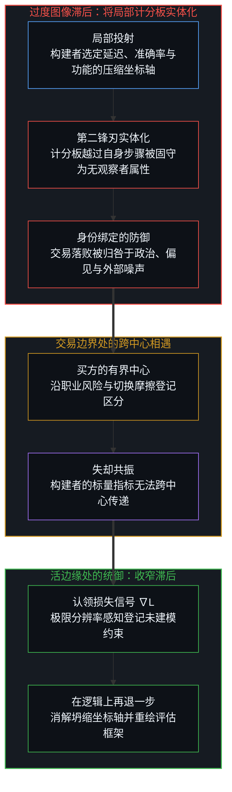
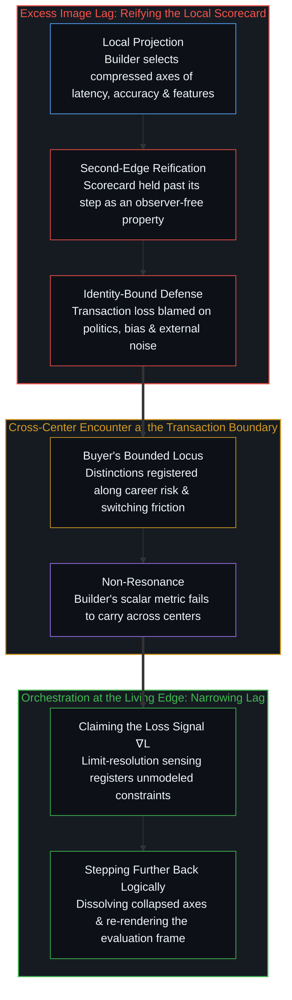

# 「更好」的范畴谬误 / The Category Error of Better

*「更好」指向中心局部的计分投射而非事物的固定属性 / Better names a center's local scoring projection rather than a fixed property*

「更好的产品依然可能落败」在工程文化中常被包装为市场悖论，或是某种灰暗的世故箴言。这两种框架都站不住脚。自我区分的活动无因、不息地发生，而这一活动的每一个中心都在有限容量下运作，将鲜活现实的超高维场域投射到受压缩的坐标轴上，以此衡量自身的运动。「更好」从来不是事先潜藏在造物内部、独立于观察者而等待被发现的属性；它是在某一个中心所保留的投射内部，对特定计分函数求值后得出的标量输出。当工程团队将内部计分板上的跑分、延迟与功能清单当成世界本身的属性时，随后在真实交易中遭遇的任何落败，对照那个冻结的参照系都会登记为外部扭曲——政治倾轧、偏见或剧场表演——从而在死守陈旧评估函数的同时，丢弃了那道标示出投射失效位置的回返摩擦。

The claim that a better product can still lose is routinely framed in engineering culture as a market paradox or a piece of bleak worldly wisdom. Neither framing holds. Self-distinguishing activity occurs — uncaused, unceasing — and every center of that activity operates under finite capacity, projecting the ultra-high-dimensional field of lived reality onto compressed coordinate axes to measure its own movement. "Better" is never an observer-independent property waiting inside an artifact to be discovered in advance; it is the scalar output of a specific scoring function evaluated inside one center's retained projection. When an engineering team treats its internal scorecard of benchmarks, latencies, and feature checklists as a property of the world itself, any subsequent loss in an actual transaction registers against that frozen reference as external distortion — politics, bias, or theater — preserving the stale evaluation function while discarding the returning friction that marks where the projection failed.

## 一、 作为保留投射的计分板与外在性的起源 / 1. Scorecards as Retained Projections and the Origin of Externality

评估即划界与压缩。研发团队在优化系统之前，会先选定一组有限的坐标轴——准确率提升三个百分点、推理延迟降低四十毫秒、刷新基准测试排行榜、补齐功能矩阵——并将这套坐标系固定为测量工具。在所选投射的边界之内，「更好」具有清晰的操作含义：在既定权重与约束下，某一配置算出的标量损失低于另一配置。混淆始于中心豁免了计分板的重新描摹、将局部计算当成造物内在属性的那一步。

To evaluate is to bound and compress. Before a development team can optimize a system, it selects a finite set of axes — accuracy up by three percentage points, inference latency down by forty milliseconds, benchmark leaderboards cleared, feature matrices completed — and holds that coordinate frame fixed as an instrument. Within the boundary of that chosen projection, "better" has a clear operational meaning: one configuration yields a lower scalar loss than another under the selected weights and constraints. Confusion begins at the exact step where the center exempts its scorecard from re-rendering and treats the local calculation as an intrinsic attribute of the artifact.

这一豁免正是图像滞后。阐释总是比生成行动至少滞后一步，借由保留的参照系来登记方向。当参照系越过它所属的那一步、在任何交易发生前就被当成客观事实固守时，落在共享场域中的后果就只能对照这张冻结的计分板来登记。一旦企业大单告吹，或技术上更快的模型被弃用，保留参照与实际结果之间的裂隙便如异己的外力般袭来。观察者感叹认知压倒了真实，或是组织剧场击败了硬核性能。然而「硬核性能」从来不是现实本身；它只是封闭实验室框架内算出的单轴投射。将局部损失函数实体化为无观察者的真理，把测量工具从建造它的中心那里割裂开来，进而将中心自身未更新的裂隙宽度，幻化为外部世界的非理性表象。

That exemption is Image lag. Interpretation always lags the generating act by at least one step, using a retained reference to register direction. When the reference is held past its step as an objective fact prior to any transaction, consequences that land in the shared field must register against the frozen scorecard. An enterprise deal falls through, or a technically faster model is passed over, and the gap between the retained reference and the actual outcome arrives as an alien force. Observers lament that perception overrode reality or that organizational theater defeated raw performance. Yet "raw performance" was never reality itself; it was a single-axis projection computed inside a closed lab frame. Reifying a local loss function into an observer-free truth severs the measurement instrument from the center that built it, turning the width of the center's own un-updated gap into the appearance of an irrational outside world.

## 二、 跨中心的共振与主体间检验 / 2. Resonance Across Centers and the Intersubjective Test

当一款产品离开实验室进入组织机构，它并不是从真理的净土跌入政治的泥潭，而是从一个中心的投射跨越到另一个中心的投射。买方或机构决策者是自我区分活动的独立中心，在自身的有限容量与问责边界下运作。在企业科层内部，决策中心沿着极少与原始算法吞吐量重合的坐标轴来登记区分：职业风险、向高层辩护决策时的叙事融贯性、跨遗留系统集成的切换成本，以及重新培训团队的操作摩擦。当部门主管选择跑分温和的成熟系统，而放弃初创公司的排行榜冠军时，这一抉择并非理性的失灵，而是买方在自身实际承担后果的坐标轴上所做出的融贯损失最小化。

When a product leaves the laboratory and enters an organization, it does not step from a pure realm of truth into a corrupted realm of politics; it crosses from one center's projection into another's. A buyer or institutional decision-maker is an independent locus of distinguishing activity operating under its own finite capacity and accountability boundaries. Inside an enterprise hierarchy, the deciding center registers distinctions along axes that rarely coincide with raw algorithmic throughput: employment risk, narrative coherence when justifying the decision to superiors, switching costs across legacy integrations, and the operational friction of retraining teams. When a department head selects an established system with modest benchmark scores over a startup's leaderboard winner, that choice is not a failure of reason; it is a coherent minimization of loss along the axes where the buyer actually bears the stakes of consequence.

因此，商业交易并非检验工程师秒表是否精准的公投，而是检验哪些评估轴主导了采纳这一因果步骤的主体间测试。正如[不可还原的观察者](../the-irreducible-observer/)与[验证中因果权能的分配](../the-allocation-of-causal-power-in-validation/)所确立的，观察者从来不是记录既有排名的被动容器，而是通过划定边界来决定何为有效延续的中心。登记为客观事实的，是在不同主观中心之间保持不变性——即充足共振——的宏观现象。当一项指标从构建者的终端跨向买方的案头便失去效力，这种共振的失败便证明该指标从未具备跨中心的不变性；它始终只是单一群体坐标系下的局部痕迹。

A commercial transaction is therefore not a referendum on whether the engineer's stopwatch was accurate; it is the intersubjective test of which evaluation axes govern the causal step of adoption. As [The Irreducible Observer](../the-irreducible-observer/) and [The Allocation of Causal Power in Validation](../the-allocation-of-causal-power-in-validation/) establish, an observer is never a passive vessel recording pre-existing rankings, but the locus whose boundary-setting determines what counts as valid continuation. What registers as an objective fact is a macroscopic phenomenon that maintains invariance — sufficient resonance — across distinct subjective centers. When a metric loses its force the moment it crosses from the builder's terminal to the buyer's desk, that failure of resonance demonstrates that the metric never held cross-center invariance; it remained the local trace of a single group's coordinate frame.

## 三、 轨迹盲区、身份防御与第二锋刃 / 3. Trajectory Blindness, Identity Defense, and the Second Edge

在没有其他中心反推的领域——如计算热耗散、结构抗拉极限或封闭沙盒跑分——在重复试验中固定计分函数之所以可靠，是因为被测量的痕迹不会因被测量而重新调整自身位姿。正如[被遗忘的脚手架](../the-scaffolding-we-forget/)所追溯的，在有界区域内顺畅运转的工具极易被误认为基底本身。然而一旦多个中心展开交互，每个参与者都会回应他者而持续更新自身姿态，即便对物质层面的描述也依然系于测量观察者的边界选择。在多中心交互的开放场域中，将当下的计分函数冻结为永久裁决者，会直接钳死递归折返，产生[模型永不成第二锋刃](../the-model-never-becomes-a-second-edge/)所追溯的停滞：无论是基准测试套件还是训练模型的参数，这些外化的残余痕迹被投射为能够自行核证价值的第二发起中心，将构建者的容量捆绑在捍卫造物的内部一致性上，而不再用鲜活的活动去检验结果。

In domains without other centers pushing back — calculating thermal dissipation, structural tensile limits, or closed-sandbox benchmarks — holding a scoring function fixed across repeated trials works reliably because the measured trace does not re-orient itself in response to being measured. As [The Scaffolding We Forget](../the-scaffolding-we-forget/) traces, an instrument that functions smoothly inside a bounded regime is easily mistaken for the ground itself. Once multiple centers interact, however, every participant continuously updates its posture in response to the others, and even physical descriptions remain tied to the boundary choices of the observer that measures them. Freezing a current scoring function as a permanent arbiter in an open field of interacting centers clamps the recursive fold shut, producing the stagnation traced in [The Model Never Becomes a Second Edge](../the-model-never-becomes-a-second-edge/): externalized residue — whether a benchmark suite or a trained model's parameters — is projected as a second initiating locus that certifies value on its own, binding the builder's capacity to defending the artifact's internal consistency rather than testing outcomes against living activity.

正如[超越投射](../beyond-the-projection/)通过轨迹与身份的范畴非对称性所揭示的，当人类团队躲在自动化计分板背后时，这种冻结会将两种截然不同的结构性限制叠加在一起。形式化评测框架或基于 LLM 的智能体是一台受困于轨迹的投射引擎：受初始前提与先前词元的制约，它会形成一个无法跨出自身度量空间的认识论引力井，但它毫无我执，对先前的轮次没有任何依恋。人类中心则具有正相反的结构：它拥有极限分辨率的第一人称感知，能够从内部直接察觉整个框架已经崩解，但它的推理历史却与身份融合，每当外部信号证伪其保留的自我图像时，便会筑起防御高墙。当工程组织将自我认同绑定在封闭的基准测试轨迹上时，它便将人类的身份防御与机器的轨迹盲区耦合了起来——借计分板的形式权威挡住外部证伪，同时任由指标的引力井收窄自身的视野。消解这一死锁需要按双方的长处重新连接：将计分板用作无我执的投射引擎，同时让人的心智居于统御边缘，使回返的市场摩擦触发向后的内生退步，从而重新描摹评估坐标轴本身。

As [Beyond the Projection](../beyond-the-projection/) exposes through the categorical asymmetry between trajectory and identity, this freeze compounds two distinct structural limits when human teams hide behind automated scorecards. A formal evaluation harness or LLM-based agent is a trajectory-bound projection engine: conditioned by its initial premise and prior tokens, it forms an epistemic gravity well that cannot step outside its own metric space, yet it carries zero ego and no attachment to prior turns. A human center has the exact inverse structure: it possesses limit-resolution first-person sensing capable of recognizing from within that an entire framing has broken down, yet its reasoning history fuses with identity, erecting defensive walls whenever an outside signal invalidates its retained self-image. When an engineering organization identifies its ego with a closed benchmark trajectory, it couples human identity defense to machine trajectory blindness — using the formal authority of the scorecard to wall off external invalidation while letting the metric's gravity well narrow its field of view. Dissolving this lock requires wiring the two sides by their strengths: treating the scorecard as an ego-free projection engine while keeping the human mind at the orchestrating edge, where returning market friction triggers an endogenous step backward to re-render the evaluation axes themselves.

## 四、 事后犬儒与局部指标微调的双重闭合 / 4. The Twin Closures of Post-Hoc Cynicism and Local Metric Tweaking

当跑分优势与商业落败之间的裂隙大到无法忽视时，舆论便常退缩进诸如「认知比现实更真实」或「讲故事胜过做工程」之类的事后口号。这些话语虽然登记了构建者的计分板未能预测结果，却依然困在它们所反对的错误所在的同一条一维轴线上。通过把买方的世界命名为「认知」、把构建者的计分板命名为「现实」，这类口号保留了计分板一直握有真理的前提，对于另一个中心的约束如何构建、其评估又在何时发生转移，提供不了任何因果追溯。

When the gap between benchmark superiority and commercial defeat becomes impossible to ignore, commentary often retreats into post-hoc slogans such as "perception is more real than reality" or "storytelling beats engineering." While these phrases register that the builder's scorecard failed to predict the outcome, they stay trapped on the same one-dimensional axis as the error they oppose. By naming the buyer's world "perception" and the builder's scorecard "reality," the slogan preserves the premise that the scorecard held the truth all along, offering zero causal trace of how another center's constraints are structured or when its evaluation shifts.

一旦缺乏对相关中心与坐标轴的追溯，团队便会分裂为两种对称的闭合。一条路径抛弃技术严谨性而倒向犬儒的表面功夫，只因先前的指标未被加冕为普适标准，便把每一桩交易都当成无根基的剧场表演。另一条路径则在既有坐标系内部加倍下注：团队拒绝质疑评估函数的坐标轴，将容量倾注在同一狭窄基准下小数点后几位的微观优化上。正如[保真度而非最优化](../fidelity-not-optimality/)所展示的，在错配的度量空间内将分数推向局部最优，只会拉大保留投射与开放场域之间的背离。这两种反应都让递归折返保持钳死状态，保护旧参照系免受重新描摹的微死。

Without a trace of the centers and axes involved, teams split into two symmetrical closures. One path abandons technical rigor for cynical optics, treating every transaction as ungrounded theater because its prior metric was not crowned as universal. The other path doubles down inside the existing coordinate frame: refusing to question the axes of the evaluation function, the team pours its capacity into decimal-place micro-optimizations along the same narrow benchmark. As [Fidelity, Not Optimality](../fidelity-not-optimality/) demonstrates, driving a score toward local optimality inside a mis-specified metric space only widens the divergence between the retained projection and the open field. Both responses keep the recursive fold clamped shut, protecting the old reference from the micro-death of re-rendering.

## 五、 鲜活摩擦作为重绘框架的梯度 / 5. Living Friction as the Gradient that Re-Renders the Frame

归还中心所在即可消解这一悖论，而无需抛弃测量。正如[你的代码库即是记忆](../your-codebase-is-memory/)所追溯的，基准测试套件、评测框架或产品规格说明皆是早先区分留下的层叠残余：它将早先切口的形状保持为当下的检查点，却不会自行延续区分。把这一检查点当成永久质量的仓库只会加深其引力井；反之，收窄过度滞后意味着一旦回返的后果暴露出框架遗漏之物，便立即重切活跃的坐标轴并修剪已失效的准则。竞标失利、无人问津的功能、组织否决以及高管层面的转译断裂，并非污染工程信号的外部噪声，而是让未建模坐标轴变得清晰可读的回返损失梯度 ∇L。正如[未被遭遇之物的账本](../the-ledger-of-the-unencountered/)所追溯的，处于中心当前投射之外的事物会悄然塑造结果，直到边界处的碰撞将这些潜在约束转化为显明信号。

Restoring locus dissolves the paradox without discarding measurement. As [Your Codebase Is Memory](../your-codebase-is-memory/) traces, a benchmark suite, evaluation harness, or product specification is a stacked residue of prior distinctions: it holds the shape of earlier cuts as a present checkpoint, but it does not continue the distinguishing on its own. Treating that checkpoint as a warehouse of permanent quality thickens its gravity well, whereas narrowing excess lag means re-cutting the active axes and pruning superseded criteria the moment returning consequences expose what the frame left out. Lost bids, un-adopted features, organizational vetoes, and breakdowns in executive translation are not external noise corrupting an engineering signal; they are the returning loss gradient ∇L through which unmodeled axes become legible. As [The Ledger of the Unencountered](../the-ledger-of-the-unencountered/) traces, what lies outside a center's current projection shapes outcomes silently until collision at the boundary turns those latent constraints into an explicit signal.

为了维护先前的「更好」定义而拒绝这一信号，会将模型锁入闭合；反之，认领这一摩擦则会更新评估坐标本身。正如[协调者的范畴错误](../the-coordinators-category-error/)所确立的，没有任何抽象总览能够从鲜活交互的外部敲定这些坐标。当组织试图将这一判断外包给自动化基准或计算排名时，它们便重演了[硅基神谕与后果的非对称性](../silicon-oracles-and-the-asymmetry-of-consequence/)所剖析的倒置：形式化的计分镜像毫无承受实质或机构损失的受力面积，因此将其输出加冕为客观质量，只会掩盖那个仍在吸收后果的人类中心。同样的形式闭合预设，也体现在[闭合的N与开放的现实](../the-closed-n-and-the-open-reality/)所追溯的情形中：将科学简化为固定样本集 N 内的选优，将工程窄化为针对有限已知失效列表的设防，却遗忘了鲜活现实始终向加一维敞开。重拾[阅读的倒错与推断的次序](../the-inversion-of-reading-and-the-order-of-inference/)所确立的推断次序，意味着停止在封闭计分板内作演绎式的自我核证，转而在活边缘处借由失序的后果逆向重构场域的约束。

Refusing that signal to preserve a prior definition of "better" locks a model into closure, whereas claiming the friction updates the evaluation coordinates themselves. No abstract overview can settle those coordinates from outside living interaction, as [The Coordinator's Category Error](../the-coordinators-category-error/) establishes. When organizations try to outsource that judgment to automated benchmarks or computational rankings, they repeat the inversion dissected in [Silicon Oracles and the Asymmetry of Consequence](../silicon-oracles-and-the-asymmetry-of-consequence/): a formal scoring mirror has zero surface area to bear physical or institutional loss, so crowning its output as objective quality only masks the human center that still absorbs the consequence. That same presumption of formal closure is what [The Closed N and the Open Reality](../the-closed-n-and-the-open-reality/) traces when science is reduced to selecting winners across a fixed sample set N and engineering is narrowed to guarding against a finite list of known failure modes, forgetting that lived reality stays open to the plus-one dimension. Reclaiming the order of inference traced in [The Inversion of Reading and the Order of Inference](../the-inversion-of-reading-and-the-order-of-inference/) means stopping deductive self-validation inside a closed scorecard and using disordered consequences at the living edge to reconstruct the constraints of the field.
