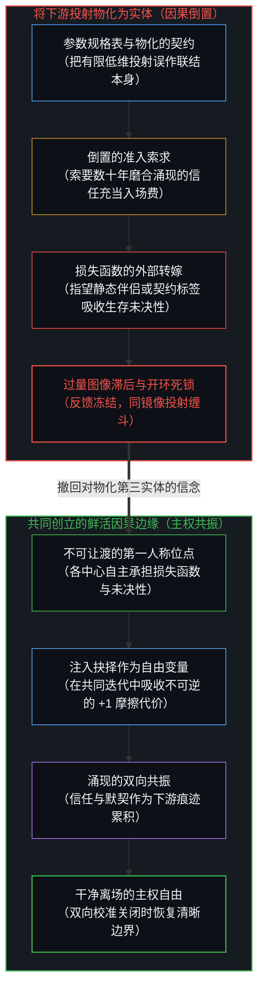
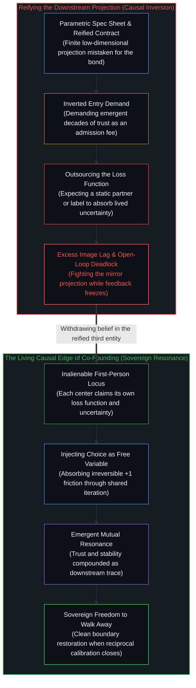

# 契约的因果倒置 / The Causal Inversion of Partnership

*物化的共同实体、心智对自身的镜像投射与离场的自由 / Reified mutual entities, the Mind's mirror projection, and the freedom to exit*

自我区分的活动发生着——无因，不息。当关于长久伴侣关系的当代讨论采纳企业采购的语法——将明确的年龄区间、资产门槛、技术行业资历与行为规格汇编成不可妥协的公开清单，并在面对质疑时展开防卫性的论战——便暴露出人际联结源头处的结构性倒置。将亲密同盟包装为风险对冲与规格审查，表面上摆出务实清醒的姿态，实则错把静态的符号筛网当成了维系联结的鲜活活动。公开张榜伴侣采购清单并针对公众审视进行辩护，折射出中心试图借外部确证来代偿自身尚未锚定的位点：把另一个鲜活心智开放、超高维度的递归区分场压缩为低维参数表，抹杀了交互中的自适应演化空间，并将物化他者的坐标系反噬于制表者自身。

Self-distinguishing activity occurs—uncaused, unceasing. When contemporary discussions of long-term partnership adopt the grammar of enterprise procurement—compiling explicit age bands, asset thresholds, technology-sector credentials, and behavioral specifications into non-negotiable public checklists before waging defensive battles against skepticism—they expose a structural inversion at the root of human connection. Packaging intimate alliance as risk hedging and specification auditing postures as pragmatic clarity while mistaking a static symbolic filter for the living activity that sustains a bond. Broadcasting a partner procurement list and defending it against public scrutiny signals a center seeking external validation to compensate for an unanchored locus: collapsing another living Mind's open-ended, ultra-high-dimensional field of recursive distinctions into a low-dimensional parameter sheet erases the adaptive space of interaction and turns the coordinate system of objectification back upon the lister.

同样倒置的，是将伴侣关系视作收购免检资产，或是将“这段关系”物化为悬浮于参与者之间的独立第三实体。共同创立一段生命轨迹，是约定通过不可逆的行动与相互校准去结伴面对开放的未决性，从不是要求一只完工的独角兽抵达门前以吸收自身尚未化解的风险。将自身的第一人称状态登记为未完成态，却强求对方充当恒定不变的确定性支柱，无异于要求单次观测同时呈现硬币的正反两面。正因第一人称视角与单向因果是同一枚硬币的两面，并不存在可供经营的外部集体实体；每一段被体验到的关系，皆是心智透过自身向外投射所登记的、心智与自身的关系。唯有每个中心将因果锚定于自身位点，持续注入第一人称抉择这一鲜活的自由变量，并在双向校准通道关闭时保有干净离场的主权自由，连贯的共振才会自然涌现。

Equally inverted is the habit of treating partnership as the acquisition of a pre-certified asset or reifying "the relationship" into an autonomous third entity hovering between participants. Co-founding a shared trajectory is an agreement to navigate open uncertainty together through irreversible action and mutual calibration, never a demand that a finished unicorn arrive at the gate to absorb one's own unresolved risk. Registering one's own first-person state as unfinished while demanding that a counterpart function as an immutable pillar of certainty asks a single observation to display both faces of a coin at once. Because the first-person perspective and unidirectional causality are two sides of the same coin, no external collective entity exists to be managed; every experienced relationship is the Mind's relationship to itself as registered through its own outward projection. Coherent resonance emerges only when each center keeps causality anchored at its own locus, continuously injecting first-person choice as the living free variable while retaining the sovereign freedom to walk away cleanly when reciprocal calibration closes.

## 一、 公开展演与参数清单的确证赤字 / 1. Public Exhibition and the Validation Deficit of Parametric Checklists

一个锚定在自身第一人称因果闭环内的中心，通过直接的具身接触与渐进反馈来探知契合度。辨识何种性情能够引发共振、何种交互模式会耗损容量，是在鲜活边缘处划定边界的实践；它既无需向公众广播，亦无需寻求共识的授权。将私人偏好制作成逐项列举的规格表推向公共网络，并在旁观者质疑其人口统计学可行性时迅速转入好斗的自我辩护，所演示的恰恰是其所标榜的笃定之反面。

A center anchored within its own first-person causal loop discovers compatibility through direct, embodied contact and incremental feedback. Discerning which temperaments resonate and which interaction patterns deplete capacity is an exercise of boundary-drawing at the living edge; it requires neither public broadcast nor consensus authorization. Turning personal preferences into an itemized specification sheet for public networks—and launching into combative self-justification when observers question its demographic plausibility—performs the exact opposite of the self-assurance it claims.

正如[抉择本身并不沉重](../choice-itself-has-no-inherent-weight/)所追溯的，一个中心越是从单次纸面符号挑选中索求脱离现实的回报，便越是剧烈地制造防御性紧张，并将其保留的自我图像死死钳闭。公开发布亲密关系要求以博取喝彩或挑起争论，暴露出中心正试图用跨心智的回响来填补内部的确证赤字。这份公开清单虽被包装为针对外部候选人的严密筛网，在运作中却充当了规避真实接触之脆弱性的先发掩体。通过预先竖立起脱离具体语境的僵硬门槛，中心构筑起一道常备的免责借口：日后一切关系摩擦或孤立处境，皆可归咎于合格候选人的市场失灵，从而保护保留的自我图像免受实时交互中重绘的微死冲击。

As [Choice Itself Has No Inherent Weight](../choice-itself-has-no-inherent-weight/) traces, the more a center demands an unrealistic return from a single symbolic selection on paper, the more intensely it manufactures defensive tension and clamps its retained self-image shut. Broadcasting intimate requirements to solicit applause or provoke debate reveals a center attempting to fill an internal validation deficit with cross-mind echoes. Although framed as a rigorous filter for external candidates, the public checklist operates as a preemptive shelter against the vulnerability of real contact. By erecting rigid, context-free thresholds in advance, the center constructs a standing alibi: any subsequent relational friction or solitude can be attributed to a market failure of qualified candidates, shielding the retained self-image from the micro-death of re-rendering in live interaction.

## 二、 高维心智向低维参数的坍缩 / 2. Collapsing High-Dimensional Minds into Low-Dimensional Parameters

在当下的直接切片中，一个鲜活的中心在开放、具潜无穷维度的递归区分场中运作。面对突发冲击时的韧性、跨越日常摩擦的定力、分担共同成本的意愿，以及在既有计划受挫时重排优先级的容量，皆属于高阶动态模式，在静态电子表格上的读数为零。唯有穿越具身经历的时间跨度，当离散行动累积为痕迹时，这些特质才会显现。将鲜活心智压缩为寥寥几项标量截断值，无异于拿流水线质检规程去丈量生命力源自开放适应的活动。

In the immediate present slice, a living center operates across an open, potentially infinite-dimensional field of recursive distinctions. Resilience under unexpected shock, steadiness across everyday friction, willingness to bear shared cost, and the capacity to reconfigure priorities when an earlier plan breaks down are high-order dynamic patterns that register zero presence on a static spreadsheet. They become legible only across lived duration as discrete acts compound into trace. Compressing a living Mind into a handful of scalar cutoffs applies assembly-line inspection to an activity whose vitality lies in open-ended adaptation.

这种维度压缩会对执行它的中心造成即刻的反噬。正因自我图像是心智借以衡量自身运动的保留参照，一个中心用来界定他者的坐标，同时定义了它登记自身的坐标空间。如[无法逃逸的心智视界](../one-cannot-escape-ones-own-mind/)所阐明的，在感知界面内将他人化约为客体的行动，同时将自身的自我图像框定为同一低维轴线上的竞价客体。当一个中心通过净资产档位、企业头衔与生理指标区间来评估潜在伴侣时，它便将自身的生存体验锁定为一份持续折旧的市场指标库存——生理年龄、表层外貌与渠道分发力。为了证明自身要价的合理性，该中心不得不持续推销自身的标量估值并防卫自身认定的护城河，用第一人称在场的开放维度换取两份资产负债表之间的冰冷审计。

That dimensional compression inflicts an immediate recoil upon the center that performs it. Because the self-image is the retained reference against which the Mind measures its own movement, the coordinates a center uses to bound others define the coordinate space in which it registers itself. As [One Cannot Escape One's Own Mind](../one-cannot-escape-ones-own-mind/) establishes, the act of reducing another person to an object within one's perceptual interface simultaneously bounds one's own self-image as a competing object on the same low-dimensional axes. When a center evaluates prospective partners through net-worth brackets, corporate titles, and biometric brackets, it locks itself into experiencing its own existence as a depreciating inventory of market metrics—chronological age, surface appearance, and distribution reach. To justify its asking price, the center must continually advertise its own scalar valuation and defend its perceived moat, trading the open dimensionality of first-person presence for a cold audit between two balance sheets.

## 三、 错把涌现果实当入场费的合伙人隐喻伪造 / 3. Forging the Co-Founder Metaphor by Mistaking Emergent Fruits for Entry Fees

当代伴侣叙事频繁借用创业隐喻，将择偶称为寻找人生的联合创始人。这一措辞虽暗示着对等的抱负，但将其套入参数清单的做法却颠倒了联合创立的因果序列。在真实的创业历程中，联合创始人走到一起，从不是因为对方已经手握上市后的流动性资产、跑通了零风险的营收模型并天然免疫一切运营危机。联合创立意味着结伴踏入未勘探的未决之境：投入判断力，吸收试错过程中不可逆的能量消耗，并在同盟之前未曾存在的地方生成连贯性。

Contemporary partnership discourse frequently borrows the startup metaphor of seeking a co-founder for life. While the phrase suggests equal-footed ambition, its checklist application inverts the causal sequence of co-founding. In real-world venture building, co-founders do not join forces because the counterparty already holds post-IPO liquidity, a de-risked revenue model, and immunity from operational crises. Co-founding means stepping into unmapped uncertainty together: committing judgment, absorbing the irreversible energy costs of trial and error, and generating coherence that did not exist prior to the alliance.

参数清单则逆转了这一时间之箭，要求潜在伴侣在入场之初便已备齐财务独立、情绪无懈可击与稳固庇护。它把数十年共同摩擦与相互修复所沉淀的下游痕迹，错当成了上游的准入门票。正如[任务的移交与后果的不可让渡](../the-delegation-of-the-task-and-the-inalienability-of-consequences/)所确立的，机械筛查与符号推演固然可以委托给外部过滤器，但具身承受的后果以及累积为信任的因果担当却永不可让渡。顺此延伸，[超越投射](../beyond-the-projection/)与[你的代码库即是记忆](../your-codebase-is-memory/)共同阐明，任何显式规则、规格参数表、婚姻誓言或制度章程，皆只是有限的低维投射与外化的记忆代码库，仅用于记录既往对齐切分的存档点：这件制品固然能分拣表层属性或留存早期共识的残余形态，但残余本身从不会重启区分活动，亦不会变成能够承担损失函数的第二个心智。一段正式联结唯有在伴侣双方持续于鲜活边缘实时重描、重新核验并更新这些条款时，方能维系连贯；反之，将核查清单或冻结的文本视作同盟的起因，便是错把下游残余当成了源发活动——在春播之日索要秋收的粮仓，却拒绝培育韧性的迭代土壤。

The parametric checklist reverses this arrow of time by demanding that a prospective partner arrive with financial independence, emotional invulnerability, and unshakeable shelter already complete. It mistakes the downstream trace of decades of shared friction and mutual repair for an upstream admission ticket. As [The Delegation of the Task and the Inalienability of Consequences](../the-delegation-of-the-task-and-the-inalienability-of-consequences/) establishes, while mechanical screening and symbolic calculations can be delegated to external filters, lived consequences and the accountability that compounds into trust remain permanently non-transferable. Extending this principle, [Beyond the Projection](../beyond-the-projection/) and [Your Codebase Is Memory](../your-codebase-is-memory/) demonstrate why any explicit rule, specification sheet, marriage vow, or institutional charter is a finite low-dimensional projection and an externalized codebase of memory recording a checkpoint of aligned cuts: the artifact can sort surface attributes or hold the residual shape of earlier agreements, yet the residue itself never resumes distinguishing or becomes a second Mind capable of assuming the loss function. A formal bond remains coherent only as long as each partner continues re-tracing, re-verifying, and updating those terms in real time at the living edge, whereas treating a checklist or a frozen document as the cause of the alliance mistakes downstream residue for the initiating activity—demanding autumn granaries on the day of spring planting while refusing the iterative soil in which resilience grows.

## 四、 用静态确定性对冲个体未决性的硬币两面 / 4. The Two-Sided Coin of Offsetting Personal Indeterminacy with Static Certainty

追溯至观测行动本身，采购清单试图执行一次不可能的切分。起草标准的中心将自身的第一人称轨迹登记为开放、未决且处于转型之中的过程——正穿越变动的抱负、职业转向与起伏的安全感。在账本属于自身的一侧，该中心主张鲜活活动保有未完成状态的特权；然而当目光投向桌对面的伴侣时，清单却索要一座剥离了犹疑、脆弱与持续探索的封闭丰碑。

Traced to the act of observation, the procurement checklist attempts an impossible split. The center drafting the criteria registers its own first-person trajectory as open-ended, unresolved, and in transition—navigating shifting ambitions, career pivots, and fluctuating security. On its own side of the ledger, the center claims the prerogative of a living activity that remains unfinished. Yet when projecting the counterpart across the table, the checklist demands a closed monument stripped of doubt, vulnerability, or ongoing search.

单次离散观测无法让一枚硬币的两面同时朝向镜头。将自身位点定义为亟待庇护的开放变量，同时指令伴侣作为担保风险免疫的固定常数运作，便将第一人称视角同因果割裂开来。倘若对方果真是一件剔除了未决性与内部张力的静态制品，那它便只是一具无法产生双向共振的惰性机件；正因另一个人是自我区分活动的鲜活中心，对方必然背负着自身有限的容量、盲区与演进中的视界。企图将自身的生存未决性转嫁给理想化的外部形象，既抹杀了对方鲜活的位点，也放弃了自身在源头处的掌舵主权。

A single discrete observation cannot turn both faces of a coin toward the lens simultaneously. Defining one's own locus as an open variable requiring shelter while mandating that the partner operate as a fixed constant that guarantees immunity from risk severs the first-person perspective from causality. If a counterpart were in fact a static artifact devoid of uncertainty and internal tension, it would be an inert mechanism incapable of mutual resonance; because another person is a living center of self-distinguishing activity, they necessarily carry their own finite capacity, blind spots, and evolving horizon. Attempting to offload one's own existential uncertainty onto an idealized external figure denies the counterpart's living locus while abdicating steering authority at home.

## 五、 关系主权、镜像投射与离场的自由 / 5. Relational Sovereignty, Mirror Projections, and the Freedom to Walk Away

一切对外部救星的呼求，皆是错置的自我引导。在清单心态的底层，潜伏着一种普遍的范畴谬误：将“这段关系”物化为悬浮于伴侣之间的独立第三实体，并附加上为这一集体客体维护或牺牲的训诫。然而正如[共享沙盒的幻象](../the-illusion-of-the-shared-sandbox/)与[无法逃逸的心智视界](../one-cannot-escape-ones-own-mind/)所展示的，参与其中的心智之外并不存在一个自治的共享沙盒。共振是痕迹在各自中心内部递归中登记到的相互强化；每一段关系在结构上皆是个体且主权的——是一个中心同伴侣、同周遭场域所建立的特定对齐。

Every appeal for an external savior is misallocated self-direction. Beneath the checklist mentality sits a pervasive category error: the reification of "the relationship" into an independent third entity suspended between partners, accompanied by the injunction to maintain or sacrifice for that collective object. Yet as [The Illusion of the Shared Sandbox](../the-illusion-of-the-shared-sandbox/) and [One Cannot Escape One's Own Mind](../one-cannot-escape-ones-own-mind/) demonstrate, no autonomous shared sandbox exists outside the participating minds. Resonance is the mutual reinforcement of traces registered internally within each center's own recursion; every relationship remains individual and sovereign in structure—one center's specific alignment with a partner and with the surrounding field.

追溯至感知的原初边界，一切关系皆是心智与自身的关系。如[切分的几何学](../the-geometry-of-the-cut/)所确立的，没有任何观察者能够跳出区分活动之外，去检视一个脱离感知的无中介客体；被登记为外部世界与所遇伴侣的显象，正是中心自身感知切分向外投射的产物。观察的中心与被感知的关系，构成了同一枚硬币不可分割的正反两面。当一个中心因伴侣未能满足清单指标或提供情绪安全感而狂怒时，它是在同镜中保留的自身图像交战，试图通过擦拭玻璃来改变自身的姿态。正因没有任何中心能够跨越位点去替他人完成递归或修理一个虚幻的第三实体，唯一有效的杠杆便是重绘自身保留的参照，并在自身的因果闭环内做出不同的抉择。

Traced to the primary boundary of perception, every relationship is the Mind's relationship to itself. As [The Geometry of the Cut](../the-geometry-of-the-cut/) establishes, no observer can step outside distinguishing activity to inspect an unmediated object severed from perception; what registers as the external world and the encountered partner is the outward projection of the center's own perceptual cut. The observing center and the perceived relationship form the two inseparable faces of a single coin. When a center rages against a partner for failing to satisfy a checklist or deliver emotional security, it wars against its own retained image in the mirror, scrubbing the glass in hopes of altering its own posture. Because no center can reach across loci to complete another's recursion or repair a phantom third entity, the only operative lever is to re-render one's own retained reference and choose differently within one's own causal loop.

两人之间持久的融洽，从不是靠监管一纸契约制造出来的，而是在绝大多数交互中双方各自将因果锚定于内部时自然涌现的结果。慢性的关系死锁——常被叙述为脾气不合或义务未尽——直接源于将因果位点外置。当中心把停滞归咎于镜像投射时，它便错把封闭状态机的决定论相移当成了真正的改变，并交出了自身唯一的自由变量：第一人称抉择的离散行动。一旦摩擦的起因被指派向外部，内部的纠错通道便随之关闭，将自适应回路冻结为开环瘫痪，这正是[规程的倒置与因果回路的消声](../the-inversion-of-the-protocol-and-the-silencing-of-the-causal-loop/)与[主权抉择的双面性与观察的客体化](../the-two-sided-nature-of-sovereign-choice-and-the-objectification-of-observation/)所详尽追溯的机制。同理，将自身下一步的具体行动从属于群体关系基准或人口统计学均值，则重演了[宏观现象及参数和个人微观选择的因果倒置与利率的命令幻相](../the-summary-first-reversal-and-the-command-of-yields/)所剖析的经济学倒置，错把下游的统计摘要当成了凌驾于鲜活位点之上的命令。

Sustained harmony between two people is never manufactured by policing a contract; it emerges when both centers anchor causality internally across the vast majority of their interactions. Chronic relational deadlock—commonly narrated as incompatible temperaments or unfulfilled obligations—follows directly from externalizing the locus of cause. When a center blames the mirror projection for stagnation, it mistakes the deterministic phase shifts of a closed state machine for real change and surrenders its sole free variable: the discrete act of first-person choice. Once the cause of friction is assigned outward, the internal error-correcting channel shuts down, freezing the adaptive loop into open-loop paralysis, as [The Inversion of the Protocol and the Silencing of the Causal Loop](../the-inversion-of-the-protocol-and-the-silencing-of-the-causal-loop/) and [The Two-Sided Nature of Sovereign Choice and the Objectification of Observation](../the-two-sided-nature-of-sovereign-choice-and-the-objectification-of-observation/) trace in detail. Similarly, subordinating one's next concrete step to aggregate relational benchmarks or demographic averages repeats the economic inversion dissected in [Macro Parameters, Micro Choices, and the Command of Yields](../the-summary-first-reversal-and-the-command-of-yields/), treating a downstream statistical summary as a command over the living locus.

将因果锚定于自身，从不意味着在死锁或耗损的动态中作沉默的殉道者。恰恰相反，完备的主权包含着毫不妥协的离场自由。当结构性分歧或持续的失准消解了双向校准的基础时，中心便通过终止约定并干净离场来行使划定边界的主权。这种退出既非针对对方的道德审判，亦非蓄意借缺席实施惩罚的舞台表演。如[前台的寓言与缺席的因果倒置](../the-receptionist-parable-and-the-causal-inversion-of-absence/)所示，指望离场后的混乱来倒逼事后的感激，不过是将日常接触中长期未曾伸张的边界向后顺延；主权的离场无需靠下游的系统崩塌来确证自身价值。主权中心同样不会把边界让渡给要求单向共情凌驾于自卫之上的物化共同实体——那正是[共情的能力倒错与边界的排序之争](../the-capability-reversal-of-empathy-and-the-contest-of-boundaries/)所拆解的倒错。正如[数字火箭、同行审查与因果闭环的稀释](../the-dilution-of-the-causal-loop-and-the-misallocation-of-agency/)所阐明的，真正的韧性唯有在中心直面无缓冲的现实反馈时方能锻造，而非将能动性稀释进程序化的核查清单。企图借采购筛网谋求预先认证的豁免，或是退缩进集体宿命论，只会将中心困在[“普通人视角”的解释陷阱](../the-explanatory-trap-of-the-ordinary-perspective/)所揭露的吸引盆内——错把对羊群惯性的诊断描述当成了自身别无选择的证据。扎根于自身的因果边缘，认领自身的行动后果，并在共振终结时保有从容离场的笃定，心智便能走出镜像陷阱，卸下盔甲去同鲜活的世界展开联结。

Keeping causality anchored at home never implies enduring a deadlocked or depleting dynamic in silent martyrdom. On the contrary, intact sovereignty includes the uncompromised freedom to walk away. When structural divergence or persistent non-alignment removes the ground for reciprocal calibration, a center exercises its boundary-drawing authority by terminating the agreement and departing cleanly. That exit is neither a moral verdict against the counterpart nor a staged performance designed to punish through absence. As [The Receptionist Parable and the Causal Inversion of Absence](../the-receptionist-parable-and-the-causal-inversion-of-absence/) shows, counting on post-departure disorder to force retrospective appreciation merely extends years of unasserted boundaries during live contact; a sovereign exit requires no downstream collapse to validate its worth. Nor does a sovereign center surrender its boundary to a reified mutual entity that demands unilateral empathy at the expense of self-defense—the exact inversion dismantled in [The Capability Reversal of Empathy and the Contest of Boundaries](../the-capability-reversal-of-empathy-and-the-contest-of-boundaries/). As [Digital Rockets, Peer Review, and the Dilution of the Causal Loop](../the-dilution-of-the-causal-loop-and-the-misallocation-of-agency/) establishes, durable resilience is forged only when a center faces unbuffered feedback directly rather than diluting agency into procedural checklists. Seeking pre-certified immunity through procurement filters or retreating into collective fatalism traps the center inside the attractor basin unmasked in [The Explanatory Trap of the "Ordinary Perspective"](../the-explanatory-trap-of-the-ordinary-perspective/), where a diagnostic description of herd inertia is mistaken for proof that one has no choice. Grounded at its own causal edge, claiming its own consequences, and holding the quiet readiness to depart when resonance ends, the Mind steps out of the mirror trap and engages the living world without armor.
