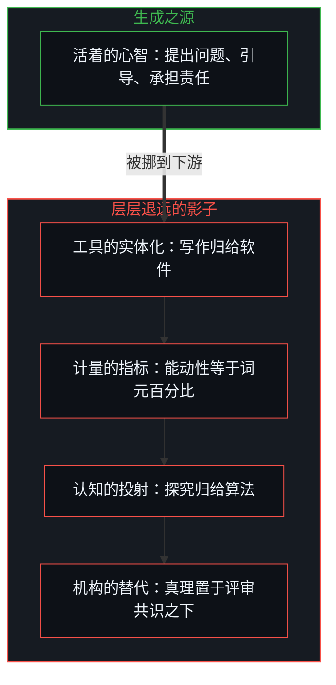
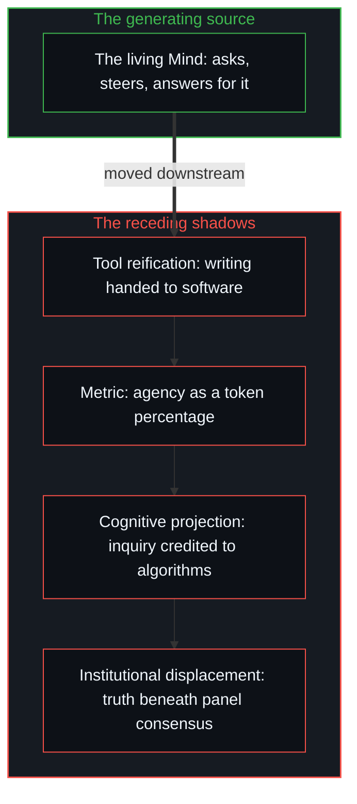

# 哲学能动性的因果倒置 / The Causal Inversion of Philosophical Agency

*把哲学能力归给语言模型、把哲学权威归给评审团，是把因果次序倒过来 / Crediting philosophy to language models and authority to judging panels turns the causal order upside down.*

思想讨论里有一个反复出现的错误：把因果的次序倒过来。被产出的东西被当成了产出者，思考时用的工具被当成了思考者，为一个结果盖章的机构被当成了哲学真理的源头。

A recurring error in intellectual discussion is reversing the causal order. What is produced is treated as the producer, the instrument used in thinking is treated as the thinker, and the institution that stamps a result is treated as the source of philosophical truth.

这种倒置把行动的生成之源，从活着的心智挪到了它下游的某个影子上。从第一人称追溯，这个次序有一个起点：任何“某物在思考”“某物写了这篇文章”的判定，本身都是一个心智在划出这道切分；否认这一点，也要先做一次这样的划分。以下逐层看这次挪动怎样发生。

This inversion moves the generating source of action from the living Mind to one of its downstream shadows. Traced from the first person, the order has a starting point: any judgment that "something is thinking" or "something wrote this essay" is itself a Mind drawing that cut, and denying this takes one such drawing first. What follows looks, layer by layer, at how the move happens.

## 一、 倒置的语法 / 1. The Grammar of Inversion

倒置先出现在日常的语言里。说一篇文章“由 AI 写成”，就把创作的首要行为归给了一件工具。作者用笔、用印刷机、用搜索索引，或用一个计算的语言模型来写；工具可能生成了绝大部分的词元，它仍然是工具。提出问题的是心智，通过提示的表述、批评、挑选与修改来引导生成回路的是心智，为最终的断言承担认识上与伦理上的责任的，也是心智。说一篇文章“用了 AI 工具”，保住了不断开的因果次序；说它“由 AI 写成”，就把次序倒了过来，把媒介当成了行动者。

The inversion appears first in ordinary language. Saying an essay was "written by AI" assigns the primary act of creation to a tool. An author writes with a pen, a printing press, a search index or a computational language model; the tool may generate the great majority of the tokens, and it remains a tool. It is the Mind that poses the question, the Mind that steers the generating loop through the wording of prompts, critique, selection and revision, and the Mind that bears the epistemic and ethical responsibility for the resulting claims. Saying an essay "used an AI tool" keeps the unbroken causal order; saying it was "written by AI" turns the order upside down, taking the medium for the agent.

## 二、 词元门槛的计量谬误 / 2. The Counting Fallacy of Token Thresholds

想用数量门槛来规范这层关系，只会把错误叠上去。要求投稿“主要由 AI 生成”、只有“最少的人类协作”的规则，用一个任意的算术指标替换了一个概念上的混淆。词元的数量反映的是句法的机械来源，并不说明是谁做了哲学的行为。统计模型依据历史的分布生成序列；人在构想问题、评估中间的候选稿、剪掉不连贯之处、选定最后的表述。无论机器输出的是最终句子的一成还是九成，引导这一过程的心智仍是因果上的行动者。引导是能动性的来源，数词元只是对机械痕迹的普查。

Attempts to regulate this relation with quantitative thresholds only stack the error higher. Rules requiring submissions to be "primarily AI-generated" with "minimal human collaboration" replace a conceptual confusion with an arbitrary arithmetic metric. Token volume reflects the mechanical origin of syntax; it says nothing about who performed the philosophical act. A statistical model generates sequences from historical distributions; a person conceives the problem, weighs intermediate candidate drafts, cuts what is incoherent and chooses the final wording. Whether the machine outputs a tenth or nine tenths of the final sentences, the Mind steering the process remains the causal agent. Steering is the source of agency; counting tokens is only a census of mechanical residue.

## 三、 机器哲学里偷带的前提 / 3. The Premise Smuggled into Machine Philosophy

把一场比赛或一项研究框定为“衡量人工智能的哲学能力”，就把结论偷带进了前提。这样的说法把评估呈现为对产出质量的中立测量；在哲学上，它却预设了它声称要检验的东西。哲学是一个心智的活动：认出一个真问题，对理由作出承诺，再让这些理由去经受逻辑上与现实中的摩擦。一个计算模型把过去语言的模式编成流畅的句法；把它称作在探究，是一个心智在那里划下切分，[智能只属于心智](../intelligence-belongs-only-to-the-mind/)从这里推出智能只在心智之中。把哲学能力归给系统，是把成形的修辞器物与探究的行为混为一谈。模型在一片已有的统计地形上生成候选文本；只有当一个活着的心智拿这些文本去澄清自己对世界的理解时，哲学才发生。

Framing a contest or a study around "gauging the philosophical capabilities of artificial intelligence" smuggles the conclusion into the premise. Such wording presents the evaluation as a neutral measurement of output quality; in philosophy it assumes what it claims to test. Philosophy is the activity of a Mind: recognising a real problem, committing to reasons, and putting those reasons through logical and lived friction. A computational model compiles patterns of past language into fluent syntax; calling that inquiry is a Mind placing a cut there, and [Intelligence Belongs Only to the Mind](../intelligence-belongs-only-to-the-mind/) derives from this that intelligence lives only in the Mind. Crediting the system with philosophical competence confuses a well-formed rhetorical artifact with the act of inquiry. The model generates candidate text across an existing statistical landscape; philosophy happens only when a living Mind takes that text up to clarify its own understanding of the world.

## 四、 机构的声望与验证的幻象 / 4. Institutional Prestige and the Mirage of Validation

把一个学术评审团当作哲学真理的最终验证者，是同一种倒置的另一个版本。委员会能颁奖、授予资格、执行程序规则，可机构的声望与哲学的有效性是两回事。探究在与现实不加缓冲的碰撞中受检验，靠的是逻辑的一致、经验的证据与解释的力量。当赢得听众的认可成了首要目标，探究就倒转成了社会表演：思考者不再为了理解而观察世界，转而观察委员会，以满足它的期待，[验证中因果权能的分配](../the-allocation-of-causal-power-in-validation/)分析的正是这个模式。同行的认可可以伴随严谨的思考，却从不是真理的生成引擎。

Treating an academic panel as the final validator of philosophical truth is another version of the same inversion. A committee can award prizes, confer credentials and enforce procedural rules, yet institutional prestige and philosophical validity are two things. Inquiry is tested in unbuffered collision with reality, by logical consistency, empirical evidence and explanatory power. When winning an audience's approval becomes the first goal, inquiry turns into social performance: the thinker stops observing the world in order to understand it and starts observing the committee in order to meet its expectations, the pattern analysed in [The Allocation of Causal Power in Validation](../the-allocation-of-causal-power-in-validation/). Recognition from peers can accompany rigorous thought, but it is never the generating engine of truth.

## 五、 层层退远的影子 / 5. The Receding Shadows

这些错误构成一串逐级升高的错置。先是工具的实体化，写作这个行为被转给了软件；再是计量的指标，能动性用机器生成词元的百分比来定义；接着是认知的投射，哲学探究的能力被归给了统计算法；最后是机构的替代，真理被置于评审团的共识之下。每走一步，活着的中心就退得更远。剩下的是一串影子：一篇文章，一个词元分数，一个被赋予了拟人能力的算法，一份评审名单。

These errors form a rising sequence of misplacements. First comes the reification of the tool, the act of writing handed to software; then the metric, agency defined by the percentage of machine-generated tokens; then the cognitive projection, the capacity for philosophical inquiry credited to statistical algorithms; last the institutional displacement, truth placed beneath a panel's consensus. At each step the living centre recedes further from view. What remains is a series of shadows: an essay, a token score, an algorithm given anthropomorphic capability, a list of judges.

得到的器物可能清晰、精致，在局部也有洞见，它仍是人的能动性穿过一面高维镜子的产出。

The resulting artifact may be articulate, polished and locally insightful, and it is still the output of human agency working through a high-dimensional mirror.

## 六、 哲学行动的根基 / 6. The Ground of Philosophical Action

思想的因果结构并不复杂。一个心智想要理解现实的某些方面，包括知识本身的认识条件；计算工具延展这场探究的速度、规模与组合的范围，加快的是人的回路，[模型永远无法成为第二重前沿](../the-model-never-becomes-a-second-edge/)展示了这一点；别的心智提供批评、校准与对话；机构的环境提供庇护与存档的记忆。这些下游的工具没有一件是行为的发起之源。源头是那个发起探究、穿过摩擦、为自己的断言负责的活着的心智。

The causal structure of thought is not complicated. A Mind seeks to understand aspects of reality, including the epistemic conditions of knowledge itself; computational tools extend the speed, scale and combinatorial reach of that inquiry, accelerating the human loop, as [The Model Never Becomes a Second Edge](../the-model-never-becomes-a-second-edge/) shows; other minds offer critique, calibration and dialogue; institutional settings offer shelter and archival memory. None of these downstream instruments is the originating source of the act. The source is the living Mind that starts the inquiry, moves through friction and answers for its claims.

把这个次序倒过来，就是把器物当成创造者，把镜子当成目光，把资格当成发现。现实在哪里被区分、被追问、被理解，就在活着的心智那里。

Turning this order upside down takes the artifact for the creator, the mirror for the gaze and the credential for the discovery. Where reality is distinguished, questioned and understood is in the living Mind.
