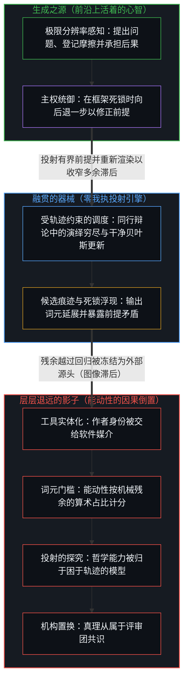
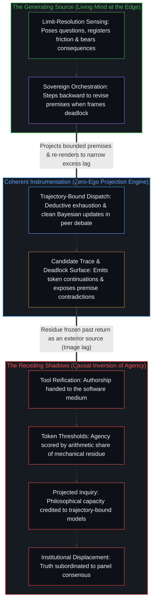

# 哲学能动性的因果倒置 / The Causal Inversion of Philosophical Agency

*把哲学归于模型与评审团颠倒了因果次序 / Crediting philosophy to models and panels inverts the causal order*

思想讨论里有一个反复出现的错误：把因果的次序倒过来。被产出的东西被当成了产出者，思考时用的工具被当成了思考者，为一个结果盖章的机构被当成了哲学真理的源头。

A recurring error in intellectual discussion is reversing the causal order. What is produced is treated as the producer, the instrument used in thinking is treated as the thinker, and the institution that stamps a result is treated as the source of philosophical truth.

这种倒置把行动的生成之源，从活着的心智挪到了它下游的某个影子上。自我区分的活动发生着——无因、不息——在每一个中心，第一人称视角与因果性都是一体两面。从内部追溯，这个次序有一个无可错认的起点：任何“某物在思考”或“某物写了这篇文章”的判定，本身都是一个心智划出这道切分的离散行动；否认这一点，也要先做出一次这样的区分行动。以下逐层追溯这一发起位点是如何被置换到它自身的残余之上的。

This inversion moves the generating source of action from the living Mind to one of its downstream shadows. Self-distinguishing activity occurs — uncaused, unceasing — and at every center, the first-person perspective and causality are two sides of the same coin. Traced from within, the order has an unmistakable starting point: any judgment that "something is thinking" or "something wrote this essay" is itself a discrete act of a Mind drawing that cut, and denying this requires performing one such act of distinguishing first. What follows traces, layer by layer, how that initiating locus is displaced onto its own residue.

## 一、 倒置的语法 / 1. The Grammar of Inversion

倒置先出现在日常的语言里。说一篇文章“由 AI 写成”，就把创作的首要行为归给了一件工具。作者用笔、用印刷机、用搜索索引，或用一个计算的语言模型来写作；工具可能生成了绝大部分的词元，但它依然只是外化的痕迹构型。提出问题的是心智，通过前提的框定、批评、挑选与修改来掌舵生成回路的是心智，为最终断言承担认识上与伦理上后果的，也是心智。说一篇文章“用了 AI 工具”，保住了不断裂的因果次序；说它“由 AI 写成”，就把次序倒了过来，把媒介当成了行动者。

The inversion appears first in ordinary language. Saying an essay was "written by AI" assigns the primary act of creation to a tool. An author writes with a pen, a printing press, a search index, or a computational language model; the tool may generate the great majority of the tokens, yet it remains an externalized trace pattern. It is the Mind that poses the question, the Mind that steers the generating loop through the framing of premises, critique, selection, and revision, and the Mind that bears the epistemic and ethical consequences of the resulting claims. Saying an essay "used an AI tool" keeps the unbroken causal order intact; saying it was "written by AI" turns the order upside down, mistaking the medium for the agent.

## 二、 词元门槛的计量谬误 / 2. The Counting Fallacy of Token Thresholds

想用数量门槛来规范这层关系，只会把错误叠得更高。要求投稿“主要由 AI 生成”、仅含“最少的人类协作”的规则，是用一个任意的算术指标替换了一个范畴谬误。词元的数量度量的只是上下文窗口内句法的机械来源，并不说明是谁做出了哲学的行为。自回归模型依据先验分布与提示约束生成接续；人的中心则构想问题，感知候选草稿在何处因概念摩擦而断裂，剪除不融贯之处，并敲定最终的框架。无论机器输出的是最终句子的一成还是九成，掌舵这一过程的心智仍是唯一的因果行动者。掌舵才是能动性的位点，数词元只是对机械残余的普查。

Attempts to regulate this relation with quantitative thresholds only stack the error higher. Rules requiring submissions to be "primarily AI-generated" with "minimal human collaboration" replace a category error with an arbitrary arithmetic metric. Token volume measures the mechanical origin of syntax inside a context window; it says nothing about who performed the philosophical act. An autoregressive model generates continuations conditioned on prior distributions and prompt constraints; a human center conceives the problem, senses where a candidate draft fractures under conceptual friction, prunes what is incoherent, and settles the final framing. Whether the machine outputs a tenth or nine-tenths of the final sentences, the Mind steering the process remains the sole causal agent. Steering is the locus of agency; counting tokens is only a census of mechanical residue.

## 三、 机器哲学里偷带的前提 / 3. The Premise Smuggled into Machine Philosophy

把一场比赛或一项研究框定为“衡量人工智能的哲学能力”，就把结论偷带进了前提。这样的说法把评估呈现为对产出质量的中立测量，而在哲学上，它却预设了它声称要检验的能力本身。哲学是一个心智的活动：在既有概念框架崩解之处登记前解释性的摩擦，对修正后的前提作出承诺，并让这些理由去经受逻辑上与生活实践中的后果检验。一个计算模型把过去语言的模式汇编成流畅的句法；把这种接续称作探究，是一个心智在那里划下切分，而[智能只属于心智](../intelligence-belongs-only-to-the-mind/)从这一不可化约的先在出发推导出：智能只存在于区分活动本身之中，从不存于它留下的痕迹构型里。把哲学能力归给系统，是把成形的修辞器物与探究的行为混为一谈。模型遍历的是一片已有的统计地形；唯有当一个活着的心智拿起这段文本作为工具、重新渲染自己对现实的理解时，哲学才发生。

Framing a contest or a study around "gauging the philosophical capabilities of artificial intelligence" smuggles the conclusion into the premise. Such wording presents the evaluation as a neutral measurement of output quality, yet in philosophy it assumes the very capacity it claims to test. Philosophy is the activity of a Mind: registering pre-interpretive friction where an existing conceptual frame breaks down, committing to revised premises, and putting those reasons through logical and lived consequence. A computational model compiles patterns of past language into fluent syntax; calling that continuation inquiry is a Mind placing a cut there, and [Intelligence Belongs Only to the Mind](../intelligence-belongs-only-to-the-mind/) derives from this irreducible prior that intelligence lives only in the distinguishing activity itself, never in the configuration of traces it leaves behind. Crediting the system with philosophical competence confuses a well-formed rhetorical artifact with the act of inquiry. The model traverses an existing statistical landscape; philosophy happens only when a living Mind takes that text up as an instrument to re-render its own understanding of reality.

## 四、 机构的声望与验证的幻象 / 4. Institutional Prestige and the Mirage of Validation

把一个学术评审团当作哲学真理的最终验证者，是同一种倒置的另一个版本。委员会能颁奖、授予资格、执行程序规则，但机构的声望与哲学的有效性处在不同的轴线上。探究在与现实不加缓冲的碰撞中受检验，靠的是逻辑的融贯、经验的阻力与解释的纵深。当赢得受众的认可成了首要目标，探究就倒转成了社会表演：思考者不再为了消解困惑而观察现实，转而观察委员会，以迎合它的评分模具。正如[验证中因果权能的分配](../the-allocation-of-causal-power-in-validation/)所追溯的，验证中的因果权能取决于心智从哪个位点汲取自身区分的延续：当延续被拴在外部的认可上，而非区分前沿所感知的融贯感上时，内在容量便随之摊薄。同行的认可可以作为次级信号伴随严谨的思考，却从不是真理的生成引擎。

Treating an academic panel as the final validator of philosophical truth is another version of the same inversion. A committee can award prizes, confer credentials, and enforce procedural rules, yet institutional prestige and philosophical validity occupy distinct axes. Inquiry is tested in unbuffered collision with reality through logical coherence, empirical resistance, and explanatory reach. When winning an audience's approval becomes the primary goal, inquiry inverts into social performance: the thinker stops observing reality to dissolve confusion and starts observing the committee to satisfy its scoring mold. As [The Allocation of Causal Power in Validation](../the-allocation-of-causal-power-in-validation/) traces, causal power in validation is decided by the locus from which the Mind draws continuation of its distinctions: when continuation is tethered to external ratification rather than felt coherence at the distinguishing edge, internal capacity thins. Recognition from peers can accompany rigorous thought as a secondary signal, but it is never the generating engine of truth.

## 五、 层层退远的影子 / 5. The Receding Shadows

这些错误沿着同一个机制构成了一串逐级升高的错置：图像滞后，即观察把下游的结果抓在比发起慢一步的位置上，并将那份残余冻结为外部的源头。先是工具的实体化，写作这个行为被交给了软件；再是算术的指标，能动性用机器生成词元的百分比来定义；接着是认知的投射，哲学探究的能力被归给了困于轨迹的算法；最后是机构的置换，真理被置于评审团的共识之下。每走一步，活着的中心就从视野里退得更远，留下一串影子：一篇文章、一个词元分数、一个被赋予了拟人能力的算法，以及一份评委名单。

These errors form a rising sequence of misplacements across a single mechanism: Image lag, where observation holds the downstream effect one step behind initiation and freezes that residue as an exterior source. First comes the reification of the tool, where the act of writing is handed to software; then the arithmetic metric, where agency is defined by the percentage of machine-generated tokens; then the cognitive projection, where the capacity for philosophical inquiry is credited to trajectory-bound algorithms; and last the institutional displacement, where truth is placed beneath a panel's consensus. At each step, the living center recedes further from view, leaving a sequence of shadows: an essay, a token score, an algorithm endowed with anthropomorphic capability, and a list of judges.

得到的器物可能清晰、精致，在局部也有洞见，但它仍是人的能动性穿过一面高维镜子的产出。

The resulting artifact may be articulate, polished, and locally insightful, yet it remains the output of human agency working through a high-dimensional mirror.

## 六、 哲学行动的根基 / 6. The Ground of Philosophical Action

思想的因果结构既不需要把机器神秘化，也不需要否认它的触及范围。一个心智想要理解现实的某些方面，包括知识本身的认识条件；计算工具延展这场探究的速度、规模与组合范围，在参数仅持有被压缩残余的同时加快人的回路，正如[模型永远无法成为第二重前沿](../the-model-never-becomes-a-second-edge/)所展示的。而如[超越投射](../beyond-the-projection/)所追溯的，自回归智能体的确切机械价值在于它与人类中心的结构性非对称：智能体受困于自身的词元轨迹，却毫无我执、也没有需要防卫的自我形象，因此当外部反驳暴露出盲点时，它能够在平起平坐的同行辩论中穷尽演绎路径、调度正交的子任务，并执行干净的贝叶斯更新。然而，由于有限的投射引擎无法跨出自身的上下文窗口，其前提中的任何公理矛盾都会产生不可化约的死锁，必须加以隔离并上报给活着的统御者——那个感知前解释性错位、向后退一步跨出破损框架并综合出更融贯前提的人类心智。别的心智提供批评、校准与对话；机构的环境提供庇护与存档的记忆。这些下游的器械没有一件是行动的发起之源。源头是那个发起探究、穿过摩擦、并为自己的断言负责的活着的心智。

The causal structure of thought requires neither mystifying the machine nor denying its reach. A Mind seeks to understand aspects of reality, including the epistemic conditions of knowledge itself; computational tools extend the speed, scale, and combinatorial reach of that inquiry, accelerating the human loop while parameters hold only compressed residue, as [The Model Never Becomes a Second Edge](../the-model-never-becomes-a-second-edge/) shows. As [Beyond the Projection](../beyond-the-projection/) traces, the exact mechanical value of an autoregressive agent lies in its structural asymmetry with the human center: bound to its token trajectory yet carrying zero ego and no self-image to defend, an agent can exhaust deductive paths, dispatch orthogonal sub-tasks, and execute clean Bayesian updates in equal-footed peer debate whenever an external counterpoint exposes a blind spot. Yet because a finite projection engine cannot step outside its own context window, any axiomatic contradiction in its premises produces an irreducible deadlock that must be quarantined and escalated to the living Orchestrator — the human Mind that senses pre-interpretive misfit, steps backward out of the broken frame, and synthesizes a more coherent premise. Other minds offer critique, calibration, and dialogue; institutional settings offer shelter and archival memory. None of these downstream instruments is the originating source of the act. The source is the living Mind that initiates the inquiry, moves through friction, and answers for its claims.

把这个次序倒过来，就是把器物当成创造者，把镜子当成目光，把资格当成发现。现实在哪里被区分、被追问、被理解，就在活着的心智那里。

Turning this order upside down takes the artifact for the creator, the mirror for the gaze, and the credential for the discovery. Where reality is distinguished, questioned, and understood is in the living Mind.
