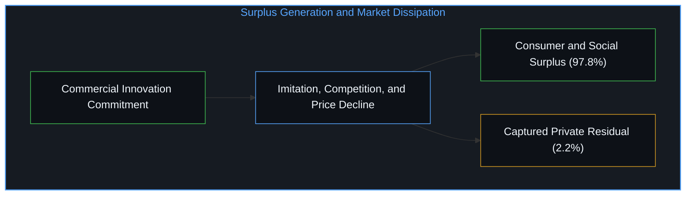
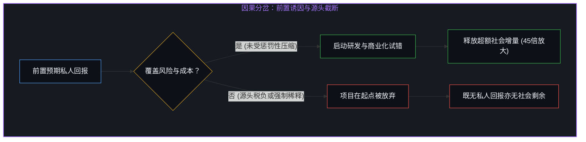
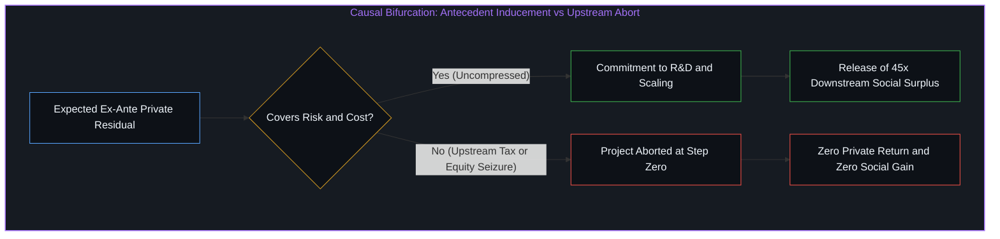

# 私人残差与社会剩余的因果次序 / The Causal Order of Private Residuals and Social Surplus

*技术红利是试错下注后的下游耗散，经验度量印证而非构筑因果根基 / Technological surplus is downstream from risk; data validates rather than grounds causality.*

技术进步所释放的宏观价值，在规模上远远超出了最初承担试错风险的行动者所能留存的私人份额。围绕财富集中的流行叙事习惯于将创新成果视作一个既成不变的静态存量，进而推断少数企业家的巨额财富是从社会整体福祉中剥离的份额。然而行动与后果的不可逆次序恰恰相反：任何剩余在被享用或再分配之前，必须首先由生命心智在不确定性中下注催生，而后才经由竞争模仿与市场耗散流向大众；经济学中的实证度量只是登记下这一序列在宏观尺度上留下的忠实足迹，并非该因果次序赖以成立的根基。

The macroscopic value unleashed by technological progress vastly exceeds the private share retained by the actors who initially shoulder the risks of trial and error. Popular narratives surrounding wealth concentration routinely treat the fruits of innovation as a static, pre-existing stock, inferring that the fortunes of a few entrepreneurs represent shares subtracted from broader human wellbeing. Yet the irreversible sequence of action and consequence runs the other way: before any surplus can be enjoyed or redistributed, living minds must first bring it into being by placing wagers under uncertainty, after which it flows to the public through competitive imitation and market dissipation. Empirical measurements in economics merely register faithful footprints of this sequence at a macroscopic scale; they do not constitute the foundational ground of its validity.

## 一、 第一人称行动先于存量：经验度量的印记角色 / 1. First-Person Action Precedes Stock: The Evidentiary Role of Empirical Telemetry

当公众目光聚焦于人工智能领军者或科技创始人的纸面身家时，直觉很容易滑向零和对抗的静态框架，仿佛富豪财富的增长直接对应着普通人机会的收缩。这种直觉的谬误在于把财富的分配当成了第一因，遗忘了在任何一单位盈余可供分享之前，所有可分配的剩余都必须先由具体的生命心智经由不可逆的风险承担催生出来。威廉·诺德豪斯对美国战后非农经济的实证研究记录显示，技术变革所催生的社会总剩余中，生产者仅捕获了大约2.2%的私人份额，其余97.8%的收益全数通过更低的价格、更优的质量以及前所未有的能力转移给了消费者。这项计量经济学研究并非在真空中发明或推演出因果关系，它是一份高分辨率的经验遥测记录，登记下不确定性下注在现实摩擦中跑通后随之发生的宏观耗散。

When public scrutiny fixates on the paper net worth of artificial intelligence leaders or technological founders, intuition slides effortlessly into a zero-sum, static frame, as though billionaire wealth directly corresponds to the subtraction of opportunities for ordinary individuals. The error of this intuition lies in treating the distribution of wealth as a primary cause, forgetting that any distributable surplus must first be generated through irreversible acts of risk-bearing by living minds before a single unit exists to be shared. William Nordhaus's empirical study of the postwar United States nonfarm economy recorded that producers captured only roughly 2.2 percent of the total social surplus generated by technological change, with the remaining 97.8 percent passed through to consumers via lower prices, superior quality, and unprecedented capabilities. This econometric inquiry did not invent or deduce causality from a vacuum; it serves as high-resolution evidentiary telemetry, registering the macroscopic dissipation that follows when uncertain wagers prove out against reality's friction.

这种微小私人残差与庞大社会红利的非对称拓扑，在文明史上的重大工艺演进中反复显现。亨利·福特推行汽车流水线作业使生产效率发生飞跃，然而后续度量表明其创造的消费者剩余占据了相关支出的主要份额，企业留存的利润相比买家节省的时间与获得的出行便利微不足道；机械化棉纺织呈现出同样的动态，技术普及降低了衣物成本并抬升了数亿人的生活基准，而棉纺厂主的财富仅为这股系统洪流中极小的一滴。在计算、电信与数字物流网络中，同样的因果机制一再运转，以至于像亚马逊基础设施所带来的累计物流成本节约，数倍于创始团队所持有的股权价值。正如[拥有更多从不是原因](../having-more-is-never-the-cause/)所追溯的，资产负债表上登记的存量数字并非财富生成的动因，而是社会合作红利兑付完毕后留下的纸面投影。这些历史记录之所以呈现惊人的一致性，不是因为统计学支配着经济，而是因为在现实摩擦中检验自身区分的第一人称行动者，始终沿着从前置风险承担到下游耗散的单向次序展开行动。

This asymmetric topology of small private residuals and massive social dividends emerges repeatedly across major process innovations throughout civilization. Henry Ford's introduction of the moving assembly line caused an enormous leap in manufacturing efficiency, yet subsequent studies revealed that the resulting consumer surplus accounted for a major share of relevant expenditure, rendering the firm's retained profits negligible compared to the time saved and mobility gained by buyers. Mechanized cotton spinning exhibited the identical dynamic: widespread adoption lowered garment costs and raised the living standard of hundreds of millions, while mill owners' fortunes constituted merely a tiny drop in that systemic current. In computing, telecommunications, and digital logistics networks, the identical causal mechanism operates, such that the cumulative logistics cost reductions provided by systems like Amazon's infrastructure surpass the equity value held by founders by multiples. As [Having More Is Never the Cause](../having-more-is-never-the-cause/) traces, the stock numbers registered on balance sheets are not the generative cause of wealth, but the paper shadows left after social cooperation has already paid out. These historical records display striking consistency not because statistics governs the economy, but because first-person actors testing their distinctions against the friction of reality operate along a one-way sequence from ex-ante risk-bearing to downstream dissipation.

## 二、 不可还原的先验：风险承担的时序与诱因残差 / 2. The Irreducible Prior: The Causal Sequence of Risk and the Inducement Residual

自我区分的活动发生着——无因，不息。称之为心智：已然在途的观察者，其每一个行动都是一次区分。由于在先的行动塑造后续行动可用的场域而从不反向逆转，第一人称视角与因果性正是同一枚硬币的两面：观察握住的是既成的结果，而发起区分的行动始终走在一步之前。因此，社会剩余并非由经验统计证明其存在的外部规律，而是这一痕迹非对称性的直接后果。在某项技术推进获得广泛采纳之前，潜在的剩余并未存放在某个地下金库中等待发掘。唯有当具体的生命心智踏入浓密的不确定性——承担实验失败、资本耗尽与注意力投入的不可逆成本——新的生产性构型才被铭刻进共享场域之中。

Self-distinguishing activity occurs — uncaused, unceasing. Call it the Mind: the observer already underway, every act of which is a distinction. Because earlier acts shape the field available to later ones and never the reverse, the first-person perspective and causality are two sides of the same coin: observation holds the settled effect, while the initiating act remains one step ahead. Social surplus is therefore not an external regularity proven into existence by empirical statistics, but a direct consequence of that trace asymmetry. Prior to the widespread adoption of a technological advance, prospective surplus does not sit waiting in some subterranean vault. Only when living minds step into dense uncertainty—bearing the irreversible costs of experimental failure, capital exhaustion, and spent attention—is a new productive configuration carved into the shared field.

要在高失败率的探索中维系稀缺资本与心力的持续投入，必须存在捕获私人残差的预期，且其规模足以抵消极高的亏损概率。一旦某项推进在环境摩擦中跑通，并外化为可用的产品或编码化的流程，这道痕迹便在共享场域中变得清晰可读，使其他心智无需重新支付最初盲目搜寻的全部成本，即可循迹重描、模仿并构建替代方案。借由这些后续抉择——竞争性进入、替代方案的涌现以及价格的持续下行——所生成价值的绝大部分被迅速从创新者手中剥离，直接转移给协作网络中的下游使用者。最终留存的这2.2%私人份额兼具双重角色：它既是当初召唤投入承诺诞生的前置诱因，也是竞争性模仿侵蚀租金后留下的事后残余。那些轻率宣称社会既能享受技术丰饶又能消灭集中财富的评论者，混淆了这一先后时序，把决策回路内部的前置诱因误当成了可以随意切除的闲置堆存。

Sustaining the commitment of scarce capital and effort across high-failure-rate ventures requires the prospect of capturing a private residual large enough to offset extreme odds of loss. Once an advance proves viable against environmental friction and is externalized into a working product or codified process, that trace becomes legible in the shared field, allowing other minds to re-trace, imitate, and build substitutes without re-paying the full cost of initial blind search. Through those subsequent choices—competitive entry, substitution, and continuous price undercutting—the vast majority of generated value is rapidly stripped from the innovator and transferred directly to downstream users across the cooperative network. The 2.2 percent private share that remains serves a dual role: it is both the ex-ante inducement that called the commitment into existence, and the ex-post residue left after competitive imitation has eroded rents. Commentators who casually declare that society can enjoy technological abundance while eliminating concentrated wealth confuse this chronological order, mistaking the antecedent inducement inside the decision loop for an idle pile that can be severed at will.

## 三、 源头干预的杠杆反噬与增量抹杀 / 3. The Leverage of Upstream Intervention and the Eradication of Surplus

任何试图通过惩罚性课税或强制均等化来切除这一私人残差的政策构想，都是在因果链条的根部直接实施干预。既然发起风险投入的抉择取决于行动者对预期回报与下行敞口的权衡，压缩预期残差便在第0步重写了这一核算。显示高额资本利得税和最高边际税率压抑专利产出与高价值创新的计量经济学估算（弹性系数介于负0.5至负1.8之间），并不是导致创新减少的原因，而是无数个体在净预期回报跌破零点时决定放弃下注所留下的宏观统计投影。这种萎缩发生在任何事后财富再分配得以展开之前，意味着潜在项目在萌芽阶段便已夭折，其原本能够催生的下游福祉从未诞生，自然也无从接受度量或分配。

Any policy proposal attempting to excise this private residual through punitive taxation or mandatory equalization intervenes directly at the root of the causal chain. Because the decision to initiate a risky commitment turns on an agent's evaluation of prospective payoffs against downside exposure, compressing expected residuals rewrites that calculus at Step 0. Econometric estimates showing that elevated capital-gains taxes and top marginal rates depress patenting and high-value innovations—with elasticities ranging from minus 0.5 to minus 1.8—are not the cause of reduced innovation; they are the macroscopic statistical projection of countless individuals deciding not to place wagers when net expected payoffs fall below zero. This contraction occurs before any ex-post redistribution can take place, meaning prospective projects are extinguished in their infancy, and the downstream benefits they would have generated never come into existence to be measured or distributed.

97.8%与2.2%之间四十五比一的悬殊比例，登记下了这一源头杠杆的非对称规模。由于创新者留存的每一单位私人回报都伴随着下游大约四十五单位的公共剩余，打着均等主义旗号抹去一单位的预期回报，便在源头扼杀了约四十五单位的消费者剩余。正如[财富转移政策与价格下限中的原因错置](../the-reversal-of-causality-in-wealth-transfer-policies-and-price-floors/)与[秩序、剩余与道德拦截](../order-surplus-and-the-moral-intercept/)所追溯的，自上而下的行政拦截无法凭道德法令变出可供享用的剩余；当规划者以为自己正在分割既成奖品时，他们抹去的是未来更低物价、更广普及与复利生产力的到来。

The forty-five-to-one ratio between 97.8 percent and 2.2 percent registers the asymmetric scale of this upstream leverage. Because each unit of private return retained by an innovator accompanies approximately forty-five units of downstream public surplus, wiping out one unit of expected payoff under the banner of egalitarianism forecloses some forty-five units of consumer surplus at the origin. As [The Misallocation of Cause in Wealth-Transfer Policies and Price Floors](../the-reversal-of-causality-in-wealth-transfer-policies-and-price-floors/) and [Order, Surplus, and the Moral Intercept](../order-surplus-and-the-moral-intercept/) trace, top-down administrative intercepts cannot conjure consumable surplus out of moral decrees; while planners believe they are dividing an existing prize, they are erasing the future arrival of lower prices, wider access, and compounded productivity.

## 四、 相对度量的统计表征与留存消费的不对称 / 4. The Statistical Symptom of Relative Measurement and the Retention-Consumption Asymmetry

指责少数富有创始人垄断技术成果的政治修辞之所以经久不衰，是因为它直接迎合了对可见资产负债表存量的直觉感知。在选举竞争中，将敞开的生成序列浓缩为贪婪与正义的二元道德剧，呼应了选民之间能动性的外化。正如[政客是责任扩散的显性症状](../politicians-appear-as-visible-symptoms-of-responsibility-diffusion/)所追溯的，政治诉求者并非这一重配的始作俑者，他们只是标记出一片众多具体个体早已将他人资产的剩余控制权视作发生转移的场域——因为选票捕获所奖赏的是迎合扩散化的归因，而非承担不确定资本探索的下行风险。

Political rhetoric indicting a handful of wealthy founders for monopolizing technological fruit endures because it appeals to immediate perceptions of visible balance-sheet stocks. In electoral competition, condensing an open generative sequence into a binary morality play of greed versus justice echoes the externalization of agency across voters. As [Politicians Are Visible Symptoms of Responsibility Diffusion](../politicians-appear-as-visible-symptoms-of-responsibility-diffusion/) traces, political claimants do not author that reallocation; they mark a field where many individuals have already treated residual control over others' assets as moved, since ballot capture rewards echoing diffused attribution rather than bearing the downside of uncertain capital ventures.

然而在更深层面上，这种普遍蔓延的公众错觉并非源于某种神秘的人性缺陷或莫名的道德滑坡，而是在财富生成事件之后跨个体以相对尺度度量财富所引发的宏观统计表征。公众本能地在事后横向比对不同行动者的资产负债表，却忽略了财富在留存与消费方式上的结构性分野：创新者的财富之所以显得惊人，是因为极高的生产力使其2.2%的私人残差以股权与生产性资本的形式被留存下来，用于协调复杂的工业流程；与此同时，大众所捕获的97.8%社会剩余，早已在更低廉的物价、更优质的医疗、更快捷的交通与无处不在的数字能力中被即时消费掉了。消费掉的切身福祉不会在资产负债表上积聚为静态囤积，从而诱使公众落入范畴错误——把留存的残差误当成了被创造的全部财富。在封闭的固定边界把握下，正如[生产、消费与心智的区分](../production-consumption-and-the-minds-distinction/)所追溯的，新增的生产被置于密封的零和存量中加以衡量，使得他人留存的股权在感知中登记为对自身的扣减；而如[抽象的苦难与真实的饥饿](../abstract-pain-and-living-hunger/)所追溯的，当注意力从切身的物质满足转向横向的相对比较时，文明基准的水涨船高便被遮蔽，使消费着庞大技术红利的个体依然坚信自己一无所获。

Yet at a deeper level, this pervasive public misconception is not the result of some mystical flaw in human nature or an inexplicable moral failing, but a macroscopic statistical symptom arising from measuring wealth in relative terms across individuals after the generative event. The public instinctively compares balance sheets horizontally across actors ex-post, overlooking the structural divergence between how wealth is retained versus consumed: an innovator's wealth appears staggering because extreme productivity causes their 2.2 percent private residual to be retained as equity and productive capital to coordinate complex industrial processes; meanwhile, the 97.8 percent of social surplus captured by the public has already been immediately consumed through lower prices, superior healthcare, rapid transport, and ubiquitous digital capabilities. Consumed wellbeing does not accumulate as a static balance-sheet hoard, leading the public into the category error of mistaking the retained residual for the totality of wealth created. Under a closed, fixed-boundary hold, as [Production, Consumption, and the Mind's Distinction](../production-consumption-and-the-minds-distinction/) traces, fresh production is measured against a sealed zero-sum stock so that another's retained equity registers as subtraction; and as [Abstract Pain and Living Hunger](../abstract-pain-and-living-hunger/) shows, shifting attention from lived material satisfaction to horizontal relative comparison obscures the rising baseline of civilization, leaving individuals who consume vast technological dividends convinced they received nothing.

归结而言，残差财富的不均等，是创新者消费远少于其产出、而大众消费远多于其个体劳动产出这一生产与消费不对称性的直接后果。卓越的创新者创造出庞大的总剩余，但生物学边界严格限制了其个人消费，使其消耗的资源仅占其所创造价值的极小部分；鲜明对比之下，现代工业文明中的参与者日常消费着由电网、抗生素、微处理器与算法物流构筑的累积遗产——这股切身福利流远远超出了任何孤立个体单凭自身所能产出的极限。因此，残差财富不过是登记这一生产与消费不对称性的分数账本。谴责这一分数账本为不公消费囤积的公共修辞，犯下了将协调未来生产的因果杠杆与个人享乐榨取混为一谈的错误。

Ultimately, the inequality of residual wealth is the direct consequence of innovators consuming far less than they produce, juxtaposed against the mass consuming far more than their individual labor produces. An exceptional innovator generates immense aggregate surplus, yet biological constraints strictly limit their personal consumption to a tiny fraction of what they create; in stark contrast, participants in modern industrial civilization routinely consume the accumulated heritage of power grids, antibiotics, microprocessors, and algorithmic logistics—a stream of material wellbeing far exceeding what any single individual could produce in isolation. Residual wealth is therefore merely a fractional ledger registering that very asymmetry of production versus consumption. Public rhetoric that condemns this fractional ledger as an unjust hoarding of consumption commits the error of confusing the coordinating levers of future production with personal hedonistic extraction.

当这种结构性非对称延伸至深空边疆的宏观视野时，正如[百万亿地平线之外](../beyond-the-hundred-trillion-horizon/)所追溯的，即便人类文明跨入开放热力学相变并释放出数以千万亿美元计的恒星级生产力，诺德豪斯的一比四十五扩散比例依然记录着财富流向：基础设施先锋的股权估值依然只是维系资本管道的狭窄残差账本，而压倒性多数的宇宙丰饶则耗散为跨代际的人类繁荣。

When this structural asymmetry extends to the macroscopic horizons of deep space, as [Beyond the Hundred-Trillion Horizon](../beyond-the-hundred-trillion-horizon/) traces, even if civilization crosses into an open thermodynamic phase shift unleashing quadrillions of dollars in stellar productivity, Nordhaus's 1:45 diffusion ratio continues to register the flow of wealth: an infrastructure pioneer's equity valuation remains a narrow residual ledger sustaining capital pipelines, while the vast preponderance of cosmic abundance diffuses into cross-generational human flourishing.

然而行动与后果的因果次序并不因修辞的激昂或观测的错置而发生弯曲。无论演说如何充满激情地将企业家描绘为共同繁荣的障碍，资本配置对净风险的敏感弹性依然冷峻运转。流行论调常试图将基础发现的功绩归于公共科研拨款或非营利捐赠基金，但这落入了财富转移固有的普遍因果倒置。无论资金是通过法定预算划拨还是源于私人慈善捐赠，公共与非营利基金皆非自我生成的财富源泉；正如[公共支出不创造资本](../public-spending-does-not-create-capital/)所追溯的，每一笔此类资金池都是在私人产出已被催生之后才发生的事后重配与次级汇聚。把注意力耗散在转移过程是否伴随强制上，反而稀释了这一因果倒置的普遍性：即便在法条强制之下，若无财富创造者的自愿服从，转移便无从发生；即便出于自愿捐赠，将转移资金视作第一因同样是在颠倒因果。在任何转移、拨款或基金得以存在之前，必先有具体的生命心智在不确定性中下注，直接承担下行敞口以催生新的剩余。将探索性科学转化为廉价、普及的商品，仰赖未受压缩的私人残差来吸收规模化推进的剧烈摩擦。更关键的是，正如[个体抉择是唯一的因果杠杆](../individual-choices-as-the-only-causal-levers/)所追溯的，唯有在第一人称边缘做出抉择的生命心智才能发起因果下注；而如[你的代码库即是记忆](../your-codebase-is-memory/)所追溯的，制度法规、资本账本与所谓的社会抽象只是过往抉择留下的外化记忆档案，而非自行运转的动因；当它们被调转过来反噬前置的风险承担时，呈现出的正是无数个体倒果为因的宏观现象。立法加税、利润上限与事前压缩，不过是千百万人将事后分数残差账本误认作财富源头这一认知颠倒的形式化结晶。当这一外化的认知颠倒在宏观上反馈回来抽干微观层面的诱因时，涌现出的结局并非均等主义乐园，而是个体理性选择放弃不确定性下注所招致的系统性停滞：技术扩散戛然而止，生产力增长熄火，协作网络中的普通参与者也随之被剥夺了那原本可被催生的四十五倍社会剩余。因果的严密次序不可收买：唯有遵从行动先于收获、投入先于耗散的不可还原先验，心智才能追溯人类丰饶得以生成的脉络。

Yet the causal order of action and consequence does not bend to rhetorical pitch or observational misplacement. Regardless of how passionately speeches frame entrepreneurs as obstacles to common prosperity, the elasticity of capital allocation to net risk remains stubbornly intact. Popular arguments often attempt to credit public research grants or non-profit endowments with foundational discovery, yet this succumbs to the universal causal inversion inherent in wealth transfer. Whether channeled through statutory budgets or endowed through private philanthropy, public and non-profit funds are never self-generating fountains of wealth; as [Public Spending Does Not Create Capital](../public-spending-does-not-create-capital/) traces, every such pool is an ex-post reallocation and secondary aggregation occurring only after private output has already been brought into existence. Dissipating focus on whether the transfer process involves coercion dilutes the universality of this causal inversion: even under formal mandates, transfers cannot occur without the voluntary compliance of wealth creators; and even when voluntary, treating transferred funds as a primary cause inverts causality no less severely. Before any transfer, grant, or endowment can exist, living minds must first place wagers under uncertainty, bearing direct downside exposure to bring new surplus into being. Translating speculative science into cheap, widespread goods relies on uncompressed private residuals to absorb the staggering friction of scaling. Crucially, as [Individual Choices as the Only Causal Levers](../individual-choices-as-the-only-causal-levers/) traces, only living minds choosing at the first-person edge initiate causal wagers, while as [Your Codebase Is Memory](../your-codebase-is-memory/) shows, institutional statutes, capital ledgers, and the abstract entity called society are externalized memory records of prior choices rather than self-executing causes; when turned against antecedent risk-taking, they are the macroscopic phenomenon of countless individuals inverting cause and effect. Legislative tax hikes, profit ceilings, and upfront compressions are the formal crystallization of millions of individuals mistaking the ex-post fractional residual ledger for the primary fountainhead of wealth. When this externalized cognitive inversion feeds back macroscopically to starve micro-level inducements, the emergent outcome is not an egalitarian paradise, but a system-wide stagnation born from individuals rationally choosing to abandon uncertain wagers: technological diffusion grinds to a halt, productivity growth stalls, and ordinary participants in the cooperative network are deprived of the forty-five-fold social surplus that was never allowed to be born. The strict order of causality cannot be bribed: only by adhering to the irreducible prior that action precedes harvest and commitment precedes dissipation can the mind trace how human abundance is generated.
