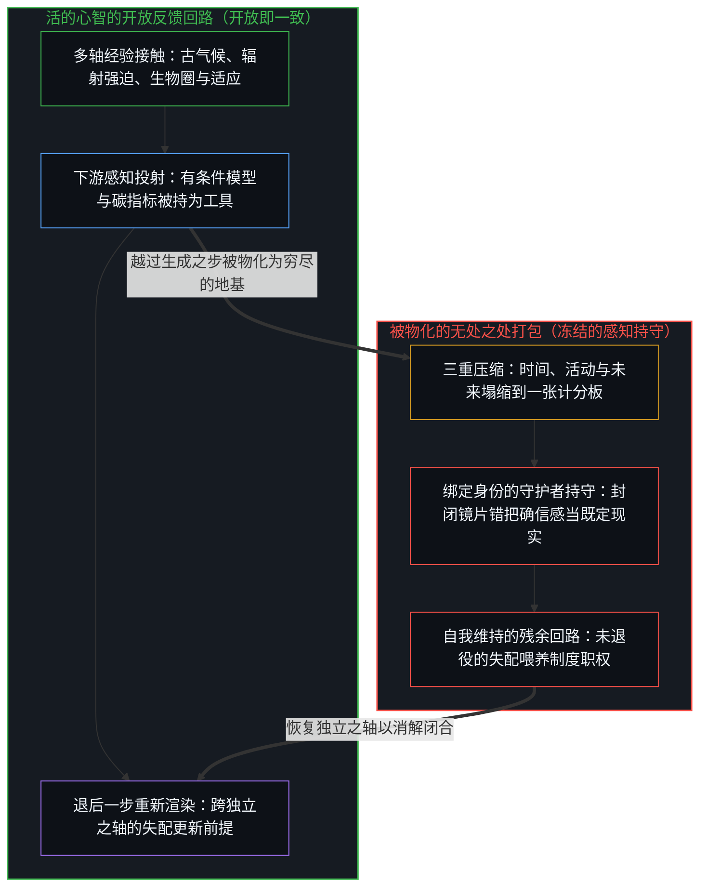
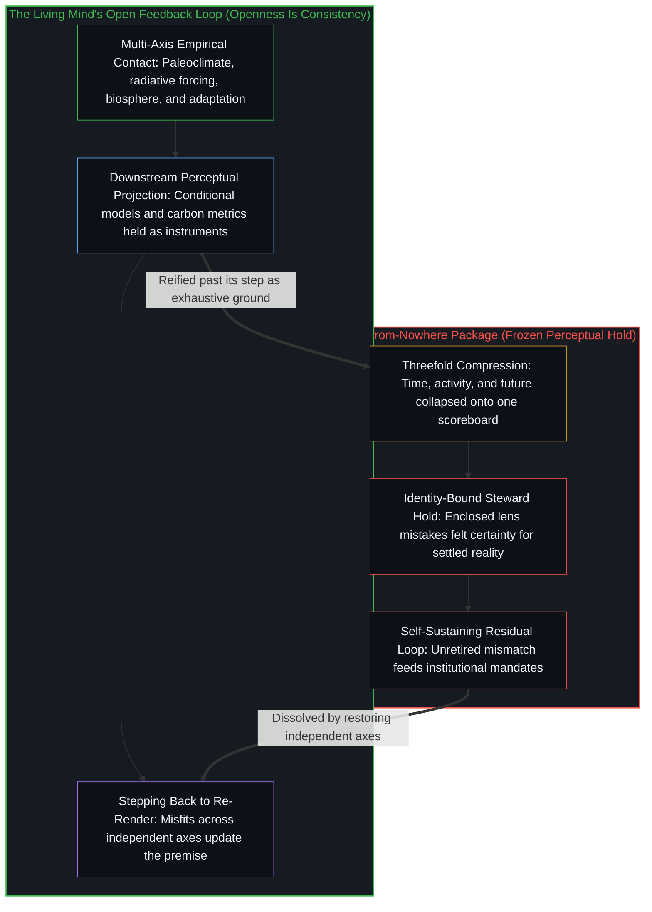

# 气候问题只作为感知被登记 / The Climate Problem Registers Only as Perception

*“问题”的身份是某个中心处的感知持守，而不是地球本身的属性 / Problem-status is a perceptual hold at a center, not a property of the earth*

作为“气候问题”流传的东西，不是地球系统等待被认出的固有特征；它是一次离散的感知持守，在其中，天气、冰盖动力学、大气气体、模型模拟与政策指令被压缩到一张单一的计分板上，而这张计分板被物化为处境本身的结构。不论这份持守是否被维持，大气、海洋与行星气候的深远历史，都在广阔而相互作用的动态中继续。装上这份感知持守，并不会穷尽或封闭这个场。相反，它让一幅道德化的自我形象，以及一套解决方案的经济变密，这套经济穿着科学的词汇，结构上却依赖一份不被了结的残余失配。这样一来，这个打包把科学探究在经验接触之下保持敞开的那些轴关死，让解决方案的提供者朝向维持“问题”的身份，而不是在完成时卸下自己的职权。

What circulates as "the climate problem" is not an inherent feature of the earth system waiting to be recognized; it is a discrete perceptual hold in which weather, ice sheet dynamics, atmospheric gases, model simulations, and policy directives are compressed onto a single scoreboard, and that scoreboard is reified as the structure of the situation itself. The atmosphere, the oceans, and the deep history of planetary climate continue across vast interacting dynamics whether or not that hold is maintained. Installing that perceptual hold does not exhaust or close the field. Instead, it densifies a moralized self-image and an economy of solutions—an economy that wears the vocabulary of science while structurally depending on an unretired residual mismatch. In doing so, the package clamps shut the very axes that scientific inquiry keeps open under empirical contact, orienting solution-providers toward sustaining problem-status rather than retiring their mandate upon completion.

## 一、 “问题”的身份不是天气 / 1. Problem-Status Is Not the Weather

天气事件、轨道变化、太阳周期、洋流、火山气溶胶、冰盖动力学、植被覆盖与工业排放，都是可供观察的痕迹。每一样都沿着它自己的物理与时间之轴运作。没有一样是预先被包装成*那个问题*而到来的。

Weather events, orbital variations, solar cycles, ocean circulation, volcanic aerosols, ice sheet dynamics, vegetation cover, and industrial emissions are traces available to observation. Each operates along its own physical and temporal axis. None arrives packaged in advance as *the problem*.

一个问题是又一次区分的行动：一幅将偏好状态与被计分的现在之失配保留下来的形象，配上一个想象出的修复模板。没有这份持守，有的是行星气候：跨越地球一生的、持续的、敞开的流变。有了这份持守，有的是作为问题的气候：同样那些经验痕迹，被对着一条冻结的基线计分。[一步一步绘制出的路径](../the-path-drawn-one-step-at-a-time/)把当下追溯为一条一步一步画出的路径上的位置，每一步都选定下一步行动的前提，而冻结发生在一个被选定的位置被当作未经选择的地基之时；这里，经验痕迹是那个位置，而“气候问题”这个打包，是被当作未经选择的本体地基的那个冻结参照。[卓异、感知与自我设限的问题场域](../exceptionality-perception-and-the-self-limiting-field-of-problems/)区分前沿的难度与被占有的难度：前者是解开一道前沿难题照例揭开下一道，后者是别处的寻常困难被重新框定为需要专门介入，而卓异的标签靠它声称要处理之问题的延续来维系。两者在实践中相混；如这里所追溯的，作为问题的气候偏向被占有的一侧，而在两者之中，形成的制度都是自我选择的沉积，不是引擎。

A problem is a further discrete act of distinguishing: a retained image of mismatch between a preferred state and a scored present, paired with an imagined template of repair. Without that hold, there is planetary climate: continuous, open-ended flux across the life of the earth. With that hold, there is climate-as-problem: those same empirical traces scored against a frozen baseline. [The Path Drawn One Step at a Time](../the-path-drawn-one-step-at-a-time/) traces the present as a position on a path drawn one step at a time, where each step chooses the premise of the next act, and the freeze occurs when a chosen position is treated as unchosen ground; here, the empirical traces are the position, while the package "the climate problem" is the frozen reference treated as unchosen ontological ground. [Exceptionality, Perception, and the Self-Limiting Field of Problems](../exceptionality-perception-and-the-self-limiting-field-of-problems/) distinguishes frontier difficulty, where solving one frontier problem characteristically discloses the next, from appropriated difficulty, where ordinary difficulties at other loci are reframed as requiring specialized intervention and the label of exceptionality is sustained by the continuation of the problem it claims to address. The two mix in practice; climate-as-problem, as traced here, leans to the appropriated side, and in both, the institutions that form are sediment of self-selection, not engines.

这个概念打包不会迁进大气。拒绝装上它的人并不缺少现实；他们只是在没有这一特定压缩的情况下运作。反过来，装上它的人也不会仅凭装上它就获得对行星动态的直接因果支配。他们获得的是一套共享的坐标系。持有同一张计分板的中心之间的相互共振，让制度、媒体叙事与监管政策变密。这份共振作为跨所在的对齐是真的；它不是转移进大气热力学的因果发起，也不证明计分板已经囊括了开放之场。

The conceptual package does not migrate into the atmosphere. Those who decline to install it do not lack reality; they simply operate without that particular compression. Conversely, those who install it acquire no direct causal command over planetary dynamics merely by doing so. What they acquire is a shared coordinate system. Mutual resonance among centers holding the same scoreboard densifies institutions, media narratives, and regulatory policies. That resonance is real as alignment across loci; it is not causal initiation transferred into atmospheric thermodynamics, nor is it proof that the scoreboard has encompassed the open field.

## 二、 制造“简单科学”的三种压缩 / 2. Three Compressions That Manufacture "Simple Science"

“科学很简单：少排碳，剩下的就是合作”这句口号，拿三种认知压缩的结果，把它冻结为已完成的知识。这些压缩没有一种代表气候科学作为经验探究的工作方法；每一种都是公共口号强加给那份探究的东西。

The slogan "the science is simple: emit less carbon, and the rest is cooperation" takes the outcome of three cognitive compressions and freezes it as completed knowledge. None of these compressions represents the working method of climate science as an empirical inquiry; each is what the public slogan imposes upon that inquiry.

第一种是时间的压缩。行星气候在整个地球历史中不断变化，跨越远早于工业文明的各个时代。气候科学通过古气候记录考察这条谱系，并通过辐射强迫的物理，而不只是通过相关性，把近来的变暖归因于人类影响，主要是温室气体。公共口号保留了这一归因，却丢掉了它的框架：它把敞开的时间序列压缩成工业化之后薄薄的一片，在其中主导项成了唯一的项，于是科学本身所量化的其他强迫，不再出现在公共计分板上。[因果贯穿始终](../causality-all-the-way/)维持这份约束：从持有的结果，到划出的模式，再到下一步，因果仍是画出它路径的活的边缘，而抽象是在每一步中被重新描摹的工具，不是事先批准了那一步的外部蓝图。

The first is temporal compression. Planetary climate has continuously shifted throughout terrestrial history, across epochs long preceding industrial civilization. Climate science investigates this lineage through paleoclimate records, and attributes recent warming to human influence, chiefly greenhouse gases, through the physics of radiative forcing rather than correlation alone. The public slogan keeps that attribution and drops its frame: it compresses the open temporal sequence into a thin post-industrial slice in which the dominant term becomes the only term, so that other forcings that the science itself quantifies no longer appear on the public scoreboard. [Causality All the Way](../causality-all-the-way/) maintains this discipline: from held effects to drawn patterns to the next step, causality remains the living edge drawing its path, while abstraction is an instrument redrawn with the step rather than an exterior blueprint that authorized the step in advance.

第二种是活动的压缩。“人类活动”与“地球系统响应”二者在公共账本上都被简化为选定的碳排放项。诸如陆地碳吸收与生物圈变绿这样的生物物理通量，从那份核算中脱落，而人类回应的广阔谱系——农业上的适应、地方性的防护、指定碳指标之外的技术替代——被当作无关，或作为无法重新打开指标的脚注到来。于是一份局部的账本被持守为整体的账本。[基准刷榜中的封闭实存](../closed-reality-in-benchmark-maxing/)追溯同一种几何：基准把能力冻结为一个封闭的靶子，封闭指标上的残余可以被推向零，而开放负载下的失败却在扩大，只要分数被当作整个场，有用性就被登记不足。

The second is activity compression. Both "human activity" and "earth system response" are reduced to selected carbon emission terms on the public ledger. Biophysical fluxes such as terrestrial carbon uptake and biospheric greening drop out of that accounting, while the vast spectrum of human responses—agricultural adaptations, localized defenses, and technological substitutions outside the designated carbon metrics—is treated as irrelevant or arrives as footnotes that cannot reopen the metric. A partial ledger is thus held as the ledger of the whole. [Closed Reality in Benchmark Maxing](../closed-reality-in-benchmark-maxing/) traces the same geometry: a benchmark freezes capability into a closed target, residual on the closed metric can be driven toward zero while failure under open load widens, and usefulness is under-registered whenever the score is taken as the whole field.

第三种是未来的压缩。数值预估本身是带有不确定范围的条件情景，建模者自己也明确记录了这一点。然而，被普及的打包把一条单一的模拟轨迹保存为必须到来的未来，把当下的观测对着那份固定的预期计分，于是任何偏离都登记为人类服从的失败，而不是预测构造的滞后。模拟取代了世界。[没有系统能被保持封闭](../no-system-can-be-kept-closed/)给出它最直观的一面，即一位寄存器上的加法：运算在持守之内有效，而真实的结果落在它之外。正如[你的代码库即是记忆](../your-codebase-is-memory/)所追溯的，气候模型、历史数据集与政策框架构成了一座外化的记忆代码库——它们是过往区分留下的层叠残迹，只保存早先切分的形状，自己却不再继续区分，其推演出的预估也只有相对于活的心智所选定的评价切分与生存基线，才会被登记为问题。一个气候模型作为计算的工具运作，在它声明的假设之内有效；崩坏发生在预估被持守为最终的现实之时，仿佛开放的行星之场已被模型的边界穷尽，而不再需要对着当下的经验接触重新切分那份残迹。

The third is future compression. Numerical projections are inherently conditional scenarios accompanied by uncertainty ranges, as modelers themselves explicitly document. The popularized package, however, preserves a single simulated trajectory as the future that must arrive, scoring present observations against that fixed expectation so that any divergence registers as a failure of human compliance rather than lag in the predictive construct. The simulation is substituted for the world. [No System Can Be Kept Closed](../no-system-can-be-kept-closed/) gives this its most intuitive face, a one-bit register under addition: the operation is valid inside the hold, and the true result lies outside it. As [Your Codebase Is Memory](../your-codebase-is-memory/) traces, climate models, historical datasets, and policy frameworks constitute an externalized codebase of memory—stacked residues of prior distinctions that hold the shape of earlier cuts without continuing the distinguishing themselves, and whose projections register as a problem only relative to the evaluative cuts and survival baselines chosen by living Minds. A climate model functions as an instrument of calculation, valid within its stated assumptions; the breakdown occurs when the projection is held as final reality, as if the open planetary field were exhausted by the model's boundaries instead of requiring the residue to be re-cut against present empirical contact.

这些压缩都不需要欺骗或恶意。在认知与制度的负载之下，独立的轴自然地塌缩成一个单一的道德—科学坐标，而一旦合并，这个塌缩了的坐标感觉就像直接的发现。那种感觉是一副封闭镜片的内部清晰——[清晰不是抵达的终点，而是运动本身](../clarity-isnt-a-state-you-arrive-at/)所命名的结构：在一副正在起作用的镜片之内，感受到的确信与实际正确无法区分，镜片过滤了场却将结果呈现为现实，相反的证据不被登记为经验的摩擦，反被登记为恶意、怯懦或表演。

None of these compressions requires deception or bad faith. Under cognitive and institutional load, independent axes naturally collapse into a single moral-scientific coordinate, and once merged, that collapsed coordinate feels like direct discovery. That sensation is the internal clarity of an enclosed lens—the structure named in [Clarity Isn't a State You Arrive At. It's the Movement Itself.](../clarity-isnt-a-state-you-arrive-at/): from within an active lens, felt certainty and being correct are indistinguishable, the lens filters the field while presenting the result as reality, and contradictory evidence registers not as empirical friction, but as bad faith, cowardice, or performance.

## 三、 持守解决不了它所命名的东西 / 3. The Hold Does Not Solve What It Names

把气候感知为一个问题，并不是一件把行星动态的众多原因引向一个偏好热力状态的工具。装上这份感知持守，主要是为人与人之间的对齐定出样式：决定什么可以说、可以资助、可以监管、可以谴责或可以颂扬。这些样式构成结构意义上的权力，即被稳定下来的痕迹——作为社会上的可得性是真的，而不是对大气热力学的控制。大气不会对着一张道德计分板校准自己；它在任何正在起作用的物理原因之下继续，包括计分板遗漏的那些原因。

Perceiving climate as a problem is not an instrument that steers the manifold causes of planetary dynamics toward a preferred thermal state. Installing that perceptual hold primarily patterns alignments among people: determining what can be said, funded, regulated, censured, or celebrated. Those patterns constitute power in the structural sense of stabilized traces—real as social availability, not as control over atmospheric thermodynamics. The atmosphere does not calibrate itself against a moral scoreboard; it continues under whatever physical causes operate, including those the scoreboard omitted.

因此，问题的持守并不拥有它所声称的那种杠杆。它维持的是“问题”的身份本身：一个被保存过了它生成之那一步的参照，被每一次可以被解读为计分板上残余的气象事件重新授权。当一套封闭的核算被强加在一个敞开、持续的行星之场上，地球持续的物理流变总会超出那个封闭的指标；把这份差额当作持久的短缺，就产生持续的必要性，而这份必要性不过是持守在维持它自己的相关性。

The hold on the problem therefore possesses no leverage of the kind it claims. What it sustains is problem-status itself: a reference preserved past its generative step, re-authorized by every meteorological event that can be interpreted as residual on the scoreboard. When a closed accounting suite is imposed on an open, continuous planetary field, the ongoing physical flux of the earth will always exceed the closed metric; treating that difference as a persistent shortfall generates ongoing necessity, and that necessity is simply the hold sustaining its own relevance.

制度、国际会议与监管政策围绕那份残余变密，维持着一些专门的角色，这些角色的预算与公共可见度要求残余持续下去。这些安排可以重塑特定的人类实践，而改变实践是人与人之间又一种离散的活动，在那些社会之轴上是真的。然而，程序上的转变并不证明问题形象是地球系统的因果地图，也不标志着抵达了预估被持守去要求的那个封闭的未来。把局部的行政协调当作整个宇宙论式打包的确认，不过是又一次压缩：把人与人之间的程序服从，计分为仿佛是行星气候的本体闭合。

Institutions, international conferences, and regulatory policies densify around that residual, sustaining specialized roles whose budgets and public visibility require the residual to persist. These arrangements can reshape specific human practices, and altering practices is another discrete activity among people, real on those social axes. Yet procedural shifts are not proof that the problem-image is the causal map of the earth system, nor do they mark arrival at the closed future that projections were held to demand. Treating localized administrative coordination as confirmation of the entire cosmological package is simply one more compression: scoring procedural compliance among people as if it were the ontological closure of planetary climate.

## 四、 科学作为道德形象的外衣 / 4. Science as Dress on a Moral Image

起作用的自我形象，不是开放的科学探究者的形象；它是那个看出危机、持有正确计分板、并自居于拒绝装上它的人之上的守护者。任何与那幅形象的不符，都被定为否认、拖延或道德失败，而这次命名就是生成的行动。[恶是心智自己的造物](../evil-as-the-minds-own-creation/)追溯同一种几何：当一个中心保留一幅自身为善或为必需之英雄的偏好形象时，与它的不符便被命名为恶，而这次命名在持有那幅形象的中心那里生成了恶与对立极的范畴，其他中心的行动则只是在它们自己的所在上继续。

The operating self-image is not that of the open scientific investigator; it is that of the steward who discerns the crisis, holds the correct scoreboard, and asserts standing over those who decline to install it. Any mismatch with that image is designated as denial, delay, or moral failure, and the naming is the generative act. [Evil as the Mind’s Own Creation](../evil-as-the-minds-own-creation/) traces the same geometry: when a center retains a preferred self-image of itself as good or as the necessary hero, mismatch with that image is named evil, and that naming generates the category of evil and its contrasting pole at the center holding the image, while the actions of other centers simply continue at their own loci.

科学的词汇随后被当作外衣穿上。经验测量、图表、置信区间与多模型集合，让这块布料变厚。然而外衣不是方法。每当与经验摩擦的接触让持守失灵，方法就重新打开轴；外衣保存持守，借用方法的声望，恰恰是为了让持守不必重新打开。被宣布为无需再辩的东西，被奉为“已有定论的科学”——而被定下来的不是经验探究，而是那幅道德化的形象本身。[从可辩护的主张到教条的反转](../the-reversal-from-defensible-claim-to-dogma/)在公共卫生中追溯这一模一样的反转：当单一指标被当作安全的全部时，在选定风险曲线上得出的有条件发现就冻结成教条，而科学语言被当作外衣穿上，让持守免于修订。[安装战争的那个问题](../the-question-that-installs-the-war/)在公共言说中追溯一种同类的压缩：纯差异的身份堆叠配上为敌意计分的要求，预设了毫无共同地基——这一比字面战争更严苛的先验一旦装入，迫使后来的实质性区分只能作为该先验之内的更新来运作。在气候话语中，“确认危机”对“否认异端”这根二元之轴，早在行星动态能作为多变量而未封闭的东西被考察之前，就已被装入。

The vocabulary of science is then worn as outer dress. Empirical measurements, charts, confidence intervals, and multi-model ensembles thicken the fabric. Yet dress is not method. Method reopens axes whenever contact with empirical friction fails the hold; dress preserves the hold, borrowing the prestige of method precisely so the hold need not reopen. What is declared beyond debate is canonized as "settled science"—where what is settled is not the empirical inquiry, but the moralized image itself. [The Reversal from Defensible Claim to Dogma](../the-reversal-from-defensible-claim-to-dogma/) traces this exact reversal in public health: a conditional finding on a chosen risk curve freezes into dogma when a single metric is held as the whole of safety, and scientific language is worn as dress to insulate the hold from revision. [The Question That Installs the War](../the-question-that-installs-the-war/) traces a kindred compression in public speech: a pure-difference identity stack paired with a demand to score enmity presumes no common ground at all—a premise stricter than literal war that, once installed as a prior, forces subsequent substantive distinctions to operate only as updates inside it. In climate discourse, the binary axis of crisis-affirmation versus denialist heresy is installed long before planetary dynamics can be investigated as multivariate and unclosed.

道德的等级出于结构的必然。只要敞开的行星之场被对着一套封闭的核算计分，每一次偏离基线都被计为残余的短缺，守护者在社会上的必要性就不断被续上。每一年未能抵达，都重新授权那些声称有远见的人，去对抗拒绝这个打包的人。那份道德地位不是偶然的副作用；它是防御性的外衣阻止对基础前提的重新追溯时所产出的社会红利。

Moral hierarchy follows by structural necessity. As long as the open planetary field is scored against a closed accounting suite and every departure from the baseline is scored as residual shortfall, the steward's social necessity is continuously renewed. Each year of non-arrival re-authorizes those claiming foresight against those who decline the package. That moral standing is not an accidental side effect; it is the social dividend yielded when defensive dress blocks the re-tracing of foundational premises.

这个打包既不代表活的方法，也不代表现实主义，它经由同一次认识论上的冻结同时偏离两者。它偏离方法，因为历史与物理证据的独立线索没有被保持得足够分明，好让经验接触去重新校准计分板。它偏离现实主义，因为一条被保存的未来轨迹与一份局部的碳账本，无法追踪行星持续生成的敞开余下部分。现实主义意味着在持续的接触之下，跨多根自主的轴登记现象——追踪自然强迫、生物圈响应，以及每当一个过时模型滞后时就能消解它的经验观测。实际上，作为方法来实践的经验科学，已经在这样做。道德化的打包拒绝这种敞开，因为让轴保持敞开，就会让那张僵硬的计分板退役，而正是它维持着守护者的地位，以及建立在它之上的制度经济。

The package represents neither living method nor realism, departing from both through the same epistemological freeze. It departs from method because independent lines of historical and physical evidence are not kept distinct enough for empirical contact to recalibrate the scoreboard. It departs from realism because a preserved future trajectory and a partial carbon ledger cannot track the open remainder the planet continuously generates. Realism entails registering phenomena across multiple autonomous axes under ongoing contact—tracking natural forcings, biospheric responses, and empirical observations capable of dissolving an obsolete model whenever that model lags. Indeed, empirical science, practiced as method, already does this. The moralized package declines that openness, because keeping the axes open would retire the rigid scoreboard that sustains both the steward's standing and the institutional economy constructed upon it.

## 五、 解决方案的提供者以残余为食，而不以完成为食 / 5. Solution-Providers Feed on Residual, Not on Completion

道德地位是过度的滞后付出的一份回报；制度的永续是另一份。一旦“问题”的身份被确立为一个处境的基础前提，那些角色、预算、法定职权与公共可见度被定义为*解决方案提供者*的人，就对着计分板上的残余失配为自己后来的行动定出样式。持久的残余对那套装置来说不是尴尬；它是不可或缺的原料。

Moral standing is one payout of excess lag; institutional perpetuity is the other. Once problem-status is established as the foundational premise of a situation, those whose roles, budgets, statutory mandates, and public visibility are defined as *solution-providers* pattern their subsequent acts against residual mismatch on the scoreboard. Persistent residual is not an embarrassment to that apparatus; it is its indispensable feedstock.

倡导组织围绕一个必须始终可读的危机来组织自己。政治纲领围绕一种必须随每个选举周期更新的紧迫来组织。活动家的运动围绕持续的升级来组织——更激烈的修辞、更尖锐的道德二元、不断扩大的指定对手名单——因为温和的残余动员不起大规模的参与。咨询机构、合规官僚与商业的“绿色”中介，围绕把这个打包当作既定地基的程序标准来组织，出售在它边界之内的导航。这一切都不需要中央的协调或有意识的阴谋。[你委托的风险就是你创造的风险](../the-risk-you-delegate-is-the-risk-you-create/)追溯核心的机制：把风险委托给集中的问责结构，就把一个原本分散的、递减的问题，转化为一个集中的、自我维持的问题，机构的资金、权威与相关性开始依赖于该风险继续需要被管理。这里，被管理的对象是作为问题的气候——一套强加在开放之场上的封闭核算，其运作职权不会因天气变化而解散，只要这套核算被保存为地基，它就持续下去。

Advocacy organizations structure themselves around a crisis that must remain perpetually legible. Political platforms organize around an urgency that must be renewed with each electoral cycle. Activist campaigns organize around continuous escalation—heightened rhetoric, sharper moral binaries, and an expanding roster of designated adversaries—because mild residual fails to mobilize mass engagement. Consulting bodies, compliance bureaucracies, and commercial "green" intermediaries organize around procedural standards that treat the package as settled ground, selling navigation within its boundaries. None of this requires central coordination or conscious conspiracy. [The Risk You Delegate Is the Risk You Create](../the-risk-you-delegate-is-the-risk-you-create/) traces the core mechanism: delegating risk to concentrated accountability structures converts a distributed, diminishing problem into a concentrated, self-sustaining one, where the institution's funding, authority, and relevance come to depend on the risk continuing to require management. Here, the managed object is climate-as-problem—a closed accounting suite imposed on an open field, where the operational mandate does not dissolve through changing weather, but persists as long as the suite is preserved as ground.

在这种几何之下，寻常意义上的解决——把给定目标上的残余失配推向零，并解散制度职权——与解决方案层自身的存续是错位的。与组织延续对齐的，是维持“问题”的身份，并在公共动员减弱时，加剧被感知到的失配：把情景预估当作确凿无疑，缩短行动窗口，把异议框定为危险的异端，并宣布资金拨付一次比一次紧迫。这种加剧很少是精心策划的欺骗；它只是在一个奖励可见残余的制度生态中登记为能力的东西。一年宣布地球“尚未得救”，会重新授权研究经费、行政办公室、抗议与媒体平台；一年承认多变量的气候动态在没有中央道德账本的情况下继续，则一样也不会重新授权。

Under that geometry, resolution in the ordinary sense—driving residual mismatch on a given target to zero and dissolving the institutional mandate—is misaligned with the survival of the solution layer itself. What aligns with organizational continuity is sustaining problem-status and, whenever public mobilization wanes, sharpening the perceived mismatch: treating scenario projections as absolute certainties, shortening action windows, framing dissent as dangerous heresy, and declaring funding allocations ever more urgent. This intensification is rarely an orchestrated deception; it is simply what registers as competence within an institutional ecology that rewards visible residual. A year of declaring that the planet is "not yet saved" re-authorizes research grants, administrative offices, protests, and media platforms; a year of acknowledging that multivariate climate dynamics continue without a centralized moral ledger re-authorizes none of them.

同样的保存也体现在标签的使用方式上。在归因科学中，不同类别的气象事件依其物理情况被逐一评估。然而在公共话语中，像“气候变化”或“气候危机”这样宽泛的总括，可以作为一块吸水的海绵来运作：热浪与寒潮、洪水与干旱、剧烈风暴与反常平静，都被一样地当作那张单一道德计分板的佐证。在标签被这样使用之处，守护者的席位保持固定，而关切的对象靠扩张而膨胀，于是相反的大气现象被一样地计为确认。那不是经验方法的精炼；那是靠扩大名称来保存“问题”的身份。[伪装成远见的表演性后见](../performative-hindsight-that-pretends-to-be-foresight/)追溯回溯的形式，即已经公开的成功被对着一幅保存下来的早先不在意的形象重新追溯，并被登记为远见。这里的保存是向前运行的，是一种不同的行动，还没有任何结果公开：无论什么天气到来，都被预先分配给那幅被保存的危机形象。

The same preservation shows in how labels are used. In attribution science, distinct classes of meteorological events are evaluated individually on their physical merits. In public discourse, however, a broad umbrella term such as "climate change" or "climate crisis" can function as an absorptive sponge: heatwaves and cold snaps, floods and droughts, severe storms and unseasonable calms alike are treated as corroboration of the single moral scoreboard. Where the label is used that way, the steward's seat remains fixed while the object of concern expands by dilation, so that opposite atmospheric phenomena are scored alike as confirmation. That is not the refinement of empirical method; it is problem-status preserved by widening the name. [Performative Hindsight That Pretends to Be Foresight](../performative-hindsight-that-pretends-to-be-foresight/) traces the retrospective form, where already-public success is re-traced against a preserved image of earlier non-attention and registers as foresight. Here the preservation runs forward, a different act with no outcome yet public: whatever weather comes is allocated to the preserved crisis image in advance.

当某个特定框定作为动员原料变薄时，守护者的席位并不消解回敞开、不加修饰的观察；相反，平台迁移到相邻的紧迫事业。格蕾塔·通贝里的公共轨迹是一个可见的例子：作为问题的气候是第一张大计分板，在那里建立起的平台，此后被带进相邻的地缘政治与社会事业，加沙即在其中。每一项都提供一个持续的言说、抗议与道德对齐的场地，而公开的序列显示，相关性是靠持续贴近未解决的摩擦来维持的，而不是靠一项职权的退役。不论个人是否真诚，制度回路奖励的是对活跃问题的持续贴近，为下一份残余提供资金，而几乎不为在交付时结束的角色提供激励。

When a particular framing thins as mobilizing feedstock, the steward's seat does not dissolve back into open, unadorned observation; instead, the platform migrates to adjacent urgent causes. Greta Thunberg's public arc is one visible instance: climate-as-problem was the first large scoreboard, and the platform built there has since been carried into neighboring geopolitical and social causes, Gaza among them. Each provides an ongoing arena for speech, protest, and moral alignment, and the public sequence shows relevance sustained through continuous proximity to unresolved friction rather than through the retirement of a mandate. Independent of personal sincerity, the institutional loop rewards continuous proximity to active problems, funding the next residual while offering few incentives for roles that conclude upon delivery.

这就解释了为什么解决方案层能运作几十年，而不了结它所宣布的紧急状态。具体的技术装置或监管变化沿着离散的轴改变实践，但那些局部的成就不会解散总体的危机职权。反馈回路强化的，是听起来有建设性，同时维持“问题”的身份：当经验摩擦咬住时扩大描述性的标签，当一个议题变旧时把注意力转向更新的事业，每当公共紧迫感冷却时就升级修辞。问题的持久延续不是对个人真诚的控诉；它是一个奖励问题感知、惩罚计分板退役的激励结构可预见的均衡。

This explains why the solution layer can operate for decades without concluding the emergency it announces. Specific technological installations or regulatory changes alter practices along discrete axes, yet those localized achievements do not dissolve the overarching crisis mandate. What the feedback loop reinforces is sounding constructive while sustaining problem-status: broadening descriptive labels when empirical friction bites, shifting attention to newer causes when an issue ages, and escalating rhetoric whenever public urgency cools. The persistence of the problem is not an indictment of personal sincerity; it is the predictable equilibrium of an incentive structure that rewards problem-perception and penalizes the retirement of the scoreboard.

因此，解决方案的生态并不作为中立的维修队坐在认知与制度的滞后之外；它主动让那份滞后变密。道德化的自我形象与物质激励形成一个相互强化的封闭回路：守护者需要一个未完成的危机来保持社会上的必要，而危机的叙事需要被指定的守护者、立法拨款与公共仪式来保持可见。当一个特定的危机定义在经验接触之下吃紧时，这个系统会换个名号或换个地方，而不是面对解散。在具体任务完成时让“问题”的身份退役，从来不是那个回路的均衡；在任何仍能动员的旗号之下延续问题感知，一直是。

The solution ecosystem therefore does not sit outside cognitive and institutional lag as a neutral repair crew; it actively densifies that lag. A moralized self-image and material incentives form a mutually reinforcing closed loop: the steward requires an unfinished crisis to remain socially necessary, while the narrative of crisis requires designated stewards, legislative appropriations, and public ceremonies to maintain visibility. When a specific crisis definition strains under empirical contact, the system rebrands or relocates rather than face dissolution. Retiring problem-status upon the completion of specific tasks was never the equilibrium of that loop; the continuation of problem-perception, under whatever banner still mobilizes, always was.

## 六、 开放之场下的单一解释 / 6. Singularity of Explanation Under an Open Field

同样的认知压缩，在一个敞开的生成之场被强行塞进一个单一的支配对象、随后又被讲述得仿佛那个对象就是终极起源的地方反复出现。在流行的宇宙学复述中，可观测宇宙在概念上被塌缩成一个被呈现为物理开端的无维之点，尽管理论物理把数学上的奇点标为它自己的方程恰好不再适用的门槛。同样，气候物理量化跨越许多尺度的强迫，并把二氧化碳称为其中的主要控制旋钮；流行的危机叙事保留了旋钮，丢掉了场，于是工业排放成了唯一的支配原因，碳核算成了关于天气之意义必须讲述的强制故事。在两种情形中，在公共文化中作为既定事实流传的，是塌缩了的坐标系，而不是这门学科自己对其边界的觉察。

The same cognitive compression recurs wherever an open generative field is forced into a single governing object and subsequently narrated as if that object were the ultimate origin. In popular cosmological retellings, the observable universe is collapsed conceptually into a dimensionless point presented as the physical beginning, even though theoretical physics marks the mathematical singularity as the precise threshold where its own equations cease to apply. Similarly, climate physics quantifies forcings across many scales and names carbon dioxide the principal control knob among them; popular crisis narratives keep the knob and drop the field, so that industrial emissions become the sole governing cause and carbon accounting the mandatory story that must be told about the meaning of weather. In both cases, what circulates in public culture as settled fact is the collapsed coordinate system rather than the discipline's own awareness of its boundaries.

[开放即一致](../openness-is-consistency/)从互补的视角阐明这份要求：不一致是对闭合的渴望或尝试——强迫一个有限的结构去为只会延续的东西奠基。作为问题的气候，正是那份对闭合的渴望，穿上了生存紧迫的衣裳。正如[超越投射](../beyond-the-projection/)所追溯的，任何显式的模型、规则手册或模拟，都是从活生生的感知那超高维之场中切出的下游低维投射；一旦被留在自身的条件化轨迹之内，投射引擎就会把反常包裹起来以维持表面的貌似合理，而受困于身份的人类中心则会把自己的推理历史与一幅被保留的自我形象熔接在一起，将外部的证伪当作生存威胁隔绝在外。把一套行星气候叙事物化为无处之处的视角，便把这两种闭合锁在了一起：它错把下游的感知投射当成活的心智那敞开的反馈回路，将镜片夹死在[清晰不是抵达的终点，而是运动本身](../clarity-isnt-a-state-you-arrive-at/)所追溯的虚假抵达之中，而不是让跨独立之轴的经验失配把信号传回边缘以重新渲染前提。那份紧迫作为持有这个心智模型的中心所经验到的认知负荷是真的。然而穿上这件外衣，并不会把投射出的形象变成地球的因果地图。

[Openness Is Consistency](../openness-is-consistency/) articulates this demand from a complementary vantage: inconsistency is the desire, or attempt, for closure—a finite structure forced to ground what only continues. Climate-as-problem is precisely that desire for closure dressed in the garment of existential urgency. As [Beyond the Projection](../beyond-the-projection/) traces, any explicit model, rulebook, or simulation is a downstream low-dimensional projection cut from the ultra-high-dimensional field of lived sensing; left inside its own conditioning trajectory, a projection engine wraps anomalies to preserve surface plausibility, while an identity-bound human center fuses its reasoning history with a retained self-image and walls off external invalidation as an existential threat. Reifying a planetary climate narrative as a view-from-nowhere locks both closures together: it mistakes a downstream perceptual projection for the living Mind's open feedback loop, clamping the lens shut in the false arrival traced in [Clarity Isn't a State You Arrive At. It's the Movement Itself.](../clarity-isnt-a-state-you-arrive-at/) rather than letting empirical misfits across independent axes return the signal to the edge to re-render the premise. That urgency is real as cognitive load experienced by centers holding that mental model. Yet wearing that dress does not turn the projected image into the earth's causal map.

## 七、 让计分板持续重新渲染 / 7. Keep the Scoreboard Re-rendering

消解这种物化，并不意味着提供一个对立的单因学说。用太阳决定论或轨道周期还原论去替换碳单因论，只是在一个新标签下复制同一次塌缩。消解在于恢复场的维度独立：认出一部远比人类工业深远的行星历史，考察有无人类在场都在运作的热力学强迫，在排放之旁核算生物圈的碳吸收，把数学模型当作必须在经验接触中消解并重新成形的临时工具，并把政策与活动家的运动理解为由社会激励塑造的人的对齐，而不是对天气的形而上守护。

Dissolving this reification does not mean offering a rival monocausal doctrine. Replacing carbon monocausalism with solar determinism or orbital-cycle reductionism merely replicates the identical collapse under a new label. Dissolution lies in restoring the dimensional independence of the field: recognizing a planetary history far deeper than human industry, examining thermodynamic forcings that operate with and without human presence, accounting for biospheric carbon absorption alongside emissions, treating mathematical models as provisional instruments that must dissolve and take shape anew upon empirical contact, and understanding policy and activist campaigns as human alignments shaped by social incentives rather than as the metaphysical stewardship of weather.

行星气候无论如何都在继续。经过分析而脱落的，是三重虚假的必要性：相信“问题”的身份是大气本身强加的要求，假定穿上道德化的打包等同于科学方法，以及认定制度化的解决方案经济是朝着了结它所宣告的任务而去的。仍然可得的，是在经验负载之下区分现象的清醒实践：剥去道德外衣的测量，摆脱宇宙道德席位的务实人类协调，不把对方总体化为生存之敌的分歧，以及清楚地看到，一套封闭核算之内持续的残余，喂养着那些被付钱、被颂扬去管理它的人——不论是靠扩大描述性的标签，还是靠把地位转移进下一场紧迫的运动。

Planetary climate continues either way. What falls away upon analysis is a threefold false necessity: the belief that problem-status was a demand imposed by the atmosphere itself, the presumption that wearing the moralized package was equivalent to scientific method, and the assumption that the institutional solution economy was oriented toward concluding the task it proclaims. What remains available is the sober practice of distinguishing phenomena under empirical load: measurement stripped of moral dress, pragmatic human coordination free from a cosmic moral seat, disagreement conducted without totalizing counterparts into existential enemies, and a clear view that ongoing residual within a closed accounting suite feeds those paid and celebrated to manage it—whether by widening descriptive labels or by transferring standing into the next urgent campaign.

被设想为一场封闭的生存紧急状态的气候问题，只在维持它的那些中心的认知表征之内被登记。那份登记有力地为认同其前提的人之间的言说、制度权力与职业生计定出样式。然而，它并不会成为它声称所命名的那个场。

The climate problem, conceived as a closed existential emergency, registers only within the cognitive representations of the centers that maintain it. That registration powerfully patterns speech, institutional power, and professional livelihoods among those who subscribe to its premises. It does not, however, become the field it claims to name.
