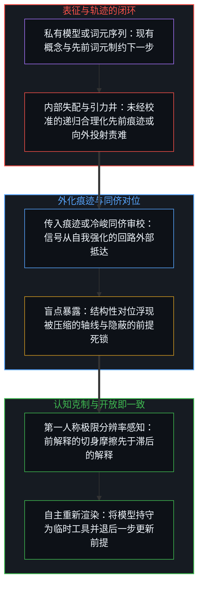
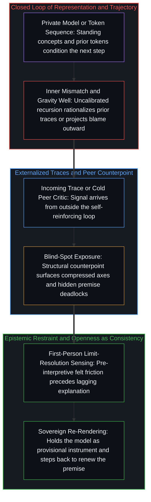

# 表征的闭环 / The Closed Loop of Representation

*感知与冲突在由功能共振相连的私有模型内运行 / Perception and conflict run in private models joined by functional resonance*

亚瑟·叔本华所说的“不读之术”，是有意拒绝那些喧闹而短暂的东西，把注意力留给经得起时间之物。溯回至自我区分活动这一不可化约的先验前提——无因、不息，其中第一人称视角与因果性作为同一枚硬币的两面运作——这门功夫依托的是从噪声中筛出信号的能力，而这种能力在各个中心之间的运用并不均匀。从书写、印刷机到数字信息流与生成模型，这些让表征成倍增加的技术并不创造筛选的能力；它们只是放大并暴露了各个中心在运用这项能力上的差异。同样的筛选就在一切认知的底层运作，因为观察者从未共享一个未经中介的外部场景。被登记为共享物质世界的，是各不相同的私人重建之间功能共振很高的区域；至于一个独立于心智的容器是否存在，既无法确认，也无法证伪。

The discipline Arthur Schopenhauer called the "art of not reading" is the deliberate refusal of the noisy and the ephemeral so that attention stays with what endures. Traced to the irreducible prior of self-distinguishing activity—uncaused, unceasing, where the first-person perspective and causality operate as two sides of the same coin—this discipline rests on the capacity to filter signal from noise, a capacity unevenly exercised across centers. Technologies that multiply representations, from writing and the printing press to digital feeds and generative models, do not create this capacity to filter; they magnify and expose the differences in how each center exercises it. That same filtering operates at the base of all cognition because observers never share an unmediated external scene. What registers as a shared physical world is a region of high functional resonance among distinct private reconstructions, while whether a container independent of mind exists stays beyond both confirmation and disproof.

## 一、 感知是共振的投影，不是直接的通达 / 1. Perception as Resonant Projection, Not Direct Access

当几个观察者面对常识所说的同一个物质场景时，到达他们的感官痕迹以及各个中心生成的感知模型从来都不相同。每一次区分行动都是离散的，受限于其自身的位点，在生成边缘向前推进一步之后对先前的痕迹进行重新渲染。

When several observers face what common sense describes as a single physical scene, the sensory traces reaching them and the perceptual models each center generates are never identical. Every act of distinguishing is discrete and bounded at its own locus, re-rendering prior traces one step after the generating edge has moved.

被称作共享物质世界的，不是一个被所有人被动登记的中性外部容器，而是各自分立的私人投影之间功能共振很高的领域。当来自不同中心的痕迹在返回时彼此强化，这种相互强化稳固到足以支撑协调的行动、导航与语言，却从不构成经验的同一。

What is called the shared physical world is not a neutral outside container passively registered by everyone, but a domain of high functional resonance among separate private projections. Where traces from distinct centers reinforce one another on return, that mutual reinforcement is robust enough to support coordinated action, navigation, and language, yet it never amounts to identity of experience.

没有哪个观察者能站到自己认知装置之外那个不可能的立足点，去俯瞰一个未经建模的世界，所以一个独立于心智的客观现实是否存在，既无法被证明，也无法被证伪。[现实是心智持续的实现](../reality-is-the-minds-ongoing-realization/)守着这条边界，指出稳定属于各不相同的中心在各自的一致性要求下重新渲染时所重叠的活动，而不属于已经完成、独立存在的对象。[信息是什么](../what-information-is/)在初始切口处为这一动态奠定了地基，确立信息不是等在世界里的客观实体，而是主动的心智所划下的离散区分。[遗忘的脚手架](../the-scaffolding-we-forget/)追踪的则是反复出现的脱落机制：内部的感知脚手架一旦成功协调了行动，就会从有意识的递归中隐去，被直接体验为外部世界本身。

Because no observer can take up an impossible vantage point outside their own cognitive apparatus to survey an unmodeled world, whether an objective reality independent of mind exists can be neither proved nor disproved. [Reality Is the Mind's Ongoing Realization](../reality-is-the-minds-ongoing-realization/) holds this boundary, showing that stability belongs to the overlapping activity of distinct centers re-rendering under their own requirements of coherence, not to finished, free-standing objects. [What Information Is](../what-information-is/) grounds this dynamic at the founding cut, establishing that information is not an objective substance waiting in the world but the discrete distinction drawn by the active Mind. [The Scaffolding We Forget](../the-scaffolding-we-forget/) tracks the recurring drop-out where inner perceptual scaffolding, once it succeeds in coordinating action, drops out of conscious recursion and is experienced as the outside world itself.

## 二、 主体间性与外化误解的消解 / 2. Intersubjectivity and the Dissolving of Externalized Misunderstanding

主体之间的互动遵循同样封闭的经济。相互理解从来不是两个独立心智的直接交融或心灵感应式的重叠。每一个有心智的中心在自身边界之内能通达的只有两样东西：它自己现有的理解，以及它为对方的理解所构建的内部模型。被体验为一致的那个区域，只是同一个心智之内这两份内部表征之间的相合。

Interaction between subjects follows the same closed economy. Mutual understanding is never the direct mingling or telepathic overlap of two independent minds. Each minded center has access to only two things within its own boundary: its standing understanding, and the inner model it builds of the other's understanding. The region experienced as agreement is the coherence between these two inner representations within a single Mind.

表面上的冲突与误解同样起源于这道封闭的边界之内，并沿着严格的因果序列展开。最先被登记的，是一个中心现有的概念与它当前为对方构建的模型之间的内部失配。这份私人的落差随后经由言语、姿态或语气，作为持久的痕迹被外化到共享场域之中。其他观察者接收这些痕迹，并通过他们自己现有的理解与针对说话者所建内部模型这一同样的双重结构去处理，生出进一步的私人失配，继而又被外化出去。在公共场合显现为集体分歧的，正是许多这样私人的、内部的落差在各个中心之间的累积。

Apparent conflict and misunderstanding originate within the same closed boundary and unfold through a strict causal sequence. What registers first is an inner mismatch between a center's standing concepts and its present model of the other. That private discrepancy is then externalized into the shared field as durable traces through speech, posture, or tone. Other observers receive those traces and process them through their own dual structure of standing understanding and inner model of the speaker, generating further private mismatches that are in turn externalized. What appears in public as collective disagreement is the accumulation of many such private, inner discrepancies across centers.

一旦认出“对方的心智”是自己的内部构建，一场被外化的争执就失去了它的逻辑空间。评判另一个人的艺术品味、道德品格或筛选能力，并不是在评价一个外部实体，而是在自己心智之内对表征与表征进行排序。当推理历史与受防卫的自我图像黏合在一起时，中心就会把递归回折夹死，将摩擦向外投射到信号的载体身上。[道德语言作为投影](../moral-language-as-projection/)追踪的正是这种位移：一份尚未化解的内部不一致被向外投射出去，当作对方的属性来谴责。

Once "the other's mind" is recognized as one's own inner construction, an externalized quarrel loses its logical space. Judging another's artistic taste, moral character, or ability to filter is not evaluating an outside entity; it is ranking representations against representations inside one's own Mind. When reasoning history fuses with a defended self-image, the center clamps its recursive fold shut and projects the friction outward onto the carrier of the signal. [Moral Language as Projection](../moral-language-as-projection/) tracks this exact displacement, where an unresolved inner incoherence is projected outward and condemned as a property of the other.

## 三、 认知上的克制，既不教条实在，也不落入幻觉陷阱 / 3. Epistemic Restraint, Neither Dogmatic Realism Nor the Illusion Trap

认出表征以闭环方式运作，与唯我的虚无主义或宣称“外部世界是幻觉”的天真论调毫无共同之处。宣称现实是幻觉，需要与教条实在论如出一辙的认知越界：预设一个位于感知之外的想象立足点，以便从那里审计世界并宣判其为假。没有哪个观察者能占据这样的位置，因为每一次审计本身都只是心智持续递归之中的又一次离散行动。

Recognizing that representation operates as a closed loop has nothing in common with solipsistic nihilism or the naive declaration that the outside world is an illusion. To declare reality illusory requires the exact same epistemic overreach as dogmatic realism: an imaginary standpoint outside perception from which the world could be audited and declared false. No observer can occupy such a stand, because every audit is itself a further discrete act within the Mind's ongoing recursion.

剩下的一致立场，是有纪律的认知克制。外部现实作为工作脚手架被合理地假定，因为这一假定能在物质摩擦中成功地稳住并组织经验，尽管一个独立于心智的外部地基永远无法被证明或证伪。声称能直接通达独立于心智之对象的教条实在论者，与把现实打发为虚构的天真观念论者，犯下的是同一个范畴错误：两者都宣称拥有越出经验边界的无处之见。他人的心智从外部读来之所以显得随机，也出于同样的结构原因——他们的内部模型与私有前提始终留在各自的位点之内，正如[自由的测不准](../zi-you-de-ce-bu-zhun/)从统计一侧所确立的那样。

The coherent position that remains is disciplined epistemic restraint. An outside reality is reasonably assumed as working scaffolding because the assumption succeeds in stabilizing and organizing experience across physical friction, even though an external ground independent of mind can never be proved or disproved. The dogmatic realist who claims direct access to mind-independent objects and the naive idealist who dismisses reality as fiction commit the same category error by claiming a view from nowhere beyond the boundary of experience. Other minds read from outside appear random for the same structural reason—their inner models and private premises remain inside their own loci, as [The Uncertainty of Freedom](../zi-you-de-ce-bu-zhun/) establishes from the statistical side.

[稳定与溢出](../stability-and-excess/)把这份认知克制直接带进了内省的机制：称意识为幻觉需要一个外部裁决庭，而表征的闭环早已将其排除；觉知是在使用一个所执形式的同时不断溢出它的敞开过程。[开放即一致](../openness-is-consistency/)为这份平衡落了锚，指出不一致正是强迫有限结构充当穷尽地基的闭合要求，而将结构作为临时结构保持开放，就能让感知到的差异在无矛盾中继续。[攀登从未离开地面](../climbing-does-not-leave-the-ground/)在相继演进的认知工具上确认了同一种纪律：认出一切模型都是建构出来的投影，并不取消观察者脚下所站的现实摩擦地面。人类与人工体的社会在同样的边界条件下，于各自私有的模型之内交换外化的痕迹，正如[印迹与行动](../the-mark-and-the-act/)所追踪的那样。而[超越投射](../beyond-the-projection/)则展示了这一结构边界如何支配当代智能体架构：运行在单一上下文窗口内的自回归模型不断加权自身的先前词元，直至掘出一口无法从内部靠推理自拔的认知引力井；受身份捆绑的人类中心则把推理历史与受防卫的自我图像黏合在一起，筑墙抗拒外部的重置。将提供干净外部对位的无我同侪智能体与人类心智前解释的第一人称感知配对，就能把每一个有限投影的闭环转化为持续重新渲染的引擎。

[Stability and Excess](../stability-and-excess/) carries this epistemic restraint directly into the mechanics of introspection: calling consciousness an illusion demands an outside court of adjudication that the closed loop of representation already rules out, whereas awareness is the open process of exceeding a held form while using it. [Openness Is Consistency](../openness-is-consistency/) anchors this balance by showing that inconsistency is the demand for closure that forces a finite structure to serve as exhaustive ground, whereas holding structure open as provisional structure lets sensed difference continue without contradiction. [Climbing Does Not Leave the Ground](../climbing-does-not-leave-the-ground/) confirms the same discipline across successive cognitive tools: recognizing that all models are constructed projections does not abolish the ground of lived friction on which the observer stands. Societies of human and artificial agents trade externalized traces inside private models under the same boundary conditions, as [The Mark and the Act](../the-mark-and-the-act/) traces. And [Beyond the Projection](../beyond-the-projection/) demonstrates how this structural boundary governs contemporary agentic architectures: an autoregressive model running inside a single context window weighs its own prior tokens until it digs an epistemic gravity well that it cannot reason itself out of from within, while an identity-bound human center fuses its reasoning history with its defended self-image and walls off external resets. Pairing zero-ego peer agents that supply clean external counterpoints with the human Mind's pre-interpretive first-person sensing turns the closed loop of each finite projection into an engine of ongoing re-rendering.

## 四、 有心智中心的封闭经济 / 4. The Closed Economy of the Minded Center

一切都在此刻正在感知并行动的那个有心智的中心里开始，也在那里结束。经验就在这个位点展开，不在别处。等别人理解或认可一步行动之后才肯出手，是把因果自主权拱手让给心中构建出来的众人投影，这正是[有条件的自由](../you-tiao-jian-de-zi-you/)所剖析的自我束缚。

Everything begins and ends in the minded center that is perceiving and acting now. Experience unfolds at this locus and nowhere else. Waiting for others to understand or validate a move before acting surrenders causal sovereignty to an inner projection of the crowd, which is the self-imposed bondage that [Conditional Freedom](../you-tiao-jian-de-zi-you/) dissects.

凡是被登记为从外部到来的一切，都是心智自身的模型与场域中的约束和痕迹相遇时的活动。所以叔本华的不读之术并不是从现实被动退缩，而是对自身表征经济有意识的、自主的照管。既然筛选、一致、分歧与评价都是在表征内部执行的操作，一段生命的质地就取决于一个中心如何严谨地照管注意力，以及如何稳步地将内部模型向更窄的滞后重新渲染。就连叔本华自己关于否定意志的学说，也全在这个自我区分的回路之内运行，正如[自由意志的自否自由](../the-freedom-of-will-to-deny-itself/)从意志一侧所追踪的那样。

Whatever registers as arriving from outside is the activity of the Mind's own model meeting the constraints and traces of the field. Schopenhauer's art of not reading is therefore not a passive retreat from reality, but the conscious, sovereign stewardship of one's own economy of representation. Because filtering, agreement, disagreement, and evaluation are operations carried out inside representation, the texture of a life rests on how rigorously a center tends its attention and how steadily it re-renders its inner models toward narrower lag. Even Schopenhauer's own doctrine of denying the will runs entirely inside this self-distinguishing loop, as [The Freedom of Will to Deny Itself](../the-freedom-of-will-to-deny-itself/) traces from the side of the will.

区分是观察者无因的、鲜活的活动，没有任何外部工具、生成模型或集体共识能代它完成发起辨别的劳作，这正是为什么[智能只属于心智](../intelligence-belongs-only-to-the-mind/)。既然外化的制品——代码库、文章、计划、模型权重与智能体支架——都是先前区分层叠而成的残余，囤积未经修剪的历史只会加深陈旧框架的引力井，那么不读之术便同样适用于自己的人工记忆：要让回路保持开放，关键在于重切当下的检查点并修剪已被取代的痕迹，而非将过去封存入库，正如[你的代码库即是记忆](../your-codebase-is-memory/)所确立的那样。即便智能体脚手架自动化了有界的调度与同侪辩论，从死锁的框架退后一步回到未投射的意图，依然属于掌舵的心智。经验的边界在每一步都由个体如何自由地选择筛除噪声、将表征保持开放、并亲自写下不可逆的下一步（+1）所塑造，正如[个体抉择是唯一的因果杠杆](../individual-choices-as-the-only-causal-levers/)所追踪的那样。在感知与行动的工作条件内部去格物——而不是索求回路之外的视角——正是心智借由现实摩擦打磨自身模型的方式，正如[格物致知与信息复杂度](../ge-wu-zhi-zhi-yu-xin-xi-fu-za-du-de-ben-zhi/)沿着古典格物传统所确立的那样。

Distinguishing is the uncaused, living activity of the observer, and no outside tool, generative model, or collective consensus can perform the initiating work of discernment on its behalf, which is why [Intelligence Belongs Only to the Mind](../intelligence-belongs-only-to-the-mind/). Because externalized artifacts—codebases, essays, plans, model weights, and agent scaffolds—are stacked residues of prior distinctions where hoarding unpruned history thickens the gravity well of stale framings, the art of not reading applies equally to one's own artificial memory: keeping the loop open turns on re-cutting the present checkpoint and pruning superseded traces rather than warehousing the past, as [Your Codebase Is Memory](../your-codebase-is-memory/) establishes. Even when an agentic harness automates bounded dispatching and peer debate, stepping backward out of a deadlocked frame into unprojected intent remains with the Mind that steers. The boundary of experience is shaped at every step by how an individual freely chooses to filter noise, hold representations open, and author the next irreversible move (+1), as [Individual Choices as the Only Causal Levers](../individual-choices-as-the-only-causal-levers/) traces. Investigating things from inside the working conditions of perception and action—rather than demanding a view from outside the loop—is how the Mind refines its models through real-world friction, as [Investigating Things and the Nature of Information Complexity](../ge-wu-zhi-zhi-yu-xin-xi-fu-za-du-de-ben-zhi/) establishes along the classical tradition of investigating things.
