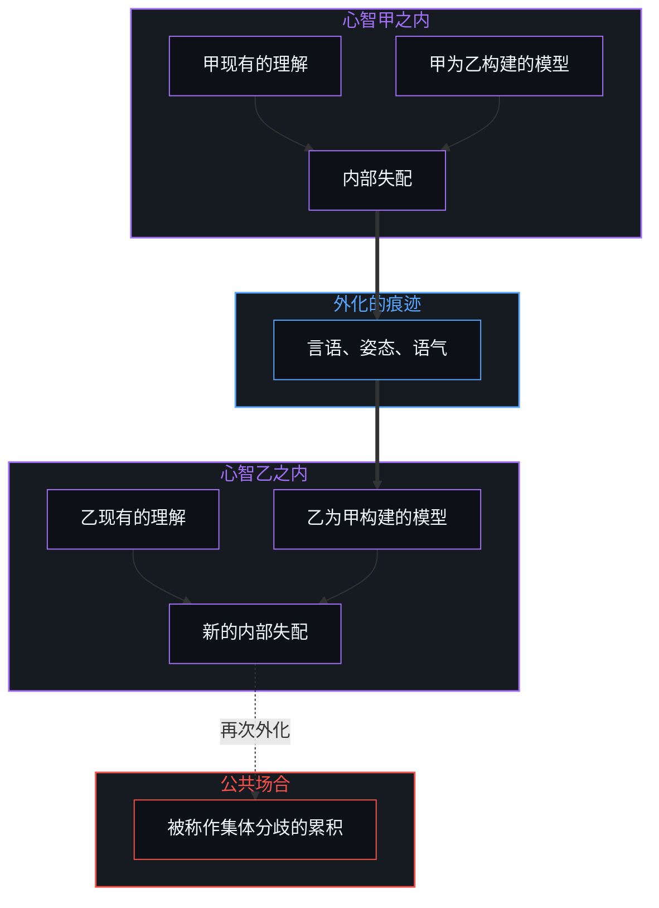
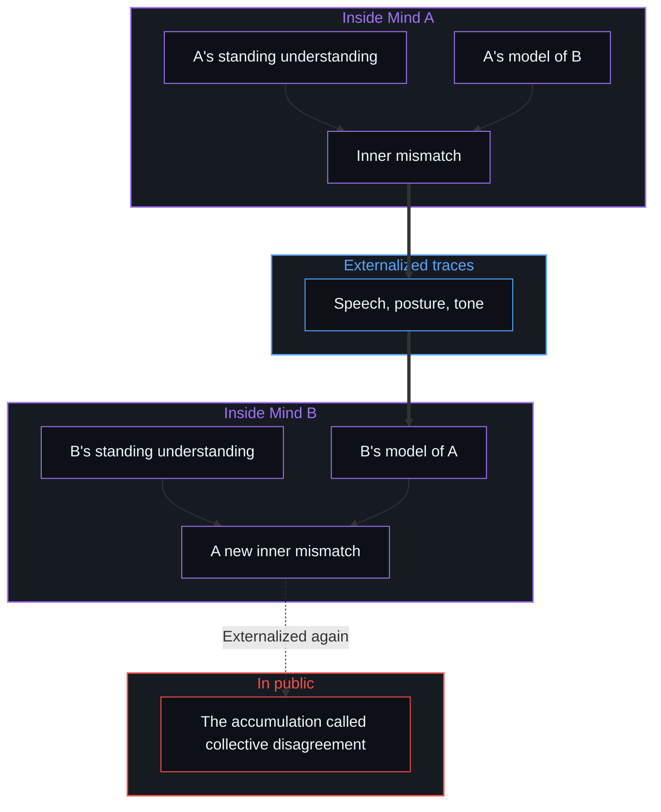

# 表征的闭环 / The Closed Loop of Representation

*叔本华的不读之术显示，感知与误解都在私有模型内运作，共享现实是共振 / Schopenhauer's art of not reading shows perception and misunderstanding run in private models; shared reality is resonance.*

亚瑟·叔本华所说的“不读之术”，是有意地拒绝那些喧闹而短暂的东西，把注意力留给经得起时间的东西。再往下追，这门功夫依托的，是从噪声中筛出信号的能力，而这种能力的运用并不均匀。让表征成倍增加的技术，书写、印刷机、数字信息流与生成模型，并不创造这种筛选的能力；它们只是把它在运用上的差异放大、暴露出来。而同样的筛选，就在一切认知的底部运作：观察者从未共享一个未经中介的外部场景。被体验为“共享物质世界”的，是各不相同的私人重建之间功能共振很高的一个区域；至于一个与心智无关的容器是否存在，既无法确认，也无法证伪。

The discipline Arthur Schopenhauer called the "art of not reading" is the deliberate refusal of the noisy and the ephemeral, to keep attention for what endures. Traced further down, what this discipline rests on is the capacity to filter signal from noise, a capacity unevenly exercised. Technologies that multiply representations, writing, the printing press, digital feeds and generative models, do not create this capacity to filter; they only magnify and expose the differences in how it is exercised. Yet the same filtering operates at the base of all cognition: observers never share an unmediated external scene. What is experienced as a "shared physical world" is a region of high functional resonance among distinct private reconstructions, while whether a container independent of mind exists stays beyond both confirmation and disproof.

## 一、 感知是共振的投影，不是直接的通达 / 1. Perception as Resonant Projection, Not Direct Access

当几个观察者面对常识所说的同一个物质场景，到达他们的感官数据，以及各自生成的感知模型，从来都不相同。

When several observers face what common sense describes as a single physical scene, the sensory data reaching them and the perceptual models each one generates are never identical.

被称作共享物质世界的，不是一个被所有人被动登记的中性外部容器，而是各自分开的私人投影之间功能共振很高的一个领域。这种共振稳固到足以支撑协调的行动、导航与语言，却从不构成经验的同一。

What is called the shared physical world is not a neutral outside container passively registered by everyone, but a domain of high functional resonance among separate private projections. The resonance is robust enough to support coordinated action, navigation and language, yet it never amounts to identity of experience.

没有哪个观察者能站到自己认知装置之外那个不可能的位置，去俯瞰一个未经建模的世界，所以一个客观的、与心智无关的现实是否存在，既无法被证明，也无法被证伪。[现实是心智持续的实现](../reality-is-the-minds-ongoing-realization/)守着的正是这条边界：稳定属于各不相同的中心在各自的一致性要求下重新渲染所共同重叠的活动，而不属于已经完成、独立存在的对象。[信息是什么](../what-information-is/)为这个动态打下了地基：信息不是一种等在世界里的客观实体，而是主动的心智划下的离散区分。[遗忘的脚手架](../the-scaffolding-we-forget/)追踪的是反复出现的脱落：内部的感知脚手架一旦成功地协调了行动，就从递归中脱落，被误当作外部世界本身来体验。

Because no observer can take up an impossible vantage point outside their own cognitive apparatus to survey an unmodelled world, whether an objective reality independent of mind exists can be neither proved nor disproved. [Reality Is the Mind's Ongoing Realization](../reality-is-the-minds-ongoing-realization/) holds this boundary: stability belongs to the overlapping activity of distinct centres re-rendering under their own requirements of coherence, not to finished, free-standing objects. [What Information Is](../what-information-is/) grounds this dynamic: information is not an objective substance waiting in the world but the discrete distinction drawn by the active Mind. [The Scaffolding We Forget](../the-scaffolding-we-forget/) tracks the recurring drop-out: once inner perceptual scaffolding succeeds in coordinating action, it drops out of recursion and is experienced, wrongly, as the outside world itself.

## 二、 主体间性与外化误解的消解 / 2. Intersubjectivity and the Dissolving of Externalized Misunderstanding

主体之间的互动，遵循同样封闭的经济。

Interaction between subjects follows the same closed economy.

相互理解从来不是两个独立心智直接的交融，或心灵感应式的重叠。每一个有心智的中心，能通达的只有两样东西：它自己现有的理解，以及它为对方的理解所构建的内部模型。被体验为“一致”的那个区域，只是同一个心智之内这两份内部表征之间的相合。

Mutual understanding is never the direct mingling or telepathic overlap of two independent minds. Each minded centre has access to only two things: its own standing understanding, and the inner model it builds of the other's understanding. The region experienced as "agreement" is the coherence between these two inner representations within a single Mind.

表面上的冲突与误解，也在同一道封闭的边界之内起源，并按这样的顺序展开：

Apparent conflict and misunderstanding originate within the same closed boundary and unfold in this order:

1. 最先被登记的，是自己现有的概念与自己当前为对方构建的模型之间的内部失配。
2. 这份私人的落差经由言语、姿态或语气被外化出去。
3. 其他观察者接收这些痕迹，用他们自己同样的双重结构去处理，生出进一步的私人失配，再被外化出去。
4. 集体的分歧，就是许多这样私人的、内部的落差在公共场合的累积。

1. What registers first is an inner mismatch between one's standing concepts and one's present model of the other.
2. That private discrepancy is externalized through speech, posture or tone.
3. Other observers receive those traces and process them through their own dual structure, generating further private mismatches that are in turn externalized.
4. Collective disagreement is the public accumulation of many such private, inner discrepancies.

一旦认出“对方的心智”从来只是自己的内部构建，一场被外化的争执就失去了它的逻辑空间。评判另一个人的艺术品味、道德品格或筛选能力时，被评价的不是一个外部实体，而是自己心智之内表征与表征之间的排序。[道德语言作为投影](../moral-language-as-projection/)追踪的正是这种位移：一份没有化解的内部不一致被投射出去，当作对方的属性来谴责。

Once "the other's mind" is recognized as only ever one's own inner construction, an externalized quarrel loses its logical space. Judging another's artistic taste, moral character or ability to filter is not evaluating an outside entity; it is ranking representations against representations inside one's own Mind. [Moral Language as Projection](../moral-language-as-projection/) tracks this displacement: an unresolved inner incoherence is projected outward and condemned as a property of the other.

## 三、 认知上的克制，既不教条实在，也不落入幻觉 / 3. Epistemic Restraint, Neither Dogmatic Realism Nor the Illusion Trap

认出表征是一个闭环，不能被误当作唯我的虚无主义，也不能被误当作“外部世界是幻觉”的天真宣告。

Recognizing that representation is a closed loop must not be mistaken for solipsistic nihilism or for the naive declaration that the outside world is "an illusion".

宣称现实是幻觉，需要与教条实在论一模一样的认知越界：一个在感知之外、能据以宣判世界为假的上帝视角。没有哪个观察者能站到这样的立足点上。

To declare reality illusory takes exactly the same epistemic overreach as dogmatic realism: a God's-eye standpoint outside perception from which the world could be declared false. No observer can stand on such a standpoint.

剩下的一致立场，是一种有纪律的认知克制。外部现实出于实用而被合理地假定，因为这个假定能成功地稳住并组织经验；可这个外部的地基永远无法被确定地证明或证伪。教条的实在论者声称直接通达与心智无关的对象，天真的观念论者把现实打发为虚构，两者犯的是同一个范畴错误：都声称拥有一个越出经验边界的视角。他人的心智从外面读来显得随机，也是因为他们的模型留在各自之内，[自由的测不准](../zi-you-de-ce-bu-zhun/)从统计的一侧讲清了这一点。

The coherent position that remains is a disciplined epistemic restraint. An outside reality is reasonably assumed for practical purposes, because the assumption succeeds in stabilizing and organizing experience; yet that outside ground can never be definitively proved or disproved. The dogmatic realist, who claims direct access to objects independent of mind, and the naive idealist, who dismisses reality as fiction, commit the same category error: both claim a perspective beyond the boundary of experience. Other minds read from outside look random for the same reason, because their models stay private, as [The Uncertainty of Freedom](../zi-you-de-ce-bu-zhun/) makes clear from the statistical side.

[稳定与溢出](../stability-and-excess/)把这份认知上的克制直接带进了内省的机制：称意识为“幻觉”，需要一个不可能的外部裁决庭，而封闭系统的前提本身已经排除了它；觉知是在持守一个形式的同时溢出它的那个敞开的过程。[开放即一致](../openness-is-consistency/)为这份平衡落了锚：无根的开放承认现实没有闭合，而不试图用教条的断言封住这份奥秘。[攀登从未离开地面](../climbing-does-not-leave-the-ground/)确认了同一种纪律：认出一切模型都是建构的，并不取消此刻脚下站着的地面。智能体的社会也在各自私有的模型之内交换印迹，[印迹与行动](../the-mark-and-the-act/)把这一点讲到了智能体身上。

[Stability and Excess](../stability-and-excess/) carries this epistemic restraint directly into the mechanics of introspection: calling consciousness an "illusion" needs an impossible outside court of adjudication that the closed-system premise has already ruled out; awareness is the open process of exceeding a form while holding it. [Openness Is Consistency](../openness-is-consistency/) anchors this balance: groundless openness acknowledges that reality is unclosed without trying to seal the mystery with dogmatic claims. [Climbing Does Not Leave the Ground](../climbing-does-not-leave-the-ground/) confirms the same discipline: recognizing that all models are constructed does not abolish the ground on which one now stands. Societies of agents trade marks inside private models in the same way, as [The Mark and the Act](../the-mark-and-the-act/) carries over to agents.

## 四、 有心智的中心那封闭的经济 / 4. The Closed Economy of the Minded Centre

一切都在此刻正在感知的那个有心智的中心里开始，也在那里结束。经验在这里展开，不在别处。等别人理解了才行动，是[有条件的自由](../you-tiao-jian-de-zi-you/)所描述的那种自由。

Everything begins and ends in the minded centre that is perceiving now. Experience unfolds here and nowhere else. Waiting for others to understand before acting is the freedom that [Conditional Freedom](../you-tiao-jian-de-zi-you/) describes.

被当作从“外面”到来的一切，都是心智自己的模型与它所遇到的约束和痕迹之间的互动。所以叔本华的不读之术，不是从现实被动地退开，而是对自己的表征经济有意识的、自主的照管。既然筛选、一致、分歧与评价都是在表征之内完成的操作，一段生命的质地，就落在一个人多么严谨地照管自己的注意力、多么持续地重新渲染自己的内部模型上。即便否认意志，也在这个环里运行，[自由意志的自否自由](../the-freedom-of-will-to-deny-itself/)从意志一侧走到了同一处。

Whatever is taken to arrive from "outside" is the activity of the Mind's own model interacting with the constraints and traces it meets. Schopenhauer's art of not reading is therefore not a passive retreat from reality but the conscious, sovereign stewardship of one's own economy of representation. Since filtering, agreement, disagreement and evaluation are operations carried out inside representation, the texture of a life rests on how rigorously one tends one's own attention and how steadily one re-renders one's inner models. Even the denial of will runs inside this loop, which [The Freedom of Will to Deny Itself](../the-freedom-of-will-to-deny-itself/) reaches from the side of the will.

区分是观察者无因的、活的活动，没有哪个外部工具或集体共识能代为完成辨别的劳作，所以[智能只属于心智](../intelligence-belongs-only-to-the-mind/)。经验的边界，由一个人自由地选择怎样筛去噪声、怎样持守表征、怎样写下自己的下一步来塑造，所以[个体抉择是唯一的因果杠杆](../individual-choices-as-the-only-causal-levers/)。从工作条件的内部去格物，是走出这个环的路，[格物致知与信息复杂度](../ge-wu-zhi-zhi-yu-xin-xi-fu-za-du-de-ben-zhi/)沿着格物的传统走到了这一点。

Distinguishing is the uncaused, living activity of the observer, and no outside tool or collective consensus can do the work of discernment on its behalf, which is why [Intelligence Belongs Only to the Mind](../intelligence-belongs-only-to-the-mind/). The boundary of experience is shaped by how an individual freely chooses to filter noise, hold representations and author the next move, which is why [Individual Choices as the Only Causal Levers](../individual-choices-as-the-only-causal-levers/). Investigating things from inside the working conditions is the way out of the loop, as [Investigating Things and the Nature of Information Complexity](../ge-wu-zhi-zhi-yu-xin-xi-fu-za-du-de-ben-zhi/) reaches along the tradition of investigating things.
