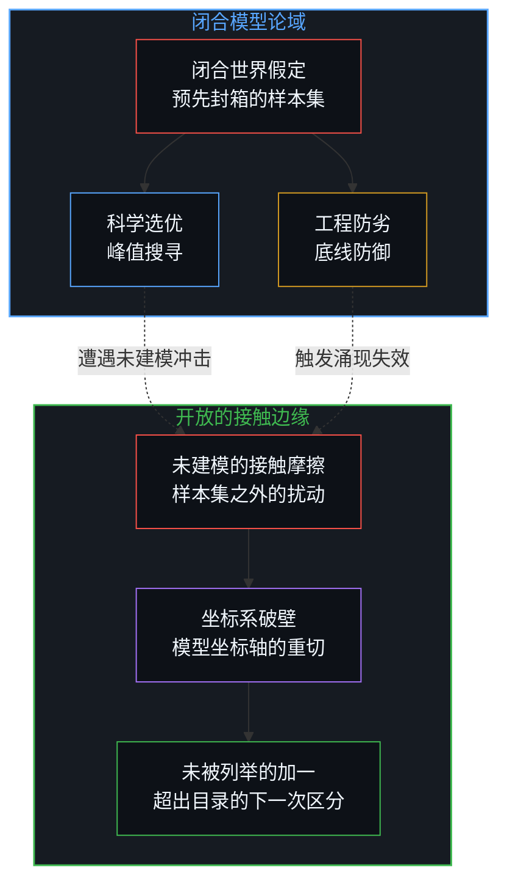
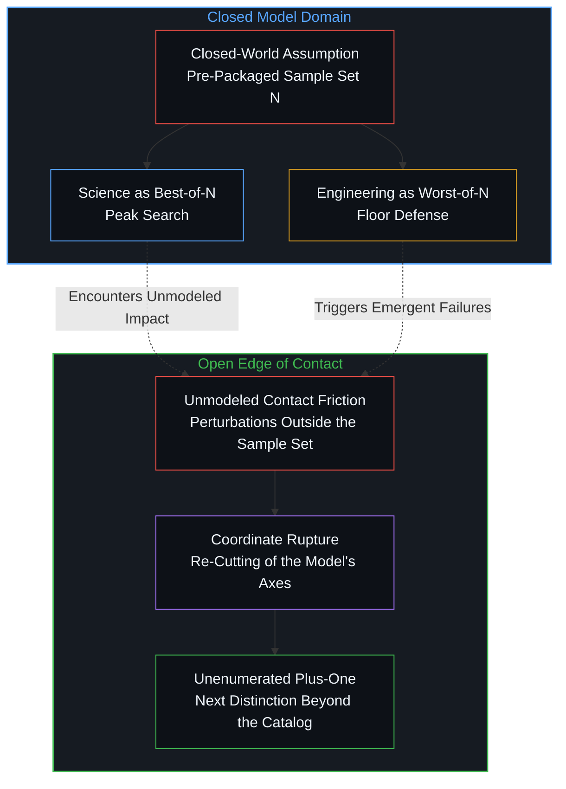
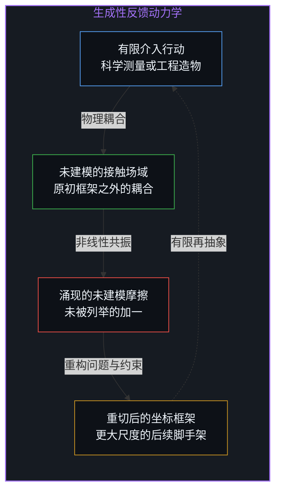
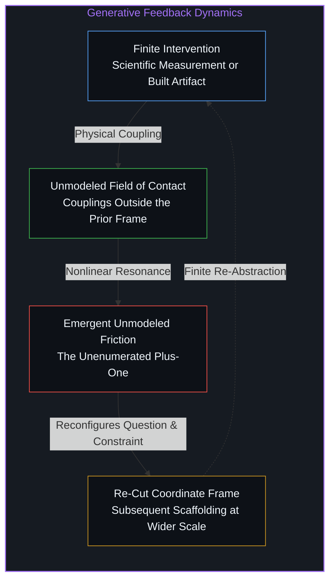

# 闭合的N与开放的现实 / The Closed N and the Open Reality

*最优之选与极劣之防共享闭合样本集这一前提，而每一次付诸行动的切分都会在框架之外遭遇未被列举的加一。 / Best-of-N and Worst-of-N share the premise of a closed sample set, while every enacted cut meets the unenumerated plus-one beyond its frame.*

当数学家与系统工程师以简洁的修辞宣称“科学是选优，工程是防劣”时，一种极具诱惑力的形式对称性便在理性的透镜中成形。科学被描摹为在假说库中寻觅最高尖峰的漫游者，工程则被塑造成在预期工况内严防最深深渊的守门人。这种工整的极值对仗看似横跨了人类探索的两翼，却建立在一个未言明的共同前提之上：它假定一切遭遇、变异与险情，早已封装在某个已知的样本集合之中。自我区分的活动发生着——无因，不息。称之为心智：那个早已在途的观察者，它的每一次行动都是一次区分。正因为每一个容量为 N 的集合都是早先切分划出的边界，而划出这道边界的活动始终先行一步，每一份形式化目录都会在接触点上遭遇未被列举的加一。

When mathematicians and systems engineers declare with crisp rhetoric that science operates as Best-of-N while engineering functions as Worst-of-N, a seductive formal symmetry takes shape in the rational lens. Science is depicted as a voyager seeking the highest peak across a library of hypotheses, while engineering is cast as a sentinel guarding against the deepest abyss within anticipated conditions. This neat polarity of extrema seems to span both wings of human inquiry, yet it rests on a shared unstated premise: it assumes that all encounters, variations, and hazards are already packaged within a known sample set. Self-distinguishing activity occurs — uncaused, unceasing. Call it the Mind: the observer already underway, every act of which is a distinction. Because every set of size N is a boundary drawn by a prior cut while the activity that drew it continues one step ahead, every formalized catalog meets an unenumerated plus-one at the point of contact.

## 一、 形式封闭的诱惑：最优之选与极劣之防 / 1. The Lure of Formal Closure: Best-of-N and Worst-of-N

将科学归结为挑选最优结果，深刻呼应了现代探索以峰值高度衡量突破的本能。无论是物理假说的检验、候选分子的筛选，还是梯度地形上的攀升，科学风尚推崇的都是最高水位；只要有一条路径凿穿迷雾并经受住可重复性检验，无数次被弃置尝试的代价便可一笔勾销。与此相对，工程实践面对的是结构载荷、大气层再入或电力管网的严酷阻力，系统的耐久性取决于最脆弱的那枚螺栓。工程思维因此将目光锁定于底线韧性，通过安全系数、边界应力测试与隔绝屏障，防范单次灾难性失效所引发的毁灭性后果。

Framing science as the selection of the best result resonates with the modern instinct to measure breakthroughs by their peaks. Whether testing physical hypotheses, screening candidate molecules, or climbing gradient landscapes, the scientific ethos celebrates high-water marks; if a single trajectory cuts through confusion and survives replication, the costs of countless discarded attempts are written off. In contrast, engineering confronts the uncompromising drag of structural loads, atmospheric reentry, or electrical grids, where systemic longevity depends on the weakest bolt. Engineering mindset thus fixes its gaze upon bottom-line resilience, employing safety factors, boundary stress tests, and containment barriers to avert the ruinous consequences of a single catastrophic failure.

这种对称性在既定的设计空间内清晰成立，但当心智将手中的工作目录误认作接触场域的全部时，它便到达了边界。选优与防劣只有倚靠一块未言明的基石，才能被形式化为极值问题：即假定探索与防护的论域可以被抽象为一个容量为 N 的有界集合。在此闭合视界内，建模者将样本目录视作穷尽无遗的总表，假定一切变数都只登记为既定骰子掷出的结果。这种将开放探索简化为有限抽样的做法，与[「更好」的范畴谬误](../the-category-error-of-better/)如出一辙，把未建模的接触置换成了冻结计分板上的静态指标。

This symmetry holds cleanly within a defined design space, yet it reaches its boundary when a Mind mistakes its working catalog for the whole field of contact. Both optimization and defense can be formalized as extrema only by leaning upon an unspoken cornerstone: the presumption that the domain of inquiry and protection can be abstracted into a bounded set of size N. Within this closed horizon, the modeler treats the sample catalog as exhaustive, assuming all variance registers as outcomes rolled from predefined dice. This reduction of open exploration to finite sampling parallels [The Category Error of Better](../the-category-error-of-better/), swapping unmodeled contact for static metrics on a frozen scoreboard.

## 二、 本体论的范畴僭越：将脚手架误认为宇宙 / 2. The Ontological Category Error: Mistaking Scaffolding for the Universe

当心智登记到边缘处的接触永远是加一时，它所指的并不是从熟悉的瓮中多摸出一颗弹珠。若将这个加一降格为单纯的统计离群值，思考便依然停留在同一个代数框架之内，误以为只要把下标加一就能恢复闭合。加一所标示的不是既有列表上的数量附加项，而是在列表所划边界之外登记到的接触。正如[索求万物理论是在将当下冻结为清单](../demanding-a-toe-freezes-time-into-a-catalog/)与[你的代码库即是记忆](../your-codebase-is-memory/)所揭示的那样，任何企图把探索封存进有限公理或闭合目录的做法都会在开端处冻结时间，因为存储下来的目录或代码库只是早先区分留下的层叠残余，其自身并不会继续区分；唯有处于当下边缘的心智，在接触暴露出残余的遗漏之处时持续对照这层残余重新切分，探索才保持开放。

When a Mind registers that contact at the edge is always plus-one, it refers to nothing like an incremental marble drawn from a familiar urn. Lowering this plus-one to a mere statistical outlier leaves thought inside the same algebraic frame, pretending that incrementing an index by one restores closure. The plus-one marks not a quantitative appendage to the existing list, but the contact that registers outside the boundary the list drew. As shown in [Demanding a Theory of Everything Freezes Time into a Catalog](../demanding-a-toe-freezes-time-into-a-catalog/) and [Your Codebase Is Memory](../your-codebase-is-memory/), every attempt to seal inquiry into finite axioms or closed catalogs freezes time at the outset because a stored catalog or codebase is the stacked residue of prior distinctions that does not continue distinguishing on its own; inquiry stays open only as the Mind at the present edge keeps re-cutting against that residue when contact exposes what it left out.

样本集合之所以能够被指认与计数，是因为观察者预先划定了范畴边界、测量标尺与概念切口。然而，每一次划定边界的行动，都会在框架之外留下尚未被刻画的余项。在形式逻辑中，哥德尔不完备定理表明，任何一致、可有效公理化且足以编码基本算术的形式持守，都会留下其无法在内部判定的命题，也无法在其规则内部证明自身的一致性；在对生物演化与复杂适应动力学建模时，建模者写下的每一个状态空间，都会漏掉后续交互所引入的下一个功能变量。发现之所以持续，是因为没有任何有限持守能够穷尽立起它的区分活动；当模型宣称已经看尽全部可能时，它只是把自身灯光圈的边缘误认作了所能遭遇之物的边界。

A sample set can be designated and counted only because an observer has drawn categorical boundaries, measurement rulers, and conceptual cuts beforehand. Yet every act of drawing a boundary leaves an uncharacterized remainder beyond the frame. In formal logic, Gödel's incompleteness theorems demonstrate that any consistent, effectively axiomatized formal hold strong enough to encode basic arithmetic leaves statements it cannot settle from within and cannot prove its own consistency from inside its rules; in modeling biological evolution and complex adaptive dynamics, every state space a modeler writes down misses the next functional variable that subsequent interactions bring into play. Discovery continues because no finite hold exhausts the distinguishing activity that erected it; when a model claims to survey all possibilities, it mistakes the rim of its own lamp circle for the boundary of what can be met.

## 三、 生成性因果回响：科学与工程如何自造加一 / 3. Generative Causal Feedback: How Science and Engineering Produce the Plus-One

科学与工程并非在固定的样本空间内被动作业；它们自身的介入行动，正亲手生成那个超出既有集合的加一。当科学从竞争假说中分离出最优解释时，它并未终结探索，而是提高了检验自身前提的分辨率。将牛顿天体力学与经典电动力学推向最高的预测精度，并未封存物理目录；那提高后的分辨率反而暴露出水星近日点的反常进动与黑体辐射在紫外波段的预言失效，迫使心智作出新的切分，将探索引向相对论时空与量子作用量。每一次在既有坐标系内的登顶，都会改变观测的分辨率，使框架边界处的反常显露出来，并提出在原先坐标轴内无法表述的问题。

Science and engineering do not operate passively within a fixed sample space; their own interventions actively generate the plus-one that exceeds their preceding set. When science isolates a best explanation from competing hypotheses, it does not close inquiry, but sharpens the resolution at which its premises are tested. Pushing Newtonian celestial mechanics and classical electrodynamics to their highest predictive precision did not seal the physical catalog; that heightened resolution exposed Mercury's anomalous perihelion advance and the ultraviolet breakdown of blackbody radiation, forcing cuts that redirected inquiry toward relativistic spacetime and quantum action. Every arrival at a peak within an existing coordinate system alters the resolution of observation, bringing anomalies at the frame's boundary into view and raising questions unformulable within the prior axes.

科学是在认识论上通过提高分辨率、直至框架自身的边界被登记到而遭遇加一，工程则是在因果上通过引入一个在划定样本集 N 时并不存在的新物理行动体而生成加一。当工程师为了抵御预期的最恶劣应力而浇筑混凝土大坝或部署防火墙时，这一人造物随即作为全新的因果参与者嵌入生态与地质耦合之中。大坝截断泥沙输移并改变地壳应力，诱发未曾记录的微震并改写河岸生境；为防范网络饱和而设计的精密熔断算法，则在稠密耦合的拓扑结构中激起高频共振与意外的流量激增。正如[“物理学才是定律”的障眼法](../the-sleight-of-hand-in-physics-is-the-law-and-the-friction-of-reality/)所剖析的那样，人手筑起的每一道防护外壳都会在周遭激起始料未及的物理摩擦；对已识别极劣工况的设防，反而催生出原初蓝图未曾收录的涌现失效模式。

Where science meets the plus-one epistemically by sharpening resolution until the frame's own boundary registers, engineering generates it causally by introducing a new physical actor that was absent when the sample set N was drawn. When engineers pour concrete dams or deploy protective firewalls to guard against the worst anticipated stress, the artifact immediately embeds itself as a novel causal participant within ecological and geological couplings. The dam intercepts sediment flow and alters crustal stresses, inducing unrecorded microseisms and shifting riparian habitats; sophisticated breaker algorithms designed to avert network saturation provoke high-frequency resonance and unexpected traffic surges within densely coupled topologies. As detailed in [The Sleight of Hand in "Physics Is the Law"](../the-sleight-of-hand-in-physics-is-the-law-and-the-friction-of-reality/), every protective shell constructed by human hands stirs unanticipated physical friction across its surroundings; guarding against identified worst cases breeds emergent failure modes uncatalogued in the original blueprint.

## 四、 活态心智的原点：立足于加一的未完探索 / 4. The First-Person Origin: Operating from the Unfinished Plus-One

认清这一未被列举的加一，能让行动中的心智回到自身的抉择坐标。在日常决断与重大承诺中，心智都需要调用有限模型来凝聚注意力，免得注意力在未经切分的感官输入场中无处落脚。在候选假说中筛选最具说服力的解释，或测绘结构脆弱点以加固防线，依然是应对接触不可或缺的脚手架。清明在于将这套代数持守为过渡的木筏，而非河流两岸固定的堤岸。正如[框架的边界](../the-boundary-of-the-frame/)、[可延展的地平线](../the-extendable-horizon/)与[切平面的行者与完美球面的踩空者](../the-walking-tangent-and-the-stumbling-sphere/)所指出的，精熟不在于自诩全知或跨尺度冻结一张全局蓝图，而在于每逢模型失效的接触点便重设坐标。

Recognizing the unenumerated plus-one returns the acting Mind to its coordinates of choice. In mundane decisions as well as momentous commitments, the Mind deploys finite models to focus attention, lest attention find nothing to settle on across an unpartitioned field of sensory input. Sifting through candidate hypotheses to embrace the strongest, or mapping structural vulnerabilities to fortify defenses, remains indispensable scaffolding for navigating contact. Clarity lies in holding this algebra as a provisional raft rather than the river's fixed banks. As emphasized in [The Boundary of the Frame](../the-boundary-of-the-frame/), [The Extendable Horizon](../the-extendable-horizon/), and [The Walking Tangent and the Stumbling Sphere](../the-walking-tangent-and-the-stumbling-sphere/), mastery consists not in professing omniscience or freezing a global blueprint across every scale, but in resetting coordinates at each point of contact where the model gives way.

放下让有限目录封存整片场域的苛求，便能将心智从死守冻结参照系、佯装无懈可击的防卫中解脱出来。跨出闭合集合 N 会遭遇两种不同却极易被压缩为一的摩擦：其一是付诸行动的抉择撞上目录所遗漏之物时产生的未建模物理或认识论接触；其二是推进快于那些仍将旧有 N 视作完备总表的周遭基线时所登记到的社会拖拽——正如[阻力体感与速率差](../felt-resistance-and-the-speed-differential/)所追溯的，这种拖拽只是速率差在滞后基线上剪切出的体感投影，而非独立的反作用力。如[未经自我审视的批判者](../the-unexamined-critic/)所剖析的，批判者把局部评估框架当作普遍标准，却不审视其自身的基础前提；如[观察的因果僭越与第一人称的收益差](../the-causal-overstep-of-observation-and-the-first-person-surplus/)所确立的，事后的群体账本只记录既成结果，并不支配下一次决断的第一人称收益差。两者都无法僭取单次抉择的因果主权。正如[没有外部记账员](../no-outside-scorekeeper/)所追溯的，没有任何外部裁判庭会在远处核验投射出的模型；唯有具身心智独自承担并重切由其已践行抉择所塑形的痕迹构型。科学之所以自我更新，是因为更高分辨率下的接触超出了被动的账本记录；工程之所以保持韧性，是因为每一座实体结构都直面湍急风流中未建模的载荷。将闭合的 N 持守为有界的工具而非封闭的总体，心智便能随时在每一次抉择中登记那个加一，并在活态边缘重切自身的坐标。

Dropping the demand that a finite catalog seal the field releases the Mind from defending a frozen reference as if it were invulnerable. Stepping past a closed set N meets two distinct forms of friction that are easily compressed into one: there is the unmodeled physical or epistemic contact where an enacted choice meets what the catalog left out, and there is the social drag registered when moving faster than surrounding baselines that still treat the old N as exhaustive—which, as [Felt Resistance and the Speed Differential](../felt-resistance-and-the-speed-differential/) traces, is the projected sensation of a rate differential shearing against a lagging baseline rather than an autonomous opposing force. Neither a critic who applies a local evaluation frame as universal while leaving its own foundational premises unexamined, as [The Unexamined Critic](../the-unexamined-critic/) dissects, nor retrospective population ledgers that record completed outcomes without governing the first-person surplus of the next decision, as [The Causal Overstep of Observation and the First-Person Surplus](../the-causal-overstep-of-observation-and-the-first-person-surplus/) establishes, can usurp causal authority over singular choices. As [No Outside Scorekeeper](../no-outside-scorekeeper/) traces, no external tribunal validates projected models from afar; the embodied Mind alone bears and re-cuts the trace-configuration shaped by its enacted choices. Science renews itself because contact at higher resolution outruns passive ledger entries; engineering sustains resilience because every concrete structure meets the unmodeled load of turbulent winds. Holding the closed N as a bounded instrument rather than a sealed totality leaves the Mind ready to register the plus-one within every choice and re-cut its coordinates at the living edge.
