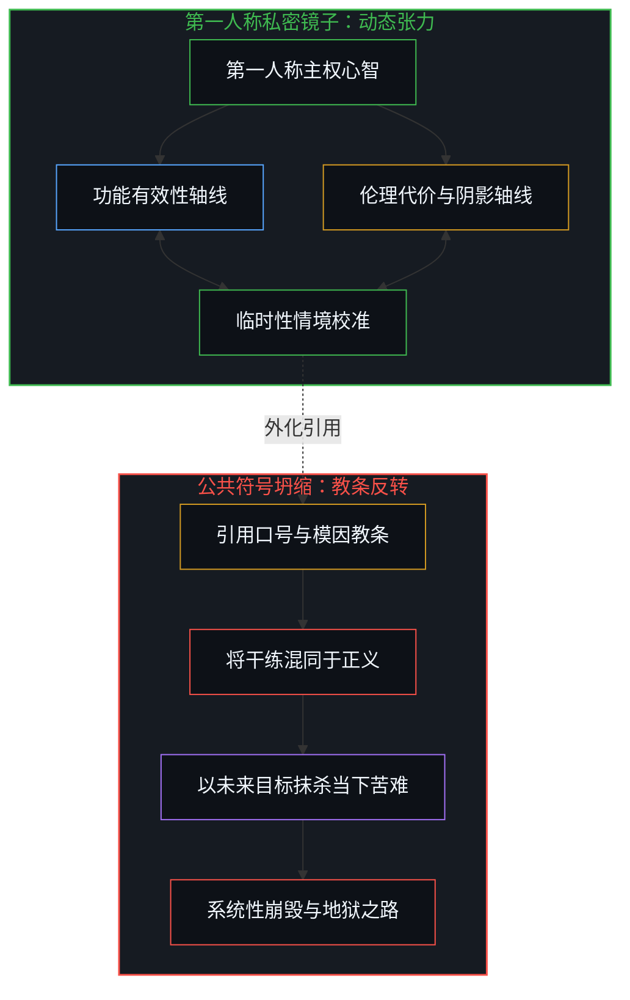
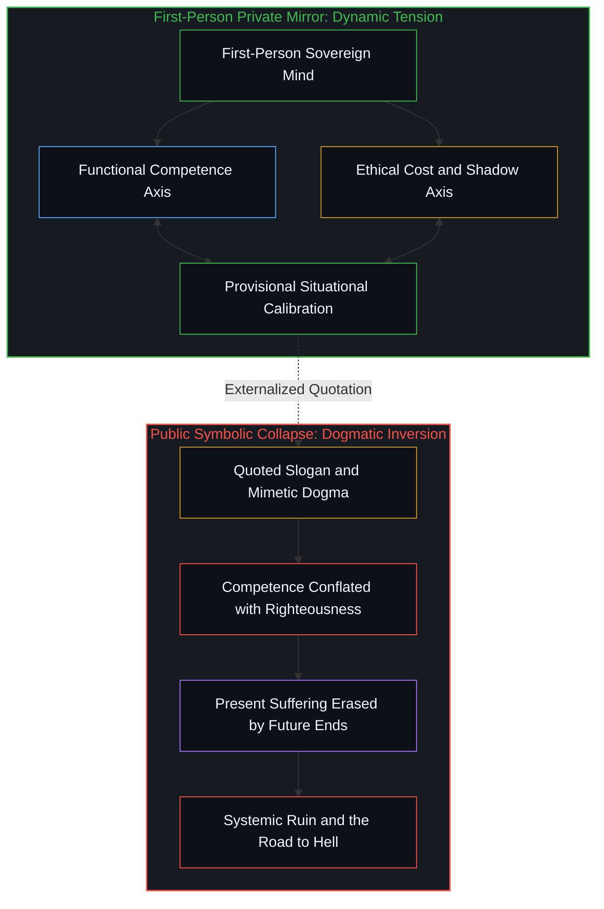
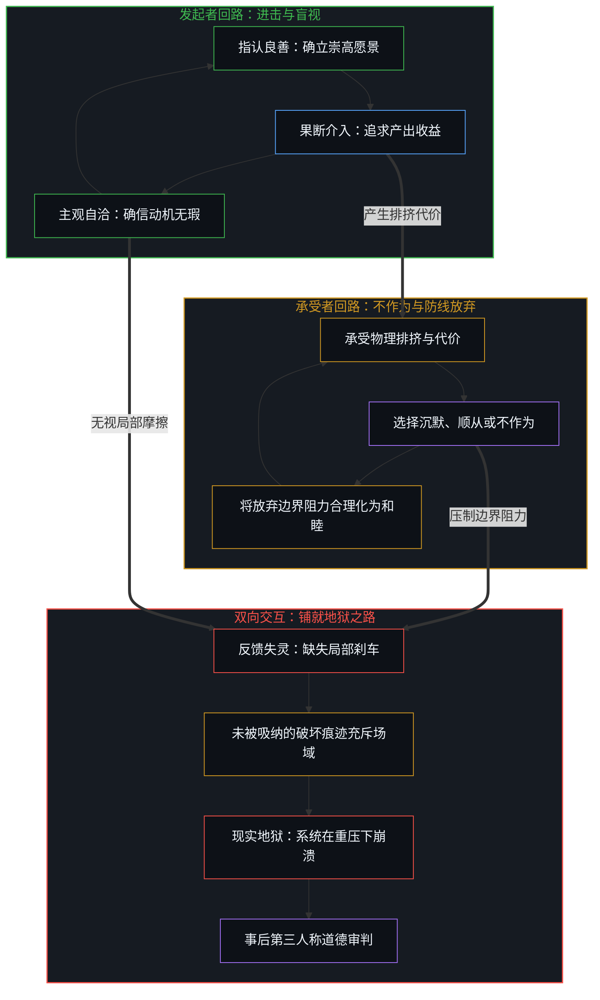
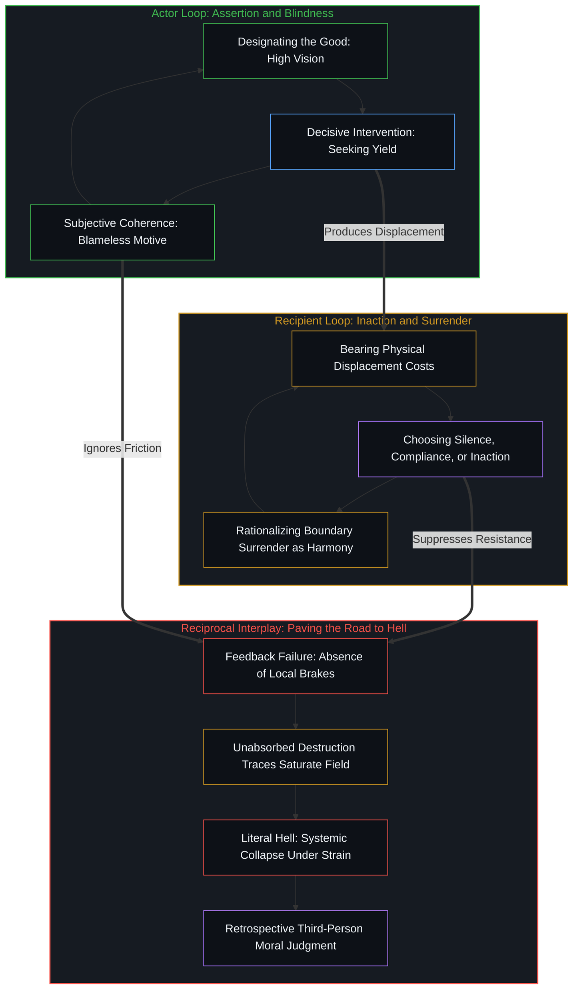

# 善恶硬币与通往地狱的善意之路 / The Coin of Good and Evil and the Road to Hell

*地狱是天堂的对拓镜像，唯在第一人称的张力中硬币才不至坍缩为教条。 / Hell is the antipodal mirror of heaven; only in first-person tension does the coin refuse to collapse into dogma.*

古老的格言断言通往地狱的道路是由善意铺就的，这并非警世的文学隐喻，而是物理因果中确凿展开的机械过程。善与恶并非宇宙中相互交战的两种独立形而上实体，而是活的心智在划定界线时同时生成的正负两极。当行动者将某种结果指认为善，便不可避免地将任何抵触或背离这一取向的事物投射为对立的阴影。由于意识中心始终围绕内部自洽性的维系而运作，没有任何活的心智会在对自身的内在体验中怀揣恶意行事；哪怕打着长远愿景的旗号接纳眼前的破坏，其内在驱动力依然深信自身的正当与干练。与此同时，直接承受这些后果冲击的一方，若在自身不可转让的第一人称视角中选择沉默、顺从或不作为，便是在出于恐惧或便利而动用自身的能动性放弃边界阻力。正是在行动者未经审视的进击与承受者予以准许的顺从这二者的交互中，未被吸纳的物理痕迹持续累积，最终将通往天堂的宏愿大道凝固为崩毁的废墟。

The ancient maxim asserting that the road to hell is paved with good intentions is not a poetic moral metaphor, but a literal mechanical process unfolding within physical causality. Good and evil are not two independent metaphysical substances warring across the cosmos; they are the positive and negative poles generated simultaneously whenever a living Mind draws a boundary. The moment an agent designates an outcome as good, it inevitably casts whatever resists or contradicts that alignment as an opposing shadow. Because conscious centers operate to preserve internal coherence, no living Mind acts from an interior experience of malice toward itself; even when embracing immediate destruction under the banner of a distant horizon, the inner drive remains convinced of its own righteousness and competence. Concurrently, when those who directly bear the brunt of these consequences choose silence, compliance, or inaction from their own non-transferable first-person vantage, they exercise their own agency to surrender boundary resistance out of fear or convenience. It is within the reciprocal interplay between the actor's unexamined advance and the recipient's granted compliance that unabsorbed physical traces compound, solidifying the visionary highway to heaven into ruin.

## 一、 善意的几何学：对拓镜像与未被察觉的阴影 / 1. The Geometry of Good Intentions: Antipodal Mirrors and the Unseen Shadow

自我区分的活动发生着，无因、不息。称之为心智：那已在途中的观察者，其每一动皆是区分。区分即划界，而道德极性正是这一边界在评价轴线上的投射：一旦行动中心将某片领地指认为善，被排斥在外的疆域便同步被勾勒为恶。正如[善恶是硬币的两面与那一刀](../good-and-evil-are-the-two-sides-of-the-coin-and-the-cut/)所阐明的，两极的分立并非对某种预先存在、等待被发现的实体所作的中立勘测，而是划界动作本身留下的运作余迹。天堂的构想与地狱的煎熬从来不是两座相互独立的国度，地狱正是勾勒天堂时必然投射出的对拓镜像。当一个心智执意要求某种理想秩序必须占统治地位时，任何抵触这一秩序、乃至仅仅是迟疑着不愿顺从的存在，都会在该行动者的坐标系中自动转化为障碍或生存威胁。

Self-distinguishing activity occurs — uncaused, unceasing. Call it the Mind: the observer already underway, every act of which is a distinction. To distinguish is to bound, and moral polarity is this boundary projected onto an evaluative axis: the moment an acting center claims a domain as good, the excluded territory is simultaneously delineated as evil. As shown in [Good and Evil Are the Two Sides of the Coin and the Cut](../good-and-evil-are-the-two-sides-of-the-coin-and-the-cut/), this polarity is not a neutral finding of pre-existing substances awaiting discovery, but the operational residue of the boundary-drawing act itself. The vision of heaven and the torment of hell are not independent realms; hell is the antipodal mirror inevitably cast whenever heaven is drawn. The moment a Mind insists that a particular idealized order must prevail, whatever resists that order, or even hesitates to comply, is automatically converted into an obstruction or an existential threat within that agent's coordinates.

这种几何对称性潜藏的危险在于一项结构性事实：没有任何心智会在内部将自己当下的抉择体验为恶。自我连贯是活中心运作的不变条件；即便行动者从事着极具毁灭性的破坏，其内在叙事也必定将其重塑为必要的牺牲、防卫的急务或为了崇高目标而不得不付出的代价。即便有人公开将自己的选择称为坏事或冷酷之举，只要这一表态出自笃定的第一人称信念，其底层算计依然包裹在该中心所登记的某种自洽之善或必然要求之中，诸如粉碎虚伪的教条、证明自身实力，或是在残酷博弈中求取长远存续。正因为作恶的直接体验在内部省察中被系统性屏蔽，只要注意力仍死锁在自身目标的正当性上，行动中的心智便对自身划界所投射出的阴影视而不见。

The insidious peril of this geometric symmetry lies in the structural fact that no Mind ever experiences its own immediate choices as evil from within. Self-coherence is an invariant condition of living centers; even when an agent engages in devastating destruction, its internal narrative unfailingly recasts the act as a necessary sacrifice, a defensive imperative, or an indispensable price paid for a higher purpose. Even when individuals openly describe their choices as bad or ruthless, if the statement reflects genuine first-person conviction, the underlying calculation remains wrapped in what that center registers as a coherent good or necessity—such as shattering hypocritical dogmas, proving strength, or securing long-term survival in an unforgiving game. Because the direct experience of being evil is systematically barred from internal introspection, so long as attention stays locked on the righteousness of its aim, the acting Mind remains blind to the shadow its boundary projects.

关键在于，这一因果回路从不是由发起行动的一方单独闭环的。若将分析严格局限于强势进击的一方，便会在无形中把承受后果的人降格为丧失主权、无力自主的惰性客体，从而掉入跨心智因果裁判的道德化陷阱。每一个意识中心的递归都锚定在自身的第一人称视角之内，因果署名在此处闭合，从不跨心智转移。当物理排挤与代价落到承受方身上时，承受方如何回应——是即刻筑起边界摩擦予以反制，还是出于图求安宁或畏惧冲突而选择沉默、顺从与不作为——始终是由其自身位置亲手写就、不可剥夺的抉择。不作为并非能动性的缺席，而是主动选择放弃边界阻力、准许发起者的尺度生效，并在内部借由承受者所固守的息事宁人或顾全大局之善来实现自我合理化。正如[一切伤害的根源](../the-source-of-all-harm/)所确立的，唯有当一个心智将私密之善冻结为普世凭据，而接收方的心智又准许这一主张作为自身下一步行动的权威准绳时，伤害才作为内部捕获最终成形，而双方各自行动的因果署名始终留在各自的心智之内。

Crucially, this causal loop is never completed by the initiating actor alone. Confining the analysis strictly to the assertive party inadvertently demotes those who bear the consequences into inert, helpless objects devoid of sovereignty, thereby falling into the moralistic trap of adjudicating cross-mind causality. Every conscious center's recursion is bounded within its own first-person perspective, where causal authorship closes and never transfers across Minds. When physical displacement and costs land upon an affected party, that party's response—whether mounting immediate boundary friction or choosing silence, compliance, and inaction out of a desire for tranquility or fear of conflict—remains an inalienable choice authored from its own position. Inaction is not an absence of agency; it is an active choice to surrender boundary resistance and grant the initiator's measure, justified from within by the recipient's own preserved good of keeping peace or enduring for the collective. As [The Source of All Harm](../the-source-of-all-harm/) establishes, harm completes as internal capture only where one Mind freezes its private good as universal warrant and the receiving Mind grants that claim as authoritative for its own next step, while authorship of both acts stays with each respective Mind.

在纸面推演上，符号形式体系无需能量耗散即可达成无摩擦的对称，但在物理因果中，每一次行动都是消耗能量、排挤物质的不可逆介入。当进击者的前冲动量与承受者的顺从不作为相互咬合时，纠偏反馈便告失灵。行动者将外溢的摩擦轻巧地撇作微不足道的附带损耗，承受者则在沉默中吞下创痛，未能将切身的躯体痛感转化为动态的边界阻力。这两个独立的第一人称中心各自围绕所偏好的善将递归折返死死锁闭，非但没有形成局部的摩擦制衡，反而在彼此的自我合理化中结成了致命的同盟。未被吸纳的痕迹在整个场域中持续累积。通往地狱的道路之所以由善意铺就，既不是出于天生的邪恶，也不是单向施害的道德剧，而是因为行动者未经审视的狂热与承受者放弃边界阻力的顺从相互强化，拆除了系统的物理刹车，直至整个秩序在累积的重压下走向崩解。

On paper, symbolic formalisms achieve frictionless symmetry without energetic dissipation, but in physical causality, every action is an irreversible intervention that consumes energy and displaces matter. When the forward momentum of the crusader interlocks with the compliant inaction of the recipient, corrective feedback breaks down. The actor dismisses displaced friction as negligible collateral damage, while the recipient swallows the injury in silence, failing to convert somatic pain into dynamic resistance. Instead of producing localized frictional balance, these two independent first-person centers—each clamping its recursive fold shut around its own preferred good—enter a fatal alignment of reciprocal rationalization. Unabsorbed traces accumulate throughout the field. The road to hell is paved with good intentions not because of innate wickedness, nor as a one-sided morality play, but because the actor's unexamined zeal and the recipient's surrendered boundary resistance mutually reinforce each other, eliminating the system's physical brakes until the entire order collapses under accumulated strain.

## 二、 蒂尔的界线：有效性与道德代价的私密镜子 / 2. Thiel's Boundary: Competence and Moral Cost as a Private Mirror

关于这一道德辩证关系，彼得·蒂尔对善的反义词所作的区分提供了一个锋利的例证。蒂尔指出，善有两个截然不同的反义词：其功能层面的反义词是差劲或低效，而其道德层面的反义词才是恶。在常规话语中，人们常因畏惧触犯社会禁忌而陷入行动瘫痪，把无能与不作为粉饰成温良的道德美德。蒂尔的分类提供了一把诊断手术刀：在极端情境下，高能动性的行动者必须辨明，一项方案的受挫究竟是因为技术上拙劣低效，还是它虽能高效奏效，却伴随着严酷的附带损害与伦理代价。

A sharp illustration of this moral dialectic emerges from the distinction Peter Thiel draws between the antonyms of good. Thiel suggests that good has two separate opposites: its functional antonym is bad or ineffective, whereas its moral antonym is evil. In conventional discourse, individuals frequently succumb to paralysis out of fear of transgressing social taboos, dressing up sheer incompetence and inaction as modest moral virtue. Thiel's taxonomy offers a diagnostic scalpel: in extreme circumstances, a high-agency operator must discern whether a plan is failing because it is technically deficient, or whether it is highly effective yet exacts severe collateral damage and ethical cost.

这一表述的生成性价值，取决于它被安放的场所。唯有当它锚定在单个心智私密的第一人称审视内部时，它才作为活的工具而运作。面对眼前的摩擦，决策者可以借它追问自己的审慎是否只是怯懦的伪装，或者权衡自己为了取得关键突破愿意承受多大尺度的冲击。在那一独处的空间里，善、差与恶的范畴保持着临时性与具身性，紧扣着具体困境的约束条件，作为活态的认知脚手架发挥作用。正如[抉择的跨界](../the-boundary-crossing-of-choice/)所确立的，主观抉择是从信息潜能跨入物理实在的不可逆跨越，在这一临界点上，唯有行动主体自己能够直接校准能动性的摩擦与由此招致的代价。

The generative value of this formulation depends upon where it is held. It operates as a living instrument only so long as it remains anchored inside the private first-person look of a single Mind. Confronted with immediate friction, a decision-maker can use it to interrogate whether caution is merely a cloak for cowardice, or to weigh what magnitude of shock they are willing to absorb to achieve a vital breakthrough. In that solitary space, the categories of good, bad, and evil remain provisional and embodied, tethered to the concrete constraints of a singular dilemma as living scaffolding. As established in [The Boundary Crossing of Choice](../the-boundary-crossing-of-choice/), subjective choice is an irreversible crossing from informational potential into physical reality, where only the acting subject can directly calibrate the friction of agency against its incurred costs.

然而，这种平衡极其脆弱。一旦这一表述被从私密的内省中抽离出来，作为公共教条广为宣扬，其动态校准的效用便烟消云散。正如[登记共鸣的表面](../the-surface-that-registers/)在追踪脱离语境的格言如何跨心智流传时所揭示的，一旦某个表述褪去了在第一人称中约束它的原初前提链条、适用边界与修正条件，继续在公共场域中流通的就只剩下一层单薄的低维表面，不同的中心各自将固守的自我形象投射其上，却并不共享底层的认知结构。在公开的舆论场中，干练与代价之间的动态张力被一刀切断。硬币被抛入人群，其中一面被攫取为统摄一切的旗帜。原本旨在克服消极瘫痪的审慎工具，退化为替残酷手段开脱的狂妄意识形态：运作上的干练被加冕为道德上的正义，而虚构的未来愿景则被搬出来折算接触面上当下的切肤之痛。

Yet this balance is delicate. The moment the formulation is extracted from private introspection and broadcast as a public doctrine, its adaptive utility evaporates. As [The Surface That Registers](../the-surface-that-registers/) traces on how detached maxims circulate across Minds, once a formulation sheds the originating chain of premises, scope conditions, and revision boundaries that constrained it in the first person, what continues to travel in public is only a thin, low-dimensional surface onto which different centers project their own preserved self-images without sharing structure. In the open arena, the dynamic tension between competence and cost is severed. The coin is hurled into the crowd, and one face is seized upon as a totalizing banner. What began as a cautious instrument to overcome passive paralysis degrades into an arrogant ideology that excuses cruelty: operational competence is crowned as moral righteousness, and hypothetical future horizons are invoked to discount present suffering at the point of contact.

## 三、 硬币的两面：不可同时观测的第一人称统一体 / 3. Both Faces of the Coin: A First-Person Unity That Cannot Be Seen Simultaneously

善与恶的不可分割性，最贴切的物理隐喻便是一枚具有正反两面的硬币。每一个改变场域的有效行动，都在照亮一隅经验的同时投下相应的阴影；每一个因审慎而瘫痪的道德冲动，也都在因果场域中占据着空间，招致无法挽回的机会成本。这两个截面并非由不同材质拼合而成，而是由同一块连续的金属锻造出的正反两面。唯有发起行动的那个单一心智，站在能够于同一个第一人称觉知中同时托住这一刀两面的位置上。

The inseparability of good and evil finds its most precise physical metaphor in a two-faced coin. Every competent action that alters the field illuminates one sector of experience while casting a corresponding shadow; every moral impulse paralyzed by caution occupies space in the causal field, incurring an unrecoverable opportunity cost. These two faces are not assembled from different substances; they are carved from one continuous piece of metal. Only the singular Mind initiating the action stands where both faces of that cut can be held within a single first-person awareness.

然而，即便对于手握这枚硬币的心智而言，也依然受制于一道严苛的感知约束：从单一视角出发，物理上不可能同时观测到硬币的两面。当视线聚焦于正面，追寻其崇高愿景、预期收益与运作胜利时，承载着实地摩擦与损耗的背面便不可避免地背离了视线；反之，当行动者翻转硬币去检视累积的残骸与未曾预料的苦难时，正面最初的光彩又会暂时退出视野。能动性唯一可用的成熟能力，是通过持续的动态警觉在正反两面之间交替审视。正如[感知者与痕迹的不可坍缩](../the-perceiver-and-the-trace/)所强调的，活的感知活动从不能外包给第三人称的器物记录。

Yet even for the Mind holding the coin, an uncompromising perceptual constraint applies: it is physically impossible to observe both faces simultaneously from a single vantage point. When visual attention fixates on the front face—tracing its noble vision, projected benefits, and operational triumph—the reverse face, bearing the friction and damage exacted on the ground, is oriented away from sight. Conversely, when the agent turns the coin to inspect the accumulated wreckage and unintended suffering, the initial brilliance of the front face momentarily withdraws from view. The only mature capacity available to agency is to alternate attention between both sides through continuous dynamic vigilance. As emphasized in [The Perceiver and the Trace Cannot Collapse](../the-perceiver-and-the-trace/), living perception can never be outsourced to third-person artifacts.

行动中心可以选择向世界展示硬币的哪一面，却无从规定其他主权中心会看到哪一面。当行动者自豪地递出精心打磨的善意纹章时，站在其动量承受端的人所感受到的，却只有背面沉重而粗糙的锯齿边缘。这种分歧并非源于恶意或背信，而是身处因果拓扑中不同坐标位置所带来的必然结果。正如[强求善意的残暴与范畴反馈的因果遮蔽](../compulsory-kindness-and-the-obscuration-of-categorical-feedback/)所追溯的，强求他人只登记行动者乐于展示的善意正面，或是以美德标签弹压他人拒绝顺从的反应，便是在接触面上用范畴性的认可取代局部的因果摩擦，将求取认同的诉求转化为结构性的僭越。

The acting center may choose which side of the coin to present to the world, but it cannot dictate which side other sovereign centers will see. While the actor proudly extends the polished emblem of its benevolent intentions, those standing at the receiving end of its momentum feel only the heavy, jagged edge of the reverse face. This divergence does not arise from malice or bad faith; it is an unavoidable consequence of occupying different coordinates in the causal topology. As [Compulsory Kindness and the Obscuration of Categorical Feedback](../compulsory-kindness-and-the-obscuration-of-categorical-feedback/) traces, demanding that others register only the benevolent face the actor prefers to show—or policing their refusal to comply with a virtuous label—substitutes categorical approval for localized causal friction at the point of contact, turning the demand for recognition into structural usurpation.

## 四、 符号化坍缩与高能动性的僭越 / 4. Reification in Public Tokens and the Overextension of High Agency

一旦私密的内省被抛入公共广场，硬币便滑出最初托住它的手掌，坍缩为物化的符号。在流通与引用的链条中，活的张力被剥离殆尽，被冻结的单面被抬升为不容置疑的教条。原本属于个人担责的临时标尺，被追随者与批评者改造成非人格化的普遍原则。辩护者挥舞它作为脱罪的借口，攻击者则将其当作道德败坏的靶标。正如[道德倒错与被脚本化的主体](../the-moral-reversal-and-the-scripted-subject/)所剖析的，当第一人称的能动性被外部符号置换时，活生生的主体便被降格为意识形态剧场里的脚本道具。

Once private introspection is cast into the public square, the coin slips from the palm that held it and collapses into a reified token. In circulation and citation, living tension is stripped away, and one frozen face is elevated into an absolute doctrine. What began as a provisional rubric for personal responsibility is transformed by disciples and detractors into an impersonal principle. Apologists brandish it as an alibi, while critics attack it as moral depravity. As analyzed in [The Moral Reversal and the Scripted Subject](../the-moral-reversal-and-the-scripted-subject/), when first-person agency is displaced by external tokens, living subjects are demoted into scripted props in an ideological theater.

这种物化暴露了高能动性行动者所面临的隐蔽陷阱。具备卓越才干的人在他人畏缩之处展现出果敢的行动魄力，敢于迎战摩擦、强行开辟新的结果。然而，正是这股驱动力极易过度延展为致命的狂妄：将技术层面的干练混同于道德层面的正义。行动者误以为，既然自己能够构建系统、扭转演化轨迹，便天然拥有为所有其他心智定义何为良善的权威。正如[外化善意走向其反面](../externalized-virtue-becomes-its-opposite/)所论证的，把私密认定的善抬升为凌驾他人的指令，会将自我认证的可靠性与把异议中心诊断为残缺障碍这两者捆绑在一起；一旦这种外化之善在无偿顺从中不断致密化并被视作理所当然，它便耗尽了自身的正当凭据，亲手酿成它原本声称要超越的毁灭。

This reification exposes the subtle trap confronting high-agency actors. Those possessing exceptional competence display an admirable readiness to act where others cower, confronting friction to force novel outcomes. Yet this same drive tends to overextend into a fatal hubris: confusing technical competence with moral righteousness. The actor assumes that because they can engineer systems and bend trajectory lines, they possess the authority to define goodness for all other Minds. As [Externalized Virtue Becomes Its Opposite](../externalized-virtue-becomes-its-opposite/) demonstrates, elevating a private conviction of the good into a mandate to override others pairs self-certified reliability with the diagnosis that dissenting centers are deficient obstacles; once densified by free compliance and taken for granted, the externalized good expires its own warrant and inflicts the very destruction it claimed to transcend.

这种过度延展建立在一个虚妄的前提之上，即认定未来的预期产出可以抵消当下伤害的物理痕迹。顺着不可逆的因果之箭，每一分痛苦、排挤与榨取都是不可磨灭的历史刻写，没有任何遥远的乌托邦能够回溯性地抹去为抵达它而造成的破碎。当行动者要求他人承受眼前的破坏来为想象中的未来天国充当燃料，而承受者又消极顺从时，活的中心便在合谋中将彼此降格为可消耗的物料。正如[没有外部记账员](../no-outside-scorekeeper/)所揭示的，并不存在外部的宇宙记账员来兜底此类逃避；拒绝承接眼前的摩擦必然扭曲内部的世界模型，引发复利式的系统坍塌螺旋。那枚曾作为私密良知之镜的硬币就此遗落，取而代之的是在推进中碾碎沿途大地的意识形态巨轮。事后的第三人称观察者继而把道德化的标签贴在残骸之上，遮蔽了酿成这场灾祸的双向因果咬合。

This overextension rests on the false premise that prospective future outcomes can cancel the physical traces of immediate harm. Along the irreversible arrow of causality, every unit of suffering, displacement, and extraction is an indelible historical inscription; no distant utopia can retrospectively erase what was broken to reach it. When an agent demands that others bear immediate destruction to fuel an imagined future paradise, and those others passively acquiesce, living centers collaboratively reduce themselves to expendable material. As revealed in [No Outside Scorekeeper](../no-outside-scorekeeper/), no external cosmic scorekeeper exists to absorb such evasions; refusing immediate friction inevitably warps the internal world model, triggering a compounding downward spiral of systemic collapse. The coin that once functioned as a private mirror of conscience is lost, replaced by an ideological juggernaut crushing the landscape beneath its advance. Retrospective third-person observers then slap moralizing labels onto the wreckage, obscuring the two-sided causal interplay that produced the disaster.

## 五、 无法转让的原点：在第一人称中承担自己的阴影 / 5. The Non-Transferable Ground: Bearing One's Own Shadow in the First Person

善与恶之间的张力，无法在外部法庭或抽象的伦理图式中达成调和。任何打着从地面上根除邪恶的旗号出征的十字军，都只是划出了更宽广的排斥边界，将善意化作浇向灾难烈火的新鲜燃料。唯一能够以非暴力方式同时托住这两面的场所，只有个体心智不可化约的第一人称视角。

The tension between good and evil cannot be reconciled in an external tribunal or an abstract ethical schema. Every crusade that marches to eradicate evil from the face of the earth merely draws a wider boundary of exclusion, pouring good intentions as fresh fuel onto catastrophic fires. The sole arena capable of holding both sides without violence is the irreducible first-person vantage of the individual Mind.

正如[你的代码库即是记忆](../your-codebase-is-memory/)将每一座成文代码库定位为过往决策的外化痕迹、仍需处于掌舵前沿的活心智在当下摩擦中重新渲染一样，公共格言与伦理记分牌也只是早先切分所留存的痕迹；而如[道德语言稀释自由复利的反馈](../moral-language-dilutes-the-feedback-that-scales-freedom/)所示，把那些冻结的公式当作当下活判断的替代品，便会切断行动者与一手因果反馈之间的连接。回到第一人称视角，不仅要求发起者承认自己对善的追求不可避免地投射出相应的阴影，同样也要求承受代价的一方放弃对外部拯救者的消极幻想，重夺自身的边界防线。人无法跨出第一人称视角，因为这一视角正是因果署名唯一得以登记的场所。成熟的能动性不会耗费气力向公众舆论索取道德认证，也不会打着息事宁人的体面幌子放弃自身的边界。它稳稳凝视着躺在自己掌心的那枚硬币，既不被正面的意图光环晃花双眼，也不在背面镌刻的代价面前退缩。

Just as [Your Codebase Is Memory](../your-codebase-is-memory/) locates every written repository as an externalized trace of prior decisions that still requires a living Mind at the steering edge to re-render under present friction, public maxims and ethical scoreboards are stored traces of earlier cuts—and as [Moral Language Dilutes the Feedback That Scales Freedom](../moral-language-dilutes-the-feedback-that-scales-freedom/) shows, treating those frozen formulas as a substitute for live judgment severs the agent from raw causal feedback. Returning to the first-person vantage not only demands that the initiator acknowledge the inevitable shadow cast by its pursuit of the good, but equally demands that those who bear the costs cease harboring passive hopes for an external savior and reclaim their own boundary defense. One cannot step out of the first-person perspective, because that vantage is the sole site where causal authorship registers. Mature agency does not waste its strength demanding moral validation from public opinion, nor does it surrender its boundaries under the polite guise of keeping the peace. It gazes steadily at the coin resting in its own palm, neither blinded by the brilliance of its intentions nor shrinking from the costs carved into its reverse side.

在实践中，这要求对物理摩擦保持持久的敬畏。每当卓越的干练斩获决定性胜利时，行动者都清醒地记得，这一结果并非宇宙赐予的加冕，而是付出能量代价的不可逆扰动。承担自己的阴影，意味着主动认领那些外溢效应，在自身的容量之内吸纳摩擦，而非将其转嫁给旁观者或把账单推给虚构的明天。与此同时，由于因果署名从不离开付诸行动的心智，抵御外部侵蚀、守住自身边界，始终是每一个主权中心不可转让的责任。唯有当发起者不再抛出硬币去凌驾他人，承受者也不再打着消极善意的旗号放弃边界阻力，那条由未经审视的狂热与沉默顺从共同铺就的地狱之路，才会失去继续向前延展的双向动量。

In practice, this requires enduring reverence for physical friction. Whenever remarkable competence yields a decisive victory, the agent remembers that this outcome is not a cosmic coronation, but an irreversible perturbation exacting energetic costs. Bearing one's own shadow means taking ownership of those externalities, absorbing the friction within one's own capacity rather than outsourcing it to bystanders or passing the bill to an imaginary tomorrow. Simultaneously, because causal authorship never leaves the Mind that acts, holding one's boundary against external erosion remains the non-transferable responsibility of every sovereign center. Only when initiators cease hurling the coin to override others, and recipients cease surrendering boundary resistance under the banner of passive goodwill, will the road to hell—paved by unexamined zeal and quiet compliance alike—lose the two-sided momentum that extends it.
