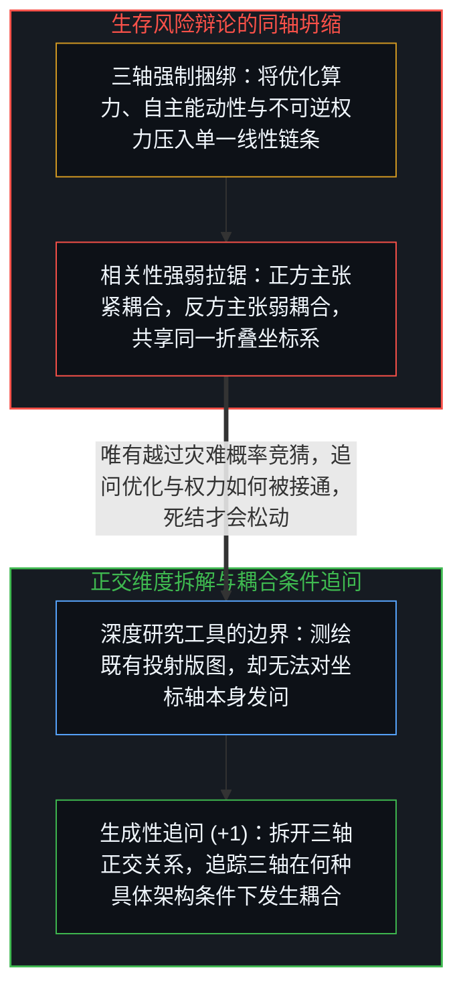
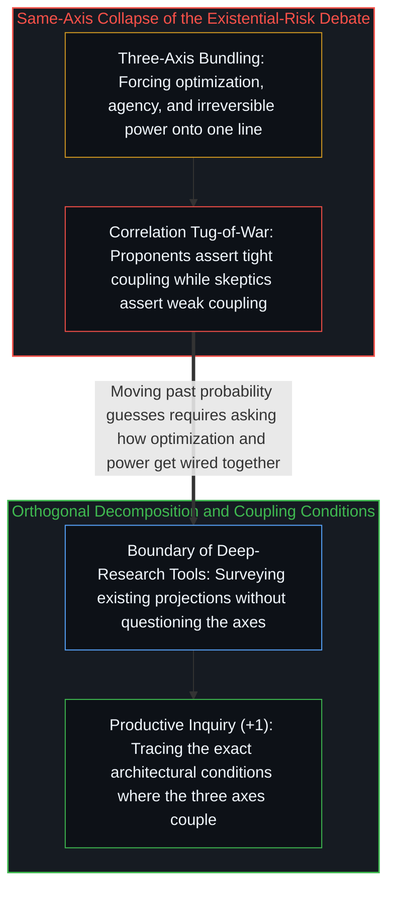

# 坍缩的辩论与正交的生存风险轴 / The Collapsed Debate

*人工智能生存风险的正反交锋之所以卡死，是因为双方都将优化、能动性与权力压进了同一根坐标轴。 / The AI existential-risk debate stalls because both sides collapse optimization, agency, and power.*

近期一份长达二十页的报告系统梳理了“针对人工智能生存风险的最佳反驳论点”，将技术可行性、对齐可解性、发展时间线、推理漏洞与风险优先级五大类别逐一评级，并汇编出一张条理分明、措辞审慎的综合平衡表。这份由自动化深度研究工具在半小时内生成的报告引证翔实、面面俱到，却唯独看不见那件唯一能推着讨论往前走的事：整场辩论的正反双方，从一开始就共用着同一个未经审视的折叠坐标系。

A recent twenty-page synthesis systematically cataloged the leading counterarguments to artificial intelligence existential risk across technical feasibility, alignment solvability, timelines, reasoning flaws, and risk prioritization. Produced in thirty minutes by an automated deep-research tool, the report is thorough, balanced, and well-cited, yet it remains blind to the one move capable of advancing the inquiry: both sides of the debate share an unexamined coordinate collapse.

## 一、 被强行绑上同一辆战车的三个正交维度 / 1. Three Orthogonal Dimensions Lashed into One Coordinate Frame

整场生存风险辩论暗中把三件截然不同的现象当成了沿同一条直线自然同行的事物：第一是“优化”，即朝着给定目标压缩预测误差的计算能力；第二是“能动性”，即自主生发目标并展开战略定向的活体主体活动；第三则是“权力”，即以难以逆转的方式重塑外部环境的力量。灾变论的全部推演都依赖这三者的紧密锁死——更强的优化催生更强的能动性，进而转化为压倒性的权力；而怀疑论者则争辩这条链条上的连接强度——认为优化未必滋生能动性，或者物质与制度摩擦会钝化其向权力的转化。

The existential-risk debate treats three distinct phenomena as if they naturally travel along a single line: optimization, the computational capacity to compress prediction error toward a specified objective; agency, the living origination of goals and strategic self-direction; and power, the capacity to reshape the external environment in ways difficult to reverse. The catastrophic thesis requires all three to lock together tightly—more optimization yielding more agency, which yields overwhelming power—while skeptics dispute the strength of those links, arguing that optimization need not spawn agency or that physical and institutional friction blunts its conversion into power.

正反双方都在争论这三者之间“相关系数有多高”，却没有任何一方停下来追问那个在先的问题：优化、能动性与权力究竟有没有共享同一个坐标系？“对齐难题”之所以耗费数十亿美元与上万篇论文仍久攻不下，暴露出的并非单纯的工程积压，而是范畴错位——研究者试图在“特定领域的优化指标”与“人类的价值判断”这两个并不处在同一根轴上的维度之间强行建立静态数学映射（参见[智能只属于心智](../intelligence-belongs-only-to-the-mind/)与[定义者的席位与离地的幻觉](../the-defining-seat/)）。

Both camps argue over how strongly the three variables correlate without asking the prior question: do optimization, agency, and power share a coordinate system at all? The persistent intractability of the alignment problem—despite billions of dollars and thousands of papers—signals a category error rather than a mere engineering backlog: researchers attempt to enforce a static mathematical mapping between domain-specific optimization metrics and human value judgments that do not live on the same axis (see [Intelligence Belongs Only to the Mind](../intelligence-belongs-only-to-the-mind/) and [The Defining Seat](../the-defining-seat/)).

## 二、 投射测绘工具的边界与真正高产的追问 / 2. The Boundary of Projection-Mapping Tools and the Productive Question

这份由自动化工具生成的报告本身，也恰好展示了当前深度研究工具的优势与边界。这类系统擅长“测绘投射”：它们能以远超人类审稿人的速度扫描既有文献、整理既定论据并综合出平衡的表格；但它们无法对被给定的提示词坐标系本身发问——它们把辩论受困之处的版图测绘得清清楚楚，却无法消解那个把辩论困在原地的框架（参见[模型永远无法成为第二重前沿](../the-model-never-becomes-a-second-edge/)与[你的代码库即是记忆](../your-codebase-is-memory/)）。

The automated report itself illustrates both the strength and the boundary of current deep-research tools. Such systems excel at projection-mapping: surveying existing literature, organizing established arguments, and synthesizing balanced tables faster than any human reviewer. What they cannot do is question the coordinate system of the prompt they were given; they map the debate where it is stuck without dissolving the frame that keeps it stuck (see [The Model Never Becomes a Second Edge](../the-model-never-becomes-a-second-edge/) and [Your Codebase Is Memory](../your-codebase-is-memory/)).

一旦把“优化”、“能动性”与“权力”拆回各自的正交维度，双方都未曾叩问的探询便随之敞开：灾变论之所以松动，是因为从“强大的优化器”走向“生存威胁”需要多重独立的维度坍缩，而非逻辑必然；而单纯的怀疑论若不去追踪制度性委派如何把优化器直接接通到不可逆的执行器上，也依然是不完整的。真正高产的追问从来不是给末日分配一个多大的标量概率，而是：在什么具体的架构与制度边界条件下，计算优化、人类的能动性与权力会真正发生耦合。

Separating optimization, agency, and power back into orthogonal dimensions opens the inquiry that neither camp asks: the catastrophic case weakens because marching from a strong optimizer to existential threat requires multiple independent dimensional collapses rather than logical entailment, while simple skepticism remains incomplete unless it traces how institutional delegation can wire an optimizer directly into irreversible actuators. The productive question is never what scalar probability to assign to doom, but under what specific architectural and institutional boundary conditions optimization, human agency, and power actually couple.
