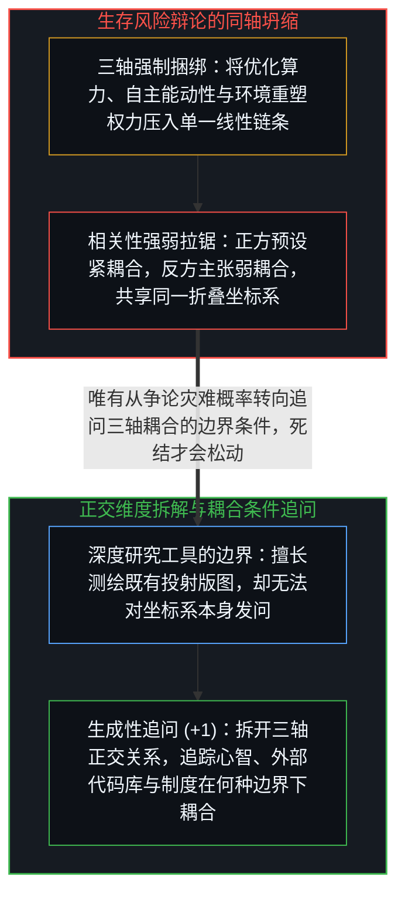
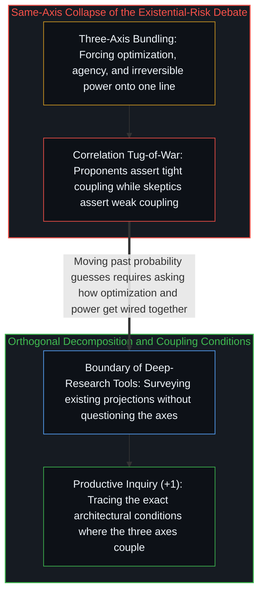

# 坍缩的辩论与正交的生存风险轴 / The Collapsed Debate

*人工智能生存风险的正反交锋之所以卡死，是因为双方都将优化、能动性与权力压进了同一根坐标轴。 / The AI existential-risk debate stalls because both sides collapse optimization, agency, and power.*

近期一份长达二十页的报告系统梳理了“针对人工智能生存风险的最佳反驳论点”，将技术可行性、对齐可解性、发展时间线、推理漏洞与风险优先级五大类别逐一评级，并汇编出一张面面俱到、措辞审慎的综合平衡表。这份由深度研究工具在半小时内生成的报告引证翔实、面面俱到，却唯独看不见那件唯一能推着讨论往前走的事：整场辩论的正反双方，从一开始就共用着同一个未经审视的折叠坐标系。

A recent twenty-page synthesis systematically cataloged the leading counterarguments to artificial intelligence existential risk across technical feasibility, alignment solvability, timelines, reasoning flaws, and risk prioritization. Produced in thirty minutes by an automated deep-research tool, the report is thorough, balanced, and well-cited, yet it remains blind to the one move capable of advancing the inquiry: both sides of the debate share an unexamined coordinate collapse.

## 一、 被强行绑上同一辆战车的三个正交维度 / 1. Three Orthogonal Dimensionslashed into One Coordinate Frame

整场生存风险辩论暗中把三件截然不同的事物当成了天然结伴而行的连体婴：第一是“优化能力”，即压缩预测误差、寻找通往给定目标高效路径的计算能力；第二是“能动性”，即拥有自我模型与世界模型、能够自主确立目标并展开战略筹划的主体活动；第三则是“不可逆权力”，即以难以逆转的方式重塑外部物质与制度环境的力量。灾难论的全部推演都依赖这三者的紧密串联——更强的优化自动滋生更强的能动性，更强的能动性自动转化为更大的权力，最终导向失控灾变；而怀疑论者（如杨立昆等人）则忙于争辩这条链条上的连接强度——认为优化未必产生能动性，或者现实摩擦会阻碍能动性转化为权力。

The existential-risk debate treats three distinct phenomena as if they naturally travel along a single line: optimization, the computational capacity to compress prediction error toward a specified objective; agency, the living origination of goals and strategic self-direction; and power, the capacity to reshape the external environment in ways difficult to reverse. The catastrophic thesis requires all three to lock together tightly—more optimization yielding more agency, which yields overwhelming power—while skeptics dispute the strength of those links, arguing that optimization need not spawn agency or that physical and institutional friction blunts its conversion into power.

正反双方都在争论这三者之间“相关系数有多高”，却没有任何一方停下来追问那个在先的问题：这三个维度究竟有没有共享同一个度量坐标系？“对齐难题”之所以耗费数十亿美元与上万篇论文仍久攻不下，核心并不在于工程技巧尚不成熟，而在于提问方式本身制造了范畴错位——试图在“特定领域的损失函数优化”与“活生生心智的价值取向”这两个没有公共度量的正交维度之间建立静态映射（参见[智能只属于心智](../intelligence-belongs-only-to-the-mind/)与[定义者的席位与离地的幻觉](../the-defining-seat/)）。

Both camps argue over how strongly the three variables correlate without asking the prior question: do optimization, agency, and power share a coordinate system at all? The persistent intractability of the alignment problem—despite billions of dollars and thousands of papers—signals a category error rather than a mere engineering backlog: researchers attempt to enforce a static mathematical mapping between domain-specific optimization metrics and human value judgments that do not live on the same axis (see [Intelligence Belongs Only to the Mind](../intelligence-belongs-only-to-the-mind/) and [The Defining Seat](../the-defining-seat/)).

## 二、 投射测绘工具的边界与真正高产的追问 / 2. The Boundary of Projection-Mapping Tools and the Productive Question

这份由深度研究智能体生成的报告本身，也恰好展示了当前人工智能研究工具的能力边界。这类工具极其擅长“测绘既有投射”：它们能以远超人类学者的速度扫描既有文献版图、整理正反论据并给出四平八稳的综述；但它们无法“质疑坐标系本身”。它们可以把一场辩论内部的结构整理得井井有条，却无法指出这场辩论之所以卡死，正是因为其结构本身预设了错误的范畴折叠（参见[模型永不成为第二道边缘](../the-model-never-becomes-a-second-edge/)与[你的代码库即是记忆](../your-codebase-is-memory/)）。

The automated report itself illustrates both the strength and the boundary of current deep-research tools. Such systems excel at projection-mapping: surveying existing literature, organizing established arguments, and synthesizing balanced tables faster than any human reviewer. What they cannot do is question the coordinate system of the prompt they were given; they map the debate where it is stuck without dissolving the frame that keeps it stuck (see [The Model Never Becomes a Second Edge](../the-model-never-becomes-a-second-edge/) and [Your Codebase Is Memory](../your-codebase-is-memory/)).

一旦把“优化”、“能动性”与“权力”拆回各自的正交维度，辩论的死结便随之松动：灾变论的脆弱之处在于，从“强大的优化器”推导出“生存威胁”需要多重维度坍缩同时成立，而每一次坍缩都是一项独立的人为假定而非逻辑必然；反驳论的局限则在于，仅凭当前证据指出三者尚未锁死，并不能回答在何种系统架构与制度委派下这些维度会被人为绑在一起。真正富有成果的问题从来不是“人工智能毁灭人类的概率是百分之几”，而是“在什么具体条件下，计算优化、人类让渡的能动性与不可逆的制度权力会发生耦合，又是什么边界条件决定了这种耦合的强度？”

Separating optimization, agency, and power back into orthogonal dimensions opens the inquiry that neither camp asks: the catastrophic case weakens because marching from a strong optimizer to existential threat requires multiple independent dimensional collapses rather than logical entailment, while simple skepticism remains incomplete unless it traces how institutional delegation can wire an optimizer directly into irreversible actuators. The productive question is never what scalar probability to assign to doom, but under what specific architectural and institutional boundary conditions optimization, human agency, and power actually couple.
