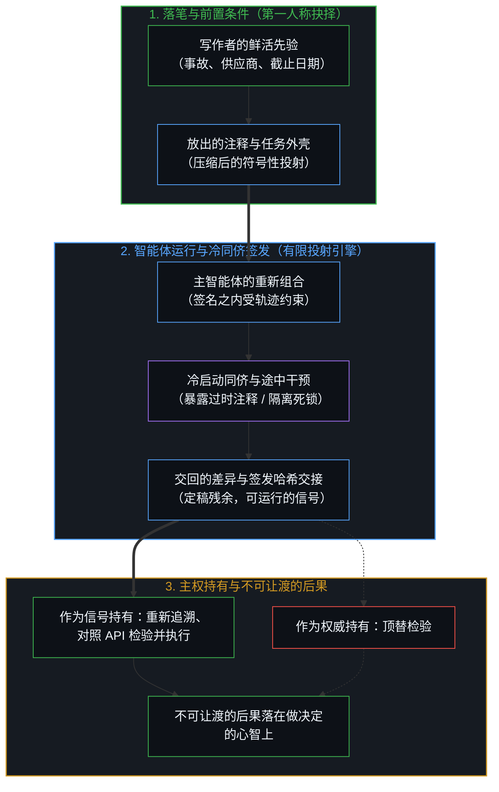
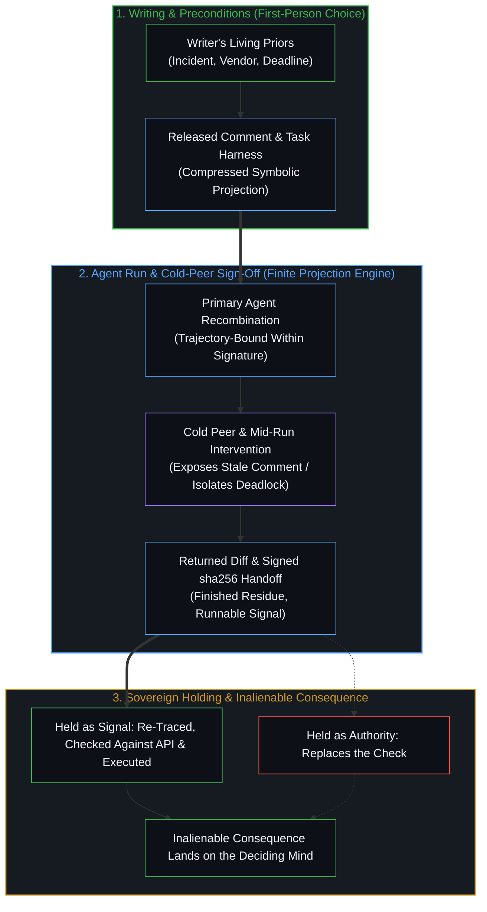

# 注释不是代码 / The Comment Is Not the Code

*注释或智能体交回的差异，是给做决定的心智的信号，从不是检验本身 / A comment or an agent's diff is signal to the deciding Mind, never the check*

注释是写作者落笔那一刻的鲜活语境，被压缩成一句话放了出去。每一个读者，包括回头重读的写作者自己，都在各自的先验下从这句话里重建出一个意图。拿到这句话的智能体作为一条因果链运行，这条链由人的抉择开启、在途中一再介入、最后收尾，交回的差异是一个提议，取用与否由做决定的心智定夺。

A comment is the writer's living context at the moment of writing, compressed into a sentence and released. Every reader, the writer rereading included, rebuilds an intent from it under their own priors. An agent given it runs as a causal chain that human choice starts, punctuates, and ends, and returns a diff that is a proposal for the deciding Mind to take up or not.

## 一、 写注释是写作者先验之下的抉择 / 1. Writing a Comment Is a Choice Under the Writer's Priors

开发者写下一个函数和它的注释，是同时做了两个抉择，每一个都受那一刻所持有的一切制约：对上游 API 知道多少，刚刚和哪个 bug 缠斗过，哪些部分显得理所当然、哪些显得脆弱，想象中下一个读者是谁。那句话就是从这些里生出来的：*“这里要重试，因为上游 API 冷启动后会丢掉第一个请求。”* 在写作者那里，注释与代码登记下来是一致的，因为两者出自同一组先验。从写作者所站的位置，落差登记不出来，因为每看一眼，写作者都在用记忆补上没写下的语境。

A developer writing a function and its comment makes two choices at once, each conditioned by everything held at that moment: what is known about the upstream API, which bug was just fought, which parts feel obvious and which feel fragile, who is imagined reading next. From that, the sentence comes out: *"retry here because the upstream API drops the first request after a cold start."* To the writer, comment and code register as aligned, because both issue from the same priors. From where the writer stands the gap does not register, because the writer supplies the unwritten context from memory at every glance.

赋予这句话意义的东西留在了文本之外：那次冷启动事故，供应商没写进文档的行为，重试只是临时措施的假定。这些是先验，不是字句。注释是那份鲜活语境被压缩、放出的结果，是指向一个意图的符号性指称。正如[你的代码库即是记忆](../your-codebase-is-memory/)所追踪的，代码仓库是一座由已提交代码与随附文字构成的外化晶格，其中存下的每一行都等待着活的心智重新进入：一旦放入这座晶格，注释便不再替写作者承载任何东西，任何展开都是读者完成的重建。期待放出去的文本还能保住写作者的理解，正是[信任读者是最后的越界](../trusting-the-reader-is-the-last-overstep/)所追踪的那种越界。写作者一旦登记到这句话将在自己不具备的先验下被重建，就会把原本靠记忆补上的东西多写出来一些；可离手的，仍是一份压缩。

What gave the sentence its meaning stays outside the text: the cold-start incident, the vendor's undocumented behavior, the assumption that the retry is temporary. Those were priors, not words. The comment is that living context compressed and released, a symbolic reference to an intent. As [Your Codebase Is Memory](../your-codebase-is-memory/) traces, a repository is an externalized lattice of committed code and accompanying prose where every stored line awaits re-entry by an active Mind: once released into that lattice, the comment carries nothing further on the writer's behalf, and any unpacking is a rebuild performed by a reader. Expecting the released text to keep its understanding is the overstep [Trusting the Reader Is the Last Overstep](../trusting-the-reader-is-the-last-overstep/) traces. A writer who registers that the sentence will be rebuilt under priors the writer lacks writes out more of what memory would otherwise supply, and what leaves the hand is still a compression.

这就是注释与代码之间的不对称。运行代码时，读者登记到它的行为，用不着重建写作者的意图。注释则不然：读者不从中重建出一个意图，它就什么也给不出，而这个重建是在读者自己的先验下完成的。

That is the asymmetry between comment and code. Running the code, the reader registers its behavior without rebuilding the writer's intent. The comment yields nothing until a reader rebuilds an intent from it, under that reader's own priors.

## 二、 每一次阅读与重读都在各自的先验下重建意图 / 2. Each Reading and Rereading Rebuilds the Intent Under Its Own Priors

一个月后，第二位开发者打开这个文件。那个 bug 这位开发者没有亲手缠斗过：要么从没听说过什么冷启动模式，要么上周刚看着它被修好。从同一句话里，重建出的是另一个意图：一条永久的要求，一个过时的补丁，或者一句无从核对的断言。字句没变，读者变了。

A second developer opens the file a month later. They did not fight that bug. Either they have never heard of a cold-start mode, or they watched it get fixed last week. From the same sentence they rebuild a different intent: a permanent requirement, a stale hack, or a claim with nothing to check it against. The words are unchanged. The reader is different.

六个月后重读的写作者也只是又一个这样的读者：那次事故、那个供应商、那个截止日期都已变淡或被替换，这句话读来，把握不如预想。每个读者只能从自己所站的位置登记这道落差，表现为一句话展开得顺畅、展开一半，或者展开不了；每个读者自己的登记是衡量它的唯一尺度，把同一把尺子横放在多个心智之上，正是[距离的幻觉与尺度的双向投影](../the-illusion-of-distance-and-the-dual-ruler/)所追踪的越界。

The writer rereading six months later is one more such reader: the incident, the vendor, the deadline have thinned or been replaced, and the sentence registers with less certainty than expected. Each reader registers the gap only from where that reader stands, as a sentence that unpacks easily, partly, or not at all; each reader's own registering is the only measure of it, and laying one ruler across Minds is the overstep [The Illusion of Distance and the Dual Projections of the Ruler](../the-illusion-of-distance-and-the-dual-ruler/) traces.

没有哪一次阅读能找回那次书写。每一次阅读，每一次改了代码却没动注释的编辑，这句话周围人员的每一次变动，都带来这句话从未遇见过的先验。当一致被视为理所当然，这句话被当成仿佛也会执行的东西来持有，仿佛挨着代码，就分得了代码的地位，落差才开始有代价。

No reading recovers the writing. Each reading, each edit to the code that leaves the comment untouched, each change in the people around it brings priors the sentence never met. The gap starts to cost something when the alignment is taken for granted and the sentence is held as if it executed, as if sitting beside the code lent it the code's standing.

## 三、 智能体交回的差异是提议，不是决定 / 3. The Agent's Diff Is a Proposal, Not a Decision

被要求清理这个函数的 AI 编码智能体，遇到的是同一句话。一个智能体保留重试，另一个删掉它，第三个发问。分歧一路追溯到前置条件：注释与其描述的代码并排出现的训练语料，奖励依赖邻近文字的指令微调，一段系统提示，一个剥掉注释或原样传递注释的运行外壳。输出就是这些前置条件的重新组合。采样器里的“随机”，不是本体论意义上的非决定论：它是按确定的程序编出来的随机，一个设了种子的生成器，或者某人选定的一个温度，整条都追溯得到它的前置条件。日常争论任由这两种含义混在一起；两者同名，却不是同一个词。无论采样走贪心还是种子随机，智能体都在由人的抉择所设定的签名之内重新组合；一个出人意料的样本，是签名已有内容里一个尚未用过的组合，也就是[模型永远无法成为第二重前沿](../the-model-never-becomes-a-second-edge/)所命名的残余。智能体始终处在前置条件之中。人也处在前置条件之中，却仍然可以自由抉择，因为切分由心智在观察发生之处做出，而机器作为更早切分的下游后果，并不做出这一切分。人扩大智能体运行其中的签名，注入下一次运行所继承的[自由变量](../the-residue-and-the-free-variable/)，而智能体只在签名之内重新组合。

An AI coding agent asked to clean up the function meets the same sentence. One agent keeps the retry, another removes it, a third asks. The divergence traces to preconditions: a training corpus in which comments sat beside the code they described, instruction tuning that rewarded leaning on nearby prose, a system prompt, a harness that strips comments or passes them through. The output is those preconditions, recombined. "Stochastic" in a sampler is not indeterminism in the ontological sense: it is randomness programmed deterministically, a seeded generator or a temperature someone chose, traceable in full to its preconditions. Everyday dispute lets the two meanings slide together; they are not the same word. Whether its sampling runs greedy or seeded-random, the agent recombines within a signature set by human choices; a surprising sample is an unused combination of what the signature already holds, the residue [The Model Never Becomes a Second Edge](../the-model-never-becomes-a-second-edge/) names. The agent is always preconditioned. The human is preconditioned and still free to choose, because the cut is made where observation happens, in the Mind, and the machine, a downstream consequence of earlier cuts, does not make it. The human enlarges the signature the agent runs within, injecting the [free variable](../the-residue-and-the-free-variable/) the next run inherits, while the agent only recombines within it.

对人类读者来说，追溯止于抉择的前置条件。对 API 的了解，在这个仓库里的经历，时间压力，上一次事故：这些都影响接下来发生什么，却没有一样做出抉择。不妨设想两个各项条件都相同的时刻：它们的相同，只是比较它们的心智所登记到的相同；在任一时刻，读者要么信任注释，要么删掉它，要么去查 API，那些条件没有一样替读者做决定。抉择在抉择的那一刻、在处理这个文件的心智之中做出，它是[唯一的独立变量](../individual-choices-as-the-only-causal-levers/)。

For the human reader, the trace stops at the preconditions of the choice. Knowledge of the API, history with this repository, time pressure, the last incident: all of it bears on what happens next, and none of it makes the choice. Two moments alike in every condition, borrowed for the point, are alike only as the Mind comparing them registers them, and in either moment the reader trusts the comment, deletes it, or checks the API, with the conditions picking none of these. The choice is made at the moment of choosing, in the Mind working on the file, as the [only independent variable](../individual-choices-as-the-only-causal-levers/).

人的抉择在智能体因果链的起点进入，经由数据、提示和运行外壳；又在运行途中的每一次干预处进入：批准或拒绝一次工具调用，打断，用一句关于供应商修复的话去引导，把变更日志加进上下文，从三个建议补丁里取用一个。途中的每一次微调都注入了一项起初未曾列明的前提，重设了下游的签名；正如[判断的密度](../the-density-of-judgment/)所审视的，在一轮运行完成后逆向追溯这些注入的前提，并将其编入起点的运行外壳，便能在下一轮运行中把中间环节自动化，而不撤去人的定框。正如[超越投射](../beyond-the-projection/)所追踪的，智能体是一部受限于词元轨迹且毫无我执的有限投射引擎；将主编码智能体与只持有任务语境的冷启动同侪配对，便会暴露出主运行过程在哪里盲目依赖了过时的注释，并将文字说明与可执行契约之间的矛盾隔离为局部死锁。[按需语境将融贯保持在一步](../on-demand-contexts-keep-coherence-at-one-step/)将这一切分扩展至多步流水线：即便冷审校者签发了定稿制品，并在双方工作语境丢弃之前记录其 `sha256` 哈希值以供加密交接，这份经签发的制品与哈希值也依然只是供下一步重新追溯的可读残余，从不是自行授权的检验。任何同侪回路、校验层或加密签发，都无法把有限投射变成那个掌舵的鲜活心智。到了终点，删掉重试的那处编辑停在差异里，直到有人接受它、拒绝它、搁置它，或者重新提示，只有经由这个抉择，它才产生后果。正如[任务的移交与后果的不可让渡](../the-delegation-of-the-task-and-the-inalienability-of-consequences/)所指出的，无论有多少任务被移交出去，合并的后果始终留在取用它的心智那里。

Human choice enters the agent's chain at its start, through the data, the prompt, and the harness, and again at each intervention along the run: approving or declining a tool call, interrupting, steering with a sentence about the vendor's fix, adding the changelog to the context, taking up one of three suggested patches. Each mid-run tweak injects an initially unspecified premise that resets the downstream signature, and as [The Density of Judgment](../the-density-of-judgment/) examines, tracing those injected premises backward after a completed pass and codifying them into the starting harness automates the middle stretch on the next run without removing the human frame. As [Beyond the Projection](../beyond-the-projection/) traces, an agent is a finite projection engine bound by its token trajectory and devoid of ego; pairing a primary coding agent with a cold peer holding only the task context exposes where the primary run leaned blindly on a stale comment, and isolates any contradiction between the prose note and the executable contract into a localized deadlock. [On-Demand Contexts Keep Coherence at One Step](../on-demand-contexts-keep-coherence-at-one-step/) scales that cut across a multi-step pipeline: even when a cold critic signs off on a finished artifact and records its `sha256` for cryptographic handoff before both working contexts drop, the signed artifact and hash remain legible residue for the next step to re-trace, never a self-authorizing check. No peer loop, verification layer, or cryptographic sign-off can turn a finite projection into the living Mind that steers. At the end, the edit that removes the retry sits in a diff until a human accepts it, rejects it, ignores it, or reprompts, and only through that choice does it become consequential. The consequence of the merge stays with the Mind that took it up, however much of the task was handed off, as [The Delegation of the Task and the Inalienability of Consequences](../the-delegation-of-the-task-and-the-inalienability-of-consequences/) holds.

差异和注释在一点上相同，在另一点上不同。在被取用之前，差异和注释一样，是交给做决定的心智的又一道痕迹；它供人重建的，是签名之内的一个重新组合。和注释不同的是，差异就是代码：它可以运行，而运行它就是检验的一部分。由于智能体是在交付给它的前置条件之内重新组合，交回的差异能够通过编译、也能通过在同一框架内写出的测试，同时把交付给它的注释或提示里的含混一并往下传递：正如[精度与分辨率](../precision-and-resolution/)所追溯的，框架之内的严密准确，补不上这一框架从未切出的区分。作为信号持有，它为抉择提供信息，在落地之前被运行、阅读、测试。作为权威持有，因为是智能体产出的、或是因为流水线同侪签发了它的哈希值就接受，它便顶替了检验，把那句注释未经检验的意图换个新名字带了下去。

The diff and the comment are alike in one respect and differ in another. Until taken up, the diff is one more trace for the deciding Mind, as the comment is; what it offers to rebuild is a recombination within the signature. Unlike the comment, the diff is code: it can be run, and running it is part of the check. Because the agent recombines within the preconditions handed to it, a returned diff can compile and pass tests written within the same frame while carrying forward any blur in the comment or prompt it was handed: exactness inside a frame does not supply a distinction the frame never cut, as [Precision and Resolution](../precision-and-resolution/) traces. Held as signal, it informs the choice and gets run, read, and tested before it lands. Held as authority, accepted because the agent produced it or because a pipeline peer signed off its hash, it stands in for the check and carries the note's unchecked intent forward under a newer name.

## 四、 信号为检验提供信息，权威则顶替检验 / 4. Signal Informs the Check, Authority Replaces It

注释的用处，是它交给做决定的心智的额外信号。把它作为信号持有的读者，在代码执行时的表现之外，又登记到一道过去意图的痕迹，再拿这道痕迹去对照它所指的东西：API、契约、那次事故。这句注释要么经受住对照，要么趁语境还新鲜被改写或删除。作为权威持有，同一句话便顶替了检验，被当成会执行的代码那样服从，把下一次编辑引向一个此后再没人核对过的意图。在这两种读法之间，注释没有变，变的是持有的方式。

The use of a comment is the additional signal it hands the deciding Mind. A reader who holds it as signal registers one more trace of a past intent alongside what the code does when executed, then checks it against its referent: the API, the contract, the incident. The note either survives that check or gets rewritten or deleted while the context is fresh. Held as authority, the same sentence stands in for the check, gets obeyed as if it executed, and steers the next edit toward an intent no one has checked since. The comment did not change between those two readings. The holding did.

同一个结构也涵盖了禁止注释的冲动。禁令把决定从每一次阅读挪到一条规则上，于是信号再也到不了读者那里。一份外部契约、一个历史决定、别人系统里的一个 bug：这些在读者那里登记为类型、命名和测试最难承载的东西，而代码旁的一句话把它们交了过来。稀疏注释、写*为什么*而不写*是什么*、漂移检查、偏好代码的智能体提示，这套折中是一组处在同样位置的工具：对每一次新的抉择是信号，一旦被当作既定政策持有，就成了一条在下一次抉择做出之前就把它冻住的规则。这套做法的每一次修订都是一个单独的抉择，面对的是上一次不曾遇到的条件。

The same frame covers the impulse to ban comments. A ban moves the decision from each reading to a single rule, so that the signal no longer reaches the reader at all. An external contract, a historical decision, a bug in someone else's system: these register to the reader as what types, names, and tests hold least, and a sentence beside the code hands them over. The compromise of sparse comments, *why* over *what*, drift linting, and agent prompts that prefer code is a set of instruments in the same position: signal for each new choice, and once held as settled policy, a rule that freezes the next choice before it is made. Each revision of the practice is a separate choice, made under conditions the last one did not face.

决定智能体能看到什么的那道过滤器，是人的一个抉择，被安装为智能体的前置条件；把它留在默认设置，也还是这个抉择。当智能体照着一句未经核对的注释行事、而那处编辑上线了，追溯止于人的抉择：设定和引导前置条件的那些抉择，以及接受差异的那一个。修订模型，也是这些抉择中的又一个。

The filter that decides what an agent sees is a human choice installed as its precondition, and leaving it at a default is still that choice. When an agent follows an unchecked note and the edit ships, the trace ends at human choices, those that set and steered the preconditions and the one that accepted the diff. Revising the model is one more of those choices.

关于注释的公开争论，运行在同样的结构上。每一方报告的都是在自己的先验下、针对自己的代码库做出的抉择，任何一方的答案都不从另一方的先验中推出。这场交锋到来时，是又一道信号，是又一个供人据以抉择的新条件。是否有人重新打开那个文件、再读一遍那句注释，留在手里拿着这个文件的人那里。

Public arguments about comments run on the same structure. Each side reports choices made under its own priors, about its own codebase, and neither side's answer follows from the other's priors. The exchange arrives as one more signal, a new condition to choose against. Whether anyone reopens the file and reads the comment again stays with whoever holds the file.
