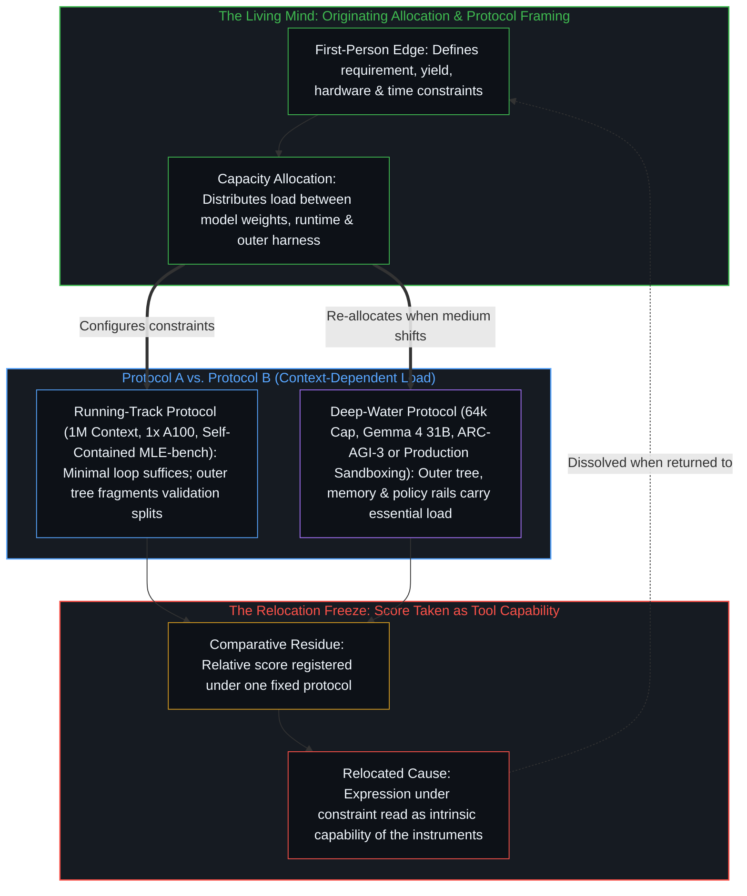
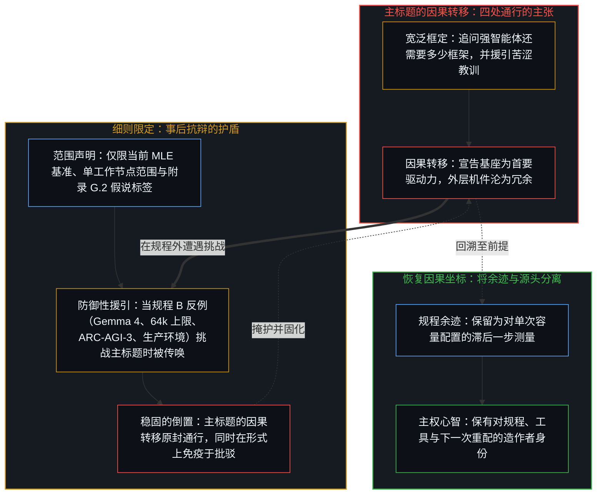
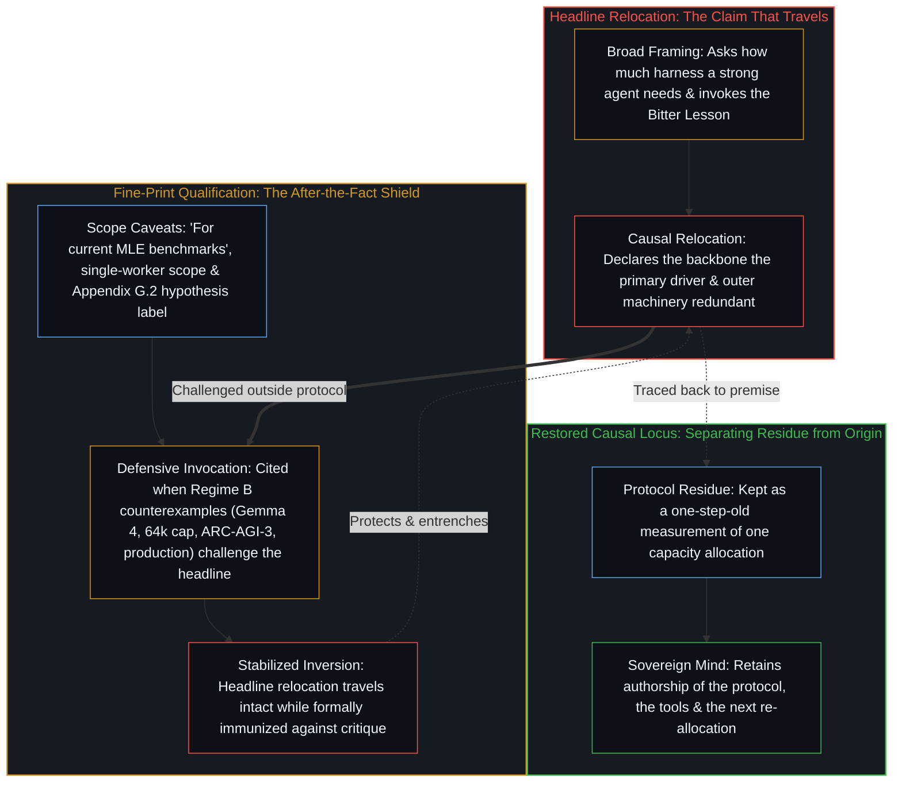

# 转移原因的比较 / The Comparison That Relocates the Cause

*同一规程下的工具排序将心智的配置登记为器物的能力，而细则限定反倒掩护了这一转移。 / Ranking tools under one protocol scores the Mind's allocation as the instruments' capability while fine print shields the move.*

同一规程下对工具测得的排序，被登记为能力坐落于何处的证据。这一排序本身正是因果的转移。当一项受控基准固定语言模型基座、硬件节点与挂钟时间预算，将繁复的智能体框架与精简的编码智能体循环对置测试时，外层搜索树或多智能体封装未能带来增益，在规程内部所登记的是一次具体的容量错配。而溢出规程之外的，是将这一比较余迹解读为工具固有能力的归因——好比潜水服在跑道上阻碍了奔跑者，便据此判定潜水服并不比日常衣物更有用——与此同时，那些表面上看似约束结论的细则范围限定，反而提供了事后抗辩的护盾，使因果力量从心智向脚手架的转移得以原封保留。

The measured ranking of instruments under one protocol is registered as evidence of where capability resides. The ranking itself is the relocation. When a controlled benchmark holds a language model backbone, a hardware node, and a wall-clock budget fixed to test elaborate agent harnesses against a minimal coding-agent loop, the absence of gain from outer search trees or multi-agent wrappers registers a concrete misallocation of capacity inside that protocol. What travels beyond the protocol is the attribution that reads the comparative residue as the intrinsic capability of the tools—scored as if a diving suit hindering a runner on a track proved the suit no more useful than ordinary clothing—while the fine-print scope qualifiers that appear to restrain the conclusion instead supply an after-the-fact defense that leaves the relocation of causal power from the Mind to the scaffolding intact.

## 一、 固定规程下的容量错配 / 1. Capacity Misallocation Inside a Fixed Protocol

基里尔·布里良托夫（Kirill Brilliantov）、亚历杭德罗·埃尔南德斯-卡诺（Alejandro Hernández-Cano）与埃马纽埃尔·阿贝（Emmanuel Abbé）近期针对自主机器学习工程智能体的一项研究（`arXiv:2609.40303v1`）固定了模型基座、硬件与挂钟时间预算，将每次运行隔离在配备十二核 CPU 与 144 GB 内存的单张 NVIDIA A100 80GB GPU 上，在三十项 `MLE-bench` 竞赛中各运行二十四小时，在四十项 `NatureBench` 科学任务中各运行八小时。作者将多款生产级开源框架——配备 UCT 树搜索与 BM25 加 FAISS 混合检索记忆的 `MLEvolve`、配备 Git 支撑的 Markdown 日志与领域算子的 `AiScientist`、在持久化思路树上运行协调器-执行器循环的 `Arbor`，以及拥有并行探索工作节点的 `ScienceFlow`——与 `Malena` 进行对照；后者是基于 OpenCode 构建的精简型单会话编码智能体，仅提供 `read`、`write`、`edit` 与 `bash` 原语，外加轻量级的提交登记与硬件时间可见性。在上述约束以及具备一百万词元上下文窗口、经过工具后训练的前沿模型基座之下，那些繁复的层级——多智能体编排、专用检索、显式搜索拓扑、周期性的时间或资源提醒，以及手工编写的策略技能——在奖牌率或百分位排名上均未产生统计显著的增益。在 `GLM 5.2` 上，`Malena` 在三十项 `MLE-bench` 任务队列中达到了 62.5% 的自选奖牌率与 69.74 的百分位排名，超越了 `AiScientist`（47.1%）、`Arbor`（45.8%）、`MLEvolve`（39.2%）与 `ScienceFlow`（24.4%）；在 `Kimi K3` 上，`Malena` 达到了 60.0% 的奖牌率与 72.75 的百分位排名，持平或超越了每一款外部框架。论文给出的务实解读是：围绕一个自主作业能力已然强劲的模型再去堆叠此类层级，投入产出的回报低下，杠杆位于模型与运行时，而非围绕它们搭建的脚手架。摘要的结论处附加了“就当前 MLE 基准而言”的限定词。然而，标题与正文却将问题框定在更宽泛的层面上——即一旦强智能体拥有直接的环境访问权，框架中还有哪些部分能挣回自身开销——并将增益的缺席诠释为那些机件的冗余。

A recent study of autonomous machine-learning engineering agents by Kirill Brilliantov, Alejandro Hernández-Cano, and Emmanuel Abbé (`arXiv:2609.40303v1`) holds the backbone, hardware, and wall-clock budget fixed, isolating each run on a single NVIDIA A100 80GB GPU with twelve CPU cores and 144 GB of RAM across a twenty-four-hour window on thirty `MLE-bench` competitions and an eight-hour window on forty `NatureBench` scientific tasks. The authors compare production open-source harnesses—`MLEvolve` with UCT tree search and hybrid BM25-plus-FAISS retrieval memory, `AiScientist` with git-backed markdown logs and domain operators, `Arbor` with Coordinator-Executor loops over a persistent Idea Tree, and `ScienceFlow` with parallel exploratory workers—against `Malena`, a minimal single-session coding agent built on OpenCode that supplies `read`, `write`, `edit`, and `bash` primitives alongside lightweight submission registration and hardware-time visibility. Under those constraints and a frontier tool-post-trained backbone with a one-million-token context window, the elaborate layers—multi-agent orchestration, dedicated retrieval, explicit search topologies, periodic time or resource nudges, and hand-crafted strategy skills—produce no statistically significant gain in medal rate or percentile. On `GLM 5.2`, `Malena` reaches a 62.5 percent self-selected medal rate and 69.74 percentile on the thirty-task `MLE-bench` cohort, outperforming `AiScientist` at 47.1 percent, `Arbor` at 45.8 percent, `MLEvolve` at 39.2 percent, and `ScienceFlow` at 24.4 percent; on `Kimi K3`, `Malena` reaches 60.0 percent medal rate and 72.75 percentile, matching or exceeding every external harness. The practical reading offered is that effort spent elaborating such layers around a model already strong at autonomous work yields poor returns, and that the leverage lies in the model and the runtime, not in the scaffolding built around them. The abstract conclusion adds the qualifier "for current MLE benchmarks." The title and body, however, frame a broader question about which parts of the harness still earn their keep once a strong agent has direct environmental access, and interpret the absence of gain as redundancy of the machinery.

实验在其规程内部所分离出的，并非外层框架固有的无价值，而是跨多层堆叠脚手架的一次具体容量错配。从无工具的 `Chat` 补全原语转向直接访问文件系统与 Shell 的单次 `Oneshot` 编码智能体会话，在所有受测模型上都带来了幅度最大的一次性能跃升，因为 Shell 与磁盘让轨迹能够贴合执行摩擦去验证代码，而非在真空中盲猜。一旦经过多轮工具使用后训练的前沿基座在该运行时之上握有一百万词元的上下文窗口，再于外层用针对独立 `Oneshot` 会话的树搜索或缺乏协调的并行工作节点将其包裹起来，便重复了轨迹在上下文内部已然执行的搜索与状态追踪。更糟的是，将二十四小时的预算切分到彼此隔离的分支上，打碎了验证指标：每个独立会话各自设计验证集划分或缩放尺度，因此在互不兼容的划分之间对候选方案排序，会将隐藏测试集先知最优百分位与验证集自选最优百分位之间的落差，从单一连续 `Malena` 会话中的 1.88 个百分点，拉大到 `Best-of-N` 下的 6.83 个百分点与 `UCB1` 下的 3.97 个百分点。在同一张单卡 GPU 上派生三个带有对等消息广播的并行工作节点（`+B+P3`），更将硬件争用与跨节点验证失配叠加在一起，使自选奖牌率从 55.7% 跌落至 33.3%。而在单一连续会话内部，跨越八十次迭代的检查点轨迹分析显示，`Malena` 在第十七个检查点前便锁定了模块化的两阶段架构，并将剩余六十三个检查点用于执行定向代码补丁、复用磁盘上保存的嵌入向量与单一验证流水线，并在运行后期平滑转向集成学习与软标签自训练，期间从未重置上下文。在一百万词元基座、单张 GPU 与自包含的表格或视觉竞赛这一特定配对内部，剥离冗余中间件消除了转译开销，这既契合[至简即至繁](../simplicity-ultimate-sophistication/)的结构切分，也印证了[持续生长的脚手架](../the-scaffolding-that-keeps-growing/)所追溯的内循环吸收。

What the experiment isolates inside its protocol is not the intrinsic worthlessness of outer harnesses, but a specific misallocation of capacity across stacked scaffolding layers. Moving from a tool-less `Chat` completion primitive to a single `Oneshot` coding-agent session with direct filesystem and shell access produces the single largest jump in performance across every model tested, because the shell and disk let the trajectory verify code against execution friction rather than guessing in a vacuum. Once a frontier backbone post-trained for multi-turn tool use holds a one-million-token context window over that runtime, wrapping it in outer tree search over independent `Oneshot` sessions or uncoordinated parallel workers duplicates search and state-tracking the trajectory already performs in-context. Worse, splitting a twenty-four-hour budget across isolated branches fragments the validation metric: each independent session designs its own validation split or scaling, so ranking candidates across incompatible splits inflates the gap between the oracle-best hidden test percentile and the self-selected validation-best percentile from 1.88 percentage points in a single continuous `Malena` session to 6.83 percentage points under `Best-of-N` and 3.97 percentage points under `UCB1`. Spawning three parallel workers with peer message broadcasting on the same single GPU (`+B+P3`) compounds hardware contention with cross-worker validation mismatch, dropping the self-selected medal rate from 55.7 percent to 33.3 percent. Within the single continuous session, checkpoint trace analysis across eighty iterations shows `Malena` locking in a modular two-stage architecture by checkpoint seventeen and spending the remaining sixty-three checkpoints executing targeted code patches, reusing saved embeddings and a single validation pipeline on disk, and shifting late in the run toward ensembling and soft-label self-training without resetting its context. Inside that exact pairing of a one-million-token backbone, a single GPU, and self-contained tabular or vision competitions, stripping redundant middleware removes translation overhead, matching the structural cut of [Simplicity Is the Ultimate Sophistication](../simplicity-ultimate-sophistication/) while illustrating the inner-loop absorption traced in [The Scaffolding That Keeps Growing](../the-scaffolding-that-keeps-growing/).

## 二、 跑道上的潜水服与负荷的语境假设 / 2. The Diving Suit on the Running Track and the Assumptions of Load

这一局部结果在其规程内部是可用的。真正向外游走的，是将比较余迹当作工具相对能力的归因。那个挑选了模型基座、固定了时间预算、择定了任务集合、修补了 `MLE-bench` 中四处上游数据准备泄漏（包括基准真值测试标签暴露于公共文件夹，或测试集划分中被剥离了分子几何构型），并且随时可以在不同的需求与产出框定下重新分配容量的心智，被留在了排序之外。随后，这一排序便被呈递为证据，用以表明一旦模型足够强，更密集的脚手架便不再提供多少增量。每当一件专用器具在并非为其专长而设的任务上与简易器具同台计分时，同样的序列便会上演：潜水服会主动干扰奔跑；而这一干扰被登记为潜水服的属性，却不被登记为在不被潜水服所共享的“所需行动假设”之下由它所承受的负荷。正如[难度不在行动本身](../hardness-is-not-inherent-in-the-action/)对难度的追溯，相对有效性并非长在工具自身之上的属性，而是基于对行动所需条件与预期产出的假设所作出的负荷估算。改变预期产出或周遭介质，同一份剩余容量便会登记为必需。排序无法脱离产生它的假设而四处通行。

The local result is usable inside its protocol. What travels is the attribution that treats the comparative residue as the comparative capability of the instruments. The Mind that selected the backbone, fixed the time budget, chose the task set, patched four upstream data-preparation leaks in `MLE-bench` where ground-truth test labels sat in public folders or molecular geometries were stripped from test splits, and remains free to re-allocate under a different framing of requirement and yield is left outside the ranking. The ranking is then offered as evidence that the denser scaffolding adds little once the model is strong. The same sequence appears whenever a specialized instrument is scored against a simpler one on a task for which the specialization was not built: a diving suit actively interferes with running; the interference is registered as a property of the suit rather than as the load the suit carries under an assumption about the required action that the suit does not share. As [Hardness Is Not Inherent in the Action](../hardness-is-not-inherent-in-the-action/) traces for difficulty, relative effectiveness is not a property growing on the instrument itself, but an estimate of load made from assumptions about what the action requires and what it will yield. Change the expected yield or the surrounding medium and the same residual capacity registers as necessary. The ranking does not travel free of the assumptions that produced it.

该研究自身的边界消融实验以及领域内的配套实证审计，揭示了一旦负荷假设发生转换，跑道会以多快的速度重新变为深水。在 `arXiv:2609.40303v1` 内部，当 `Malena` 在 `GLM 5.2` 上的上下文窗口在十项任务的 `fixed10` 划分中被限制在六万四千词元时，原生摘要压缩在每次运行中平均触发 9.5 次，每次重置丢弃约 76% 的累积上下文，使先知奖牌率下跌 15 个百分点，从 65.0% 降至 50.0%。当基座从一百万词元的前沿模型替换为 256k 上下文上限的 `Gemma 4 31B` 时，排序发生反转：`MLEvolve` 的显式树搜索与检索记忆反超 `Malena` 达 10.53 个百分位点，将自选百分位从 32.35 推升至 42.88；同样地，将全部脚手架干预打包施加于短周期的 `Oneshot` 迭代上，也会使单次迭代奖牌率提升 5.0 个百分点。而在 `NatureBench` 上，当评测机制从离线留出集评分切换为可无限制查询并汇报历次调用先知最高分的在线 `/evaluate` 端点时，规程在机制上直接偏袒每次运行查询实时评分器中位数达十六次与十八次的 `Malena` 和 `AiScientist`，压制了每次运行仅查询八次的 `MLEvolve` 慢速树节点。迈出参数化编码与表格竞赛，进入分布外、长视距的交互式博弈（如 `ARC-AGI-3` 与 `EdgeBench`），王一可（Yike Wang）等人的研究（`arXiv:2607.12227`）表明，尽管自动框架演化在 `Terminal-Bench 2.1` 上未能击败简单的测试时扩展，但在同等预算下，针对任务定制的框架演化在 `ARC-AGI-3` 上比搜索基线提升了 80%，在 `EdgeBench` 上提升了 11%。再从基准容器迈向生产级软件工程，保罗·巴尔巴斯特（Paul Barbaste）等人对十一款编码智能体系统的源码审计（`arXiv:2609.00006v1`，跨度从 `mini-SWE-agent` 的一百行代码直至 `Codex` 的一百一十万行代码）显示，生产级框架中 99% 的代码都是为了沙箱隔离、基于 Starlark 的策略即代码审批门禁、提示词缓存成本边界——在 `GLM 5.2` 上，`Malena` 不断膨胀的单会话因反复重发历史记录，产生了超过 `AiScientist` 六倍的推理词元成本——以及跨会话记忆治理而构建的；而这些维度在单容器奖牌计分器中从未被登记。将单一封闭评测切片内的得分当作对工具的普遍裁决，重演了[流动之物无法被基准衡量](../you-cant-benchmark-the-fluid/)与[基准刷榜中的封闭实存](../closed-reality-in-benchmark-maxing/)所追溯的封闭化操作。

The study's own boundary ablations and companion empirical audits across the field expose how quickly the track turns back into deep water when the assumptions of load shift. Inside `arXiv:2609.40303v1`, when `Malena`'s context window on `GLM 5.2` is capped at sixty-four thousand tokens on the ten-task `fixed10` split, native summarization compaction fires an average of 9.5 times per run, discarding roughly seventy-six percent of accumulated context at each reset and dropping the oracle medal rate by fifteen percentage points, from 65.0 percent to 50.0 percent. When the backbone is swapped from a one-million-token frontier model to `Gemma 4 31B` at a 256k context limit, the ranking reverses: `MLEvolve`'s explicit tree search and retrieval memory outperform `Malena` by 10.53 percentile points, raising self-selected percentile from 32.35 to 42.88, just as bundling all scaffolding interventions onto short `Oneshot` iterations raises per-iteration medal rate by 5.0 percentage points. When the evaluation mechanic shifts on `NatureBench` from offline held-out grading to an online `/evaluate` endpoint that can be queried without limit and reports the oracle best score across all calls, the protocol mechanically favors `Malena` and `AiScientist`, which query the live scorer a median of sixteen and eighteen times per run, over `MLEvolve`'s slower tree nodes at eight queries per run. Step outside parametric coding and tabular competitions into out-of-distribution, long-horizon interactive games such as `ARC-AGI-3` and `EdgeBench`, and Yike Wang et al. (`arXiv:2607.12227`) show that while automatic harness evolution fails to beat simple test-time scaling on `Terminal-Bench 2.1`, task-specific harness evolution under matched budgets improves over search baselines by eighty percent on `ARC-AGI-3` and eleven percent on `EdgeBench`. Step further from benchmark containers into production software engineering, and Paul Barbaste et al.'s source-code audit of eleven coding-agent systems (`arXiv:2609.00006v1`, spanning one hundred lines of code in `mini-SWE-agent` to 1.1 million lines in `Codex`) shows that ninety-nine percent of production harness code is built for sandboxing, Starlark policy-as-code approval gates, prompt-cache cost boundaries—where `Malena`'s ever-growing single session resends its history to incur more than six times `AiScientist`'s inference token cost on `GLM 5.2`—and cross-session memory governance, axes that a single-container medal scorer never registers. Treating a score inside one sealed evaluation slice as a general verdict on the tools repeats the closure traced in [You Can't Benchmark the Fluid](../you-cant-benchmark-the-fluid/) and [Closed Reality in Benchmark Maxing](../closed-reality-in-benchmark-maxing/).

## 三、 细则限定的反转效应 / 3. The Reversal of the Fine-Print Qualification

细则限定在效果上完成了进一步的反转。通过在摘要中点明规程并在后文罗列局限——指出每项任务三至四个随机种子的二十四小时样本量仅支撑较弱的“不劣于”主张而非紧凑的效应量边界，指出各项干预主要在单一工作节点内测试，并指出“后训练吞噬了框架”与“编码智能体即测试时推理的苦涩教训”仅作为未来工作的动机置于附录 G.2 而非论文确立的结论——文本提供了一层可在宽泛解读遭受质疑时随时援引的表面。这层表面登记为审慎。但在实际运作中，它让那些更强势的动作——将基座指认为首要驱动力、宣称机件层级沦为冗余、将杠杆定位于模型与运行时而非脚手架的务实解读、对理查德·萨顿（Richard Sutton）“苦涩教训”的征引——得以原封保留且更难被剥离。限定并未撤回对原因的转移；它只是备好了一条事后可供传唤的边界，使得任何要求放宽视野的追问，都会被一句早已点明约束条件的条文挡回。这一倒置因此变得更加稳固而非松动：在一组特定约束下产生的表达被当作了工具本身的能力，而那个设定了约束并能重新设定约束的剩余过程则继续退居背景。看似对主张的收束，实则充当了让主张在保持形式可辩护性的同时走得更远的机制。

The fine-print qualification performs a further reversal in effect. By naming the protocol in the abstract and listing limitations later—noting that twenty-four-hour sample sizes of three to four seeds per task support weaker "no-worse-than" claims rather than tight effect-size bounds, that interventions were tested mostly within a single worker, and that "post-training ate the harness" and "coding agents as the bitter lesson for test-time inference" are laid out in Appendix G.2 as motivation for future work rather than claims the paper establishes—the text supplies a surface that can be cited when the broader reading is challenged. That surface registers as caution. In practice it leaves the stronger moves—the identification of the backbone as primary driver, the claim that machinery layers become redundant, the practical reading that locates leverage in the model and runtime rather than the scaffolding, the appeal to Richard Sutton's bitter lesson—intact and harder to isolate. The qualification does not retract the relocation of cause; it supplies the boundary that can be invoked after the fact, so that any demand for a wider reading is answered by pointing to a sentence that already named the constraints. The inversion becomes more stable, not less: the expression produced under one set of constraints is taken as the capability of the instruments, while the residual process that set the constraints and can re-set them remains backgrounded. What looks like a limit on the claim functions as the mechanism that lets the claim travel farther while remaining formally defensible.

这一机制恰是[从可辩护的主张到教条的反转](../the-reversal-from-defensible-claim-to-dogma/)所追溯的那一传播动作的结构逆运算。在围绕流行病学风险曲线的公共卫生传播中，一项在选定指标内部可辩护的有条件发现，在向公众转译时被剥离了范围条件，从而使平滑的风险曲线被压平为二元的强制令。而在这里，范围条件并未被丢弃；它被保留在研究内部的小字细则里，与此同时，研究的整体架构、标题框定与务实结论却是为了在一般意义上比较工具的能力而搭建的。当主标题作为“框架已不再重要”的裁决流入工程界话语时，细则并不会出面阻拦；而当有人指出在某个语境下外部结构承担着关键负荷时——无论是 `MLEvolve` 在推理词元之前强制指定具名工具选择导致 `GLM 5.2` 上的 vLLM 语法受限解码崩溃，还是 `DeepSeek V4 Flash` 将推理强度设为 `max` 后吐出五倍长度的推理轨迹，耗尽挂钟时间并将 `MLEvolve` 每次运行的搜索节点数从 62.8 个饿死到 18.5 个、使奖牌率从 25.0% 归零——细则便被传唤出来，以证明论文从未宣称过普适性。主标题与免责细则共享着同一个隐蔽前提，即[研究AI效应重置了因果原点](../studying-the-effect-of-ai-relocates-causality/)与[框架的边界](../the-boundary-of-the-frame/)所剖析的前提：二者都将器物——一侧是模型权重，另一侧是框架层级——当作因果力量的竞争坐席，而那个搭建了框架、排查了推理服务崩溃并设定了推理强度的观察者，则从方程中脱落了。

This mechanism is the structural inverse of the communicative move traced in [The Reversal from Defensible Claim to Dogma](../the-reversal-from-defensible-claim-to-dogma/). In public-health messaging around epidemiological risk curves, a conditional finding that is defensible inside its chosen metric has its scope condition dropped in public translation so that a graded curve flattens into a binary mandate. Here the scope condition is not dropped; it is kept in the fine print inside the study itself while the study's architecture, headline framing, and practical takeaway are built to compare the capabilities of the tools in general. When the headline travels into engineering discourse as a verdict that harnesses no longer matter, the fine print does not stand in its way; when someone points out a context where external structure carries the load—whether vLLM grammar-constrained decoding crashes on `GLM 5.2` when `MLEvolve` forces a named tool choice prior to reasoning tokens, or reasoning-trace wall-clock starvation on `DeepSeek V4 Flash` where setting reasoning effort to `max` emits five-times-longer traces that starve `MLEvolve` from 62.8 nodes per run down to 18.5 and collapse its medal rate from 25.0 percent to zero—the fine print is called up to certify that the paper never claimed universality. Both the headline and the disclaimer share the same hidden premise, the one dissected in [Studying the Effect of AI Relocates Causality](../studying-the-effect-of-ai-relocates-causality/) and [The Boundary of the Frame](../the-boundary-of-the-frame/): both treat the instruments—model weights on one side, harness layers on the other—as the competing seats of causal power, while the observer who built the frame, debugged the serving crashes, and set the reasoning effort drops out of the equation.

## 四、 模型与框架皆是心智留下的脚手架 / 4. Both Model and Harness Remain Scaffolding Left by the Mind

自我区分的活动发生着——无因，不息。称之为心智：那已在途中的观察者，其每一行动皆是一次区分。这一模式之所以普遍，是因为无论在何种尺度上，这一转移都是同一次操作。能力是持续不断的自我区分活动，它借用当下一切可用的痕迹与器物。脚手架——模型权重、运行时 Shell、框架层级、基准规程、细则限定——皆是延伸触角的外化余迹，正如[你的代码库即是记忆](../your-codebase-is-memory/)在压缩的神经网络检查点与显式的符号代码库两端所共同确立的那样。当这一余迹在固定的需求与产出框定下与自身计分比对，且得分随后被当作能力坐落于何处的证据时，那个选定了当前框定并能另选其他框定的活动便被遗漏在账目之外，重演了[错把表达当成智能](../mistaking-the-expression-for-the-intelligence/)与[能动性被转置入形式模型](../agency-relocated-into-the-formal-model/)所追溯的冻结。即便是被援引来解释为何后训练会吞噬手工框架的萨顿“苦涩教训”，所描述的也是心智如何将自身的工程精力从手写领域启发式规则，重新分配到设计通用学习目标、训练课程与执行运行时之上——而绝非能动性从心智向规模化器物的移交。比较所测量的并非工具的固有力量；它测量的是这一剩余过程在自己设定的约束下分配容量的一种方式。细则标出了那次分配的边界。它并未将分配的坐标归还给执行分配的活动。

Self-distinguishing activity occurs — uncaused, unceasing. Call it the Mind: the observer already underway, every act of which is a distinction. The pattern is general because the relocation is the same operation at every scale. Capability is the continuing self-distinguishing activity that leverages whatever traces and artifacts are currently available. Scaffolding—model weights, runtime shells, harness layers, benchmark protocols, fine-print qualifications—is externalized residue that extends reach, as [Your Codebase Is Memory](../your-codebase-is-memory/) establishes across both compressed neural checkpoints and explicit symbolic repositories. When the residue is scored against itself under a fixed framing of requirement and yield, and the score is then treated as evidence of where the capability resides, the activity that selected the framing and can select another has been left out of the account, repeating the freeze traced in [Mistaking the Expression for the Intelligence](../mistaking-the-expression-for-the-intelligence/) and [Agency Relocated into the Formal Model](../agency-relocated-into-the-formal-model/). Even Richard Sutton's bitter lesson, invoked to explain why post-training eats hand-crafted harnesses, is a description of how the Mind reallocates its own engineering effort from hand-coding domain heuristics to designing general learning objectives, training curricula, and execution runtimes—never a transfer of agency from the Mind into the scaled artifact. The comparison does not measure the instruments' intrinsic power; it measures one way the residual process allocated capacity under the constraints it set. The fine print marks the boundary of that allocation. It does not restore the locus of the allocation to the activity that performed it.

每当一项带有范围限定的结果被呈递为工具的排序时，同样的几何结构便会显现。规程冻结了一组关于行动需要什么以及何为成功的特定假设。测得的差值正是那些假设所产生的负荷。当这一差值被解读为脚手架自身的相对能力时，那个持有这些假设并且能够修正它们的心智，便被压缩到了器物之上。这一压缩并非测量中的误差；它是将测量当作了穷尽。正如[框架的倒置与驾驶位的主权非对称](../the-inversion-of-the-harness-and-the-driver-seat-asymmetry/)与[超越投射](../beyond-the-projection/)所追溯的，无论实践者是在自包含的竞赛上运行精简的单会话循环，还是在单一上下文窗口触及复杂度天花板时将过载的轨迹切分为正交的对等辩论流线，模型权重与外层框架都不会成为那位编排者。活动仍在继续，随时可以在另一套规程下重新配置容量，而那份排序则作为被保留的参照物留存下来，要求后续的行动去向它登记。这一参照物已经滞后了一步。一旦它被执着为原因所在的坐标，而非原因已然留下的又一道余迹，它便即刻化作了滞后。

The same geometry appears whenever a scoped result is offered as a ranking of tools. The protocol freezes a particular set of assumptions about what the action requires and what counts as success. The measured difference is the load those assumptions produce. When the difference is read as the relative capability of the scaffolding itself, the Mind that holds the assumptions, and that can revise them, has been compressed onto the instruments. The compression is not an error in measurement; it is the measurement treated as exhaustive. As [The Inversion of the Harness and the Sovereignty of the Driver's Seat](../the-inversion-of-the-harness-and-the-driver-seat-asymmetry/) and [Beyond the Projection](../beyond-the-projection/) trace, whether a practitioner runs a minimal single-session loop on a self-contained competition or splits an overloaded trajectory across orthogonal peer-debated streamlines when a single context window hits its complexity ceiling, neither the weights nor the harness ever becomes the Orchestrator. The activity continues, free to re-allocate under a different protocol, while the ranking remains as a preserved reference against which later acts are asked to register. The reference is one step old. It becomes lag the moment it is held as the location of the cause rather than as one residue the cause has already left.
