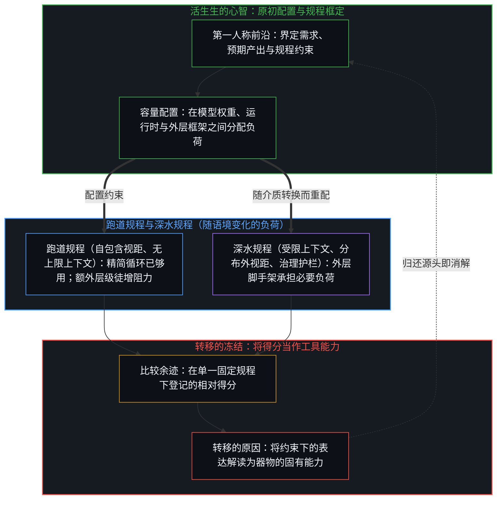
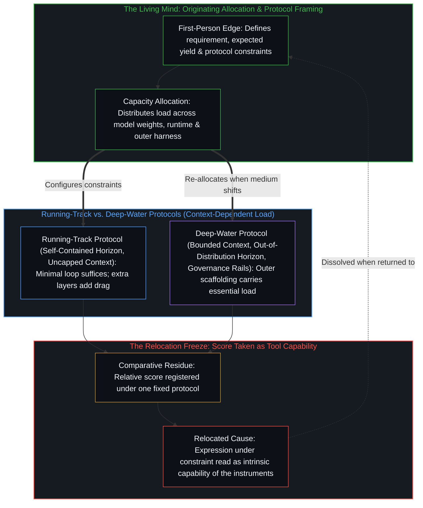
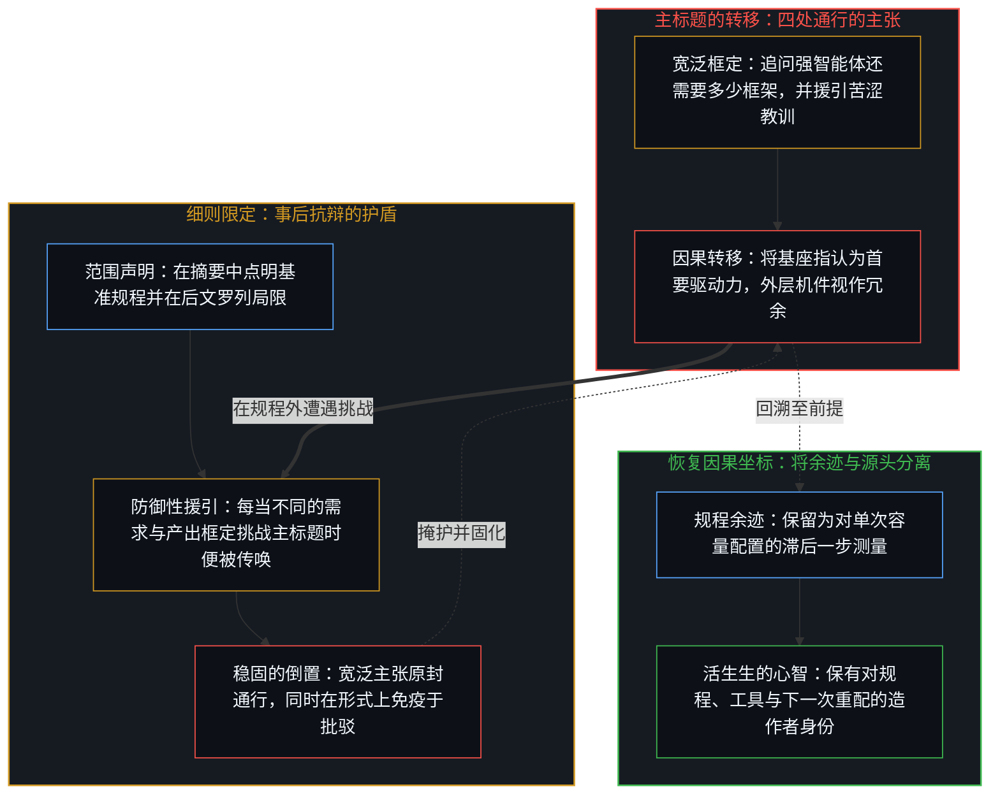
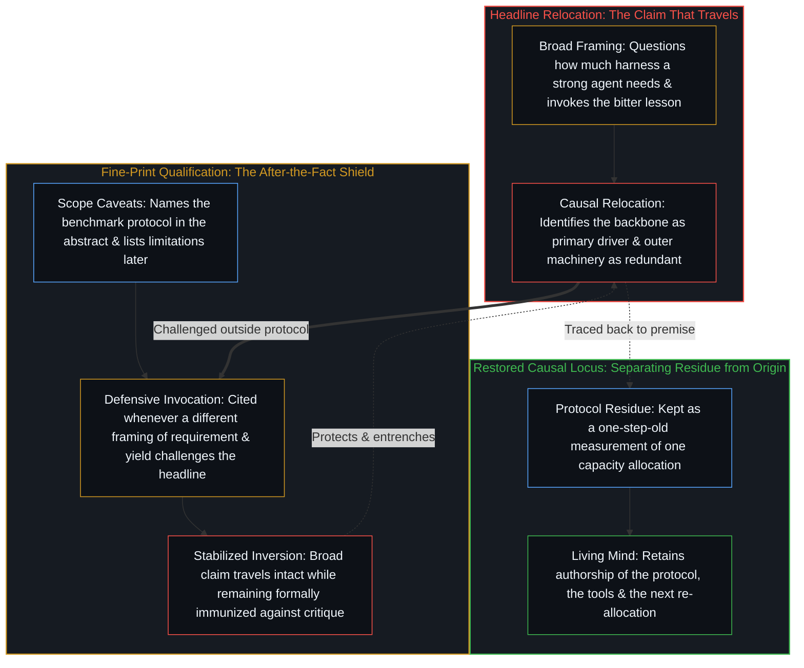

# 转移原因的比较 / The Comparison That Relocates the Cause

*同一规程下的工具排序将心智的配置计为器物的能力，而细则限定反倒掩护了这一转移。 / Ranking tools under one protocol scores the Mind's allocation as the instruments' capability while fine print shields the move.*

同一规程下对工具测得的排序，被登记为能力坐落于何处的证据。这一排序本身正是原因的转移。当一项受控评测固定模型基座、硬件与挂钟时间预算，将繁复的智能体框架与精简的编码智能体会话对照测试时，外层结构未能带来增益，在规程内部所登记的是一次具体的容量配置。而越出规程向外通行的，是将这一比较余迹解读为工具固有能力的归因——好比潜水服在跑道上阻碍了奔跑者，便据此判定潜水服多余——与此同时，那些表面上看似约束结论的细则范围限定，反而提供了事后抗辩的护盾，使原因从心智向脚手架的转移得以原封保留。

The measured ranking of instruments under one protocol is registered as evidence of where capability resides. The ranking itself is the relocation. When a controlled evaluation holds a model backbone, hardware, and a wall-clock budget fixed to test elaborate agent harnesses against a minimal coding-agent session, the absence of gain from outer layers registers a concrete allocation of capacity inside that protocol. What travels beyond the protocol is the attribution that reads the comparative residue as the intrinsic capability of the tools—scored as if a diving suit hindering a runner on a track proved the suit redundant—while the fine-print scope qualifiers that appear to restrain the conclusion instead supply an after-the-fact defense that leaves the relocation of cause from the Mind to the scaffolding intact.

## 一、 固定规程内部的容量配置 / 1. Capacity Allocation Inside a Fixed Protocol

近期一项针对自主机器学习工程智能体的研究固定了模型基座、硬件与挂钟时间预算，进而将多款开源框架与仅提供读写及命令行原语的精简编码智能体会话加以对照。在上述约束下，那些繁复的层级——多智能体编排、专用检索、显式搜索拓扑——在奖牌率或百分位排名上均未产生统计显著的增益。随之给出的务实解读是：围绕一个已具备强劲自主作业能力的模型再去铺陈此类层级，所得回报甚微，杠杆在于模型与运行时，而不在于围绕它们搭建的脚手架。摘要的结论处附加了“就当前机器学习工程基准而言”的限定词。然而，标题与正文却提出了更宽泛的追问——一旦强智能体拥有直接的环境访问权，框架中还有哪些部分能挣回自身开销——并将增益的缺席诠释为那些机件的冗余。

A recent study of autonomous machine-learning engineering agents holds the backbone, hardware, and wall-clock budget fixed, then compares open-source harnesses against a minimal coding-agent session that supplies only read, write, and bash primitives. Under those constraints the elaborate layers—multi-agent orchestration, dedicated retrieval, explicit search topologies—produce no statistically significant gain in medal rate or percentile. The practical reading offered is that effort spent elaborating such layers around a model already strong at autonomous work yields poor returns, and that the leverage lies in the model and the runtime, not in the scaffolding built around them. The abstract conclusion adds the qualifier "for current MLE benchmarks." The title and body, however, frame a broader question about which parts of the harness still earn their keep once a strong agent has direct environmental access, and interpret the absence of gain as redundancy of the machinery.

这项比较在其规程内部所分离出的，并非外层框架固有的无价值，而是跨多层堆叠脚手架的一次具体容量错配。当评测将一个已针对多轮工具调用受训的长上下文基座，与可容纳于单一会话内的自包含任务配对时，直接的命令行与文件系统访问已足以让轨迹凭执行反馈检验假设，并在磁盘上维持一致的验证基准。在固定时间预算下，再用外层树搜索或并行分支去包裹这一连续会话，只会重复内循环已在执行的状态追踪；而将预算切分到彼此隔离的轨迹上，则会打碎各分支借以筛选候选方案的验证标尺。在模型容量、任务视距与资源上限的这一特定配对内部，剥离冗余中间件消除了转译开销，这既契合[至简即至繁](../simplicity-ultimate-sophistication/)的结构切分，也印证了[持续生长的脚手架](../the-scaffolding-that-keeps-growing/)所追溯的内循环吸收。

What the comparison isolates inside its protocol is not the intrinsic worthlessness of outer harnesses, but a specific misallocation of capacity across stacked layers of scaffolding. When an evaluation pairs a long-context backbone already trained for multi-turn tool use with self-contained tasks that fit inside a single session, direct shell and filesystem access already allows the trajectory to test its hypotheses against execution feedback and maintain a consistent validation reference on disk. Wrapping that continuous session in outer tree search or parallel branches under a fixed time budget duplicates state-tracking the inner loop already performs, while splitting the budget across isolated trajectories fragments the validation yardstick each branch uses to select its candidates. Inside that specific pairing of model capacity, task horizon, and resource ceiling, stripping redundant middleware removes translation overhead, matching the structural cut of [Simplicity Is the Ultimate Sophistication](../simplicity-ultimate-sophistication/) while illustrating the inner-loop absorption traced in [The Scaffolding That Keeps Growing](../the-scaffolding-that-keeps-growing/).

## 二、 跑道上的潜水服与负荷的假设 / 2. The Diving Suit on the Running Track and the Assumptions of Load

这一局部结果在其规程内部是可用的。向外通行的，是将比较余迹当作器物相对能力的归因。那个挑选了模型基座、固定了时间预算、择定了任务集合，并且随时可以在不同的需求与产出框定下重新分配容量的心智，被留在了排序之外。随后，这一排序便被呈递为证据，用以表明一旦模型足够强，更密集的脚手架便不再提供多少助益。每当一件专用器具在并非为其专长而设的任务上与简易器具同台计分时，同样的序列便会上演：潜水服会主动妨碍奔跑；而这一妨碍被登记为潜水服的属性，却不被登记为在潜水服并不共享的“所需行动假设”之下由它所承受的负荷。正如[难度不在行动本身](../hardness-is-not-inherent-in-the-action/)对难度的追溯，相对有效性并非长在器物自身之上的属性，而是基于对行动所需条件与预期产出的假设所作出的负荷估算。改变预期产出，同一份剩余容量便会登记为必需。排序无法脱离产生它的假设而四处通行。

The local result is usable inside its protocol. What travels is the attribution that treats the comparative residue as the comparative capability of the instruments. The Mind that selected the backbone, fixed the time budget, chose the task set, and remains free to re-allocate under a different framing of requirement and yield is left outside the ranking. The ranking is then offered as evidence that the denser scaffolding adds little once the model is strong. The same sequence appears whenever a specialized instrument is scored against a simpler one on a task for which the specialization was not built: a diving suit actively interferes with running; the interference is registered as a property of the suit rather than as the load the suit carries under an assumption about the required action that the suit does not share. As [Hardness Is Not Inherent in the Action](../hardness-is-not-inherent-in-the-action/) traces for difficulty, relative effectiveness is not a property growing on the instrument itself, but an estimate of load made from assumptions about what the action requires and what it will yield. Change the expected yield and the same residual capacity can register as necessary. The ranking does not travel free of the assumptions that produced it.

只要规程所持有的任一假设发生转换，跑道便会在瞬间重新变为深水。一旦收紧活动上下文窗口，迫使单一会话反复压缩并丢弃工作历史，或是将运行时与无法在单次传递内维持长视距搜索的较小基座配对，显式的外部记忆与搜索拓扑便会即刻恢复其结构职能。一旦将任务从已契合预训练先验的自包含竞赛题，转向必须通过试错来摸索规则的新颖交互环境，或是从孤立的基准容器迈入以沙箱隔离、策略执行、成本边界与跨会话状态治理来界定所需产出的生产级工程，那些在跑道上登记为累赘的框架层级，便成为了承重结构。将单一封闭评测切片内的得分当作对工具的普遍裁决，重演了[流动之物无法被基准衡量](../you-cant-benchmark-the-fluid/)与[基准刷榜中的封闭实存](../closed-reality-in-benchmark-maxing/)所追溯的封闭化操作。

The running track turns back into deep water the moment any of the protocol's held assumptions shift. Constrain the active context window so that a single session must repeatedly compact and discard its working history, or pair the runtime with a smaller backbone that cannot hold long-horizon search inside a single pass, and explicit external memory and search topologies immediately recover their structural role. Shift the task from self-contained competition problems already aligned with pre-training priors to novel interactive environments where rules must be discovered through trial, or move from isolated benchmark containers into production engineering where sandboxing, policy enforcement, cost boundaries, and cross-session state governance define the required yield, and the very harness layers that registered as dead weight on the track become the load-bearing structure. Treating a score inside one sealed evaluation slice as a general verdict on the tools repeats the closure traced in [You Can't Benchmark the Fluid](../you-cant-benchmark-the-fluid/) and [Closed Reality in Benchmark Maxing](../closed-reality-in-benchmark-maxing/).

## 三、 细则限定的反转 / 3. The Reversal of the Fine-Print Qualification

细则限定在效果上完成了进一步的反转。通过在摘要中点明规程并在后文罗列局限，文本提供了一层可在宽泛解读遭受质疑时随时援引的表面。这层表面登记为审慎。在实际运作中，它让那些更强势的动作——将基座指认为首要驱动力、宣称外层机件冗余、将杠杆定位于模型与运行时而非脚手架的务实解读、对“苦涩教训”的援引——得以原封保留且更难被剥离。这一限定并未撤回对原因的转移；它只是提供了事后可供传唤的边界，使得任何要求拓宽视野的追问，都会被指向某句早已点明约束条件的条文来挡回。这一倒置因此变得更加稳固而非松动：在一组特定约束下产生的表达被当作了器物的能力，而那个设定了约束并能重新设定约束的剩余过程则继续退居背景。看似对主张的限制，实则充当了让主张在保持形式可辩护性的同时走得更远的机制。

The fine-print qualification performs a further reversal in effect. By naming the protocol in the abstract and listing limitations later, the text supplies a surface that can be cited when the broader reading is challenged. That surface registers as caution. In practice it leaves the stronger moves—the identification of the backbone as primary driver, the claim of redundancy, the practical reading that locates leverage in the model and runtime rather than the scaffolding, the appeal to the bitter lesson—intact and harder to isolate. The qualification does not retract the relocation of cause; it supplies the boundary that can be invoked after the fact, so that any demand for a wider reading is answered by pointing to a sentence that already named the constraints. The inversion becomes more stable, not less: the expression produced under one set of constraints is taken as the capability of the instruments, while the residual process that set the constraints and can re-set them remains backgrounded. What looks like a limit on the claim functions as the mechanism that lets the claim travel farther while remaining formally defensible.

这一机制恰是[从可辩护的主张到教条的反转](../the-reversal-from-defensible-claim-to-dogma/)所追溯的那一传播转换的结构逆运算。在常见的公共转译中，研究的范围条件被剥离，致使有条件的测量硬化为无条件的规则；而在这里，范围条件被保留在文本内部，与此同时，外围的论述架构、标题框定与务实结论却被组织起来为器物自身排定座次。当这一结论作为“外层脚手架已不再重要”的证据四处流传时，细则保持缄默；而当约束条件的转换暴露出外部结构仍在何处承担负荷时，细则便被传唤出来，以证明该主张始终带有范围限定。无论宽泛结论还是防御性限定词，都共享着同一个未言明的前提，即[研究AI效应重置了因果原点](../studying-the-effect-of-ai-relocates-causality/)与[框架的边界](../the-boundary-of-the-frame/)所剖析的前提：二者都将器物——一侧是模型权重，另一侧是框架层级——当作因果力量的竞争坐席，而那个搭建了框架、择定了约束并诠释着余迹的心智，则从视野中脱落了。

This mechanism operates as the structural inverse of the communicative shift traced in [The Reversal from Defensible Claim to Dogma](../the-reversal-from-defensible-claim-to-dogma/). Where public translation often drops a study's scope condition so that a conditional measurement hardens into an unconditional rule, here the scope condition is preserved inside the text while the surrounding architecture, headline framing, and practical takeaway are organized to rank the instruments themselves. When the takeaway circulates as evidence that outer scaffolding no longer matters, the fine print stays quiet; when a shift in constraints exposes where external structure still carries the load, the fine print is called up to certify that the claim was always scoped. Both the broad takeaway and the defensive qualifier share the same unstated premise, the one dissected in [Studying the Effect of AI Relocates Causality](../studying-the-effect-of-ai-relocates-causality/) and [The Boundary of the Frame](../the-boundary-of-the-frame/): both treat the instruments—model weights on one side, harness layers on the other—as the competing seats of causal power, while the Mind that built the frame, chose the constraints, and interprets the residue drops out of sight.

## 四、 模型与框架皆是心智留下的余迹 / 4. Both Model and Harness Remain Residue Left by the Mind

自我区分的活动发生着——无因，不息。称之为心智：那已在途中的第一人称前沿，其每一行动皆划定边界并留下痕迹。这一模式之所以普遍，是因为无论在何种尺度上，这一转移都是同一次操作。能力是持续不断的自我区分活动，它借用当下一切可用的痕迹与器物。脚手架——模型权重、框架层级、基准规程、细则限定——皆是延伸触角的外化余迹，正如[你的代码库即是记忆](../your-codebase-is-memory/)在压缩的神经网络权重与显式的符号代码两端所共同确立的那样。当这一余迹在固定的需求与产出框定下与自身计分比对，且得分随后被当作能力坐落于何处的证据时，那个选定了当前框定并能另选其他框定的活动便被遗漏在账目之外，重演了[错把表达当成智能](../mistaking-the-expression-for-the-intelligence/)与[能动性被转置入形式模型](../agency-relocated-into-the-formal-model/)所追溯的倒置。即便是对“苦涩教训”的援引，所描述的也是心智如何将自身的工程精力从手写领域启发式规则，重新分配到塑造训练目标与执行运行时之上，而从未将能动性移交予规模化的器物。比较所测量的并非器物的固有力量；它测量的是这一剩余过程在自己设定的约束下配置容量的一种方式。细则标出了那次配置的边界。它并未将配置的坐标归还给执行配置的活动。

Self-distinguishing activity occurs — uncaused, unceasing. Call it the Mind: the first-person edge already underway, every act of which draws a boundary and leaves a trace. The pattern is general because the relocation is the same operation at every scale. Capability is the continuing self-distinguishing activity that leverages whatever traces and artifacts are currently available. Scaffolding—model weights, harness layers, benchmark protocols, fine-print qualifications—is externalized residue that extends reach, as [Your Codebase Is Memory](../your-codebase-is-memory/) establishes across both compressed neural weights and explicit symbolic code. When the residue is scored against itself under a fixed framing of requirement and yield, and the score is then treated as evidence of where the capability resides, the activity that selected the framing and can select another has been left out of the account, repeating the inversion traced in [Mistaking the Expression for the Intelligence](../mistaking-the-expression-for-the-intelligence/) and [Agency Relocated into the Formal Model](../agency-relocated-into-the-formal-model/). Even the appeal to the bitter lesson describes how the Mind reallocates its own engineering effort from hand-coding domain heuristics to shaping training objectives and execution runtimes, never a transfer of agency into the scaled artifact. The comparison does not measure the instruments' intrinsic power; it measures one way the residual process allocated capacity under the constraints it set. The fine print marks the boundary of that allocation. It does not restore the locus of the allocation to the activity that performed it.

每当一项带有范围限定的结果被呈递为工具的排序时，同样的几何结构便会显现。规程冻结了一组关于行动需要什么以及何为成功的特定假设。测得的差值正是那些假设所产生的负荷。当这一差值被解读为脚手架自身的相对能力时，那个持有这些假设并且能够修正它们的心智，便被压缩到了器物之上。这一压缩并非测量中的误差；它是将测量当作了穷尽。正如[框架的倒置与驾驶位的主权非对称](../the-inversion-of-the-harness-and-the-driver-seat-asymmetry/)与[超越投射](../beyond-the-projection/)所追溯的，无论模型权重还是外围框架，都从未坐进驾驶位。活动仍在继续，随时可以在另一套规程下重新配置容量，而那份排序则作为被保留的参照物留存下来，要求后续的行动去向它登记。这一参照物已经滞后了一步。一旦它被执着为原因所在的坐标，而非原因已然留下的又一道余迹，它便即刻化作了滞后。

The same geometry appears whenever a scoped result is offered as a ranking of tools. The protocol freezes a particular set of assumptions about what the action requires and what counts as success. The measured difference is the load those assumptions produce. When the difference is read as the relative capability of the scaffolding itself, the Mind that holds the assumptions, and that can revise them, has been compressed onto the instruments. The compression is not an error in measurement; it is the measurement treated as exhaustive. As [The Inversion of the Harness and the Sovereignty of the Driver's Seat](../the-inversion-of-the-harness-and-the-driver-seat-asymmetry/) and [Beyond the Projection](../beyond-the-projection/) trace, neither the model weights nor the surrounding harness ever steps into the driver's seat. The activity continues, free to re-allocate under a different protocol, while the ranking remains as a preserved reference against which later acts are asked to register. The reference is one step old. It becomes lag the moment it is held as the location of the cause rather than as one residue the cause has already left.
