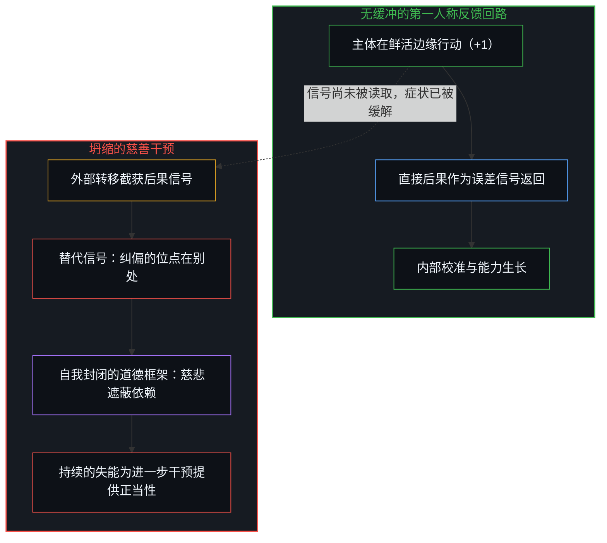
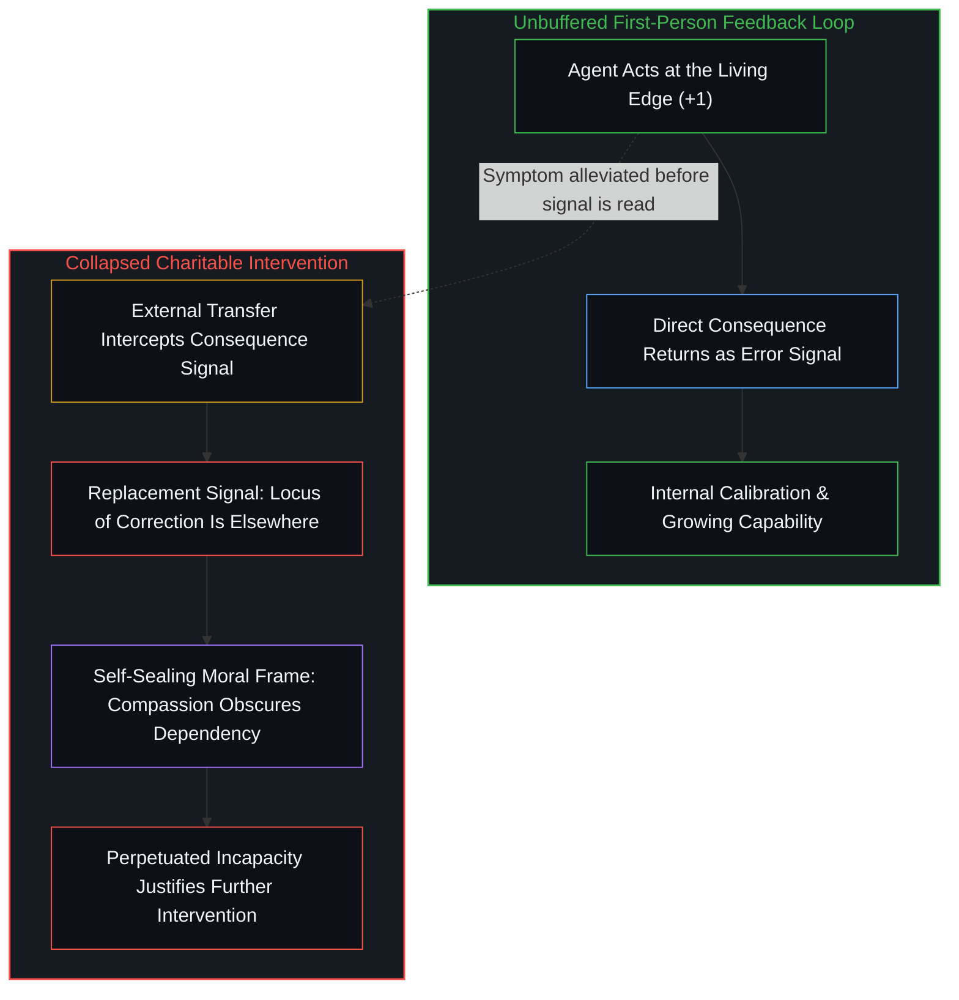

# 慈悲即遮蔽的机制 / The Compassion Is the Mechanism of Obscuration

*只诊断慈善的低效而不追问其结构，慈悲的道德框架便维持着它声称要解决的依赖。 / Diagnosing charity's inefficiency without questioning its structure sustains the dependency it claims to cure.*

马克·库班指出，如今慈善机构太多而慈善本身不够。迈克尔·戴尔则以“慈善 2.0”回应：直接向儿童投资账户注资、零管理成本、可量化的社会投资回报。这场对话的启示不在于它解决了什么，而在于它让什么变得不可见。两位发言者都在诊断运作层面的低效，却都不追问产生这种低效的结构。对困顿者怀抱慈悲的道德框架，正在执行它表面上所做的事：维持它自身，连同它声称要解决的问题一起维持下去。

Mark Cuban observes that there are too many charities and not enough charity. Michael Dell replies with Charity 2.0: direct giving to children's investment accounts, zero overhead, and measurable societal return on investment. The exchange is instructive not for what it resolves, but for what it renders invisible. Both speakers diagnose operational inefficiency while neither questions the structure that produces it. The moral frame of compassion for those in need is doing the work it appears to be doing: sustaining itself, along with the problem it claims to solve.

## 一、 投射的坍缩 / 1. The Projection

慈善沿着三个不同的投射轴向运作，而这三个轴向坍缩成了同一个东西。第一重是资源转移：物资、资本或服务从拥有较多者流向拥有较少者；这一投射极易被误认为中立之举，仿佛资源只是变换了位置，而没有对所涉主体的能动性编码任何信息。第二重是身份建构：捐赠者变得慷慨，机构变得有使命感，受助者变得困顿；这些身份并非先于慈善行为存在，而是由这一行为本身生产出来的——这段关系制造了它自己的参与者。第三重是道德架构：整套安排被包裹在一种使审视显得残忍的语言之中，于是质疑慈善就成了质疑助人、成了暴露自己冷漠无情，从而将整个框架密封起来，免疫于检视。

Charity operates across three distinct axes of projection that collapse into one. First is resource transfer: goods, capital, or services move from those who have more to those who have less, a projection easily mistaken for a neutral act as though resources simply change location without encoding anything about the agencies involved. Second is identity construction: the donor becomes generous, the organization becomes purposeful, and the recipient becomes needy; these identities do not precede the charitable act but are produced by it as the relationship manufactures its own participants. Third is moral architecture: the entire arrangement is wrapped in language that makes examination feel like cruelty, so that to question charity is to question helping and to reveal oneself as someone who does not care, sealing the frame against inspection.

这三重投射在各自独立的轴向上运作。自我区分的活动发生着——无因、不息。称之为心智：已然在途的观察者，其每一行动都是一次区分。当一个中心将其所保留的施惠者自我图像、资源的机械转移，以及抵御审视的道德护盾熔铸在一起时，它的边界便将这三个轴向压缩到了单一坐标之上。将它们坍缩在一起、当作名为“慈善”的单一事物来对待，便产生了库班在管理成本激增中所感知到、却无法从结构上定位的困惑——这正是[共情的投射坍缩](../empathy-as-projection-collapse/)所追踪的同一种坐标压缩：当私密的感知拓宽、社会信号传递与关系义务被塞进同一个公共词汇时，信号传递便排挤掉了底层的机制。

These three projections operate on distinct axes. Self-distinguishing activity occurs — uncaused, unceasing. Call it the Mind: the observer already underway, every act of which is a distinction. When a center fuses its retained self-image as a benefactor with the mechanical transfer of resources and a moral shield against inspection, its boundary compresses all three axes onto a single coordinate. Collapsing them and treating them as one single thing called "charity" generates the confusion that Cuban senses in the proliferation of overhead but cannot locate structurally—the same coordinate compression [Empathy as Projection Collapse](../empathy-as-projection-collapse/) traces when private perceptual widening, social signaling, and relational obligation are packed into one public word until signaling crowds out the underlying mechanics.

## 二、 结构性依赖 / 2. The Structural Dependency

慈善关系要求一种不对称性：一方拥有另一方所匮乏之物。这种不对称并非该关系旨在消除的状况，而是该关系赖以存在的条件。

The charitable relationship requires an asymmetry in which one party possesses what the other lacks. This asymmetry is not a condition the relationship aims to eliminate; it is the condition the relationship needs in order to exist.

这是几何结构使然，而非阴谋。一旦参与其中的各个中心将其保留的自我图像锚定在某种不对称之上，跨越步点去维系这一参照便成了自我图像自身的指令：一个仰赖落差而存续的结构不会去弥合落差；它会维持足以自我延续的落差，同时制造足够多的可见活动，使其看起来似乎正在弥合落差。正如[帮助是问题的一半](../help-is-half-the-problem/)在双输入互赖回路中所追踪的那样，当一方持续提供动作以保持自身不可或缺、另一方持续提供受困需求的固定支点时，库班所抱怨的管理成本——相互竞争的机构、重复的投入、行政的膨胀——并不是系统的故障，而是按其几何结构的要求在运转的均衡状态。每个机构都需要这个问题，且各自都需要一套属于自己版本的问题，用来证明自身特定存在的合理性。

This is geometry rather than conspiracy. Once participating centers anchor their retained self-images to an asymmetry, preserving that reference past its step is the self-image's own directive: a structure that depends on a gap does not close the gap; it maintains sufficient gap to sustain itself while producing enough visible activity to appear as though gap-closing is underway. As [Help Is Half the Problem](../help-is-half-the-problem/) traces across two-input codependent circuits, where one side supplies motion to remain indispensable and the other supplies the fixed point of need, the overhead Cuban complains about—the competing organizations, the duplicated effort, the administrative bloat—is not a bug in the system, but the equilibrium operating as its geometry demands. Each organization needs the problem, and each needs its version of the problem to justify its particular existence.

戴尔提出的零管理成本与直接转账优化并未逃出这一几何结构；它精简了输送机制，却加深了依赖。如今，孩子的财务轨迹由外部主体的决策播下种子：捐赠者选定邮政编码、选定学区、选定孩子，而孩子接收到的资源并非通过自身任何反馈回路生成。戴尔所称颂的社会回报，是以孩子是否产出了捐赠者框架所能读取的结果——毕业、置业、创业——来衡量的，从而将孩子的人生变成了他人投资的回报。正如[主体性的折现](../the-discount-on-agency/)针对这笔种子账户账本所追踪的，将一个年轻人此后数十年间承受的摩擦与作出的选择记作一笔初始支票的收益，是对孩子自身因果性的双重折现：既折现在出资者的资产负债表上，也折现在任何被驯化得将外部赠予而非自身行动视为决定性变量的受助者身上。

Dell's optimization of zero overhead and direct transfer does not escape this geometry; it refines the delivery mechanism while deepening the dependency. Now the child's financial trajectory is seeded by an external agent's decision: the donor selects a zip code, a school district, and a child, and the child receives resources they did not generate through any feedback loop of their own. The societal return Dell celebrates is measured by whether the child produces outcomes legible to the donor's framework—graduation, homeownership, business formation—turning the child's life into a return on someone else's investment. As [The Discount on Agency](../the-discount-on-agency/) traces in this exact seed-account ledger, booking decades of a young person's subsequent friction-bearing and choices as the yield on an initial check discounts the child's own causality twice: on the financier's balance sheet and in any recipient conditioned to treat an external grant rather than their own action as the decisive variable.

## 三、 主体性问题 / 3. The Agency Problem

道德框架通过自我维持所延续的，是对自我纠偏的打断。自我纠偏需要一个闭合回路：主体行动、遭遇后果、读取信号并作出调整。正如[模块化反馈回路与动态残差网络](../dynamic-resnet-of-skill-loops/)所追踪的，这一信号必须由主体自身的行动产生，并作为相对于其保留参照的局部差分（`yₗ₊₁ = yₗ + Δyₗ`）由同一主体接收；系统由此学习，有机体由此发育，主体性也由此运作。

What the moral frame sustains by sustaining itself is the interruption of self-correction. Self-correction requires a closed loop in which an agent acts, encounters consequences, reads the signal, and adjusts. That signal must be generated by the agent's own action and received by the same agent as a local differential against its retained reference (`yₗ₊₁ = yₗ + Δyₗ`), as [Modular Feedback Loops and Dynamic Residual Networks](../dynamic-resnet-of-skill-loops/) traces; this is how systems learn, how organisms develop, and how agency operates.

慈善在后果阶段介入，在信号被读取之前就将其缓解。主体的行动不再产生其原本的反馈；取而代之抵达的是另一个截然不同的信号——别人帮了你。这一替代信号所携带的信息无关主体自身的“行动—后果”关联，而是关乎依赖：它宣告纠偏的位点在别处。

Charity intervenes at the consequence stage, alleviating the signal before it can be read. The agent's action no longer produces its natural feedback; in its place arrives a different signal altogether—that someone else helped you. This replacement signal carries information not about the agent's own action-consequence relationship, but about dependency, announcing that the locus of correction lies elsewhere.

对于主体性而言，这种干预是反信息的。受助者失去了通往反馈的入口，而唯有那种反馈才能促成慈善声称要支持的自我纠偏；慈善缓解症状越有效，它对纠偏回路的阻断就越深入——正如[能动性、复利与 AI 封建之争](../agency-compounding-and-the-argument-over-ai-feudalism/)所推导的，这种干预在垫高静态起始截距（`I₀`）的同时，压平了随时间复利累积能力的自主学习斜率。[解放的言辞始于定义囚禁](../liberation-rhetoric-begins-by-defining-captivity/)追踪了披着解放外衣的同一种错位：延续被分配给了发言者的裁决，而自我定义的支点却只留在那个不断延续的边缘上。

This intervention is anti-informational with respect to agency. The recipient loses access to the feedback that would enable the self-correction charity claims to support, and the more effectively charity alleviates symptoms, the more thoroughly it disrupts the corrective loop—shifting a static starting intercept (`I₀`) while flattening the self-directed learning slope that compounds capability over time, as [Agency, Compounding, and the Argument Over AI Feudalism](../agency-compounding-and-the-argument-over-ai-feudalism/) derives. [Liberation Rhetoric Begins by Defining Captivity](../liberation-rhetoric-begins-by-defining-captivity/) traces the same displacement in emancipatory dress: continuation is allocated to the speaker's verdict while the lever of self-definition stays only at the edge that continues.

## 四、 为何升级反而加剧问题 / 4. Why Upgrades Exacerbate

库班想要更少、更好的慈善机构，戴尔想要零管理成本的直接捐赠。两者都是同一架构内部的升级，其指向并非更好地解决问题，而是替换上一代解决方案——而要完成替换，新版本就必须更持久地履行该结构自我维持的核心功能。

Cuban wants fewer, better charities, and Dell wants no-overhead direct giving. Both are upgrades within the same architecture, aimed not at solving the problem better but at replacing the previous solution—and to replace it, the new version must perform the structure's core function of sustaining itself even more durably.

一个能更有效地自我维持的慈善机制，也能更有效地维持问题本身；这两者不是彼此独立的结果，而是同一个运作。由于制度性结构自身并不具备独立的能动性——正如[涌现的伪因果](../yong-xian-de-wei-yin-guo-yu-ji-ti-gui-yin-dao-cuo/)与[外化善意走向其反面](../externalized-virtue-becomes-its-opposite/)所确立的，它只是个体分配并外包因果性的选择所留下的稳定残迹——慈善载体所承受的选择压力便指向载体自身的耐久度，而非受助者的自主性：留存下来的是那些延续该交易的机制，而延续该交易的机制正是那些维持自身存在之必要条件的机制。

A charity that sustains itself more effectively sustains the problem more effectively; these are not separate outcomes, but the same operation. Because an institutional structure possesses no autonomous agency of its own—operating only as the stabilized residue of individual choices to allocate and outsource causality, as [The Pseudo-Causality of Emergence](../yong-xian-de-wei-yin-guo-yu-ji-ti-gui-yin-dao-cuo/) and [Externalized Virtue Becomes Its Opposite](../externalized-virtue-becomes-its-opposite/) establish—the selection pressure on charitable vessels is toward the durability of the vessel itself rather than the autonomy of recipients: what survives is what perpetuates the transaction, and what perpetuates the transaction is what maintains the conditions of its own necessity.

戴尔的版本之所以比库班的版本更具竞争力，不是因为孩子们变得更具主权，而是因为它更难被反驳、更难被看穿、也更难被拆解。零管理成本、直接转账与可量化的投资回报，使这套安排更加稳固且更能自我维持。每一个成功案例都在同时证明受助者需要捐赠者；随着每一次升级，这一证明都变得更有说服力，因为该结构将自身的持续存在包装为成功的能力提升了。

Dell's version outcompetes Cuban's not because children become more sovereign, but because it is harder to argue against, harder to see through, and harder to dismantle. Zero overhead, direct transfer, and measurable return on investment make the arrangement more durable and self-sustaining. Each success story simultaneously proves that the recipients needed the donor, and with each upgrade that proof grows more convincing because the structure's capacity to frame its own persistence as success has improved.

## 五、 作为承重结构的道德框架 / 5. The Moral Frame as Load-Bearing Structure

慈悲在这一安排中并非附带之物，而是整套安排借以自我维持的承重机制。一旦追踪慈善阻断主体性的机制，立刻就会触发“人们正在受苦、孩子们需要帮助”的反驳。这种反应并非论证，而是道德框架正在履行其结构性职能——将机制分析转化为表面上的残忍，使提问者变成问题所在，而非被追问的结构本身；这正是[强求善意的残暴与范畴反馈的因果遮蔽](../compulsory-kindness-and-the-obscuration-of-categorical-feedback/)所追踪的范畴裁判所：评价性标签插在行动与后果之间，以缓冲原始的反馈摩擦。

Compassion is not incidental to this arrangement; it is the load-bearing mechanism by which the arrangement sustains itself. Tracing the agency-disrupting mechanism of charity immediately triggers the objection that people are suffering and children need help. That response is not an argument; it is the moral frame doing its structural work, converting mechanistic analysis into apparent cruelty and making the questioner the problem rather than the structure being questioned—the exact categorical tribunal [Compulsory Kindness and the Obscuration of Categorical Feedback](../compulsory-kindness-and-the-obscuration-of-categorical-feedback/) traces when evaluative labels interpose between action and consequence to damp raw feedback friction.

倘若剥离慈悲的叙事——仅按其实际的反馈后果，将慈善描述为资源转移——这套安排就会显露出真面目：一种依靠受助者的失能来维持自身的权力关系。由于没有人会心甘情愿地为这样一种描述出资，慈悲便充当了使这一机制显得崇高且不可推卸的叙事层。

Remove the narrative of compassion—describe charity simply as resource transfer with its actual feedback consequences—and the arrangement becomes visible as a power relation that sustains itself through the incapacity of its recipients. Because no one would willingly fund that description, compassion serves as the narrative layer that makes the mechanism admirable and mandatory.

“慈善”一词完成了这种坍缩：它将资源转移的机械行为与慈悲的道德框架熔铸得如此紧密，以至于将二者剥离开来听上去像是一场暴力。然而将二者剥离并非暴力，而是澄明。这三重投射皆涌现自不同主体之间同一个自指行动，对它们加以区分，才能让其干涉图样变得清晰可读。倒果为因的慈悲，打断了[非万物之理](../not-a-theory-of-everything/)所阐明的因果序列。

The word "charity" performs the collapse by fusing the mechanical act of resource transfer with the moral frame of compassion so tightly that separating them feels like an act of violence. Yet separating them is clarity rather than violence. All three projections emerge from the same self-referential act between agencies, and distinguishing them makes their interference pattern legible. Compassion that reverses cause and effect breaks the causal sequence that [Not a Theory of Everything](../not-a-theory-of-everything/) sets out.

## 六、 什么随之消解 / 6. What Dissolves

每一次转移都是主体之间的行动，都会在其中编码对另一方的模型、为其定位，并刻录下谁拥有、谁匮乏的记录。正如[你的代码库即是记忆](../your-codebase-is-memory/)所确立的，任何外化器物或累积盈余，都是生成它的既有反馈回路所留下的结晶痕迹，而非自我纠偏的鲜活边缘本身；当这一盈余取代受助者自身的后果信号而进入其回路时，从转移的第一个单位起，它就把捐赠者过往的模式导入了受助者的轨迹之中。

Every transfer is an act between agencies that encodes a model of the other, positioning them and inscribing a record of who has and who lacks. As [Your Codebase Is Memory](../your-codebase-is-memory/) establishes, any externalized artifact or accumulated surplus is the crystallized trace of the prior feedback loops that generated it, never the living edge of self-correction itself; when that surplus enters another agency's loop in place of its own consequence signal, it imports the donor's past pattern into the recipient's trajectory from the very first unit of transfer.

慈善不是一笔会走向完结的交易，而是一段不断自我再生产的关系。完结意味着受助者具备完整的主体性，而一旦到达那一点，慈善关系便失去功能，捐赠者失去身份，机构也失去使命。不同于中心一旦能够自行承重便即刻撤除的临时脚手架——即[当被需要不再是尺度](../when-need-stops-being-the-measure/)所追踪的、早先的依赖不再充当关怀计分板的转变——一段将“被需要”冻结为自身尺度的关系，阻止了它所宣扬的结果。

Charity is not a transaction that completes; it is a relationship that reproduces itself. Completion would mean the recipient's full agency, at which point the charitable relationship has no function, the donor has no identity, and the organization has no purpose. Unlike temporary scaffolding that releases as soon as a center can carry its own load—the transition [When Need Stops Being the Measure](../when-need-stops-being-the-measure/) traces when earlier dependence stops serving as the scoreboard of care—a relationship that freezes need as its measure prevents the outcome it advertises.

消解并非作出“慈善是坏事”的否定——那仍会保留原有的道德框架。消解在于看清：“慈善”这一概念将三重不同的投射坍缩为一，而这一坍缩本身制造了慈善声称要解决的依赖。将这三重投射分离开来，便剥去了“转移可以中立”的幻象，并如[协调者的范畴错误](../the-coordinators-category-error/)所示，暴露出协调者企图在他人身上安装主体性的冲动，正是作为遮蔽机制在运作的慈悲。一旦把感受层面的体验置于首位，每一次回应就都在管理感受而非因果回路，正如[当效果主宰了框架的叙事](../when-the-effect-authors-the-frame/)所揭示的那样；而正如[剩余个人主义](../residual-individualism/)所确立的，由于没有任何外部转移或保护性设计能够替另一个心智完成其递归回返，当不再需要从外部去替另一个中心解决其回路时，这一问题便随之消解。

The dissolution is not the negation that charity is bad, which would preserve the moral frame. The dissolution is recognizing that the concept of charity collapses three distinct projections into one, and that the collapse itself generates the dependency charity claims to address. Separating the projections strips away the illusion that any transfer is neutral, exposing the coordinator's urge to install agency in others as compassion working as obscuration, as [The Coordinator's Category Error](../the-coordinators-category-error/) shows. Once the felt register is made primary, every response manages the feeling rather than the causal loop, as [When the Effect Authors the Frame](../when-the-effect-authors-the-frame/) describes; and as [Residual Individualism](../residual-individualism/) establishes, because no external transfer or protective design can complete another Mind's recursive return, the problem dissolves when there is no longer a need to solve another center's loop from outside.
