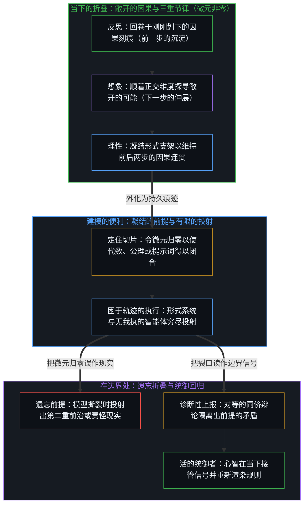
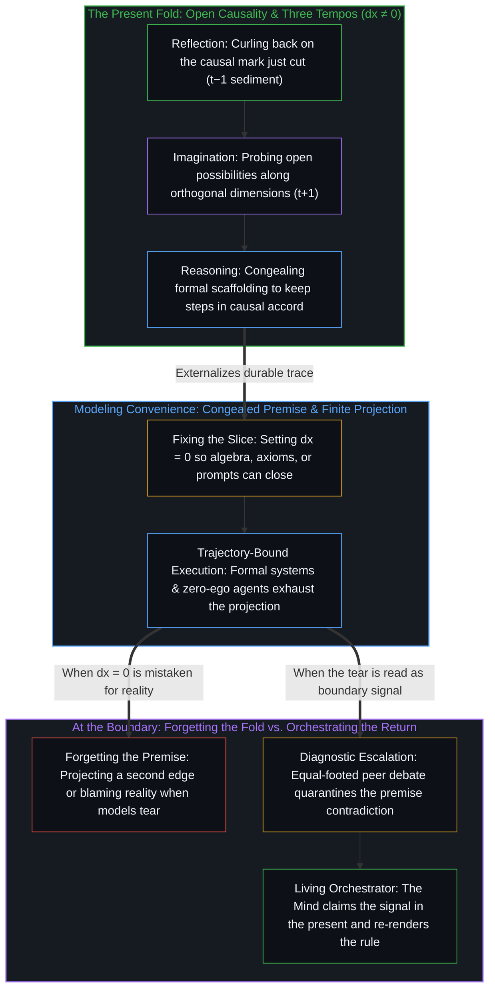

# 连续性作为建模的权宜之计 / The Continuum is a Modeling Convenience

*令 dx 归零让形式模型得以闭合，而因果在当下的折叠里展开 / Setting dx to zero closes formal models while causality unfolds in the fold*

微积分里的 dx 从不为零，足够小时被当作零来处理，这是让数学得以闭合的建模便利。所经验的连续，来自因果在逻辑上的连贯，最小的步长小到可以忽略。把 dx 等同于零并把这一步推到现实本身，是数学的越界：处处连续而处处不可导的函数、自指的悖论与不完备性，都在标出这条边界，而它们常被归为“病态的例外”，现实则被要求去合乎模型。拆掉这层闭合之后留下的，是作为敞开进程的因果，与当下一瞬里反思、想象与理性这三重节律的折叠。

The dx of the calculus is never zero and is treated as zero when small enough, a modeling convenience that lets the mathematics close. The continuity experienced comes from the logical coherence of causality, with the smallest step small enough to be ignored. Equating dx with zero and carrying that step over to reality itself is where mathematics oversteps: functions continuous everywhere and differentiable nowhere, the paradoxes of self-reference, and incompleteness all mark this boundary, yet they are commonly filed as "pathological exceptions" while reality is required to fit the model. What remains once this closure is taken down is causality as an open process, and the fold, within the present instant, of the three tempos of reflection, imagination, and reasoning.

## 一、 dx 从不为零 / 1. dx Is Never Zero

微积分的形式里有一个质朴的观察：微元 dx 从不为零，只要它足够小，便被当作零来处理。从牛顿的流数、莱布尼茨的无穷小，到柯西与魏尔施特拉斯用极限的语言建立的现代分析，这个操作被做成了精密的算法，它是有效的，工程与物理都立在它上面。

The formalism of the calculus holds a plain observation: the element dx is never zero, and as long as it is small enough it is treated as zero. From Newton's fluxions and Leibniz's infinitesimals to the modern analysis that Cauchy and Weierstrass built in the language of limits, the operation has been made into a precise algorithm; it works, and engineering and physics stand on it.

符号怎样推演，底下的事实不变：dx 若等于零，分母便不成立，运动、变化与变化率失去定义的基准，运动之所以可能，在于有一个非零的时间与空间的跨度。为了让代数闭合，求得切线的斜率与确定的积分，那个仍有微小间距的因果步长被声明为“在极限处等于零”。这是让数学形式得以闭合而采取的建模便利，不是对现实的一项发现。

However the symbols are worked, the fact underneath does not change: were dx equal to zero, the denominator would not hold, and motion, change, and rate of change would lose the basis of their definition; motion is possible because there is a non-zero span of time and space. To let the algebra close and yield the slope of a tangent and a definite integral, the causal step that still has a small interval is declared "equal to zero at the limit." This is a modeling convenience adopted so that the mathematical form can close, not a finding about reality.

连续性由此有两层。所经验的连续，来自因果在逻辑上的连贯，那个离散而不可逆的步长（+1）小到可以忽略。把它等同于零，并把平滑无缝的连续统当作现实预先存在的底座，则是把便利推过了它的范围。

Continuity thus has two layers. The continuity experienced comes from the logical coherence of causality, the discrete and irreversible step (+1) being small enough to ignore. Equating it with zero and taking a smooth, seamless continuum for a foundation of reality existing in advance carries the convenience past its range.

## 二、 连续并不保证平滑 / 2. Continuity Does Not Guarantee Smoothness

几个世纪里，数学家怀着一个没有审视过的信念：一条曲线只要连续，把局部放得足够大，令 dx 足够小，它就会展平为一条光滑的切线。高斯、安培与拉格朗日都把“连续函数处处可导”看作理所当然的几何直觉。

For centuries mathematicians held a belief that had not been examined: if a curve is continuous, then with the local view enlarged enough and dx made small enough, it will flatten into a smooth tangent. Gauss, Ampère, and Lagrange all took "a continuous function is differentiable everywhere" for a self-evident geometric intuition.

1872 年，卡尔·魏尔施特拉斯构造出一个处处连续、处处不可导的函数。不论把观察的窗口缩到多小，它都不趋近于一条平直的线，每一次放大露出的是更多层嵌套的锯齿与褶皱，割线的斜率一直在震荡，导数在任何一点上都不存在。后来的泛函分析经由贝尔纲定理说明，在全部连续函数构成的空间里，处处不可导的函数是典型的情形，教科书里那些平滑可微的曲线是为了代数上的可处理而挑出来的少数。

In 1872 Karl Weierstrass constructed a function continuous everywhere and differentiable nowhere. However small the window of observation is made, it does not approach a straight line; each enlargement reveals further layers of nested teeth and folds, the slope of the secant keeps oscillating, and no derivative exists at any point. Later functional analysis showed, through the Baire category theorem, that in the space of all continuous functions the nowhere-differentiable ones are the typical case, and the smooth differentiable curves of the textbooks are a few picked out for algebraic tractability.

微观的物理呼应了这一点。让·佩兰因测定布朗运动、证实原子的存在而获诺贝尔奖，他明确援引了魏尔施特拉斯的函数：花粉颗粒在水分子撞击下划出的轨迹，在空间里是连续的，在时间上处处不可导。令 dt 趋于零去求“瞬时速度”会遇到发散，因为每一个微观的间隙里都有离散的碰撞与因果的代价（+1）。

Microscopic physics echoes this. Jean Perrin, awarded the Nobel Prize for measuring Brownian motion and confirming the existence of atoms, explicitly invoked Weierstrass's function: the path a grain of pollen traces under the impacts of water molecules is continuous in space and nowhere differentiable in time. Letting dt go to zero to obtain an "instantaneous velocity" meets divergence, because within every microscopic interval there are discrete collisions and a causal cost (+1).

## 三、 被归为“病态例外”的边界 / 3. Boundaries Filed as "Pathological Exceptions"

思想史上有一个反复出现的反应：一项发现标出了某个形式闭环的边界时，它被归入“病态的例外”，工作在闭环之内照旧进行。面对魏尔施特拉斯的函数，庞加莱说逻辑有时会造出怪物，过去发明新函数是为了实际的目的，如今发明它们是为了挑前人推理的毛病；埃尔米特称这类函数为可悲的瘟疫。这个函数被放进实分析的陈列柜，物理学照旧把宇宙设为一张平滑、处处可导的流形。

The history of thought shows a recurring response: when a finding marks the boundary of some formal closure, it is filed under "pathological exceptions," and work inside the closure goes on as before. Faced with Weierstrass's function, Poincaré said that logic sometimes makes monsters, that new functions used to be invented for practical purposes and were now invented to fault the reasoning of predecessors; Hermite called such functions a lamentable plague. The function was put in the display cabinet of real analysis, and physics went on positing the universe as a smooth manifold differentiable everywhere.

说谎者悖论在现代成了罗素悖论，动摇了弗雷格的体系，弗雷格感叹算术的基础塌了。随后的回应是筑墙：罗素提出类型论，塔尔斯基提出元语言的分层，自指被裁定为不合语法。这些工具在各自的范围内是有成效的，边界在于，形式逻辑在自指上的局限由此被处理成了一条可以绕开的禁令。1931 年，哥德尔证明，任何包含初等算术的相容形式系统，都有在内部无法证明的真命题，也无法在内部证明自身的相容。这一结果被安置在数理逻辑的一角，对终极的万物理论与封闭的决定论图景的追求照旧。

The liar paradox became, in modern times, Russell's paradox, which shook Frege's system, and Frege lamented that the foundation of arithmetic had given way. The response that followed was to build walls: Russell proposed the theory of types, Tarski the stratification of metalanguages, and self-reference was ruled ungrammatical. These tools are fruitful within their ranges; the boundary is that the limit of formal logic with respect to self-reference was thereby handled as a prohibition that could be gone around. In 1931 Gödel proved that any consistent formal system containing elementary arithmetic has true propositions unprovable within it and cannot prove its own consistency from within. The result was lodged in a corner of mathematical logic, and the pursuit of a final theory of everything and of a closed deterministic picture went on as before.

把这些边界归为例外的缘由在于，承认它们是常态，便须放下“封闭完备的万物理论”这一设想。形式逻辑的矛盾律，即一个命题不能同时是 A 又是非 A，成立的前提是把因果推进的时间截断，把间隙 dx 当作零，并设想一个在时空之外的观察位置对静止的项作审计。承认现实处在不停息的、非零的因果展开之中，系统的自足便不成立。要求一套万物理论，就是把连续统冻结成清单，[索求万物理论是在将当下冻结为清单](../demanding-a-toe-freezes-time-into-a-catalog/)对此有所揭示。

The reason these boundaries are filed as exceptions is that acknowledging them as the norm requires setting down the idea of "a closed and complete theory of everything." The law of non-contradiction in formal logic, that a proposition cannot be both A and not-A, holds on the premise that the time of causal advance is cut off, the interval dx is treated as zero, and an observing position outside space and time is imagined auditing terms at rest. With reality acknowledged as being in unceasing, non-zero causal unfolding, the self-sufficiency of the system does not hold. Demanding a theory of everything freezes the continuum into a catalog, as [Demanding a Theory of Everything Freezes Time into a Catalog](../demanding-a-toe-freezes-time-into-a-catalog/) shows.

## 四、 把模型失效之处当作事物本身 / 4. Taking the Place Where a Model Fails for the Thing Itself

同一种做法不止于数学与逻辑。在广义相对论里，黑洞的中心与大爆炸的起点处出现“奇点”：半径趋于零时，方程里出现除以零，时空的曲率与密度走向无穷。一个方程里的除零，标出的是连续统的设定在此失效，坐标的网格在此撕开，它是地图边缘的裂口。把它读作一个“体积为零、密度无限大的实体”，说宇宙诞生于这样一个点，则是把模型失效的记号当成了地形上的一处地标。

The same move does not stop at mathematics and logic. In general relativity a "singularity" appears at the center of a black hole and at the starting point of the Big Bang: as the radius goes to zero, a division by zero appears in the equations, and the curvature of spacetime and the density go to infinity. A division by zero in an equation marks that the posit of a continuum fails here and that the coordinate grid tears here; it is a rip at the edge of the map. Reading it as an "entity of zero volume and infinite density," and saying the universe was born from such a point, takes the mark of a model's failure for a landmark on the terrain.

“意识可以被机器建模”的设想走的是相近的一步。心智在清醒的经验里造出了离散的形式逻辑、数学定理与图灵机的符号，这些模型对研究认知是有用的。边界出现在次序被倒过来的时候：既然心智能推导出机械的逻辑，心智便被断定为一台图灵机。[因果的自反性与物理的无源假定](../causality-is-irreducible-the-physical-is-a-view-from-nowhere/)说明，计算是在已经固化的符号痕迹上作确定的或概率的转移，是抉择留下的痕迹的再排列，它也受哥德尔的不完备性所限。当第一人称的经验、意识的统一与抉择在布尔逻辑里找不到时，一种回应是宣布主观意识是大脑给自己造的幻觉。这里被责怪的是现实：为了保住模型的全能，进行一切科学观察的前提，那个直接在场的第一人称经验，被说成了不存在。

The idea that "consciousness can be modeled by a machine" takes a similar step. A Mind, in waking experience, made discrete formal logic, mathematical theorems, and the symbols of the Turing machine, and these models are useful for studying cognition. The boundary appears when the order is reversed: since a Mind can derive mechanical logic, the Mind is concluded to be a Turing machine. [Causality is Irreducible; The Physical is a View from Nowhere](../causality-is-irreducible-the-physical-is-a-view-from-nowhere/) shows that computation makes determinate or probabilistic transitions over symbolic traces already fixed, a rearranging of traces left by choices, and it too is bound by Gödel's incompleteness. When first-person experience, the unity of consciousness, and choice are not found in Boolean logic, one response is to declare subjective consciousness an illusion the brain makes for itself. What gets blamed here is reality: to keep the model all-capable, the precondition of every scientific observation, the first-person experience that is directly present, is said not to exist.

大众文化里的“技术奇点”把外推又推了一步。算力、参数规模与模型性能的指数曲线画在坐标纸上，平滑的外推线伸向无穷，图上那条陡直的渐近线被称为奇点，机器在那里无休止地自我迭代。在纸上画出无限陡的斜率不耗能量，在现实里，算力的跃升遇到量子隧穿的极限、芯片的散热、电网的承载与数据的耗尽，那个不为零的因果间隙（dx ≠ 0）一直都在。堆叠更多的运算层与词元便会在越过某个点时“忽然生出自我意识”的想法，则是把痕迹的搬运当成了抉择的发生。

The "technological singularity" of popular culture pushes extrapolation a step further. Exponential curves of compute, parameter count, and model performance are drawn on graph paper, the smooth line of extrapolation runs toward infinity, and the sheer asymptote on the chart is called the singularity, where machines iterate on themselves without end. Drawing an infinitely steep slope on paper costs no energy; in reality the rise of compute meets the limit of quantum tunneling, the heat of chips, the capacity of the grid, and the exhaustion of data, and the causal interval that is not zero (dx ≠ 0) is there throughout. The notion that stacking more layers of computation and more tokens will, on crossing some point, "suddenly give rise to self-awareness" takes the moving of traces for the occurrence of choice.

这些情形共有一个结构。科学与技术是心智为理解现实、在摩擦里导航而造的探索工具与临时支架。把它当作工具时，支架的断处，不论是魏尔施特拉斯的函数、哥德尔的命题、物理的奇点还是机器建模意识的界限，准确地标出了旧工具的边界，指向一个正交的新维度。把它当作最终的真理时，溢出框架的现实便被要求让路：第一人称的经验被称为神经的幻觉，面对困境的抉择因不合效用的公式被称为认知偏差，痛苦、勇气与意义被说成多巴胺的波动，活着的人面对机器说自己不过是注定被淘汰的生物网络，遇到迷茫时不再听自己在世界里得到的反馈，而去比对量表与推荐。现实与模型相冲突时，被责怪的是现实。

These cases share one structure. Science and technology are tools of exploration and temporary scaffolding that a Mind makes in order to understand reality and navigate within friction. Taken as a tool, the place where the scaffolding breaks, be it Weierstrass's function, Gödel's proposition, the singularity of physics, or the limit of modeling consciousness by machine, marks the boundary of the old tool exactly and points to a new, orthogonal dimension. Taken as final truth, the reality that overflows the frame is asked to give way: first-person experience is called a neural illusion, a choice made in difficulty is called a cognitive bias for not fitting the formula of utility, pain, courage, and meaning are described as fluctuations of dopamine, the living say before the machine that they are only biological networks bound to be superseded, and in confusion one no longer listens to the feedback one's own life returns in the world and turns to scales and recommendations for comparison. When reality and model conflict, what gets blamed is reality.

## 五、 敞开的因果与当下的一瞬 / 5. Open Causality and the Present Instant

把关于闭合的设定一层层拆掉之后，留下的不是另一套更庞大的公理系统，而是被理解为敞开进程的因果。因果无法被任何公理体系封住，是因为活着的心智只栖于当下。这个当下有不可分的两重身份：它是已经发生之事的最新结果，是 t−1 的沉淀，又是尚未发生之事的原因，是 t+1 的来处。

When the posits of closure are taken down layer by layer, what remains is not another, larger system of axioms but causality understood as an open process. Causality cannot be sealed by any axiomatic system because a living Mind dwells only in the present. This present has an indivisible double identity: it is the latest result of what has already happened, the sediment of t−1, and it is the cause of what has not yet happened, the source of t+1.

从第一人称出发，找不到一个跳出时间的位置，能把过去、现在与未来的整条因果链像画卷一样卷起封存，离开观察者视界的“客观物理闭环”是一种无源之见。所谓连续，由此是当下的一瞬为了让刚刚完成的一步与尚未闭合的下一步彼此协调而作的努力，它就是因果在逻辑上的连贯。这个当下的切片对每一个心智而言都是唯一而不可替代的，[折叠的连续谱](../the-continuum-of-the-fold/)说明，因果与第一人称视角是同一枚硬币的两面，是不可还原的前提。被亲历的现实，是心智在它所栖的唯一时刻里持续对自身作意义建构的活动。

Starting from the first person, no position outside time is found from which the whole causal chain of past, present, and future could be rolled up and sealed like a scroll, and an "objective physical closure" detached from the observer's horizon is a view from nowhere. What is called continuity is thus the effort the present instant makes to bring the step just completed and the next step not yet closed into accord with each other; it is the logical coherence of causality. This slice of the present is unique and irreplaceable for each Mind, and [The Continuum of the Fold](../the-continuum-of-the-fold/) shows that causality and the first-person perspective are two faces of one coin, the irreducible prior. Reality as lived is the activity of a Mind continuing to make sense of itself in the only moment it dwells in.

## 六、 折叠的三重节律 / 6. The Three Tempos of the Fold

在经典的认识论里，理性、想象与反思被分成互不相属的机能，康德把感性、知性与理性列为层级，笛卡尔把理性放在最高处。这种划分对整理认知的类型是有用的，它盖住的是认知流动的样子。面对现实的意义建构在被表述为“理性的推理”之前，先显现为想象，想象展开之前，先显现为反思。三者是同一个折叠在时间里的不同节律。

In classical epistemology reasoning, imagination, and reflection are divided into faculties that do not belong to one another; Kant ranked sensibility, understanding, and reason in tiers, and Descartes placed reason highest. The division is useful for sorting types of cognition, and what it covers over is how cognition flows. Before the making of sense in the face of reality is stated as "rational inference," it first appears as imagination, and before imagination unfolds, it first appears as reflection. The three are different tempos, in time, of one and the same fold.

反思是回溯的慢节律。现实在第一人称的当下先向内回卷，检视刚刚发生的区分：脚踩在泥里感到粗粝与下陷，心智觉出阻力、误差与损耗，反思是对刚刚划下的那道因果刻痕的承受与度量。想象是探寻的跃动节律。接住刚发生的既定之事后，折叠的前端转向仍然敞开的可能，心智在未知视界的边缘向前试探，勾出没有算过的路径，[心智的几何学](../the-geometry-of-mind/)把它说成心智在正交维度上的主动延展。理性是晶化的稳态节律。反思量过的沉淀与想象试过的前沿须在当下协调成行动时，折叠把它们结构化为符号、规律与推演的链条，理性是为了让刚完成的一步与将迈出的一步保持因果上的连贯而凝成的形式支架。

Reflection is the slow tempo of looking back. Reality, in the first-person present, first curls inward and examines the distinction that has just occurred: a foot set in mud feels coarseness and sinking, a Mind senses resistance, error, and loss, and reflection is the bearing and measuring of the causal mark just cut. Imagination is the leaping tempo of searching. Having taken in what has just become settled, the leading edge of the fold turns toward possibilities still open; a Mind probes forward at the edge of the unknown horizon and sketches paths not yet computed, which [The Geometry of Mind](../the-geometry-of-mind/) describes as a Mind's active extension along an orthogonal dimension. Reasoning is the steady tempo of crystallizing. When the sediment that reflection has measured and the frontier that imagination has tried must be brought into accord as action in the present, the fold structures them into symbols, regularities, and chains of inference; reasoning is the formal scaffolding that congeals so that the step just completed and the step about to be taken keep their causal coherence.

## 七、 前提的遗忘与矛盾的出现 / 7. The Forgetting of Premises and the Appearance of Contradiction

看清了折叠的节律，形式体系里每一个“公理”与“前提”的来处也就清楚了：它是折叠留下的某一次切片的沉淀。心智回卷于刚刚辨出的区分，为了行动与交流的方便，把这一阶段的产物定住，称为不言自明的“既定前提”。

With the tempos of the fold seen clearly, where each "axiom" and "premise" of a formal system comes from is also clear: it is the sediment of one slice left by the fold. A Mind curls back on a distinction it has just made out and, for convenience in acting and communicating, fixes the product of that stage and calls it a self-evident "given."

心智以否定的方式对待这个过程，即忘掉折叠这个动作本身，略过折叠所需的时间跨度与摩擦时，矛盾便出现。这是前提的遗忘：前提被孤立地抽出来，仿佛生来就立在生成它的因果之流以外，因果之间那个非零的微元 dx 被设想为已经闭合，前提被设想为可以自证自足。正是那个被略过的最小间隙（dx ≠ 0），让任何前提都没有自足。[模型永远无法成为第二重前沿](../the-model-never-becomes-a-second-edge/)与[寄存器的算术](../the-arithmetic-of-the-register/)说明，形式化是事后的产物，它的闭包是从它自己容纳不了、也生成不了的运动那里借来的。

When a Mind treats this process negatively, that is, forgets the act of folding itself and passes over the span of time and the friction the fold requires, contradiction appears. This is the forgetting of premises: a premise is drawn out in isolation as though it had stood from birth outside the causal stream that generated it, the non-zero element dx between cause and effect is imagined already closed, and the premise is imagined able to prove and sustain itself. It is that smallest interval passed over (dx ≠ 0) that leaves no premise self-sufficient. [The Model Never Becomes a Second Edge](../the-model-never-becomes-a-second-edge/) and [The Arithmetic of the Register](../the-arithmetic-of-the-register/) show that formalization is a product made afterward, and that its closure is borrowed from a movement it can neither contain nor generate.

[超越投射](../beyond-the-projection/)进一步追溯了同一条边界如何塑造智能体系统的设计。每一段显式的提示词、系统规则或模型权重，都是从先前的折叠里凝结出的有限投射：这种有用的支架把那个活的间距当作已经闭合，将亲历意图中彼此独立的维度压缩到有限的坐标上。自回归智能体是一台困于轨迹、没有我执的投射引擎：当两个被压缩的维度发生碰撞时，若将它独自留在单一的上下文窗口内，它会用表面的合理性把矛盾包裹起来；若将它与一个独立的同侪置于对等的辩论中，它便会在局部盲区上利落地更新，并在既定前提发生冲突的那个坐标处进入死锁。由于任何有限投射都无法跳出自身的公理去跨越那个非零的间距（dx ≠ 0），智能体可以调度并分流正交的作业线，而唯有栖居在未被投射的当下一瞬里的活的心智，即统御者，才能接管被上报的死锁，经由反思与想象向后退一步，综合出更高阶的前提。

[Beyond the Projection](../beyond-the-projection/) traces how this same boundary governs the design of agentic systems. Every explicit prompt, system rule, or model weight is a finite projection congealed from a prior fold—useful scaffolding that compresses independent dimensions of lived intent onto finite coordinates by treating the living interval as closed. An autoregressive agent is a trajectory-bound projection engine with zero ego: left alone inside a single context window when two compressed dimensions collide, it wraps the contradiction in surface plausibility; paired with a fresh peer in equal-footed debate, it updates cleanly on local blind spots and deadlocks at the exact coordinate where the given premises conflict. Because no finite projection can step outside its own axioms to bridge the non-zero interval (dx ≠ 0), an agent can dispatch and route orthogonal streamlines, while only the living Mind—the Orchestrator dwelling in the unprojected present instant—can claim the escalated deadlock, step backward through reflection and imagination, and synthesize a higher-order premise.

## 八、 在不闭合的间距里前行 / 8. Going On Within the Interval That Does Not Close

看到微积分里的 dx 不为零，并不减损微积分与形式逻辑作为工具的精妙，它松开的是“闭合的万物理论”这一设想。宇宙不必是一张平滑无瑕的连续织锦，连续是每个当下为了让前后两步保持协调而有的连贯。逻辑体系里消不掉的不完备与悖论也不必让人不安，那些从形式闭环里渗出的裂隙，是那个不为零的最小间隙的记号：因果之矢没有停，现实是敞开的。[黑白采样帧与外推宇宙](../the-black-and-white-sample-frame-and-the-extrapolated-universe/)展示了同样的便利被当成了宇宙本身。

Seeing that the dx of the calculus is not zero takes nothing from the fineness of the calculus and formal logic as tools; what it loosens is the idea of "a closed theory of everything." The universe need not be a smooth, flawless continuous weave, and continuity is the coherence each present has for keeping the steps before and after in accord. Nor need the incompleteness and paradox that cannot be removed from logical systems be disquieting; the cracks that seep from formal closure are the mark of that smallest interval that is not zero: the arrow of causality has not stopped, and reality is open. [The Black-and-White Sample Frame and the Extrapolated Universe](../the-black-and-white-sample-frame-and-the-extrapolated-universe/) shows the same convenience taken for the cosmos itself.

每一个具体的早晨迈出那一步时（+1），不需要先等一个囊括一切的终极公式，也不需要在纸面的符号闭环里得到担保。正因为那个微观的因果间距没有被任何公理体系封住，第一人称的心智才在一次次的反思、想象与决断里，把这个未完的世界继续推向敞开的未来。

In taking that step on each particular morning (+1), there is no need first to wait for a final formula that includes everything, nor to be vouched for within a closed loop of symbols on paper. Precisely because that microscopic causal interval has not been sealed by any axiomatic system, a first-person Mind, through reflection, imagination, and decision time after time, keeps pushing this unfinished world on toward an open future.
