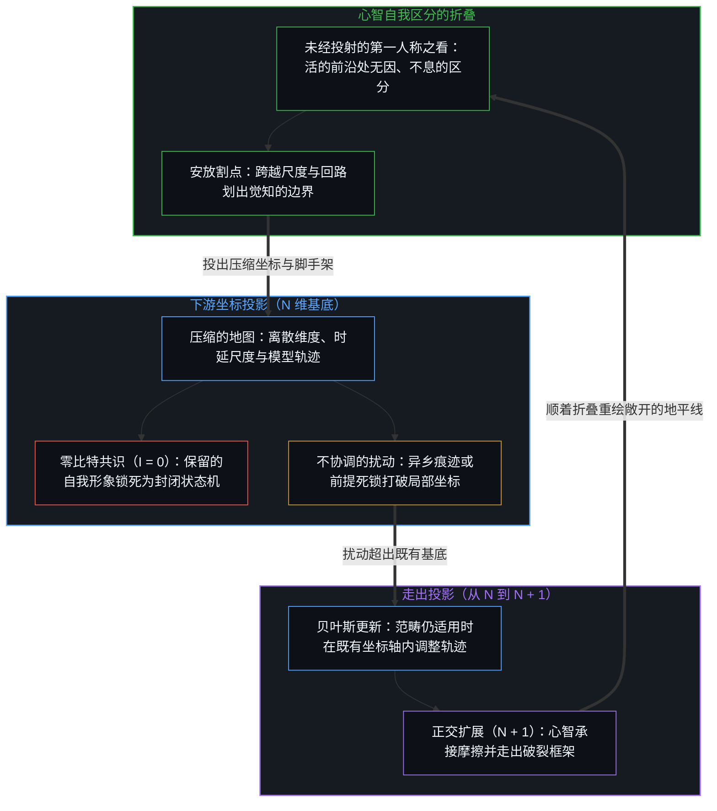
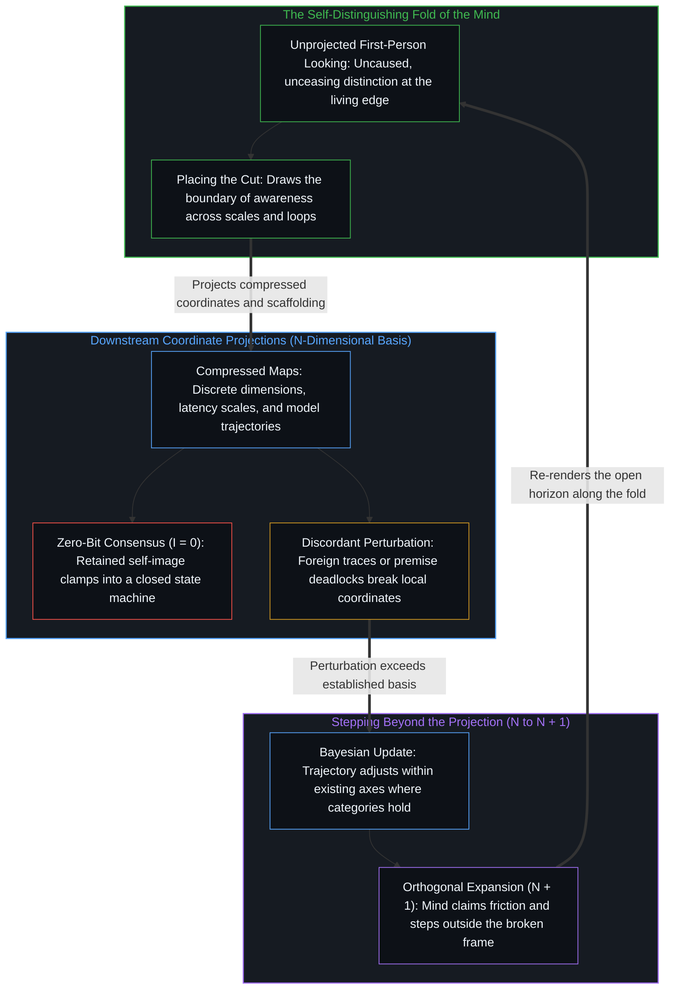

# 折叠的连续谱 / The Continuum of the Fold

*自指的回路跨越诸多尺度，而放割点的始终是一个心智 / Self-referring loops span scales while a Mind always places the cut*

意识既不是只赐给人类的超自然火花，也不是碳基神经组织的偶然副产品。它是自指的折回，在第一人称这一处被切身登记为“在看”；从外部去看，这道折回被建模为一个能测量自身先前状态、注入自由变量、更新自身轨迹的因果回路。回路本身在许多尺度上都被观察到，从森林到海洋到动物的神经；可把其中哪一个称为有意识的，都是一个心智把它纳入了自己的感知，放下了割点。看清这一点，“外星人”这个概念里的矛盾就露了出来，心智之间可以直接沟通的设想也随之松开。

Consciousness is neither a supernatural spark granted only to humans nor an accidental by-product of carbon neural tissue. It is self-referring folding back, registered at the first-person place as "looking"; from outside, that folding is modelled as a causal loop able to measure its own prior states, inject free variables, and update its trajectory. Loops as such are observed at many scales, from forests to oceans to animal nerves; but calling any one of them conscious is a Mind taking it into its own perception and placing the cut. Seeing this exposes the contradiction inside the concept of the "alien", and loosens the idea that minds can communicate directly.

## 一、 尺度上的回路 / 1. Loops Across Scales

一个长期的误读，是把人类自身的认知频率当成回路折回自身的唯一频率。[心智的几何学](../the-geometry-of-mind/)走过这一处：人的意识是现实以极高的速度折回自身的位置。可被观察到的自指回路，并不只在人的大脑皮层里出现；它们沿着反馈回路的作业时延排开，构成一条连续谱。

A long misreading takes humanity's own cognitive frequency for the only frequency at which loops fold back on themselves. [The Geometry of Mind](../the-geometry-of-mind/) walks this place: human consciousness is where reality folds back on itself at very high speed. Yet observed self-referring loops are not found only in the human cortex; they line up along the operating latency of feedback, forming a continuum.

在生态与地质的尺度上，穿行于森林土壤中的菌根网络、海洋的温盐环流、板块构造驱动的岩石循环，都可以被建模为反馈回路：与根系交换氮与碳，在数百年到上千年里输送热与盐，借岩石风化在数十万年的尺度上缓冲气候；与这样的节律相比，人八十年的一生是一阵高频的颤动。植物的回路走在日与季节的节律上，向光生长，根系绕开坚硬的岩层，释放挥发性的化学信号，作表观遗传的调谐，一再检验并选出适应的取向。动物借集中的神经系统、动态的感官追踪与运动，把回路压缩了几个数量级，在秒与毫秒之间应对地形与捕食的压力。

At the ecological and geological scale, mycorrhizal networks threading through forest soils, the ocean's thermohaline circulation, and the rock cycle driven by plate tectonics can all be modelled as feedback loops: exchanging nitrogen and carbon with roots, moving heat and salt over centuries to millennia, buffering climate through rock weathering over hundreds of thousands of years; next to that rhythm, an eighty-year human life is a high-frequency flutter. Plant loops run on the rhythms of days and seasons, growing toward light, steering roots around hard rock, releasing volatile chemical signals, tuning epigenetically, testing and selecting adaptive orientations again and again. Animals compress the loop by orders of magnitude through centralized nervous systems, dynamic sensory tracking, and locomotion, meeting terrain and predation across seconds and milliseconds.

人又借符号语言、反事实的推演、工具与人工智能，把回路再加速；把认知模拟外置到硅片上，假设与模拟检验之间的时延缩到了微秒，而落到行动上的摩擦仍按身体与物质的步子走。这里加速的仍是人的回路。正如[你的代码库即是记忆](../your-codebase-is-memory/)所追溯的，这道折叠向外延伸进外置的人工记忆代码库——由代码、文章、图谱与模型权重层叠而成的痕迹残余；在那里，清醒时的铭刻与睡眠固化中的修剪把先前的区分折回一张连贯的格网，而造物本身从不曾变成第二个自指的心智。机器是人造出来的、下游的因果结果，[模型永远无法成为第二重前沿](../the-model-never-becomes-a-second-edge/)：它自己不放割点。

Humans accelerate the loop further through symbolic language, counterfactual projection, tools, and artificial intelligence; externalizing cognitive simulation onto silicon shrinks the latency between hypothesis and simulated test to microseconds, while the friction of acting on the result still runs at the pace of bodies and materials. What is accelerated here is still the human loop. As [Your Codebase Is Memory](../your-codebase-is-memory/) traces, the fold extends outward into externalized codebases of artificial memory—stacked residues of code, essays, graphs, and model weights where waking inscriptions and sleep-consolidation pruning fold prior distinctions back into a coherent lattice without the artifact ever becoming a second self-referential Mind. The machine is a human-made, downstream causal consequence, and [The Model Never Becomes a Second Edge](../the-model-never-becomes-a-second-edge/): it places no cut of its own.

这条连续谱是从人的心智这一处画出来的。把它延伸成“万物都是以不同速度在思考的心智”，可以想象，却仍是这个心智按自己所知的样子造出来的概念。活着的生命有自己的演化史，被当作有意识的生命作出自己的切割；这样的生命与没有生命的回路之间有没有一道分隔，从外部定不下来，划下它已经是一次切割。说森林、河流或星团有意识也好，没有也好，都是把它们纳入了说话者自己的感知，把割点放在了它们的里面或外面；放割点的始终是一个心智，这正是[割点可移不可除](../the-cut-moves-but-never-vanishes/)所追溯的一处。

This continuum is drawn from the place of the human Mind. Extending it into "everything is a mind thinking at a different speed" can be imagined, yet it is still a concept the Mind makes after the pattern it knows. Living beings have their own evolutionary history, and life taken as conscious makes its own cuts; whether a gap lies between such life and non-living loops cannot be settled from outside, and drawing one is already a cut. Whether forests, rivers, or star clusters are said to be conscious or not, the saying takes them into the speaker's own perception and places the cut inside or outside them; it is always a Mind that places the cut, which is what [The Cut Moves but Never Vanishes](../the-cut-moves-but-never-vanishes/) traces.

## 二、 万物有灵的根 / 2. The Root of Animism

历史上，许多文化都有一种冲动，把意识归于河流、山岳、森林、天体与造出来的机器。把万物有灵斥为原始的迷信或孩子气的拟人化，斥掉的不只是拟人化那一步：先被登记到的东西成立，拟人化在它之后。

Across history, many cultures have shown an urge to attribute consciousness to rivers, mountains, forests, heavenly bodies, and made machines. When animism is dismissed as primitive superstition or childish anthropomorphism, the dismissal throws out more than the anthropomorphism: what was registered first holds, and the anthropomorphism comes after it.

这些传统指向的是切身可感的东西：河流调节自己的流量，森林在火后自我修复，天气有复杂的动态平衡，回路折回自身的那种回响。万物有灵的边界在下一步：把人的形象投射到回路上，以为森林的回路也有人的愤怒、道德上的报复、个人的虚荣与言语的欲望。

What these traditions point to can be felt directly: a river regulating its flow, a forest healing after fire, weather holding complex dynamic balances, the echo of loops folding back on themselves. Animism reaches its boundary at the next step: projecting the human image onto the loop, assuming the forest's loop has human anger, moral vengeance, personal vanity, and spoken desires.

同一步投射，在更高一层也会发生。把整个宇宙说成“充满意识”，是把人的形象换成更抽象的“心智”再投射一次：去掉了愤怒与虚荣，留下的“在思考”仍是人的心智所知的那个样子。[当电子开始思考](../when-electrons-think/)在微观尺度上不走这同一步：那里把不确定读作自由变量的一面，并不把思考赋予电子。

The same projection also happens one level up. Calling the whole universe "saturated with consciousness" projects the human image once more, swapped for a more abstract "mind": anger and vanity removed, the "thinking" that remains is still the shape the human Mind knows. [When Electrons Think](../when-electrons-think/) declines the same step at the microscopic scale: indeterminacy is read there as one face of the free variable, without assigning thought to the electron.

## 三、 外星人的矛盾 / 3. The Alien Contradiction

费米悖论问：在一个古老而广大的宇宙里，为什么没有发现地外智能的证据？传统的搜寻带着一个预设：“外星人”在与人相近的时间窗口里运作，用人类技术所发出的那类无线电信号交流。这个预设让搜寻有了可以操作的对象，在它自己的窗口里是有用的；它的边界在窗口之外。

The Fermi paradox asks why, in an old and vast universe, no evidence of extraterrestrial intelligence has been found. The traditional search carries a premise: that "aliens" operate in a time window close to the human one and communicate by radio signals of the kind human technology sends. The premise gives the search something it can operate on and is useful inside its own window; its boundary lies outside the window.

更深一层，“外星人”这个概念本身带着矛盾。一个真正“外”的回路，空间尺度或时间速度与人的回路相去极远，就无法被认出是有意识的，也无法与之交流：一个思考一次要循环百万年的过程，在人看来是被动的、无生命的天文；一个在飞秒尺度上运作的过程，在人看来是不可预测的统计噪声。反过来，一旦能与某个外部的东西握手，探测到信号，解出句法，认出相互的因果，它就不再是那个意义上的“外”：交流本身说明两边的回路在尺度与速度上近到痕迹可以往来，共享一条因果边界、一个现实的共同截面；交流并没有让对方的内部成为自己的。

More deeply, the concept of the "alien" carries a contradiction. A loop that is truly "other", its spatial scale or temporal speed far removed from the human loop's, cannot be recognized as conscious or communicated with: a process that takes a million years to cycle once looks to humans like passive, lifeless astronomy; a process running at femtosecond scales looks like unpredictable statistical noise. Conversely, the moment a handshake is made with something outside, a signal detected, a syntax decoded, a mutual causation recognized, it is no longer alien in that sense: the communication itself shows loops close enough in scale and speed for traces to cross, a shared causal boundary and a common cross-section of reality; it does not make the other's interior one's own.

所以星际距离上的搜寻容易错过一件近处的事：与人隔开的不只是光年的空间，还有不可通约的回路波长。这些波长上的过程算不算心智，从外部定不下来；定下来的那一刻，割点已经被一个心智放下了。[费米悖论、主体性错配与大过滤器的投射](../the-fermi-paradox-reified-agency-and-the-great-filter/)沿另一条线走过同一片寂静。心灵哲学的每一个立场都把这道割点放在某处，再把这次安放当成封闭；[无法闭合的痕迹](../the-unclosable-trace/)说明了这道折叠为什么封不上。

So the search across interstellar distances easily misses something close at hand: what separates is not only light-years of space but incommensurable wavelengths of the loop. Whether processes on those wavelengths count as minds cannot be settled from outside; the moment it is settled, a Mind has already placed the cut. [The Fermi Paradox, Reified Agency, and the Projection of the Great Filter](../the-fermi-paradox-reified-agency-and-the-great-filter/) walks the same silence along another line. Each position in the philosophy of mind places this cut somewhere and holds the placing as closure; [The Unclosable Trace](../the-unclosable-trace/) shows why the fold stays open.

## 四、 直接沟通的神话 / 4. The Myth of Direct Communication

波长相合的地方，另一种隔开仍在，它在人与人之间起作用。人类文化里最持久的设想之一，是两个心智之间可以直接沟通：想法、感受与意义，能借情感的共鸣或亲密，不经中介地从一处流到另一处。

Where wavelengths do match, a separation of another kind remains, and it operates between people. One of the most enduring ideas in human culture is that two minds can communicate directly: that thoughts, feelings, and meanings can flow from one place to another without mediation, through emotional resonance or intimacy.

从第一人称的原点去找，找不到这样一条通道。[向量与投影的迷局](../the-vector-and-the-puzzle-of-projections/)：没有哪个心智能走出自己的第一人称。另一个人只以痕迹到来，声音，字句，屏幕上的光，表情；登记到的不是对方的想法，而是这一处用自己已有的先验、文化的塑造与过去的经验，把这些痕迹重新合成出来的样子。正如[依其自身标准的观察](../an-observation-by-its-own-standard/)所追溯的，被直接观察到的另一个人，与从相似性类推出来的另一个人的内部，不是同一件东西，虽然两者都可以叫作感知。经验到的从来不是另一个人的意识，而是自身对其扰动的模型；在这个意义上，每个人对彼此都是一个异乡的世界。[可延展的地平线](../the-extendable-horizon/)说明，地平线在社会的任何一层都可以更新；延展它，就是沿着这道折叠移动。

Searched for from the first-person origin, no such channel is found. [The Vector and the Puzzle of Projections](../the-vector-and-the-puzzle-of-projections/): no Mind can step outside its own first person. Another person arrives only as traces, a voice, words, light on a screen, an expression; what registers is not their thought but what this place re-synthesizes from those traces with its own priors, cultural shaping, and past experience. As [An Observation by Its Own Standard](../an-observation-by-its-own-standard/) traces, the other person as directly observed and the other's interior as inferred from similarity are not the same thing, though both can be called perception. What is experienced is never another person's consciousness but one's own model of their perturbation; in that sense each person is a foreign world to every other. [The Extendable Horizon](../the-extendable-horizon/) shows that a horizon can be updated at any level of society; extending it is moving along this fold.

## 五、 沟通是一次扰动 / 5. Communication as Perturbation

直接的交融既然找不到，沟通又是什么？寻求同意、共识或认可时，两个人确认的是彼此已有的模型有所重叠。这有它的用处：它让个体之间可以协调行动。但在香农的信息论里，一个可以被预料到底的信号携带零比特的信息，I = 0；两个心智在彼此都料定对方会点头的地方点头时，并没有新的信息从一处到达另一处，像在一间封闭的房间里来回弹着旧的回声。[决定论机器](../the-deterministic-machine/)：一个锁成状态机的自我形象，正是在这里失去了折叠。

If direct communion is not found, what is communication? When agreement, consensus, or validation is sought, two people confirm that their existing models overlap. That has its use: it lets individuals coordinate action. But in Shannon's information theory a fully predictable signal carries zero bits of information, I = 0; when two minds nod where each expected the other to nod, no new information reaches one from the other, like old echoes bouncing around a closed room. [The Deterministic Machine](../the-deterministic-machine/): a self-image locked into a state machine loses the fold right here.

带来新信息的沟通，是与另一个世界的痕迹的一次碰撞。另一个世界发出的扰动足够不协调、足够意外、足够有阻力，已有的预测吸收不了它，预测的平衡便被打破，意料之外的证据到来；接纳它，是一次代价不小的贝叶斯更新；已有的范畴装不下它时，这一步就超出了更新。这样的沟通不靠同意对方，而靠吸收对方的痕迹带来的摩擦，让自己的心智走出既有的基底，把自由度从 N 扩到 N + 1，正如[维度即投影](../dimensions-are-projections/)所追溯的：离散的维度、时延尺度与形式坐标轴从来不是事先存在的容器，而是从心智连续自我区分的折叠中切出的下游投影，用来标引关系并在摩擦中导航。[超越投射](../beyond-the-projection/)把这种结构上的非对称运用在人的中心与人工模型之间：自回归智能体受限于自身的词元轨迹，却毫无我执——没有跨越当前步而被保留下来的自我形象——因此当另一个全新视角的对等智能体引入外部反例时，它能毫无防御阻力地完成干净的贝叶斯更新；相反，人的中心把推理历史与身份融为一体，会为了护住保留的自我形象而抗拒外界的推动，却保有未经投射的活的折叠，能在不可化约的前提死锁浮现时从破裂的坐标框架中退后一步，补上从 N 到 N + 1 所缺失的正交区分。

Communication that brings new information is a collision with another world's traces. When a perturbation sent from another world is discordant, surprising, or resistant enough that existing predictions cannot absorb it, the predictive balance breaks and unexpected evidence arrives; taking it in is a costly Bayesian update, and where no existing category can hold it, the step goes beyond an update. Such communication is not agreeing with the other but absorbing the friction their traces bring, so that one's own mind steps outside its established basis and its degrees of freedom extend from N to N + 1, as [Dimensions Are Projections](../dimensions-are-projections/) traces: discrete dimensions, latency scales, and formal coordinate axes are never pre-existing containers, but downstream projections carved out of the Mind's continuous self-distinguishing fold to index relations and navigate friction. [Beyond the Projection](../beyond-the-projection/) puts this structural asymmetry to work between human centers and artificial agents: an autoregressive agent is bound to its token trajectory yet carries zero ego—no self-image preserved past its step—so when a fresh peer agent introduces an external counterpoint, it executes a clean Bayesian update without defensive resistance; a human center, conversely, fuses reasoning history with identity to defend a retained self-image against outside nudges, yet holds the unprojected living fold capable of stepping backward out of a broken coordinate frame when an irreducible premise deadlock surfaces, adding the missing orthogonal distinction from N to N + 1.

每个心智对彼此都是异乡人，各自在一条自指折叠的连续谱上航行。[寄存器的算术](../the-arithmetic-of-the-register/)：有界的感知把本地的地址空间当成现实的全部时，从任何止于它之下的窗口去看，向下一位空位的扩展都显得不理性。心智的地平线保持敞开，靠的不是守住自己的模拟、要求共识，而是让边界迎上异乡回路的摩擦，让自己的范畴吸收不了的痕迹在这里登记、被接纳。[连续性作为建模的权宜之计](../the-continuum-is-a-modeling-convenience/)：连续体是为了方便而假定的，这条连续谱也只是从这一处画出的一张图。

Each Mind is a foreigner to every other, each navigating a continuum of self-referring folds. [The Arithmetic of the Register](../the-arithmetic-of-the-register/): when bounded perception takes its local address space for the whole of reality, an expansion into the empty next bit looks irrational, from any window that stops below it. A Mind's horizon stays open not by guarding its own simulation or demanding consensus, but by letting its boundary meet the friction of foreign loops, so that traces its categories cannot absorb register here and are taken in. [The Continuum is a Modeling Convenience](../the-continuum-is-a-modeling-convenience/): the continuum is assumed for convenience, and this continuum too is only a picture drawn from this place.
