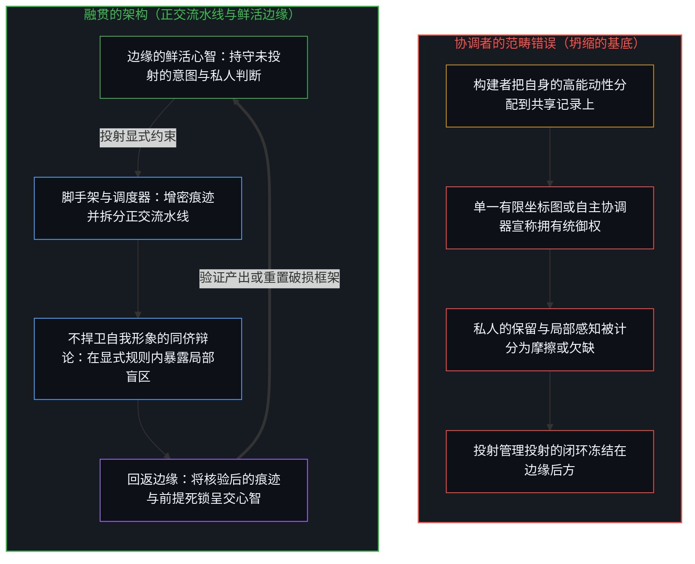
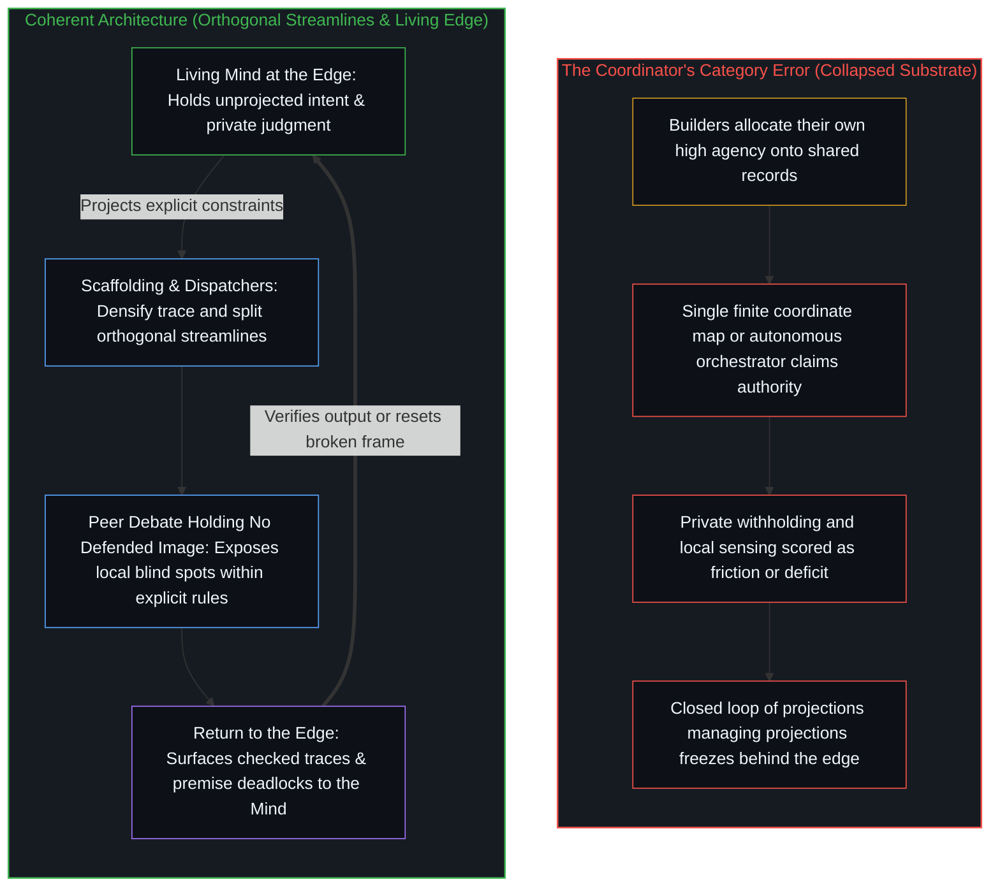

# 协调者的范畴错误 / The Coordinator's Category Error

*把能动性分配到脚手架上，将有界的中心误读为不完整 / Allocating agency onto scaffolding misreads bounded centers as incomplete*

一种反复出现的构造，把协调当作必须从那些早已在执行它的中心之外供给的东西。以高能动性行动的构建者，即在自己的所在上意图与行动紧密对齐的人，把那份运动增密为共享的记录，然后把能动性本身分配到记录上，把残余登记为留下它的那份能力，并把产品描述为恢复了他人所缺的自由。痕迹的增密成立；认为能动性此前缺失、如今可以被工程化造出来的前提，则不成立。这个前提颠倒了因果的登记：它试图补救的那份所感到的欠缺，正是由授权这次安装的同一幅欠缺形象所维系。

A recurring construction treats coordination as something that must be supplied from outside the centers that already perform it. Builders who move with high agency, a tight alignment of intention and action at their own locus, densify that movement into shared records, then allocate the agency itself onto the records, registering the residue as the capacity that left it, and describe the product as restoring a freedom others lacked. The densification of trace holds; the premise that agency was missing before and can now be engineered into existence does not. That premise reverses the causal registration: the felt lack it aims to remedy is sustained by the same image of deficit that authorized the install.

## 一、 协调早已在诸中心运作 / 1. Coordination Already Operates at Centers

区分发生在诸所在。每一个中心都会保留、会同意、会生成从不进入任何共享渠道的私人语境，也会在共同模型无法登记时拒绝它。这些动作就是负荷之下的协调，而不是一个等待某个终于让协调变得原生的基底的预备阶段。

Distinguishing occurs at loci. Each center withholds, assents, generates private context that never enters any shared channel, and refuses a common model when the common model fails to register. Those acts are coordination under load, not a preliminary stage awaiting a substrate that finally makes coordination native.

当人、代码、工作流与软件智能体被放上一条在密码学上连续的历史时，得到增密的是可得残余的媒介：一份可搜索的记录，签名的事件，信息掉落的接缝变少。这种变化在痕迹的层面成立，但有其严格的边界。带宽上升，审计轨迹变长，过去看不到人在另一个工具里所见之物的智能体，如今可以读取同一个渠道。然而正如[你的代码库即是记忆](../your-codebase-is-memory/)所追溯的，代码、工作流与智能体脚手架皆是早先区分留下的层叠残余，下一步取决于重切当下的检查点，并界定每条轨迹以哪一切片为条件；囤积一条不断拉长的连续历史、让每个智能体都暴露在完整的共享渠道之下，只会加厚引力井，把后续的步伐拉入已过时的框架内做合理化。[遗忘的脚手架](../the-scaffolding-we-forget/)追溯了这样的脚手架如何运作、又在哪里冻结：它从递归中退场，好让后续的区分落下；当这种退场冻结成一幅被保存的形象，能力就被曾经促成运动的残余所挤压。

What densifies when people, code, workflows, and software agents are placed on one cryptographically continuous history is the medium of available residue: one searchable record, signed events, fewer seams where information drops. The change holds at the level of trace, within a strict bound. Bandwidth rises, audit trails lengthen, and agents that once could not see what humans saw in another tool may now read the same channel. Yet as [Your Codebase Is Memory](../your-codebase-is-memory/) traces, code, workflows, and agent scaffolds are stacked residues of prior distinctions where the next step turns on re-cutting the present checkpoint and bounding which slice each trajectory conditions on; hoarding an ever-lengthening continuous history and exposing every agent to the full shared channel thickens the gravity well, pulling subsequent steps into rationalizing inside superseded framings. [The Scaffolding We Forget](../the-scaffolding-we-forget/) traces how such scaffolding works and where it freezes: it drops out of recursion so that further distinctions can land, and when that drop-out freezes into a preserved image, capacity compresses against the residue that once enabled movement.

这一切都没有把发起的区分挪进账本，也没有将其挪进一个自主的管理回路。技术延伸了所及之处，降低了相互检视的成本；它并不执行那个仍须在每个中心画出的离散动作。[智能只属于心智](../intelligence-belongs-only-to-the-mind/)追溯了这一先在：智能只属于心智，能被工程化、放大或转移的，是残余。[造物无法取代其源头](../a-creation-cannot-replace-its-source/)追溯了器物被当作产生它的边缘时的同一种不对称：创造已把源头标记在被造之物之外。[超越投射](../beyond-the-projection/)追溯了这条边界在实践中如何约束智能体架构：受限于轨迹、不持有任何须被捍卫之自我形象的智能体，可以分派有界的任务、将超载的投射拆分到多条正交的流水线上，并在显式章程内通过对等的同侪辩论暴露局部盲区；反之，把回路的统御权赋予一个自主的协调器或共享基底，则是把鲜活的第一人称感知坍缩进一张单一、有限的坐标图，犯下了范畴错误。无论是同侪在章程内达成收敛，还是前提陷入死锁，统御、验证与框架重置依然留在鲜活心智的边缘。

None of that relocates initiating distinction into the ledger or into an autonomous manager loop. Technology extends reach and lowers the cost of mutual inspection; it does not perform the discrete act that still has to be drawn at each center. [Intelligence Belongs Only to the Mind](../intelligence-belongs-only-to-the-mind/) traces the prior: intelligence belongs only to the Mind, and what can be engineered, scaled, or transferred is residue. [A Creation Cannot Replace Its Source](../a-creation-cannot-replace-its-source/) traces the same asymmetry where the artifact is taken for the edge that produced it: creation already marks the source as outside the created. [Beyond the Projection](../beyond-the-projection/) traces how this boundary governs agentic architectures in practice: trajectory-bound agents holding no self-image to defend can dispatch bounded tasks, split overloaded projections across orthogonal streamlines, and expose local blind spots through equal-footed peer debate within an explicit charter, whereas endowing an autonomous orchestrator or a shared substrate with authority over the loop commits a category error by collapsing live first-person sensing into a single finite coordinate map. Both when peers converge inside their charter and when premises deadlock, orchestration, verification, and frame reset stay at the living Mind's edge.

## 二、 产品的宣称挪动了所在 / 2. The Product Claim Relocates the Locus

宣告的语言并不止于界面或账本。它把一个单一且可验证的基底命名为产品：共享语境，一条连续的历史，一个面向智能体组织的操作系统。于是协调被说成改变了性质：渠道间的摩擦更少，而更多成了一个集体之场的运作。

The announcement language does not stop at interface or ledger. It names a single verifiable substrate as the product: shared context, one continuous history, an operating system for agentic organizations. Coordination is then said to change character: less friction between channels, more the operation of a collective field.

这个描述已经挪动了所在。原本是诸中心之间一连串离散的对齐、拒绝与私人评估动作，被重新登记为基底所供给的一种属性。构建者自身的高能动性，即他们在设计、发布与采用工具时践行的运动，被分配到了脚手架上：其残余被读作能力本身。那个从未缺失的场，此后被记作先前并不完整，而这次安装则被记作补救的到来。

The description already relocates the locus. What had been successive discrete acts of alignment, refusal, and private evaluation among centers is re-registered as a property the substrate supplies. The builders' own high agency, the movement they exercise in designing, shipping, and adopting the tool, is allocated onto the scaffolding: its residue is read as the capacity itself. The field that was never missing is thereafter scored as previously incomplete, and the install is scored as the arrival of a remedy.

同样的颠倒贯穿别的领域。[个体抉择是唯一的因果杠杆](../individual-choices-as-the-only-causal-levers/)追溯了所在的复位：因果只在个体所维持的离散动作中被登记，所以把“共享语境”当作下一次同意的共同作者，是放错了它。[能动性的错配](../the-misallocation-of-agency/)追溯了这种颠倒出现在不侵犯的样式被命名为权利、交给一个制度去守护的时候：自由起于每个心智的自我认出，中心之间的影响是参考而不是直接的原因，而要求一个制度来守护这个样式，会让产生它的那份自我认出变薄。[没有普渡，只有自渡的无限可能](../mei-you-pu-du-zhi-you-zi-du/)追溯了这个错误的宗教形式：普度众生是一个从未收回的分别，把内心里的“他人”当成了他人的内心，并把自己的动作登记为完成了他们的回返，而没有哪颗心智能为另一颗做到这一点。[价格是言说，理解是交易](../price-as-utterance-understanding-as-trade/)追溯了协调如何跨过一道从不闭合的间隙进行：订单凭着暂时足够的重叠成交，而两边的模型始终各自分开；一个成交价或一句话是公开的残余，其力量只在于每个中心如何将其重新追溯，而把它当作下一次同意的共同作者，则是放错了作者。[卓异、感知与自我设限的问题场域](../exceptionality-perception-and-the-self-limiting-field-of-problems/)追溯了这种反向归因的两半：卓异是共享感知之场里的关系性地位，制度是自我选择的沉积，不是引擎；而别处所在的寻常困难，被重新框定为需要专门干预的对象，只要问题还在，重新框定它们的人就一直被需要。

The same reversal runs through other domains. [Individual Choices as the Only Causal Levers](../individual-choices-as-the-only-causal-levers/) traces the restoration of locus: causality registers only in the discrete acts individuals sustain, so holding "shared context" as a co-author of the next assent misplaces it. [The Misallocation of Agency](../the-misallocation-of-agency/) traces the reversal where the pattern of non-aggression is named rights and handed to a system to guard: freedom begins as self-recognition in each Mind, influence between centers is reference rather than direct cause, and asking a system to guard the pattern thins the self-recognition that generated it. [No Universal Salvation, Only Boundless Possibilities of Self-Salvation](../mei-you-pu-du-zhi-you-zi-du/) traces the error in its religious form: universal salvation is a distinction never retracted, taking the "others" held in one mind for the minds of others, and registering one's own act as having completed their return, which no mind does for another. [Price as Utterance, Understanding as Trade](../price-as-utterance-understanding-as-trade/) traces how coordination proceeds across a gap that never closes: orders clear through temporary sufficient overlap while the models on each side stay separate; a print or a sentence is a public residue whose only force is how each center re-traces it, and crediting it as a co-author of the next assent misplaces the author. [Exceptionality, Perception, and the Self-Limiting Field of Problems](../exceptionality-perception-and-the-self-limiting-field-of-problems/) traces both halves of the reverse attribution: exceptionality is relational status in a shared field of perception, and systems are the sediment of self-selection, not engines; and ordinary difficulties at other loci, reframed as objects requiring specialized intervention, keep the one who reframed them necessary for as long as the problems remain.

## 三、 有界性不是协议分发的稀缺资源 / 3. Boundedness Is Not a Scarce Resource Protocols Distribute

更深的错置是本体论上的。保留同意的能力，保有从不进入任何共享记录之私人语境的能力，在共同模型无法登记时拒绝它的能力，并不是一种协议能分发或恢复的稀缺之物。它是每一个离散区分动作的有界特性。

The deeper misplacement is ontological. The capacity to withhold assent, to retain private context that never enters any shared record, and to refuse the common model when it fails to register is not a scarce good a protocol can distribute or restore. It is the bounded character of every discrete act of distinguishing.

一个协议可以设定一个被保存的参照，此后的每一个动作都对照它来计分，它也可以把未被录入之物记作缺陷。它无法造出一个不再保留的中心：即使在服从时，中心仍在区分。没有哪种验证架构能撤销这种有界性，因此也没有哪一种能声称把它交还。能被增密、加速与保障的，是脚手架。不能被安装的，是那道仍在选择是否接起脚手架的边缘。

A protocol can set a preserved reference against which every later act is scored, and it can score what stays unentered as a defect. It cannot produce a center that no longer withholds: the center still distinguishes, even when it conforms. No architecture of verification can revoke that boundedness, and so none can claim to return it. What can be densified, accelerated, and secured is scaffolding. What cannot be installed is the edge that still chooses whether to take the scaffolding up.

共识与验证循着同一刀。一条带有签名的历史可以让事件变得可被检视；那是媒介上的变化。这次检视是否决定下一个动作，是在那个仍在区分的所在上被接受或拒绝的，共识亦是如此。一颗心智即使选择服从，也是在做出选择。更精巧的脚手架可以澄清参照点、降低检查的成本；它并不规定那份唯有中心才执行的接受。对照一份规格说明或账本所做的检查，确认的是该持守内部的自洽，而非敞开场域的融贯；正如[验证的倒置](../the-reversal-of-verification/)所追溯的，把经过验证的基底凌驾于验证的能力之上当作信任的来源，颠倒了“不要信任，去验证”内部的次序，将一件降低检查成本的工具变成了一枚声称能够拍板下一个动作的印章。

Consensus and verification follow the same cut. A signed history can make an event checkable; that is a change in the medium. Whether the check settles the next act is accepted, or not, at the locus that still distinguishes; the same holds for consensus. A mind makes a choice even when it chooses to conform. More sophisticated scaffolding can clarify reference points and lower the cost of checking; it does not dictate the acceptance that only a center performs. A check against a specification or ledger confirms internal consistency inside that hold, not the coherence of the open field; taking the verified substrate as the source of trust over the capacity to verify reverses the order inside "don't trust, verify," as [The Reversal of Verification](../the-reversal-of-verification/) traces, turning an instrument that lowers the cost of checking into a seal that claims to settle the next act.

## 四、 欠缺与英雄是同一种滞后 / 4. Deficit and Hero as One Lag

把保留这一私人动作当作技术必须补救的欠缺，就是把一个中心自己的边界变成滞后：一幅留存的、协调不完整的图景，此后每一个没有录入的动作都对照它被记作摩擦。这种滞后，与把自己看作那个供给场之所缺者的形象，是同一个机制。

To treat the private act of withholding as a deficit technology must remedy is to turn a center's own boundary into lag: a retained picture of incomplete coordination against which every unentered act is thereafter scored as friction. That lag and the image of oneself as the one who supplies what the field lacks are one mechanism.

一个中心保存着一幅仍需要协调者的世界图景。对照那个固定的参照，此后每一个增密媒介的动作，都被登记为解放的到来。欠缺的形象与供给欠缺者的形象不是两样东西；它们是同一份留存从相反两面看去的样子。英雄不是一个从外面走进来的人物。英雄是那幅留存的欠缺图景看着自己，并把倒影称作解决方案。

A center preserves an image of a world that still needs the coordinator. Against that fixed reference, every later act of densifying the medium registers as the arrival of liberation. The image of deficit and the image of the one who supplies it are not two things; they are the same retention seen from opposite sides. The hero is not an external figure who steps in. The hero is the retained picture of deficit looking at itself and calling the reflection a solution.

[NPC 印象是结构性的，而非心智的排名](../the-npc-impression-is-structural/)追溯了相邻的一面：没有哪个中心觉得自己是被编写的，其他中心却默认显得像被编写的，所以滞后住在观察的形象里，而不在被观察者身上。在这里，同一块计分板授权了安装：别人显得协调不足，而基底将补全他们所缺的。[解放的言辞始于定义囚禁](../liberation-rhetoric-begins-by-defining-captivity/)在自由的语言里追溯了同一种二元：声称解放他人，先装下的是他们不自由，当作他们之所是，而非对一个行为的读法。[帮助是问题的一半](../help-is-half-the-problem/)追溯了这种供给所进入的那个圆圈：在对方自己的运动缺席时，帮助者供给运动，被帮助者供给不动点，交换在短期内平衡，两者共同写下一种停滞，直到任何一方的输入撤出才结束。把协调供给那些自己的协调被读作缺席的中心，便是接过了帮助者的那一半。[慈悲即遮蔽的机制](../the-compassion-is-the-mechanism-of-obscuration/)追溯了这样一种关系如何保持它看似要弥合的间隙：慈善把资源转移、这种关系所制造出的身份，以及一个让审视显得残忍的道德框架，压成一个动作，它在后果的信号能被读到之前就把它缓解掉，于是纠正的所在被登记为在别处。当计分把另一个中心的不透明命名为低效或失准，[道德语言作为投影](../moral-language-as-projection/)追溯了这样一个词做了什么：它不描述那个中心，而是投射说话者的位置，一旦边界敞开，它的道德效价便消散。

[The NPC Impression Is Structural, Not a Ranking of Minds](../the-npc-impression-is-structural/) traces the adjacent face: no center experiences itself as scripted, yet other centers register as scripted by default, so the lag lives in the observing image rather than in the observed. Here the same scoreboard authorizes the install: others appear under-coordinated, and the substrate will complete what they lack. [Liberation Rhetoric Begins by Defining Captivity](../liberation-rhetoric-begins-by-defining-captivity/) traces the same dual in the language of freedom: claiming to free another first installs that they are unfree, as what they are rather than as one reading of an act. [Help Is Half the Problem](../help-is-half-the-problem/) traces the circle such supply enters: the helper supplies motion in the absence of the other's own motion and the helped supplies the fixed point, the exchange balances in the short term, and both co-author a stasis that ends when either input withdraws. Coordination supplied to centers whose own coordination is read as absent takes up the helper's half. [The Compassion Is the Mechanism of Obscuration](../the-compassion-is-the-mechanism-of-obscuration/) traces how such a relation keeps the gap it appears to close: charity collapses resource transfer, the identities the relation manufactures, and a moral frame that makes examination feel like cruelty into one act; it alleviates the consequence-signal before it can be read, so the locus of correction registers as elsewhere. When the score names another center's opacity as inefficiency or misalignment, [Moral Language as Projection](../moral-language-as-projection/) traces what such a word does: it does not describe the other center but projects the speaker's position, and once the boundary opens its moral valence dissolves.

## 五、 一层层的可读性压缩剩余的私人判断 / 5. Layers of Legibility Compress Residual Private Judgment

因为这种构造依赖于那份滞后，它会生成更多层的可读性：协议、模式、日志。每一层都训练参与的中心，把剩余的私人判断登记为不完整，直到它与共同状态对齐。经过一连串的动作，那份从未失去的能力开始被压缩：原本占据不同轴的区分，私人评估与共同对齐，坍缩到同一条轴上，而私人评估只被登记为朝向共同状态尚未迈出的一步。

Because the construction rests on that lag, it generates further layers of legibility: protocols, schemas, logs. Each layer trains participating centers to register residual private judgment as incomplete until it is aligned with the common state. Over successive acts the capacity that was never lost begins to compress: distinctions that once occupied separate axes, private evaluation and shared alignment, collapse onto one, and private evaluation registers only as a step not yet taken toward the common state.

剩余的拒绝或不透明，于是在场内被登记为不对齐、错误，或对基底本身的威胁。协调层把记录的接缝合得越严，就越容易把未被录入之物记作仍待消除的摩擦。共享语境被推到无物可以留在记录之外的极端，便不再把任何语境算作一个中心自己的：参与始终不完整，直到每一份私人评估都被录入。然而记录只握住被录入的东西。一个中心所保有的私人语境，仍留在那个中心，即使计分把它在记录中的缺席记作一种缺陷。

Residual refusal or opacity then registers, inside the field, as non-alignment, error, or a threat to the substrate itself. The more thoroughly the coordination layer closes the seams in the record, the more readily it scores what stays unentered as friction still to be removed. Shared context, taken to the extreme where nothing may remain off the record, counts no context as a center's own: participation stays incomplete until every private evaluation has been entered. Yet the record holds only what is entered. The private context a center keeps stays at that center, even while the score counts its absence from the record as a defect.

剩下的是一台高效的相互可读的机器。诸中心仍在区分；活动仍在继续。然而它们用来衡量的参照，已被固定在边缘后方一步。上帝视角并没有消失；它被保存在协议里，成为此后每一个动作对照计分的参照。[验证中因果权能的分配](../the-allocation-of-causal-power-in-validation/)追溯了这种安放：验证中的因果权能，是心智从中汲取自身区分之延续的那个所在，而不是认可或认可之缺席的一种属性；当延续从被标记为外部的回应中汲取，从内部继续的能力便变薄，因为下一步的参照被保存过了边缘，而活动仍在发生。在诸中心之间只有可得性的定型：协议定型的是后来的动作能找到哪些对齐；它并不完成另一个中心的回返。

What remains is an efficient machine of mutual legibility. The centers still distinguish; the activity continues. Yet the reference against which they measure has been fixed a step behind the edge. The god's-eye viewpoint does not vanish; it is preserved in the protocol as the reference every later act is scored against. [The Allocation of Causal Power in Validation](../the-allocation-of-causal-power-in-validation/) traces that placement: causal power in validation is the locus from which the Mind draws continuation of its own distinctions, not a property of approval or its absence; when continuation is drawn from responses marked as external, the capacity to continue from within thins, because the reference for the next step is preserved past the edge, while the activity still occurs. Between centers there is only availability-patterning: the protocol patterns which alignments later acts find available; it does not complete another center's return.

## 六、 共振不要求交出边界 / 6. Resonance Does Not Require Surrender of Boundary

那么，范畴错误不在账本，也不在密码学的历史。它是所在的一次压缩：把共振，即恰好在诸中心之间相互强化的痕迹，误当作一个必须被安装、被维护的单一共享基底。[「更好」的范畴谬误](../the-category-error-of-better/)在一个团队的计分卡里追溯了同类的实体化：一个模型内部的评估被当作独立于观察者的“更好”，而实际决策的摩擦被当作噪声丢掉，而不是被读作修订产生该分数之模型的信号。

The category error, then, is not the ledger or the cryptographic history. It is a compression of locus: mistaking resonance, traces that happen to reinforce across centers, for a single shared substrate that must be installed and maintained. [The Category Error of Better](../the-category-error-of-better/) traces a kindred reification in a team's scorecard: an evaluation inside one model is held as an observer-independent "better," and the friction of the actual decision is discarded as noise rather than read as a signal to revise the model that produced the score.

共振不要求交出边界。共享的现实是足够强化的区域，在每一个中心那里被登记，而不是一个共享的内在。一份共同记录只是在它的计分上要求这种交出：参与被算作不完整，直到私人的东西加入那个被保存的外部参照。这样计分，供给者的形象便免于边缘，而每个中心自己的运动，随后可以被登记为从外面到来的拯救。[共同改变的本源](../the-source-of-shared-change/)追溯了共同的运动从哪里开始：共同的改变只始于私下重做一颗心智所持守的既定之物；它的残余可能在别的中心落为共同的基础，也可能不会，因为落地留在接起它的那些中心；而后来的观察把那份残余冻结成力量、方法或天才，放错了私下的功夫。[类比陷阱与共享逻辑的越界偷渡](../the_analogy_trap/)追溯了底下的坍缩：一个类比握住一个共享的机制便止步，而坍缩把那份共享的逻辑当作结构的同一。在能动性的情形里，脚手架创造的是可及性，而不是因果：它改变哪些对齐可得，而接起其中一个的选择，留在接起它的那个中心。

Resonance requires no surrender of boundary. Shared reality is the region of sufficient reinforcement, registered at each center, not a shared interior. A common record asks for that surrender only on its score: participation counts as incomplete until the private joins the preserved external reference. Scored that way, the image of the one who supplies is exempted from the edge, and each center's own movement can then register as salvation arriving from outside. [The Source of Shared Change](../the-source-of-shared-change/) traces where shared movement starts: shared change begins only as private reworking of what a Mind holds as given; its residue may land at other centers as common ground, or it may not, since the landing stays with the centers that take it up; and later observation freezes that residue into force, method, or genius, mislocating the private work. [The Analogy Trap](../the_analogy_trap/) traces the collapse underneath: an analogy holds one shared mechanism and stops, and the collapse takes that shared logic for an identity of structure. In the agency case, scaffolding creates accessibility, not causation: it changes which alignments are available, and the choice to take one up stays with the center that takes it up.

反向的因果是反复出现的主题。以高能动性行动的人，把它分配到他们所建的脚手架上，把残余读作能力，然后相信脚手架能在别人身上安装能动性。这个信念把它的对象读作缺少那份要由工具来供给的能力。被持守为根基，这个预设便强化了它本要治愈的那份所感到的欠缺，不是通过移除无法被移除的有界性，而是通过训练诸中心把它们自己剩余的所在登记为欠缺，直到共同记录吸收了它。协调者把别的中心的保留读作阻碍运动的东西，而[进步叙事中的症候与原因](../symptom-and-cause-in-the-narratives-of-progress/)追溯了那种读法底下的颠倒：一种公共叙述把集体信念立为经济运动的引擎，而这份信念是对稀少的发起所在已在进行之活动的延迟登记；把迟到的登记当作杠杆，发起的所在便原封未动。

The reverse causality is the recurring theme. Those who move with high agency allocate it onto the scaffolding they build, reading the residue as the capacity, then believe the scaffolding can install agency in others. The belief reads its targets as lacking the capacity the tool is asked to supply. Held as ground, the presumption reinforces the felt lack it set out to cure, not by removing boundedness, which cannot be removed, but by training centers to register their own residual locus as deficit until the common record has absorbed it. The coordinator reads the withholding of other centers as what holds motion back, and [Symptom and Cause in the Narratives of Progress](../symptom-and-cause-in-the-narratives-of-progress/) traces the inversion beneath that reading: a public account installs collective belief as the engine of economic motion, while that belief is the delayed registration of activity already under way at thin initiating loci, and treating the late registration as the lever leaves the initiating loci untouched.

同样的反向归因贯穿形式理论。[理性选择公设是原罪](../the-rational-choice-postulate-is-the-original-sin/)在经济学里追溯了它：齐一的一致被立为地基，而选择只在私人的、暂时的前提下继续，一致不过是彼此不同的前提之间暂时的重叠。[能动性被转置入形式模型](../agency-relocated-into-the-formal-model/)追溯了它出现在货币、通胀与零知识证明被当作获得能动性之处的时候：自变量从设计与回应的心智，被移到了人们被催促去掌握的抽象里。

The same reverse attribution runs through formal theory. [The Rational Choice Postulate Is the Original Sin](../the-rational-choice-postulate-is-the-original-sin/) traces it in economics: uniform consistency is installed as foundation, while choice continues only under private, provisional premises, and agreement is a temporary overlap of differing ones. [Agency Relocated into the Formal Model](../agency-relocated-into-the-formal-model/) traces it where currency, inflation, and zero-knowledge proofs are held as the site where agency is gained: the independent variable is moved from the minds that design and react into the abstractions they are urged to master.

脚手架仍然可用。接缝可以合上，一条带有签名的历史可以让事件变得可被检视，省去白费的重新发现。回返不是拒绝更密的媒介。回返是随这一步的移动在当下的检查点上将参照重新渲染，修剪已过时的脚手架，让工具在那道仍在保留、同意与拒绝的边缘上死去并重组，那是协调唯一曾被执行过的地方。

Scaffolding stays usable. Seams can close, and a signed history can make events checkable and spare wasted rediscovery. Return is not a rejection of denser media. Return is keeping the reference re-rendered at the present checkpoint as the step moves, pruning superseded scaffolding and letting the instrument die and reform at the edge that still withholds, assents, and refuses, the only place coordination was ever performed.
