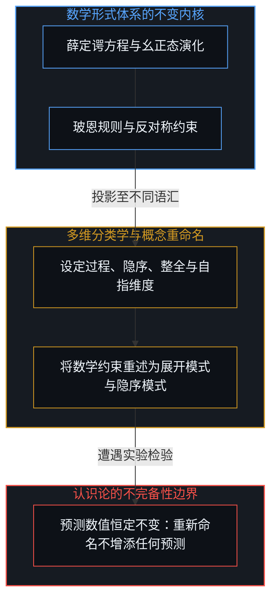
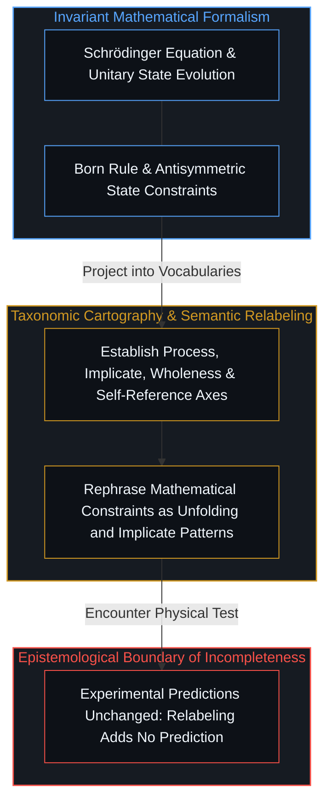
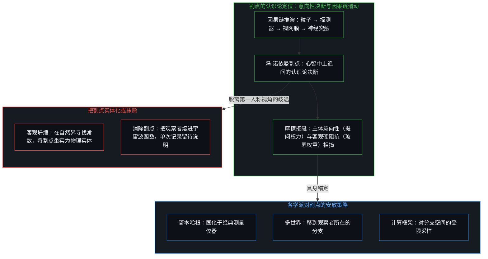
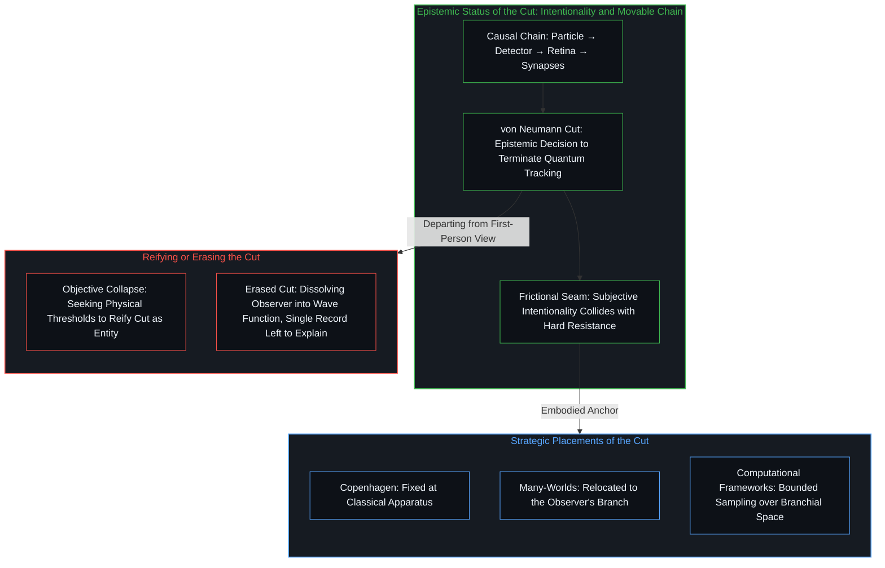
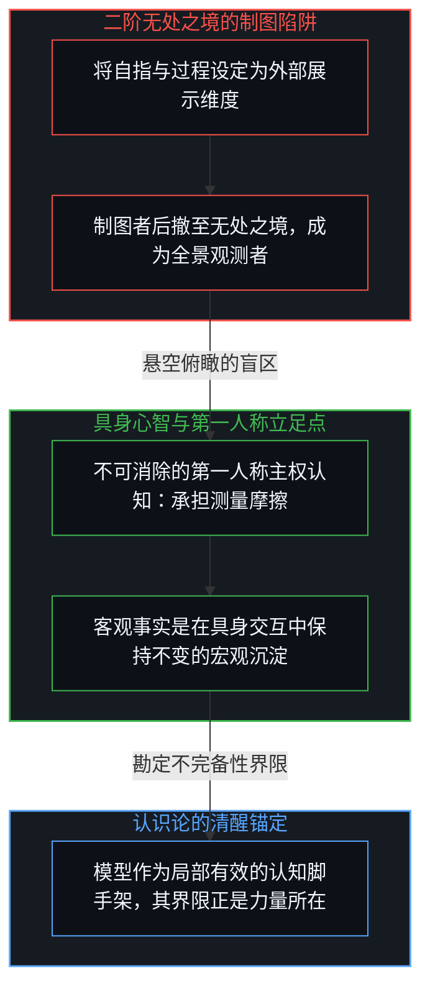
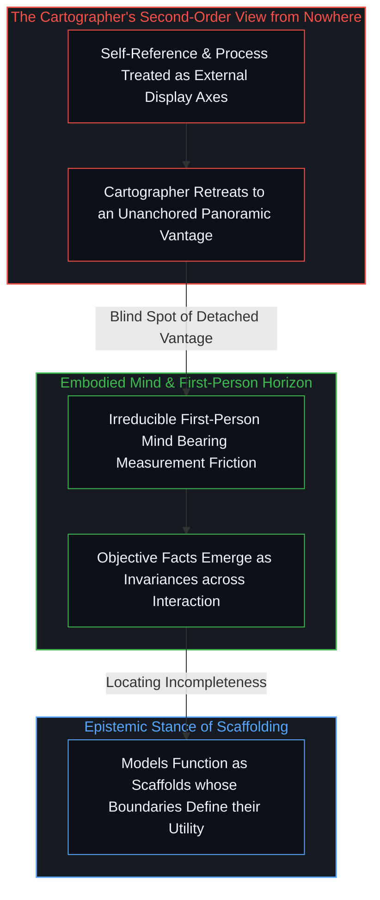

# 割点可移不可除 / The Cut Moves but Never Vanishes

*量子诠释争的是观察者安放何处；高处俯瞰的元图集只是把上帝之眼再挂高一层。 / Quantum interpretations contest where the observer sits; a meta-map from above moves the God's-eye view one level higher.*

量子力学的数学形式体系以非凡的精度预测了实验读数，围绕其物理图景的学派争鸣却持续了整整一个世纪。每一种理论都在其适用尺度内提供了有用的认知脚手架，而当人们试图绘制一份超越所有视角的元图集来统一这些图景时，却不可避免地重蹈其所批评的那一步：站在无处去俯瞰所有视角。任何测量都依托于具身观察者与外部世界遭遇的宏观摩擦，而企图把观察者抹去或固化为静态坐标的做法，正好标定了理论失去普遍适用性的不完备性边界。

The mathematical formalism of quantum mechanics predicts experimental readings with extraordinary precision, yet debates surrounding its physical picture have persisted for a full century. Each interpretation provides a useful cognitive scaffold within its applicable domain, but attempts to construct a panoramic meta-atlas reconciling all viewpoints inevitably repeat the step they criticize: standing nowhere to survey every viewpoint. Every measurement depends upon the macroscopic friction between an embodied observer and the world, and any attempt to erase the observer or freeze them into a static coordinate marks the boundary of incompleteness where universal claims falter.

## 一、 坐标轴上的分类学与重命名边界 / 1. Taxonomic Cartography and the Boundary of Relabeling

面对各派学说的长期对峙，一种常见的理论冲动是构想更高的多维空间，将彼此冲突的诠释投影为连续分布的地域。在这类坐标系中，经典理论被归入机械与局部，而新兴学说则被赋予过程优先性、隐序展开、全息整全与自指性等维度。通过将概念张力分解为空间方位，分散的学派看似被安置进了一份井然有序的认知图集。卡洛斯·E·佩雷斯（Carlos E. Perez）的[《量子诠释的新制图》](https://medium.com/intuitionmachine/a-new-cartography-of-quantum-interpretations-4f82724942a8)（2025）便是这样的一份图集。

Confronted with the enduring standoff among rival schools, a familiar theoretical impulse is to imagine a higher-dimensional space, projecting conflicting interpretations as contiguous regions across an intellectual territory. Within such coordinate systems, classical frameworks are relegated to mechanical and local quadrants, while newer perspectives are assigned dimensions such as process primacy, implicate unfolding, holistic wholeness, and self-reference. By resolving conceptual tensions into spatial alignments, divergent schools appear neatly situated within a coherent cognitive atlas. Carlos E. Perez's [A New Cartography of Quantum Interpretations](https://medium.com/intuitionmachine/a-new-cartography-of-quantum-interpretations-4f82724942a8) (2025) is one such atlas.

各派诠释在其适用的领域内各有其用。哥本哈根诠释维持了实验室内微观态与经典指针之间的操作纪律；多世界诠释通过保全幺正演化，为量子信息与量子计算提供了优美的代数推演图景；玻姆力学为粒子赋予了确定的轨迹；量子贝叶斯与关系量子力学把量子态读作相对于某个行动者或系统的描述；而基于离散计算的多路系统与规则极限，则为因果几何开辟了全新的形式探索空间。这些模型在各自的局部界限内发挥着具体功用。

Within their applicable domains, competing interpretations serve as useful cognitive tools. The Copenhagen interpretation maintains strict operational discipline in the laboratory by keeping microscopic states distinct from classical pointers. The Many-Worlds interpretation preserves unitary evolution, offering an elegant algebraic landscape for quantum information and quantum computation. Bohmian mechanics gives particles definite trajectories. QBism and Relational Quantum Mechanics read the state as relative to an agent or to a system. Computational frameworks like multiway systems and the ruliad open generative vistas for discrete causal geometries. Each model remains useful within its respective operational boundary.

然而，分类学的梳理并不等同于物质世界的扩展。当一套图集试图通过重新命名来调和矛盾时，理论的局限便显现出来。例如，标准量子力学为全同费米子设定交换反对称性（在相对论性场论中，这个负号由自旋-统计定理给出），泡利不相容原理由此直接导出。若仅仅换用过程哲学的语汇，将这种数学性质重述为显序展开的约束或不可分割的整全模式，方程的预测结果并无任何增减。这类图集的语汇中没有任何一处能推出这个负号；它是从形式体系原样搬过来的。类似的，将贝尔实验中的非定域关联称为同一过程的内在折叠，赋予了它富有表现力的修辞外壳，却并未改变其统计特征。一份分类图集整理了过往概念的邻近关系，但把概念分类误当作本体论解答，便跨过了模型的有效区间。

Taxonomic organization is not an expansion of physical reality. When an atlas attempts to reconcile foundational puzzles through verbal re-labeling, the limits of the framework become apparent. Standard quantum mechanics posits exchange antisymmetry for identical fermions (in relativistic field theory the sign follows from the spin-statistics theorem), and the Pauli exclusion principle follows directly from it. Restating this mathematical constraint in the language of process philosophy—calling it a constraint on unfolding or an undivided implicate pattern—leaves experimental predictions unchanged. Nothing in such an atlas's vocabulary produces that sign; it is carried over from the formalism unchanged. Similarly, designating Bell correlations as the unfolding of a singular undivided process provides evocative phrasing without altering a single statistical outcome. An intellectual atlas clarifies semantic neighborhoods, but mistaking taxonomic rearranging for an ontological resolution oversteps the boundary of the model.

## 二、 冯·诺依曼割点：可移与不可除 / 2. The von Neumann Cut: Movable yet Irreducible

如果追溯微观测量与宏观表象之间的深层张力，就会触及冯·诺依曼与海森堡划下的那条界线。在形式体系中，处于线性叠加与幺正演化之中的微观系统，必须在某一处与产生确定记录的宏观测量仪器相连。这条分割微观可能性与宏观确定性的界线被称为测量割点。冯·诺依曼的数学分析表明，这个割点的位置是可移动的：它可以划在粒子与荧光屏之间，划在荧光屏与实验员视网膜之间，甚至划在视神经与大脑皮层之间。无论分析者将割点沿因果链向后推移多远，最终计算出的几率分布分毫不差。

Probing the tension between microscopic superpositions and macroscopic phenomena inevitably leads to the boundary established by John von Neumann and Werner Heisenberg. Within the mathematical architecture, a microscopic system evolving unitarily must at some point interface with a macroscopic apparatus that produces a definite record. This boundary separating quantum possibilities from macroscopic outcomes is known as the measurement cut. Von Neumann demonstrated that the location of this cut is movable: it can be placed between the particle and the detector screen, between the screen and the experimenter's retina, or between the optic nerve and the cerebral cortex. Regardless of how far back along the causal chain the analyst shifts the cut, the calculated probability distributions remain invariant.

割点虽然可以任意滑动，却断不可被剔除。一种常见的搜寻在客体世界中寻找物理的坍缩点，却忽略了一个更为深刻的前提：割点的位置并非客体世界中天然矗立的界碑，而是心智的认知决断向外投射的边界。在冯·诺依曼的因果链推演中，粒子、探测器、视网膜光子与神经电流在形式描述中均可被视作一个连续演化的微观叠加态。外部世界内部并没有任何一个固有标记写着“在此处发生坍缩”；所谓割点落在荧光屏上，实际上意味着实验者在此处单方面决定中止量子追踪，将该处的不可逆相互作用接纳为可读的宏观事实。正如玻尔所强调的，量子现象无法脱离实验配置来定义。选择实验配置，决定的是世界回答哪一个问题；选择割点落在哪里，决定的是在因果链的哪一环把回答接纳为记录。前者改变统计结果；后者，如冯·诺依曼所示，不改变。同一条界线也可以推到因果链最远的一端：说宇宙在任何观察者出现之前的几十亿年里冷却、形成原子与恒星，是把割点放在了宇宙历史的那一头，预测不变，而这个说法是有意识的生命提出并当作既定的，在哪里接受它仍是有意识地作出的抉择；[索求万物理论是在将当下冻结为清单](../demanding-a-toe-freezes-time-into-a-catalog/)追溯过当下的理论家怎样把一段光谱指认为早期的宇宙。

The cut is freely movable, yet it is strictly irreducible and non-removable. A familiar search looks in the objective world for a physical point of collapse, yet this search overlooks an epistemic inversion: the location of the cut is not a natural boundary stone standing in external reality, but the boundary of a cognitive decision projected outward by the Mind. Along von Neumann's causal chain, the particle, the fluorescent detector, the retinal photons, and the neural currents can all be described formally as a continuously evolving microscopic superposition. The physical world contains no intrinsic signpost declaring that collapse occurs here; asserting that the cut sits at the detector screen simply means the experimenter has decided to terminate quantum tracking at this stage, accepting the irreversible interaction as an accountable macroscopic record. As Niels Bohr emphasized, quantum phenomena cannot be defined in isolation from an experimental arrangement. Choosing the arrangement decides which question the world answers; choosing where the cut falls decides at which link the answer is taken as a record. The first changes the statistics; the second, as von Neumann showed, does not. The same line can be pushed to the farthest end of the causal chain: to say that the universe cooled and formed atoms and stars for billions of years before any observer appeared is to place the cut at that far end of cosmic history; the predictions are unchanged, the statement is formulated and taken for granted by conscious beings, and where it is accepted remains a choice made consciously. [Demanding a Theory of Everything Freezes Time into a Catalog](../demanding-a-toe-freezes-time-into-a-catalog/) has traced how a theorist in the present points to a spectrum and assigns it to the early universe.

这种主观决断的外在映射，并非凭空捏造的幻象，而是主体在世界中锚定自身的第一人称动作。割点是心智的意向性与外部世界的物理阻抗正面遭遇的摩擦接缝。一方面，主体选择问什么、在哪里接纳回答：选择测量动量还是位置，选择在双缝后安置探测器还是任其自由干涉，选择在荧光屏前读数还是将仪器继续纳入演化，这属于主体的提问权力；另一方面，外部世界在切口处反馈以不容篡改的硬阻抗——割点处兑现的读数，其频率严格服从玻恩规则，不随观察者的主观愿望而转移。割点正是一组可能读数被接纳为一个确定记录的接缝，它标志着因始终领先于果至少一步的时间间隙：每一次观察在成立的刹那，都已然是一个既成的“果”，同时又作为后续演化的“因”。只要理论还需要解释为什么具体的实验员会在特定的时刻读出一个不可逆的仪表指针，这个因果落差与割点就必须在某处划下。具身心智在哪里接过一条不可逆记录并承担其代价，这条记录便在那里对它作为单次的历史事实成立。

This outward projection of a cognitive decision is not an ethereal idealist fiction, but an embodied first-person act by which the subject anchors itself in reality. The cut marks the frictional seam where the Mind's intentionality collides with the physical resistance of the world. On the one hand, the subject chooses what to ask and where to take the answer: choosing whether to measure momentum or position, whether to place detectors behind the slits or permit unhindered interference, and whether to read the fluorescent screen or incorporate the instrument into unitary evolution. This constitutes the subject's prerogative of interrogation. On the other hand, the physical world responds at the incision with unyielding resistance: the frequencies of the readings taken at the cut strictly follow the Born rule, immune to the observer's wishes. The cut is the seam where a spread of possible readings is taken as one definite record, marking the operational temporal gap where cause is always at least one step ahead of effect: every observation, in the moment it registers, is an accomplished effect, even as it serves as the cause for whatever unfolds next. As long as a theory must account for why a concrete experimenter registers an irreversible pointer reading at a specific moment, this causal gap and the measurement cut must be drawn somewhere. Where an embodied mind takes up an irreversible record and bears its cost, the record stands for it as a singular historical fact.

意识到割点是主体选择的外在映射，便能看清百年来试图客观坐实或抹除割点的两种做法。以彭罗斯引力坍缩或自发坍缩模型为代表的客观坍缩理论，试图在自然界中搜寻一个真实的物理常数或引力阈值，把割点固化为一个实体。客观坍缩模型本身就是物理：它们在介观尺度上改变预测，正在接受实验检验；在这些模型中，割点不再可以任意移动。而极端的多世界诠释则试图抹除割点，将观察者无缝熔化进全宇宙波函数，随后又必须从某一分支内部说明，为什么在这里登记的是这一个读数，且服从玻恩权重。当其中任何一方被当作已了结割点问题时，同一步便会出现：把作为第一人称介入边界的割点，误当成了第三人称宇宙舞台中可以被客观还原或剔除的道具。沿着这条因果链追下去，各派把割点留在了不同的环节上：哥本哈根诠释将其定格在经典宏观仪器上；多世界诠释将其移到观察者身处哪一分支上；玻姆力学将其放进不可测的粒子隐变量轨迹中；量子贝叶斯学派将其收敛为主体信念的更新；而计算框架则将其追溯到对分支空间的受限采样。割点之所以可移，是因为主体的意向性可以自由决定在因果链的哪一个截面上同现实发生具身摩擦；割点之所以不可除，是因为第一人称的主体性在认知中是不可消除的先决条件。它不是自然的物理裂痕，而是心智将自身锚定于世界时留下的深深刻痕。在[意识归属与量子割点](../consciousness-ascription-and-the-quantum-cut/)中，这一机制被进一步阐明：它不仅出现在微观物理的测量链条上，也以同构的方式出现在沿着一个按参数量逐级缩小的语言模型、沿着生物神经回路所作的意识指认中：因果链条在第三人称描述中均无内在终点，而割点的设立是现象得以登记所必需的操作界碑，却并未向客体增添任何新的本体。

Recognizing that the cut is the outward mapping of an observer's choice clarifies a century of attempts either to reify it or to erase it. Objective collapse models, such as Penrose's gravitational collapse or spontaneous localization theories, attempt to discover a fundamental physical constant or gravitational threshold in nature, cementing the cut into an ontological entity. Collapse models are physics in their own right: they alter predictions at mesoscopic scales and are under experimental test, and within them the cut is no longer freely movable. Conversely, radical formulations of the Many-Worlds interpretation attempt to erase the cut altogether, dissolving the observer into the universal wave function, and must then account, from inside one branch, for why the reading registered here is this one, with Born weights. Where either is held as settling the cut, the same step recurs: the cut, which functions as the boundary of first-person intervention, is taken for a third-person prop that can be reduced to physics or eliminated entirely. Followed along this chain, the schools leave the cut at different links: Copenhagen fixes it at classical apparatuses; Many-Worlds relocates it to which branch an observer finds itself in; Bohmian mechanics places it within unobservable trajectories; QBism localizes it in subjective belief updates; and computational frameworks trace it to bounded sampling over branchial space. The cut is movable because the subject's intentionality freely chooses the cross-section along the causal chain where it incurs embodied friction with reality; the cut is irreducible because first-person agency is an inescapable prerequisite of cognition. It is not an intrinsic fracture in nature, but the indelible imprint left by the Mind as it anchors itself in the world. As elaborated in [Consciousness Ascription and the Quantum Cut](../consciousness-ascription-and-the-quantum-cut/), the same mechanism appears not only in physical measurement chains but, isomorphically, in the attribution of consciousness along a language model scaled down through its parameter counts and along biological neural circuits: third-person descriptions possess no internal terminus, and the cut functions as an indispensable operational boundary that lets phenomena register without appending novel entities to the world's ontology.

## 三、 自指维度的范畴错置与二阶无处之境 / 3. Category Errors of Self-Reference and the Second-Order View from Nowhere

当元制图学试图将自指性作为坐标轴引入图集时，更深层的认识论错位悄然发生。在这类图集里，自指性被当作一项可以打分的理论属性：把观察者写进反馈回路的模型得高分，把观察者留在形式体系之外的得低分。即便一份图集补上一句，说这个回路只能由有限的观察者承担、永远合不严，打分这个动作仍然是从回路之外做出的。这种处理方式混淆了形式描摹与认识论立足点。自指并非一件可以置于桌上从容审视的客观展品，它正是心智同自身永不停歇的自我分化，却在此处被实体化为一条向外展示的独立维度。审视自我的目光无法退化为被审视的客体标本，自指恰恰是阻止认知主体脱离现实、悬空退出的第一人称羁绊。在形式逻辑中，同一形状有其精确形式：一个一致、可有效公理化且能编码算术的形式系统，无法证明自身的一致性（哥德尔），也无法在内部定义自身语句的真（塔斯基）；同样，没有任何算法能判定所有程序是否停机（图灵）。图集并不是这样的系统；能迁移过来的只是形状本身：一种描述无法把自己的描述行为也包括进去。

When meta-cartography treats self-reference as an objective coordinate axis on an atlas, a deeper epistemological category error occurs. In such an atlas self-reference is scored as a theoretical feature: a model that writes the observer into its feedback loop scores high, one that keeps the observer outside the formalism scores low. Even an atlas that added that the loop is carried only by a bounded observer and never fully closes would still be scoring from outside the loop. This treatment conflates formal representation with the epistemic position of the theorist. Self-reference is not an inert exhibit that an outside analyst can inspect from across the room; it is the unceasing differentiation of the Mind from itself, here reified as an independent external dimension. The gaze examining consciousness can never be flattened into the examined specimen; self-reference is the first-person constraint that prevents any living thinker from stepping outside reality to construct a detached inventory. In formal logic the same shape has a precise form: a consistent, effectively axiomatized system that encodes arithmetic cannot prove its own consistency (Gödel) or define truth for its own sentences (Tarski), and no algorithm decides halting for every program (Turing). An atlas is not such a system; what carries over is the shape alone, a description that cannot include its own describing.

正是这种错位孕育了更为隐秘的二阶无处之境。当制图者从高处比对哥本哈根、多世界与隐变量学派，声称在过程全息的顶峰实现了观察者与流动系统的统一时，有一个追问还没有走到底：正在描摹这张全景地图的制图者，究竟置身何处？没有什么妨碍这样的图集在哥本哈根那一处写明，割点不在自然之中，而在追踪停下的地方，或承认自己的顶峰有一部分是由自己选定的坐标搭出来的。剩下的一步在于，这两句话被安放在地图的某个区域之内，而没有用到绘制地图这件事上：各派被安放为同一张地图上的不同读法，而绘制这张地图的那一步没有画进地图。为了将所有学派平铺于二维或三维网格中，制图者必须预先假定自己占据了一个脱离所有历史分支、不受任何测量割点约束的超然立足点。一张批评哥本哈根把观察者留在形式体系之外的地图，它自己的绘制却把制图者留在了地图之外，走的是[隐秘的上帝之眼](../the-invisible-gods-eye/)所追溯的那一步。

This category error gives rise to an unacknowledged second-order view from nowhere. When a cartographer overlooks Copenhagen, Many-Worlds, and hidden-variable schools from an elevated vantage point, claiming that a summit of process holism unites the observer with the flow, one question has not been followed to its end: where is the cartographer standing while drawing this panoramic map? Nothing stops such an atlas from writing at Copenhagen that the cut is not in nature but where tracking stops, or from admitting that its summit is built partly from the coordinates it chose. The step that remains is that both sentences are placed inside a region of the map and are not applied to the drawing of the map: the schools are placed as readings of one map, and the drawing of that map is left off the map. To project all competing frameworks onto a uniform grid, the cartographer must presuppose an unanchored vantage point detached from all experimental branches and immune to any measurement cut. A map that faults Copenhagen for keeping the observer outside the formalism, while its own drawing keeps the cartographer outside the map, makes the move traced in [The Invisible God's Eye](../the-invisible-gods-eye/).

这样的地图也可以借语言模型在几分钟内生成。训练把大量成文的学术文献压缩进同一个表征空间，相互冲突的物理假设在其中成为相邻的簇，自指与过程成为现成的标签。正如[你的代码库即是记忆](../your-codebase-is-memory/)所追溯的，外化的记忆库只保存过往区分的压缩记录，自己并不作出判断；模型本身并不在任何一次测量中站定位置，提示它并接受这张地图的人站定了位置，而地图的版式上没有留下这个位置的痕迹。[因果的自反性与物理的无源假定](../causality-is-irreducible-the-physical-is-a-view-from-nowhere/)追溯过任何宣称拥有无源视角的论述里那同一处遗漏：物理不变性赖以确立的具身摩擦被略去了。

A map like this can also be produced in minutes with a language model. Training compresses a large share of written scholarship into one representation space, where conflicting physical hypotheses sit as neighbouring clusters and self-reference and process arrive as ready tags. Because an externalized memory structure holds compressed traces of past distinctions while initiating no cut at the steering edge, as [Your Codebase Is Memory](../your-codebase-is-memory/) traces, the model takes up no position in any measurement; whoever prompts it and accepts the map does, and the map's layout carries no mark of that seat. [Causality is Irreducible; The Physical is a View from Nowhere](../causality-is-irreducible-the-physical-is-a-view-from-nowhere/) traces the same omission in any claim to a sourceless perspective: the embodied friction on which physical invariance rests drops out.

[索求万物理论是在将当下冻结为清单](../demanding-a-toe-freezes-time-into-a-catalog/)的根源，正在于误将形式脚手架当成了现实本身的终极闭合。从波动力学到过程图谱，人类创造的每一个物理模型都是通向具体实践的精良工具；它们的生命力在于帮助心智与未知的现实发生深刻的摩擦，而非提供一个让人得以卸下第一人称责任的避难所。承认割点可移而不可除，不是对物理学探索的贬损，而是对理论适用范围的勘定。正如在[算符的潜无限与记录的有限边界](../the-potential-infinity-of-operators-and-the-finite-horizon-of-records/)中所阐明的，在幺正量子力学之内，玻恩权重在割点的任何平移下都保持不变，这表明线性动力学中没有任何一处标出确定性从哪里进入；确定性是在所划的边界处被接纳的，而以动力学方式提供确定性的理论，如玻姆力学或坍缩模型，都是在形式体系之上有所添加。当心智不再以为自己占据着那个无处之境，认知便走出已完成的地图，回到一个开放的世界。

The impulse analyzed in [Demanding a Theory of Everything Freezes Time into a Catalog](../demanding-a-toe-freezes-time-into-a-catalog/) stems from mistaking cognitive scaffolding for an ultimate, closed cosmos. From wave mechanics to process topologies, every physical model devised by human intellect is an instrument forged for concrete engagement. Its vitality lies in guiding the mind into productive friction with an unmodeled reality, rather than serving as a detached sanctuary where first-person responsibility is relinquished. Recognizing that the cut is movable yet irreducible does not diminish physics; it marks the boundary of incompleteness of our formal representations. As traced in [The Potential Infinity of Operators and the Finite Horizon of Records](../the-potential-infinity-of-operators-and-the-finite-horizon-of-records/), within unitary quantum mechanics, the invariance of Born weights under every shift of the cut shows that nothing in the linear dynamics marks where definiteness enters; definiteness is taken at the boundary drawn, and theories that supply it dynamically, such as Bohmian mechanics or collapse models, do so by adding to the formalism. When the mind no longer takes itself to occupy the view from nowhere, understanding leaves the finished map and steps back into an open world.

