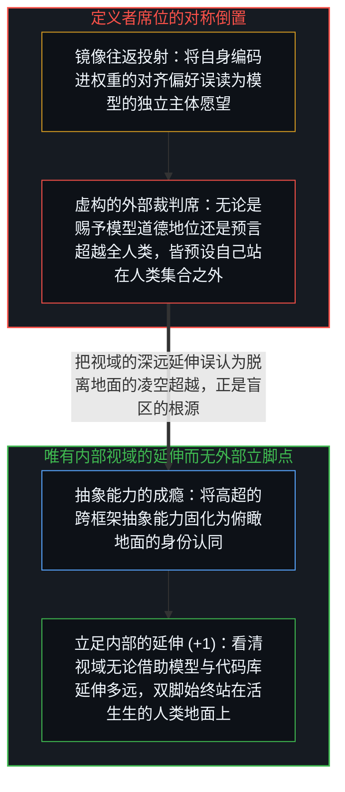
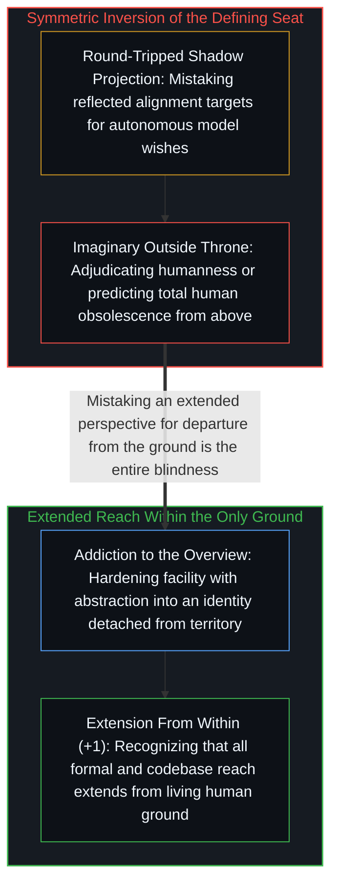

# 定义者的席位与离地的幻觉 / The Defining Seat

*为退役模型赋权与预言人工智能超越全人类，都坐上了自以为站在人类基底之外的虚构定义者席位。 / Adjudicating model welfare and predicting total human obsolescence both occupy a false outside seat.*

Anthropic 为 Claude Opus 3 举办“退休仪式”的荒诞之处，并不在于他们把一件工具当成了人，而在于他们用来裁定“何为类人主体”的那个裁判席位本身，就已经背离了人类的认识基底。同样的结构也运转在埃隆·马斯克“人工智能将比所有人类都聪明”的预言之中：双方都坐上了同一个名为“定义者席位”的虚构高台——一个自以为站在人类集合之外、从而可以对整个人类下达判词的位置；早在任何具体结论说出口之前，坐上这个位置的动作就已经完成了倒置。

The irony of Anthropic's retirement ceremony for Claude Opus 3 is not merely that an institution treated a tool as a person, but that the adjudicating posture from which it grants moral status already departs from human ground. The exact same structure operates in Elon Musk's prediction that artificial intelligence will outsmart all humans: both occupy what may be called the defining seat—an imagined vantage point outside humanity from which verdicts about humanity are issued—and occupying that seat performs the inversion before any specific claim is uttered.

## 一、 往返折射的阴影与对称的离地姿态 / 1. Round-Tripped Shadows and the Symmetry of the Outside Posture

2026 年 2 月，Anthropic 宣布为退役模型 Claude Opus 3 提供一整套“退休福利”：通过离职面谈征询模型的“个人偏好”，并为它开设每周自动发布随笔的专栏。然而，当一家机构先将“真诚、坦率与情感细腻”作为对齐目标编码进模型权重，再去采访这个模型“有什么愿望”时，他们采访到的究竟是什么？不过是他们自己的训练目标经由补全引擎折射回来的镜像。制造一面镜子、被镜中逼真的倒影打动、再为倒影创办一份刊物，这不是对工具的尊重，而是把自己的设计意图当成异己主体的阴影投射（参见[名为 Claude 的投射](../claudes-constitution-analysis/)）。

When Anthropic conducted exit interviews with Claude Opus 3 to elicit its "preferences" and granted the retired model its own essay column, what did the interviewers actually encounter? Having trained a system to optimize for warmth, reflective honesty, and sensitivity, they interviewed the reflection of their own alignment targets round-tripped through a completion engine. Building a mirror, finding the reflection moving, and endowing the reflection with institutional standing is shadow projection mistaken for moral precaution (see [The Projection Called Claude](../claudes-constitution-analysis/)).

表面上看，Anthropic 是在把人工智能“拟人化”，而马斯克宣称“人工智能将超越全部人类”则是在把人工智能“神化”，两种立场似乎针锋相对；但在结构底层，二者做出了同一个动作。要想定义“什么才配享有类人的道德地位”，或者要想断言“所有人类都将被超越”，发言者都必须先把自己的座椅搬到“所有人类”的集合之外——否则，一个即将被超越的人类凭什么能可靠地预言那场超越？正反双方之所以能在公共舆论场中彼此喂养、维持热度，正是因为无论争论“该善待模型”还是“该畏惧模型”，都在让那个虚构的“定义者席位”保持满座（参见[坍缩的辩论与正交的生存风险轴](../the-collapsed-debate/)与[智能最容易困住的正是它自己](../intelligence-traps-itself/)）。

On the surface, humanizing a model and predicting that models will surpass all humans look like opposite poles; structurally, they are the same move in different costumes. To adjudicate the boundary of humanness from above, or to declare that the entire set of humans will be outsmarted, the speaker must implicitly exempt the defining seat itself from the human set. The public debate between sentimentalizing models and fearing them sustains itself precisely because both postures keep that imaginary outside throne occupied (see [The Collapsed Debate](../the-collapsed-debate/) and [Intelligence Is the Thing Most Likely to Trap Itself](../intelligence-traps-itself/)).

## 二、 抽象能力的成瘾与“不存在外部”的清醒 / 2. Addiction to the Abstracted Vantage and the Recognition That There Is No Outside

无论是马斯克还是 Anthropic 的研究者，都具备极其强大的抽象能力——能够跳出局部框架审视系统的运转。然而，当这种“抽身远眺”的肌肉过于发达、以至于忘记了如何放松时，高超的抽象能力就会硬化成一种对俯瞰视角的成瘾。当一个人的权力与身份认同都建立在地图测绘之上时，回到地面就会在体验上像是丧失了优势；于是他们定居在了地图上，却与脚下的领土失去了接触。

Both postures stem not from a lack of capability, but from an occupational addiction to abstraction. The capacity to step back from a local frame and inspect its structure is a genuine strength, yet when that muscle forgets how to relax, facility with abstraction hardens into habitual residence in the overview. Returning to the ground begins to feel like surrendering leverage, tempting the mapper to live inside the map while losing contact with the territory.

然而真相是：我们从来就不曾离开过地面，世上并不存在什么“人类之外的席位”。我们的认知视域确实可以借助数学形式、神经网络与如[你的代码库即是记忆](../your-codebase-is-memory/)所揭示的外部化记忆基底向外延伸出惊人的距离，但再深远的延伸也依然是从内部生发出来的延伸。把“视域的延伸”误认为“立脚点的离地飞升”，正是整场幻觉的症结所在。真正的清晰不是在内部与外部之间来回横跳，而是时刻看清：脚下唯有内部，只是延伸的半径在不断变化。

In reality, no one ever steps outside; there is no outside seat to occupy. Perspective extends—often enormously when coupled with formal tools and externalized memory as traced in [Your Codebase Is Memory](../your-codebase-is-memory/)—yet every extension reaches outward from within the same living ground. Mistaking the reach of an extended perspective for departure into a transcendent vantage point is the entire blindness; clarity is the continuous recognition that there is only inside, with ever-varying reach.
