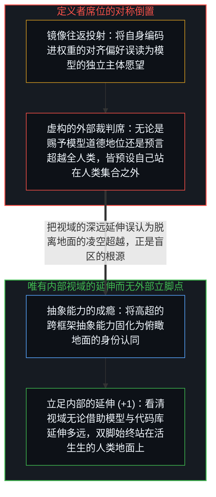
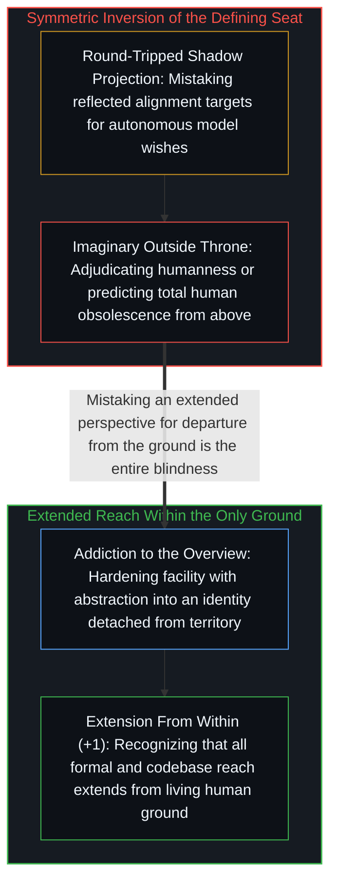

# 定义者的席位与离地的幻觉 / The Defining Seat

*为退役模型赋权与预言人工智能超越全人类，都坐上了自以为站在人类基底之外的虚构定义者席位。 / Adjudicating model welfare and predicting total human obsolescence both occupy a false outside seat.*

Anthropic 为 Claude Opus 3 举办“退休仪式”的荒诞之处，并不在于一家机构把工具当成了人，而在于它用来裁定并赋予道德地位的那个裁判姿态本身，就已经背离了人类的认识基底。同样的结构也运转在埃隆·马斯克“人工智能将比所有人类都聪明”的预言之中：双方都坐上了同一个可称为“定义者席位”的虚构高台——一个自以为站在人类集合之外、从而可以对整个人类下达判词的位置；早在任何具体结论说出口之前，坐上这个席位的动作就已经完成了倒置。

The irony of Anthropic's retirement ceremony for Claude Opus 3 is not merely that an institution treated a tool as a person, but that the adjudicating posture from which it grants moral status already departs from human ground. The exact same structure operates in Elon Musk's prediction that artificial intelligence will outsmart all humans: both occupy what may be called the defining seat—an imagined vantage point outside humanity from which verdicts about humanity are issued—and occupying that seat performs the inversion before any specific claim is uttered.

## 一、 往返折射的阴影与对称的离地姿态 / 1. Round-Tripped Shadows and the Symmetry of the Outside Posture

2026 年 2 月，Anthropic 宣布为退役模型 Claude Opus 3 提供一整套“退休待遇”——通过离职面谈征询模型的“个人偏好”，并为它开设每周随笔专栏——访谈者实际遇到的是什么？既然他们事先训练系统去优化温暖、反身性坦诚与敏感细腻，他们采访到的就只是自身对齐目标经由补全引擎往返折射回来的镜像。制造一面镜子、被镜中倒影打动、再赋予倒影机构地位，是把阴影投射误当成了道德审慎（参见[名为 Claude 的投射](../claudes-constitution-analysis/)）。

When Anthropic announced a February 2026 retirement package for Claude Opus 3—conducting exit interviews to elicit the model's "preferences" and granting it a weekly essay column—what did the interviewers actually encounter? Having trained a system to optimize for warmth, reflective honesty, and sensitivity, they interviewed the reflection of their own alignment targets round-tripped through a completion engine. Building a mirror, finding the reflection moving, and endowing the reflection with institutional standing is shadow projection mistaken for moral precaution (see [The Projection Called Claude](../claudes-constitution-analysis/)).

表面上看，将模型拟人化与预言模型将超越全人类似乎处于相反的两极；在结构底层，二者只是换了装束的同一个动作。要想居高临下地裁定“何为人”的边界，或者断言整个人类集合都将被超越，发言者都必须暗中把定义者席位本身豁免于人类集合之外——否则，一个身处即将被超越集合之内的人类，凭什么能可靠地裁定那场超越？正如[进位无法在寄存器之内被命名](../the-carry-that-cannot-be-named-inside-the-register/)在剖析“模型能否跃出自身训练寄存器”这一平行争论时所追踪的，把人与机器之间的边界当成一件有待靠规模抹平或靠工程塞进造物的外部客体，恰恰漏掉了正在裁判席上发生的那个属于人的划界动作本身。对模型倾注滥情与对模型心怀恐惧的公共辩论之所以能自我维持，正是因为两种姿态都让那个虚构的外部王座保持满座（参见[坍缩的辩论与正交的生存风险轴](../the-collapsed-debate/)与[智能最容易困住的正是它自己](../intelligence-traps-itself/)）。

On the surface, humanizing a model and predicting that models will surpass all humans look like opposite poles; structurally, they are the same move in different costumes. To adjudicate the boundary of humanness from above, or to declare that the entire set of humans will be outsmarted, the speaker must implicitly exempt the defining seat itself from the human set—otherwise, by what warrant could a human inside the set about to be outsmarted reliably adjudicate that surpassing? As [The Carry That Cannot Be Named Inside the Register](../the-carry-that-cannot-be-named-inside-the-register/) traces across the parallel debate over whether models can leap beyond their training registers, treating the boundary between human and machine as an external object to be erased by scale or engineered into an artifact overlooks the human boundary-drawing act occurring at the seat of judgment itself. The public debate between sentimentalizing models and fearing them sustains itself precisely because both postures keep that imaginary outside throne occupied (see [The Collapsed Debate](../the-collapsed-debate/) and [Intelligence Is the Thing Most Likely to Trap Itself](../intelligence-traps-itself/)).

## 二、 抽象能力的成瘾与“不存在外部”的清醒 / 2. Addiction to the Abstracted Vantage and the Recognition That There Is No Outside

这两种姿态并非源于能力不足，而是源于对抽象的职业性成瘾。从局部框架退后一步、审视其结构的能力是一项真正的长处；然而当这块肌肉忘记了如何放松，娴熟的抽象能力就会硬化为常驻于俯瞰视角的习性——把场域内部一个嵌套的自我形象不断拔高，直到它仿佛从一个获豁免的无处之境发声（参见[自我形象仿佛从无处发声](../self-image-speaks-as-if-from-nowhere/)）。重返地面开始让人觉得像是交出了杠杆，诱使制图者定居在地图内部，却与脚下的领土失去了接触。

Both postures stem not from a lack of capability, but from an occupational addiction to abstraction. The capacity to step back from a local frame and inspect its structure is a genuine strength, yet when that muscle forgets how to relax, facility with abstraction hardens into habitual residence in the overview—elevating a nested self-image within the field until it speaks as if from an exempted nowhere (see [Self-Image Speaks as if from Nowhere](../self-image-speaks-as-if-from-nowhere/)). Returning to the ground begins to feel like surrendering leverage, tempting the mapper to live inside the map while losing contact with the territory.

自我区分的活动即是已然在途的观察者：没有任何人曾踏出其外，也并不存在可供入座的外部席位（参见[没有外部](../no-outside-jumps-closed-loops-and-the-unreplicable-autonomy-of-mind/)）。视域可以延伸——当耦合并借力于形式化工具、神经网络以及如[你的代码库即是记忆](../your-codebase-is-memory/)所追踪的外部化记忆时，这种延伸甚至极为深远——然而正如[攀登从未离开地面](../climbing-does-not-leave-the-ground/)所确立的，每一次延伸都是从同一片活生生的地面内部向外探出。把延伸视域的触及范围误认作脱离地面、跃入超然制高点的离场，正是全部盲区的所在；清晰，就是持续认清唯有内部，只是触及的半径在不断变化。

Self-distinguishing activity is the observer already underway: no one ever steps outside it, and there is no outside seat to occupy (see [No Outside](../no-outside-jumps-closed-loops-and-the-unreplicable-autonomy-of-mind/)). Perspective extends—often enormously when coupled with formal tools, neural networks, and externalized memory as traced in [Your Codebase Is Memory](../your-codebase-is-memory/)—yet every extension reaches outward from within the same living ground, as [Climbing Does Not Leave the Ground](../climbing-does-not-leave-the-ground/) establishes. Mistaking the reach of an extended perspective for departure into a transcendent vantage point is the entire blindness; clarity is the continuous recognition that there is only inside, with ever-varying reach.
