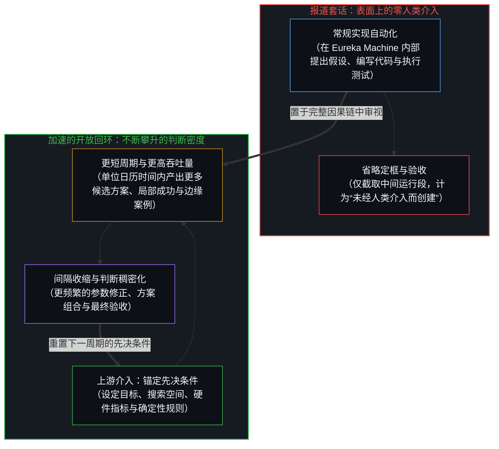
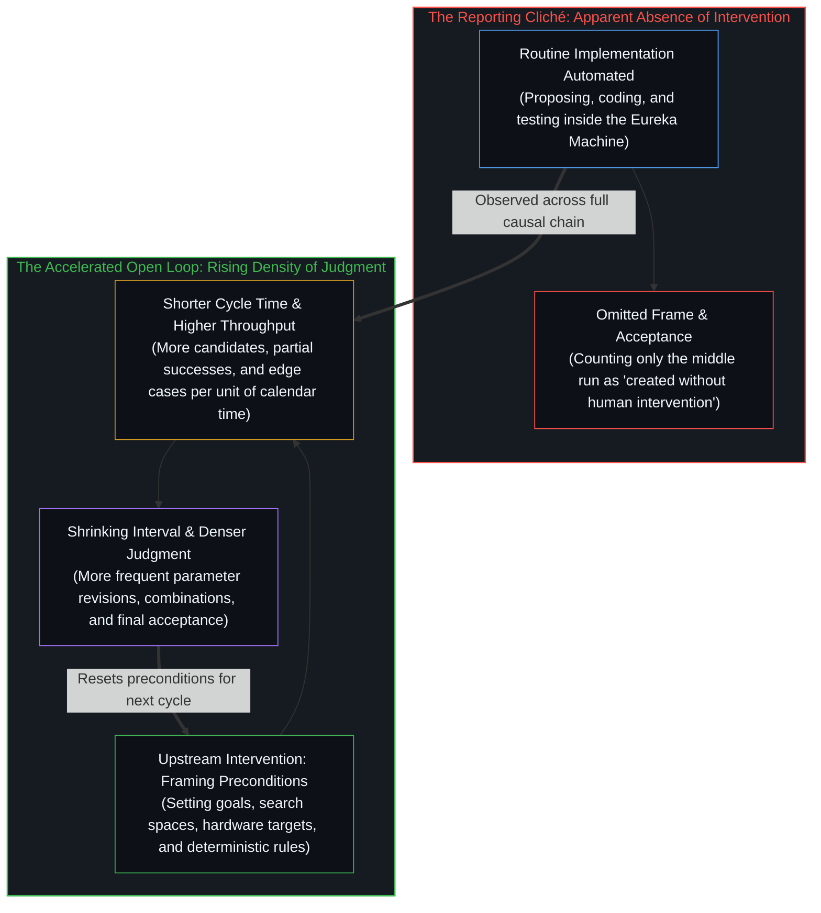
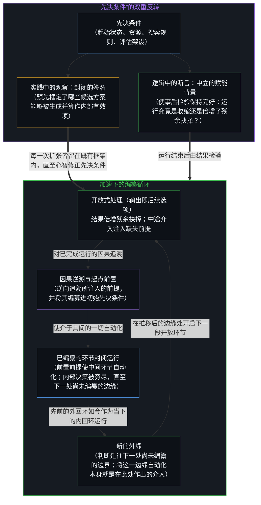
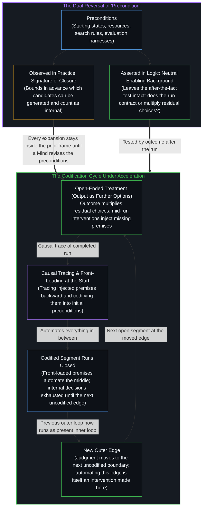

# 判断的密度 / The Density of Judgment

*加速开放式回环会缩短介入之间的间隔，并使留归心智的抉择成倍增加 / Accelerating an open-ended loop shrinks the interval between interventions and multiplies the choices that remain with the Mind*

Recursive 发布 Flint 模型——一个总参数量 400 亿、激活参数量约 20 亿的混合专家（MoE）编程模型——时，评论者将其欢呼为首个“未经人类介入而创建的开源模型”，重演了人们并不陌生的夸大。实际的记录要精确得多：一个由人类与智能体组成的小型团队在不到四个月的时间里从零构建了该模型，利用名为 Eureka Machine 的自动化系统运行了从提出假设、编写实现、执行测试到迭代演进的大段研究回环。人类设计了整套运行架设，设定了评测基准与硬件速度目标，修正了中间规则，并验收了最终发布的版本。将自动化吞吐量的实质提升坍缩为人类主体性的退场，既漏掉了启动运行的锚定先决条件，也抹去了收束流程的最终验收，同时忽略了开放式探究中的更快周期如何压缩两次介入之间的日历时间，从而推高人类判断的密度。

The announcement of Recursive's Flint model—a 40-billion-parameter mixture-of-experts coding model with roughly two billion active parameters—carried a familiar excess when commentators hailed it as the first open-source model created without human intervention. The actual record was more precise: a small team of people and agents built the model from scratch in under four months, using an automated system, the Eureka Machine, to run large stretches of the research loop of proposing, implementing, testing, and iterating. Humans designed the harness, set the benchmarks and hardware speed targets, revised intermediate rules, and accepted the finished release. Collapsing a real rise in automated throughput into the absence of human agency omits both the framing preconditions that started the run and the final acceptance that closed it, while missing how faster cycles in an open-ended inquiry compress calendar time between interventions and raise the density of human judgment.

## 一、 被省略的介入与不断收紧的间隔 / 1. The Omitted Interventions and the Tightening Interval

“未经人类介入而创建”把至少两次决定性的介入，连同维持回环运转所需的每一次参数修正，都隐藏在了众目睽睽之下。没有任何事物是未经介入而创建的——若无介入，创建者是谁？第一次介入是创建自动化架设本身，它将中间决策固化为确定性规则、搜索边界与起始先决条件；此后无人值守地运行的那一段，正是这次介入的编译形态。第二次介入是对最终产物的验收，即决断的心智判定某个候选运行结果适合发布而非废弃的那一刻。在这起首的锚定框架与收尾的最终验收之间，还分布着对数据配比、架构搜索空间、量化容差以及评估标准的持续调整。将结果称为未经人手触碰，并非对实际发生之事的描述，而是一种拒绝将定框、掌舵与收尾的决策计入账目的记账惯例，它还把形式化程度最高的介入读作介入的缺席。这种读法把表达当成了它的来源，正是[错把表达当成智能](../mistaking-the-expression-for-the-intelligence/)所追溯的那种归因：凡是系统在其构建者持续设定的外层流程之内运行，这种归因就会出现。正如[模型永远无法成为第二重前沿](../the-model-never-becomes-a-second-edge/)所追溯的，自动化架设使外化痕迹变得稠密，却不会衍生出第二个抉择中心；[注释不是代码](../the-comment-is-not-the-code/)也在每一次智能体运行中追溯了相同的结构：人类的抉择在起点处通过先决条件与运行架设切入，在每一次重置下游运行签名的中间微调中再度介入，并在返回的候选结果被采纳或驳回时闭合链条。

"Created without human intervention" hides at least two decisive interventions in plain sight, along with every parameter revision required to keep the loop running. Nothing is created without intervention—created by whom? The first intervention is the creation of the automated harness itself, which builds intermediate decisions into deterministic rules, search bounds, and starting preconditions; the stretch that then runs unattended is that intervention in compiled form. The second is the acceptance of the final product, the moment a deciding Mind judges a candidate run fit to release rather than discard. Between that opening frame and that closing acceptance sit the ongoing adjustments of data mixtures, architecture search spaces, quantization tolerances, and evaluation criteria. Calling the result untouched by human hands is not a description of what occurred; it is an accounting convention that refuses to count the decisions that framed, steered, and concluded the process, and that reads the most formalized intervention as its absence. That reading takes the expression for its source, the attribution [Mistaking the Expression for the Intelligence](../mistaking-the-expression-for-the-intelligence/) traces wherever a system runs inside an outer process its builders keep setting. As [The Model Never Becomes a Second Edge](../the-model-never-becomes-a-second-edge/) traces, the automated harness densifies externalized traces without originating a second locus of choice, and [The Comment Is Not the Code](../the-comment-is-not-the-code/) traces the same structure in every agentic run: human choice enters at the start through the preconditions and harness, re-enters at every intermediate tweak that resets the signature for downstream runs, and closes the chain when the returned candidate is taken up or rejected.

这一事件所展示的，正是每当开放式探究被加速时都会显现的动态。将科学方法中更大比例的环节自动化，是技术进步的体现，但它的实际效应却与当下报道的陈词滥调——即系统正独自运行得越来越久、所需的人类参与越来越少——恰好相反。事实上，自动化回环转得更快了：它在两次介入之间完成了更多工作，同时缩短了将一个决策点与下一个决策点隔开的日历间隔。研究周期的缩短，使返回给操作者以供筛选的候选架构、训练配方、内核变体以及模棱两可的评估结果在数量上成倍增加。

What the episode illustrates is the dynamic that appears whenever open-ended inquiry is accelerated. Automating larger portions of the scientific method is the expression of technical progress, yet its effect is the opposite of the contemporary reporting cliché that systems are running longer on their own and requiring less human involvement. Instead, the automated loop runs faster, getting more done between interventions while shrinking the calendar interval separating one decision point from the next. Shortening the research cycle multiplies the volume of candidate architectures, training recipes, kernel variants, and ambiguous evaluation results that return to the operator for selection.

常规实现的工作量在下降；而设定判准、组合局部成功、解读边缘案例失效以及决定何时叫停的工作却在加剧，并在日历时间上以更高的频率涌现，正如[要紧的控制迁往边缘](../residual-control-recedes-to-the-edge/)所追溯的那样，将起决定性作用的掌舵迁往外围边界。由于加速运转的回环在每一轮迭代中都会推移约束边界，掌舵便无法仰赖过往结论的缓存库存，这正是[判断力不是可囤积的存量](../judgment-is-not-a-stock/)所审视的实时证伪动态。更快的产出在制造出人类被取代的直观印象的同时，也生成了一连串更稠密、杠杆率更高的人类判断。机器正在接管工作的观感，与手头有更多决策需要定夺的体验并不矛盾；当更短的周期时间作用于一个其产物是更多后续选项而非终局结果的流程时，这两者便是同时发生的必然后果，从而收紧了[不断收紧的回环](../the-tightening-loop/)所追溯的自指旋转。

The work of routine implementation declines; the work of setting criteria, combining partial successes, interpreting edge-case failures, and deciding when to halt intensifies and arrives at higher frequency in calendar time, relocating essential steering to the outer perimeter as [Essential Control Moves to the Edge](../residual-control-recedes-to-the-edge/) traces. Because the accelerated loop shifts the constraint boundary with each pass, steering cannot rest on a cached inventory of prior conclusions, the live falsification dynamic [Judgment Is Not a Stock](../judgment-is-not-a-stock/) examines. Faster production creates the immediate impression of displacement while simultaneously generating a denser sequence of higher-leverage human judgments. The feeling that machines are taking over the work and the experience of having more decisions to make are not contradictory; they are simultaneous consequences of applying shorter cycle times to a process whose product is further options rather than a finished result, tightening the self-referential rotation traced in [The Tightening Loop](../the-tightening-loop/).

## 二、 封闭源于视角，而非内生属性 / 2. Closed by Perspective, Not by Nature

这种判断密度的反弹并非在所有自动化部署中都普遍存在。它是那些持续扩张自身残余决策空间的活动的特征。当一个流程被赋予固定的、由外部界定的终点——生产指定数量的已知物品、执行终止规则早已确定的计算，或运行公差已完整列明的物理操作——加速确实会减少人类在该特定任务中的参与，且几乎不会引发反弹。一旦终止条件得到满足，后续迭代便落在该任务之外，残余的人类精力也会收窄为监控与异常处理。

This rebound in judgment density is not universal across every deployment of automation. It is characteristic of activities that continue to expand their own residual decision space. When a process is given a fixed, externally defined endpoint—producing a specified quantity of a known item, executing a calculation whose termination rule is already settled, or running a physical operation whose tolerances have been fully stated—acceleration reduces human involvement in that specific task with limited rebound. Once the terminating condition is met, further iterations fall outside the task, and residual human effort narrows to monitoring and exception handling.

这种意义上的“封闭”取决于视角——取决于掌舵心智所施加的目标与停机规则——而非底层技术步骤的内在属性。同一套自动化序列既可以在固定规格下运行（在指定硬件目标上达到该基准阈值即停止），也可以在开放指令下运行（持续提升能力、探索邻近架构、揭示新的权衡空间）。在前一种处理下，满足判准即穷尽了任务内部的决策。在后一种处理下，没有任何固定上限来终结探究，因此每一个完成的周期都会将成功的输出转化为供进一步筛选的原材料。无论在哪一种处理下，运行的自主性都是真实的：它的具体路径由系统自行寻得，而非被逐步口授。然而所谓的“完全自主”从来不曾完整，因为这份自主是一片领地的内部，而这片领地是此前的种种介入开拓出来、才变得可用的；对该发布的一条回复说“某种非人类的东西长出了这个”，这句话对边界之内的具体搜索成立，对边界本身则不成立。由于封闭的形式化执行只是在重组其边界处已固定的自由度，正如[主体性不曾涌现](../agency-does-not-arise/)所追溯的，封闭任务与开放探索之间的切分从不自机器内部涌现；它是由承担停机或继续之不可让渡后果的委托人所设定并反复重设的，这正是[任务的移交与后果的不可让渡](../the-delegation-of-the-task-and-the-inalienability-of-consequences/)所追溯的边界。

"Closed" in that sense is determined by perspective—by the goal and stopping rule imposed by the directing Mind—rather than by the intrinsic nature of the underlying technical steps. The same automated sequence can be run under a fixed specification (reach this benchmark threshold on this hardware target, then stop) or under an open directive (keep improving capability, explore adjacent architectures, surface new trade-offs). Under the first treatment, meeting the criterion exhausts the decisions internal to the task. Under the second, no fixed ceiling terminates the inquiry, so every completed cycle turns successful outputs into raw material for further selection. Under either treatment the autonomy of the run is real: its detailed path is found by the system rather than dictated step by step. Full autonomy is never full, though, because that autonomy is the interior of a territory earlier interventions expanded over and made workable; "something non-human grew this," as one reply to the announcement put it, holds of the detailed search inside the bounds and fails of the bounds themselves. Because a closed formal execution only recombines the degrees of freedom fixed at its boundary, as [Agency Does Not Arise](../agency-does-not-arise/) traces, the cut between a closed task and an open exploration never emerges from the machine; it is set and re-set by the principal who holds the non-transferable consequences of stopping or continuing, the boundary [The Delegation of the Task and the Inalienability of Consequences](../the-delegation-of-the-task-and-the-inalienability-of-consequences/) traces.

## 三、 作为封闭签名的先决条件及其双重反转 / 3. Preconditions as the Signature of Closure and Their Dual Reversal

如果剥离由外部选定的目标，区分这两种演进形态的标志，就在于运行一个周期究竟是将内部决策空间收缩至终止结果，还是使尚待裁决的备选项成倍增加。检验这一结构性差异无需任何先验预设：在任何运行完成后，只需观察其输出究竟是穷尽了活动内部的抉择，还是留下了比原先更大的残余抉择集。然而，将“执行该检验无需任何预设”的论断，与“先决条件（起始状态、资源与规则）为两种情形所共有”的观察并置时，便暴露出一种尖锐的张力。作为先决条件来看，起始规则本身就已经是封闭的签名：它预先固定了确定性的映射关系。一方面声称先决条件为两者共有，另一方面又声称无需任何预设，这种并置将关于事后检验的逻辑真值，与关于先决条件实际运作方式的经验上显见、逻辑上却倒置的描述捆绑在了一起。

If the externally chosen goal is stripped away, what separates the two patterns of progress is whether running a cycle contracts the internal decision space to a terminating result or multiplies the alternatives still requiring resolution. That structural difference requires no a-priori presupposition to test: after any run completes, one can observe whether the output exhausted the choices inside the activity or left a larger residual choice set than before. Yet stating that no presupposition is required to run the test alongside the observation that preconditions—starting states, resources, and rules—are common to both cases exposes a sharp tension. Treated as a precondition, a starting rule is already the signature of closure: it fixes a deterministic mapping in advance. Claiming that preconditions are common to both while no presupposition is required pairs a logical truth about the after-the-fact test with an empirically obvious yet logically inverted description of how preconditions actually operate.

这一张力揭示了同一个词——“先决条件”——如何根据它是在逻辑中被断言、还是在实践中被观察，而获得截然相反的含义。当在逻辑中被断言为区分标尺时，先决条件的存在被视为中立的背景：它使执行得以启动，却不预先判定残余决策空间将会收缩还是扩张，从而使事后检验保持完好。当运行结束后在实践中被观察时，恰恰是这些先决条件从头到尾充当着限定边界的约束，决定了哪些扩张能够被生成、哪些候选方案算作活动内部的有效项。自动化机器内部的每一次“开放”探索，都早已封闭在周期运行前所固定的先决条件签名之内；要扩张这一签名，就必须由鲜活的心智介入并注入新的自由变量，正如[残余与自由变量](../the-residue-and-the-free-variable/)所追溯的那样。保持逻辑一致要求同时握住这两重面向：先决条件既充当了开启一个周期的赋能起点，又构成了封闭该周期单靠自身所能触及范围的边界。

That tension is how the exact same term—"precondition"—acquires opposite meanings depending on whether it is asserted in logic or observed in practice. Asserted as a logical separator, the presence of preconditions is treated as neutral background that enables execution without prejudging whether the residual decision space will contract or expand, leaving the after-the-fact test intact. Observed in practice after the run, those very preconditions functioned all along as the bounding constraint that determined which expansions could even be generated and which candidates counted as internal to the activity. Every "open" exploration inside an automated machine was already enclosed within the signature of the preconditions fixed before the cycle ran; expanding that signature requires a living Mind to step in and inject a new free variable, as [The Residue and the Free Variable](../the-residue-and-the-free-variable/) traces. Consistency requires holding both faces at once: preconditions serve simultaneously as the enabling starting point of a cycle and as the boundary that closes what the cycle can reach on its own.

先决条件的这一双重角色，解释了处于 Flint 发布事件核心、乃至更广泛的自动化流水线中的现象。流程中途的每一次人类介入，都是注入了一项在起点处未被列明的前提。当一次运行在未决的分岔处停滞、偏离靶标，或返回模棱两可的候选方案时，初始签名便已抵达单靠自身所能推导出的边界；此时介入以调整数据配比、收紧容差，或在两个分支之间择一而行，正是补上了使链条得以继续延伸所需的缺失前提。倘若在一次运行完成后逆向进行因果追溯，识别出沿途为达成预期结果而引入的每一项前提，并将这些被发现的前提编纂进流程最起点的起始先决条件之中——即[按需语境将融贯保持在一步](../on-demand-contexts-keep-coherence-at-one-step/)在智能体工作流中所付诸实施的复盘与编纂回环——那么介于其间的一切便都能由确定性推导得出，从而实现端到端的自动化。将这些前提集中前置到初始边界之中，正是制造出“未经人类介入而达成结果”这一印象的原因：在随后的运行轮次里，中间环节之所以能够不间断地执行，并不是因为人类判断消失了，而是因为过往高密度周期中注入的各项前提已被追溯并编译进了起始先决条件，从而将一段开放式环节转化为封闭式执行，直至探究触及下一处尚未编纂的边缘。

This dual role of preconditions explains the phenomenon at the center of the Flint announcement and of automated pipelines more broadly. Every mid-process human intervention is the injection of a premise that was not specified at the beginning. When a run stalls on an undecided split, drifts off target, or returns ambiguous candidates, the initial signature has reached the boundary of what can be derived from it alone; stepping in to adjust a data mixture, tighten a tolerance, or select one branch over another supplies the missing premise required for the chain to continue. If a completed run is then traced causally backward to identify every premise introduced along the way in reaching the desired result, and those discovered premises are codified into the starting preconditions at the very beginning of the process—the recap-and-codification loop [On-Demand Contexts Keep Coherence at One Step](../on-demand-contexts-keep-coherence-at-one-step/) operationalizes across agentic workflows—everything in between becomes deterministically derivable and can be automated end to end. Front-loading those premises into the initial boundary is what creates the impression of a result achieved without human intervention: on the subsequent pass, the middle executes without interruption not because human judgment disappeared, but because the premises injected across prior high-density cycles have been traced and compiled into the starting preconditions, converting an open-ended segment into a closed execution until the inquiry hits its next uncodified edge.

编纂是迭代的：每一轮都把上一次运行时须在外围现场作出的判断，编译进下一次运行的内回环，判断则迁往新的外缘，因此先前的外回环就是当下的内回环。向内迁移的是每一圈外围的编译形态；判断下一圈外围的那个行动并不在其中。“外回环也会被自动化”这一反驳成立，却不改变这一几何结构：被自动化的外回环是一个更新回环的内回环，而将它自动化本身就是在当前边缘处作出的一次介入，所以边缘永远不会被自动化掉；不存在固定的顶层，只有一条随每圈外围被编译而向外推移的边缘。[持续生长的脚手架](../the-scaffolding-that-keeps-growing/)追溯了同一种由外部边界向内部支撑的转化：后继模型不断吸收为其前代搭建的运行架设；[智能向自身的回折](../intelligence-folding-back-on-itself/)则使这条边缘不致固化为一个坐镇永久外部的监督者：在该文中，“外”只指称那条自我闭合的回路，即心智把改进分配给它所投射的内回环，而非一个顶层。

Codification iterates: each pass compiles the judgments that had to be made live at the last run's perimeter into the inner loop of the next, and judgment moves to a new outer edge, so the previous outer loops are the present inner loops. What moves inward is each perimeter's compiled form; the act that judges the next perimeter is not among them. The rejoinder that outer loops get automated too holds and leaves the geometry intact: an automated outer loop is the inner loop of a newer one, and automating it is itself an intervention made at the current edge, so the edge is never automated away; there is no fixed top, only an edge that moves outward as each perimeter is compiled. [The Scaffolding That Keeps Growing](../the-scaffolding-that-keeps-growing/) traces the same conversion of outer boundary into interior strut as successive models absorb the harnesses built for their predecessors, and [Intelligence Folding Back on Itself](../intelligence-folding-back-on-itself/) keeps that edge from hardening into a supervisor seated in a permanent exterior: there, "outer" names only the circuit that closes on itself, the Mind allocating improvement to the inner loops it projects, not a top layer.

每当关于进步的话语将更高的自动化吞吐量等同于人类介入的消失时，它就遮蔽了这一结构。那些声称机器正在取代研究者、或是自动化科学正逼近自足自治的说法，只记录了手工实现工作的减少，却无视了判断密度的攀升。研究活动的开放性并非该领域的某种神秘属性，而是导向目标使然——这些目标将每一次成功的输出都当作供进一步筛选的材料，而非停下的理由。当这些目标被收窄为固定靶标时，同样的自动化就会产出封闭的完结。当目标保持开放时，加速回环并不会消除剩余的人类抉择，反而会推高它们的发生频率与杠杆率。工作仿佛正被机器接管、同时却又在成倍增加的悖论式体验，因此并非对事实的认知混乱，而是一个开放式流程在更高时钟频率下运转时的精确写照。

The language of progress obscures this structure whenever it equates higher automated throughput with the disappearance of human intervention. Claims that machines are replacing researchers, or that automated science is approaching self-contained autonomy, register the decline in manual implementation while ignoring the rise in the density of judgment. The open-ended character of research is not a mystical property of the domain; it is the consequence of directing goals that treat every successful output as material for further selection rather than as a reason to stop. When those goals are narrowed to a fixed target, the same automation yields a closed completion. When they remain open, speeding up the loop raises the rate and leverage of the remaining human choices instead of eliminating them. The paradoxical experience that the work is simultaneously being taken over and multiplying is therefore not a confusion about the facts, but the exact registration of an open-ended process running at a higher clock speed.
