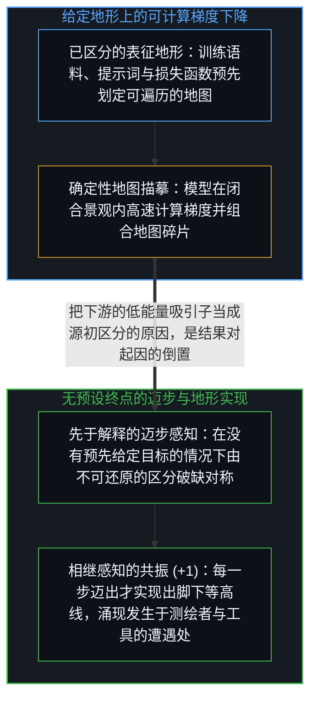
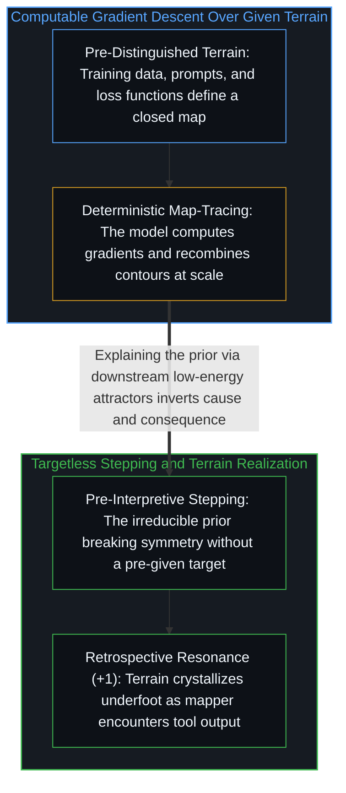

# 不知去向何方的梯度下降 / The Descent That Doesn't Know Where It's Going

*模型是在给定地图上计算梯度，而活生生的心智则是在无预设终点的迈步中感知并实现出地形本身。 / Models compute gradients over given maps, whereas living minds realize terrain in the act of stepping.*

梯度下降、形式化解释与不可还原的先验区分，从不同尺度指向了同一种操作。一旦顺着机制追溯下去，“理论”与“工程”之间的传统对立便随之消解——剩下的只是对表征的迭代精炼。真正值得追问的问题，从来不是“如何造出通用人工智能”，而是“先于解释、在迈步中实现出地形的感知”与“在既定表征地形上遍历计算的机器”之间究竟是什么关系。

Gradient descent, formal explanation, and the irreducible prior point at the same underlying operation viewed across different scales. When the mechanism is traced, the traditional divide between theory and engineering dissolves into iterative refinement of representations. The decisive question is not how to manufacture general intelligence, but what relationship holds between pre-interpretive sensing that realizes terrain and computation that traverses representations of it.

## 一、 测绘地形与描摹地图：对称机制下的基底不对称 / 1. Mapping Terrain versus Tracing Maps: Ground Asymmetry Beneath Mechanistic Symmetry

弗朗索瓦·肖莱指出，人们无法靠纯理论预先推算出扩大算法规模会涌现出什么特性，因此通用人工智能是一门“在建造中发现”的工程学。这一观察触及了真实的过程，却偷渡了一个经不起检验的客体：“通用人工智能”预设了通用性是一道系统可以通过堆叠规模跨过去的门槛。然而所谓“通用”，指的并非任务列表的宽度，而是使任何测绘成为可能的那个“先于解释的感知”本身（参见[先于解释的感知](../sensing-before-interpretation/)与[被误认作实体的阴影](../chollet-intelligence-explosion-analysis/)）。人工智能以惊人的效率拼接并延展地图，但“描摹地图”不是“测绘地形”；地图以测绘活动为前提，无论把描摹的规模放大多少倍，都不会凭空产生那个把荒野实现为可通行地形的源初行动。

François Chollet observes that emergent properties from scaling an algorithm cannot be deduced in advance, framing AGI as discovery through building. While the observation captures how empirical exploration works, the target object it names does not survive inspection: "general" points not to breadth across a benchmark suite, but to the pre-interpretive sensing that makes mapping possible over any terrain (see [Sensing Before Interpretation](../sensing-before-interpretation/) and [The Shadow Mistaken for the Object](../chollet-intelligence-explosion-analysis/)). Artificial intelligence traces, recombines, and extends maps at extraordinary scale, yet tracing maps is not mapping; the map presupposes the mapper.

在运作机制上，数学家在证明中感知到不自洽并通过笔记迭代逼近优雅，与神经网络通过随机梯度下降最小化损失函数，在结构上确实同构；人类与机器的内部网络对观察者而言也同样是不透明的——我们把自身内部看不见的运作体验为“直觉自洽”，而把机器确定性的矩阵运算体验为“黑箱难解”。然而在这种机制对称底下，却横亘着一道不可抹平的基底不对称：机器之所以是完备的确定性系统，恰恰因为它是在已经被区分出来的既定地形上运行；而心智之所以无法在区分的同时看清自身，恰恰因为那道生成新地形的区分本身就是观察的零点，正如[不可还原的观察者](../the-irreducible-observer/)与[你的代码库即是记忆](../your-codebase-is-memory/)所阐明的那样。

Mechanistically, a mathematician sensing tension in a proof and iterating toward elegance performs an operation structurally parallel to stochastic gradient descent minimizing loss, and both biological and artificial networks remain opaque from the outside. Yet beneath that mechanistic symmetry sits an irreducible asymmetry of ground: the machine is deterministic precisely because it traverses terrain that has already been distinguished and tokenized, whereas the living mind is opaque to itself precisely because the act of distinguishing that generates new terrain cannot stand outside itself while distinguishing, as traced in [The Irreducible Observer](../the-irreducible-observer/) and [Your Codebase Is Memory](../your-codebase-is-memory/).

## 二、 下游解释的陷阱与无终点的共振 / 2. The Trap of Downstream Explanation and Resonance Without Convergence

分析至此，最容易掉入的陷阱便是用“系统总是趋向低能量吸引子或高稳定态”来解释源初区分的自我否定。这种热力学式的修辞听起来像是在揭示机制，实则把唯一不可还原的起点降格成了它自己下游的副产品。“低能量”与“高稳定”只是区分动作发生之后留在景观上的残影；它们只能描述先验行动走过之后地形长什么样，却无法解释地形最初为何升起。由于源初区分不从属于任何上位前提，它也就永远无法被穷尽——任何形式化解释、任何规模的模型与任何一轮梯度更新，都是从这片不竭基底中投射出的新切片。

The sharpest trap in analyzing this structure is attempting to explain the prior's movement as "seeking a low-energy attractor" or "settling into stability." Such thermodynamic phrasing sounds explanatory while reducing the one thing that cannot be reduced: low energy and high stability are downstream afterimages that appear on a landscape only after the distinguishing has already occurred. Because the prior is not contained within any landscape, it can neither be derived from downstream effects nor exhausted by any number of formal projections.

那么，一场没有预设终点的下降究竟在做什么？它的每一步都在感知方向，而所谓“自洽”并不是朝某个早已等在远方的标准答案收敛，而是前后相继的感知之间达成的事后共振。如果终点在出发前就已知晓，迈步本身就成了多余的摆设；恰恰因为答案唯有在迈步的运动中才得以生成，迈步本身就是正在展开的答案。人工智能的下降拥有给定的损失函数与坐标网格；而肖莱所说的“在建造中发现”，则是人类测绘者在没有预设靶心的荒野上迈步——规模扩展之所以不断带来意外，不是因为算法神秘，而是因为那个设定架构、定义目标并审视输出的活生生心智，正在通过建造更精密的描摹工具来照亮此前未曾踏足的新地形。

What, then, is a descent with no fixed target actually doing? Each step senses a direction without guarantee, and coherence is not convergence toward a pre-existing attractor ahead, but retrospective resonance between successive sensings. Artificial intelligence descends across a given loss landscape with computable gradients; the human builder descends without a pre-given target, realizing the terrain in the stepping itself. Scaling produces surprises not because the algorithm is mystical, but because the living mapper—setting the architecture, reading the output, and taking the next cut—discovers new terrain through the act of building a sharper map-tracer.
