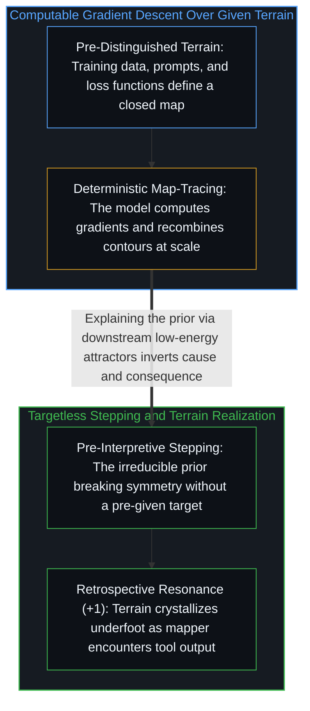

# 不知去向何方的梯度下降 / The Descent That Doesn't Know Where It's Going

*模型是在给定地图上计算梯度，而活生生的心智则是在迈步行动中实现地形。 / Models compute gradients over given maps, whereas living minds realize terrain in the act of stepping.*

梯度下降、形式化解释与不可还原的先验区分，从不同尺度指向了同一种底层操作。一旦顺着机制追溯下去，理论与工程之间的传统分野便消解为对表征的迭代精炼。决定性的问题并非如何制造通用智能，而是实现出地形的先于解释的感知，与遍历地形表征的计算之间究竟是什么关系。

Gradient descent, formal explanation, and the irreducible prior point at the same underlying operation viewed across different scales. When the mechanism is traced, the traditional divide between theory and engineering dissolves into iterative refinement of representations. The decisive question is not how to manufacture general intelligence, but what relationship holds between pre-interpretive sensing that realizes terrain and computation that traverses representations of it.

## 一、 测绘地形与描摹地图：对称机制下的基底不对称 / 1. Mapping Terrain versus Tracing Maps: Ground Asymmetry Beneath Mechanistic Symmetry

弗朗索瓦·肖莱指出，扩大算法规模所涌现的特性无法预先推演，因而将通用人工智能（AGI）界定为“在建造中发现”。这一观察捕捉到了经验探索的运作方式，但它所命名的目标客体却经不起审视：所谓“通用”，指向的并非跨越基准测试集的广度，而是使任何地形上的测绘成为可能的“先于解释的感知”（参见[先于解释的感知](../sensing-before-interpretation/)与[被误认作实体的阴影](../chollet-intelligence-explosion-analysis/)）。人工智能以惊人的规模描摹、重组并延展地图，然而描摹地图并非测绘地形；地图以测绘者为前提。

François Chollet observes that emergent properties from scaling an algorithm cannot be deduced in advance, framing AGI as discovery through building. While the observation captures how empirical exploration works, the target object it names does not survive inspection: "general" points not to breadth across a benchmark suite, but to the pre-interpretive sensing that makes mapping possible over any terrain (see [Sensing Before Interpretation](../sensing-before-interpretation/) and [The Shadow Mistaken for the Object](../chollet-intelligence-explosion-analysis/)). Artificial intelligence traces, recombines, and extends maps at extraordinary scale, yet tracing maps is not mapping; the map presupposes the mapper.

在机制层面上，数学家在证明中感知到张力并通过迭代逼近优雅，其运作在结构上与最小化损失的随机梯度下降平行，且生物网络与人工网络从外部看去同样是不透明的。正如[模块化反馈回路与动态残差网络](../dynamic-resnet-of-skill-loops/)所追溯的，即便架构用残差跳跃连接（`yₗ₊₁ = yₗ + F(yₗ, Wₗ)`）取代了逐层状态覆写（`yₗ₊₁ = fₗ(yₗ)`），沿着恒等主干传递保留参考，使每个模块计算有界差值 `Δyₗ` 并在不受中间层雅可比畸变干扰的情况下接收上游梯度（`I + ∂F/∂yₗ`），这种模块化反馈依然运行在锚定于外部给定初始状态 `y₀` 与终端损失判据的已区分景观之内。在这层机制对称之下，横亘着一道不可还原的基底不对称：机器之所以是确定性的，恰恰因为它遍历的是在迈步之前便已由外部划界的地形——无论其单元由分词器预先固定，还是如[学到的边界与给定的尺度](../learned-boundaries-and-the-given-rate/)所追溯的，其边界、路由与模块分裂在外环给定并依结果修正的压缩尺度、意外定义与巩固算子之内按语境学得——而活生生的心智之所以对自己不透明，恰恰因为生成新地形的区分行动在实施区分时无法站到自身之外，正如[不可还原的观察者](../the-irreducible-observer/)与[你的代码库即是记忆](../your-codebase-is-memory/)所追溯的那样。

Mechanistically, a mathematician sensing tension in a proof and iterating toward elegance performs an operation structurally parallel to stochastic gradient descent minimizing loss, and both biological and artificial networks remain opaque from the outside. Even when an architecture replaces plain layer-by-layer state overwrites (`yₗ₊₁ = fₗ(yₗ)`) with residual skip connections (`yₗ₊₁ = yₗ + F(yₗ, Wₗ)`) that carry a retained reference along an identity highway so each block computes a bounded differential `Δyₗ` and receives upstream gradients (`I + ∂F/∂yₗ`) without intermediate Jacobian distortion, as [Modular Feedback Loops and Dynamic Residual Networks](../dynamic-resnet-of-skill-loops/) traces, that modular feedback still operates within a pre-distinguished landscape anchored to an externally supplied initial state `y₀` and terminal loss criterion. Beneath the mechanistic symmetry sits an irreducible asymmetry of ground: the machine is deterministic precisely because it traverses terrain bounded from outside before it steps—whether its units are fixed in advance by a tokenizer or its boundaries, routes, and module splits are learned per context within a compression rate, a surprise definition, and consolidation operators that the outer loop gives and refines by results, as [Learned Boundaries and the Given Rate](../learned-boundaries-and-the-given-rate/) traces—whereas the living mind is opaque to itself precisely because the act of distinguishing that generates new terrain cannot stand outside itself while distinguishing, as traced in [The Irreducible Observer](../the-irreducible-observer/) and [Your Codebase Is Memory](../your-codebase-is-memory/).

## 二、 下游解释的陷阱与无终点的共振 / 2. The Trap of Downstream Explanation and Resonance Without Convergence

分析这一结构时最隐蔽的陷阱，是试图把先验区分的运动解释为“寻找低能量吸引子”或“落入稳定态”。这种热力学式的措辞听起来像是在提供解释，实则把唯一不可还原的起点给还原掉了：低能量与高稳定只是区分发生之后才出现在景观上的下游残影。由于先验区分不被包含在任何景观之内，它既无法从下游效应中推导出来，也无法被任何数量的形式化投射所穷尽。

The sharpest trap in analyzing this structure is attempting to explain the prior's movement as "seeking a low-energy attractor" or "settling into stability." Such thermodynamic phrasing sounds explanatory while reducing the one thing that cannot be reduced: low energy and high stability are downstream afterimages that appear on a landscape only after the distinguishing has already occurred. Because the prior is not contained within any landscape, it can neither be derived from downstream effects nor exhausted by any number of formal projections.

那么，一场没有固定目标的下降究竟在做什么？它的每一步都在无保证的情况下感知方向，而所谓自洽并不是朝前方某个预先存在的吸引子收敛，而是前后相继的感知之间达成的回溯性共振。人工智能凭借可计算的梯度在给定的损失景观上下降；人类建造者则在没有预设目标的情况下下降，在迈步本身之中实现出地形。规模扩展之所以不断带来意外，不是因为算法神秘，而是因为那个设定架构、审视输出并作出下一刀切分的活生生测绘者，正在通过建造更锐利的地图描摹器这一行动本身发现新地形。

What, then, is a descent with no fixed target actually doing? Each step senses a direction without guarantee, and coherence is not convergence toward a pre-existing attractor ahead, but retrospective resonance between successive sensings. Artificial intelligence descends across a given loss landscape with computable gradients; the human builder descends without a pre-given target, realizing the terrain in the stepping itself. Scaling produces surprises not because the algorithm is mystical, but because the living mapper—setting the architecture, reading the output, and taking the next cut—discovers new terrain through the act of building a sharper map-tracer.
