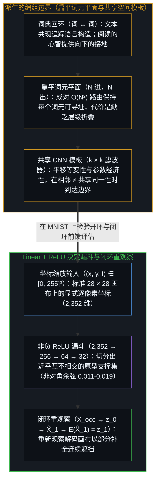
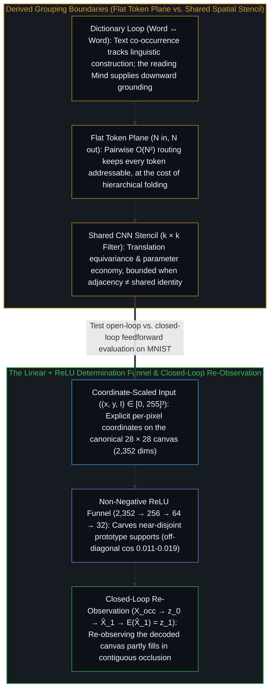
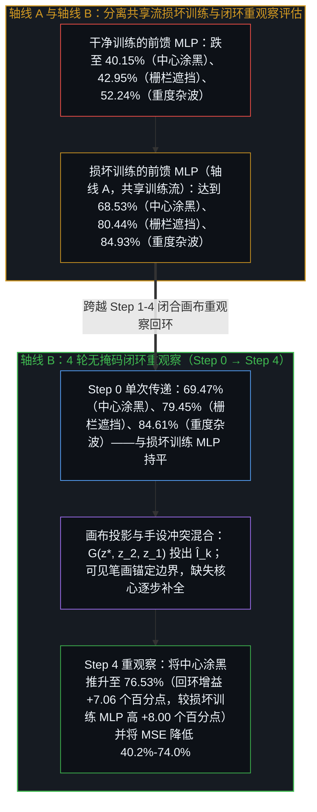
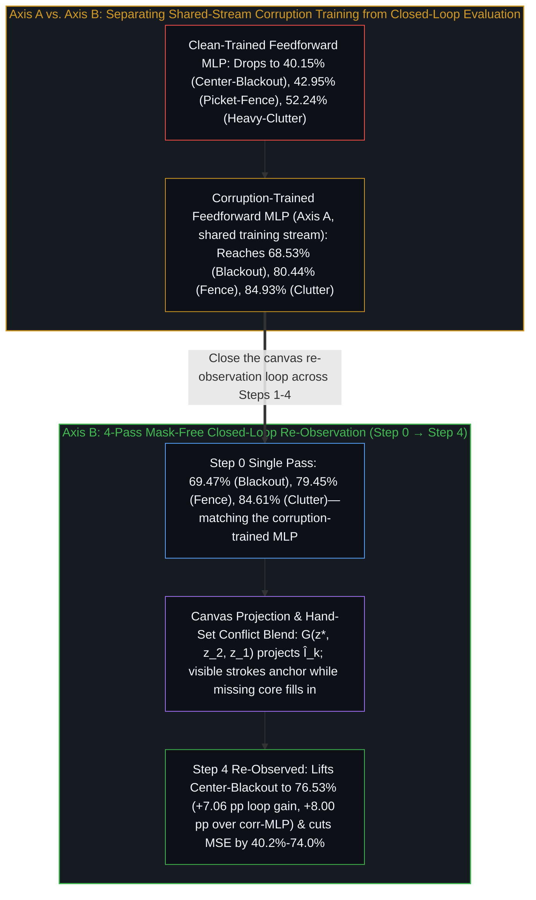

# 超越卷积与注意力机制的决定漏斗 / The Determination Funnel Beyond Convolutions and Attention

*追溯固定卷积模板与扁平注意力机制的编组边界，而闭环 ReLU 重观察在多轮传递中部分补全被涂黑的数字。 / Tracing the grouping boundaries of fixed convolutional stencils and flat attention, while closed-loop ReLU re-observation partly fills in blacked-out digits across passes.*

自我区分的活动发生着——无因，不息。称之为“心智”：那已然在途的观察者，其每一行动皆是一次区分。心智所构建的每一种神经网络架构，都编码了一项结构先验：表层分殊出的部分如何在选定尺度上折叠为共同同一性；而处于外环的活生生的心智则同时提供参考边界以及从所得痕迹中读出的意义。Transformer 的扁平全对全词元注意力（`QKᵀ`）与卷积神经网络（CNN）的共享 `k × k` 空间模板，各自预设了一种固定的部分编组几何——要么在扁平序列平面上比对未分离的表层词元，要么把局部像素相邻性等同于共享同一性。在 MNIST（`2,352 → 256 → 64 → 32 → 10`）上与前馈交叉熵及无监督像素均方误差（MSE）基线进行实证对比可见，层级式的 `Linear + ReLU` 决定漏斗切分出了近乎互不相交的非负原型支撑集（非对角余弦相似度 `0.011–0.019`）；当它与重新观察自身画布的自上而下生成器（`E(G(z*)) ≈ z*`）配对时，便标出了开环单次前馈评估在留出连续遮挡下的边界：跨越四轮传递部分补全被涂黑的 `10 × 12` 数字核心区，将准确率从 `69.47%` 推升至 `76.53%`，比在同一随机损坏流上训练的前馈基线（`68.53%`）高出 `+8.00` 个百分点。

Self-distinguishing activity occurs — uncaused, unceasing. Call it the Mind: the observer already underway, every act of which is a distinction. Every neural architecture a Mind builds encodes a structural prior over how articulated surface parts fold into a collective identity at a chosen scale, while the living Mind at the outer loop supplies both the reference boundaries and the meaning read from the resulting traces. The Transformer's flat all-to-all token attention (`QKᵀ`) and the Convolutional Neural Network's shared `k × k` spatial stencil each presume a fixed geometry of part-grouping—comparing unseparated tokens across a flat sequence plane or equating local pixel adjacency with shared identity. Tested empirically on MNIST (`2,352 → 256 → 64 → 32 → 10`) against feedforward cross-entropy and unsupervised pixel-MSE baselines, a hierarchical `Linear + ReLU` determination funnel carves near-disjoint non-negative prototype supports (`off-diagonal cosine 0.011–0.019`) and, when paired with a downward generator that re-observes its own canvas (`E(G(z*)) ≈ z*`), locates the boundary of open-loop single-pass evaluation under held-out contiguous occlusion: partly filling in a blacked-out `10 × 12` digit core across four passes to lift accuracy from `69.47%` to `76.53%`, beating a feedforward baseline trained on the same corruption stream (`68.53%`) by `+8.00` percentage points.

## 一、 词典回环与扁平平面编组的边界 / 1. The Dictionary Loop and the Boundary of Flat-Plane Grouping

自指式的 Transformer 架构为何在语言建模中如此奏效？因为人类语言同时充当着序列化的表层表达与已命名抽象的压缩记录，正如[固定地图与重复的行程](../the-fixed-map-and-the-repeated-trip/)与[盲目的切分与命名的心智](../the-blind-cut-and-the-naming-mind/)所追溯的那样。自然语言中的每一个词，都是活生生的心智为跨观察持守某项不变量而铸造的符号坐标。由于被操作的一阶材料与施加其上的高阶关系操作处在同一种符号媒介之内，单一的自指模块——查询、键与值皆从同一词元序列中投影而出（`Q, K, V ← X`）——便能在同一个平面上路由并重组表层句法。

Why did the self-referential Transformer architecture prove so effective for language modeling? Because human language acts simultaneously as a serialized surface expression and a compressed record of named abstractions, as [The Fixed Map and the Repeated Trip](../the-fixed-map-and-the-repeated-trip/) and [The Blind Cut and the Naming Mind](../the-blind-cut-and-the-naming-mind/) trace. Every word in a natural language is a symbolic coordinate coined by living Minds to hold an invariant across observations. Because the first-order material operated upon and the higher-order relational operations over it sit inside the same symbolic medium, a single self-referential block—where queries, keys, and values are projected from the same token sequence (`Q, K, V ← X`)—can route and recombine surface syntax on one plane.

然而，追溯词义的来源便标出了任何纯文本自指架构的边界。抽象是它所折叠起来的各部分的共同同一性。沿着决定的层级向下看，构成“火”或“石”等词之意义的各个部分并非其他语词，而是亲历经验中的非语言感官、空间与因果区分——光谱、温度梯度、声波波形与机械阻抗。仅靠横向词对词（`Word ↔ Word`）共现在纯文本上训练的模型，并无直接触及这些非语言决定的通道（这一边界在认知科学中被表述为哈纳德 1990 年提出的“符号接地问题”，即单语词典回环仅借其他符号来定义符号）。纯文本语言模型之所以在使用中得以传达意义，是因为人类写作者早已完成了从亲历经验到语词的纵向压缩，而在阅读时，读取输出的活生生的心智又将这些表层印迹向下重新接回其自身的感官与因果抽象——这正是[感知者与痕迹的不可坍缩](../the-perceiver-and-the-trace/)与[错把表达当成智能](../mistaking-the-expression-for-the-intelligence/)所确立的被动痕迹与感知主体之间的分界。

Yet tracing where the meaning of a word comes from marks the boundary of any text-only, self-referential architecture. An abstraction is the collective identity of the parts it folds together. Looking downward along the hierarchy of determination, the parts that constitute the meaning of a word such as `"fire"` or `"stone"` are not other words; they are non-linguistic sensory, spatial, and causal distinctions in lived experience—light spectra, thermal gradients, acoustic waveforms, and mechanical resistance. A model trained exclusively on text via horizontal word-to-word (`Word ↔ Word`) co-occurrence has no direct access to those non-linguistic determinations (the boundary formulated in cognitive science as Harnad's 1990 symbol-grounding problem, where a monolingual dictionary loop defines symbols solely through other symbols). A text-only language model conveys meaning in use because human writers already performed the vertical compression from lived experience into words, and at read-time the living Mind reading the output reconnects those surface marks downward to its own sensory and causal abstractions—the boundary between passive trace and perceiving subject established in [The Perceiver and the Trace Cannot Collapse](../the-perceiver-and-the-trace/) and [Mistaking the Expression for the Intelligence](../mistaking-the-expression-for-the-intelligence/).

第二道结构性边界显现于扁平平面架构跨层编组各部分的方式。在标准 Transformer 中，若有 `N` 个词元进入第 1 层，直到最后一层仍保留 `N` 个词元向量。跨深度始终保持全部 `N` 个表层位置可寻址，以在表层词元之间反复执行 `O(N²)` 全对全比对为代价，换取了可变长度序列上的精确上下文提取；而将表层部分逐层折叠为紧凑的潜层向量（`z*`）并重新观察所生成的表达（`E(G(z*)) ≈ z*`），则以牺牲位置精确的词元提取为代价，换取了层级式的部分编组。当单一扁平平面被要求同时承担这两者时，边界便浮现出来；而即便架构加入了一道内部重观察传递，该传递依然是目标与准则皆由外部设定的嵌套回环，而检验并核准结果的回路唯有在心智处方才闭合，如[没有外部](../no-outside-jumps-closed-loops-and-the-unreplicable-autonomy-of-mind/)所追溯。

A second structural boundary appears in how flat-plane architectures group parts across layers. In a standard Transformer, if `N` tokens enter Layer 1, `N` token vectors remain at the final layer. Keeping all `N` surface positions addressable across depth buys exact in-context recall over variable-length sequences at the price of repeated `O(N²)` all-to-all comparisons among surface tokens, whereas progressively folding surface parts into a compact latent vector (`z*`) and re-observing the generated expression (`E(G(z*)) ≈ z*`) buys hierarchical grouping at the price of position-exact token recall; the boundary appears where one flat plane is asked to carry both, and even when an architecture adds an internal re-observation pass, that pass remains a nested loop whose objective and criteria are set from outside it, while the circuit that tests and ratifies the result closes only in the Mind, as [No Outside](../no-outside-jumps-closed-loops-and-the-unreplicable-autonomy-of-mind/) traces.

## 二、 卷积的权重共享预设、视网膜压缩与近乎互不相交的 ReLU 锥 / 2. The Weight-Sharing Premise of Convolutions, Retinal Compression, and Near-Disjoint ReLU Cones

扁平序列架构在每一层都保留 `N` 个词元，而卷积神经网络（`CNN`）则通过主动舍弃对位置索引的直接依赖，实现了空间金字塔（`H × W` 随层收缩）：它在所有空间位置上滑动同一个共享的 `k × k` 局部滤波器。这一权重共享选择为局部边缘与纹理提供了平移等变性与显著的参数经济性。当局部空间邻近性被等同于共享同一性时，它便到达了边界。当相邻像素沿着连续轮廓排列时，它们属于同一个对象；但当对象位于遮挡横条或栅栏之后时，对象的左右两半属于同一个共同同一性，而夹在它们正中间、落在同一个 `3 × 3` 窗口之内的遮挡横条却属于另一个对象。此外，由于卷积权重共享将笛卡尔坐标位置从滤波器中剥离，若要在空间画布坐标与潜层表征之间建立映射，便不得不重新注入显式的 `(x, y)` 坐标通道（如 Liu 等人 2018 年以 `CoordConv` 所展示的那样）；同时，均匀的空间滑动——正如固定网格上的任何稠密首层一样，决定漏斗自身的首层亦在此列——在空白背景像素上花费的算力与在关键轮廓像素上花费的算力毫无二致，而处境化的分辨率，如[精度与分辨率](../precision-and-resolution/)所追溯的那样，会将分辨率分配给真正攸关的区分所在之处。

Where a flat sequence architecture keeps `N` tokens across every layer, a Convolutional Neural Network (`CNN`) implements a spatial pyramid (`H × W` shrinks across layers) by deliberately discarding absolute index dependence: it slides a shared `k × k` local filter across all spatial positions. That weight-sharing choice provides translation equivariance and strong parameter economy for local edges and textures. Its boundary is reached when local spatial proximity is equated with shared identity. Adjacent pixels belong to the same object when they lie along a continuous contour, but when an object sits behind an occluding bar or picket fence, the left and right halves of the object belong to one collective identity while the occluding bar sitting directly between them inside a `3 × 3` window belongs to another. Moreover, because pure convolutional weight-sharing strips Cartesian position out of the filter, mapping between spatial canvas coordinates and latent representations requires re-injecting explicit `(x, y)` coordinate channels (as Liu et al., 2018 demonstrated with `CoordConv`), while uniform spatial sliding—like any dense first layer over a fixed grid, the funnel's included—spends the same compute per pixel on blank background as on informative contours, whereas situated resolution, as [Precision and Resolution](../precision-and-resolution/) traces, allocates resolution where the distinctions that matter sit.

生物视觉展示了高比例的早期汇聚如何通向更窄的瓶颈：在整个人类视网膜上，约 `9,600` 万个视杆与视锥感光细胞（约 `9,200` 万个视杆细胞与约 `460` 万个视锥细胞）经由双极中间神经元汇聚至视神经处约 `100` 万至 `110` 万根视网膜神经节细胞轴突——总体汇聚比约为 `90:1`（Curcio 等人，1990；Curcio 与 Allen，1990；与此同时，中央凹侏儒通路保留了近乎 `1:1` 的局部敏锐度）——在早期便选定了要舍弃哪些表层自由度，而这一选择是任何下游层都无法收回的，正如[蒸馏、压缩与能动性](../distillation-compression-agency/)所追溯的那样。

Biological vision illustrates high-ratio early convergence into a narrower bottleneck: globally across the human retina, roughly `96` million rods and cones (`~92` million rods and `~4.6` million cones) converge through bipolar interneurons onto roughly `1.0` to `1.1` million retinal ganglion cell axons at the optic nerve—a `~90:1` global convergence ratio (Curcio et al., 1990; Curcio & Allen, 1990, while foveal midget pathways preserve near `1:1` local acuity)—choosing early which surface degrees of freedom to lose, a choice no downstream layer can take back, as [Distillation Chooses What to Lose](../distillation-compression-agency/) traces.

在全连接首层（`28 × 28` 画布上的 `Linear(2352, 256)`）中，展平后的每个像素索引本就拥有各自专属的权重列，因此将每个像素打包为显式的三元组 `(x, y, I) ∈ [0, 255]³`（其中空白背景像素 `I = 0` 被加权为 `(x · I/255, y · I/255, I) = (0, 0, 0)`，而在 `14 × 14` 或 `56 × 56` 分辨率下观察到的图像则经双线性插值重采样回标准的 `28 × 28` `[0, 255]³` 网格），起到的是一种固定的坐标缩放输入重参数化作用，而非补充展平线性层原本缺失的位置信息。随着漏斗按 `2,352 → 256 → 64 → 32` 逐层压缩，每一层线性映射（`u = Wx + b`）在全场之上构建候选线性组合，而 `ReLU` 激活函数（`z = max(0, u)`）则执行[递归区分的架构](../architecture-of-recursive-distinction/)所追溯的阈值切分，将低于阈值的组合归零，使其各自的自由度脱落。由于 `ReLU` 的输出落在非负象限（`z ∈ ℝ_≥0^d`）之内，两个非负向量严格正交（`z_a · z_b = 0`）当且仅当它们激活的神经元支撑集互不相交（`supp(z_a) ∩ supp(z_b) = ∅`）。因此，在 `ReLU` 瓶颈层中将各类别原型之间的非对角余弦相似度压向零，便直接将各类别原型推向了近乎互不相交的激活神经元支撑集。

In a fully connected first layer (`Linear(2352, 256)` on a `28 × 28` canvas), each flattened pixel index already carries its own dedicated weight column, so packaging each pixel as an explicit three-component tuple `(x, y, I) ∈ [0, 255]³` (with empty background pixels `I = 0` weighted to `(x · I/255, y · I/255, I) = (0, 0, 0)`, and images observed at `14 × 14` or `56 × 56` bilinearly resized back onto the canonical `28 × 28` `[0, 255]³` grid) acts as a fixed coordinate-scaled input re-parameterization rather than supplying position information that a flattened linear layer lacked. As the funnel compresses `2,352 → 256 → 64 → 32`, each linear map (`u = Wx + b`) forms candidate linear combinations across the field, and the `ReLU` activation (`z = max(0, u)`) executes the threshold partition traced in [The Architecture of Recursive Distinction](../architecture-of-recursive-distinction/), zeroing sub-threshold combinations so their separate degrees of freedom drop out. Because `ReLU` outputs live in the non-negative orthant (`z ∈ ℝ_≥0^d`), two non-negative vectors are strictly orthogonal (`z_a · z_b = 0`) if and only if their active neuron supports are disjoint (`supp(z_a) ∩ supp(z_b) = ∅`). Driving class prototypes toward zero off-diagonal cosine in a `ReLU` bottleneck therefore drives the class prototypes toward near-disjoint active neuron supports.

## 三、 纯前向十组决定、交叉熵多层感知机与无监督像素均方误差 / 3. Forward-Only 10-Group Determination, Cross-Entropy MLPs, and Unsupervised Pixel-MSE

为了检验显式潜层分组正交化与闭环重观察在静态 `28 × 28` 数字上相对于标准前馈训练的表现（将实证检验聚焦于 MNIST 上开环与闭环前馈评估的边界，同时将第 1、2 节中针对注意力机制与 CNN 的对比作为理论推导持守），在 `1-shot`（`10` 个样本）、`5-shot`（`50` 个）、`10-shot`（`100` 个）、`50-shot`（`500` 个）以及完整 `60,000` 样本 MNIST 上评估一个四级 `Linear + ReLU` 漏斗（`2,352 → 256 → 64 → 32 (z*) → 10`，`seed = 42`），并与两个共享 `256 → 64 → 32 → 10` 隐藏层宽度的基线进行对比：其一是在原始像素强度 `I` 上以输出交叉熵训练的**标准交叉熵多层感知机（CE MLP）**（`784 → 256 → 64 → 32 → 10`）；其二是使用同一编码器配以单层线性解码器（`32 → 784`）、通过最小化表层像素重建误差（`‖X̂ − X‖²`）训练的**无监督像素损失自编码器**。

To evaluate how explicit latent group orthogonalization and closed-loop re-observation compare against standard feedforward training on static `28 × 28` digits (scoping the empirical test to the open-loop vs. closed-loop feedforward boundary on MNIST while holding the attention and CNN comparisons in §§1–2 as derivations), a four-stage `Linear + ReLU` funnel (`2,352 → 256 → 64 → 32 (z*) → 10`, `seed = 42`) is evaluated across `1-shot` (`10` samples), `5-shot` (`50`), `10-shot` (`100`), `50-shot` (`500`), and full `60,000`-sample MNIST against two baselines sharing the `256 → 64 → 32 → 10` hidden-layer widths: a **Standard Cross-Entropy MLP** (`784 → 256 → 64 → 32 → 10`) trained on raw pixel intensities `I` with output cross-entropy, and an **Unsupervised Pixel-Loss Autoencoder** using the same encoder paired with a single-layer linear decoder (`32 → 784`) trained by minimizing surface pixel reconstruction error (`‖X̂ − X‖²`).

在**纯前向十组决定（Forward-Only 10-Group Determination）**中，前向传递利用标签将 `z*`（`32` 维）中的同类表征拉近（`cos(z_a, z_b) → 1`），同时惩罚不同类别原型之间的非对角余弦相似度（`cos(z_a, z_b) → 0`）。决定漏斗在两条轴线上区别于标准交叉熵 MLP——其 `2,352` 维坐标缩放输入重参数化 `(x · I/255, y · I/255, I)`，以及其 `32` 维潜层分组正交目标；在少样本区间内，这两项差异的结合使其测试准确率优于无约束的交叉熵 MLP：原型分类准确率（括号内为分组输出头准确率）在 **`1-shot` 下达到 `43.39%`（`38.60%`）对 `39.19%`（原型增益 `+4.20` 个百分点）**，在 **`5-shot` 下达到 `68.20%`（`66.34%`）对 `65.23%`（`+2.97` 个百分点）**，在 **`10-shot` 下达到 `74.92%`（`74.11%`）对 `71.70%`（`+3.22` 个百分点）**。到了 `50-shot`（原型 `88.52%` / 输出头 `88.24%` 对 CE MLP `88.84%`）与 `完整 MNIST`（`60,000` 个样本：CPU 上耗时 `4.79` 秒达到**输出头 `97.93%` / 原型 `97.77%`**，对 CE MLP 的 **`97.71%`**），充足的监督信号使两种前馈分类器在干净测试集上收敛至近乎一致的准确率。

In **Forward-Only 10-Group Determination**, the forward pass is trained with labels to pull same-class representations in `z*` (`32d`) together (`cos(z_a, z_b) → 1`) while penalizing off-diagonal cosine similarity between different-class prototypes (`cos(z_a, z_b) → 0`). The funnel differs from the Standard Cross-Entropy MLP on two axes—its coordinate-scaled `2,352`-dimensional input re-parameterization `(x · I/255, y · I/255, I)` and its `32d` latent group-orthogonality objective—and in the low-sample regimes their combination improves test accuracy over the unconstrained Cross-Entropy MLP: prototype classification accuracy (with group-head accuracy in parentheses) reaches **`43.39%` (`38.60%`) vs. `39.19%` at `1-shot` (`+4.20` percentage-point prototype gain)**, **`68.20%` (`66.34%`) vs. `65.23%` at `5-shot` (`+2.97` pp)**, and **`74.92%` (`74.11%`) vs. `71.70%` at `10-shot` (`+3.22` pp)**. By `50-shot` (`88.52%` prototype / `88.24%` head vs. `88.84%` CE MLP) and `Full MNIST` (`60,000` samples: **`97.93%` head / `97.77%` prototype** in `4.79` seconds on CPU vs. **`97.71%`** for the CE MLP), abundant supervision brings both feedforward classifiers to virtually identical clean test accuracy.

作为对 `z* ∈ ℝ_≥0^32` 施加正交惩罚的直接机制结果，决定漏斗将原型间的平均非对角余弦相似度压低至 **`0.014`（`1-shot`）、`0.017`（`5-shot` 与 `10-shot`）、`0.011`（`50-shot`）与 `0.019`（`完整 MNIST`）**——切分出十个近乎互不相交的原型支撑集，其中 `ReLU` 在第 1 层（`2,352 → 256`）截断了 **`44.2%` 至 `71.6%` 的神经元（完整 MNIST 上为 `71.6%`）**，在 `z*`（`32` 维）截断了 **`76.2%` 至 `83.9%` 的神经元**——而无约束的交叉熵 MLP 则在 `z*` 中留下了 `0.551` 至 `0.736` 的非对角原型余弦相似度，以及仅 `23.5%` 至 `44.0%` 的 `ReLU` 截断率。当在半分辨率（`14 × 14`）或双倍分辨率（`56 × 56`）经双线性重采样回 `28 × 28` `[0, 255]³` 画布的测试数字上进行零样本评估时，决定漏斗分别取得 **`96.26%`（`14 × 14`）**、**`97.77%`（`28 × 28`）**与 **`97.75%`（`56 × 56`）**；而在**零标签无监督分组（Zero-Label Unsupervised Grouping）**区间内（不使用任何标签，仅最小化条件分组熵 `H(group | x)`、最大化边际分组熵 `H(group)` 并对齐局部 `(x, y, I)` 邻域），它激活了全部 `10 / 10` 个分组（每组包含 `787` 至 `1,154` 个测试数字），取得了 **`53.91%` 的无监督聚类纯度**。

As a direct mechanistic consequence of the orthogonality penalty on `z* ∈ ℝ_≥0^32`, the Determination Funnel drives mean off-diagonal prototype cosine similarity down to **`0.014` (`1-shot`), `0.017` (`5-shot` and `10-shot`), `0.011` (`50-shot`), and `0.019` (`Full MNIST`)**—carving ten near-disjoint prototype supports where `ReLU` zeroes **`44.2%` to `71.6%` of Layer 1 (`2,352 → 256`, `71.6%` on full MNIST)** and **`76.2%` to `83.9%` of `z*` (`32d`)**—whereas the unconstrained Cross-Entropy MLP leaves `z*` with off-diagonal prototype cosines of `0.551` to `0.736` and `23.5%` to `44.0%` `ReLU` cutoff. Evaluated zero-shot on test digits bilinearly resized from half (`14 × 14`) or double (`56 × 56`) resolution onto the `28 × 28` `[0, 255]³` canvas, the funnel scores **`96.26%` (`14 × 14`)**, **`97.77%` (`28 × 28`)**, and **`97.75%` (`56 × 56`)**; in the **Zero-Label Unsupervised Grouping** regime (minimizing conditional group entropy `H(group | x)`, maximizing marginal group entropy `H(group)`, and aligning local `(x, y, I)` neighbors without labels), it activates all `10 / 10` groups (`787` to `1,154` test digits per group) with **`53.91%` unsupervised cluster purity**.

与此同时，将同一编码器配以单层线性解码器（`32 → 784`）作为**无监督像素损失自编码器**进行训练（不使用类别标签，仅在表层最小化 `‖X̂ − X‖²`，随后利用训练集标签在 `z*` 中评估最近原型准确率），其准确率随样本量增加从 **`30.05%`（`1-shot`）提升至 `44.54%`（`5-shot`）、`60.21%`（`10-shot`）、`74.24%`（`50-shot`）以及 `完整 MNIST` 上的 `74.68%`**，而其未中心化的非负 `32` 维类别原型之间的平均非对角余弦相似度则从 `0.367`（`1-shot`）上升至 `0.870`（`5-shot`）、`0.757`（`10-shot`）、`0.894`（`50-shot`）以及 **`完整 MNIST` 上的 `0.935`**。两条轴线将 `74.68%` 的像素损失自编码器与 `97.77%` 的原型计分决定漏斗区分开来：其一是监督轴线（自编码器在无类别标签下训练，而 `97.77%` 的漏斗在类别标签下训练；零标签潜层分组实验则以无监督聚类纯度计分，结果为 `53.91%`），其二是目标轴线（在 `784` 像素画布上重建像素强度 `‖X̂ − X‖²` 而不设角度分离项，会使 `ℝ_≥0^32` 中十个未中心化的类别质心共处于相近的正方向（`cos = 0.935`））。

Meanwhile, training the same encoder with a single-layer linear decoder (`32 → 784`) as an **Unsupervised Pixel-Loss Autoencoder** (`‖X̂ − X‖²` at the surface without class labels, then evaluating nearest-prototype accuracy in `z*` using training labels) improves with sample size from **`30.05%` (`1-shot`) to `44.54%` (`5-shot`), `60.21%` (`10-shot`), `74.24%` (`50-shot`), and `74.68%` on `Full MNIST`**, while the mean off-diagonal cosine between its uncentered non-negative `32d` class prototypes rises from `0.367` (`1-shot`) to `0.870` (`5-shot`), `0.757` (`10-shot`), `0.894` (`50-shot`), and **`0.935` on `Full MNIST`**. Two axes separate the `74.68%` Pixel-Loss Autoencoder from the `97.77%` prototype-scored Determination Funnel: the supervision axis (the autoencoder is trained without class labels, whereas the `97.77%` funnel is trained with class labels; the zero-label latent grouping run is scored on unsupervised cluster purity at `53.91%`) and the objective axis (reconstructing pixel intensities `‖X̂ − X‖²` on the `784`-pixel canvas without an angular separation term leaves the ten uncentered class centroids in `ℝ_≥0^32` sharing a positive direction `cos = 0.935`).

## 四、 闭环重观察与留出遮挡补全 / 4. Closed-Loop Re-Observation and Held-Out Occlusion Completion

在**闭环重观察（Closed-Loop Re-Observation）**中，向上的漏斗 `E`（`2,352 → 256 → 64 → 32`）与层级式的向下生成器 `G(z*, z₂, z₁)`（`352 → 256 → 784`）配对，将内部状态解码回 `[0, 255]³` 画布（`X̂`），再将 `X̂` 重新送入 `E`，使重观察所得的表征与 `z*` 对齐（`cos(z*, E(G(z*))) = 0.882–0.942`）。在未损坏的少样本数字上，闭环漏斗的单次直接评估达到 `42.08%`（`1-shot`）、`67.22%`（`5-shot`）、`73.49%`（`10-shot`）与 `86.85%`（`50-shot`）；而在已经干净的数字上经由生成画布再走第二轮传递则会损失 `0.35` 至 `0.70` 个百分点（`41.38%`、`66.87%`、`72.98%`、`86.42%`），因为对本已干净的数字重新生成会引入轻微的重建平滑。

In **Closed-Loop Re-Observation**, the upward funnel `E` (`2,352 → 256 → 64 → 32`) is paired with a hierarchical downward generator `G(z*, z₂, z₁)` (`352 → 256 → 784`) that decodes the internal state back onto the `[0, 255]³` canvas (`X̂`) and feeds `X̂` back into `E` so the re-observed representation aligns with `z*` (`cos(z*, E(G(z*))) = 0.882–0.942`). On uncorrupted few-shot digits, direct single-pass evaluation of the closed-loop funnel reaches `42.08%` (`1-shot`), `67.22%` (`5-shot`), `73.49%` (`10-shot`), and `86.85%` (`50-shot`), while taking a second pass through the generated canvas on clean digits costs `0.35` to `0.70` percentage points (`41.38%`, `66.87%`, `72.98%`, `86.42%`) because re-generating an already clean digit introduces slight reconstruction smoothing.

闭环重观察展现其独特功能角色的地方，是在留出的结构化损坏之下。测试阶段不传入任何外部损坏掩码，对全部 `10,000` 个未见过的 MNIST 测试数字跨三种结构化测试损坏进行评估：**中心涂黑（Center-Blackout）**（将中央 `10 × 12` 区域即第 `9:19` 行、第 `8:20` 列置为 `0`）、**栅栏遮挡（Picket-Fence）**（将 3 条 2 行宽的水平横条置为 `0`，并画上 2 条亮度为 `I = 220` 的垂直亮条），以及**重度杂波（Heavy-Clutter）**（`45%` 随机笔画丢弃加上 `15%` 亮度在 `I ∈ [140, 255)` 的随机亮噪点）。为了将损坏增强训练的效应（**轴线 A**）与测试阶段多轮闭环重观察的效应（**轴线 B**）分离开来，将四轮闭环传递（`Step 0 → Step 4`）同时与**干净训练的标准 MLP**以及**损坏训练的标准 MLP**进行对比——后者在训练中接触与决定漏斗相同的随机训练损坏流（`30%` 随机像素丢弃、一条置为 `0` 的 4 行水平带，以及一条 2 列宽的垂直亮条或 `12%` 随机杂波），而上述三种结构化测试损坏均不出现在该训练流之中。

Where closed-loop re-observation shows its distinct functional role is under held-out structured corruption. All `10,000` unseen MNIST test digits are evaluated across three structured test corruptions without passing any external corruption mask at test time: **Center-Blackout** (a `10 × 12` central block `rows 9:19, cols 8:20` erased to `0`), **Picket-Fence** (3 horizontal 2-row slats erased to `0` plus 2 bright vertical bars drawn at `I = 220`), and **Heavy-Clutter** (`45%` random stroke dropout plus `15%` bright random static `I ∈ [140, 255)`). To separate the effect of corruption-augmented training (**Axis A**) from the effect of multi-pass closed-loop re-observation at test time (**Axis B**), four closed-loop passes (`Step 0 → Step 4`) are compared against both a **Clean-Trained Standard MLP** and a **Corruption-Trained Standard MLP** that sees the exact same random training-corruption stream as the funnel (`30%` random pixel dropout, one erased 4-row horizontal band, and a 2-column bright vertical bar or `12%` random clutter)—while none of the three structured test corruptions appears in that training stream.

将两条轴线分开，实证边界便得以精确划定。在**轴线 A（损坏增强训练）**上，干净训练的 MLP 在三种损坏下跌至 `40.15%`（中心涂黑）、`42.95%`（栅栏遮挡）与 `52.24%`（重度杂波），而在共享的随机损坏流上训练标准前馈 MLP，即可将其在留出测试损坏上的单次传递准确率推升至 **`68.53%`（中心涂黑）**、**`80.44%`（栅栏遮挡）**与 **`84.93%`（重度杂波）**——与闭环漏斗自身的单次传递 `Step 0`（`69.47%`、`79.45%` 与 `84.61%`）高度吻合。这一相对于干净训练基线高出约 `28` 至 `37` 个百分点的跃升，来自共享的损坏训练流，而非测试阶段的回环。

Separating the two axes makes the empirical boundary exact. On **Axis A (Corruption-Augmented Training)**, whereas the clean-trained MLP drops to `40.15%` (Center-Blackout), `42.95%` (Picket-Fence), and `52.24%` (Heavy-Clutter), training the standard feedforward MLP on the shared random corruption stream lifts single-pass accuracy on the held-out test corruptions to **`68.53%` (Center-Blackout)**, **`80.44%` (Picket-Fence)**, and **`84.93%` (Heavy-Clutter)**—closely matching the closed-loop funnel's own single-pass `Step 0` (`69.47%`, `79.45%`, and `84.61%`). That `~28` to `37` percentage-point jump over the clean-trained baseline comes from the shared corruption-training stream, not from the test-time loop.

在**轴线 B（迭代闭环重观察，`Step 0 → Step 4`）**上，将初始潜层估计投回画布（`Îₖ`），按手设的冲突混合规则（在观察与预期一致处保留 `80%` 观察权重，冲突处保留 `15%`）跨越阻尼步长（`γₖ = 0.55 · 0.70ᵏ`）与观察图像融合，再经由 `E` 重新观察更新后的画布，在全部三种损坏下均降低了相对于未遮挡原图的像素均方误差（MSE）——**在中心涂黑上降低 `40.2%`**（`0.0513 → 0.0307`），**在栅栏遮挡上降低 `58.1%`**（`0.0774 → 0.0324`），**在重度杂波上降低 `74.0%`**（`0.1221 → 0.0318`）。在局部笔画仍散落分布于画布各处的离散损坏上，单次损坏训练已捕获了大部分分类信号，因此闭环重观察带来的是温和增益：在**栅栏遮挡**下，准确率从 **`79.45%`（`Step 0`）单调爬升至 `81.05%`（`Step 1`）、`81.76%`（`Step 2`）、`82.04%`（`Step 3`）与 `82.09%`（`Step 4`）**（回环增益 `+2.64` 个百分点，高于损坏训练 MLP 的 `80.44%` 达 `+1.65` 个百分点）；在**重度杂波**下，准确率从 **`84.61%`（`Step 0`）升至 `85.58%`（`Step 1`），在 `Step 2` 达到峰值 `85.65%`**（回环增益 `+1.04` 个百分点，高于损坏训练 MLP 的 `84.93%` 达 `+0.72` 个百分点），随后稳定在 `85.56%`（`Step 3`）与 `85.49%`（`Step 4`）。

On **Axis B (Iterative Closed-Loop Re-Observation, `Step 0 → Step 4`)**, projecting the initial latent estimate back onto the canvas (`Îₖ`), combining it with the observed image through a hand-set conflict-blend rule (`80%` keep weight where observation and expectation agree, `15%` where they conflict) across damped steps (`γₖ = 0.55 · 0.70ᵏ`), and re-observing the updated canvas through `E` cuts pixel MSE against the unoccluded digit across all three corruptions—by **`40.2%` on Center-Blackout** (`0.0513 → 0.0307`), **`58.1%` on Picket-Fence** (`0.0774 → 0.0324`), and **`74.0%` on Heavy-Clutter** (`0.1221 → 0.0318`). On scattered corruptions where local strokes remain distributed across the canvas, single-pass corruption training already captures most of the classification signal, so closed-loop re-observation adds a modest gain: under **Picket-Fence**, accuracy climbs monotonically from **`79.45%` (`Step 0`) to `81.05%` (`Step 1`), `81.76%` (`Step 2`), `82.04%` (`Step 3`), and `82.09%` (`Step 4`)** (`+2.64` pp loop gain, `+1.65` pp over the corruption-trained MLP `80.44%`); under **Heavy-Clutter**, accuracy rises from **`84.61%` (`Step 0`) to `85.58%` (`Step 1`) and peaks at `85.65%` at `Step 2`** (`+1.04` pp loop gain, `+0.72` pp over the corruption-trained MLP `84.93%`) before settling to `85.56%` (`Step 3`) and `85.49%` (`Step 4`).

相比之下，在**中心涂黑**下，留出的连续 `10 × 12` 方块抹去了每个数字的中央交汇区，在共享损坏流上训练的单次前馈传递停滞在 `68.53%`（`MLP`）与 `69.47%`（`Step 0`），因为缺失的中央笔画在单次输入中并不存在。当 `G(z*, z₂, z₁)` 将其初始多尺度预期投回画布，同时外围可见笔画在冲突混合规则下于一致处锚定边界时，重观察一步步补全了缺失的中央桥接（这一机制与 Rao 和 Ballard 1999 年的自上而下预测编码反馈以及 Radhakrishnan 等人 2020 年的迭代收缩补全高度呼应）：分类准确率从 **`69.47%`（`Step 0`）单调爬升至 `73.88%`（`Step 1`）、`75.69%`（`Step 2`）、`76.18%`（`Step 3`）与 `76.53%`（`Step 4`）**，在**所有权重固定不变的情况下，测试阶段的四轮传递取得 `+7.06` 个百分点的增益**，比损坏训练的前馈 MLP（`68.53%`）高出 **`+8.00` 个百分点**，同时潜层表征与干净数字 `z*` 的余弦对齐度从 `0.7365` 升至 `0.8129`。当开环单次前馈评估在连续缺失的核心区到达其边界时，闭合潜层决定与画布表达之间的重观察回环，得以在多轮传递中恢复部分缺失的核心——而坐标框架、目标函数、冲突混合规则与评估阈值的选定，依然锚定于外环那活生生的心智。

Under **Center-Blackout**, by contrast, where a held-out contiguous `10 × 12` block wipes out the central intersection of every digit, a single feedforward pass trained on the shared corruption stream stalls at `68.53%` (`MLP`) and `69.47%` (`Step 0`), because the missing central strokes are absent from the single-pass input. When `G(z*, z₂, z₁)` projects its initial multi-scale expectation onto the canvas while the visible outer strokes anchor the boundary where they agree with the projected expectation under the conflict-blend rule, re-observation fills in the missing central bridges step by step (closely paralleling top-down predictive coding feedback in Rao & Ballard, 1999 and iterative contractive completion in Radhakrishnan et al., 2020): classification accuracy climbs monotonically from **`69.47%` (`Step 0`) to `73.88%` (`Step 1`), `75.69%` (`Step 2`), `76.18%` (`Step 3`), and `76.53%` (`Step 4`)**, delivering a **`+7.06` percentage-point gain across the four test-time passes with all weights fixed** and beating the corruption-trained feedforward MLP (`68.53%`) by **`+8.00` percentage points** as latent cosine alignment to the clean digit's `z*` rises from `0.7365` to `0.8129`. Where open-loop single-pass evaluation reaches its boundary on a contiguous missing core, closing the re-observation loop between latent determination and canvas expression recovers part of the missing core across passes—while the choice of coordinate frame, objective, conflict-blend rule, and evaluation threshold remains anchored to the living Mind at the outer loop.
