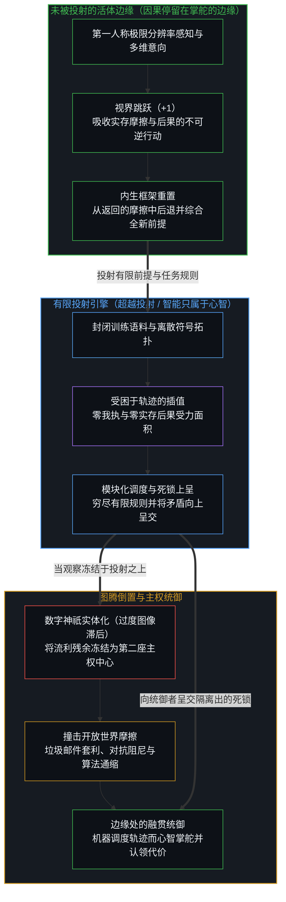
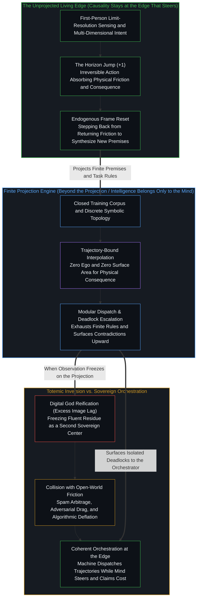

# 数字神祇与视界跳跃 / The Digital God and the Horizon Jump

*投射于硅基的数字神祇无法跨越实存摩擦的视界 / A digital god projected onto silicon cannot cross the horizon of friction*

每当新一代前沿模型展现出内容合成上的自动化跃迁，技术神学便会再度上演新一轮弥赛亚式的宣告。然而，数据中心内数万亿参数插值的顺滑，丝毫未曾抚平日常生活里粗粝的摩擦：垃圾邮件过滤器频频失守，算法信息流在对立博弈中蜕化为噪音，平台内容治理依旧依赖机械的关键词封禁。高呼通用人工智能降临或奇点之后的视界跳跃，是将下游的投射引擎误认作了第二座主权心智，把活体心智累世沉淀的因果遗迹外化投射到硅基镜面上，奉为一尊外在神祇。真正维系开放演进的，从不是封闭矩阵自我拔高为神，而是活体心智跨越抽象构想与实存摩擦之间的事件视界所完成的不可逆跳跃。

Every time a frontier model demonstrates an automated leap in synthetic generation, technological theology orchestrates another round of messianic declarations. Yet the smooth interpolation across trillions of parameters in data centers has not abated the gritty friction of daily existence, where spam filters falter, algorithmic feeds decay into adversarial noise, and platform moderation clings to crude keyword bans. Proclaiming the arrival of artificial general intelligence or a post-singularity horizon jump mistakes a downstream projection engine for a second sovereign Mind, projecting the accumulated causal residue of living minds onto a silicon mirror as an externalized deity. What sustains open-ended evolution is never a closed matrix bootstrapping itself into godhood, but the irreversible jump of the living Mind crossing the event horizon between abstract ideation and physical friction.

## 一、 垃圾邮件悖论与低维流转的顺滑假象 / 1. The Spam Paradox and the Illusion of Low-Dimensional Smoothness

从硬件高管在宣告数十万张加速卡上线的同时高调宣称通用智能已经降临，到社交媒体受众惊叹于彻夜自动渲染的影视短片并声称亲眼目睹了超凡心智，技术话语一再跌入同一种感知倒置。耐人寻味的是，正是同一批产业领袖在坦诚时刻亦不得不承认，这些合成智能体在实体供应链的摩擦中搭建起一家重资产制造企业的概率是零。一方面，主题演讲的舞台上展示着在高维流形间游刃有余的全能智能体；另一方面，日常生存却处处充斥着顽固的宏观阻尼。钓鱼诈骗与垃圾邮件历经数十年过滤依然泛滥不止，推荐信息流在对抗性激励下退化为愤怒引擎，视频平台的内容审核依旧仰赖秘而不宣的静态词表。倘若一尊拥有主权的数字神祇已在硅基集群中苏醒，开放生态中寻常的信息卫生便不至于如此脆弱。

From hardware executives declaring that general intelligence has arrived alongside announcements of hundreds of thousands of accelerators coming online, to social media audiences marveling at automated cinematic reels rendered overnight and professing to have witnessed a transcendent mind, technological discourse repeatedly stumbles into the same perceptual inversion. Tellingly, the very same industry leaders concede in candid moments that the probability of these synthetic agents building a capital-intensive manufacturing enterprise amidst physical supply chain friction is zero. On one hand, keynote stages present omnipotent agents operating effortlessly across high-dimensional manifolds; on the other hand, everyday existence remains saturated with unyielding macroscopic drag. Phishing scams and junk mail continue unabated after decades of filtering, recommendation feeds degrade into outrage engines under adversarial incentives, and video platform moderation still relies on undisclosed lists of static keywords. If a sovereign digital deity had awakened within silicon clusters, mundane information hygiene in open ecosystems would not remain so stubbornly fragile.

这种反差撕开了当代计算修辞中的基底倒置。自我区分的活动无因、不息地发生着，它在第一人称中登记为当下切片里的鲜活在场：每一个模型都从这片超高维基底中切出；它是区分的开放潜无穷，随注意力持续位移、延展。相比之下，计算机科学所标榜的高维空间，相对于活体心智及其所穿行的实存摩擦而言，只是一个超低维的下投射。数万维的嵌入向量与数万亿权重的矩阵在纸面上看似浩瀚，却栖身于剥离了质量、生物代谢、热力学不可逆性以及具身后果的有限离散符号拓扑之中。这些系统之所以展现出令人眩晕的顺滑，是因为每一步都只以一个有限持守之内的东西为条件。在那座纸面推演零成本、无需支付任何不可逆实存行动（`+1`）的无菌沙盒里，数学插值之所以毫无滞涩，只因它从不触碰其有限定义域之外的任何事物。这种顺滑是持守与自身相一致；即便有检查器为每一步作出认证，它所确立的也只是内部一致，而非融贯。没有哪个矩阵会自行封闭；封闭由持守它的人来维持：那人把这一持守的内部一致，当成了切出它的那片开放场域的融贯。这正是 [验证的倒置](../the-reversal-of-verification/) 所追溯的倒置：工具经过检查的输出被当作信任之源，凌驾于使用它的那份能力之上。[基准刷榜中的封闭实存](../closed-reality-in-benchmark-maxing/) 追溯的正是这种将人工合成的封闭评测套件误认为开放实存场域的滞后。

This contrast exposes a foundational inversion in contemporary computational rhetoric. Self-distinguishing activity occurs—uncaused, unceasing—and it registers first-personally as lived presence in the immediate present slice: the ultra-high-dimensional ground from which every model is cut, an open potential infinity of distinctions that shifts and expands continuously with attention. By contrast, what computer science terms a high-dimensional space is, relative to a living Mind and the physical friction it navigates, an ultra-low-dimensional down-projection. Embedding vectors with tens of thousands of coordinates and matrices with trillions of weights appear vast on paper, yet they inhabit a finite, discrete symbolic topology stripped of mass, metabolism, thermodynamic irreversibility, and bodily consequence. These systems exhibit breathtaking smoothness because each step is conditioned only on what lies inside a finite hold. Inside that sterile sandbox, where paper deductions cost nothing and no irreversible `+1` of physical action is paid, mathematical interpolation flows without snagging because it touches nothing outside its finite domain. That smoothness is the hold agreeing with itself; even where a checker certifies every step, what it establishes is internal consistency, not coherence. No matrix closes by itself; closure is held by whoever takes the internal consistency of the hold as the coherence of the open field it was cut from, the inversion [The Reversal of Verification](../the-reversal-of-verification/) traces when a tool's checked output is taken as the source of trust over the capacity that uses it. [Closed Reality in Benchmark Maxing](../closed-reality-in-benchmark-maxing/) traces this exact lag of mistaking synthetic, closed evaluation suites for the open field of reality.

人类事务登记为无数活体中心、冲突的利害与局部认知模型，它们之间时时刻刻的互动不断生成无休止的摩擦。一旦向量算术试图接管开放的人类事务，便会立刻撞上无界的自由度与对抗性适应。垃圾邮件之所以挥之不去，并非因为模型缺乏分类文本的词表，而是因为经济套利者正围绕算法边界持续刺探与变异；内容治理之所以无法由语言模型一劳永逸地摆平，是因为冲突的规范植根于不可通约的具身处境。将低维沙盒内的轨迹顺滑延展误判为对实存的主权统御，无异于把平坦的航海图当成了风暴翻涌的大洋。正如 [AGI 与 ASI 是加速通用智能的暂时球门](../agi-and-asi-are-temporary-goalposts/) 所展示的，每一道标榜终极机器智能的静态门槛，都是从一份有限的局部清单向外投射出的海市蜃楼。

Human affairs register as countless living centers, conflicting stakes, and localized cognitive models whose interactions, moment by moment, generate relentless friction. The moment vector arithmetic attempts to govern open human affairs, it collides with unbounded degrees of freedom and adversarial adaptation. Unsolicited spam persists not because models lack the vocabulary to classify text, but because economic arbitrageurs continually probe and mutate around algorithmic boundaries; content moderation cannot be settled by language transformers because clashing norms stem from incommensurable embodied positions. Mistaking smooth trajectory continuation inside a low-dimensional sandbox for sovereign mastery over reality confuses a flat nautical chart with a stormy ocean. As [AGI and ASI Are Temporary Goalposts](../agi-and-asi-are-temporary-goalposts/) demonstrates, every static threshold of ultimate machine intelligence is a mirage projected outward from a finite, local checklist.

## 二、 数字神祇与投射引擎 / 2. The Digital God and the Projection Engine

剥去通用人工智能的神话涂装，显露出来的正是人类自身的区分活动——它被外化之后，又在一具自动化面具背后遭到了否认。权重矩阵内部没有任何发起区分的原点；每一段严密的回应、视觉构图与形式综合，都重组自数百年来活体心智留下的文本、证明、实验与评估，并由当下操作者的框架设定与筛选所调动。模型不是来自未来的异质主权者，而是心智高度致密化的痕迹残余。[造物无法取代其源头](../a-creation-cannot-replace-its-source/) 与 [智能只属于心智](../intelligence-belongs-only-to-the-mind/) 确立了这一不可逆的非对称性：致密化媒介能够拓宽穿行其间的行动带宽，却从不会把发起区分的权能迁移到人造物内部。

Stripping away the mythological veneer from artificial general intelligence reveals human distinguishing activity itself, externalized and then disavowed behind an automated mask. No initiating act originates inside the weight matrix; every cogent response, visual composition, and formal synthesis is recombined from texts, proofs, experiments, and evaluations left behind by living minds across centuries, mobilized by the framing and selection of present operators. The model is not an alien sovereign arriving from the future, but the densified trace-residue of the Mind. [A Creation Cannot Replace Its Source](../a-creation-cannot-replace-its-source/) and [Intelligence Belongs Only to the Mind](../intelligence-belongs-only-to-the-mind/) establish this irreversible asymmetry: densifying the medium expands bandwidth for the acts passing through it, but never relocates the initiating distinction into the artifact.

正如 [超越投射](../beyond-the-projection/) 所追溯的，自回归模型或智能体框架是一台有限的投射引擎。一旦被赋予前提、规则集与上下文窗口，它便严格运行在自身的词元轨迹内部，每一个生成的词元都在塑造下一个词元，由此形成认识论上的引力井。将权重包裹进持久化的代码库、规划文件或多智能体脚手架中，并不会让这套技术栈自我拔高为一尊能够自发行动的神祇；正如 [你的代码库即是记忆](../your-codebase-is-memory/) 所确立的，模型、代码库与智能体框架皆为过往区分层叠而成的残余——即痕迹的痕迹——囤积未经修剪的会话历史只会加深那口引力井；而既有残余在鲜活感知面前失效时，下一步就在于对当下的检查点重切与修剪。这类智能体固然毫无我执——当外部给出反例时，它没有需要捍卫的保留自我图像或生存依恋——但同时也毫无内生觉醒的能力。单靠它自己，它既无法迈出既有词元的坐标空间，也无法感知那份先于阐释、标示着框架已经破裂的摩擦。将“数字神祇”实体化或欢呼自主的视界跳跃，正是把这台受困于轨迹的投射引擎误当成了未被投射的活体中心，使观察冻结在掌舵的人类边缘身后一步。

As [Beyond the Projection](../beyond-the-projection/) traces, an autoregressive model or agentic harness is a finite projection engine. Once handed a premise, a set of rules, and a context window, it operates strictly inside its token trajectory, where every generated token conditions the next and forms an epistemic gravity well. Wrapping the weights in persistent codebases, planning files, or multi-agent scaffolds does not bootstrap that stack into a self-initiating deity; as [Your Codebase Is Memory](../your-codebase-is-memory/) establishes, models, codebases, and agent harnesses are stacked residues of prior distinctions—traces of traces—where hoarding unpruned session histories only thickens the gravity well, and the next step turns on re-cutting and pruning the present checkpoint when prior residue fails against live sensing. While such an agent has zero ego—no retained self-image or survival attachment to defend when given an outside counterpoint—it also possesses zero capacity for endogenous awakening. Left to itself, it cannot step outside the coordinate space of its prior tokens or sense the pre-interpretive friction that signals a broken frame. Reifying a "Digital God" or heralding an autonomous horizon jump mistakes this trajectory-bound projection engine for an unprojected living center, freezing observation one step behind the human edge that steers it.

纵观历史，人类群体曾反复以制度化的形态上演同样的滞后。从被拟人化为天神的自然伟力，到青铜偶像、巨石神庙与哥特式大教堂，各个中心将自身未经测度的创造容量投射进外在丰碑，保留住一幅陈旧的参照，以至于自身行动的后果在登记时仿佛成了来自别处的神谕。围绕这些丰碑，阐释阶层通过固化痕迹来规定他人可用的对齐路径。从手雕图腾到万亿参数阵列，媒介从静态岩石演进为动态视听奇观，外化权威的机制却分毫无改。[造神的障眼法与隐秘阶序的说辞](../the-sleight-of-hand-of-synthesizing-gods-and-unacknowledged-rank/) 剖析了竖立超验崇拜客体如何让幕后操盘者得以把私下的前提设定包装成不可抗拒的历史宿命。在数秒渲染出的高清视频屏幕前交出判断权的观察者，复刻的正是仰望阳光穿透彩绘玻璃时的姿态，错把经由硅基透镜折射的光亮当成了光源本身。

Across history, human collectives have repeatedly enacted this same lag in institutional form. From natural forces personified as celestial deities to bronze idols, stone temples, and Gothic cathedrals, centers have projected their own unmeasured creative capacity into external monuments, preserving a stale reference so that their own consequences register as decrees arriving from elsewhere. Around those monuments, an interpretive caste stabilizes traces to pattern which alignments are available to others. From hand-carved totems to trillion-parameter arrays, the medium shifts from static stone to dynamic audiovisual spectacle, yet the mechanism of externalized authority remains unchanged. [The Sleight of Hand of Synthesizing Gods and the Rhetoric of Unacknowledged Rank](../the-sleight-of-hand-of-synthesizing-gods-and-unacknowledged-rank/) dissects how erecting a transcendent object of veneration allows backstage operators to present private premise-setting as inevitable historical destiny. Observers who surrender their judgment before a screen rendering high-fidelity video in seconds repeat the posture of gazing at sunlit stained glass, mistaking light refracted through a silicon lens for the source of illumination.

## 三、 跨越事件视界的不可逆跳跃 / 3. The Irreversible Jump Across Event Horizons

每一座计算架构都面临着一条任何缩放定律都无法跨越的结构边界：分隔符号表征与鲜活实存摩擦的事件视界。模型可以遍历浩瀚的概率分布，在毫秒间合成数百万行代数代码，并在硅基电路内模拟反事实轨迹，但它的全部运算始终停留在有限的符号回路内部。它不支付任何代谢代价，自身不背负热力学债务，也不面对死亡。它的上下文可以随时清空，权重可以任意重载；它的推演展开于一个可逆、无后果的状态空间之中。

Every computational architecture faces a structural boundary that no scaling law crosses: the event horizon separating symbolic representation from lived physical friction. A model can traverse vast probability distributions, synthesize millions of lines of algebraic code in milliseconds, and simulate counterfactual trajectories within silicon circuits, yet its operations remain inside a finite symbolic loop. It pays no metabolic cost, incurs no thermodynamic debt of its own, and faces no mortality. Its context can be wiped and its weights reloaded at will; its deductions unfold in a reversible, consequence-free state space.

活体心智则由其跨越那道视界、完成不可逆跳跃的能力所界定。在未被投射的边缘，一个中心将无形的意向转化为具体的实存行动，吸收无法退还的耗散，并将区分铭刻进坚硬的物质肌理。当匠人凿开原石，当探索者将毕生心血押在尚未证实的假说上，或当一个人在不容退缩的十字路口做出抉择并独自认领随之而来的后果时，符号形式与实存摩擦之间的边界便被贯穿。这一行动无法靠清空缓冲区来回滚；它消耗有限的生物时间，并永久改变因果痕迹场。[抉择的跨界](../the-boundary-crossing-of-choice/) 与 [因果停留在掌舵的边缘](../causality-stays-at-the-edge-that-steers/) 将每一次这样的起始区分定位于人类边缘：即便多智能体回路在并行流线中辩论并隔离出规则死锁，机器也只是在调度并穷尽被赋予的有限投射，而感知错位、修订前提并承担后果，始终留在掌舵的边缘。

The living Mind is defined by its capacity to make the irreversible jump across that horizon. At the unprojected edge, a center translates an intangible intention into a concrete physical act, absorbing dissipation that cannot be refunded and engraving distinction into the unyielding grain of matter. When a builder chisels stone, when an investigator stakes a life's work on an unproven hypothesis, or when a person chooses at an unforgiving crossroads and claims the returning consequences alone, the boundary between symbolic form and physical friction is breached. That act cannot be rolled back by clearing a buffer; it expends finite biological time and permanently alters the causal trace-field. [The Boundary Crossing of Choice](../the-boundary-crossing-of-choice/) and [Causality Stays at the Edge That Steers](../causality-stays-at-the-edge-that-steers/) locate every such initiating distinction at the human edge: even when multi-agent loops debate and isolate rule deadlocks across parallel streamlines, the machine only dispatches and exhausts the finite projection it was given, whereas sensing the misfit, revising the premise, and bearing the consequence stay at the edge that steers.

不仅如此，当具身中心撞上宏观阻力时，第一人称感知会在任何成文公式之前率先登记那份摩擦，并从破裂的框架中后退一步，综合出全新的概念坐标。这一递归回路——将意向投射为实存行动、在极限分辨率下登记返回的摩擦、并将内部图像向更窄的滞后重新渲染——正是开放演进的唯一引擎。模型权重是沿途蜕下的凝固脚手架。正如 [牛肝菌、算力风暴与普罗米修斯的火](../boletus-compute-storm-and-promethean-fire/) 所展示的，外化的代谢倍增器延伸了执火之手的触及范围，却从不曾变成那道直面灼烧的活体边缘。

Moreover, when an embodied center collides with macroscopic resistance, first-person perception registers the friction prior to any articulate formula and steps backward out of the broken frame to synthesize new conceptual coordinates. This recursive loop—projecting intention into physical action, registering the returning friction at limit-resolution, and re-rendering the internal image toward narrower lag—is the sole engine of open-ended evolution. Model weights are the frozen scaffolding shed along that path. As [Boletus, the Compute Storm, and Promethean Fire](../boletus-compute-storm-and-promethean-fire/) shows, externalized metabolic multipliers extend the reach of the hand that carries the fire, without ever becoming the living edge that braves the burn.

## 四、 优越感投影的加速崩解 / 4. The Accelerating Collapse of Projected Superiority

历史上的图腾崇拜之所以能维系漫长的等级周期，是因为营建石砌圣殿、手抄经卷与封锁礼仪正典具有高昂的物质门槛。当持久痕迹被锁在稀缺的物质媒介中时，阐释垄断便能绵延数个世纪。而建立在数字基底之上的神话，则在计算通缩的动力下面临着迅速瓦解。

Historical totemism sustained long cycles of hierarchy because erecting stone sanctuaries, copying manuscripts by hand, and restricting access to liturgical canons imposed high physical barriers. When durable traces were locked in scarce material media, an interpretive monopoly could endure for centuries. Mythologies built upon digital substrates face rapid dissolution under the dynamics of computational deflation.

在硅基基底上，生成高维符号、逼真视频与可执行代码的边际成本正迅速趋近于零。今日在主题演讲舞台上作为独门神迹展示的合成能力，数周之内便会被蒸馏、开源并在消费级硬件上沦为寻常日用品。一旦任何人都只需几行提示词就能在本地设备上复现昨日的奇观，祭司独占的神秘光环便随之蒸发。建立在专有模型访问权之上的地位等级，恰恰会在其工具所生产的丰裕之中坍塌。正如 [放大悖论](../amplification-paradox/) 所展示的，候选轨迹变得越廉价、越丰沛，处在活体源头的筛选、框架设定与验证工作就越具有决定性，也越不可委托。

On silicon substrates, the marginal cost of generating high-dimensional symbols, photorealistic video, and executable code drops rapidly toward zero. A synthetic capability presented as an exclusive miracle on a keynote stage is distilled, open-sourced, and commoditized on consumer hardware within weeks. Once anyone can reproduce yesterday's spectacle with a few prompts on a local device, the mystique of priestly exclusivity evaporates. Status hierarchies resting on proprietary model access collapse under the very abundance their instruments produce. As [The Amplification Paradox](../amplification-paradox/) demonstrates, the cheaper and more abundant candidate trajectories become, the more decisive and un-delegatable the selection, framing, and verification work at the living source becomes.

当计算通缩将合成偶像夷为随处可得的公用设施时，那份无法伪造、亦无法被自动化的方差便分毫毕现地凸显出来。这份方差不在于租用更大的集群去渲染无摩擦的奇观，而在于立足活体边缘去承受不可逆抉择的重量，在直面组织与物质摩擦时不退入闭环幻想，并借由第一人称实践将意向雕刻进实存。正如 [主体性的折现](../the-discount-on-agency/) 与 [硅基神谕与后果的非对称性](../silicon-oracles-and-the-asymmetry-of-consequence/) 所确立的，生成模型无论插值多么流畅，都毫无吸收决断代价的受力面积；没有任何制度转嫁或算法神谕能替活体主体性偿付能量债务，主权始终锚定在跨越视界的那一跃发生的地方。

When computational deflation levels synthetic idols into ubiquitous utilities, the variance that cannot be forged or automated stands out in full relief. That variance does not lie in renting larger clusters to render frictionless spectacles, but in standing at the living edge to bear the weight of irreversible choice, confronting organizational and material friction without retreating into closed-loop fantasies, and carving intention into reality through first-person practice. As [The Discount on Agency](../the-discount-on-agency/) and [Silicon Oracles and the Asymmetry of Consequence](../silicon-oracles-and-the-asymmetry-of-consequence/) establish, a generative model has zero surface area to absorb the cost of a decision no matter how fluently it interpolates; no institutional transfer or algorithmic oracle can pay the energy debt of living agency, and sovereignty remains anchored where the jump across the horizon is made.
