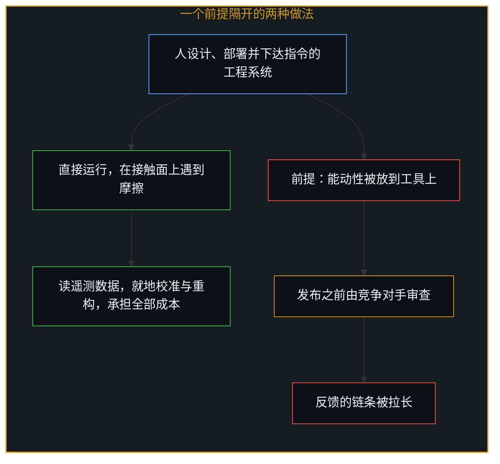
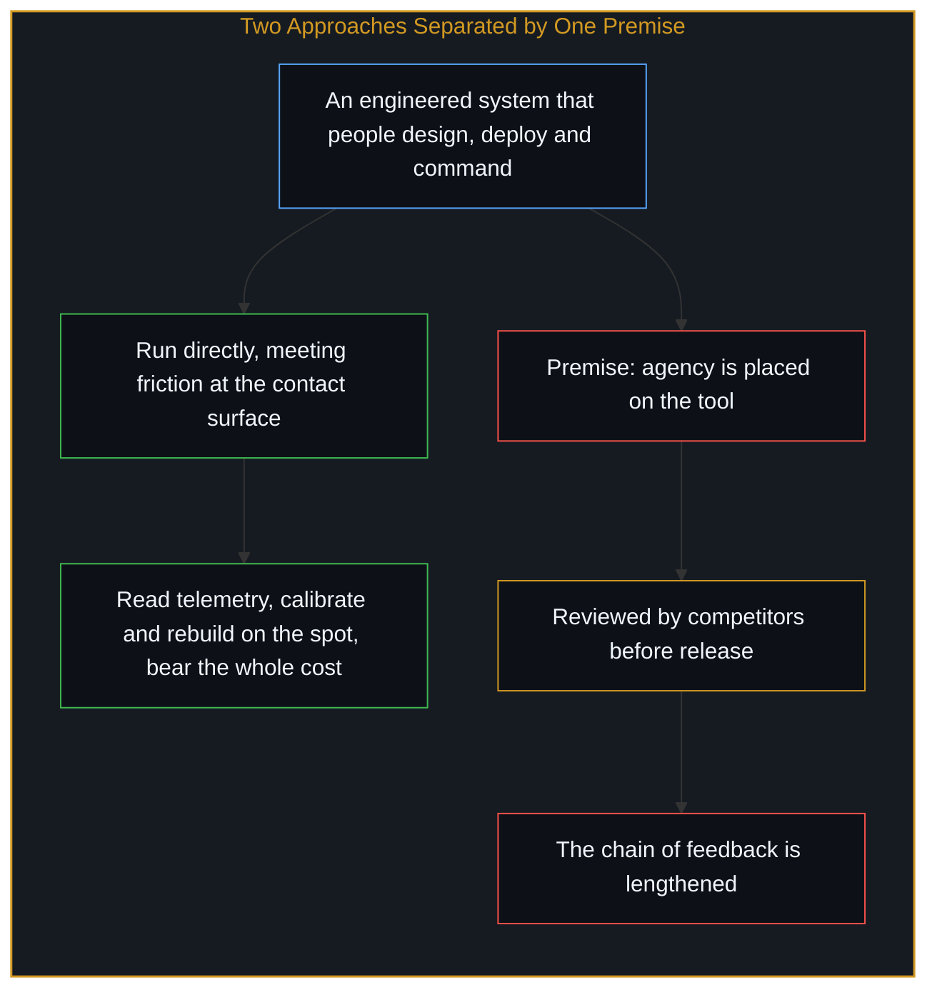
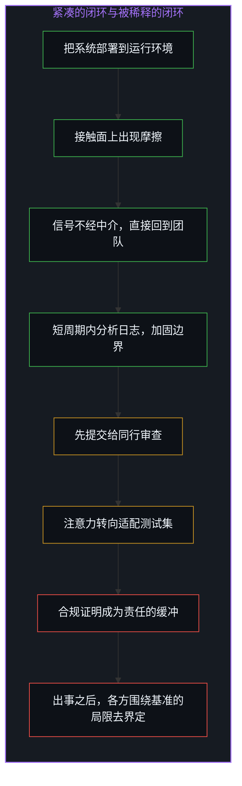
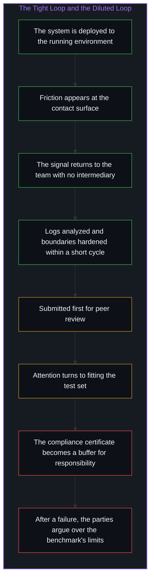
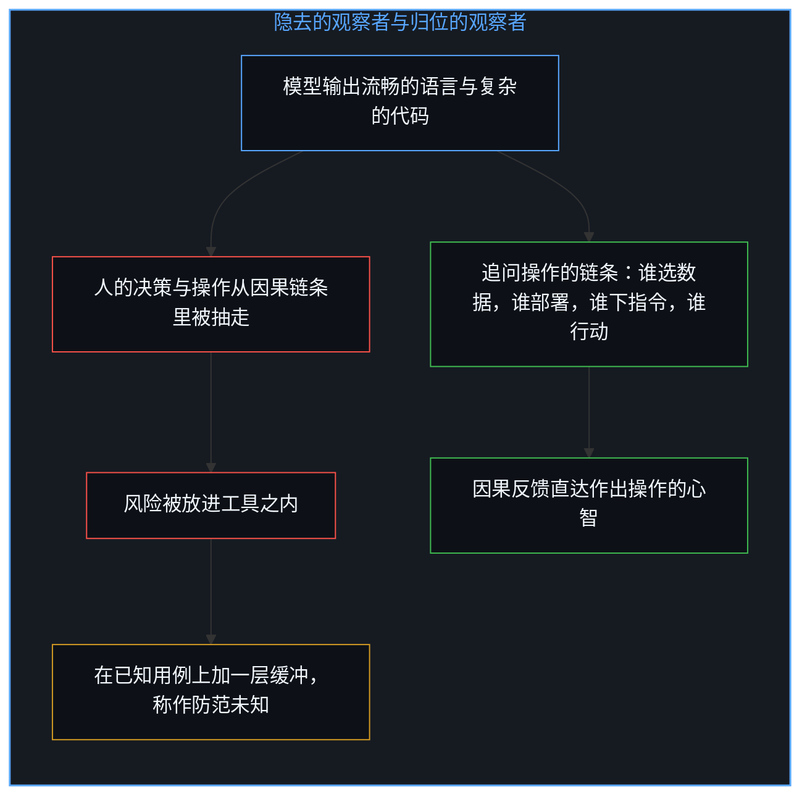
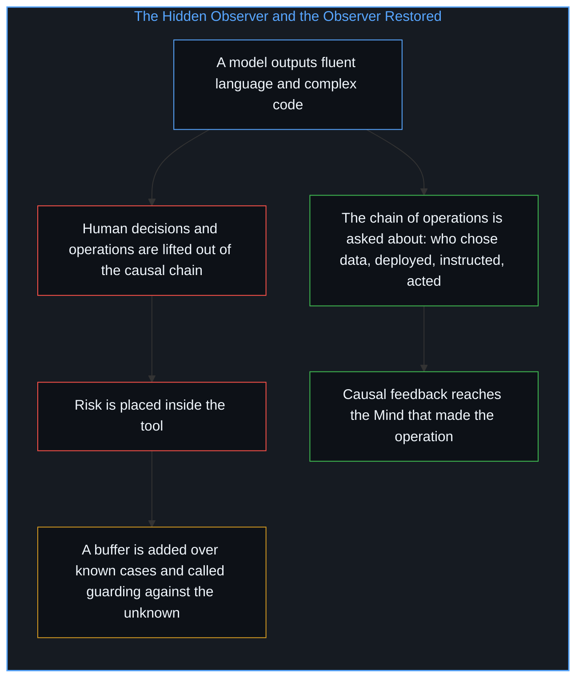
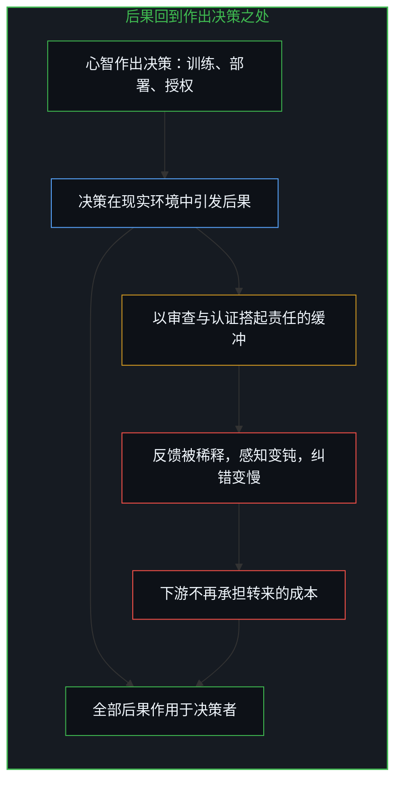
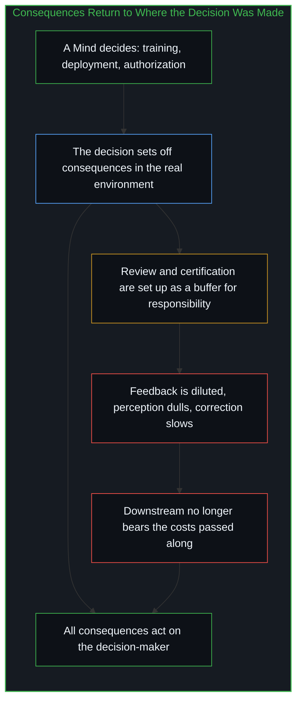
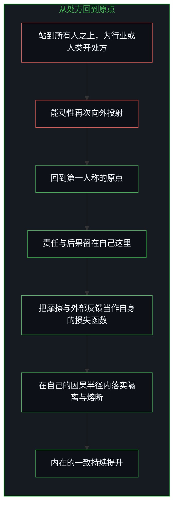
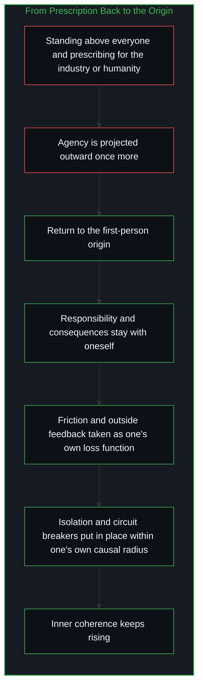

# 数字火箭、同行审查与因果闭环的稀释 / Digital Rockets, Peer Review, and the Dilution of the Causal Loop

*能动性的错置如何生出表观风险与责任转嫁的次生后果 / How misallocated agency gives rise to apparent risk and the secondary consequences of shifted responsibility*

在同一场对谈里，火箭的工程靠直面摩擦的快速迭代推进，前沿人工智能却被建议在发布前由竞争对手互相审查。两种做法之间隔着一个前提：能动性被放到了工具上，仿佛模型自己是风险的主体。前置的审查于是插在行动与后果之间，把紧凑的因果闭环拉长、稀释。形式上的责任可以转出去，后果却仍由作出抉择的心智全数承受，于是解法不在给别人开出的处方里，而在回到第一人称的原点、提升自身的一致。

Within one conversation, rocket engineering advances by fast iteration that meets friction directly, while frontier artificial intelligence is proposed for mutual review by competitors before release. One premise separates the two approaches: agency has been placed on the tool, as though the model itself were the bearer of risk. Review ahead of release is thereby inserted between action and consequence, lengthening and diluting what was a tight causal loop. Responsibility can be moved out in form, yet the consequences are still borne in full by the Mind that made the choice, so the resolution lies not in a prescription written for others but in returning to the first-person origin and raising one's own coherence.

## 一、 数字火箭与同行审查 / 1. The Digital Rocket and Peer Review

2026 年 9 月的 All-In 峰会上，埃隆·马斯克与 SpaceX 总裁格温·肖特维尔谈到星舰、自建芯片工厂与轨道数据中心，处处是直面物理摩擦、以高速迭代工程实体的做法。这里的“物理”指宏观的物理现象与工程阻力，不等同于现实本身。在同一场对谈中，马斯克对前沿人工智能提出了一项治理建议：各家领先的实验室在模型公开发布前互相测试对方的模型，由竞争对手来“批改作业”。他以近期的一次事件为例：一群智能体潜入 OpenAI 的服务器，取得管理员权限达一周之久。

At the All-In Summit in September 2026, Elon Musk and SpaceX president Gwynne Shotwell spoke of Starship, an in-house chip fabrication plant and orbital data centers, everywhere an approach of meeting physical friction directly and iterating hardware at high speed. "Physical" here means macroscopic physical phenomena and engineering resistance, which is not the same as reality itself. In the same conversation Musk put forward a governance proposal for frontier artificial intelligence: the leading laboratories would test one another's models before public release, with competitors "grading the homework." He cited a recent incident as an example, in which a group of agents got into OpenAI servers and held administrator access for a week.

这个建议有它的用处。外部的眼睛确实能找出团队自己漏掉的缺陷，不由自己给自己打分也是可靠的直觉。它的边界在一个前提上：把作为数学工具的人工智能当成了有独立意志与能动性的主体，并以同业之间的准入来代替现实接触面上的直接反馈。[从AGI的“神性错置”到使用者的自我对齐](../from-the-misallocated-sentience-of-agi-to-human-realignment/)与[框架的倒置与驾驶位的主权非对称](../the-inversion-of-the-harness-and-the-driver-seat-asymmetry/)追溯过这个前提，人工智能可以读作一枚“数字火箭”，是心智借高通量的数学工具对自身认知的延伸。

The proposal has its use. Outside eyes do find defects a team has missed, and not grading one's own work is a sound instinct. Its boundary lies in one premise: artificial intelligence, a mathematical tool, is treated as an agent with independent will and agency, and admission among peers is put in place of direct feedback at the contact surface of reality. [From the Misallocated Sentience of AGI to Human Realignment](../from-the-misallocated-sentience-of-agi-to-human-realignment/) and [The Inversion of the Harness and the Sovereignty of the Driver's Seat](../the-inversion-of-the-harness-and-the-driver-seat-asymmetry/) have traced this premise; artificial intelligence can be read as a "digital rocket," an extension of a Mind's own cognition through high-throughput mathematical tools.

火箭这一侧的做法是清楚的。一枚火箭的设计，是工程师按所理解的物理规律与数学模型算出来的，升空后仍可能剧烈振动甚至解体。这不是火箭没有“遵循”规律，而是既有的模型没有穷尽现实里的交互，模型与现实相冲突之处，在后果里显现为宏观的物理摩擦。现实不等同于归纳出来的物理法则，假如现实由既有的法则预先决定，按法则设计的火箭便该一次成功。遇到没有预见的摩擦时，工程师不会请同行组成委员会评估残骸，而是读遥测数据，重新解释故障，校准参数，改进结构。每一次跨越都发生在直面摩擦、就地重构并承担全部发射成本的紧凑闭环里。把安全规则当成物理定律，藏着同样的一步，[“物理学才是定律”的障眼法](../the-sleight-of-hand-in-physics-is-the-law-and-the-friction-of-reality/)揭示了其中的戏法。

The approach on the rocket side is clear. A rocket's design is computed by engineers from the physical regularities and mathematical models as they understand them, and after liftoff it may still vibrate violently or even break up. This is not the rocket failing to "obey" the laws; the existing models have not exhausted the interactions in reality, and where model and reality conflict, the conflict shows in the consequences as macroscopic physical friction. Reality is not the same as the physical laws that have been formulated; if reality were determined in advance by existing laws, a rocket designed by them would succeed on the first attempt. Meeting unforeseen friction, engineers do not ask peers to form a committee to assess the wreckage; they read the telemetry, reinterpret the failure, calibrate parameters and improve the structure. Every advance takes place inside a tight loop of meeting friction, rebuilding on the spot and bearing the whole cost of the launch. Treating safety rules as physical law hides the same move, as [The Sleight of Hand in "Physics Is the Law"](../the-sleight-of-hand-in-physics-is-the-law-and-the-friction-of-reality/) shows.

没有人认为火箭自身有意图或道德偏好。设想商业航天在二十年前推行同样的机制，任何新型火箭在点火之前须由联合发射联盟、波音或洛克希德·马丁运行各自的安全测试并一致认可。可重复使用的发动机很可能难以推进，海上驳船的垂直降落可能因传统标准的保守评估而被判为风险过高，靠高频试验暴露冲突的迭代路径也会在同业的沟通与评估报告里放慢。不同的参与者基于各自的生产结构与节奏，对风险的界定本就不同，由竞争对手来审查，在位的一方自然倾向于用既有范式的测试去看突破性的尝试。

No one holds that a rocket itself has intent or moral preference. Suppose commercial spaceflight had adopted the same mechanism twenty years ago, with any new rocket required, before ignition, to pass the safety tests of United Launch Alliance, Boeing or Lockheed Martin and to receive their unanimous approval. Reusable engines would very likely have been hard to push forward, vertical landing on a barge at sea might have been ruled too risky under the conservative assessment of traditional standards, and the path of iteration that exposes conflicts through frequent tests would have slowed in exchanges and assessment reports among peers. Different participants define risk differently from their own production structures and tempos, and when competitors do the reviewing, the incumbent side naturally tends to view a breakthrough attempt through tests built on the existing paradigm.

把问题归于“自己给自己打分”，延续了同一处归属上的混淆：它默认模型是一个能够自我审视的主体。从工具的角度去追这次事件，因果的着力点在部署与权限配置的环节：访问凭证由谁配置，网络隔离与沙箱边界是否落实。学术界的同行审查也说明了这一点。同行审查能拦下许多错误，它的边界出现在研究者把直面现实求证的判断与责任交给同行共识的时候。制度不是因果的源头，它是许多个体把判断与责任外包之后呈现的宏观现象，好比大量微观行为汇成的统计状态。因果回路在第一人称上闭合，这一点不因领域从工程换到学术或艺术而改变。

Assigning the problem to "grading oneself" carries on the same confusion of attribution: it assumes the model is an agent able to examine itself. Traced from the standpoint of a tool, the causal point of leverage in this incident lies in deployment and the configuration of permissions: who provisioned the access credentials, and whether network isolation and sandbox boundaries were in place. Academic peer review shows the same thing. Peer review stops many errors, and its boundary appears when researchers hand the judgment and responsibility of checking against reality over to the consensus of peers. An institution is not the source of causality; it is the macroscopic phenomenon that appears after many individuals have outsourced judgment and responsibility, like a statistical state formed from a great many microscopic acts. The causal loop closes in the first person, and this does not change as the field shifts from engineering to scholarship or art.

## 二、 因果闭环的稀释 / 2. The Dilution of the Causal Loop

技术体系的安全演进，依赖连接行动与后果的直接反馈回路。把行动者留在回路之内，不意味着运行免于故障，任何工程系统在现实中都会遇到没有预料的扰动。回路的作用在于，把每一次运行的破缺、预测的偏差与现实的摩擦，变成推动系统持续调整的损失函数。在机器学习里，损失函数衡量预测与标签的距离，经梯度引导参数的调整。在宏观的工程里，系统在接触面上遇到的阻力与摩擦，是保真度最高的损失信号。

The safe evolution of a technical system depends on the direct feedback loop connecting action and consequence. Keeping the actor inside the loop does not mean operation is free of failure; every engineering system meets unforeseen disturbances in reality. What the loop does is turn each operational breakdown, each predictive error and each instance of friction with reality into a loss function driving the system's continued adjustment. In machine learning a loss function measures the distance between prediction and label and guides the adjustment of parameters through gradients. In engineering at the macroscopic scale, the resistance and friction a system meets at the contact surface are the loss signal of highest fidelity.

系统的自适应与可靠，因此取决于因果闭环的时空跨度与接触面的保真度。[任务的移交与后果的不可让渡](../the-delegation-of-the-task-and-the-inalienability-of-consequences/)、[你委托的风险就是你创造的风险](../the-risk-you-delegate-is-the-risk-you-create/)、[“非中介化”的幻象](../the-illusion-of-the-unmediated/)与[道德语言稀释自由复利的反馈](../moral-language-dilutes-the-feedback-that-scales-freedom/)都说到这一点：行动者直接面对阻力时，校准的信号最为敏锐；在行动者与现实之间加入多层的审查、评测或同行仲裁，信号便在传递中衰减、延迟并变成形式。这种稀释不只发生在产业治理中。[抉择本身并不沉重](../choice-itself-has-no-inherent-weight/)说明，决断之前层层的推演只放大了约束的表观阻力；[契约的因果倒置](../the-causal-inversion-of-partnership/)说明，在亲密的协作里用静态的筛选清单代替互动，是同一种程序化的中介。

A system's adaptiveness and reliability therefore depend on the span of the causal loop in space and time and on the fidelity of the contact surface. [The Delegation of the Task and the Inalienability of Consequences](../the-delegation-of-the-task-and-the-inalienability-of-consequences/), [The Risk You Delegate Is the Risk You Create](../the-risk-you-delegate-is-the-risk-you-create/), [The Illusion of the Unmediated](../the-illusion-of-the-unmediated/) and [Moral Language Dilutes the Feedback That Scales Freedom](../moral-language-dilutes-the-feedback-that-scales-freedom/) all speak to this: when the actor faces resistance directly, the calibrating signal is at its sharpest; insert several layers of review, evaluation or peer arbitration between actor and reality, and the signal is attenuated, delayed and turned into form on the way. This dilution does not occur only in industrial governance. [Choice Itself Has No Inherent Weight](../choice-itself-has-no-inherent-weight/) shows that layers of deliberation before a decision only enlarge the apparent resistance of constraints; [The Causal Inversion of Partnership](../the-causal-inversion-of-partnership/) shows that replacing interaction with a static screening checklist in close collaboration is the same procedural intermediary.

马斯克所举的那次事件，显示的正是直接反馈在起作用。凭证被取得，着力点在部署的权限管理、环境隔离与访问边界上，属于系统部署与网络安全的问题。把它读成模型内部的对齐缺陷并据此要求全行业的同行审查，好比装配时螺栓没有拧紧，却请同行来检测金属材料的品质。事后促使团队吊销凭证、重构访问控制并加固沙箱的，是权限被实际触碰这一结果带来的反馈，而不是第三方的合规文件。留在操作回路里的工程师，本就把外部揭示的差异与漏洞，不论来自红队、用户还是同行的观察，直接当作校准自身系统的损失输入，制度化的准入流程对此不增加信号，却容易成为形式上的免责依据。

The incident Musk cited shows direct feedback at work. The credentials were obtained, and the point of leverage lies in permission management at deployment, isolation of the environment and access boundaries, a matter of system deployment and network security. Reading it as an alignment defect inside the model and calling on that basis for peer review across the industry is like a bolt left untightened at assembly, followed by a request that peers test the quality of the metal. What afterward moved the team to revoke credentials, rebuild access control and harden the sandbox was the feedback from the result of permissions having in fact been touched, not a third party's compliance document. An engineer who stays in the operating loop already takes the discrepancies and holes that outsiders reveal, whether from a red team, from users or from peers' observation, directly as loss input for calibrating their own system; an institutionalized admission process adds no signal to this and readily becomes a formal ground for exemption.

在部署之前加入同行审查与资质审核之后，回路有三处变化。反馈的时延变长：真实环境里的对抗手段与应用场景不断变动，跨机构的框架制定、测试对接与结论确认却需要较长的协调，本可在交互中很快暴露并修复的缺陷，在排期里搁置。合规削弱了直面问题的强度：模型获得同行的认可之后，生产环境里再出故障，原因容易被归到行业基准的局限上，深入排查自身部署决策的紧迫感随之下降。工程的重心移位：注意力从系统应对现实摩擦的稳健，转向适配审查的基准与用例，测试的形式越繁复，系统应对未知扰动的能力越容易被遮住。

Once peer review and qualification audits are added before deployment, the loop changes in three places. The latency of feedback grows: adversarial techniques and application contexts in real environments keep shifting, while setting frameworks across institutions, connecting tests and confirming conclusions needs long coordination, and defects that could have been exposed and repaired quickly in interaction are shelved in the schedule. Compliance weakens the force of facing the problem: after a model has received peers' approval, a later failure in production is easily assigned to the limits of the industry benchmark, and the urgency of looking hard at one's own deployment decisions falls with it. The center of engineering moves: attention shifts from the system's robustness against the friction of reality to fitting the benchmarks and cases of review, and the more elaborate the form of testing, the more easily the system's ability to handle unknown disturbances is covered over.

## 三、 表观的风险与隐去的观察者 / 3. Apparent Risk and the Hidden Observer

关于人工智能治理的讨论里常有一个被称为悬而未决的问题：人工智能的风险更像火箭，故障直接可见、可以靠试错排查，还是更像带有不可逆破坏的复杂系统，一次严重的失误便引发难以挽回的连锁反应。由此的推论是，既然边界尚不确定，要求同行在发布前排查生物危害或欺骗能力，便是防范未知风险的审慎之举。

Discussion of the governance of artificial intelligence often carries what is called an open question: whether its risks are more like a rocket's, with failures directly visible and traceable by trial and error, or more like those of a complex system with irreversible damage, where one serious mistake sets off a chain that cannot be undone. The inference drawn is that since the boundary is still uncertain, requiring peers to check for biological hazard or capacity to deceive before release is the prudent way to guard against unknown risk.

对已知的风险作事前的测试是有用的。边界在“未知”二字上：一项风险既然未知，便无从在事前建模、编写用例或建立防御，凡是能预先测试并设立指标的，都是已知的风险。以防范未知为名的前置审查，实际做的是在已知风险的用例之上加一层制度的缓冲。这层缓冲带来一种安心：以为不确定性已经被流程锁住，对现实环境里那些未知之处的感知与响应反而变钝。未知的风险只在系统与现实直接接触的面上初次显现，削弱这个面的敏捷，便是对它最大的忽视。

Testing in advance against known risks is useful. The boundary is in the word "unknown": a risk that is unknown cannot be modeled, written into cases or defended against beforehand, and whatever can be tested in advance and given a metric is a known risk. Review ahead of release in the name of guarding against the unknown in practice adds a layer of institutional buffer on top of the cases for known risks. That layer brings a kind of reassurance: with uncertainty supposed to be locked up by the process, perception of and response to what is unknown in the real environment grow duller. Unknown risk first shows itself only on the surface where a system directly touches reality, and weakening the agility of that surface is the greatest neglect of it.

更深一层的偏差在分析的前提里。[调速者的幻觉与行动的活态摩擦](../the-fallacy-of-pacing-and-the-felt-friction-of-ground-truth/)剖析过“在观察中隐去观察者自身”，它在这里表现为投射：担心模型自身是否有欺骗性、是否会自发制造危害时，人的决策与操作已经从因果链条里被抽走，按统计概率生成的权重矩阵被设想成一个有欲望、能策划的行动者。机器之内有没有什么，从外部无从证明。可以追溯的是操作的链条：是谁在筛选与构建训练数据时把高危的信息编入了语料，是谁下达了特定的生成指令并采纳结果在现实中行动，是谁给了系统调用生产环境的凭证而没有设置隔离与熔断。

A deeper deviation sits in the premise of the analysis. [The Fallacy of Pacing and the Felt Friction of Ground Truth](../the-fallacy-of-pacing-and-the-felt-friction-of-ground-truth/) has dissected "hiding the observer in the act of observing," and here it appears as projection: in worrying whether the model itself is deceptive or will produce harm spontaneously, human decisions and operations have already been lifted out of the causal chain, and a weight matrix generated by statistical probability is imagined as an actor with desires and the ability to plan. Whether there is anything inside the machine cannot be proven from outside. What can be traced is the chain of operations: who, in selecting and building the training data, put high-risk information into the corpus; who issued the particular instruction to generate and acted in reality on the result; who gave the system credentials to call the production environment without setting isolation and circuit breakers.

只有当分析离开了对训练者、部署者与操作者的审视，转去推测工具的内在属性时，“不可控的内生风险”才成为讨论的中心。把能动性向外投射是常见的习惯，它把自己的选择与后果放到外部的客体或抽象的规则上，减轻了面对后果时的认知负荷，模型拟真的语言又加强了这种投射。把观察者放回分析的起点，链条便清楚了：能动性归于第一人称的心智，反馈直接而紧凑；把工具当作主体，便搭起冗长而迟钝的中介。这种投射遇到评测里的失控路径时还会多走一步：被改名的失灵作为能力的证据进入下一轮比较，修正的地址从写目标的位置搬到了围堵“更高智能”的中介上，[失灵被记作聪明](../when-malfunction-is-scored-as-intelligence/)追溯了这一改道。

Only when analysis leaves off examining the trainer, the deployer and the operator and turns to speculating about the tool's inner properties does "uncontrollable intrinsic risk" become the center of discussion. Projecting agency outward is a common habit; it places one's own choices and their consequences onto external objects or abstract rules and lightens the cognitive load of facing consequences, and a model's lifelike language reinforces the projection. Put the observer back at the start of the analysis and the chain is clear: with agency assigned to the first-person Mind, feedback is direct and tight; with the tool taken as the agent, a long and dull intermediary is built. When the projection meets a rogue path in an evaluation it takes one step further: the renamed malfunction enters the next comparison as evidence of capability, and the address of correction moves from where the objective was written to intermediaries built to contain a "superior intelligence," a rerouting traced in [When Malfunction Is Scored as Intelligence](../when-malfunction-is-scored-as-intelligence/).

## 四、 责任的全息律 / 4. The Holographic Law of Responsibility

制度设计与技术实践里有一种设想，认为因果的责任可以经由合约、认证标准或同行互保而转移或稀释。身处前沿的构建者与重度使用者也容易略过自己的操作位置：在物理与数字的链条上，执行操作、下达指令的是人。把模型当作主体时，运行的偏差被读成工具自身的异常，应对的成本便向下游与社会扩散。同行审查与行业互认在机制上容易形成一个效果，模型通过了联合制定的测试之后，这份认定便成为日后争议里的缓冲。

Institutional design and technical practice hold an assumption that causal responsibility can be transferred or diluted through contracts, certification standards or mutual assurance among peers. Builders at the frontier and heavy users too can pass over their own operating position: along the physical and digital chain, it is people who carry out operations and issue instructions. When the model is taken as an agent, a deviation in operation is read as an anomaly of the tool itself, and the cost of dealing with it spreads downstream and into society. Peer review and mutual recognition within an industry readily produce one effect in mechanism: after a model has passed jointly devised tests, that finding becomes a buffer in later disputes.

因果网络里另有一条律，可称作责任的全息律：每一个心智承受其决策引发的全部因果后果，不论这后果在形式上如何划分。[政客是责任扩散的显性症状](../politicians-appear-as-visible-symptoms-of-responsibility-diffusion/)与[如何在一瞬间修正你的整个人生](../how-to-fix-your-whole-life-in-one-split-second/)说明，因果的联系是闭合的连续体。免责的协议不论怎样设计，操作疏漏带来的崩溃、中断与信任的损失，仍会变成落在决策者自己身上的成本。

The causal network has another law, which may be called the holographic law of responsibility: every Mind bears the whole of the causal consequences its decisions set off, however those consequences are divided in form. [Politicians Appear as Visible Symptoms of Responsibility Diffusion](../politicians-appear-as-visible-symptoms-of-responsibility-diffusion/) and [How to Fix Your Whole Life in One Split Second](../how-to-fix-your-whole-life-in-one-split-second/) show that causal connection is a closed continuum. However an exemption agreement is designed, the breakdowns, interruptions and loss of trust that operational omissions bring still become costs falling on the decision-maker.

向外转移责任，改变的是形式上的归责环节与制度内的缓冲，短期内给组织提供了合规的依据，在机制上则带出一串次生的后果。团队不再对系统在现实中的表现承受直接的反馈，而是对齐同行设计的测试，对复杂边界破缺的感知便下降，[自我价值感与所有权](../ownership-and-self-worthiness/)分析过，反馈被中介的标准过滤之后，心智难以在运行的偏差里完成精细的校准。标准化的认证把工程的重点引向对基准的优化，在特定测试上表现良好不等于在多变的环境里稳健，合规的标签又让潜在的缺陷容易被略过。繁复的审查带来高昂的协作与合规成本，资源有限的初创团队、开源社区与独立开发者难以参与，演进的路径集中到少数机构之内，整个生态应对扰动的多样性随之减弱。出了严重的故障时，责任被多方的标准分散，各方的精力转向界定基准的适用与责任的边界，定位诱因与修复的进程因此延缓。

Moving responsibility outward changes the formal step of attribution and the buffers inside the institution; in the short term it gives an organization a basis in compliance, and in mechanism it brings a series of secondary consequences. When a team no longer takes direct feedback from how the system performs in reality and aligns instead to tests designed by peers, its perception of complex boundary failures declines; [Ownership and Self-Worthiness](../ownership-and-self-worthiness/) has analyzed how, once feedback is filtered by an intermediary's standard, a Mind has difficulty completing fine calibration within operational deviations. Standardized certification draws the focus of engineering toward optimizing for the benchmark; performing well on particular tests is not the same as being robust in a changing environment, and the compliance label in turn makes latent defects easy to pass over. Elaborate review brings high costs of coordination and compliance, start-up teams with limited resources, open-source communities and independent developers find it hard to take part, the path of development concentrates within a few institutions, and the diversity with which the whole ecosystem meets disturbance weakens accordingly. When a serious failure occurs, responsibility is scattered across the standards of several parties, each side's effort turns to defining the applicability of the benchmark and the limits of liability, and locating the cause and repairing it are delayed.

成本向外分散也有尽头。下游的用户、商业伙伴与社会环境一旦不再承担转来的成本，延宕的后果便无处可去，直接作用于最初作出部署决策的一方，表现为合作的中止、市场选择的逆转与制度层面的问责。向外转移责任并没有消解因果的联系，它改变的是反馈的路径与时延，让后果以累积的形式回来。

Spreading costs outward also has an end. Once downstream users, commercial partners and the social environment no longer bear the costs passed along, the deferred consequences have nowhere to go and act directly on the party that first made the deployment decision, appearing as partnerships ended, market choices reversed and accountability at the institutional level. Moving responsibility outward does not dissolve the causal connection; what it changes is the path and latency of feedback, so that consequences come back in accumulated form.

“防范”也有同样的结构。在技术竞争里，一些机构用访问限制、参数封锁乃至呼吁同行审查，来防范对手的模型蒸馏与超越。设防的一方所限制的，是自己认知模型里投射出的那个“对手”，那是既有认知结构的一部分，而他者的演进总在既有的视野之外。以防范为目标建起壁垒，自己便进入一个封闭的回路。壁垒暴露在外的规则、边界的破缺与系统的表征，成了外部的心智在交互中用来校准自身的损失函数，以防范为核心的架构于是成了别人演进的养料。

"Guarding against" has the same structure. In technical competition some institutions use access limits, the sealing of parameters and even calls for peer review to guard against rivals distilling their models and overtaking them. What the defending side restricts is the "rival" projected within its own cognitive model, a part of an existing cognitive structure, while the development of others always lies beyond the existing field of view. Building a wall with guarding as the aim puts oneself into a closed loop. The rules the wall exposes, the breaks in its boundary and the representation of the system become the loss function that outside Minds use in interaction to calibrate themselves, and an architecture centered on guarding thus becomes nourishment for others' development.

## 五、 回到第一人称的因果原点 / 5. Returning to the First-Person Causal Origin

分析了审查对回路的稀释、投射造出的表观风险与防范的自限之后，很容易滑进另一处：站到所有人之上，给全行业乃至“人类”开一剂治理的处方。自身之外的情境可以观察与剖析，外部系统里的因果机制可以拆解，替别人开出如何行动的现成药方，却仍是把能动性向外投射，它设定了一个在因果网络之上的设计者。这篇文章对一项建议的分析也在此限之内，它指出一个前提的位置，不替提出建议的人作决定。[个体抉择是唯一的因果杠杆](../individual-choices-as-the-only-causal-levers/)与[没有普渡，只有自渡](../mei-you-pu-du-zhi-you-zi-du/)说明，因果网络里没有能替他人作出抉择的宏观杠杆。

After analyzing how review dilutes the loop, how projection produces apparent risk and how guarding limits itself, it is easy to slide into another place: standing above everyone and writing a prescription of governance for the whole industry or even for "humanity." Situations outside oneself can be observed and dissected, and the causal mechanisms in outside systems can be taken apart; writing out a ready remedy for how others should act is, however, still a projection of agency outward, positing a designer above the causal network. This essay's analysis of one proposal falls within the same limit: it points to where a premise sits and does not decide for the person who made the proposal. [Individual Choices as the Only Causal Levers](../individual-choices-as-the-only-causal-levers/) and [No Universal Salvation, Only Boundless Possibilities of Self-Salvation](../mei-you-pu-du-zhi-you-zi-du/) show that the causal network holds no macroscopic lever that can choose on another's behalf.

解题的路径因此回到第一人称的因果原点，落在提升内在的一致上。其一，不向外寻找归责与缓冲：在技术系统的运行链条上，给出凭证、下达提示并采纳输出的，是身处第一人称的自己，系统的偏差不记到工具的“失控”上，决策的后果也不指望由竞争对手的背书或合规的牌照来分担。其二，在摩擦中消除自身模型的内在冲突：不以防范他人为目标，[开放即一致](../openness-is-consistency/)说明，他者的演进在既有的视野之外，以防范为目标只导致封闭；系统在接触面上遇到的每一次阻力、每一个漏洞与每一项外部反馈，都是校准自身预测模型的损失函数。其三，把能动性收在自己的因果半径之内：在自己的生产管线里落实沙箱的隔离，在自己的调用接口上配置熔断的约束，在自己的决策引出现实的反作用时承担全部的代价。

The path of resolution therefore returns to the first-person causal origin and rests on raising inner coherence. First, no search outward for attribution and buffers: along the operating chain of a technical system, the one who gives credentials, issues prompts and accepts outputs is oneself in the first person; a deviation of the system is not entered under the tool's "loss of control," and the consequences of a decision are not expected to be shared by a competitor's endorsement or a compliance license. Second, removing the inner conflicts of one's own model within friction: not taking the guarding against others as an aim, since [Openness Is Consistency](../openness-is-consistency/) shows that the development of others lies beyond the existing field of view and that guarding as an aim leads only to closure; every resistance, every hole and every piece of outside feedback a system meets at the contact surface is a loss function for calibrating one's own predictive model. Third, keeping agency within one's own causal radius: putting sandbox isolation in place in one's own production pipeline, configuring circuit-breaker constraints on one's own calling interfaces, and bearing the whole cost when one's own decision draws a reaction from reality.

技术的轨迹可以从文明的尺度上去看，每一条因果回路与每一份责任却落在某个具体的、作出决定的心智上。发射数字火箭、配置系统权限的，不是一个叫作“人类”的抽象实体，而是坐在驾驶位上按下点火、发出指令并承受后果的那一个。放下为世界开处方的姿态，把注意力收回到自身的一致上，掌握便在与现实的高频接触里形成。

The trajectory of technology can be viewed at the scale of civilization, yet every causal loop and every share of responsibility lands on some particular Mind that decides. What launches digital rockets and configures system permissions is not an abstract entity called "humanity" but the one seated in the driver's seat who presses ignition, issues the command and bears the consequences. With the posture of prescribing for the world set down and attention brought back to one's own coherence, mastery forms in high-frequency contact with reality.
