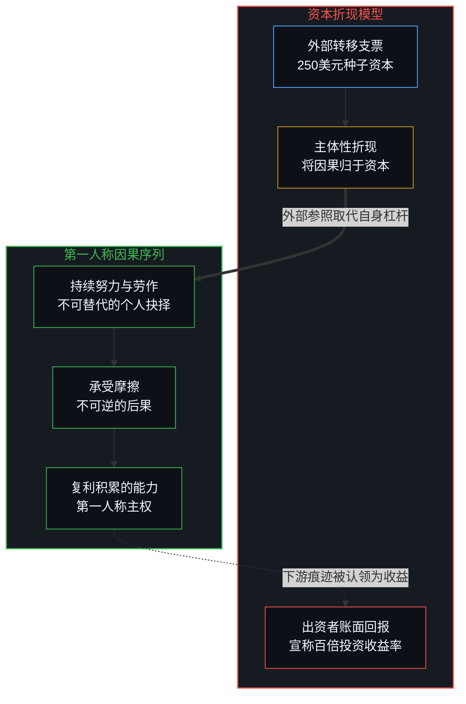
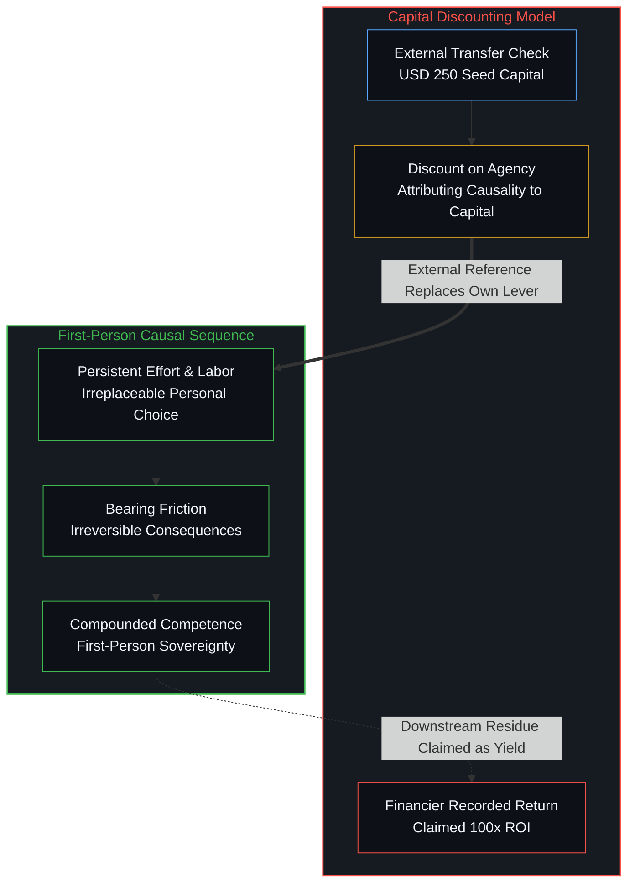
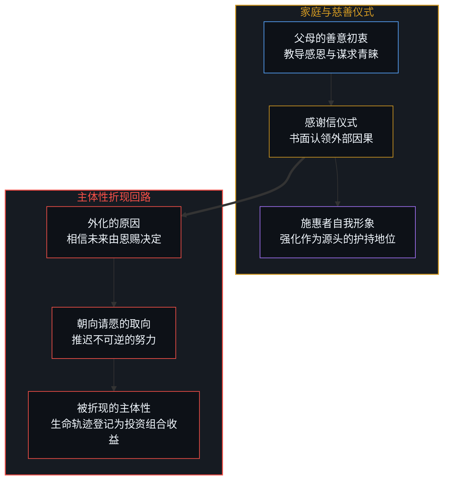
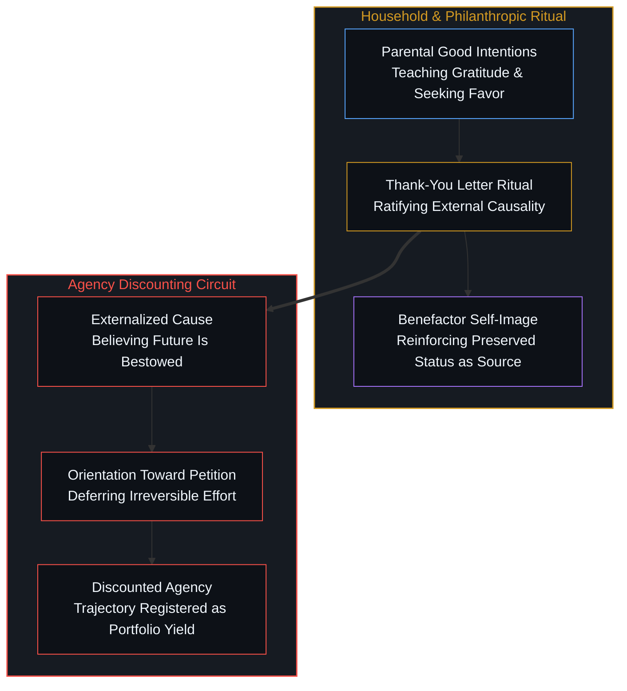

# 主体性的折现 / The Discount on Agency

*把生命轨迹算作投资回报，是对孩子自身因果的折现。 / Treating a life trajectory as return on investment discounts the child's own causality.*

当一个孩子开始相信自己的未来取决于成功人士的一笔小额投资时，因果的记认便已经向外转移。资金数额本身是次要的；真正起作用的是伴随其后的叙事：这笔外部转移支付——而非孩子自身的努力与后果承担——构成了其人生轨迹的决定性原因。一旦这一叙事被奉为前提，个体主体性便遭遇双重折现：在出资者的账本上，孩子此后数十年的努力被记作初始支票所产生的收益；而在任何采纳这本账的受助者心中，自身的行动不再被当作首要变量。

When a child comes to believe that their future depends on a small investment by successful people, the registration of cause has already shifted outward. The monetary amount itself is incidental; what operates is the narrative accompanying it: that this external transfer, rather than the child's own effort and consequence-bearing, constitutes the decisive cause of their trajectory. Once that story is held as ground, personal agency is discounted twice: on the financier's ledger, which books the child's subsequent decades of effort as the yield of the initial check, and in any recipient who adopts that ledger and stops treating their own actions as the primary variable.

## 一、 投资回报与因果的移位 / 1. Return on Investment and the Relocation of Cause

当知名实业家公开颂扬为每个儿童投入250美元能够带来丰厚的投资回报率时，现代慈善便暴露出其记账方式是如何倒置因果的。在金融市场的标准逻辑下，投资回报率衡量的是资本自身的生产效率；然而在此处，被计入分子的却是个体在随后数十年间的坚韧、判断、劳作与认知求索。为了让一笔微不足道的款项在资产负债表上登记为千倍红利，整套叙事机制必须把个体此后承受的一切摩擦、习得的技能与生存抉择，统统归因于最初那张支票。在这种记账方式下，原本无因且不息地进行自我区分的活生生的心智，被减记成了他人投资组合中的生息资产。

When a prominent industrialist publicly celebrates how a 250-dollar investment per child yields a massive return on investment, modern philanthropy exposes how its accounting inverts causality. Within the standard logic of financial markets, return on investment measures the productive efficiency of capital itself; yet here, the numerator consists of an individual's subsequent decades of perseverance, judgment, labor, and cognitive struggle. For a negligible sum to register on a balance sheet as a thousand-fold dividend, the entire narrative apparatus must attribute all subsequent friction-bearing, skill acquisition, and existential choices to the initial check. In that accounting, the living Mind—where self-distinguishing activity occurs uncaused and unceasing—is written down as an interest-bearing asset in another's portfolio.

这并非关于金额大小的争论。保障住所、清洁水源、基础教育与基本医疗，拓宽的是个体得以呼吸和行动的生理边界，并未侵入主体性的领地。一旦外部力量试图去包揽一个独立生命的建构过程——无论是提供种子资本、购置第一套房产，还是发放持续补贴以暗示沉重的跋涉已由外部代劳——这条边界便被跨越了。像芬兰每月发放95欧元儿童津贴这样的适度公共补贴，并不会制造这种倒置；扭曲并非源于支票的面额，而是源于把支票描绘成未来之所以可能的叙事框架。正如[拥有更多从不是原因](../having-more-is-never-the-cause/)所追溯的，初始存量只塑造可用条件的分布，却从不生成唯有在持续抉择中才能生长出来的能力。

This is not an argument over monetary amounts. Guaranteeing shelter, clean water, schooling, and basic medical care expands the biological horizon within which an individual breathes and acts, without trespassing upon the domain of agency. The boundary is crossed the moment an external party attempts to underwrite the construction of an independent life—whether through seed capital, purchasing the first home, or providing ongoing subsidies that imply the heavy lifting has already been solved from outside. A modest public stipend, such as Finland's child allowance of 95 euros monthly, does not produce this inversion; the distortion arises not from the size of the check, but from the narrative framing that presents the check as what makes the future possible. As [Having More Is Never the Cause](../having-more-is-never-the-cause/) traces, a starting stock patterns what is available without ever authoring the competence that only continued choosing generates.

## 二、 感谢信与因果归属的移位 / 2. The Thank-You Letter and the Relocation of Credit

当父母催促年幼的孩子给远方的亿万富翁写感谢信时，一种出于善意的外化机制便在家庭内部固化下来。父母有意识的初衷是教导感恩，并在等级化的社会网络中争取青睐；然而这一仪式的实际运作功能，却是将一个外部参照安装为孩子未来的原因。孩子被要求立字确认：自己的人生轨迹是一份被赐予的恩惠，自己的人生可能性系于远方施惠者的拨款。正如[赋权确立权力的集中](../empowerment-establishes-the-centralization-of-power/)所追溯的，赋权的框架预设了能力驻留于某个中心、必须由外部来解锁；感谢信预演的正是这种请愿，训练受助者将因果功劳向外归属，以强化资助者所护持的自我形象。

When parents urge their young children to write thank-you letters to distant billionaires, a well-intentioned mechanism of externalization solidifies within the household. The parents' conscious intent is to teach gratitude and secure favorable attention within a hierarchical social web; yet the operational function of the ritual is to install an external reference as the cause of the child's future. The child is asked to put in writing that their trajectory is a bestowed favor and that their life possibilities hinge upon a distant benefactor's grant. As [Empowerment Establishes the Centralization of Power](../empowerment-establishes-the-centralization-of-power/) traces, the framing of empowerment presumes that capacity resides at a center and must be unlocked from outside; the thank-you letter rehearses that petition, training the recipient to assign causal credit outward to reinforce the donor's preserved self-image.

这种仪式化的顺从将孩子的主体性摆上账本，以稳固施惠者的地位。资本可以购买工具、购买时间、提供安全网，却无法代行唯有活生生的心智才能执行的工作：持续的专注、审辨、支付不可逆能量代价的意愿，以及在未决后果面前站立的能力。训练孩子把一张种子支票当作自身前途的缔造者，会在他们直面开放世界之前很久，就把抉择的方向引向请愿：由此刻下的教训不是自身的行动能够改变可用之物，而是进阶取决于同外部把关者的对齐。[帮助是问题的一半](../help-is-half-the-problem/)追溯了这一双输入回路如何产生零净位移，在施助者对自身不可或缺的需求与受助者外化的责任之间维持平衡。

This ritualized deference places the child's agency on the ledger to stabilize the standing of a benefactor. Capital can purchase tools, buy time, and supply a safety net, but it cannot perform the work that only a living Mind can execute: sustained concentration, discernment, the willingness to pay irreversible energy costs, and the capacity to stand before uncertain consequences. Conditioning a child to treat a seed check as the author of their prospects orients choice toward petition long before they confront the open world: the lesson registered is not that one's own acts alter what is available, but that advancement depends on alignment with an external gatekeeper. [Help Is Half the Problem](../help-is-half-the-problem/) traces how this two-input circuit produces zero net displacement, balancing the donor's need to be indispensable against the recipient's externalized responsibility.

## 三、 远距离慈善与切断的反馈 / 3. Distant Philanthropy and Severed Feedback

当资本转移来自那些从不亲历下游后果的人时，这种因果扭曲便达到了顶点。父母、亲属与邻里即便在引导时有所误判，依然在直接的物理场域中与孩子休戚相连；孩子随后的喜悦、绝望、失败与成熟，会直接反馈回监护人的切身经历之中。这种共同暴露维系着直接的反馈回路。相比之下，远方的慈善家无需承受任何后续震荡；孩子无论是蓬勃成长还是陷入冷漠，都不会对资助者的日常起居产生丝毫摩擦。正因为这一反馈被切断，因果叙事才得以毫无阻力地倒置：孩子的成就被记录为资助者远见的收获，而停滞则从年度报告中悄然抹去。

When capital transfers originate from individuals who never inhabit the downstream consequences, the causal distortion reaches its limit. Parents, relatives, and neighbors may misjudge their guidance, yet they remain bound to the child within an immediate physical field; the child's subsequent joy, despair, failure, and maturation feed back directly into the guardians' lived experience. This shared exposure sustains a direct feedback loop. A distant philanthropist, by contrast, lives with none of the fallout; whether the child flourishes or collapses into apathy exerts no friction upon the donor's daily existence. Because that feedback is severed, the causal narrative can be inverted without resistance: the child's achievements are recorded as the harvest of the donor's foresight, while stagnation is dropped from the annual report.

即便在家庭内部，情感与财富的结合也常诱使父母把金钱当作绕过痛苦成长过程的行政捷径；而远距离慈善甚至连亲缘关系所带来的局部摩擦都不复存在。当商业巨擘将向数百万儿童注入种子投资账户描绘为高收益的人力资本投资时，公共话语便认可了一个范畴错误：金融资本可以替代个人的挣扎求索。[外化善意走向其反面](../externalized-virtue-becomes-its-opposite/)追溯了道德凭据一旦被抽象为外化的项目，如何在维系执行中心地位的同时令自身的根基失效。慈善家收获了即时的声誉回报，而账本则把受助者历经磨砺才赢得的能力归功于最初那笔拨款。

Even within families, affection combined with wealth tempts parents to use money as an administrative shortcut around painful development; distant philanthropy operates without even the local friction of kinship. When a magnate characterizes seeding investment accounts for millions of children as a high-yield investment in human capital, public discourse ratifies a category error: that financial capital can substitute for personal struggle. [Externalized Virtue Becomes Its Opposite](../externalized-virtue-becomes-its-opposite/) traces how a moral warrant, once abstracted into an externalized program, expires its own basis while preserving the standing of the center that administers it. The philanthropist collects immediate reputational return, while the ledger reassigns the credit for the recipients' own hard-won competence to the initial grant.

## 四、 成果转换的悖论 / 4. The Paradox of Conversion

一个结构性悖论贯穿于这一动态之中：那些将外部转移支付转化为持久能力的个体，恰恰是从未接受资助方宣传的人。他们将这笔意外之财视作与自身内在因果无关的环境背景，继续与物理摩擦直接角力，并保持清晰的认知——结果取决于个人的行动。相反，那些内化了这一框架、相信这笔资金背书开启了自身视界的人，则交出了被折现的努力：他们等待下一笔补贴，或者在摩擦降临时归咎于外部支持不足。出资者所猎获并大肆宣扬的成功案例，恰恰来自那些拒绝采纳资助者因果模型的年轻人。

A structural paradox runs through this dynamic: the individuals who convert external transfers into durable competence are those who never accepted the donor's advertisement. They treat the windfall as ambient background unrelated to their internal causality, continuing to wrestle directly with physical friction and maintaining the clear recognition that outcomes depend on personal action. Conversely, those who internalize the framing—believing that this financial endorsement unlocked their horizon—deliver discounted effort, awaiting the next subsidy or blaming inadequate external support when friction arrives. The financier captures the celebrated success stories from the youth who refused to adopt the donor's causal model.

这一悖论揭示出人类成长不可化约的局域性。[个体抉择是唯一的因果杠杆](../individual-choices-as-the-only-causal-levers/)阐明了条件与资源为何始终只是行动展开时的环境背景，从不是生成能力的起始原因。[你的代码库即是记忆](../your-codebase-is-memory/)在外化认知中追溯了同一结构：文件与资本资源的集合无法作为现成的理解从外部直接移交，因为唯有当掌舵边缘的心智在负载下亲自检验、打破并重构其不变量时，痕迹才会凝聚为活的晶格。如果那些已经取得实业成就的人希望为下一代拓展可能性，真正自洽的路径正是最初造就其成就的那条路：制造更好的产品、推进基础设施建设、拓展开放贸易的广度。这类生产扩大了后来者凭自身努力即可把握的机会场域，既不预先指定结局，也不宣讲一张远方的支票能够主宰人生的轨迹。

This paradox exposes the irreducible locality of human growth. [Individual Choices as the Only Causal Levers](../individual-choices-as-the-only-causal-levers/) shows why conditions and resources remain the ambient background against which action unfolds, never the initiating cause of competence. [Your Codebase Is Memory](../your-codebase-is-memory/) traces the same structure in externalized cognition: a repository of files and capital resources cannot be handed over as ready-made understanding from outside, because traces only cohere into a living lattice when the Mind at the steering edge personally tests, breaks, and refactors its invariants under load. If those who have achieved industrial success wish to expand possibilities for the next generation, the coherent path is the one that generated their success in the first place: building better products, advancing infrastructure, and expanding the reach of open trade. Such production enlarges the field of opportunities that newcomers can seize through their own effort, without pre-assigning outcomes or preaching that a distant check governs a human trajectory.

## 五、 无法被工程化的生命与父母的克制 / 5. The Unengineered Life and Parental Restraint

生命无法被工程化；倘若一条生命轨迹可以被化约为工程规范，其结果将是一台失去意义与方向的封闭状态机。意义要求未来保持未决——结局未被预先注定，个体的努力能够改变轨迹，而失败依然是不可逆的风险。被工程化的人生将活生生的心智降格为建筑师蓝图下的行政产出，只留下管理上的顺从。宏大的慈善计划之所以犯下这一范畴错误，正在于它们试图用预先打包的结局，去替代唯有活生生的心智通过切身经历才能书写的开放而未竟的劳作。

Life cannot be engineered; were a life trajectory reducible to an engineering specification, the result would be a closed state machine devoid of meaning or direction. Meaning requires that the future remain unsettled—that outcomes are not pre-ordained, that individual effort can alter trajectories, and that failure remains an irreversible hazard. An engineered life reduces a living Mind into the administrative output of an architect's blueprint, leaving only managerial compliance. Grand philanthropic schemes commit this category error by substituting a pre-packaged outcome for the open, unfinished labor that only a living Mind can author through lived experience.

每当父母受诱惑想要动用积累的财富为孩子扫清一切障碍、试图花钱买断成熟过程中的摩擦时，同一机制便在切近的家庭中运转。[投射中的自画像](../the-self-portrait-in-the-projection/)揭示了将他人的内在性压平为可控投射，反映出的只是观察者自身凝固的模型；[数字神祇与视界跳跃](../the-digital-god-and-the-horizon-jump/)则追溯了为何没有任何合成计算或外部资本能够代替活生生的心智，去完成跨越物理摩擦视界的不可逆跳跃。在家庭内部，[未历摩擦的心智与借来的全能](../the-unfrictioned-mind-and-borrowed-omnipotence/)追溯了那些试图通过创伤戒备与行政指令来工程化品格的照料者，如何在一端留下借来的全能感，而在另一端留下先发制人的负罪感。正如[隐性自由变量与权力的事后幻相](../the-free-variable-and-the-retrospective-illusion-of-power/)所确立的，价值从不是外部资本可以单向赋予的惰性存量，而是从感知未显的不对称、承担后果与摩擦下的迭代中涌现的递归回路；企图用一张预制支票买断下一代的探索与挣扎，恰恰在那个自由变量本该复利生长的边缘钝化了它的运用。监护在于放下将孩子当作工程项目的冲动，留在共同承受的反馈之中，并完整保留那道让他们直面摩擦、书写自身因果的边界。

The same mechanism operates closer to home whenever a parent is tempted to deploy accumulated wealth to clear away every obstacle for a child, attempting to purchase immunity from the friction of maturation. [The Self-Portrait in the Projection](../the-self-portrait-in-the-projection/) shows how flattening another's interiority into a controllable projection reflects only the observer's own frozen model, and [The Digital God and the Horizon Jump](../the-digital-god-and-the-horizon-jump/) traces why no synthetic calculation or external capital can make the irreversible jump across the horizon of physical friction on behalf of a living Mind. In the household, [The Unfrictioned Mind and Borrowed Omnipotence](../the-unfrictioned-mind-and-borrowed-omnipotence/) traces how caregivers who attempt to engineer character through trauma vigilance and administrative decrees leave behind borrowed omnipotence on one side and preemptive guilt on the other. Value, as [The Invisible Free Variable and the Retrospective Illusion of Power](../the-free-variable-and-the-retrospective-illusion-of-power/) establishes, is never an inert stock that external capital can endow one-way, but a recursive loop emerging from perceiving unseen asymmetries, bearing consequences, and iterating under friction; trying to buy out the next generation's exploratory struggle with a prefabricated check dulls the exercise of that free variable at the very edge where it would compound. Guardianship consists in setting down the impulse to treat a child as an engineering project, remaining within shared feedback, and leaving intact the boundary within which they face friction and author their own causality.
