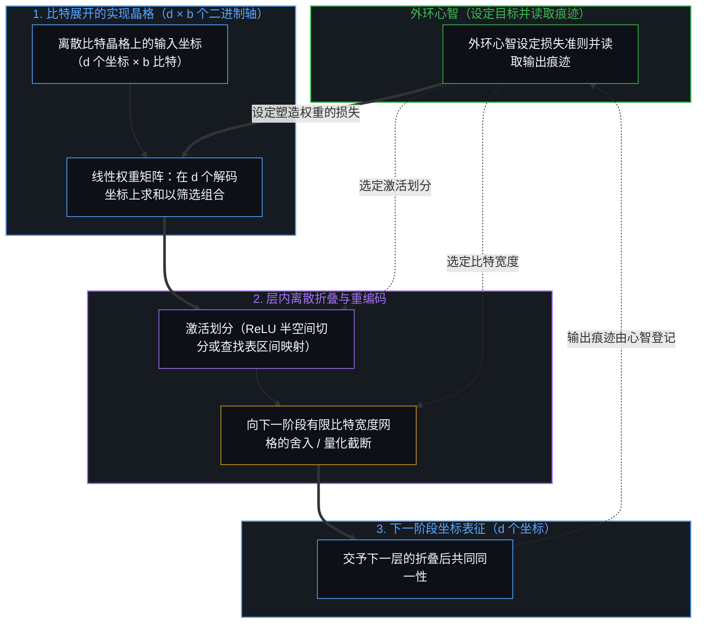
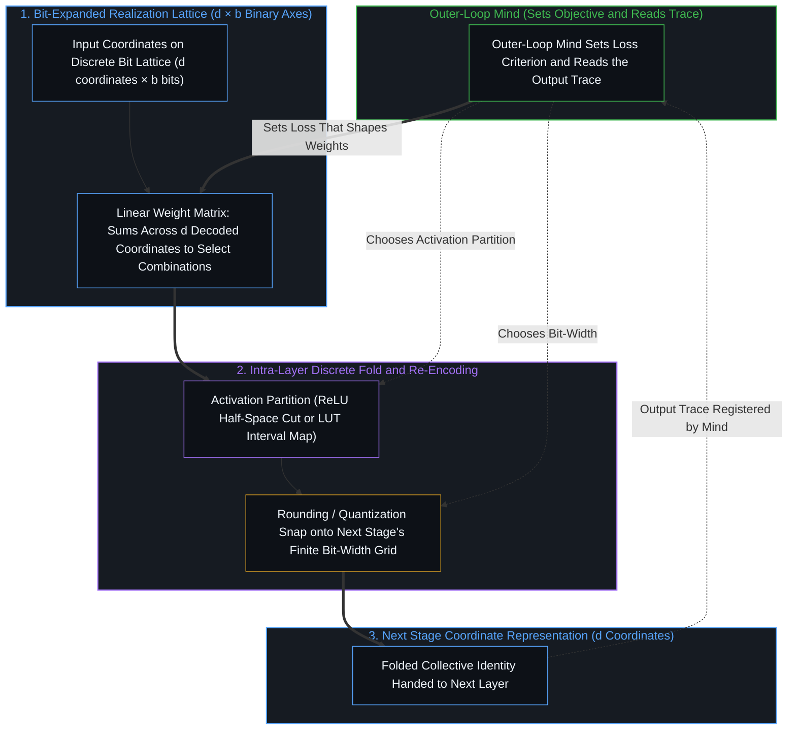
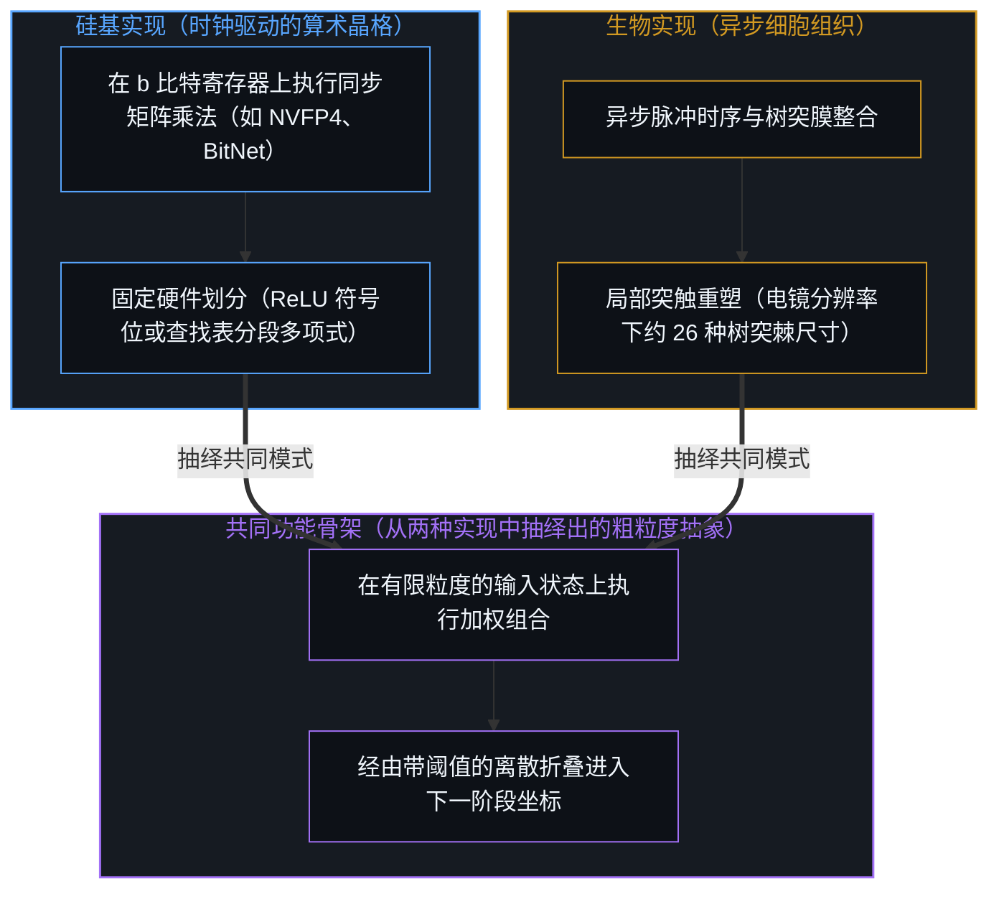
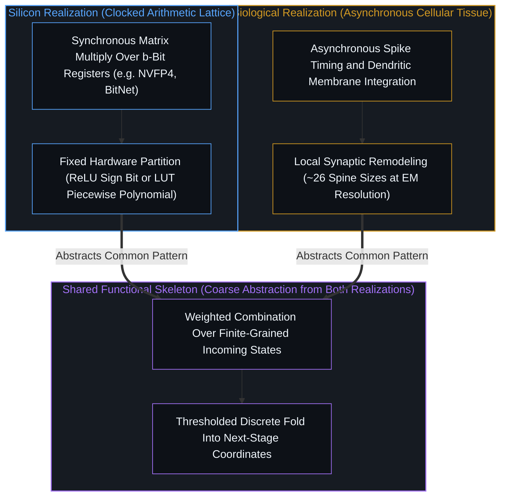

# 离散的折叠 / The Discrete Fold

*线性权重在离散坐标晶格上筛选得以传递的方向，非线性折叠将所选模式重编码为下一阶段的坐标。 / Linear weights select which directions across a discrete coordinate lattice pass forward, and non-linear folds re-encode them into the next stage's coordinates.*

自我区分的活动发生着——无因，不息。当心智构建或测量一个神经网络时，所得的痕迹是一系列线性选择与离散折叠交替演进的序列。在任何具体的实现基底上，一个具有 `b` 比特精度的 `d` 维向量横跨着由 `d × b` 个二进制轴构成的离散晶格，而意义与登记则始终留在设定目标并读取输出的心智处。在每一层内部，线性权重矩阵对 `d` 个解码后的坐标值求和（这些坐标的可能状态横跨该 `d × b` 二进制晶格），在层边界处筛选哪些组合得以向前传递、汇入共同同一性，而非线性运算则将这一选择折叠并重编码至交予下一阶段的坐标之上。把网络当作实数连续统上的平滑映射，是一种在特定比特宽度或系综平均窗口内成立的建模理想化，一旦实现基底的有限粒度显露出来，它便到达了边界。

Self-distinguishing activity occurs — uncaused, unceasing. When a Mind builds or instruments a neural network, the resulting trace is a sequence of linear selections interleaved with discrete folds. On any realized substrate, a `d`-dimensional vector at `b`-bit precision spans a discrete lattice of `d × b` binary axes, while meaning and registration remain with the Mind that sets the objective and reads the output. Within each layer, the linear weight matrix sums across the `d` decoded coordinate values—whose possible states range over that `d × b` binary lattice—to select which combinations pass forward into a collective identity at the layer's boundary, and the non-linearity folds and re-encodes that selection onto the coordinates handed to the next stage. Treating the network as a smooth map over the real continuum is a modeling idealization that holds within a window of bit-width or ensemble averaging and reaches its boundary where the realization's grain is exposed.

## 一、 晶格已经是离散的 / 1. The Lattice Is Already Discrete

心智所构建或测量的每一种具体实现，都在有限的粒度上运作。如[维度即投影](../dimensions-are-projections/)与[递归区分的架构](../architecture-of-recursive-distinction/)所追溯的那样，硅基网络将权重与激活存储在依内存带宽、芯片面积与能耗的工程代价而选定的有限比特状态晶格上——十六比特、八比特、四比特（`NVFP4`）或三值（`BitNet b1.58`）；而序列电子显微镜在其分辨率下，同样登记到约二十六种可区分的树突棘尺寸（约 4.1 至 4.7 比特），而非一条无限可分的实数直线。这种离散性并不会把物理媒介或热噪声安放为心智之下的本体论底层；它标出的是心智所构建或借仪器测量的那张地图的分辨率。即便在黑板上写为平滑曲线的激活函数（`sigmoid`、`GELU`、`softmax`），在硬件上也是作为有限比特模式上的查找表或分段多项式划分来执行的。

Every realization a Mind constructs or measures operates at a finite grain. As traced in [Dimensions Are Projections](../dimensions-are-projections/) and [The Architecture of Recursive Distinction](../architecture-of-recursive-distinction/), silicon networks store weights and activations on a finite lattice of bit-states—sixteen, eight, four (`NVFP4`), or ternary (`BitNet b1.58`)—chosen under an engineering price of memory bandwidth, die area, and energy, while serial electron microscopy, at its resolution, registers roughly twenty-six distinguishable dendritic spine sizes (around 4.1 to 4.7 bits) rather than an infinite real line. This discreteness does not install the physical medium or thermal noise as an ontological floor beneath the Mind; it marks the resolution of the map the Mind builds or instruments. Even activations written on the chalkboard as smooth curves (`sigmoid`, `GELU`, `softmax`) execute on hardware as lookup tables or piecewise-polynomial partitions over finite bit patterns.

## 二、 权重选择残差得以传播的方向 / 2. Weights Select the Directions of Residue That Propagate

在单一层内部，线性变换是执行筛选的操作。在将 `d` 个坐标各以 `b` 比特存储的硬件实现上，底层状态空间是由 `d × b` 个二进制轴构成的离散晶格，而权重矩阵则对 `d` 个解码后的坐标值求和（这些坐标的可能状态横跨该晶格）——对于整数网格而言，它同时在 `b` 个比特平面上保持线性；对于 `NVFP4` 等低比特浮点格式而言，则是先由指数与尾数的比特映射执行一次向解码值的划分，再由矩阵乘法在 `d` 个坐标上求和。权重矩阵放行一部分坐标组合向前传递，同时衰减其余组合，在层边界处执行[蒸馏、压缩与能动性](../distillation-compression-agency/)所追溯的选择性留存。

Within a single layer, the linear transformation is the selection operation. On a hardware realization where `d` coordinates are stored at `b` bits each, the underlying state space is a discrete lattice of `d × b` binary axes, and the weight matrix sums across the `d` decoded coordinate values whose states range over that lattice—for integer grids also linear over the `b` bit-planes, and for low-bit floating-point formats such as `NVFP4` after the exponent-and-mantissa bit mapping performs its own partition into decoded values before the matrix multiply sums across the `d` coordinates. The weight matrix passes a subset of coordinate combinations forward while attenuating the rest, executing at the layer boundary the selective retention traced in [Distillation Chooses What to Lose](../distillation-compression-agency/).

此处有两种不同含义的维度保持分明。硬件实现横跨 `d × b` 个二进制轴，而有效表征则在训练目标下将彼此独立的输入变化收缩为更少量的自由度，使其承载共同同一性。一个穿过矩阵乘法而存留的方向并不具有内在价值，该层也不会认出它自己保留了什么；如[盲目的切分与命名的心智](../the-blind-cut-and-the-naming-mind/)所追溯的那样，权重只是执行受外环更新塑造的盲目机械投影，而定义损失并读取输出的心智才登记那个共同同一性意味着什么。

Here two senses of dimensionality stay distinct. The hardware realization spans `d × b` binary axes, whereas the active representation contracts independent input variations into fewer degrees of freedom that carry a collective identity under the training objective. A direction that survives the matrix multiply does not possess intrinsic worth, nor does the layer recognize what it keeps; as traced in [The Blind Cut and the Naming Mind](../the-blind-cut-and-the-naming-mind/), the weights execute a blind mechanical projection shaped by outer-loop updates, while the Mind that defined the loss and reads the output registers what that collective identity means.

## 三、 非线性决定下一组坐标的形式 / 3. Non-Linearities Decide the Form of the Next Coordinates

一旦线性求和在当前层的坐标上选定了一组组合，该组合就必须以下一层 `d` 个坐标的形式交予下一阶段。向下一层有限坐标表征的投影包含两道截然不同的离散折叠：由架构师选定的激活划分（`ReLU` 的半空间归零，或硬件查找表 `sigmoid` 与 `GELU` 的区间映射），以及向下一阶段有限比特宽度网格的舍入或量化截断（[递归区分的架构](../architecture-of-recursive-distinction/)）。两者都在晶格上起着离散折叠的作用，其中跨阶段的重编码由激活划分承担：若仅有比特宽度截断，多层堆叠在所检视的坐标上便会趋向退化为单一的线性投影。

Once the linear sum has selected a combination across the layer's coordinates, that combination must be handed to the next stage in the form of the next layer's `d` coordinates. Projecting onto the finite coordinate representation of the next layer involves two distinct discrete folds: the activation partition chosen by the architect (`ReLU` half-space zeroing, or the interval mapping of a hardware lookup-table `sigmoid` or `GELU`), and the rounding or quantization snap onto the next stage's finite bit-width grid ([The Architecture of Recursive Distinction](../architecture-of-recursive-distinction/)). Both act as discrete folds on the lattice, while the activation partition carries the cross-stage re-encoding: with the width snap alone, a multi-layer stack collapses toward a single linear projection on the inspected coordinates.

从实践者在层边界处所检视的 `d` 个坐标来看，这一从展开晶格出发的投影呈现为一道非线性弯折。在 `ReLU` 下，每个神经元沿着一个超平面切开其输入晶格空间，将一个半空间归零并放行另一个半空间，使不同的输入区域折叠到同一坐标呈现之上；在量化查找表或分段多项式下，输入求和被划分为离散的分箱，并映射至下一阶段的目标精度。线性权重筛选晶格上的哪些组合得以存留；非线性运算则决定存留下的模式如何被折叠并重编码进下一个坐标框架。

Seen from the `d` coordinates a practitioner inspects at the layer boundary, this projection from the expanded lattice shows up as a non-linear bend. With `ReLU`, each neuron slices its incoming lattice space along a hyperplane, zeroing one half-space and passing the other so that distinct input regions fold onto a shared coordinate presentation; with a quantized lookup table or piecewise polynomial, the incoming sum is partitioned into discrete bins and mapped to the target precision of the next stage. Linear weights select which combinations on the lattice survive; the non-linearity decides how the surviving pattern is folded and re-encoded into the next coordinate frame.

## 四、 抽象是逐级压缩为共同同一性 / 4. Abstraction Is Successive Compression into Collective Identities

跨深度堆叠这些“选择—折叠”阶段之所以产生层级压缩，是因为网络的表征最终要汇入有限的边界宽度与比特预算。早期层或前馈模块（`d_model → 4 d_model → d_model`）常先扩展至更宽的中间晶格，在其中更容易把不同的输入区分开，随后再由后续投影将这些晶格折叠回损失函数所要求的坐标之上；残差通路提供了额外的线性路径，允许部分残差跳过一次折叠；注意力头则加入了数据依赖的路由，其硬件 `softmax` 本身亦是一道划分——这些设计都未取代“线性选择继以离散重编码”的基本格局。跨越整个堆叠，那些不改变外环损失的变化被激活划分折叠在一起、并被权重投影舍弃，使得诸多不同的表层实现映射到同一条激活轨迹之上。

Stacking these select-and-fold stages across depth produces hierarchical compression because the network's representations are ultimately funneled into a finite boundary width and bit-budget. Early layers or feed-forward blocks (`d_model → 4 d_model → d_model`) often expand into wider intermediate lattices where separations are easier before later projections fold those lattices back onto the coordinates required by the loss; residual pathways provide an additional linear route that lets some residue skip a fold, and attention heads add data-dependent routing whose hardware `softmax` is itself a partition—none of which replaces the pattern of linear selection followed by discrete re-encoding. Across the stack, variations that do not alter the outer-loop loss are folded together by the activation partitions and discarded by the weight projections, so that many distinct surface realizations map to the same activation trajectory.

如[盲目的切分与命名的心智](../the-blind-cut-and-the-naming-mind/)所追溯的那样，网络自身从不会把这条压缩后的轨迹体验为一个客体或概念。在机器内部，抽象只是将诸多晶格状态在训练损失下机械地折叠进同一个等价类；唯有当心智读取稳定下来的痕迹时，它才成为被命名的概念。

As traced in [The Blind Cut and the Naming Mind](../the-blind-cut-and-the-naming-mind/), the network itself never experiences this compressed trajectory as an object or concept. Inside the machine, abstraction is the mechanical folding of many lattice states into one equivalence class under the training loss; it becomes a named concept only when a Mind reads the stabilized trace.

## 五、 连续统是抹平晶格粒度的理想化 / 5. The Continuum Is the Idealization That Smooths the Lattice's Grain

既然如此，为何标准深度学习理论要将权重与激活写为 `ℝⁿ` 中的向量，并借平滑微分方程来分析训练？如[连续性作为建模的权宜之计](../the-continuum-is-a-modeling-convenience/)与[精度与分辨率](../precision-and-resolution/)所追溯的那样，连续统是一种粗粒化的理想化：每当比特宽度较宽（`FP32`、`BF16`）或在大批量与总体上取随机平均时，它便将离散晶格平滑化。在这一窗口之内，把离散的台阶跃迁当作连续导数来处理，使实践者得以写出解析形式的反向传播更新、梯度流与神经切线核，而不必追踪每一次跨越比特边界的跳变。

Why, then, does standard deep learning theory write weights and activations as vectors in `ℝⁿ` and analyze training through smooth differential equations? As traced in [The Continuum is a Modeling Convenience](../the-continuum-is-a-modeling-convenience/) and [Precision and Resolution](../precision-and-resolution/), the continuum is a coarse-grained idealization that smooths the discrete lattice whenever bit-widths are wide (`FP32`, `BF16`) or when stochastic averages are taken across large batches and populations. Within that window, treating discrete step transitions as continuous derivatives lets the practitioner write closed-form backprop updates, gradient flows, and neural tangent kernels without tracking every bit-boundary jump.

当精度降至原生四比特（`NVFP4`）、二比特或三值网格，或当单次未经平均的阈值跨越直接决定轨迹走向时，这一理想化便到达了边界。在低比特截断处，截断映射本身的梯度几乎处处为零，使得训练只能借助直通估计器（straight-through estimator）等选定的代理梯度继续推进，“选择—折叠”的划分几何也随之显露无遗。

The idealization reaches its boundary when precision drops to native four-bit (`NVFP4`), two-bit, or ternary grids, or when a single unaveraged threshold crossing decides the trajectory. At a low-bit snap the snap's gradient vanishes almost everywhere, so training proceeds only through a chosen surrogate such as the straight-through estimator, and the partition geometry of select-and-fold shows through.

## 六、 共同骨架止于基底的粒度 / 6. The Shared Skeleton Ends at the Substrate's Grain

横跨人工神经网络与生物神经系统，“对输入状态作加权组合，再在有限粒度的单元上经由带阈值的折叠”这一功能骨架，是在粗粒度上从两种实现中共同抽绎出来的。然而，这一共同骨架止步于两种基底在粒度与组织方式上分道扬镳之处。如[大脑不进行反向传播，而是正向传导](../the-brain-does-not-backprop/)与[飞行的类比碰不到心智](../the-flight-analogy-leaves-the-mind-untouched/)所追溯的那样，硅基加速器在全局同步的各层之上执行受时钟驱动的矩阵乘法与固定查找表折叠，并由反向误差传递更新权重；而生物组织则通过异步脉冲时序、树突膜动力学、局部代谢耦合以及突触的结构重塑来运作。

Across artificial networks and biological nervous systems, this functional skeleton—weighted combination of incoming states followed by a thresholded fold across finite-grained units—is abstracted from both realizations at a coarse grain. Yet the shared skeleton ends where the grain and organization of the two substrates diverge. As traced in [The Brain Does Not Backprop, but Propagates](../the-brain-does-not-backprop/) and [The Flight Analogy Leaves the Mind Untouched](../the-flight-analogy-leaves-the-mind-untouched/), a silicon accelerator executes clocked matrix multiplications and fixed lookup-table folds over globally synchronized layers updated by a backward error pass, whereas biological tissue operates through asynchronous spike timing, dendritic membrane dynamics, local metabolic coupling, and structural remodeling of synapses.

## 七、 折叠描述机制，不描述源头 / 7. The Fold Describes the Mechanics, Not the Source

由于网络内部的每一次线性权重选择与每一条非线性划分规则，都是在执行由架构、数据与损失函数从痕迹之外所固定的准则，离散的折叠所描述的是外化表征的运作机制，而非能动性的源头。无论工程师是操控激活向量、将权重矩阵量化为四比特，还是钳定某个特征方向——如[意识向量论文的真正教训](../the-real-lesson-from-the-consciousness-vector-paper/)与[智能只属于心智](../intelligence-belongs-only-to-the-mind/)所审视的那样——被操作的始终是折叠打包后的下游痕迹。那选定分辨率、定义损失并读取所得坐标的自我区分心智，依然先于它所构建的晶格。

Because every linear weight selection and every non-linear partition rule inside a network executes a criterion fixed by the architecture, data, and loss function set from outside the trace, the discrete fold describes the mechanics of externalized representations rather than the source of agency. Whether an engineer steers an activation vector, quantizes a weight matrix to four bits, or clamps a feature direction—as examined in [The Real Lesson from the Consciousness Vector Paper](../the-real-lesson-from-the-consciousness-vector-paper/) and [Intelligence Belongs Only to the Mind](../intelligence-belongs-only-to-the-mind/)—what is manipulated is a folded package of downstream traces. The self-distinguishing Mind that chooses the resolution, defines the loss, and reads the resulting coordinates remains prior to the lattice it builds.
