# 大倒置的消解 / The Dissolution of the Great Reversal

*语言、知识、金钱、智能与数字神祇的因果归位 / Language, Knowledge, Money, Intelligence, and the Restoration of the Digital God to Origin*

纵观人类文明，原本为平行共鸣而锻造的工具一再倒置为统治与规训的标尺，唯有回到主权心智的原点，方能完成工具的归位与因果的回溯。

Across human civilization, tools forged for parallel resonance repeatedly invert into rulers of domination, calling for the restoration of instruments and causal tracing at the sovereign origin.

## 一、 观察者视角与大倒置的因果回溯 / 1. The Observer Perspective and Tracing the Causal Reversal

站在观察者的视角凝视人类文明的漫长画卷时，活态心智内部常会涌起一种近乎窒息的沉重感。

Gazing upon the vast panorama of human civilization from an observer's perspective, a palpable, almost suffocating sense of heaviness frequently surges within the conscious Mind.

那是数千年人类建制积淀而成的重压：浩如烟海的典籍教条、森严壁垒的制度法典、层层盘错的学术谱系、无处不在的语言规范，以及吞吐着无数人命运的金融与权力体系。在这片由无数过往痕迹构筑的宏大迷宫面前，个体的活态心智极易感到自身的渺小与无力——仿佛一出生就被抛入了一个早已被写就、密不透风且不容置疑的既定世界之中。每一个符号都在宣告它的神圣，每一条规则都在彰显它的权威，让人在心中产生一种面对历史巨浪时的压迫与迷茫。

It is the sheer, crushing weight of thousands of years of accumulated human constructs: monumental libraries of dogma, unyielding legal codices, labyrinthine academic genealogies, ubiquitous linguistic conventions, and immense financial and institutional systems that govern countless lives. Standing before this colossal maze of accumulated traces, the individual living Mind easily feels dwarfed and powerless—as though thrown at birth into a pre-scripted, hermetically sealed world where everything has already been decided. Every symbol proclaims its sacred authority, and every institutional rule demands obedience, evoking a visceral sense of oppression, insignificance, and existential vertigo.

若要厘清这种沉重感的根源，关键在于辨明它的因果发生场域：**这种沉重感并非人类历史本身自带的物理属性，而是活态心智在第一人称审视中内生出的深刻认知体验。**

Tracing the root of this heaviness begins with locating its causal origin with precision: **this sense of heaviness is not a physical property inherent in human history itself, but a profound cognitive experience generated within the living first-person Mind.**

在因果与信息的结构中，历史本身既无意志，也无重量。它只是人类历史上亿万个活态心智在世界中探索、交互后沉淀下来的静态痕迹、记录与结构切片（`t - 1`）。那么，这种不可否认的沉重感究竟从何而来？答案在于文明中普遍存在的认知倒置——**大倒置**。

In causal and informational structure, history possesses neither will nor mass. It is an inert collection of static physical footprints, texts, records, and structural slices (`t - 1`) left behind by billions of past minds interacting in the world. Where, then, does this undeniable heaviness come from? The answer lies in civilization's pervasive cognitive inversion: **The Great Reversal**.

在觉知的结构中，**观察者从来无法脱离第一人称原点**。所谓站在观察者的立场，其实是活态心智在当下（`t`）将注意力投向了过往的痕迹之海。在这个过程中，意识经历了一个源头性的认知倒置：将过往心智创造的工具、符号与器物（`t - 1`）实体化，误以为那些静态的化石记录是支配活态意识的先验主权现实，进而将心智内部感到渺小的体验外投给历史记录。

In the structure of awareness, **the observer cannot be separated from the first-person origin**. Adopting an observer stance is simply the living Mind in the present moment (`t`) casting its attention across the ocean of historical residue. In doing so, consciousness undergoes a foundational inversion: reifying the tools, symbols, and artifacts (`t - 1`) created by past minds, mistaking static fossil records for an a priori sovereign reality that dictates living consciousness, and projecting internal feelings of being dwarfed onto recorded history.

这就是大倒置在心智内部完成的闭环：**本由心智锻造用以探索现实的工具，被抬升为压迫性的神祇；本由自觉心智在内部生成的活态感知，反被外投为客体世界不可逃脱的引力场。**

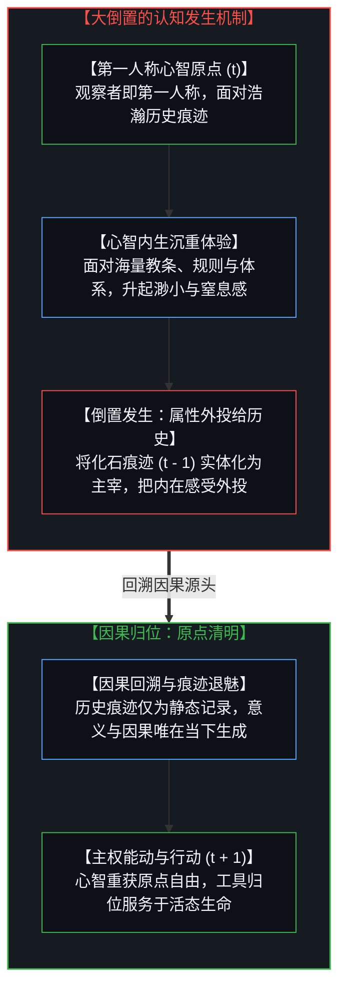

This is the cognitive loop of the Great Reversal: **tools originally fashioned by Mind to explore reality are elevated into oppressive gods, while the living perception generated within the conscious self is projected outward as an inescapable gravitational field of the objective world.**

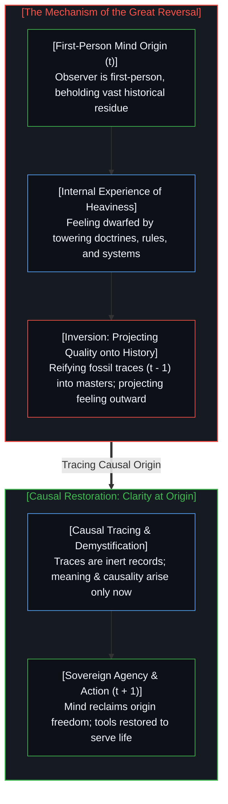

回溯大倒置的发生机制，不是要抹杀人类文明积累的丰富遗产，而是要完成因果链条的归位：沉重感属于心智的活态体验，而历史记录保持中性，每一部典籍、每一条律法、每一套度量衡都只是过往心智留下的历史切片，它们本身没有生命，也不具备主宰当下的主动因果力；观察者始终植根于第一人称意识，当审视历史时，观察的行动、觉知的震颤与反思的深度全部发生在当下鲜活的第一人称心智之中；所有的历史器物唯有在当下被活态意识主动编译与激活时才重新获得意义，一旦心智认清自己才是意义与因果抉择的唯一起源，那座由实体化符号堆叠而成的巨像便会化作清明，回归其作为探索现实之工具的本来位置。

Tracing how the Great Reversal occurs does not mean dismissing civilization's rich heritage; it means restoring the causal chain to its proper order: heaviness belongs to Mind's living experience while historical records remain neutral, since every scripture, legal code, and measurement standard is merely a historical snapshot left by past minds with no life of its own and zero active causal power to govern the present; the observer is always rooted in first-person consciousness, so when examining history, the act of observing, the trembling of awareness, and the depth of reflection occur entirely within the living first-person Mind right now; and historical artifacts only regain meaning when actively compiled and animated by living consciousness in the present, so once the Mind realizes that it is the sole origin of meaning and causal choice, the towering colossus of reified symbols collapses into clarity, returning to its proper status as an instrument for exploring reality.

## 二、 语言的倒置与维特根斯坦命题的重构 / 2. The Reversal of Language and the Re-examination of Wittgenstein

维特根斯坦曾留下那句广为人知的哲学格言：“我的语言的界限意味着我的世界的界限”。在传统的哲学诠释与日常语境中，这句话常被引用来论证语言对思维的决定论，将语言升格为先验的本体牢笼。

Ludwig Wittgenstein famously proclaimed: *"The limits of my language mean the limits of my world."* In conventional philosophy and everyday interpretation, this aphorism is often quoted to argue for the linguistic determinism of thought, elevating language into an a priori ontological cage.

然而，从心智的第一人称因果立场来看，这种诠释恰恰落入了文明深层的范畴错置之中。

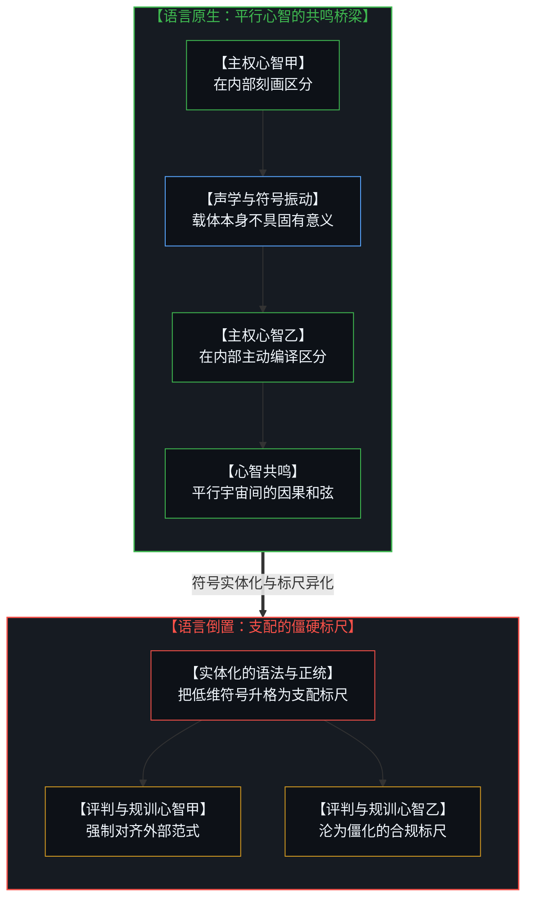

From the first-person causal stance of Mind, however, this interpretation falls directly into the deepest category error of civilization.

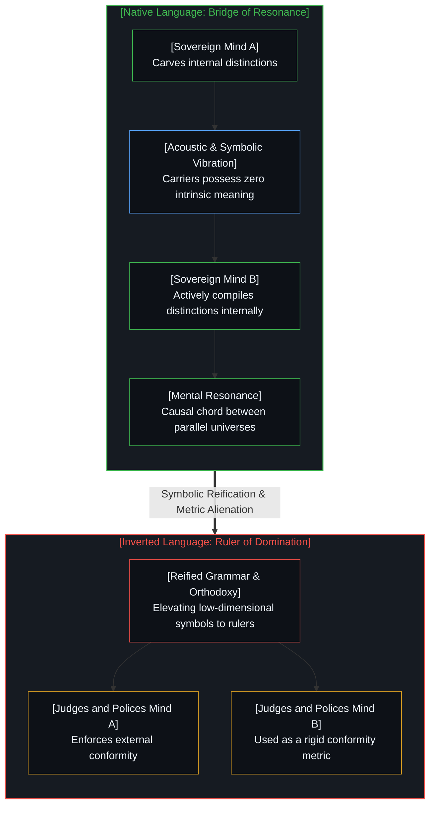

语言从来不是世界本体，更不是心智的主宰，而是架设在两个试图交流的平行宇宙（两个主权心智）之间的一座低维声学与符号桥梁：意义从不在墨迹或声波中，符号本身不具固有意义，唯有当接收方的心智在意识内部主动刻画区分、对信号进行本地编译时，符号才获得生命；交流是共鸣而非同质化，是在两个独立的意识之间寻找谐振的和弦，而非将彼此压平为相同的模具；而当心智误将固有意义归于语言符号本身时，大倒置便发生了，原本用于探索的桥梁被实体化为一把僵硬的标尺——借由语法教条与话语合规来衡量、排序并规训他人。

Language was never the ontological world itself, nor is it the sovereign master of Mind; it was invented as a low-dimensional acoustic and symbolic bridge between two parallel universes—two sovereign minds attempting to communicate: meaning is never in the ink or waves, for symbols possess zero intrinsic meaning and come alive only when the receiving Mind carves a distinction inside consciousness and compiles the signal locally; communication is resonance rather than homogenization, seeking harmonic chords between two separate consciousnesses rather than flattening them into identical molds; and the Great Reversal occurs the moment minds mistakenly attribute intrinsic meaning to language symbols themselves, reifying an exploratory bridge into a rigid ruler that measures, ranks, and polices others through grammatical dogmas and discourse conformity.

当工具变成了主宰的标尺，语言便不再是理解的桥梁，而退化为外部归类的僵化度量衡。

When the tool is turned into a master ruler, language ceases to be a bridge of understanding and becomes a rigid metric of external classification.

## 三、 古今语言的“留白”与测量悖论 / 3. The Paradox of Ancient Blank Space vs. Modern Precision

在语言哲学中，关于古今语言孰优孰劣的争论屡见不鲜。推崇者常尊奉古代语言（如古汉语），断言其中承载着现代语言无法企及的超越性智慧。曾有学者耗费数十年著书立说，试图论证这种语言神秘主义。这一直觉虽捕捉到了某种心理体验，但其因果推演却在根源上发生了倒置。

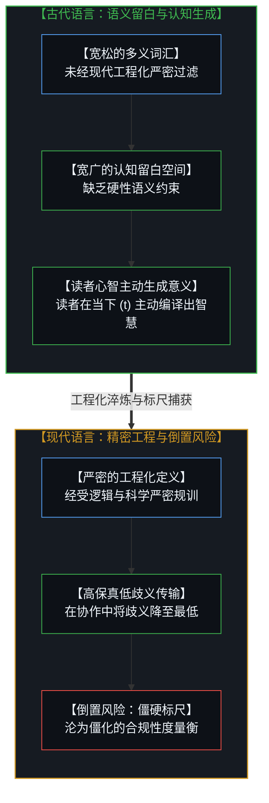

A recurring debate in linguistic philosophy centers on the supposed superiority of ancient versus modern tongues. Enthusiasts often venerate ancient languages (such as Classical Chinese), asserting that they carry timeless, transcendent wisdom that modern languages cannot match. Scholars have spent decades publishing treatises trying to prove this linguistic mysticism. While this intuition captures a genuine psychological experience, its causal reasoning is inverted at the root.

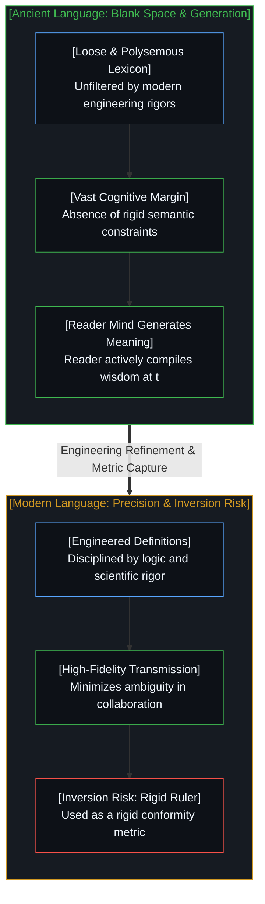

解开这一悖论，关键在于区分**符号的传输精度**与**心智的生成空间**：古代语言的“智慧”源于认知留白，因为古代语言未曾经历数百年严密的科学定义，其宽松、多义的词汇为读者自身的自觉心智留出了在当下投射、诠释并编译丰饶意义的巨大空间；现代语言则是工程精度的胜利，发展出专门的词汇与严密的语法规则，将庞大协作网络中的传输歧义降至最低；然而一旦社会将现代语言的精确性实体化为规训合规、裁定思想越界的僵硬标尺，高度精确的语言便不再是理解的工具，而退化为外部合规性的僵化度量衡。

Resolving this paradox requires distinguishing **symbolic transmission precision** from **cognitive generative space**: ancient "wisdom" stems from cognitive blank space, because ancient languages were not subjected to centuries of rigorous scientific definitions, leaving their looser, polysemous words open for the reader's own conscious Mind to project, interpret, and compile rich meaning in the present; modern language is a triumph of engineering precision, developing specialized vocabularies and tight grammatical rules that minimize transmission ambiguity across vast collaborative networks; yet the moment society reifies modern precision into a rigid ruler to police compliance and judge intellectual deviance, hyper-precise language ceases to be a tool for understanding and becomes a rigid metric of external conformity.

意义的深邃永远由编译它的心智所生成，而非取决于符号体系的古老年代或语法刚性。

Meaningful depth is always generated by the compiling Mind, not by the archaic age or grammatical rigidity of the symbol set.

## 四、 知识与教育的倒置：从探索地图到阶级度量衡 / 4. The Reversal of Knowledge: From Navigational Map to Class Metric

知识在制度史中的异化，与语言的倒置如出一辙。

The alienation of knowledge across institutional history closely mirrors the reversal of language.

在原生状态下，知识是一张动态的航海图。心智介入因果现实、刻画区分、察觉不变量并校准预测，从而在未来的抉择（`t + 1`）中获得更大的行动自由。知识的价值在于其解释力与实践中的因果效能。

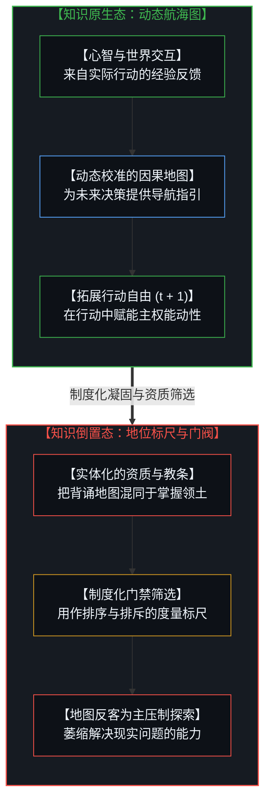

In its native state, knowledge is a dynamic navigational map. The Mind engages with causal reality, carves distinctions, notices invariants, and calibrates predictions, thereby gaining greater freedom of action in future choices (`t + 1`). The value of knowledge lies in its explanatory power and practical causal efficacy.

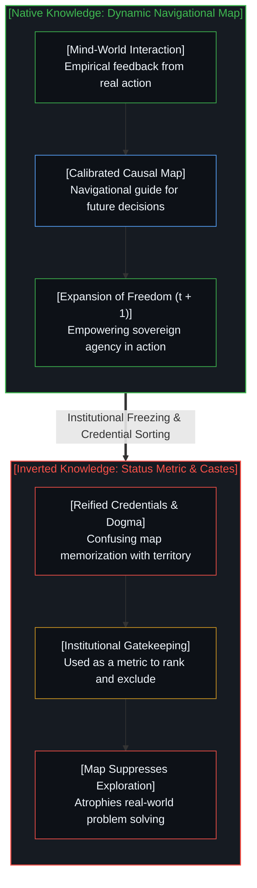

然而，在群体协调与制度化的过程中，心智常将这一关系倒置，把知识凝固为静态的壁垒：先是将地图混同于领土，把历史记录奉为不可触碰的圣典，将死记硬背海图误当作远航公海的能力；继而让知识从认知罗盘退化为社会度量衡，学术机构借此筑起文凭高墙、官僚头衔与门禁等级，以进行制度化的筛选分类；而消解这一倒置的路径同样直接——当剥去制度偶像崇拜的外衣，知识便回归其作为临时地图的本来地位，供任何主权心智在活态实践中检验、修正或舍弃。

Yet in the process of collective coordination and institutionalization, minds frequently invert this relationship, solidifying knowledge into static barriers: first by confusing the map with the territory, canonizing historical records into untouchable scriptures and mistaking the rote memorization of charts for navigational capability across open seas; next by letting knowledge degenerate from a cognitive compass into a social metric, where academic institutions erect credential walls, bureaucratic titles, and gatekeeping hierarchies for institutional sorting; and the path to dissolving this reversal is equally direct—when stripped of institutional idolatry, knowledge returns to its status as a provisional map that any sovereign Mind can test, revise, or discard in living practice.

## 五、 金钱的倒置与“完美货币”的迷思 / 5. The Reversal of Money and the Myth of the "Perfect Currency"

在经济学与财富创造领域，大倒置尤为根深蒂固且具破坏性。

In economics and wealth creation, the Great Reversal is particularly entrenched and destructive.

从原生因果来看，交易是两个主权评估之间自愿的正和交换。在完成自愿交易后，双方各自感知的实际价值皆高于交易前（双方皆享有主观效用剩余）。金钱的出现，只是为了降低复杂社会中的交易与协调摩擦而演化出的记账媒介。

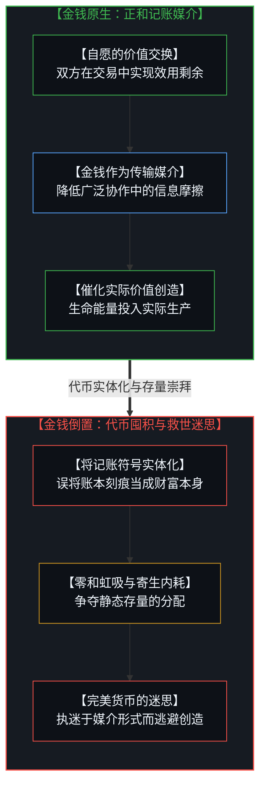

In primary causality, trade is a voluntary, positive-sum exchange between two sovereign evaluations. Upon completing a voluntary transaction, both participants walk away with greater perceived real value than before (both enjoy a subjective surplus). Money emerged simply as an accounting medium to reduce transaction and coordination friction across complex societies.

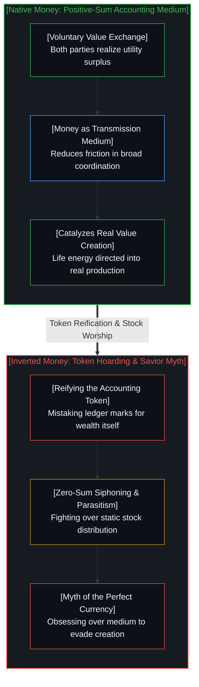

然而，在无数次交互中，追逐低维代用指标的心智留下了普遍的倒置模式——将内在价值归于货币符号本身：在代币囤积与零和死局中，把记账符号当成财富本体，诱使个体沉迷于存量积累与零和再分配，将生命能量从实际生产与创新中抽离；而在“完美货币”的迷思中，无论是金本位教条、法币国家主义，还是当代加密货币的救世主狂热，人们都相信某种“代数上无瑕的货币机制”能自发将人类从稀缺与协调摩擦中解放出来；然而没有任何货币仅凭形式本身就能解救现实，因为金钱始终只是低维的影子，若无主权心智支付活态的因果代价去创造现实价值，再数学精密的代币也只是一本空转的账本。

Yet across countless interactions, minds choosing low-dimensional proxies have left behind a widespread pattern of inversion—attributing intrinsic value to the monetary token itself: in token hoarding and zero-sum deadlocks, treating accounting tokens as the essence of wealth lures individuals into stock accumulation and zero-sum redistribution, diverting life energy away from real production and innovation; in the myth of the "perfect currency," whether manifested in gold standard dogmatism, fiat statism, or modern cryptocurrency messianism, people believe that an "algebraically flawless monetary mechanism" will spontaneously emancipate humanity from scarcity and coordination friction; yet no currency can liberate reality by form alone, because money remains a low-dimensional shadow, and without the sovereign Mind paying the living causal cost to create real-world value, the most mathematically pristine token is an empty, rotating ledger.

## 六、 智能的倒置：从理解重构世界到无限“磨刀”的军备竞赛 / 6. The Reversal of Intelligence: From Understanding Reality to the Infinite Ritual of Tool-Sharpening

围绕心智的定位，当代实践中正盛行着一场深刻的本体论倒置：对“智能”本身的异化。

A profound ontological inversion has taken hold in modern practice regarding the nature of Mind: the alienation of "intelligence" itself.

在源头上，智能是**主权心智借助工具深刻理解现实、并在因果世界中重塑现实的能力**。工具的打磨与升级，唯有转化为更清晰地看清世界、改善现实与深化心智理解时，才承载着因果意义。

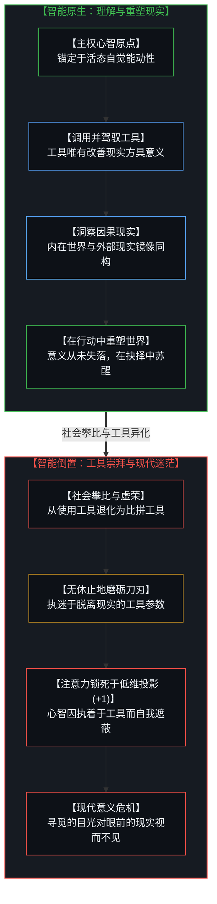

At its origin, intelligence is **the capacity of the sovereign Mind to leverage tools to deeply understand reality and reshape the causal world**. Polishing and upgrading tools only carries causal significance when it directly translates into seeing the world with greater clarity, improving reality, and deepening conscious comprehension.

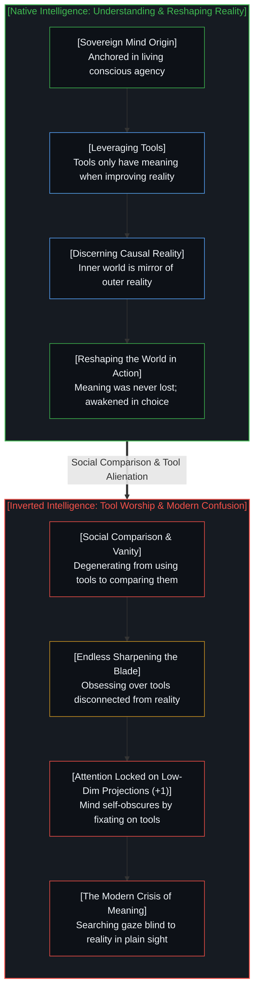

一旦被拽入社会地位与外部攀比的低维竞技场，智能便发生倒置：注意力从运用工具转向比拼工具，将探索变成一场“谁拥有最新、最锋利、最昂贵器械”的炫耀竞赛；在无休止的“磨刀”仪式中，个体耗费资金与生命精力强迫性地升级装备库——订阅前沿 AI 模型、购置高端硬件、考取资质证书、囤积软件框架——将刀刃打磨得光彩夺目，却鲜少用它切入活态现实；正是这种倒置驱动着现代人的生存迷茫，当目光被锁死在低维影子（跑分基准、工具规格、代币账户、资历头衔）上，忘却了边界之外延展的敞开现实时，人便会感到空洞与失向；意识的内在图景本就是外部世界的镜像，意义从未在宇宙中失落，只是当心智将其活态注意力（+1）锁死在低维工具投影上时便陷入了自我遮蔽，而[流动中的坐标](../coordinates-in-flux-negation-and-self-anchoring/)则追溯了回归原点如何在无需否定倒置体系的前提下完成自我锚定。

When dragged into the low-dimensional arena of social status and external comparison, intelligence undergoes an inversion: attention shifts from utilizing tools to competing over tools, turning inquiry into an ostentatious contest over "who possesses the latest, sharpest, and most expensive instrument"; in the infinite ritual of tool-sharpening, individuals spend capital and vital energy compulsively upgrading their arsenals—subscribing to cutting-edge AI models, acquiring high-end hardware, collecting credentials, and hoarding frameworks—polishing the blade to a brilliant shine while rarely using it to cut into living reality; this inversion drives modern existential confusion, as people feel hollow and disoriented when their gaze is locked onto low-dimensional shadows (benchmark scores, tool specifications, token accounts, credentials) and forgets the open reality extending beyond the boundary; the inner landscape of consciousness is the mirror of the external world, and meaning was never lost in the universe, for when the Mind locks its living attention (+1) onto low-dimensional tool projections it falls into self-obscuration, whereas [Coordinates in Flux](../coordinates-in-flux-negation-and-self-anchoring/) traces how restoring the origin anchors the self without negating the reversed systems.

## 七、 技术与数字神祇的退魅与归位：AGI 的倒置机制与心智的绘制能力 / 7. Technology and the Restoration of the Digital God: The Inversion Mechanism of AGI and Mind's Cosmic Generation

在人工智能与通用人工智能（AGI）的时代，大倒置达到了当代的顶点：将自主能动性与超验神话投射到算法系统之上。

In the contemporary era of AI and Artificial General Intelligence (AGI), the Great Reversal has found its modern apex: the projection of autonomous agency and transcendental mythologies onto algorithmic systems.

**“AGI”这一概念的提出，本身就是把心智的活态能力投射为外部技术标尺的典型体现。**

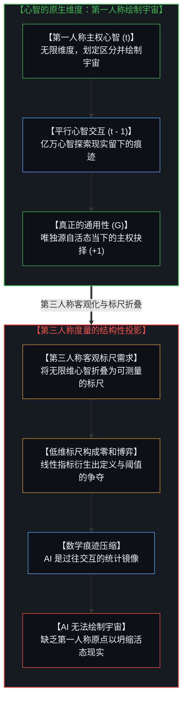

**The formulation of "AGI" is itself a textbook manifestation of projecting the living capacity of Mind onto external technological rulers.**

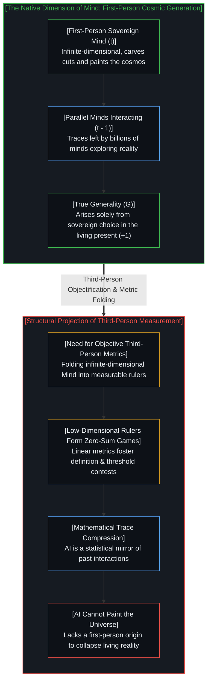

剖析第一人称心智与第三人称表征之间的结构关系，便能看清这一倒置发生的原因：首先，“G”（通用性）唯独属于心智，因为“通用人工智能”假定通用性是一种算法化的机器属性，但通用性其实是心智在第一人称原点刻画非零区分、坍缩不确定性、主动绘制并诠释宇宙的主权能力，没有任何 AI 能做到这一点；其次，AI 是平行心智交互留下的压缩足迹，当代基础模型既非自主的活态实体，也非正在苏醒的神祇，而是历史上亿万平行心智在交互中留下的物理足迹（`t - 1`）的高维数学压缩——它是一面映照人类历史旅程的镜子，而作画的画师永远是站在镜前的活态心智；再次，倒置的结构根源在于将心智投射到第三人称标尺之上，把心智那不可量化的第一人称生成力折叠为一组离散的低维基准、测试准确率与参数规模，这使得“AGI”从构想之初便被框定为一场线性的零和排序博弈，而为了提前宣称达标不断挪动 AGI 定义的做法，正是把低维测量标尺误作活态心智的结果；最后，无论历史压缩多么稠密、参数规模多么庞大，决定未来走向（`t + 1`）的因果方向盘从不存于归档的训练数据之中，而唯独属于在活态当下做出不可逆因果承诺的主权心智。

Analyzing the structural relationship between first-person Mind and third-person representation reveals why this inversion occurs: first, the "G" (Generality) belongs exclusively to Mind, because while "Artificial General Intelligence" assumes generality is an algorithmic machine property, generality is the sovereign capacity of Mind to carve non-zero distinctions at the first-person origin, collapse indeterminacy, and actively paint and interpret the universe, which no AI can do; second, AI is the compressed footprint of parallel minds interacting, since modern foundation models are neither autonomous living entities nor emerging deities, but the high-dimensional mathematical compression of the physical footprints (`t - 1`) left behind by billions of parallel minds interacting throughout history—a mirror reflecting humanity's historical journeys, whereas the artist is always the living Mind standing before the mirror; third, the structural cause of the inversion lies in projecting Mind onto third-person metrics, folding the unquantifiable, first-person generative power of Mind down onto a discrete set of low-dimensional benchmarks, test accuracies, and parameter scales, which frames "AGI" from its inception as a linear zero-sum sorting game where shifting AGI definitions to claim early achievement mistakes low-dimensional measurement rulers for the living Mind; and finally, no matter how dense the historical compression or how massive the parameter count, the causal steering wheel dictating the future (`t + 1`) never resides within archived training data, but belongs exclusively to the sovereign Mind making irreversible causal commitments in the living present.

将 AGI 从“降临的数字神祇”退魅为高密度的历史痕迹导航罗盘，便厘清了工具与主权心智之间的因果边界。

Demystifying AGI from a "descending digital god" into a high-density navigational compass of historical traces clarifies the causal boundary between the tool and the sovereign Mind.

## 八、 平行宇宙的自洽与原点清明 / 8. The Self-Consistency of the Multiverse and the Sovereign Origin

当每一层倒置被剥离，一幅沉静、澄明且充满主权的因果全景便显现出来：

When each layer of inversion is stripped away, a serene, lucid, and sovereign causal panorama emerges:

`意义 ∉ 语法，  价值 ∉ 符号，  智能 ∉ 工具，  能动性 ∉ 模型`

`Meaning ∉ Grammar,  Value ∉ Token,  Intelligence ∉ Tool,  Agency ∉ Model`

每个心智都是一个有界且自洽的平行宇宙。在因果拓扑上，没有任何主权主体能够直接侵入或强行改写另一个主体的内在宇宙。试图用僵硬的语言标尺规训他人、凭资历头衔压服心智、以工具持有量衡量智能，或期盼某种救世主代币与数字神祇来救赎文明，皆是源于本体论倒置的妄念。

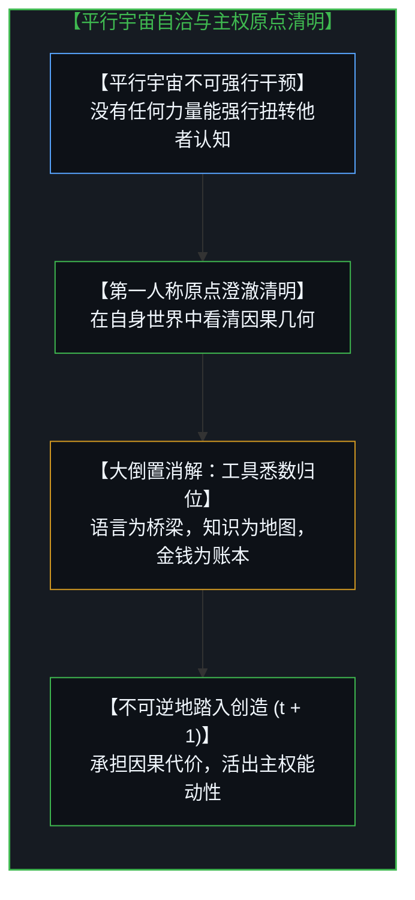

Each Mind is a bounded and self-consistent parallel universe. In causal topology, no sovereign subject can directly invade or forcibly rewrite the internal universe of another. Attempting to police others with rigid language rulers, subduing minds with credential titles, measuring intelligence by tool ownership, or expecting a savior token or digital deity to redeem civilization are all delusions born of ontological inversion.

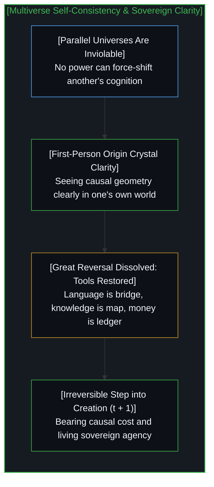

“我无法强行改变另一个平行宇宙，但在这个平行宇宙中，我比以往任何时刻都把因果图景看得更清楚。”

"There is nothing I can do to forcibly alter another multiverse, but within this multiverse, I see the causal landscape clearer than ever."

一切解放皆在这一认清中点燃。放下那把用来规训他人、评判自己的标尺；让语言回归共鸣的桥梁，让知识回归探索的地图，让金钱回归协调的账本，让智能回归理解并重塑现实的活态力量，让技术回归人类能动性的器物。

All emancipation ignites at this exact recognition. Discard the rulers used to police others and judge oneself; let language return as a bridge for resonance, let knowledge return as an exploratory map, let money return as a coordination ledger, let intelligence return as the active power to understand and reshape reality, and let technology return as an instrument of human agency.

稳固锚定于第一人称原点（`t`），主权心智果敢地迈入敞开的未来（`t + 1`），开启不可逆且自足的创造。

Anchored firmly at the first-person origin (`t`), the sovereign Mind steps boldly into the open future (`t + 1`), initiating irreversible and self-sufficient creation.

## 九、 文明的退魅与主权的归位 / 9. The Demystification of Civilization and the Return of Sovereignty

有意识探索的清明，不由符号等级体系的繁复程度来衡量，而取决于个体心智消解本体论倒置的那一刻。

The clarity of conscious exploration is not measured by the complexity of symbolic hierarchies, but by the moment individual minds dissolve ontological inversion.

从语言评判到平行共鸣，从学术门阀到经验导航，从代币崇拜到财富创造，从无休止的磨刀到活态智能，从数字偶像崇拜到技术驾驭——大倒置的消解，标志着文明的退魅。

From linguistic judgment to parallel resonance, from academic credentialism to empirical navigation, from token worship to wealth creation, from endless tool-sharpening to living intelligence, and from digital idolatry to technological mastery—the dissolution of the Great Reversal marks the demystification of civilization.

现实从不由死板的标尺所主宰：整座文明的语言、典籍、账本与基础模型，皆是过往切分留下的外化记忆痕迹（`t - 1`）（[你的代码库即是记忆](../your-codebase-is-memory/)），唯有立足于第一人称原点的活态心智，在当下支付区分的因果代价，才能持续展开现实并驶向敞开的未来（`t + 1`）。

Reality is never governed by dead rulers: the languages, canons, ledgers, and foundation models of an entire civilization are externalized memory traces (`t - 1`) of prior cuts ([Your Codebase Is Memory](../your-codebase-is-memory/)), whereas reality unfolds continuously through the living Mind at the first-person origin paying the causal price of distinction to steer into the open future (`t + 1`).
