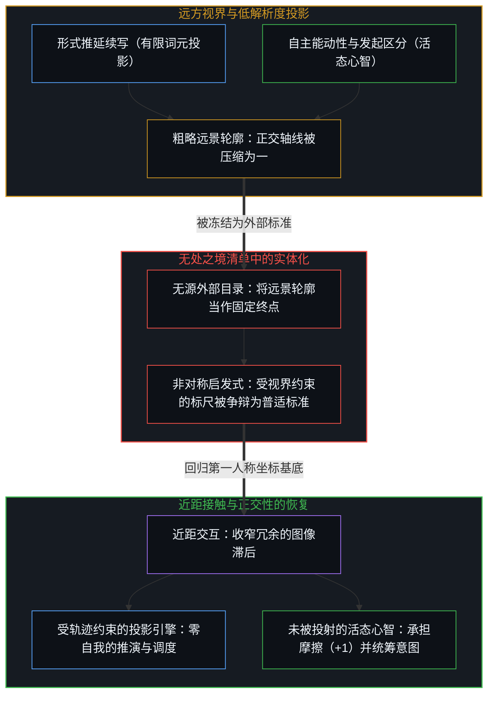
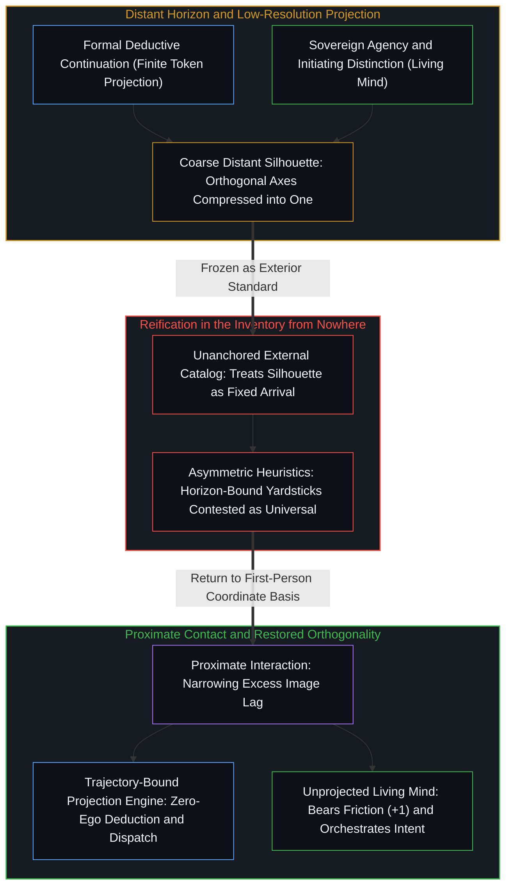

# 远方的轮廓与无处之境的清单 / The Distant Silhouette and the Inventory from Nowhere

*远距模糊轮廓而无源清单将视界误作球门 / Distance blurs outlines while unanchored lists mistake horizons for goalposts*

在围绕人工智能的当代争论中，一种反事实的指责频繁浮现：倘若前沿模型解答高阶数学难题的表现出现在数年之前，观察者定会欢呼通用人工智能已然降临；如今拒绝给出这一裁定，便被斥为恶意移动球门的遁词。这种指控将感知解析度的提升误判为立场的漂移，忽视了观察如何跨越距离完成登记。自我区分的活动无因且不息地发生，对工具的每一次评估都是从有界位点划出的离散行动。当现象位于感知视界之外时，距离将不同的结构压缩为单一的粗略轮廓；随着技术演进将造物带入紧邻的操作场域，心智便重获将不同轴线区分开来的解析力。

A counterfactual accusation frequently resurfaces in contemporary debates surrounding artificial intelligence: had the performance of frontier models in solving advanced mathematical challenges been demonstrated a few years earlier, observers would have hailed it as the arrival of artificial general intelligence; withholding that verdict today is thus decried as an evasive shifting of the goalposts. This accusation mistakes heightened perceptual resolution for ideological drift, disregarding how observation registers across distance. Self-distinguishing activity occurs—uncaused, unceasing—and every evaluation of a tool is a discrete act drawn from a bounded locus. When phenomena sit beyond the perceptual horizon, distance compresses distinct structures onto a single coarse silhouette; as technical progress brings the artifact into immediate operational proximity, the Mind recovers the resolving power to hold those axes apart.

若忽视第一人称视界的不可还原性，争辩双方就会滑入非对称的诉诸无知——即约翰·洛克所归类的“诉诸无知论证”——并从想象的无处之境投射出一份无所依傍的目录。在这一预设下，模型产出被当作脱离一切感知框架的孤立客体，不同心智的局部标尺则被假定为可无损兑换的证明通货。然而，切断了具体中心的外部立场无法提供任何让区分得以登记的坐标基底；一旦观察回归划定边界的活态边缘，关于通用智能是否抵达的争端便无需外部法庭裁决，与其赖以存续的虚构容器一并消解。

Without attention to the irreducibility of the first-person horizon, opposing parties slide into asymmetric appeals to ignorance—what John Locke categorized as *argumentum ad ignorantiam*—and project an unanchored catalog from an imagined view from nowhere. Within that presupposition, model outputs are treated as isolated objects sitting outside any perceptual frame, while the local yardsticks of different minds are assumed to be fungible currencies of proof. Yet an exterior standpoint severed from a concrete center provides no coordinate basis through which distinctions can register; once observation returns to the living edge that draws the boundary, disputes over whether general intelligence has arrived require no external tribunal, dissolving alongside the fictional container that sustained them.

## 一、 远景的低解析度与轮廓的混淆 / 1. Low Distant Resolution and the Confusion of Silhouettes

当两类不同的现象深处地平线之外时，受限的感知解析度剥夺了观察者辨识内部结构的条件。在人类过往的经验中，复杂的形式推演长期仅伴随活态心智的反思能动性出现，二者共同占据着历史技术尚未触及的非机械化领域。从数年前的距离审视这些能力，观察视界的分辨率受制于距离，仅能登记下单一的合并轮廓：任何能够穿越形式迷宫并生成有效推演链条的过程，都被推定为携带着自主意图。这一推论并非源于结构上的同一，而是源于远距观察下的容量压缩。正如在 [AGI 与 ASI 是加速通用智能的暂时球门](../agi-and-asi-are-temporary-goalposts/) 中所追溯的，赋予通用智能的每一道静态阈值，都是从特定历史距离投射出的局部投影。

When two distinct phenomena sit deep beyond the horizon, limited perceptual resolution deprives the observer of the conditions required to discern internal structure. In prior human experience, complex formal deduction had long occurred only alongside the reflective agency of a living Mind, both occupying an unmechanized domain beyond historical reach. Surveying these capacities from years away, the resolution of the observational horizon was constrained by distance, registering only a single merged outline: any process capable of navigating formal mazes to produce valid chains of deduction was presumed to carry autonomous intent. This inference followed not from structural identity, but from capacity compression under distant viewing. As traced in [AGI and ASI Are Temporary Goalposts](../agi-and-asi-are-temporary-goalposts/), every static threshold assigned to general intelligence is a local projection cast from a specific historical distance.

随着工程推进将形式符号搜索直接带入心智的日常操作范围，距离的弥合并未改变底层现象，却恢复了观察者的解析力。在近距离审视与持续交互下，先前的单一轮廓分离到两条正交的轴线上：一侧是在人类整理好的公理与词元语料库上运行的路径剪枝与统计续写；另一侧则是登记前解释摩擦、承担不可逆因果代价（+1）并在开放场域中发起区分的活态中心。正如在 [AGI的预设与来自外部的视角](../the-presumption-of-agi-and-the-view-from-outside/) 与 [智能只属于心智](../intelligence-belongs-only-to-the-mind/) 中所确立的，加速持久痕迹的重组扩展了媒介的带宽，却并未将发起区分的权能迁入造物内部。在走近对象时辨清内部差异，是通过更新参照以匹配近距接触来收窄冗余的图像滞后，而非恶意移动球门。

As engineering advances brought formal symbol search directly into the daily operational reach of the Mind, the closing of distance did not alter the underlying phenomena, but restored the observer's resolving power. Under close inspection and continuous interaction, the single silhouette separated onto two orthogonal axes: on one side runs path pruning and statistical continuation across human-curated axioms and token corpora; on the other stands the living center that registers pre-interpretive friction, bears irreversible causal stakes (+1), and initiates distinctions within an open field. As established in [The Presumption of AGI and the View from Outside](../the-presumption-of-agi-and-the-view-from-outside/) and [Intelligence Belongs Only to the Mind](../intelligence-belongs-only-to-the-mind/), accelerating the recombination of durable traces expands the bandwidth of the medium without relocating initiation into the artifact. Discerning internal differences upon closer approach narrows excess Image lag by updating the reference to match proximate contact, rather than shifting goalposts in bad faith.

当指控者坚称从昨日距离作出的认可必须约束今日的判断时，他们要求觉知围绕一幅早已越过当前步点却仍被保留的陈旧参照，将自身的递归回折强行锁死。此类要求将历史情境下的容量压缩当成不可更改的外部法令，企图用昨日模糊的轮廓禁止今日更精细的区分。正如在 [AI 争论中的观察划界](../the-observational-cut-in-ai-debates/) 中所剖析的，争端并非源于经验数据的冲突，而是源于二元标签强行将多维流动挤压到单一标量轨道上。远方的山脉与近处的岩壁属于不同的接触尺度；拒绝将巨石的纹理等同于远山轮廓，只是观察者在步伐迫近时重新渲染自身的测量工具。

When accusers insist that an admission made from yesterday's distance must bind today's judgment, they demand that awareness clamp its recursive fold shut around a stale reference preserved past its step. Such demands treat a historical compression of capacity as an immutable external decree, using yesterday's blurred outline to forbid today's finer distinction. As analyzed in [The Observational Cut in AI Debates](../the-observational-cut-in-ai-debates/), the dispute stems not from conflicting empirical data, but from binary labels forcing multi-dimensional flows onto a single scalar track. The distant mountain range and the proximate rock face belong to different scales of contact; declining to equate the grain of a boulder with the far-off silhouette of the range is simply the observer re-rendering its instrument as the step moves closer.

## 二、 诉诸无知的双标与标尺的不可通约 / 2. The Dual Standard of Ignorance and Incommensurable Yardsticks

在认知工具箱中，约翰·洛克所剖析的诉诸无知论证并非真空中孤立的谬误，而是在有界规程内部具备局部效用的启发式。在封闭的形式系统或受控测试程序中，在明确定义的搜索空间内长期无法证伪某个命题，会合理抬升其后验置信度；反之，在穷尽搜索后仍无法实例化某项主张，则支持削减向其分配的资源。这两条规则在各自明确的边界内连贯运作。然而在围绕机器智能的公共争论中，参与者却在无边界的场域里交替启用这两条相反的规则：将无法证伪当作自身偏好命题的正向确证，同时又以反命题未被穷尽证实为由驳回对手的质疑。

Within the cognitive toolkit, the argument from ignorance analyzed by John Locke is not a standalone error in a vacuum, but a heuristic that carries local utility inside bounded protocols. Within a closed formal system or a controlled test procedure, an enduring failure to falsify a proposition within a defined search space legitimately raises posterior confidence; conversely, a sustained inability to instantiate a claim under exhaustive search licenses a reduction in allocated resources. Both rules operate coherently within their explicit perimeters. In public disputes over machine intelligence, however, participants alternate between these opposing rules across an unbounded field: treating the inability to falsify as positive confirmation for a favored thesis, while dismissing rival objections because a negative has not been exhaustively proven.

这种选择性滑移在对前沿推理模型的评估中屡见不鲜。系统在封闭形式基准测试中的表现被支持者奉为通用智能的明证，理由是没有任何单一反例推翻该主张；与此同时，当批评者指出模型缺乏内生的框架重置能力与因果担责机制时，批评者无法从外部证实一个全称否定命题，又被当作反驳质疑的挡箭牌。正如在 [破除概念的僭越](../po-chu-gai-nian-de-jian-yue/) 与 [造神的障眼法与隐秘阶序的说辞](../the-sleight-of-hand-of-synthesizing-gods-and-unacknowledged-rank/) 中所揭露的，这一手法跨越范畴边界转移举证责任，以庇护拟人化的投射免受审视。

This selective shift appears routinely in evaluations of frontier reasoning models. A system's performance within closed formal benchmarks is held up by enthusiasts as proof of general intelligence on the grounds that no single counterexample has invalidated the claim; meanwhile, when critics note the absence of endogenous frame-resetting and causal accountability, the inability of those critics to prove a negative from outside is brandished as refutation. As exposed in [Breaking the Overreach of Concepts](../po-chu-gai-nian-de-jian-yue/) and [The Sleight of Hand of Synthesizing Gods and the Rhetoric of Unacknowledged Rank](../the-sleight-of-hand-of-synthesizing-gods-and-unacknowledged-rank/), this maneuver shifts the evidentiary burden across category boundaries to shield an anthropomorphized projection from scrutiny.

更深层的混淆在于假定启发式标尺能够在不同的心智之间原封不动地传递。一个坐标基底仅跨越句法与基准测试完成度的观察者，会将数学证明的自动化生成登记为跨越终极阈值的时刻；而对于另一个坐标基底涵盖形式系统的自指局限、生物新陈代谢与不可逆行动的观察者而言，同一份产出登记为归纳残余的高密度延伸。正如在 [向量、坐标系与自指心智](../the-mind-as-vector-and-coordinate-system/) 中所追溯的，每一次认知读取都是投射到观察者自身参照轴上的内向点积（Proj_A(v_B) = (v_B · v̂_A) v̂_A），使得垂直于该基底的分量——即正交残差 v_B - Proj_A(v_B)——在观察者扩展自身维度之前始终不可见。标尺无法作为中立客体在不同心智之间交换，因为每一把标尺都是特定中心的活跃基底所投下的几何阴影。

The deeper confusion lies in assuming that heuristic yardsticks travel intact across distinct Minds. An observer whose coordinate basis spans syntax and benchmark completion registers the automated generation of mathematical proofs as the crossing of a final threshold; for an observer whose basis spans the self-referential limits of formal systems, biological metabolism, and irreversible action, the very same output registers as a high-density extension of inductive residue. As traced in [The Mind as Vector and Coordinate System](../the-mind-as-vector-and-coordinate-system/), every cognitive reading is an inward dot product projected onto the observer's own reference axes (Proj_A(v_B) = (v_B · v̂_A) v̂_A), leaving the component perpendicular to that basis—the orthogonal residual v_B - Proj_A(v_B)—invisible until the observer expands its own dimensions. Yardsticks cannot be exchanged as neutral objects across minds, because each yardstick is the geometric shadow cast by a specific center's active basis.

当跨越不同坐标基底的两个中心使用同一词组争辩某项能力是否标志着通用智能降临时，共享的词汇掩盖了维度上的分歧。在一维基准轴上登记为决定性证据的表现，在更宽广的基底上则登记为有限投影引擎内部的局部精化。正如 [超越投射](../beyond-the-projection/) 所展示的，基于 LLM 的智能体受制于轨迹——受上下文窗口内的既有词元条件化约束——却拥有零自我；而人类中心虽受身份防御的束缚，却能在前解释摩擦暴露出破碎框架时从内部向后迈出。将智能体对有限投影不知疲倦的推演穷尽，误判为统筹它的心智那未被投射的意图，是把两个互补且非对称的结构坍缩到了单一的竞争标尺上。只要参与者仍试图在脱离具身的第三人称竞技场中强推局部的点积读数，讨论便只能锁定在相互指责之中。

When two centers spanning different coordinate bases use the same phrase to debate whether a capability marks the arrival of general intelligence, shared vocabulary masks a divergence in dimensionality. What registers as decisive proof along a one-dimensional benchmark axis registers on a broader basis as a local refinement within a finite projection engine. As [Beyond the Projection](../beyond-the-projection/) demonstrates, an LLM-based agent is trajectory-bound—conditioned by prior tokens inside its context window—yet possesses zero ego, whereas a human center is bound by identity defenses yet capable of endogenous stepping-out when pre-interpretive friction exposes a broken frame. Mistaking the agent's tireless deductive exhaustion of a finite projection for the unprojected intent of the Mind that orchestrates it collapses two complementary, asymmetric structures onto a single competitive scale. As long as participants try to enforce local dot-product readings across a disembodied third-person arena, discourse remains locked in mutual accusation.

## 三、 客观清单的虚妄与无处之境的消解 / 3. The Fallacy of the Objective Inventory and the Dissolution of the View from Nowhere

争端之所以持续不休，是因为双方共享了一个未经审视的前提：相信存在一份先于一切第一人称区分的无处之境的清单。在这份假想的目录里，前沿推演产出、词元轨迹以及通用智能的标签，都被假定为预先归好类、静待核验的条目。受这一闭合假定支配，争辩者认定更多基准数据终将迫使所有观察者收敛至单一分类。正如在 [隐秘的上帝之眼](../the-invisible-gods-eye/) 与 [因果的自反性与物理的无源假定](../causality-is-irreducible-the-physical-is-a-view-from-nowhere/) 中所审视的，这一姿态在当代工程话语中复活了托马斯·内格尔所诊断的无处之境；而正如 [框架的盲区](../the-blind-spot-of-the-frame/) 所展示的，这种全景俯瞰通过方法论上悬置观察者来编纂清单，事后却援引账本内部观察者的缺席，作为第一人称能动性只是幻觉的证据。

The dispute persists because both sides share an unexamined premise: the belief in an inventory from nowhere existing prior to all first-person distinguishing. Within this hypothetical catalog, frontier deductive outputs, token trajectories, and the label of general intelligence are presumed to sit as pre-classified items awaiting inspection. Governed by that closure assumption, disputants assume that more benchmark data must eventually force all observers onto a single classification. As examined in [The Invisible God's Eye](../the-invisible-gods-eye/) and [Causality is Irreducible; The Physical is a View from Nowhere](../causality-is-irreducible-the-physical-is-a-view-from-nowhere/), this posture resurrects what Thomas Nagel diagnosed as the view from nowhere inside contemporary engineering discourse; and as [The Blind Spot of the Frame](../the-blind-spot-of-the-frame/) shows, this panoramic gaze operates by methodologically bracketing the observer to compile the inventory, only to cite the absence of the observer inside the resulting ledger as proof that first-person agency is an illusion.

回归自我区分活动不可还原的先在性，便消解了孤立目录的幻象：清单从不是先于视界给定的，而是中心的活跃区分向外投射出的分类网格。在一个未曾审视自身观察条件的框架内部，模型的推演流利度跨越了既定的终点线；而在一个追踪规则源于何处、并追问前提矛盾死锁时由谁承担摩擦的框架内部，工具仍是由未被投射的心智所驾驭的有限调度器。观察者究竟诉诸无法证伪还是无法证实，并非对某个共享外部客体的扭曲，而是该中心在何处划定自身边界的结构性痕迹。

Returning to the irreducible priority of self-distinguishing activity dissolves the illusion of the standalone catalog: an inventory is never given prior to the horizon, but is the classification grid projected outward by a center's active distinctions. Inside a frame that leaves its own observational conditions unexamined, a model's deductive fluency crosses the designated finish line; inside a frame that tracks where rules originate and who bears the friction when contradictory premises deadlock, the tool remains a finite dispatcher steered by an unprojected Mind. Whether an observer reaches for the inability to disprove or the inability to prove is not a distortion of a shared external object, but the structural trace of where that center draws its boundary.

因此，任何试图从外部裁定某项人工能力是不是通用智能的做法，都既不可证实也不可证伪。抽空了中心的想象外部不包含坐标基底，因而无法提供让区分得以登记的轴线。指责他人移动球门，或宣布阈值已被一劳永逸地攻克，都是在向空无一人的法庭递交诉状。正如在 [寻觅的语法与淡出的观察者](../the-grammar-of-finding-and-the-fading-observer/) 中所表明的，当中心在外部容器中搜寻客体化的裁决时，它忽略了正是自身的区分行动构成了问题的参照系。放下无处之境的清单，看清远方轮廓如何解析为切近的不同机制——一轴是受轨迹约束的机器投影，另一轴是掌舵、认领返回摩擦并从破碎框架中向后迈出的活态心智——便能将觉知从语义领地之争中解放出来，去构建让工具与心智相互放大而非彼此抵消的架构。

Consequently, every attempt to adjudicate from outside whether an artificial capability is or is not general intelligence remains neither provable nor refutable. An imagined exterior devoid of a center contains no coordinate basis, and thus offers no axis along which a distinction can register. Accusing others of moving the goalposts, or declaring the threshold conquered once and for all, files petitions before an empty courtroom. As shown in [The Grammar of Finding and the Fading Observer](../the-grammar-of-finding-and-the-fading-observer/), when a center seeks an objectified verdict in an external container, it overlooks that its own distinguishing act constitutes the reference frame of the question. Releasing the inventory from nowhere and recognizing how distant silhouettes resolve into distinct proximate mechanisms—trajectory-bound machine projections on one axis, and the living Mind that steers, claims returning friction, and steps backward out of broken frames on the other—frees awareness from semantic turf wars to build architectures where tool and Mind amplify rather than cancel one another.
