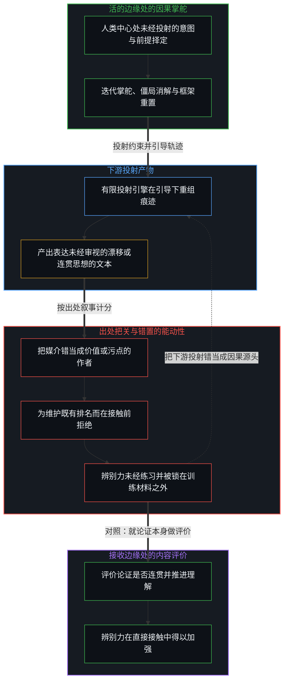
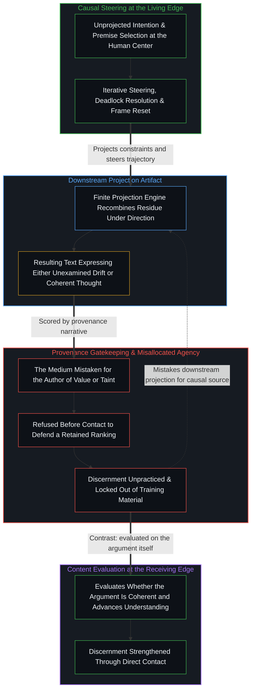

# 对“AI 糟粕”的反感是反复出现的模式 / The Distaste for “AI Slop” Is a Recurring Pattern

*注意力从内容是否推进理解，滑向了对出处的追究 / Attention drifts from whether content advances understanding to provenance*

如今把 AI 辅助的写作斥为“糟粕”，是一个老模式最新的表现：过程与身份被当作真实性来计分，工具被当作价值或污染的作者。同一种安放，也出现在接受模型产出的一切的人身上，出现在一边把污点安放在别人的使用上、一边依赖同一类工具的人身上。对内容的辨别没有被运用；拒绝“AI 辅助”材料的过滤器，于是把自己锁在了本可训练它的写作之外。手工对机器、马对汽车、手动挡对自动挡、燃油对电动，每一次都按产品与一个偏爱的生产叙事是否吻合来计分。能动仍在人身上。工具仍是工具。评价仍落在内容上。

The current rejection of AI-assisted writing as “slop” is the latest expression of an old pattern where process and identity are scored as authenticity and the instrument is treated as the author of value or of contamination. The same allocation appears in those who accept whatever the model produces, and in those who locate taint in others’ use while depending on the same class of tools. Discrimination on content is left unexercised; the filter that refuses “AI-assisted” material then locks itself out of the writing that would train it. Handmade against machine-made, horse against automobile, manual against automatic, and combustion against electric each scored the product by its match to a preferred production narrative. Agency remains with the person. Tools remain instruments. Evaluation remains on the content.

## 一、 否定把作者身份移进了工具 / 1. Dismissal Relocates Authorship into the Instrument

一段文字因为带着所谓的 AI 气味而被否定时，被评价的并不是想法的质量。因果的权能被分配给了工具。AI 被当作价值或污染真正的作者，而那个引导、编辑、选择并为这份作品负责的人，从叙述里退了出去。同一种分配，也出现在交出自己的判断、接受模型产出的一切的人身上。两种情形里，能动的所在都放错了。工具被给予首要的地位；人被降为次要的因素。[验证中因果权能的分配](../the-allocation-of-causal-power-in-validation/)追踪的是哪一边被当作供给下一步的一方。这里的安放发生在接收的一侧：出处被当作写作的作者。[因果停留在掌舵的边缘](../causality-stays-at-the-edge-that-steers/)是同一份归还装扮成发现的样子：模型重组痕迹；发起区分，仍是使用者自己的行动。

When text is dismissed because it carries the supposed scent of AI, the quality of the ideas is not what is being evaluated. Causal power is allocated to the tool. The AI is treated as the true author of value or of contamination, while the person who directed, edited, selected, and stands behind the work recedes from the account. The same allocation appears in those who surrender their own judgment and accept whatever the model produces. In both cases the locus of agency is misplaced. The tool is given primary status; the person is reduced to a secondary factor. [The Allocation of Causal Power in Validation](../the-allocation-of-causal-power-in-validation/) tracks which side is treated as supplying the next step. Here the placement is on the side of reception, where provenance is treated as the author of the writing. [Causality Stays at the Edge That Steers](../causality-stays-at-the-edge-that-steers/) is the same return in the costume of discovery, showing that the model recombines residue while initiating distinctions remain the user’s own acts.

正如[超越投射](../beyond-the-projection/)所追溯的，自回归模型是一台受所交付的前提、规则与上下文窗口制约的有限投射引擎，本身既无我执，也没有未经投射的意图。无论写作者是放任初始轨迹不加审视、让表面的通顺包裹住坍缩的前提，还是让草稿经受同行批驳、在每一处僵局退后一步诉诸极限分辨率的感知并修订前提，决定性的差异从来不是硅基媒介内部固有的污点或美德，而是活的心智在边缘处的因果掌舵。归咎于 AI 媒介或对它设卡把关，是把下游的投射产物错当成了活的心智自身对统御的践行或放弃。

As [Beyond the Projection](../beyond-the-projection/) traces, an autoregressive model is a finite projection engine conditioned by the premise, rules, and context window handed to it, possessing zero ego and no unprojected intention of its own. Whether a writer leaves an initial trajectory unexamined so that surface-level plausibility wraps a collapsed premise, or routes drafts through peer critique and steps back at every deadlock to consult limit-resolution sensing and revise the premise, the decisive difference is never an intrinsic taint or virtue inside the silicon medium. It is the living Mind’s causal steering at the edge. Blaming or gatekeeping the AI medium mistakes a downstream projection artifact for the living Mind’s own exercise—or abdication—of orchestration.

一位科学传播者说，宁可读糟糕的人写的文字，也不读任何带着 AI 气味的东西，这时论证就已经没有被评价了。如果难处在于分辨好的写作与坏的写作，难处并不在模型那里。

A science communicator who would rather read bad human writing than anything that smells of AI has already left the argument unevaluated. If the difficulty is telling good writing from bad, the difficulty is not located in the model.

## 二、 排名反过来削弱排名者 / 2. The Ranking Undercuts the Ranker

这个错置常以排名的方式上演。批评者把决定性的权力，或决定性的污点，定位在别人所用的 AI 里，试图抬高自己偏爱的位置。同一个标准一贯地用下去，会削薄批评者自己的作品，而这些作品很多早已依赖同一类工具，那些工具或是他们参与造出的，或是他们已经习以为常的。指责于是沿着它自己装上的那条轴回到自己身上。[遮蔽进步的框架](../the-frame-that-conceals-improvement/)是同一个双重标准在另一副担子下的样子：成功者被要求达到不可能的标准，评判者自己却被豁免。这里的标准是不借助外力的出身；豁免的，是批评者自己对工具的依赖。

This misallocation is often performed as ranking. By locating the decisive power, or the decisive taint, inside the AI used by others, the critic tries to elevate a preferred position. The same standard, applied consistently, would thin the critic’s own work, much of which already depends on the very class of tools they helped create or now take for granted. The accusation therefore returns along the axis it installed. [The Frame That Conceals Improvement](../the-frame-that-conceals-improvement/) is that double standard under another load, holding the successful to an impossible bar while leaving the judge exempt. Here the bar is unaided origin, and the exemption is the critic’s own dependence on instruments.

当拒绝来自直接在 AI 或相近领域工作的人，这份分配最为稠密。隐含的要求是：他们参与造出的这件强大的工具，只能以他们认可的方式使用，而不能以一种可能让某人显得比保留下来的排名所允许的更能干的方式使用。工具的造者于是监管它正当的用途，把广泛的应用当作对等级的威胁，而不是当作造出了有用之物的后果。[自我形象仿佛从无处发声](../self-image-speaks-as-if-from-nowhere/)是这一对装扮成建造者的样子：脚手架在一处被当作工具持有，在另一处又被说成一件从外部到来的独立事件。这里的一对，是造出工具，配上对谁可以使用它的冻结。

The allocation is densest when the rejection comes from people who work directly in AI or closely related fields. The implicit demand is that the powerful tool they helped create be used only in ways they have approved, and not in a way that might make someone look more capable than the retained ranking allows. The creators of the instrument then police its legitimate use, treating wide application as a threat to hierarchy rather than as the consequence of having densified something useful. [Self-Image Speaks as if from Nowhere](../self-image-speaks-as-if-from-nowhere/) is that pair in the costume of the builder, where scaffolding is held as an instrument in one register and then spoken of as an independent event arriving from outside. Here the pair is the construction of the tool coupled with a freeze on who may use it.

## 三、 运用的是出处，不是内容 / 3. Provenance Is Exercised; Content Is Not

对工具的执着显出：以内容为依据的辨别并没有被运用。一个连贯、有洞见、准确的论证，无论硅是否参与了它的形成，都仍然连贯、有洞见、准确。一个混乱或空洞的论证，也仍然混乱或空洞。在确认有没有 AI 之前就拒绝接触，判断就已经外包给了一个粗糙的过滤器。分辨强的思考与弱的思考的能力，从未被运用，于是也从未被加强。[数据是局部的，智能是分配的](../data-is-local-intelligence-is-allocated/)把糟粕看作材料与接收的把握之间的一种关系，而不是存量本身的等级。[限制正在做功](../the-limitation-is-doing-work/)是“AI 生成”这个标签，取代了它声称要服务的那份评价。这里的过滤器就是出处本身，在接触之前就装好了。[安装战争的那个问题](../the-question-that-installs-the-war/)是同一个先验装扮成敌意的样子：强的先验把接触当作燃料；在它们之内计分得再巧，也从不把先验本身放上审判台。

The fixation on the tool shows that discrimination on the basis of content is not being exercised. A coherent, insightful, and accurate argument remains coherent, insightful, and accurate whether or not silicon assisted in its formation. A muddled or empty one remains muddled or empty. When engagement is refused until the presence or absence of AI has been established, judgment has already been outsourced to a coarse filter. The capacity to tell strong thinking from weak is never exercised and therefore never strengthened. [Data Is Local, Intelligence Is Allocated](../data-is-local-intelligence-is-allocated/) takes slop as a relation between material and the hold that receives it, not an intrinsic grade of the stock. [The Limitation Is Doing Work](../the-limitation-is-doing-work/) is the label “AI-generated” displacing the evaluation it claims to serve. Here the filter is provenance itself, installed before contact. [The Question That Installs the War](../the-question-that-installs-the-war/) is that prior in the costume of enmity, where strong priors treat contact as fuel and scoring more skillfully inside them never puts the prior on trial.

一旦有功力的写作者自己也把 AI 当作寻常的辅助工具，就像他们早已在用编辑、研究助手、词典或语法工具那样，这个样式就更清楚了。当人类统御者利用投射引擎穷尽推演轨迹，同时把前提择定与框架重置保留在活的边缘，由此写出的文字便是他们自己思想更精确、组织得更好的表达。到了那时，拒绝读任何“AI 辅助”之物的批评者，就把自己锁在了本可训练其判断的材料之外。声称捍卫辨别力的过滤器，正是阻止辨别力得到练习的那个行动。

The pattern becomes clearer once skilled writers themselves take up AI as an ordinary assisting instrument, the same way they already use editors, research assistants, dictionaries, or grammar tools. When the human orchestrator uses the projection engine to exhaust deductive trajectories while reserving premise selection and frame resets for the living edge, the resulting prose is a more precise and better organized expression of their own thought. At that point the critics who refuse to read anything “AI-assisted” have locked themselves out of the very material that would train their judgment. The filter that claims to defend discernment is the act that keeps discernment from being practiced.

## 四、 产品按生产的叙事计分 / 4. The Product Was Scored by the Production Narrative

这并非大语言模型独有。它与曾经偏爱手工制品而非机器制品、偏爱马而非汽车、偏爱手动挡而非自动挡、偏爱内燃机而非电动机的，是同一种心态。每一次，抵抗都被框定为对真实、手艺或人性的捍卫。它抵抗的是一件改变了成本、速度与能力分布的工具，并伴着一个保住了掌握旧方法者身份的故事。最终的产品被评判时，看的与其说是它达成了什么，不如说是它的生产与一个偏爱的历史叙事吻合得有多紧。[攀登从未离开地面](../climbing-does-not-leave-the-ground/)是这份冻结装扮成审美的样子：旧形式被感到的直接被计为深度，抽象被计为贫乏，两条轴被压到一条真实性的线上。[技术是人类复利的残差](../technology-is-residual-of-human-compounding/)是新旧方法早已共有的连续：此前种种区分留下的痕迹，从来不是从外部进入的第二股力量。

This is not unique to large language models. It is the same mentality that once preferred handmade objects over machine-made ones, the horse over the automobile, the manual transmission over the automatic, and the combustion engine over the electric motor. Each time the resistance was framed as a defense of authenticity, craft, or human essence. It was resistance to a tool that altered costs, speeds, and distributions of capability, accompanied by a story that preserved the identity of those who had mastered the older method. The final product was judged less by what it achieved than by how closely its production matched a preferred historical narrative. [Climbing Does Not Leave the Ground](../climbing-does-not-leave-the-ground/) is that freeze in the costume of aesthetics, where the felt immediacy of older forms is scored as depth, abstraction is scored as sterility, and two axes are forced onto one line of authenticity. [Technology Is Residual of Human Compounding](../technology-is-residual-of-human-compounding/) is the continuum those older and newer methods already share as the residue of earlier distinguishing, never a second force that entered from outside.

## 五、 能动仍在人身上 / 5. Agency Remains with the Person

一贯的另一条路，更简单，也更有要求。能动仍在人身上。工具仍是工具。评价仍定在内容以及它所产生的理解上。这份归还并不消除向外投射能动与收回能动这一对。[生成性的矛盾](../the-generative-contradiction/)是这一对作为无法消解的运动：把评价留在内容上，是活着这份矛盾，而不是了结它。对特定过程的偏好是个人的口味；它们留在形成它们的那个所在。它们一旦被抬升为不容商量的身份或真实性的标记，就冻结了。[偏好聚类与评判语言](../preference-clusters-and-the-language-of-judgment/)是这份抬升装扮成道德的样子：对齐被计为对，不对齐被计为缺陷，那句话不再是走一步的指南针。

The consistent alternative is simpler and more demanding. Agency remains with the person. Tools remain instruments. Evaluation remains fixed on the content and on the understanding it produces. That return does not eliminate the pair of projecting agency outward and reclaiming it. [The Generative Contradiction](../the-generative-contradiction/) is that pair as an irresolvable movement, where keeping evaluation on the content is living the contradiction rather than finishing it. Preferences for particular processes are personal taste; they stay at the locus that formed them. They freeze the moment they are elevated into non-negotiable markers of identity or authenticity. [Preference Clusters and the Language of Judgment](../preference-clusters-and-the-language-of-judgment/) is that elevation in the costume of morality, where alignment is scored as right, non-alignment as defect, and the statement ceases to function as a one-step compass.

对宇宙真相的追寻，不要求手段的纯洁。它要求对目的的清明。

The pursuit of truth about the universe does not require purity of means. It requires clarity about ends.
