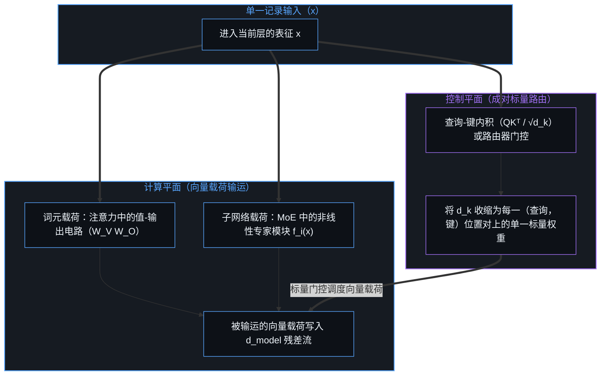
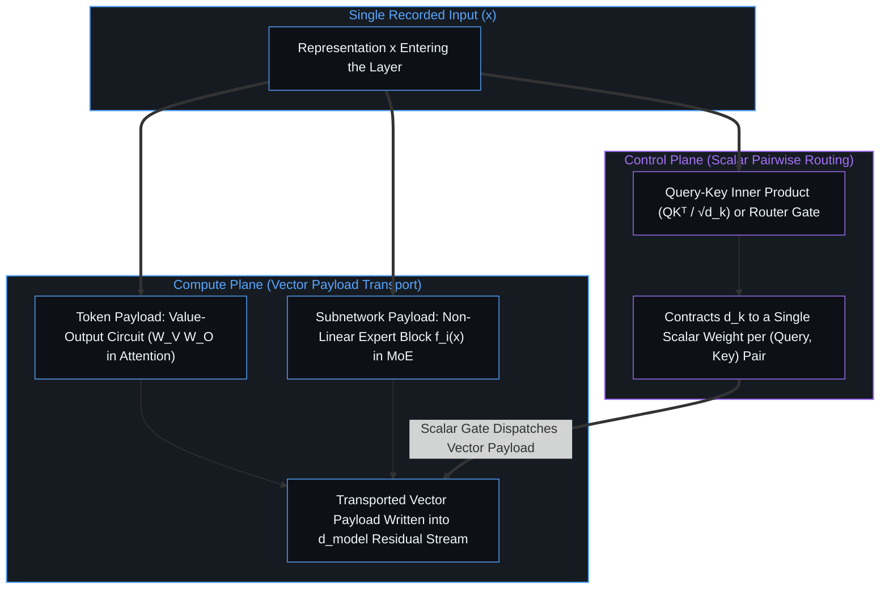
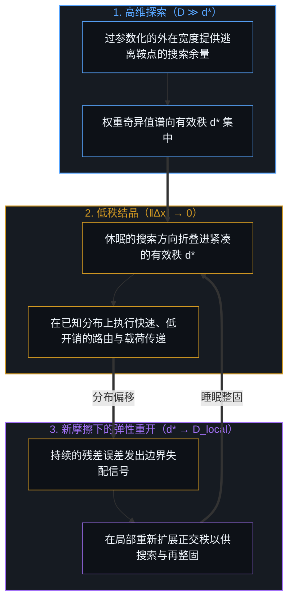
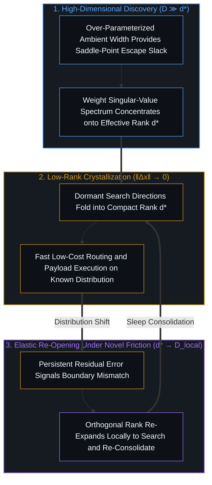
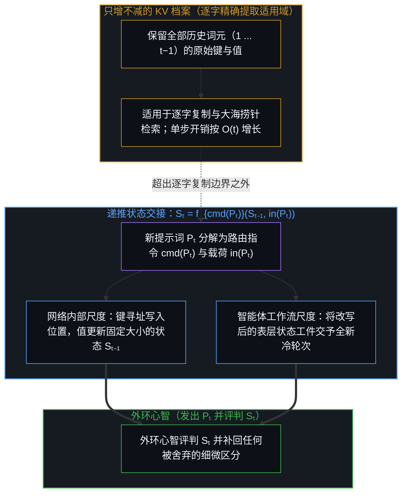
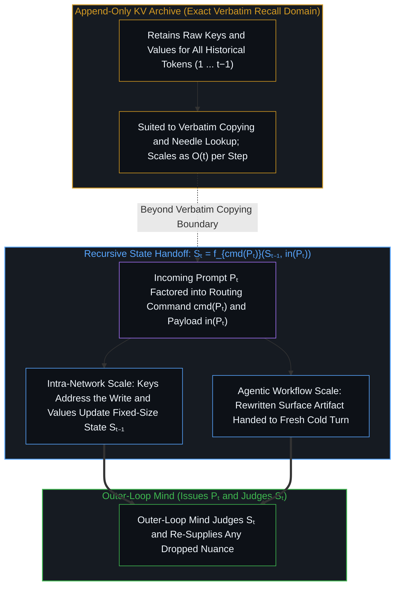

# 指令与载荷的双重切分 / The Dual Cut of Command and Payload

*注意力机制在单次传递内以每对位置一个标量进行路由并输运向量载荷，这一分离标定了键值档案与状态交接各自的边界。 / Within a pass attention routes by one scalar per pair and transports a vector payload, and the split marks where a KV archive holds and where a state handoff takes over.*

自我区分的活动发生着——无因，不息。当心智将一次区分外化为记录下的印迹时，那道印迹从不是单一均质的实体：如[印迹与行动](../the-mark-and-the-act/)与[固定地图与重复的行程](../the-fixed-map-and-the-repeated-trip/)所追溯的那样，每一段提示词或信号都同时携带着有待被操作的当前痕迹（材料）以及指引该操作的选择规则（指令）。这一切分在两个截然不同的尺度上显现：在变换器（Transformer）的单次前向传递内部，每一个词元都同样携带着标量路由（`QKᵀ / √d_k`，将注意力头维度收缩为每一“查询—键”位置对上的单一标量权重）与向量载荷输运（`W_V W_O`）；而在跨轮次的交互中，语境则在任务尺度上分配路由指令 `cmd(Pₜ)` 与载荷材料 `in(Pₜ)` 的角色。追溯这两个尺度，便将词元寻址与混合专家（Mixture-of-Experts）子网络调度统一起来，并标定了“保留原始键值（KV）档案以供逐字精确提取”与“将历史整固为递推状态交接 `Sₜ = f_{cmd(Pₜ)}(Sₜ₋₁, in(Pₜ))`”之间的分界。

Self-distinguishing activity occurs — uncaused, unceasing. When a Mind externalizes a distinction into a recorded mark, that mark is never a single homogeneous substance: as traced in [The Mark and the Act](../the-mark-and-the-act/) and [The Fixed Map and the Repeated Trip](../the-fixed-map-and-the-repeated-trip/), every prompt or signal carries both a present trace to be operated upon (material) and a rule of selection that directs the operation (instruction). That cut shows up at two distinct scales: inside a single forward pass of a Transformer, every token alike carries scalar routing (`QKᵀ / √d_k`, contracting the head dimension into one scalar weight per `(query, key)` pair) alongside vector payload transport (`W_V W_O`), while across turns context assigns the task-level roles of routing command `cmd(Pₜ)` and payload material `in(Pₜ)`. Tracing both scales unifies token addressing with Mixture-of-Experts subnetwork dispatch and locates the boundary between retaining a raw Key-Value archive for verbatim recall and consolidating history into a recursive state handoff `Sₜ = f_{cmd(Pₜ)}(Sₜ₋₁, in(Pₜ))`.

## 一、 标量路由与向量载荷 / 1. Scalar Routing and Vector Payload

在标准多头注意力机制中，单一表征 `x` 被投影至三个子空间：查询（`Q`）、键（`K`）与值（`V`）。尽管标准配置将每个头的键宽度 `d_k` 与值宽度 `d_v` 均设为 `d_model / H`（其他设计也会在任一方向上调整单头宽度），路由与载荷之间的结构非对称性并不依赖于 `d_k` 小于 `d_v`。它建立在电路分解（`QK` 对 `OV`）的两个步骤之上：其一，查询所匹配的是独立于值投影（`W_V`）的键投影（`W_K`）；其二，路由运算 `QKᵀ / √d_k` 将维度 `d_k` 消去，使得任意查询位置与任意键位置之间的握手归结为**每对位置上的单一标量权重**，而 `OV` 电路（`W_V W_O`）则将该标量乘上值投影并跨注意力头求和，在 `d_model` 空间中输运**向量载荷**。由于查询匹配的是独立的键投影，且这一匹配收缩为每对位置一个标量，而所输运的内容依然是向量，寻址一个位置既不需要载荷的具体内容，也不取决于载荷的宽度。

In standard multi-head attention, a single representation `x` is projected into three subspaces: Queries (`Q`), Keys (`K`), and Values (`V`). Although standard configurations set the per-head key width `d_k` and value width `d_v` equal to `d_model / H` (while other designs vary per-head widths in either direction), the structural asymmetry between routing and payload does not depend on `d_k` being smaller than `d_v`. It rests on two steps in the circuit decomposition (`QK` versus `OV`): first, the query matches against a key projection (`W_K`) that is separate from the value projection (`W_V`); second, the routing operation `QKᵀ / √d_k` contracts `d_k` out completely so that the handshake between any query position and any key position resolves to a **single scalar weight per pair**, whereas the `OV` circuit (`W_V W_O`) multiplies that scalar against the value projection and sums across heads to transport a **vector payload** in `d_model`. Because the query matches a separate key projection and that match contracts to one scalar per pair while the transported content remains a vector, addressing a position requires neither the payload's content nor its width.

在这里，单次前向传递的尺度有别于[固定地图与重复的行程](../the-fixed-map-and-the-repeated-trip/)所审视的多步生成回环尺度。跨越自回归训练目标与生成回环，下一词元预测将指令与数据当作扁平的表层词元流，并在重复的行程中绕圈还原功能。然而在单次前向传递内部，`QKᵀ` 标量路由与 `OV` 向量输运的分解执行了一步原生的局部调度——归纳头（induction heads）等上下文学习电路正是利用这一步，在单次传递之内跨词元搭起临时的路由通路。

Here the scale of a single forward pass stays distinct from the scale of the multi-step generation loop examined in [The Fixed Map and the Repeated Trip](../the-fixed-map-and-the-repeated-trip/). Across the autoregressive training objective and generation loop, next-token prediction treats instructions and data as a flat stream of surface tokens and recovers function circularly across repeated trips. Inside a single forward pass, however, the `QKᵀ` scalar routing and `OV` vector transport factoring executes a native local dispatch step—one that in-context learning circuits such as induction heads use to wire temporary routing paths across tokens within the pass.

## 二、 从词元寻址到子网络调度 / 2. From Token Addressing to Subnetwork Dispatch

一旦认出 `QKᵀ` 是在向量载荷 `W_V W_O` 之上执行的标量路由，两个常被分开介绍的架构家族便显露出同一道底层切分。在标准自注意力中，词元的查询与前序上下文词元的键（`k₁, k₂, …, kₜ`）相匹配，所得的标量权重对线性值投影（`W_V W_O`）进行门控。在混合专家（`MoE`）层中，路由器的查询与参数子网络习得的路由键（`k₁, k₂, …, k_E`）相匹配，所得的标量权重将表征调度至非线性多层感知机专家（`fᵢ(x)`）之中——SwitchHead 等将注意力与专家统一起来的设计正是直接利用了这一结构平行性。

Once `QKᵀ` is recognized as scalar routing over vector payloads `W_V W_O`, two architectural families that are usually presented separately reveal the same underlying cut. In standard self-attention, a token's query matches against the keys of prior context tokens (`k₁, k₂, …, kₜ`), and the resulting scalar weights gate linear value projections (`W_V W_O`). In a Mixture-of-Experts (`MoE`) layer, the router's query matches against the learned routing keys of parameter subnetworks (`k₁, k₂, …, k_E`), and the resulting scalar weights dispatch the representation into non-linear MLP experts (`fᵢ(x)`), a structural parallel that unified attention-and-expert designs such as SwitchHead exploit directly.

在这两种情形下，架构都将**控制平面**（计算低带宽标量路由决策的查询、键与路由器门控）与**计算平面**（变换并输运高维载荷的 `OV` 值投影与专家子网络）分离开来。在上下文中寻址一个历史词元，与在权重中调度一个参数模块，是同一种“路由—输运”切分的两个实例。

In both cases, the architecture separates a **Control Plane** (queries, keys, and router gates that compute low-bandwidth scalar routing decisions) from a **Compute Plane** (`OV` value projections and expert subnetworks that transform and transport high-dimensional payloads). Addressing a historical token in context and dispatching a parameter block in weights are two instances of the same routing-and-transport cut.

## 三、 模态与语境中的角色切换 / 3. Modalities and Contextual Role-Switching

既然多模态模型中的每一个词元在机制层面上都被投影为查询、键与值，这一逐词元分解又如何关联于任务层面上“指令”与“材料”的角色？如[固定地图与重复的行程](../the-fixed-map-and-the-repeated-trip/)与[盲目的切分与命名的心智](../the-blind-cut-and-the-naming-mind/)所追溯的，人类语言本就是已命名关系不变量的高度压缩残余，而原始视觉、音频与触觉流则作为稠密的同位局部扰动抵达。当心智在图像前缀之后向多模态模型输入“数一数这张图里有几个苹果”时，语言词元在任务层面上充当指令：它们的**查询（`Q`）**扫过前序视觉图像块的**键（`K`）**，选出匹配区域并将它们的**值（`V`）**提取进回答轨迹之中。

Because every token in a multimodal model is projected into a Query, a Key, and a Value at the mechanism level, how does this per-token factoring relate to the task-level roles of instruction and material? Resting on [The Fixed Map and the Repeated Trip](../the-fixed-map-and-the-repeated-trip/) and [The Blind Cut and the Naming Mind](../the-blind-cut-and-the-naming-mind/), human language is already a highly compressed residue of named relational invariants, whereas raw visual, audio, and tactile streams arrive as dense co-located perturbations. When a Mind prompts a multimodal model with `"count the apples in this image"` after an image prefix, the linguistic tokens act at the task level as the instruction: their **Queries (`Q`)** sweep across the earlier visual patches' **Keys (`K`)** to select the matching regions and extract their **Values (`V`)** into the answer trajectory.

然而，“指令”与“材料”是由周围语境分配的功能角色，而非某种模态固有的属性。在祈使分句位于引用段落之前（“修改以下段落中的语法错误”）的提示词中，在因果掩码之下，前序指令的值（`V`）被读入后续位置的残差流，指令由此进入这些位置；再由这些复合后的残差流形成查询（`Q`），去路由那段引用文字——而那段引用文字尽管由同一种语言词元构成，在任务层面上却充当着被筛选和改写的材料。反过来，在具身感知中，视野里突然逼近的边界或指尖传来的滑动感，则会充当中断性的任务级触发器，重定向整个回环的路由。正因为每个词元在机制尺度上都携带 `Q`、`K` 与 `V`，没有任何词元被预先固化为只作路由器或只作载荷，语境可以随时切换哪些表征指引操作、哪些表征接受操作。

Yet instruction and material are functional roles assigned by the surrounding context rather than fixed properties of a modality. In a prompt where an imperative clause precedes a quoted paragraph (`"fix the grammar in the following paragraph"`), under a causal mask the earlier instruction enters the later positions through its Values read into their residual streams, and those composed residual streams then form the Queries that route over the quoted paragraph—while the quoted paragraph, though made of the same linguistic tokens, serves at the task level as the material being selected and rewritten. Conversely, in embodied perception, a sudden visual looming boundary or a tactile slip at the fingertips acts as an interrupting task-level trigger that redirects routing across the loop. Because every token carries `Q`, `K`, and `V` at the mechanism scale, no token is fixed in advance as only router or only payload, and context can switch which representations direct the operation and which are operated upon.

## 四、 探索、蒸馏与弹性维度 / 4. Discovery, Distillation, and Elastic Dimensionality

单头的设计宽度 `d_k` 与**权重奇异值谱所习得的有效秩（`d*`）**是两个不同的量；网络正是为了找到 `d*` 才以宽维度训练，随后又向 `d*` 集中。当网络从原始数据中学习时，优化依赖于过参数化的外在环境宽度（`D ≫ d*`）：正如自旋玻璃与随机矩阵假设下的分析所提示的，宽阔的维度使低维局部陷阱化作带有逃逸方向的可通行鞍点。随着训练逐渐稳定，权重奇异值谱收缩至一个更低秩的子空间 `d*`——这一与任务相关的*权重谱*集中，有别于*词元激活秩坍缩*：后者指在缺少跳跃连接与值投影时，词元表征随深度丧失多样性。

The per-head design width `d_k` is a different quantity from the **learned effective rank (`d*`) of the weight singular-value spectrum**, and it is `d*` that a network trains wide to find and then concentrates toward. When a network learns from raw data, optimization relies on over-parameterized ambient width (`D ≫ d*`) so that, as analyses under spin-glass and random-matrix assumptions suggest, low-dimensional local traps become navigable saddle points with escape directions. As training settles, the weight singular-value spectrum concentrates onto a lower-rank subspace `d*`—a task-relevant concentration of the *weight spectrum* that stays distinct from *token activation rank collapse*, where token representations lose diversity across depth if skip connections and value projections are absent.

一旦某项技能趋于稳定，[蒸馏、压缩与能动性](../distillation-compression-agency/)便将这些冗余的搜索维度压缩进紧凑的学生网络，然而静态、不可逆的剪枝要付出一项结构代价：倘若环境偏移到被裁剪的子空间之外，学生网络已然失去了重新路由所需的外在维度余量。沿着[模块化反馈回路与动态残差网络](../dynamic-resnet-of-skill-loops/)的结晶与有丝分裂循环，以及[睡眠与深度睡眠的双阶段持续学习](../two-phase-sleep-and-deep-sleep-continual-learning/)的醒睡节律，弹性回环在某条通路上的残差误差趋于消失（`‖Δx‖ → 0`）时，将休眠的权重方向折叠进低秩主干（`d*`）；而在新分布下预测误差持续震荡时，则在局部重新打开正交秩（`d* → D_local`）——其中基于重要性的秩重分配（`AdaLoRA`）、周期性低秩合并重启（`ReLoRA`）与周期性梯度子空间切换（`GaLore`）等低秩训练调度，提供了参数层面的局部实例。

Once a skill has stabilized, [Distillation Chooses What to Lose](../distillation-compression-agency/) compresses those redundant search dimensions into a compact student, yet static irreversible pruning carries a structural cost: if the environment shifts outside the pruned subspace, the student has lost the ambient slack needed to re-route. Grounded in the crystallization-and-mitosis cycle of [Modular Feedback Loops and Dynamic Residual Networks](../dynamic-resnet-of-skill-loops/) and the wake-sleep rhythm of [Two-Phase Sleep and Deep Sleep Continual Learning](../two-phase-sleep-and-deep-sleep-continual-learning/)—with low-rank training schedules such as importance-based rank reallocation (`AdaLoRA`), periodic low-rank merge-and-restart (`ReLoRA`), and periodic gradient-subspace switching (`GaLore`) as partial parameter-level instances—an elastic loop collapses dormant weight directions into a low-rank backbone (`d*`) when residual error along a pathway vanishes (`‖Δx‖ → 0`), and reopens orthogonal rank locally (`d* → D_local`) when prediction error oscillates under a novel distribution.

## 五、 键值缓存、状态整固与活的交接 / 5. KV Caching, State Consolidation, and the Living Handoff

立足于[固定地图与重复的行程](../the-fixed-map-and-the-repeated-trip/)对只增不减的词元日志的剖析，完整键值（`KV`）缓存的适用范围与状态交接接管的边界便清晰浮现。跨每一个历史词元（`1, …, t−1`）保留原始 KV 档案，适用于**逐字精确提取、上下文复制与大海捞针式的检索**——在这些场景中，任何固定大小的状态都会撞上信息论的复制容量上限。KV 缓存的边界出现在这里：超出逐字提取的多轮推理与状态演化仍被当作一条不断膨胀的记录，每一步都要背负并重新检索全部过往（单步开销 `O(t)`，跨序列开销 `O(t²)`），原因只在于架构缺少可原地改写的常驻状态。

Resting on the append-only token-log critique in [The Fixed Map and the Repeated Trip](../the-fixed-map-and-the-repeated-trip/), the boundary between where the full Key-Value (`KV`) cache holds and where state handoff takes over comes into view. Retaining the raw KV archive across every prior token (`1, …, t−1`) is suited to **exact verbatim recall, in-context copying, and needle-in-a-haystack lookup**, where any fixed-size state hits an information-theoretic copying capacity bound. Its boundary appears when multi-turn reasoning and state evolution are treated as an ever-growing transcript that every step carries and searches again (`O(t)` per step, `O(t²)` across a sequence) because the architecture lacks a rewritten resident state.

在逐字记录回放之外，“选择—载荷”切分的两个尺度交汇于递推状态交接 `Sₜ = f_{cmd(Pₜ)}(Sₜ₋₁, in(Pₜ))`。在这一递推中，新到来的提示词 `Pₜ` 被分解为其路由指令与新鲜载荷，用它们将整固后的先在状态 `Sₜ₋₁` 更新为 `Sₜ`，随即释放原始步进记录。这一交接在两个互补而非相互取代的尺度上运作。在网络架构内部，快速权重与增量规则状态模型（`Fast Weight Programmers`、`Gated DeltaNet`、`Mamba-2`、`Test-Time Training`）利用键来寻址写入位置，利用值在单步 `O(1)` 时间内写入固定大小的潜层状态 `Sₜ₋₁`——这之所以可行，正是因为寻址一个槽位无需背负全部历史载荷。而在外环智能体工作流尺度上——如[固定地图与重复的行程](../the-fixed-map-and-the-repeated-trip/)、[模块化反馈回路与动态残差网络](../dynamic-resnet-of-skill-loops/)与[按需语境将融贯保持在一步](../on-demand-contexts-keep-coherence-at-one-step/)所追溯的那样——`Sₜ₋₁` 是交予全新冷上下文的改写后的表层状态工件或工作记忆桥，处于外环的活生生的心智在此发出下一步指令 `Pₜ`、评判所得状态 `Sₜ`，并能随时补回先前整固切口所舍弃的任何细微区分。

Beyond verbatim transcript replay, the two scales of the selection-and-payload cut meet in the recursive state handoff `Sₜ = f_{cmd(Pₜ)}(Sₜ₋₁, in(Pₜ))`. In this recursion, the incoming prompt `Pₜ` is factored into its routing command and its fresh payload to update the consolidated prior state `Sₜ₋₁` into `Sₜ` and release the raw step. This handoff operates at two distinct scales that complement rather than replace each other. Inside the network architecture, fast-weight and delta-rule state models (`Fast Weight Programmers`, `Gated DeltaNet`, `Mamba-2`, `Test-Time Training`) use keys to address the write and values to write into a fixed-size latent state `Sₜ₋₁` in `O(1)` per step—possible because addressing a slot does not require holding the full historical payload. At the outer agentic workflow scale—traced in [The Fixed Map and the Repeated Trip](../the-fixed-map-and-the-repeated-trip/), [Modular Feedback Loops and Dynamic Residual Networks](../dynamic-resnet-of-skill-loops/), and [On-Demand Contexts Keep Coherence at One Step](../on-demand-contexts-keep-coherence-at-one-step/)—`Sₜ₋₁` is the rewritten surface artifact or working-memory bridge handed to a fresh cold context, where the living Mind at the outer loop issues the next command `Pₜ`, judges the resulting state `Sₜ`, and can re-supply any nuance that an earlier consolidation cut dropped.

