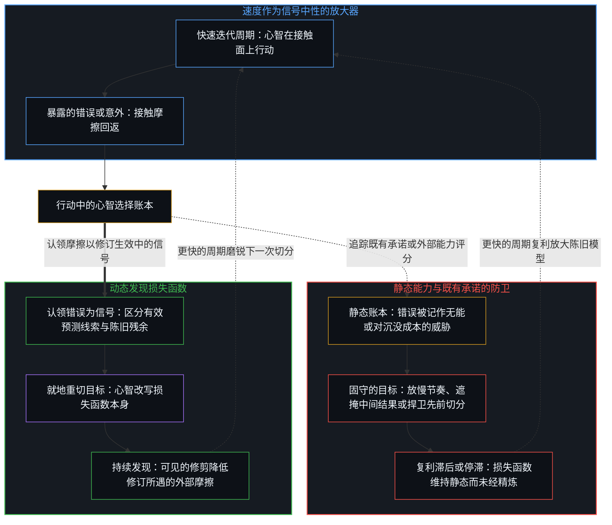
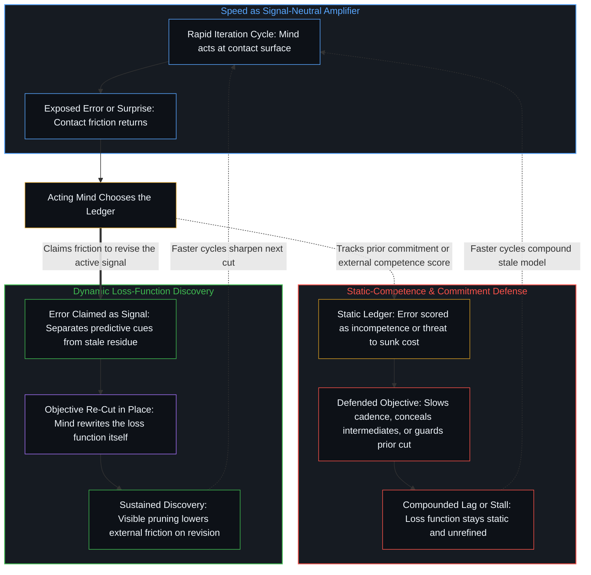

# 动态发现的损失函数与错误的转化 / The Dynamically Discovered Loss Function and the Conversion of Error

*速度只放大生效中的反馈信号，进展取决于错误能否动态改写损失函数本身 / Speed only amplifies the active feedback signal; progress turns on whether error dynamically rewrites the loss function itself*

可见的成功并非源于少犯错误，而是生自把错误持续转化为修订信号的能力。只要运作模型尚不完备，围绕避免错误来组织行动，便会扣留本可修订它的摩擦，直接令进展停滞。若行动者用速度去捍卫既有承诺，单凭跑得更快本身无济于事；而锚定静态能力的外部评判，则会抬高借暴露出来的错误改写目标的代价。循着这一条高更新率的错误转化回路追溯下去，人才、资本与操作空间便落在下游，成为在挫折间得以维系的症候；而让现实保持开放，则同时消解了对完备先验模型的索求，以及闭合世界假定所迫使的语言限定。

Visible success grows out of the sustained capacity to convert mistakes into revised signals rather than out of making fewer mistakes. Wherever an operating model remains incomplete, organizing action around avoiding error directly stalls progress by withholding the friction that would revise it. Running faster settles nothing on its own when an operator uses that speed to defend a retained commitment, and external evaluation anchored in static competence raises the cost of using exposed error to rewrite the objective. Tracing a single high-update-rate loop of error conversion places talent, capital, and operational latitude downstream as symptoms sustained across setbacks, while leaving reality open removes both the demand for a complete prior model and the linguistic hedging that closed-world assumptions force.

## 一、 速度只放大生效中的信号 / 1. Speed Only Amplifies the Active Signal

工程界的争论在节奏问题上分裂成一对熟悉的二元对立：要么快速发布、在众目睽睽下承受可见失误，要么退入漫长沉默的周期、在发布前严守品质。把节奏当作决定性变量，便错置了杠杆——正如[调速者的幻觉与行动的活态摩擦](../the-fallacy-of-pacing-and-the-felt-friction-of-ground-truth/)所追溯的，管控时钟在那里顶替了在接触面上遭遇摩擦。迭代速度本身既非充分条件，也不是诊断指标。运作中的心智追踪哪一道反馈信号，速度就放大哪一道。

Engineering debates split into a familiar binary over cadence: ship rapidly and absorb visible misses in public, or retreat into long silent cycles to protect quality before release. Treating cadence as the decisive variable misplaces the lever, just as [The Fallacy of Pacing and the Felt Friction of Ground Truth](../the-fallacy-of-pacing-and-the-felt-friction-of-ground-truth/) traces where managing the clock stands in for meeting friction at the contact surface. Iteration speed is neither sufficient nor diagnostic by itself. Speed amplifies whichever feedback signal the operating Mind tracks.

当这道信号追踪的是与实际结果的接触——因为心智认领了回返的摩擦，而不是将其记到外部承载者名下，这正是[回返的信号与认领](../the-returning-signal-and-its-claim/)所追溯的转折点——更短的周期就会更早暴露错误，为修订生效中的模型提供更及时的契机。当这道信号追踪的是捍卫既有承诺、公开叙事或沉没成本，同样的速度便会把错误加速复利：每一次快速周转，都带着更大动量强化陈旧前提。在同一本防御性账本下放慢日历节奏，只是把未经修订的承诺拉长到更久的时间段里，并未改变究竟由什么在支配更新。真正的约束不在快慢节奏的选择，而在于错误暴露之后，行动中的心智是否认领它去改写目标本身。

When that signal tracks contact with the actual outcome—because the Mind claims the returning friction rather than entering it under an external carrier, the turning point traced in [The Returning Signal and Its Claim](../the-returning-signal-and-its-claim/)—shorter cycles expose errors sooner and supply more timely opportunities to revise the active model. When the signal tracks the protection of a prior commitment, a public narrative, or a sunk cost, the exact same speed compounds the error: each fast turn reinforces the stale premise with greater momentum. Slowing the calendar under that same defensive ledger stretches the unrevised commitment across a longer interval without altering what governs the update. The binding constraint sits not in the choice of fast or slow cadence, but in whether the acting Mind claims an exposed error to rewrite the objective itself.

## 二、 动态发现的损失函数与外部评判的倒置 / 2. The Dynamically Discovered Loss Function and the Inversion of External Evaluation

运作中的损失函数并非预先给定、悬在工作之外等待一劳永逸找出的“绝对目标”。它是在与场域接触中动态成形、持续重切的暂时参照。机器训练在启动前由设计者给定损失函数；而在鲜活的行动里，目标函数本身就处在可修订之列，正如[人生是一个持续的自我迭代过程](../ren-sheng-shi-yi-ge-chi-xu-de-zi-wo-die-dai-guo-cheng/)所追溯的那样。失败与意外在这里充当更高一层的信息：除了在既定目标下登记一次偏差——即[失败即信息](../failure-as-information/)所追溯的策略更新——它们还分辨出哪些信号真正能预测所关切的结果，哪些只是先前模型留下的陈旧残余。这个回路之所以持续改进，恰恰因为运作中的心智借这些意外去改写目标本身，而不是将其当作噪声丢弃，或记作无能的判决。

The working loss function is no pre-specified absolute target waiting outside the work to be located once and for all. It is a provisional reference dynamically formed and re-cut in contact with the field. Machine training receives its loss function from a designer before the run begins; in living action, the objective function itself belongs among the terms open to revision, as [Life as a Continuous Process of Self-Iteration](../ren-sheng-shi-yi-ge-chi-xu-de-zi-wo-die-dai-guo-cheng/) traces. Failures and surprises operate here as information at that higher level: beyond registering a miss under a fixed target—the policy update traced in [Failure as Information](../failure-as-information/)—they distinguish which signals predict the outcome that matters and which remain stale residues of a prior model. The loop improves because the operating Mind uses those surprises to rewrite the objective itself rather than discarding them as noise or scoring them as verdicts of incompetence.

锚定静态能力的外部评判倒置了这一关系。若观察者以不露失误来衡量本领，暴露出来的错误便会被读作行动者不知自己在做什么的证据。这种评断为周遭的报偿场域定型，抬高了让错误保持可见并借以改写目标的声誉与组织代价。当这道代价高企，在外部账本上为自身地位计分的行动者，便会选择放慢迭代、遮掩中间结果，或捍卫既有目标——把一道敞开的工作切分变成严加守卫的外观，这正是[关闭选择权的代价](../the-price-of-closing-optionality/)所追溯的那种撤离接触。当这道代价保持在低位——因为同一行动者已反复显明，只要新摩擦证伪既有做法便果断抛弃，于是观察者把可见的修剪读作运作方法而非失手——暴露出来的失败便仍可充当可用信息。动态发现由此得以延续，而不是为了维护先前能力的外观而中途折断。

External evaluation anchored in static competence inverts this relation. An observer who measures skill by the absence of visible misses reads an exposed error as proof that the operator does not know what they are doing. That judgment patterns the surrounding payoff field, raising the reputational and organizational cost of keeping an error visible while using it to rewrite the goal. Where that cost sits high, an operator who scores their own standing on that external ledger chooses to slow iteration, conceal intermediate results, or defend the prior objective—converting an open working cut into a guarded appearance, the same withdrawal from contact traced in [The Price of Closing Optionality](../the-price-of-closing-optionality/). Where that cost stays low—because the same operator has repeatedly demonstrated the willingness to discard whatever new friction falsifies, so observers read visible pruning as the operating method rather than a lapse—exposed failure remains usable information. Dynamic discovery continues instead of breaking off to protect the appearance of prior competence.

## 三、 支撑条件是下游症候，而非独立前提 / 3. Supporting Conditions as Downstream Symptoms, Not Independent Premises

这一机制解释了为何快速迭代能够与可见错误并存，同时持续产出递进的结果。面对反证保持高更新率，既能尽早暴露错误，也能迅速加以修剪；正是同一种可见的纪律，在中间失败之后仍维系着各项支撑条件。这种维系并非某种方法对被动资源施加的机械拉力。反复显明愿意抛弃被证伪的前提，会留下致密而可靠的纠偏痕迹；其他心智——决定在何处建造的工程师、决定把资本投向何方的支持者、决定给予多大操作空间的伙伴与用户——会在可见的挫折间持续选择与这些痕迹对齐。因此，人才、资本与操作空间在这里登记为持续错误转化的下游症候，而不是这套解释成立所需的独立前提，这正循着[拥有更多从不是原因](../having-more-is-never-the-cause/)与[进步叙事中的症候与原因](../symptom-and-cause-in-the-narratives-of-progress/)所追溯的因果次序。

This mechanism accounts for why rapid iteration can coexist with visible errors while still generating progressive results. A high update rate on counter-evidence both exposes errors early and prunes them quickly; the same visible discipline sustains the supporting conditions after intermediate failures. That persistence is no mechanical pull exerted by a method on passive resources. Demonstrated willingness to discard falsified premises leaves dense, reliable traces of course-correction, and other Minds—engineers deciding where to build, backers deciding where to commit capital, partners and users deciding how much operational latitude to extend—continue to elect alignment with those traces across visible setbacks. Talent, capital, and operational latitude therefore register here as downstream symptoms of ongoing error conversion rather than as independent premises required for the explanation to hold, following the causal ordering traced in [Having More Is Never the Cause](../having-more-is-never-the-cause/) and [Symptom and Cause in the Narratives of Progress](../symptom-and-cause-in-the-narratives-of-progress/).

这一因果次序一旦确立，便无需再追加任何临时假设，去解释迭代为何没有在公开失误之后停滞或崩塌。靠事后经验记分去比较不同轨迹，始终纠缠在选择性后见与彼此竞争的叙事里；把这一排序区分开来的，是解释的简约性。仅凭一条生效中的机制——对照决定性反证的高速率修订——便同时解释了错误的快速暴露、快速修剪，以及其他中心的持续对齐。任何拒斥这一核心逻辑、转而把存续归功于超常资本、特殊人才或罕见容错空间的替代解释，都不得不把这些条件在可见错误间依旧存续当作彼此孤立的未解事实，每逢一次恢复便增设一条新前提，由此降低了与所观察模式之间的连贯性。

Once this ordering stands, no extra ad-hoc assumption is needed to explain why iteration neither stalled nor collapsed after public misses. Comparing competing trajectories through retrospective empirical scorekeeping stays entangled in selective hindsight and rival narratives; what separates this ordering is parsimony. One active mechanism—high-rate revision against decisive counter-evidence—simultaneously accounts for rapid error exposure, rapid pruning, and continued alignment from other centers. Any alternative explanation that rejects this core logic and credits survival instead to exceptional capital, special talent, or unusual room to fail must treat the continued persistence of those conditions across visible errors as separate unexplained facts, adding a new premise for each recovery and lowering coherence with the observed pattern.

## 四、 开放性消解完备模型要求与因果限定 / 4. Openness Dissolves Both Complete-Model Demands and Causal Hedging

追溯这一机制，并不以现实已经闭合或一切相关变量均已穷尽列举为前提。有效的损失函数并不等待一个事先握在手里、封闭且详尽写定的模型。只要心智为当前这一步所关切的结果分离出足够具决定性的反馈信号，并对照该信号以高速率更新，它便随之运转。周遭过程可以继续保持部分不透明、仅作局部建模：只要生效中的信号追踪着与结果的活态接触，且回返反证一旦证伪既有承诺，心智便果断将其覆盖，那么在有界的工程子问题里，回路就会向着可行解收窄；而在开放前沿上，复利则在不预设前方已有终极吸引子的情况下持续推进——这正是[不知去向何方的梯度下降](../the-descent-that-doesnt-know-where-its-going/)所追溯的不对称。

Tracing this mechanism requires no premise that reality is closed or that every relevant variable has been exhaustively enumerated. An effective loss function does not wait upon a closed, fully specified model held in advance. It operates once the Mind isolates a feedback signal decisive enough for the outcome that matters at the current step and updates against that signal at high rate. Surrounding processes can remain partially opaque and only partially modeled: within a bounded engineering sub-problem, the loop narrows toward a workable solution, while across an open frontier, compounding continues without presuming a pre-existing final attractor ahead—the asymmetry traced in [The Descent That Doesn't Know Where It's Going](../the-descent-that-doesnt-know-where-its-going/)—so long as the active signal tracks live contact with the outcome and the Mind overrides prior commitments when returning counter-evidence falsifies them.

让现实保持开放，便同时消解了两重相连的闭合，将[开放即一致](../openness-is-consistency/)的几何结构延展进了操作推理之中。其一，它移除了这样一种要求：一种方法必须先交付完备的统一理论，其落地的成果才能算作运作信号足够充分的证据；当每一个模型都被当作暂时的结构而非穷尽的地基来握持，充分与否就登记在更新能否切穿当下这一步的活态摩擦。其二，开放性消除了防御性因果限定的条件反射——诸如“往往”“在一定程度上”或“在大多数情况下”这类限定词。这些限定语之所以出现，是因为一条因果陈述暗中预设了封闭而穷尽的系统，迫使说话者挂上退路条款，以挡开绝对化的解读。一旦场域本身被保持为开放，点出一条决定性机制，便是直陈它在所运行的每一处如何运作：它并不宣称垄断一切背景因素，也无需靠柔化语气去防备一个它从未安装过的闭合。

Holding reality open dissolves two linked closures at once, extending the geometry of [Openness Is Consistency](../openness-is-consistency/) into operational reasoning. First, it removes the demand that a method must deliver a complete unified theory before its realized results count as evidence that the working signal was adequate; when every model is held as provisional structure rather than exhaustive ground, adequacy registers in whether updates cut through live friction at the step underway. Second, openness removes the reflex for defensive causal hedging—qualifiers such as "frequently," "to the extent that," or "in most cases." Those hedges arise when a causal statement silently presupposes a closed, exhaustive system, forcing the speaker to attach escape clauses to ward off an absolute reading. Once the field itself is held open, naming one decisive mechanism states directly how that mechanism operates wherever it runs, claiming no monopoly over every background factor and needing no softening to protect against a closure it never installed.

## 五、 不可见的驱动力与边缘处的转化 / 5. The Non-Obvious Driver and Conversion at the Edge

因此，可见进展背后不可见的驱动力，是从错误中学习的能力，而不是少犯错误的记录。正如[学习中不可观测的驱动力](../the-unobservable-driver-of-learning/)所揭示的，下游的考试分数遮蔽了生成学习的反身回返；一份光洁无瑕的外在记录，也同样遮蔽了磨砺判断的更新回路。当行动者围绕压低可见错误来组织工作，这份努力同时收窄了可供修订损失函数的回返信息，把尚不完备的目标冻结在原地。进展随之放缓，因为心智不再去发现究竟哪一道反馈真正要紧。当心智把暴露出来的错误认领为可用数据、并松开既有承诺，同一错误率便会成为精炼目标的机制。可见的成功顺着这场转化在下游浮现——经由相继步骤复利，拉开[幂律是正态分布的长期后果](../power-law-is-the-long-term-consequence-of-normal-distribution/)所追溯的厚尾分化——而非源于事先避开了错误。偏爱更少的可见失误，护住了能力的外观，却让生效中的信号停留在未经精炼的状态，重演着[把稳定的症状当作稳定的来源](../mistaking-the-symptom-of-stability-for-its-source/)所追溯的同一种倒置：光洁的表面被严加守卫，维系它的修正带宽却日渐稀薄。

The non-obvious driver of visible progress is therefore the capacity to learn from mistakes, not the record of making fewer mistakes. Just as downstream exam scores conceal the reflexive return that generates learning in [The Unobservable Driver of Learning](../the-unobservable-driver-of-learning/), an unblemished outward record conceals the update loop that sharpens judgment. When an operator organizes work to minimize exposed errors, that effort simultaneously shrinks the returning information available to revise the loss function, freezing an incomplete objective in place. Progress slows because the Mind stops discovering which feedback actually matters. When the Mind claims exposed mistakes as usable data and releases prior commitments, the exact same error rate becomes the mechanism that refines the objective. Visible success follows downstream of that conversion—compounding across successive steps into the heavy-tailed separation traced in [Power Law Is the Long-Term Consequence of Normal Distribution](../power-law-is-the-long-term-consequence-of-normal-distribution/)—rather than from avoiding error in advance. Preferring fewer visible mistakes guards the appearance of competence while leaving the active signal unrefined, repeating the reversal traced in [Mistaking the Symptom of Stability for Its Source](../mistaking-the-symptom-of-stability-for-its-source/), where a smooth surface is defended while the corrective bandwidth sustaining it thins out.

更高的初始准确度既未被假定，也并非必要；各项背景条件也始终留在每一个周期所运行的场域之内。错误的快速暴露之所以能与持久的迭代并存，无需为每一次恢复另设特例前提：对生效信号的动态发现，结合面对反证的高更新率，把速度从自我设限的负累转化为持续的优势。在活的边缘，这一步始终直接——认领刚刚浮现的错误，用来改写目标本身，而其余一切保持开放。

Higher initial accuracy is neither assumed nor required, and background conditions remain part of the field in which every cycle runs. Rapid error exposure coexists with durable iteration without needing a separate special-case premise for every recovery: dynamic discovery of the active signal, joined with a high update rate on counter-evidence, turns speed from a self-limiting liability into a sustained advantage. At the living edge, the step stays direct—claiming the error that just surfaced to rewrite the objective itself, while the remainder stays open.
