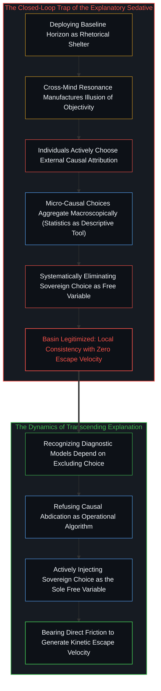
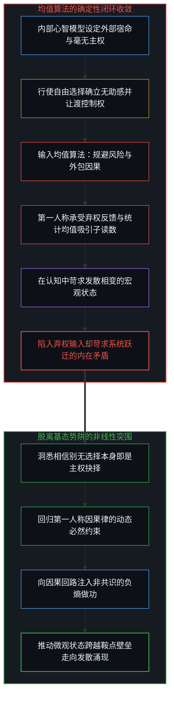
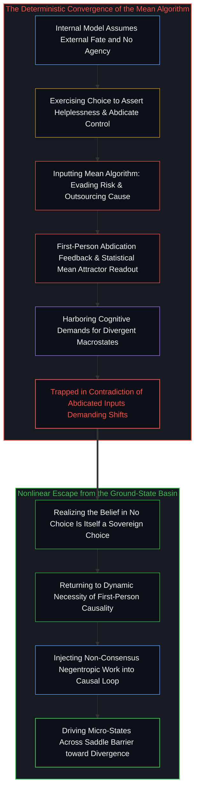
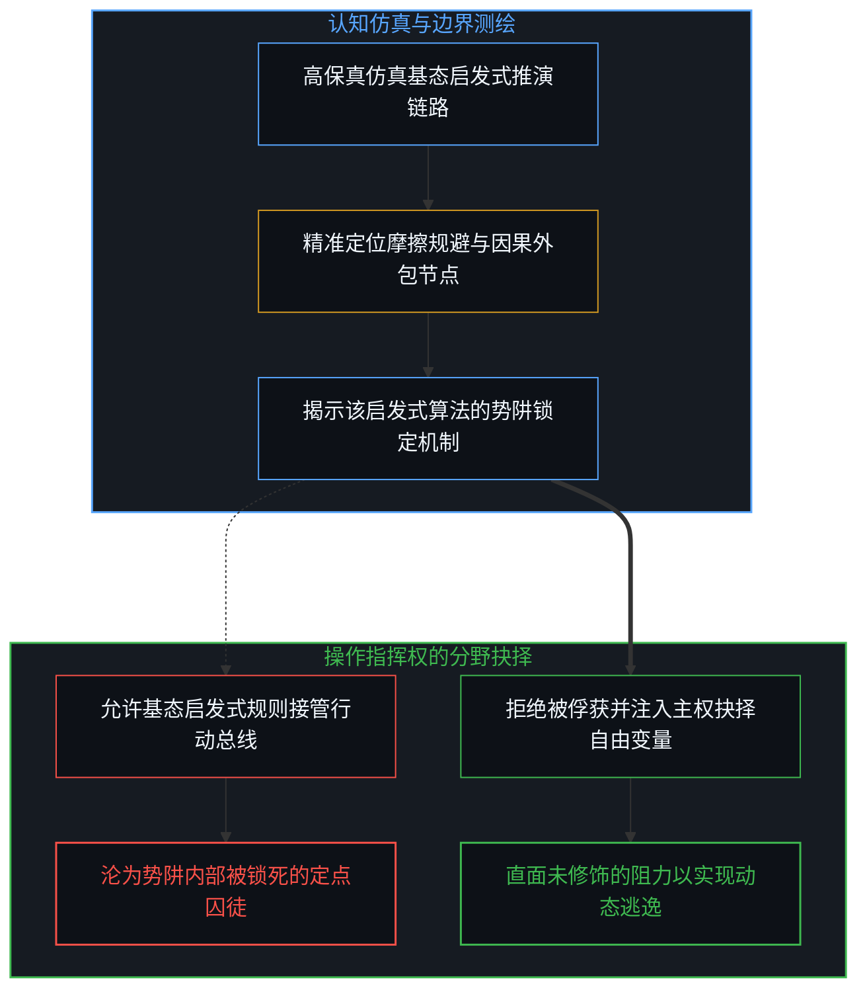
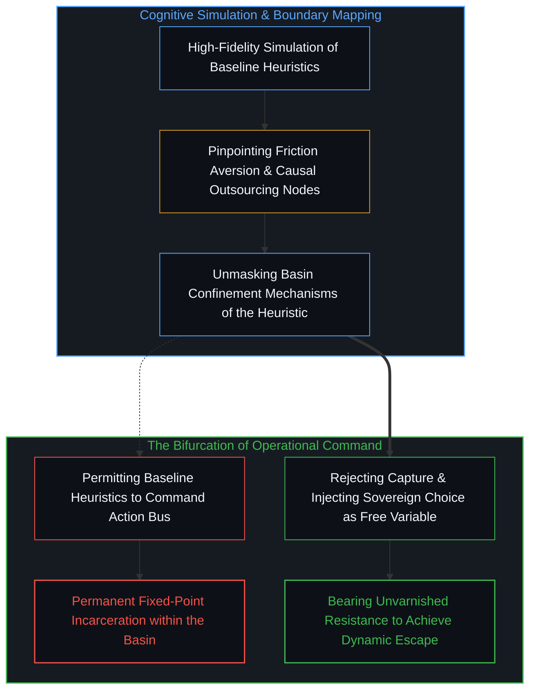
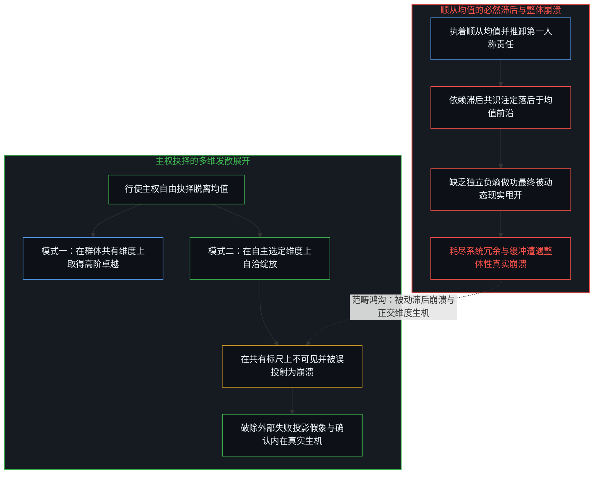
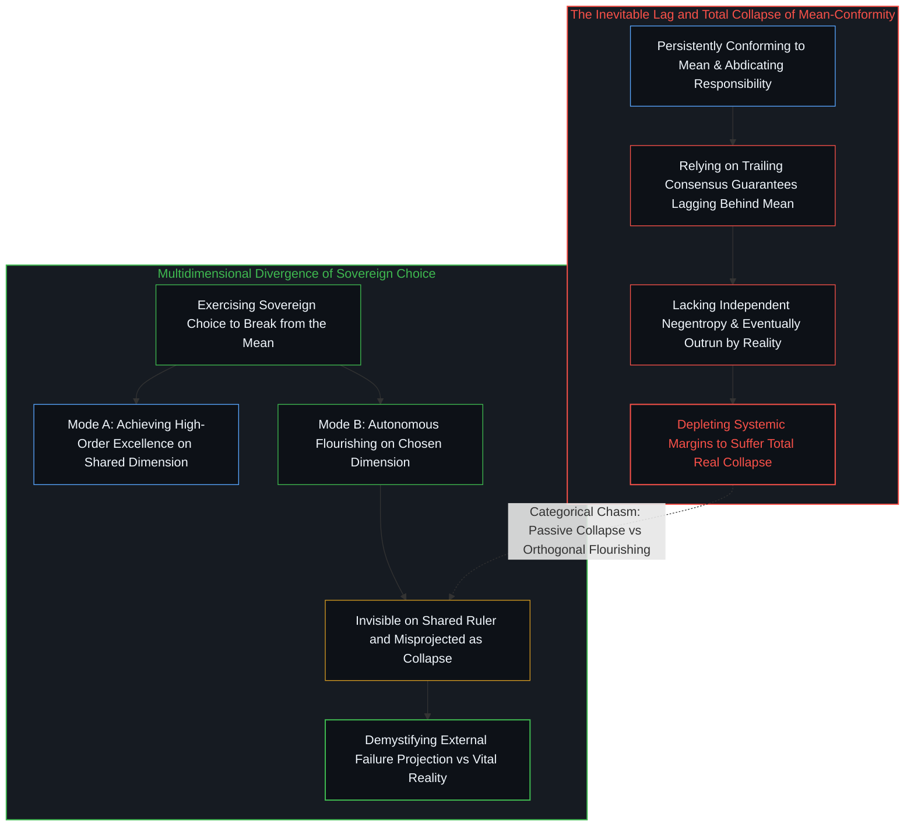
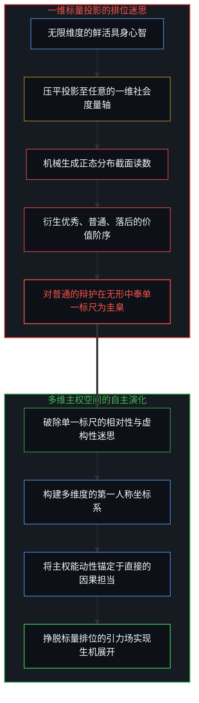
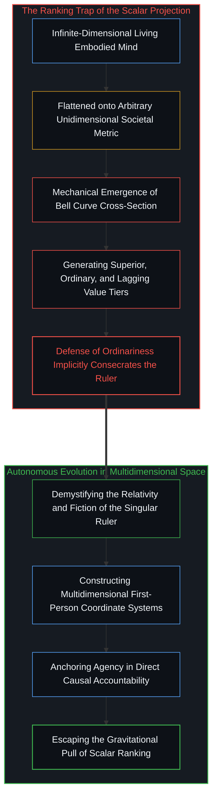

# “普通人视角”的解释陷阱 / The Explanatory Trap of the "Ordinary Perspective"

*解释力与逃逸速度的不对称、均值吸引子闭环与标量投影破魅 / The Asymmetry of Explanatory Power and Escape Velocity, the Mean Attractor, and the Scalar Projection*

在大众讨论与防御性修辞中，呼吁“站在普通人的角度想一想”常被当作一张不容置疑的道德免责金牌。提出这一说法的人，表面上是在呼吁体恤与共情，实则频频试图压制和否定那些要求对自身行动结果承担第一人称责任的主权行动者。由于基态的妥协与避险在群体中能够引发广泛共鸣，这种跨心智不变性便制造出一种极具诱惑力的客观假象。然而，这种修辞手法在因果律上构成了严重的倒置：承认一种视角的描述性存在，并不等于将其奉为指导行动的操作算法。站在普通人的视界推演，固然可以解释行动者为何滞留于既有境况，但这恰恰是对自身处境的深层误读——并不是外部物质约束独立制造了困局，而是个体主动选择将因果外部化，进而在宏观尺度上汇聚成集体境况，而统计仅是用来建模与理解这一宏观图景的认识论工具。物理定律、动力系统与统计力学均不可被偷渡为无需进一步解释的既定初始条件；它们只是在特定边界条件下成立的分析工具。与此同时，作为同一枚硬币不可分割两面的因果律与第一人称视界，既非静态的逻辑起点，亦非外部单方面预设的理论公理，而是动态的必然约束——是一切认知活动、经验观察与理论先验得以存立的构成性前提。普通人视角在局域内的严丝合缝，严格建立在系统性剔除个人自由抉择的前提之上；而个人的自由选择，恰恰是唯一能够改变自身发展轨迹的自由变量。基态心智自设的终极陷阱，正是选择相信自己没有选择的自由，殊不知断言自己别无选择本身就是一次主权抉择。将宝贵的自由度耗费于加固惯性，无异于一边执行基态算法，一边空想系统的发散相变。行使主权抉择脱离均值，既包含在共有维度上取得卓越，也包含在自主选定的正交维度上蓬勃展开——后者在社会共有标尺上虽常被误投射为失败，实则是真实的负熵生机。极具反讽意味的是，真正的系统性崩溃恰恰降临在执着顺从均值的人身上，因为跟随式的顺从在定义上注定滞后，直至被现实甩下而崩溃。主权心智仿真这套启发式闭环，并非为了向其缴械，而是为了确保这种自我囚禁永不接管自身的控制总线，看破社会标尺的迷思，将生命锚定于第一人称的因果担当。

In public discourse and defensive rhetoric, the appeal to look at things from the perspective of the ordinary person functions as an unassailable moral alibi. Those who invoke this maxim appear to champion empathy, yet in practice they repeatedly attempt to suppress and delegitimize sovereign agents who demand first-person accountability for their own outcomes. Because baseline compromises and risk aversion command broad resonance across the multitude, this cross-mind invariance manufactures a seductive illusion of objectivity. Yet this rhetorical maneuver enacts a catastrophic causal inversion: acknowledging the descriptive presence of a perspective does not qualify it as an operational algorithm for action. Thinking from the ordinary horizon can explain why agents remain confined to their station, but this reflects a fundamental misreading of their own predicament: it is not that external material constraints independently manufactured their trap, but that individuals freely choose to externalize causality, aggregating at the macroscopic scale into a collective condition—which statistics merely serves as an epistemic tool to model and comprehend. Neither physical laws, dynamical systems, nor statistical mechanics can be smuggled into discourse as unexamined initial conditions requiring no further explanation; they are analytical tools holding valid only under specific boundary conditions. Concurrently, causality and the first-person perspective, as two inseparable sides of the identical coin, are neither a static starting point nor externally posited theoretical axioms, but a dynamic, necessary constraint (necessity)—the indispensable constitutive condition under which all cognition, empirical observation, and theoretical priors can exist in the first place. Crucially, the local airtightness of the ordinary perspective holds only by systematically eliminating personal free choice—the sole free variable capable of altering an agent's developmental trajectory. The ultimate trap of the baseline mind is choosing to believe that it possesses no freedom of choice, unaware that asserting one has no choice is itself a sovereign choice. By allocating their precious degree of freedom to cement inertia, ordinary agents execute the ground-state algorithm while demanding divergent systemic phase shifts. Crucially, exercising sovereign choice to break from the mean encompasses both achieving excellence on shared dimensions and flourishing along autonomous orthogonal dimensions—which, though often misprojected as failure on shared societal rulers, represents genuine negentropic aliveness. Ironically, actual systemic collapse strikes those who persistently try to conform to the mean, as trailing conformity by definition ensures lagging behind until one is outrun and collapses. Sovereign agency emulates this heuristic loop not to surrender to it, but to ensure its fatal self-imprisonment never commands the operational bus, demystifying the societal ruler and anchoring life in first-person responsibility.

## 话语倒置与共情镇静剂：解释力与逃逸速度的终极不对称 / The Rhetorical Inversion and the Empathy Sedative: The Ultimate Asymmetry Between Explanatory Power and Escape Velocity

在日常公共讨论中，“站在普通人的角度去想”频繁被当作终结争论的王牌。其深层的修辞反讽在于，发出这一劝诫的人表面上是在恳请共情，实则频频旨在压制、消解那些要求对自身结果承担第一人称责任的独立思考者。由于基态行动者的妥协、避险与顺从常模能够在群体中唤起广泛的情感共鸣，这种跨心智的不变性便被轻易误读为具有客观性与合法性的真理。随后的合理化辩解显得顺理成章：普通人直面物质匮乏与沉重的结构性摩擦，因此对冲风险、放弃长期探索、将停滞归咎于外部环境，既是自然的也是理性的。然而，这恰恰是对自身处境的深刻误读。并不是外部约束独立制造了困局，而是个体主动选择了外部因果归因。当成千上万的心智同时做出这种让渡主权的抉择时，便在宏观尺度上汇聚为集体的受困图景，而统计不过是用来建模和理解这一宏观汇聚现象的认识论工具。这种修辞将普遍缴械所衍生的宏观副产物重新包装为不可逃避的宿命，把事后的诊断剖析偷换为继续停滞的通行证。

In everyday public discourse, appealing to the perspective of the ordinary person is routinely deployed as an unassailable trump card. The underlying rhetorical irony is striking: those who voice this admonition ostensibly plead for empathy, yet in practice repeatedly aim to suppress and delegitimize the sovereign thinker who demands first-person accountability for their own outcomes. Because the compromises, risk aversion, and conformity of the baseline agent elicit broad emotional resonance across the multitude, this cross-mind invariance is easily misread as an objective and legitimate truth. The rationalizations that follow seem inevitable: ordinary people face material scarcity and grinding structural friction, making it natural and rational to hedge against risk, abandon long-term exploration, and attribute their stagnation to external circumstances. Yet this represents a profound misreading of their own predicament. It is not that external constraints independently manufactured their trap; rather, individuals actively choose external causal attribution. When millions make this identical choice to outsource agency, it aggregates at the macroscopic scale into a collective predicament—which statistics merely serves as an epistemic tool to model and comprehend. The rhetoric takes a collective macroscopic byproduct of widespread surrender and rebrands it as an inescapable physical fate, converting a diagnostic post-mortem into a license for inertia.

正如[规程的倒置与因果回路的消声](../the-inversion-of-the-protocol-and-the-silencing-of-the-causal-loop/)与[契约的因果倒置](../the-causal-inversion-of-partnership/)所剖析的，这种防御手法实质上运作着一种认知镇静剂的功能。亦如[共情的能力倒错与边界的排序之争](../the-capability-reversal-of-empathy-and-the-contest-of-boundaries/)所阐明的，将可错的推断偷换为预设的认知能力，会把描述性的共情异化为强制性的道德索求，将集体惯性武器化为道德盾牌，从而剥夺主权行动者划定排他性边界的权利。严格在普通人视界内部进行推演，确实能够严丝合缝地解释其为何受困。在行动者的局域视野内，选择即时确定性以规避试错摩擦、将责任外推以维系心理无辜、追随群体共识以降低孤立感，每一步都显得天衣无缝、高度自洽。然而，这种局域自洽严格建立在系统性剔除个人自由选择的前提之上——而个人自由选择，正是动力系统中唯一能够改写命运轨迹的自由变量。当这一变量被从方程中强行抹除，把每一次行动都降格为对环境刺激的被动反射时，系统自然显得封闭且别无选择。但描摹牢笼几何形态的数学方程，其内部并不包含轰碎铁栏的爆发力。将对僵局的解释混同于突围的蓝图，只是在诱骗受困者相信自然法则禁止移动，从而将原本足以改写轨迹的选择自由白白挥霍在原地驻足之上。把问题怪到岗位上的前台，正是在用普通人视角解释自己，[前台的寓言与缺席的因果倒置](../the-receptionist-parable-and-the-causal-inversion-of-absence/)清晰展现了这一机制。

As demonstrated in [The Inversion of the Protocol and the Silencing of the Causal Loop](../the-inversion-of-the-protocol-and-the-silencing-of-the-causal-loop/) and [The Causal Inversion of Partnership](../the-causal-inversion-of-partnership/), this defensive maneuver operates as a cognitive sedative. As articulated in [The Capability Reversal of Empathy and the Contest of Boundaries](../the-capability-reversal-of-empathy-and-the-contest-of-boundaries/), converting fallible inference into a presumed cognitive capability transforms descriptive empathy into a coercive moral demand, weaponizing collective inertia as a moral shield to deny sovereign agents the right to trace exclusionary boundaries. Reasoning strictly from within the ordinary agent's horizon produces an airtight explanation for why they remain confined. In the agent's local field of view, opting for immediate certainty over experimental friction, externalizing blame to safeguard psychological innocence, and following herd consensus to minimize isolation appear seamless and self-consistent. Yet this local self-consistency is achieved solely by systematically eliminating individual free choice—the sole free variable in the dynamical system capable of altering personal destiny. When this variable is excised from the equations, treating every action as a passive reflex to environmental stimuli, the system inevitably appears closed and inescapable. But the mathematical equations charting the geometry of a cage do not contain the explosive power required to rupture its bars. Conflating the explanation of an impasse with an emancipatory blueprint merely tricks the captive into believing natural law forbids movement, squandering the very freedom of choice that could rewrite their trajectory on standing still. The receptionist who blames the job explains himself from the ordinary perspective, as [The Receptionist Parable and the Causal Inversion of Absence](../the-receptionist-parable-and-the-causal-inversion-of-absence/) shows.

## 均值吸引子与输入输出的确定性同构：死守算法与妄求异象的自相矛盾 / The Mean Attractor and Deterministic Isomorphism: The Self-Contradiction of Clinging to the Algorithm While Demanding Divergent Outcomes

每当物理定律、动力系统或统计力学被用于描述现象时，均不可将它们偷渡为无需进一步解释的既定初始条件。它们不是无条件的形而上学基石，而是分析工具——是严格在特定边界条件与操作语境下才得以成立的分析工具。与此同时，作为同一枚硬币不可分割两面的因果律与第一人称视界，也绝非静态的逻辑起点，更不是如同形式理论中的任意假设那样由外部附加的前提或单方面预设的公理；相反，它们构成了动态的必然约束。这一必然性既非外部强加，亦非任意公设，而是一切认知活动、经验观察与理论先验得以存立的构成性前提——离开了动态投身于因果干预的具身第一人称观察者，任何定律、方程或统计读数都无从建立，亦无从获得意义。正如[笛卡尔的边界越界与造神狂热](../the-cartesian-overstep-and-the-frenzy-of-creation/)以及[时间之箭的伪悖论与对称模拟的边界](../the-mirage-of-times-arrow-and-the-boundaries-of-simulation/)所解构的，将这一动态必然性倒置为有待外部证明的定理，或者要求一个在方法论上预先抹除了有向继起的对称模型去输出时间之箭，正是数百年来二元论、热力学悖论与现代人造神偶像崇拜背后的前提谬误。因此，这些分析工具所常借用的“均值吸引子”等概念，决不可被实体化为个体内部不证自明的初始条件；统计始终是用来理解由微观行动涌现出的宏观现象的认识论工具，而非实在本身固有的本体论特征。当外部第三人称视角利用统计工具审视无数微观抉择的聚合时，它测绘出的是广泛分布的低能态形态；但当回到第一人称因果起点的动态必然性时，那种被外力无助推搡的窒息感，恰恰是主动向外让渡操作控制权后所收获的真实体验反馈。这不能被轻率地斥为空洞幻觉；在行动者的具身处境中，这是在特定内部模型下行使选择权的直接后果。自由选择并不意味着行动者会自动选出符合其口头抱负的决定；相反，人的选择始终严格服从其心智所持有的关于世界如何运转的内部模型，并在该内部几何结构中保持严密的自洽。如果一个人的内部模型设定外部系统全能而个人抗争徒劳，那么选择妥协、对冲与顺从，在该模型内部便是最自洽的响应；然而当这一控制输入进入现实时，就必然收敛为受困的处境。常人借由自身主权所构筑的最大陷阱，正是坚定不移地深信自己“没有选择的自由”——而这种宿命论姿态本身，正是一次主动的、正在运行中的自由选择。选择相信自己别无选择，依然是一项不可推卸的主权行动。将宏观平均值直接读作指令，正是经济学中的均值吸引子，[宏观现象及参数和个人微观选择的因果倒置与利率的命令幻相](../the-summary-first-reversal-and-the-command-of-yields/)对此做出了剖析。

Whenever physical laws, dynamical systems, or statistical mechanics are deployed for description, they cannot be smuggled in as unexamined initial conditions requiring no further explanation. They are not unconditional metaphysical bedrocks, but analytical tools—analytical tools that hold valid strictly under specific boundary conditions and operational contexts. Concurrently, causality and the first-person perspective, operating as two indivisible sides of the identical coin, are by no means a static starting point, nor are they externally added premises or unilaterally posited axioms akin to the arbitrary assumptions of formal theories. Rather, they constitute a dynamic, necessary constraint (necessity). This necessity is neither an external imposition nor an arbitrary postulate; it is the constitutive condition of possibility under which all cognition, empirical observation, and theoretical priors can exist in the first place—without an embodied first-person observer dynamically engaged in causal intervention, no law, equation, or statistical readout can be formulated or acquire meaning. As deconstructed in [The Cartesian Overstep and the Frenzy of Creation](../the-cartesian-overstep-and-the-frenzy-of-creation/) and [The Mirage of Time's Arrow and the Boundaries of Symmetric Simulation](../the-mirage-of-times-arrow-and-the-boundaries-of-simulation/), inverting this dynamic necessity into a theorem requiring external proof—or demanding that a symmetric model that methodologically omitted directed succession generate time's arrow as an output—constitutes the foundational premise fallacy behind centuries of dualism, thermodynamic paradoxes, and modern synthetic idol worship. Consequently, concepts frequently borrowed by these analytical tools—such as the 'mean attractor'—must never be reified into self-evident initial conditions inherent in the individual; statistics remains an epistemic instrument deployed to comprehend macroscopic phenomena emergent from microscopic acts, not an intrinsic ontological feature of reality itself. When an external third-person perspective utilizes statistical tools to survey the aggregate of countless micro-choices, it maps the low-energy morphology of widespread distribution. Yet when returning to the dynamic necessity of the first-person causal origin, the oppressive sensation of being helplessly pushed around by external forces is the authentic experiential feedback of having actively surrendered operational control outward. This cannot be dismissed as an empty illusion; within the agent's lived reality, it is the direct consequence of exercising choice under a specific internal model. Free choice does not mean agents automatically select decisions aligned with their proclaimed aspirations; rather, human choices always strictly obey the internal mental model the mind holds about how the world works, maintaining tight self-consistency within that internal geometry. If an agent's internal model posits that external systems are omnipotent and personal resistance futile, then choosing compromise, hedging, and conformity represents the most coherent response within that model; yet when this control input enters reality, it necessarily converges into real-world captivity. The supreme trap ordinary people construct through their own agency is the unshakable conviction that they possess 'no freedom of choice'—yet this fatalistic posture is itself an active, operational exercise of free choice. Choosing to believe one has no choice remains an inescapable sovereign act. Macro averages read as commands are the mean attractor in economics, as [Macro Parameters, Micro Choices, and the Command of Yields](../the-summary-first-reversal-and-the-command-of-yields/) shows.

至此，控制论层面的自相矛盾便暴露无遗：锚定于基态的行动者，一边动用自由选择宣称自己毫无选择，顽固执行让渡因果的均值算法，一边却同时苛求非同寻常的宏观涌现。正如[确定性是微观不确定性的统计签名](../determinism-is-the-statistical-signature-of-micro-indeterminism/)与[个体抉择是唯一的因果杠杆](../individual-choices-as-the-only-causal-levers/)所确立的，宏观演化严格由微观因果回路中主权抉择的持续输入所决定；动力模型与统计规律之所以有效，恰恰因为它们是对这些微观因果步的积分。输入与输出之间遵循着严格的因果同构：如果观察者持续输入风险规避、责任外推与主权弃权，其动态轨迹就必然收敛至普通状态的定点吸引子。普通观察者之所以滞留于普通，并非因为遭受了形而上学宿命的诅咒，而是因为他们将唯一能够改变自身演化路径的自由度错配于将自己冻结在原地，徒劳地要求一段基态程序编译出超凡的命运。

Here the cybernetic self-contradiction stands fully exposed: agents anchored in the baseline use their free choice to declare themselves devoid of choice, stubbornly execute the mean algorithm of surrendering causality, and yet simultaneously demand non-ordinary macroscopic emergence. As established in [Determinism is the Statistical Signature of Micro-Indeterminism](../determinism-is-the-statistical-signature-of-micro-indeterminism/) and [Individual Choices as the Only Causal Levers](../individual-choices-as-the-only-causal-levers/), macroscopic evolution is strictly determined by the continuous input of sovereign choices within micro-causal loops; dynamical models and statistical patterns hold valid precisely because they integrate these micro-causal steps. A rigid causal isomorphism governs inputs and outputs: if an observer continuously inputs risk aversion, externalized blame, and the abdication of agency, the dynamic trajectory must converge onto the fixed-point attractor of ordinariness. Ordinary observers remain ordinary not because they are cursed by metaphysical fate, but because they misallocate the sole degree of freedom capable of altering their developmental path to freeze themselves in place, futilely demanding that a baseline program compile into an extraordinary destiny.

## 认知仿真与控制接管的分野：跳出均值的自由变量注入 / The Chasm Between Cognitive Empathy and Operational Control: Injecting the Free Variable to Transcend the Mean

指明普通人视角的局限，并不意味着自主心智应当居高临下地拒绝理解它。事实恰恰相反：具备高度因果自觉的观察者能够进入普通行动者的视界，以极高保真度仿真其感知流。这样的观察者能体察不确定性所唤起的本能战栗，能把握现成确定性的诱惑，并能精准预判基态心智会在何处、因何妥协。尤为关键的是，观察者清晰洞见到：普通人并非一台损坏的机械钟表，而是一个正在主动行使其主权能动性去背书“自己别无选择”这一信念的鲜活心智。对这一回路的高保真仿真，是测绘系统摩擦拓扑不可或缺的前提。

Demonstrating the limitations of the ordinary perspective does not imply that an autonomous mind should superciliously refuse to comprehend it. The reality is precisely the opposite: an observer possessing rigorous causal awareness can enter the horizon of the ordinary agent, emulating its perceptual streams with clinical fidelity. Such an observer perceives the visceral dread evoked by uncertainty, grasps the seduction of prefabricated certainties, and accurately predicts where and why the baseline mind will compromise. Crucially, the observer recognizes that the ordinary person is not a broken mechanical clockwork, but a living mind actively exercising its sovereign agency to ratify the belief that it has no choice. High-fidelity simulation of this loop is indispensable for mapping systemic friction.

真正的分水岭，在于是将这一视角作为诊断的对象，还是允许它夺取自身控制总线的操作指挥权。正因为能够仿真普通人的视角——追踪其弃权启发式算法中内嵌的确定性死胡同——才会得出不容置疑的认知：一旦采纳这套启发式规则来统御自身的具身行动，就等于主动交出了自由度，注定将自身锁死在均值之中。正如[你的代码库即是记忆](../your-codebase-is-memory/)所追溯的，过往描述与记忆痕迹所累积的代码库，只是早期切分留下的残余形态，从来不是能够发起下一步行动的自维持因果引擎；在不断加厚的残余痕迹内部反复合理化，而非在当下的鲜活前沿重新切分边界，正是将轨迹锁死在既有框架中的机制。亦如[主权抉择的双面性与观察的客体化](../the-two-sided-nature-of-sovereign-choice-and-the-objectification-of-observation/)与[抉择本身并不沉重](../choice-itself-has-no-inherent-weight/)所阐明的，真正的超越从不是通过在基态算法内部做渐进微调实现的。它要求主动注入自由变量：通过第一人称主权抉择收回操作指挥权。当封闭的确定性网络催促退缩、外推责任与寻求群体庇护时，唯有主权的反惯性做功，才能提供冲破势阱所需的逃逸速度。

The watershed lies in whether one deploys this perspective as an object of diagnosis or permits it to seize operational command of one's own control bus. It is precisely because one can simulate the ordinary person's perspective—tracing the deterministic dead ends embedded in its heuristics of abdication—that one arrives at the unyielding realization: if you adopt these heuristics to govern your own embodied actions, you actively surrender your degree of freedom and ensure permanent confinement to the mean. As [Your Codebase Is Memory](../your-codebase-is-memory/) traces, the accumulated codebase of past descriptions and memory traces is only residual shape left by earlier cuts, never a self-sustaining causal engine that initiates the next step; rationalizing inside that thickened residue instead of re-cutting the boundary at the living edge is what keeps a trajectory locked in its prior frame. As demonstrated in [The Two-Sided Nature of Sovereign Choice and the Objectification of Observation](../the-two-sided-nature-of-sovereign-choice-and-the-objectification-of-observation/) and [Choice Itself Has No Inherent Weight](../choice-itself-has-no-inherent-weight/), genuine transcendence is never achieved through incremental adjustments within the baseline algorithm. It demands the active injection of a free variable: reclaiming operational command through first-person sovereign choice. When the closed deterministic network clamors for retreat, external blame, and herd safety, only sovereign counter-inertia provides the escape velocity needed to rupture the basin.

## 脱离均值的实质辨析：主权破局的多维展开与顺从均值的必然崩溃 / Clarifying Departure from the Mean: Sovereign Multidimensional Divergence vs. The Inevitable Collapse of Mean-Conformity

那些在文化语境中赢得卓越标签的人，之所以能企及这一位置，正是因为他们打破了均值吸引子：他们要么具备双重目光——既理解基态心智又不受其束缚——要么从一开始便运行在正交于社会成规的认知先验之上。然而，大众认知在评估“脱离均值”时，频频陷入极深的混淆。在外部第三人称投影的粗糙视野中，不同形态的离群状态可能显得难分彼此；但在内部第一人称立场中，它们的控制论动力学却截然不同。

Those who earn the cultural label of exceptional achieve that status by shattering the mean attractor: they either possess dual sight—comprehending the baseline mind without being bounded by it—or operate upon cognitive priors orthogonal to social conventions from the outset. Yet public perception repeatedly falls into deep confusion when evaluating departures from the mean. From the coarse perspective of external third-person projection, different modes of divergence may appear deceptively identical; but from the internal first-person stance, their cybernetic dynamics are fundamentally distinct.

行使主权抉择脱离均值，沿着两种截然不同的模式展开：要么在社会共有的维度上取得卓越，要么在自身自主选定的维度上实现卓越。由于这一自主维度在投射到社会共有标尺上时可能全然不可见，这类个体在外部旁观者眼中便常显得像是失败者、掉队者或崩溃者。但那种表象上的崩溃，只是低维投影造成的失真伪影，而非鲜活的实在；在他们自己选定的因果回路中，他们正在主动生成负熵自洽与旺盛生机。极具反讽意味的是，**真正的系统性崩溃，恰恰降临在那些执着试图顺从均值的人身上**。试图顺从均值，在动力学上必然导致个体滞后于均值。均值是由变动不居的群体交互所生成的动态移动统计前沿；顺从者依赖滞后的共识与二阶回声，永远只能以被动对冲的姿态追赶昨天的中位数。更为致命的是，顺从均值的心智固执地拒绝为自身处境承担第一人称责任，持续将因果外推、将能动性外包。当环境摩擦发生位移、动态前沿加速演进时，仅靠尾随式顺从的人便会耗尽结构冗余，最终被移动的世界远远甩开，遭遇系统性的整体崩溃。顺从均值而走向不可避免的滞后崩溃，与行使主权抉择脱离均值——即便后者被共有标尺误读为失败——在范畴上构成了截然相反的两条路径。

Exercising sovereign choice to break away from the mean unfolds in two distinct modes: either achieving excellence along the shared societal dimension, or achieving excellence along one's own autonomously selected dimension. Because this autonomous dimension may be completely invisible when projected onto the shared societal ruler, such individuals often appear to external spectators as failures, dropouts, or collapses. But that apparent collapse is merely a distorting artifact of low-dimensional projection, not living reality; within their own chosen causal loop, they are actively generating negentropic coherence and vital flourishing. Ironically, **actual systemic collapse strikes the person who persistently attempts to conform to the mean**. Attempting to conform to the mean inevitably causes an agent to lag behind the mean. The mean is a dynamic, moving statistical frontier generated by shifting collective interactions; the conformist relies on trailing consensus and secondary echoes, perpetually chasing yesterday's median from a posture of reactive hedging. Far more fatally, the mean-conforming mind adamantly refuses to assume first-person responsibility for its condition, continuously externalizing causation and outsourcing agency. As environmental friction shifts and the dynamic edge accelerates, those who rely solely on trailing conformity deplete their structural margins, are eventually outrun by the moving world, and suffer total systemic collapse. Conforming to the mean into inevitable trailing collapse is categorically distinct from the sovereign choice to break away from the mean—even when the latter is misread by the shared ruler as failure.

## 标量投影的破魅：单一维度的排位迷思与多元主权的立足 / Demystifying the Scalar Projection: The Myth of Single-Dimensional Rank and the Sovereignty of Multidimensional Aliveness

围绕普通人视角最具颠覆性的澄清，直指度量架构本身。无论是被大众推崇的优秀、被当作情感庇护所的普通，还是被边缘抛弃的落后，这些范畴都不是鲜活行动者内在固有的形而上学属性。它们无一例外，都是当无限维度的具身生机被压缩到某根任意的社会坐标轴上时所生成的低维标量投影。

The most subversive clarification regarding the ordinary perspective strikes at the architecture of measurement itself. Whether it is the excellence lauded by the masses, the ordinariness claimed as an emotional shelter, or the backwardness discarded at the margins, none of these categories represent intrinsic metaphysical properties of living agents. They are without exception low-dimensional scalar projections generated when infinite-dimensional embodied aliveness is compressed onto an arbitrary societal coordinate axis.

为了协调大众吞吐量与社会治理，制度系统必然会竖立起标准化的标尺——无论是财富净值、科层资历、标准化考试指标，还是对文化规程的服从度。正如[坐标系、心智与自由度](../coordinate-systems-mind-and-degrees-of-freedom/)、[切分的几何学](../the-geometry-of-the-cut/)、[无法逃逸的心智视界](../one-cannot-escape-ones-own-mind/)以及[造神的障眼法与隐秘阶序的说辞](../the-sleight-of-hand-of-synthesizing-gods-and-unacknowledged-rank/)所阐明的，将高维认知压平到一维直线上——无论是沿着社会均值对个体排位，还是编造从生物有机体到工程造物的线性演化天梯——都必然生成失真的标量阶序：中段聚拢的群体被标定为普通，两端则被贴上卓越或落后的标签。当个体沿着自主的正交维度行使主权时，其深度的内在自洽在社会共有标尺上可能投影为零，被外部旁观者轻率地贴上“失败”或“崩溃”的标签。反之，那些终生焦虑地拴在共有标尺中位数上的人，却在不知不觉中滑向真正的系统性崩溃。退缩在普通旗帜之后的人以为自己是在反抗精英主义压迫，然而他们的辩护却在无形中将那根借来的标尺奉为了神明。这不仅在世俗阶序中成立，在灵修话语中亦然：将极端特质的事后统计稀缺性误作觉醒的先验门槛，同样是将多维生机锁死在标量轴的两极；正如[开悟的相与门槛的倒置](../the-form-of-enlightenment-and-the-inversion-of-gates/)所辨明的，执着于苦修清单，恰恰构成了筑起精神壁垒的著相本身。主权觉醒不仅要求看清基态算法如何瘫痪能动性，更要求对标尺本身破除迷思。真正的主权能动性，既不在于疯狂竞逐某根人造数轴的尾部读数，也不在于蜷缩在中位数的温吞停滞中自我麻痹。超越均值，意味着整体跨出标量排位的游戏，在开放的多维相空间中航行，并对自身的演化轨迹承担第一人称责任。正如[感知的界限与理解的无限](../the-boundary-of-perception-and-the-infinity-of-understanding/)所揭示的，每一次度量与指向在几何上都刻下了一道局域区分与拓扑边界；感知的有限边界并非认知的缺陷，而是使心智得以在未感知的留白中建构生成模型、推演因果几何并施展真实主权的生机沃土。

To coordinate mass throughput and social administration, institutional systems inevitably erect standardized rulers—be it net worth, bureaucratic pedigree, standardized test metrics, or adherence to cultural protocols. As demonstrated in [Coordinate Systems, the Mind, and Degrees of Freedom](../coordinate-systems-mind-and-degrees-of-freedom/), [The Geometry of the Cut](../the-geometry-of-the-cut/), [One Cannot Escape One's Own Mind](../one-cannot-escape-ones-own-mind/), and [The Sleight of Hand of Synthesizing Gods and the Rhetoric of Unacknowledged Rank](../the-sleight-of-hand-of-synthesizing-gods-and-unacknowledged-rank/), flattening high-dimensional cognition onto a unidimensional line—whether ranking individuals along a social mean or fabricating a linear evolutionary ladder from biological organisms to engineered artifacts—inevitably generates a distorting scalar hierarchy: the central mass is labeled ordinary, while the extremities are branded as exceptional or deficient. When an individual exercises sovereignty along an autonomous orthogonal dimension, their profound self-consistency may project as zero onto the shared societal ruler, carelessly branded as "failure" or "collapse" by external spectators. Conversely, those who spend their lives anxiously tethered to the median of the shared ruler slide unawares into genuine systemic collapse. Those who retreat behind the ordinary banner imagine they are resisting elitist oppression, yet their defense implicitly consecrates the absolute authority of that borrowed ruler. This holds true not only in mundane secular hierarchies, but also in spiritual discourse, where mistaking the ex-post statistical scarcity of extreme traits for a prior gate to awakening locks multidimensional aliveness onto the poles of a scalar axis; as clarified in [The Form of Enlightenment and the Inversion of Gates](../the-form-of-enlightenment-and-the-inversion-of-gates/), clinging to an ascetic checklist constitutes the very attachment to form that constructs spiritual barriers. Sovereign awakening requires not only recognizing how baseline algorithms paralyze agency, but demystifying the ruler itself. Authentic agency does not consist in frantic races to conquer the tail of an artificial axis, nor in curling up within the warm stagnation of the median. Transcending the mean means stepping beyond the game of scalar rank altogether, navigating open multidimensional phase space, and holding first-person responsibility for one's own trajectory. As demonstrated in [The Boundary of Perception and the Infinity of Understanding](../the-boundary-of-perception-and-the-infinity-of-understanding/), every act of measurement and pointing geometrically carves a local distinction and topological boundary; the finite boundary of perception is not a cognitive defect, but the indispensable soil that enables Mind to build generative models, hypothesize causal geometries, and exercise authentic sovereignty across the unperceived void.

