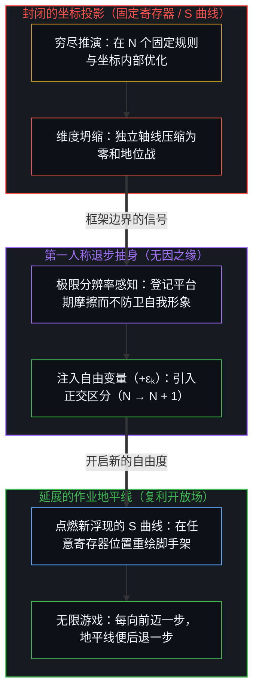
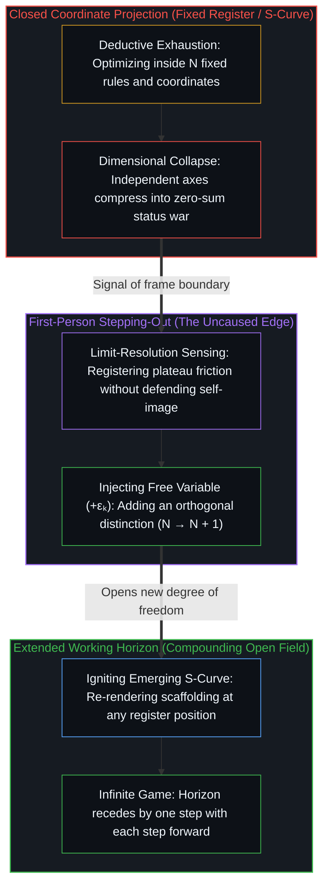

# 可延展的地平线 / The Extendable Horizon

*正和的能动性是在寄存器任何坐标都能敞开的取向 / Positive-sum agency is an orientation open at any coordinate in the register*

从外部去看一个文明的容量，能看到社会的富余怎样供养零和的摩擦；可这幅图容易滋生一个错觉，让人以为非零和的能动性是少数站在寄存器最外缘的开拓者的专利，其余位置只能困在地位之争里。这种框定把一个心智缩成了一个建制坐标。从第一人称原点看，正和的创造不是社会账本上的一个地理位置，而是面对因果的一种取向；地平线从来不是固定的天花板，注入自由变量的能力在系统里每一个坐标上都在场。

Looking at a civilization's capacity from outside shows how social abundance subsidizes zero-sum friction, yet that picture easily breeds an illusion that non-zero-sum agency belongs exclusively to the few pioneers standing at the register's outermost edge while every other position remains trapped in status competition. That framing shrinks a Mind to an institutional coordinate. From the first-person origin, positive-sum creation is not a geographic location on society's balance sheet but an orientation toward causality; the horizon is never a fixed ceiling, and the capacity to inject a free variable remains present at every coordinate in the system.

## 一、 外部视角的陷阱 / 1. The Trap of the Outside View

[寄存器的算术](../the-arithmetic-of-the-register/)勾勒出一个宏观的结构：一位探索者实例化一个新的最高位 bₙ，产生的富余向低位逐级流下，在那里被有界的感知投射成低维的地位竞赛。作为对公共协调的描述，这幅图在它的适用范围内运转良好。

[The Arithmetic of the Register](../the-arithmetic-of-the-register/) sketches a macro structure where an explorer instantiates a new most significant bit bₙ, and the resulting slack cascades down to lower bits where bounded perception projects it into low-dimensional status contests. As a description of public coordination, this picture functions well within its scope.

只从第三人称的宏观视角看它，模型就会留下一个解释上的盲区。它诱人相信，只有在地址空间最外缘工作的少数人才有清明去玩正和游戏，身处 b₃ 到 b₈ 等较低位的人则在数学上注定相互蚕食。它分析了舞台，却略过了台上每个人自己的取向，把活的中心当成由地址决定的棋子，忘了公共账本上的一个坐标对其内部的取向什么也没有说。这正是[寄存器的算术](../the-arithmetic-of-the-register/)所点明的本体膨胀：把为公共协调设计的表征，当成了活着的意识本身。寄存器模型描述的是公共记账的脚手架，不是一个心智的边界。

Seen exclusively from a third-person macro vantage, however, the model leaves an explanatory blind spot. It invites the belief that only the few working at the outermost edge of the address space possess the clarity to play positive-sum games, while those operating in lower bits from b₃ to b₈ are mathematically bound to devour one another. It analyzes the stage while passing over each actor's own orientation, treating living centers as pawns fixed by their address and forgetting that a coordinate in the public ledger says nothing about inner orientation. This is the ontological inflation named in [The Arithmetic of the Register](../the-arithmetic-of-the-register/), where a representation built for public coordination is mistaken for living awareness itself. The register model describes the scaffolding of public accounting, not the boundary of a Mind.

## 二、 任何坐标上的正和 / 2. Positive-Sum at Any Coordinate

在共享界面的某个局部坐标上做事的人——维护软件基础设施，经营一家社区诊所，照看一片农场，或是教一个班级——从不被所在的位置绑定在零和的争斗里。正和的能动性不是层级里的一个索引位置，而是面对现实的一种内部取向。

Someone working at a local coordinate of the shared interface—maintaining software infrastructure, running a neighborhood clinic, tending a farm, or teaching a class—is never bound by position to zero-sum struggle. Positive-sum agency is not an index location in a hierarchy, but an inner orientation toward reality.

带着这种取向，最高位的扩张不被登记为对自身位置的否定，或对相对地位的威胁；新生的富余被当成一份可以借用的启发，一份延展自身作业地平线的邀请。不去争夺既有的行政预算或固定的社会声望池，生成性的问题走到了前面：新解锁的能力怎样用来化解这个领域里悬而未决的摩擦，怎样就在这里精进手艺、提高通量、减少浪费。通俗话语所说的成长型思维，不过是拒绝把当前的地址窗口当成一只守恒的封闭盒子，认清价值来自实际做出的体力与心智工作，而不来自对既有剩余索取权的重新分配。把局部领域当作一片关于质量的开放前沿，任何坐标都可以成为生成的现场，在共享界面之内玩一场无限游戏。

In this orientation, the expansion of the top bit does not register as a denial of one's own position or a threat to relative status; the newly created slack is taken as an inspiration to borrow from and an invitation to extend one's own working horizon. Instead of competing for shares of an existing administrative budget or fixed pool of social prestige, generative questions take the lead: how can newly unlocked capability resolve persistent friction in this domain, and how can craft be refined, throughput raised, and waste cut right here. What popular discourse calls the growth mindset is simply refusing to treat the current address window as a conserved, closed box, recognizing that value arises from physical and mental work actually performed rather than from redistributing claims on existing surplus. Treating a local domain as an open frontier of quality turns any coordinate into a site of generation, playing an infinite game inside the shared interface.

## 三、 反应与注入 / 3. Reacting and Injecting

那么零和之坑是从哪里来的？不是来自所占的坐标，而是来自把现实当成静止的封闭取向。每一次假定现实是固定的、完成的、早被操纵好的，自身的自由度就从内部交了出去。

Where, then, does the zero-sum pit come from? It arises not from the coordinate occupied, but from the closed orientation that treats reality as static. Every time reality is assumed to be fixed, finished, or rigged in advance, one's own degrees of freedom are surrendered from within.

把局部坐标上的规则、分配与边界当成不可动摇的，就终止了原因的生成。[决定论机器](../the-deterministic-machine/)剖析的正是这一机制：当一个中心为了保卫所保留的自我形象而把递归回折死死夹闭时，心智便缩成一台封闭的状态机，对进来的刺激作出机械反应，把自身模型所决定的相变当成外部的命运。[心智的几何学](../the-geometry-of-mind/)追溯了同一重压缩：死守一个僵硬的坐标，是试图从现实加速的反馈回路里退出，用活的能动性去换取一个冻结形象的虚幻安全。

Taking the rules, allocations, and boundaries of a local coordinate as unshakeable halts the generation of causes. [The Deterministic Machine](../the-deterministic-machine/) dissects this exact mechanism: when a center clamps its recursive fold shut to defend a retained self-image, the Mind shrinks into a closed state machine, reacting mechanically to incoming stimuli and mistaking its own model's determined phase shifts for an external fate. [The Geometry of Mind](../the-geometry-of-mind/) traces the same compression: clinging to a rigid coordinate is an attempt to step out of reality's accelerating feedback loop, trading living agency for the illusory safety of a frozen image.

另一条路从未被收回。如[唯一自洽的无因之果](../the-only-coherent-uncaused-effect/)所确立的，注入自由变量不需要建制的许可、巨额的资本或最外缘的地址；在作决定的第一人称刀锋上，任何一刻都可以不让这台机器的先例支配下一步。在预料会敷衍的地方把一件手艺认真做完，在惯于含糊的地方把结构性的实情说清楚，局部的闭环就被打开，新的因果从内向外发起。

The other road is never withdrawn. As [The Only Coherent Uncaused Effect](../the-only-coherent-uncaused-effect/) establishes, injecting a free variable requires no institutional license, vast capital, or outermost address; at the first-person knife-edge of decision, at any moment, the machine's precedent can be kept from dictating the next step. Finishing a piece of craft with care where carelessness was expected, or stating a structural truth clearly where vagueness was the habit, opens the local closed loop and initiates new causality from the inside out.

## 四、 有限游戏与无限游戏 / 4. Finite Games and the Infinite Game

不必等到爬上建制阶梯的顶端，才去更新自己的地平线。在社会的任何一层，都可以把因果链一直追回活的基底。[遗忘的脚手架](../the-scaffolding-we-forget/)指明了缘由：学历证书、官僚把关与企业里的声望阶梯，不是首要的地形，而是在某个历史基线上为协调活动搭起来的临时人造脚手架。它们的用处在于协调不同中心之间的行动；一旦被误认为地形本身，它们就触及了自己的边界。

There is no need to wait until climbing to the top of an institutional ladder before updating one's horizon. At any level of society, the causal chain can be traced all the way to the living ground. [The Scaffolding We Forget](../the-scaffolding-we-forget/) shows why: credentials, bureaucratic gatekeeping, and corporate prestige ladders are not primary terrain, but temporary human-built scaffolds erected to coordinate activity against a historical baseline. Their utility lies in coordinating actions across centers; their boundary is reached the moment they are mistaken for the terrain itself.

詹姆斯·卡斯区分了两种游戏。有限游戏在商定的规则之内为了赢而玩——拿到头衔，占下市场份额，或是击败对手。无限游戏为了让游戏继续下去而玩，不断发现新的自由度，扩展游戏本身的边界。一旦这一区分被登记，共识网格上的有限地位竞赛就卸下了生存论上的沉重分量；即使在低位上履行一份操作性的职责，忠诚也可以落在现实的无限游戏上。地平线不再被职位说明书框住，框住它的只有一步步遭遇并化解的摩擦。

James Carse distinguished between two kinds of play. A finite game is played within agreed rules in order to win—securing a title, capturing market share, or defeating a rival. The infinite game is played in order to keep the play going, discovering new degrees of freedom and extending the boundary of the game itself. Once this distinction registers, the finite status contests of the consensus grid lose their existential weight; even while carrying out an operational role in the lower bits, loyalty can rest with the infinite game of reality. The horizon is no longer framed by a job description; what frames it is only the friction encountered and dissolved, step after step.

## 五、 S 曲线的解剖 / 5. The Anatomy of the S-Curve

个体的取向怎样转化为宏观的形态，在一个极端前提下看得最清楚：假定现实是封闭的。在这个假定下从底部起步的个人或企业，一开始并不觉得停滞；从其局部位置看，起步阶段呈现指数式的攀升。掌握成文的规则，吸收既有的最佳做法，摘下框里低垂的果实，进步来得很快，轨迹看上去像无界的增长。可既然系统被持守为封闭的——市场总量固定、资源有限、边界条件不动——这条指数式的攀升必然撞上框架的承载上限。如[封闭的假设把复利挤成 S 曲线](../closed-assumptions-squeeze-compounding-into-s-curves/)所追溯的，曲线减速，压平成一条逻辑斯蒂 S 曲线。

How individual orientation translates into macro pattern becomes clearest under one extreme premise: that reality is closed. A person or firm starting from the bottom under that assumption does not feel stagnation at first; from its local vantage, the opening phase looks exponential. Mastering codified rules, absorbing established best practices, and picking low-hanging fruit inside the frame brings rapid progress whose trajectory resembles unbounded growth. Yet because the system is held closed—with a fixed total market, finite resources, and unmoving boundary conditions—that exponential climb inevitably hits the frame's carrying capacity. As [Closed Assumptions Squeeze Compounding into S-Curves](../closed-assumptions-squeeze-compounding-into-s-curves/) traces, the curve decelerates and flattens into a logistic S-curve.

这一机制解释了成熟的既定行业为什么呈现出相同的症状。汽车制造、传统航空、商业银行与传统出版，回头去看，都是一种固定现实在建制上的结晶：标准被定死，监管的护城河被挖深，增长被建模成对一块封闭大饼的争夺。一旦行业的 S 曲线饱和，困在框里的竞争便退化成对零碎份额的内耗、行政寻租与品牌诉讼。[闭合的N与开放的现实](../the-closed-n-and-the-open-reality/)标出了确切的结构边界：在 N 个已知选项里择优，地平线依然保持封闭，而自由变量活在尚未穷举的余数里。

This mechanism explains why mature, defined industries exhibit identical symptoms. Car manufacturing, legacy aviation, commercial banking, and traditional publishing appear in retrospect as institutional crystallizations of a fixed reality: standards are set hard, regulatory moats are dug, and growth is modeled as a contest over a closed pie. Once an industry's S-curve saturates, competition confined within the frame degenerates into infighting over fractional shares, administrative rent-seeking, and brand litigation. [The Closed N and the Open Reality](../the-closed-n-and-the-open-reality/) locates the exact structural boundary: choosing the best option among N known alternatives keeps the horizon closed, while the free variable lives in the unenumerated remainder.

可没有哪个领域会永远静止。把自己所在行业的 S 曲线压平误认作现实本身压平了，便生出那些熟悉的哀叹，以为增长已触及物理极限，或是进步的时代已经终结。拉长历史来看，经济从来不是一条单独的逻辑斯蒂曲线，而是一束相互重叠的 S 曲线：一条成熟的曲线还没耗尽，就有某个中心走出既定的定义，实例化一个新的自由度，在邻近的、尚未被渲染的领域点燃一条新曲线的底部。

Yet no domain remains still forever. Mistaking the flattening of one's own industry S-curve for the flattening of reality itself produces the familiar laments that growth has hit its physical limits or that the age of progress is over. Looked at across history, an economy is never a single logistic curve but a bundle of overlapping S-curves: before a mature curve is exhausted, a center steps outside the established definition, instantiates a new degree of freedom, and ignites the bottom of a fresh curve in an adjacent, previously unrendered domain.

这一束重叠的 S 曲线，是两种取向持续交互留下的痕迹。封闭的取向把当前的 S 曲线当成世界的全部，在已知的天花板下优化，收割平台期，最终把富余花在保卫既有坐标的零和地位战上。成长的取向把每一条 S 曲线看作临时的脚手架，不等到触顶进入平台期便更新地平线，把因果追回开阔的场地，从饱和的曲线迈向正在浮现的新曲线，让复利保持敞开。这是两种姿态，而不是两个固化的阶层；同一个心智，在不同的日子里两种都走过。

This bundle of overlapping S-curves is the trace left by two orientations interacting continuously. The closed orientation mistakes the current S-curve for the whole world, optimizes under the known ceiling, harvests the plateau, and eventually spends its slack on zero-sum status wars defending an established coordinate. The growth orientation treats every S-curve as temporary scaffolding, updates its horizon before reaching the plateau, traces causality back to the open field, and steps from the saturated curve onto an emerging one to keep compounding open. These are two postures rather than two permanent classes of people; the same Mind walks both on different days.

## 六、 复利的数学 / 6. The Arithmetic of Compounding

既然注入自由变量的能力是每一个心智的构成性所在，它便是普遍而免费分布的。每天清晨醒来，都有发起选择的可能。在任何单独的一天里，一个中心是注入自由变量还是被动反应，在人群中大致呈正态分布：大多数时刻落在习惯里，一些时刻向能动性倾斜，少数时刻则是大胆的原创发起。

Because the capacity to inject a free variable is constitutive of every Mind, it is distributed universally and without fee. Every morning brings the possibility of originating a choice. On any single day, whether a center injects a free variable or reacts passively is roughly normally distributed across a population: most moments fall into habit, some lean toward agency, and a few initiate bold originations.

可随着时间推移，实现出来的能力不再呈正态，而是分化成陡峭的幂律。[能动性、复利与关于 AI 封建主义的争论](../agency-compounding-and-the-argument-over-ai-feudalism/)追溯了这一分化的数学机制：一次次迭代的选择不是在离散步数上做线性加法，而是连乘，即状态 Sₜ 等于初始基线 S₀ 从第 1 步到第 t 步逐一乘以因子 (1 + εₖ)，其中 εₖ 代表第 k 天注入的正和自由变量。持续行使自由变量——把反常当作信息，延展地平线，拒绝守护静止的自我形象——会让增长率一天天复利累积；而倚靠起点禀赋或初始截距 I₀ 同时玩封闭的零和游戏，轨迹便保持平直。只要时间足够长，增长率终将压倒截距。日常微小决定的正态分布，在与物理摩擦的直接接触中一轮轮复利，便生出能力、见识与负熵生成上的[幂律分布](../power-law-is-the-long-term-consequence-of-normal-distribution/)。

Over time, however, realized capability ceases to look normal and diverges into a steep power law. [Agency, Compounding, and the Argument Over AI Feudalism](../agency-compounding-and-the-argument-over-ai-feudalism/) traces the mathematics of this divergence: iterated choices do not add linearly but multiply across discrete steps, where the state Sₜ equals the initial baseline S₀ multiplied across every step k from 1 to t by the factor (1 + εₖ), with εₖ representing the positive-sum free variable injected on day k. Exercising the free variable steadily—treating anomalies as information, extending the horizon, and refusing to guard a static self-image—compounds the growth rate day after day, whereas relying on a starting endowment or initial intercept I₀ while playing closed zero-sum games keeps the trajectory flat. Given sufficient time, rate overwhelms intercept. A normal distribution of small daily decisions, compounded round after round through direct contact with physical friction, [yields a power-law distribution](../power-law-is-the-long-term-consequence-of-normal-distribution/) of capability, insight, and negative-entropy generation.

这幅数学图景的边界同样要看得分明。[分布是事后从第三人称读出来的沉淀](../mi-lv-shi-jie-guo-de-biao-xiang/)；[个体抉择是唯一的因果杠杆](../individual-choices-as-the-only-causal-levers/)与[自由的测不准](../zi-you-de-ce-bu-zhun/)都阐明，统计只在选择作出之后才登记它们，正态曲线是选择的沉积，不是选择的作者。复利的结果里也不只有能动性，还登记了境遇落在一个中心身上的偶然，运气放过了谁，从来不是谁挣来的。回头看去，把走在前面的人讲成只是一直在注入自由变量的人，便径直落进了[成功学](../cheng-gong-xue/)所剖析的事后幸存者偏差。这一复利结构留给第一人称的，从来不是给他人排定道德座次，而是当下这一抉择不可撤回的分量，它会直接乘进下一步。

The boundary of this mathematical picture must be held with equal precision. [A distribution is sediment read off afterwards](../mi-lv-shi-jie-guo-de-biao-xiang/) from a third-person vantage; both [Individual Choices as the Only Causal Levers](../individual-choices-as-the-only-causal-levers/) and [The Uncertainty of Freedom](../zi-you-de-ce-bu-zhun/) demonstrate that statistics register choices only after they have been made, making the normal curve the sediment of choice rather than its author. Nor do compounded outcomes reflect agency alone; they also register whatever fell upon a center by circumstance, and whom luck spared was never earned. Looking backward and narrating those ahead as simply the ones who kept injecting free variables falls straight into the retrospective survivor bias dissected in [Theories After Success](../cheng-gong-xue/). What this compounding structure leaves for the first person is never a moral ranking of others, but the irrevocable weight of the present choice right now, which multiplies directly into the next step.

## 七、 可移动的地平线 / 7. The Movable Horizon

公共寄存器是一个共享的、有限的、低维的协调网格，按作出感知的那个心智所感知到的样子而存在。它从来不是一座客观的牢笼，它的坐标也装不下任何一个心智的内部。[折叠的连续谱](../the-continuum-of-the-fold/)与[维度即投影](../dimensions-are-projections/)都追溯了其中的缘由：观察的地平线是一条操作上的周界，而不是一堵不可移动的墙，它标出的只是第一人称视野在当下的孔径上限。

The public register is a shared, finite, low-dimensional grid of coordination, existing as perceived by the Mind doing the perceiving. It was never an objective prison, and its coordinates can never contain the interior of any Mind. Both [The Continuum of the Fold](../the-continuum-of-the-fold/) and [Dimensions Are Projections](../dimensions-are-projections/) trace why: an observational horizon is an operational perimeter rather than an immovable wall, marking only the current aperture limit of the first-person view.

[超越投射](../beyond-the-projection/)在人类建制与人工智能架构两端将这一机制具象化：任何成文的规则集、组织章程或上下文窗口提示词，都是从活生生的意图那超高维空间投射出来的有限低维投影。当一台穷尽推演的引擎——无论是官僚机构、成熟行业，还是自回归智能体——把那个固定的投影推演到逻辑极限时，彼此独立的轴线便压缩到同一个所在上，轨迹锁死在认识论引力井或 S 曲线的平台期里。在已经耗尽的坐标内部再怎么用力推演，也无法延展地平线；唯有当活的心智登记到维度坍缩的摩擦，向后退一步走出破损的框架，并引入从 N 到 N + 1 的新正交区分时，地平线才得以延展。

[Beyond the Projection](../beyond-the-projection/) makes this mechanism concrete across both human institutions and artificial intelligence architectures: any explicit rule set, organizational charter, or context-window prompt is a finite low-dimensional projection cast from the ultra-high-dimensional space of lived intent. When an engine of deductive exhaustion—whether a bureaucratic apparatus, a mature industry, or an autoregressive agent—runs that fixed projection to its logical limit, independent axes compress onto a single locus and the trajectory locks into an epistemic gravity well or an S-curve plateau. The horizon cannot be extended by pushing harder inside the exhausted coordinates; it extends when the living Mind registers the friction of dimensional collapse, steps backward out of the broken frame, and introduces a new orthogonal distinction from N to N + 1.

不必推翻公共寄存器，也不必征服它的最高峰才得自由。一旦不再把共识的绘图网格误认作存在的全部，天花板便随之消散。地平线从来不是固定的，每向前迈一步，它就后退一步；正和的能动性从所站的地方开始，就在选择注入下一个自由变量的那一刻。

Freedom requires neither overthrowing the public register nor conquering its highest peak. Once the consensus drafting grid is no longer mistaken for the whole of existence, the ceiling dissolves. The horizon was never fixed; it recedes by a step with each step forward, and positive-sum agency begins wherever one stands at the exact moment the next free variable is chosen.
