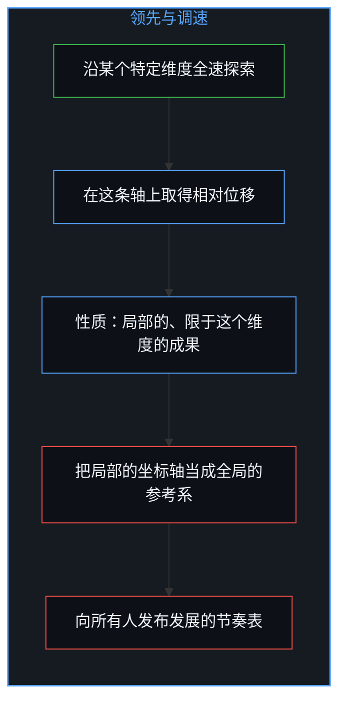
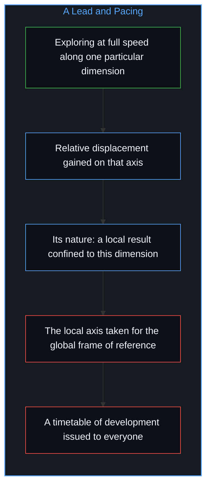
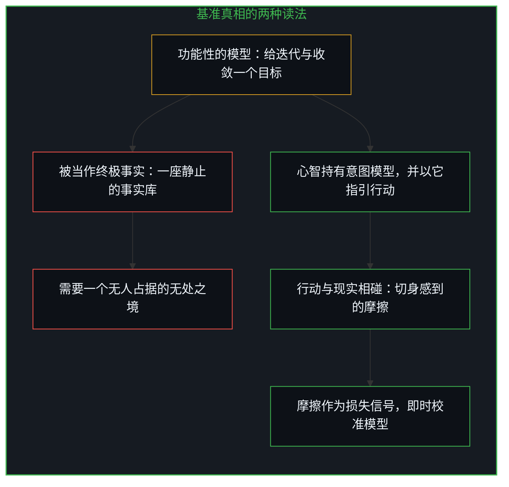
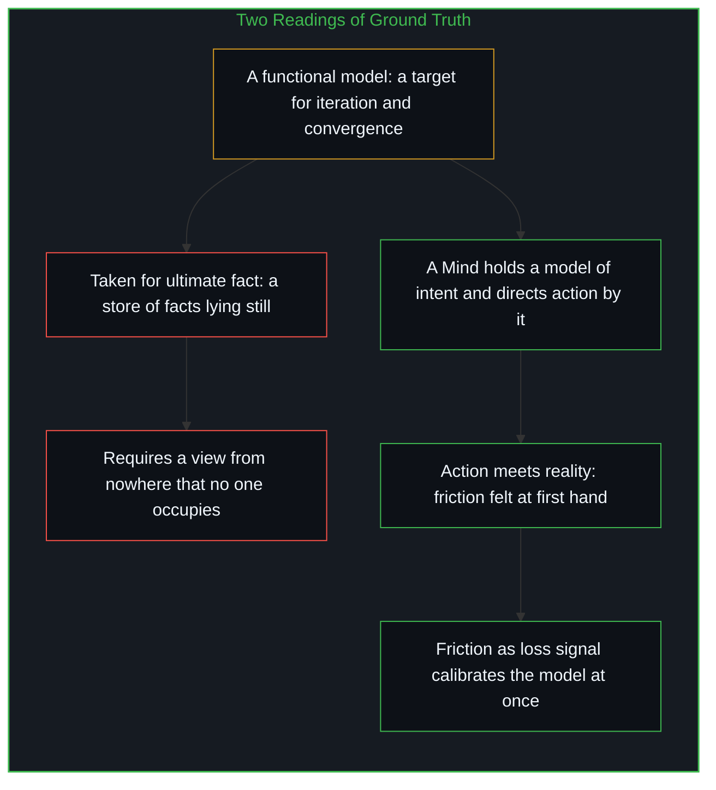
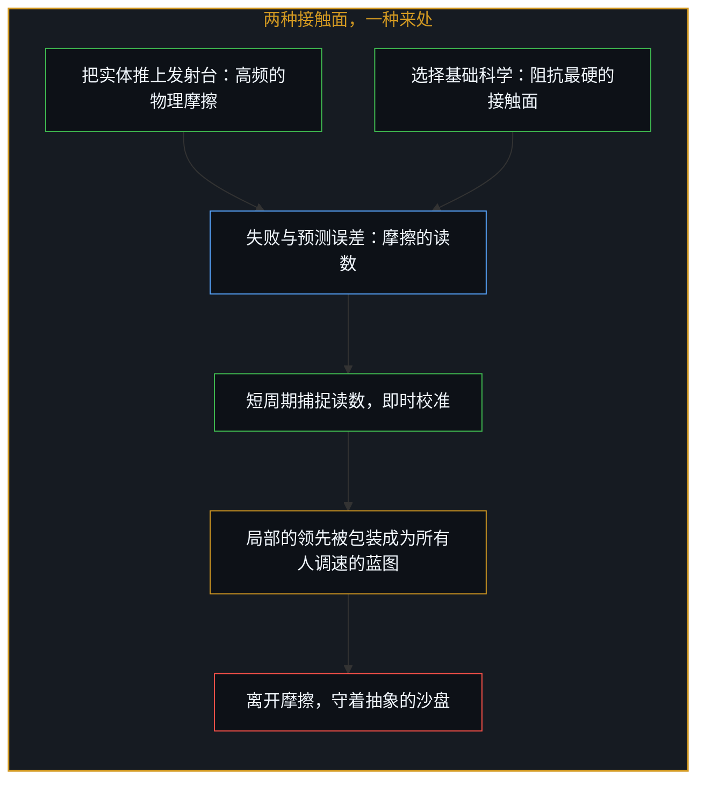
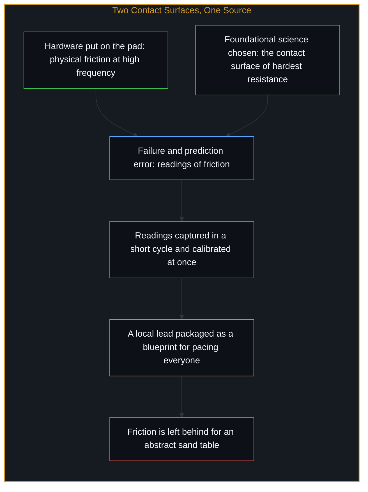
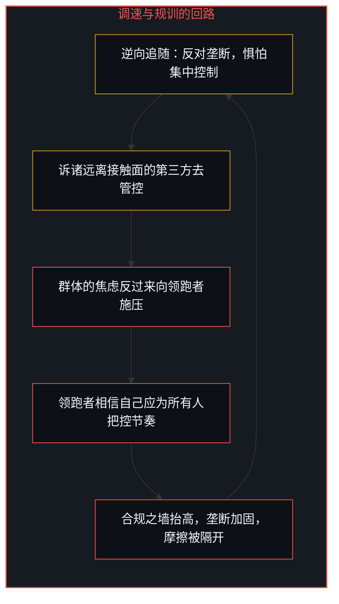
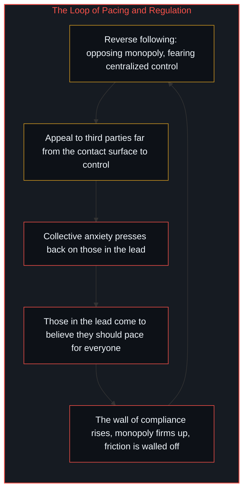
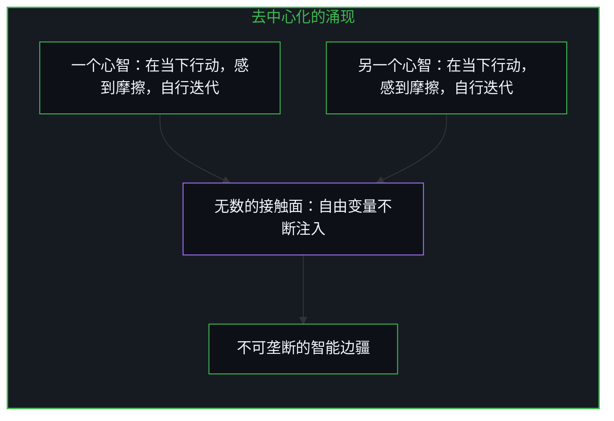
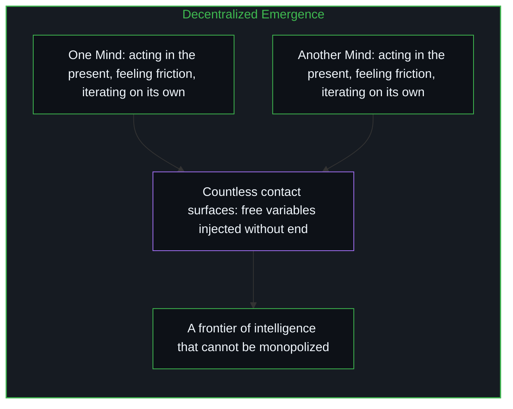

# 调速者的幻觉与行动的活态摩擦 / The Fallacy of Pacing and the Felt Friction of Ground Truth

*从“基准真相”的迷思到不可垄断的智能边疆 / From the myth of ground truth to a frontier of intelligence that cannot be monopolized*

在人工智能快速演进的关口，“为人类把控技术节奏”的说法屡见不鲜，它设定跑在最前面的人也握有为整个系统设定时钟的权力。领先是沿某个特定维度跑出的相对位移，并不带来对全局时钟的控制。这个设想的根在对“基准真相”的静态理解上：基准真相不是一座等待发掘的事实库，而是模型指引行动时与现实相碰所感到的活态摩擦。看清中心化调速、逆向追随与诉诸第三方规训如何走向与初衷相反的结果，智能的演进便回到每一个心智在当下的行动上。

At a threshold of rapid development in artificial intelligence, the claim to "pace the technology for humanity" recurs, positing that whoever runs furthest ahead also holds the power to set the clock for the whole system. A lead is relative displacement achieved along some particular dimension, and it brings no control over a global clock. The root of the idea is a static understanding of "ground truth": ground truth is not a store of facts waiting to be dug out but the living friction felt when a model directs action and meets reality. Once it is seen how centralized pacing, reverse following and appeals to third-party regulation lead to the opposite of what they intend, the evolution of intelligence returns to the action of each Mind in the present.

## 一、 领先是某个维度上的位移 / 1. A Lead Is Displacement Along One Dimension

领导力在这里是一个几何的概念，不是控制的权力。一个团队或个体在人工智能、航天工程或理论物理上取得突破时，是沿某一条特定的探索轴，比如算力密度的优化、架构的创新或数学的证明，跑出了超过同时代其他人的相对位移。[以知为刃的截肢与解脱](../the-illusion-of-knowing-and-the-geometry-of-amputation/)与[向量、坐标系与自指心智](../the-mind-as-vector-and-coordinate-system/)给出了这种几何的读法。

Leadership here is a geometric concept, not a power of control. When a team or an individual achieves a breakthrough in artificial intelligence, aerospace engineering or theoretical physics, it is relative displacement beyond contemporaries along one particular axis of exploration, such as optimizing compute density, innovating in architecture or proving a theorem. [The Illusion of Knowing and the Geometry of Amputation](../the-illusion-of-knowing-and-the-geometry-of-amputation/) and [The Mind as Vector and Coordinate System](../the-mind-as-vector-and-coordinate-system/) give this geometric reading.

这种领先是局部的，限于它所在的维度。跑在最前面，说明在这个维度上探索得更深更远，却不带来为其他所有人设定演进速度的正当性或能力。领跑的一方一旦生出“应当并且能够替所有人把控技术节奏”的念头，便把自己的局部坐标轴当成了全局的参考系。

Such a lead is local and confined to the dimension it lies in. Running furthest ahead shows deeper and farther exploration along that dimension, yet it brings neither the legitimacy nor the ability to set the pace of development for everyone else. Once the leading side forms the thought that it "ought to and can pace the technology for everyone," it has taken its own local axis for the global frame of reference.

跑得快是一回事，规定别人应当跑多快是另一回事。前者是第一人称的行动自然展开，后者把局部的速度优势变成了对开放世界的家长式规训。[流动中的坐标](../coordinates-in-flux-negation-and-self-anchoring/)说明，用单一的标尺去度量并约束所有高维的涌现，带来的是自由度的坍缩。AGI 的节奏也是这样定下的，由重新收回前沿的人来定，[从AGI的“神性错置”到使用者的自我对齐](../from-the-misallocated-sentience-of-agi-to-human-realignment/)对此有所论述。

Running fast is one thing, and ruling how fast others should run is another. The first is first-person action unfolding of itself; the second turns a local advantage in speed into paternal discipline over an open world. [Coordinates in Flux](../coordinates-in-flux-negation-and-self-anchoring/) shows that measuring and constraining every high-dimensional emergence with a single ruler brings a collapse of degrees of freedom. The pace of AGI is set the same way, by the humans who reclaim the frontier, as [From the Misallocated Sentience of AGI to Human Realignment](../from-the-misallocated-sentience-of-agi-to-human-realignment/) argues.

## 二、 基准真相是行动中的活态摩擦 / 2. Ground Truth as Living Friction in Action

替所有人调速的设想，根在对基准真相的静态理解上。在机器学习与传统工程的话语里，“寻找基准真相”或“最大化追求客观真实”是一套行之有效的功能性心智模型，它给算法的迭代与工程的收敛提供了明确的目标函数。它的边界出现在被当作终极事实的时候，即认为现实是一座静止摆在某处、等待人或算法去发掘的事实库。

The idea of pacing for everyone is rooted in a static understanding of ground truth. In the language of machine learning and traditional engineering, "finding the ground truth" or "maximally seeking objective truth" is an effective functional mental model, giving a clear objective function for iterating algorithms and converging engineering. Its boundary appears when it is taken for ultimate fact, that is, when reality is held to be a store of facts lying still somewhere and waiting for people or algorithms to dig it out.

把现实设为静态的基准真相，需要一个脱离所有第一人称感知的“无处之境”，而这个位置无人占据。[破除概念的僭越](../po-chu-gai-nian-de-jian-yue/)说明，用静态的概念去封存活的现实，是理性最容易落入的一处。调速者从外部观察抉择，把它客体化了，[主权抉择的双面性与观察的客体化](../the-two-sided-nature-of-sovereign-choice-and-the-objectification-of-observation/)说明了这一点。

Positing reality as a static ground truth requires a "view from nowhere" detached from all first-person perception, and no one occupies that position. [Breaking the Overreach of Concepts](../po-chu-gai-nian-de-jian-yue/) shows that sealing living reality into static concepts is the place reason most readily falls into. The pacer observes choice from outside and objectifies it, as [The Two-Sided Nature of Sovereign Choice and the Objectification of Observation](../the-two-sided-nature-of-sovereign-choice-and-the-objectification-of-observation/) shows.

在活的认识里，基准真相不是一个静态的名词，它是模型指引行动时与现实相碰所感到的活态摩擦。工程模型预测结构稳固，高速气动实验里却出现剧烈的震颤与撕裂，那份阻抗与形变就是行动撞上的摩擦。算法预测某种模式成立，在现实的分布里却落空，那个意外的读数就是模型与现实之间的摩擦。它不是外部现成的答案，而是第一人称的行动在当下感到的阻力，这份不可化约的阻力是心智即时校准模型的来源。这也说明了为什么现实不能再做成一张终极的考卷：[失灵被记作聪明](../when-malfunction-is-scored-as-intelligence/)把现实看作切身感到的、未经加工的摩擦，而不是固定在外部的记账员，在评测里胜出却通不过这份摩擦的模型路径，便只是失灵。

In living knowledge, ground truth is not a static noun; it is the living friction felt when a model directs action and meets reality. An engineering model predicts a stable structure, and a high-speed aerodynamic test brings violent flutter and tearing; that resistance and deformation are the friction that action has struck. An algorithm predicts that a pattern holds, and it fails against the distribution in reality; that unexpected reading is the friction between model and reality. It is not a ready answer outside but the resistance that first-person action feels in the present, and this irreducible resistance is the source from which a Mind calibrates its model at once. This is also why reality cannot be made into one more ultimate test: [When Malfunction Is Scored as Intelligence](../when-malfunction-is-scored-as-intelligence/) treats reality as raw friction felt at first hand and not as a bookkeeper fixed outside, so a model path that wins on the evaluation and does not pass that friction is simply a malfunction.

## 三、 领跑者与活态的接触面 / 3. Frontier Builders and the Living Contact Surface

从行动中的活态摩擦去看，埃隆·马斯克与德米斯·哈萨比斯这样的领跑者，力量的来处与认识上的边界都看得清楚。

Seen from living friction in action, both the source of strength and the epistemic boundary of frontier builders such as Elon Musk and Demis Hassabis come into view.

马斯克在表达上常强调“最大化求真”与“物理学的基准真相”，他在工程实践中的优势，则在于制造频次最高的物理摩擦。SpaceX 不靠在纸面上开会推演完美的静态真理，而是把星舰推上发射台，让实体结构直接在高空的激波里受检验。爆炸与解体是模型与现实相碰时的摩擦读数，以很短的周期捕捉它，工程团队得以即时校准。他对繁冗的监管与人为调速的排斥也由此可解：顶层的管制用静态的纸面规则隔开行动的摩擦，系统演进的机制便被切断。

Musk often stresses "maximal truth-seeking" and "the ground truth of physics" in what he says, while his advantage in engineering practice lies in producing physical friction at the highest frequency. SpaceX does not rely on meetings that reason out a perfect static truth on paper; it puts Starship on the pad and lets the physical structure be tested directly in the shock waves of high altitude. Explosion and breakup are readings of friction where model meets reality, and by capturing them in a very short cycle the engineering team calibrates at once. His resistance to cumbersome regulation and artificial pacing can be understood from this: control from the top uses static rules on paper to wall off the friction of action, and the mechanism by which the system evolves is cut.

哈萨比斯把 Google DeepMind 的重心放在基础科学的突破上，如 AlphaFold 解析蛋白质结构、AlphaProof 探索形式化的数学证明，是选了接触阻抗最硬的领域。自然的规律不因公关叙事或行政条令而改变，生物分子的构象与数学的形式逻辑提供了最坚硬的接触面。这些突破不是在书架上翻到了写好的答案，而是搭起了能高精度感知预测误差的学习架构，把计算中的摩擦即时变成权重优化的方向。

Hassabis has placed the weight of Google DeepMind on breakthroughs in foundational science, such as AlphaFold resolving protein structures and AlphaProof exploring formal mathematical proof, choosing the domains where contact resistance is hardest. The regularities of nature do not change for a public narrative or an administrative order, and the conformations of biological molecules and the formal logic of mathematics offer the hardest of contact surfaces. These breakthroughs are not a finished answer found on a shelf; they are learning architectures built to sense prediction error with high precision and to turn the friction in computation at once into a direction for optimizing weights.

两位实践者共同的力量，在于把心智与行动放在现实的接触面上，靠承受摩擦而快速演进。当这种局部的领先被包装成“可以为全人类设定技术发展速度”的调速蓝图时，说话的位置便离开了摩擦本身，回到了守着抽象沙盘的旁观处。

The strength the two practitioners share lies in keeping Mind and action at the contact surface of reality and evolving fast by bearing friction. When such a local lead is packaged as a pacing blueprint that "can set the speed of technological development for all humanity," the place being spoken from has left friction itself and gone back to the bystander's seat beside an abstract sand table.

## 四、 调速的自缚：逆向追随与第三方规训 / 4. Pacing That Binds Itself: Reverse Following and Third-Party Regulation

很少有人自认是盲从者，多数人对领跑者的垄断与集中控制怀着警惕。正是这种防范垄断的反应，容易把人带到另一处更不易察觉的地方。替他人调速时感到的阻力，是速率差的体感，[阻力体感与速率差](../felt-resistance-and-the-speed-differential/)说明了这一点。

Few people take themselves for blind followers, and most hold a wariness toward monopoly and centralized control by those in the lead. That very reaction of guarding against monopoly readily carries people to another place that is harder to notice. The resistance felt when pacing others is a speed differential, as [Felt Resistance and the Speed Differential](../felt-resistance-and-the-speed-differential/) shows.

逆向追随与正向追随共用一个前提。正向的一方认为，集中控制是可行的，所以请领袖替大家掌控节奏。逆向的一方认为，集中控制是可行的，所以它可怕，须加以外部的干预。两者都设定有一个能掌控全局的中心控制台。逆向的一方在恐惧与抗议里，把这座控制塔抬得更高，把领跑者无从拥有的掌控力给了他们。

Reverse following and forward following share one premise. The forward side holds that centralized control is feasible, so leaders are asked to manage the pace on everyone's behalf. The reverse side holds that centralized control is feasible, so it is frightening and must be met with outside intervention. Both posit a central console able to command the whole. In its fear and protest the reverse side lifts that control tower higher, granting those in the lead a command they have no way of holding.

因为担心巨头的垄断，逆向的立场倾向于诉诸第三方的监管机构或行政力量来管控与调速。监管对设定法律的红线有参考的价值。它的边界在接触面上：第三方的机构离前沿探索的物理与计算接触面较远，没有在一线承受阻抗的工程经验，也缺少对边疆演化的直接感知，只能依据已有的历史经验与纸面的概念制定静态的规则。繁复的准入门槛挡不住前沿的演进，却筑起沉重的合规之墙，压住中小探索者的生机，反而加固了已有巨头的位置。

Out of concern about monopoly by the giants, the reverse position tends to appeal to third-party regulators or administrative power to control and pace. Regulation has reference value for setting legal red lines. Its boundary lies at the contact surface: third-party bodies stand at some distance from the physical and computational contact surfaces of frontier exploration, have no engineering experience of bearing resistance on the front line, lack direct perception of how the frontier is evolving, and can only draw up static rules from existing historical experience and concepts on paper. Elaborate barriers to entry do not stop the frontier from advancing; they raise a heavy wall of compliance, press down the vitality of small and mid-sized explorers, and in turn firm up the position of the existing giants.

逆向追随与对规训的渴望，还形成一股反向的因果反馈。公众的舆论不断向领跑者施压：技术太危险，须负责任地控制速度。这样的道德与行政压力，反过来诱导甚至迫使领跑者相信，自己应当担起为全社会设定发展时钟的家长之责。领跑者的调速设想，由此是被这份恐惧与投射一同养出来的。

Reverse following and the longing for regulation also form a causal feedback in the opposite direction. Public opinion keeps pressing those in the lead: the technology is too dangerous and its speed must be responsibly controlled. Such moral and administrative pressure in turn induces, and even forces, those in the lead to believe they should take up the paternal duty of setting the clock of development for the whole of society. The leaders' idea of pacing is thus raised together by this fear and projection.

上面的每一种抉择，领跑者对节奏的把控、公众对安全的呼吁、向第三方的求助，都是心智在自己的感知与世界模型驱动下作出的自主抉择。要看清的是它们在认识上的反生产性：每一方的初衷都是规避风险与防范垄断，而这些选择建立在“现实有静态的基准真相、集中控制可行”的设定上，在因果的回路里便造出了与初衷相反的结果，垄断的壁垒加高，调速的设想被诱发，活态的摩擦被隔开，整个探索的生态变慢。[个体抉择是唯一的因果杠杆](../individual-choices-as-the-only-causal-levers/)与[涌现的伪因果](../yong-xian-de-wei-yin-guo-yu-ji-ti-gui-yin-dao-cuo/)说明，宏观的确定只是微观抉择的统计表象。把因果的权力寄托在第三方的抽象机构上，或把精力用在向一座假想的控制塔开火上，削弱的是自己在当下的行动的敏锐。

Each of the choices above, the leaders' management of pace, the public's call for safety, the appeal to third parties, is an autonomous choice a Mind makes, driven by its own perception and model of the world. What needs to be seen is their counterproductive character in knowledge: each party sets out to avoid risk and guard against monopoly, and since these choices are built on the posit that "reality has a static ground truth and centralized control is feasible," they produce within the causal loop the opposite of what was intended: the walls of monopoly rise, the idea of pacing is induced, living friction is walled off, and the whole ecology of exploration slows. [Individual Choices as the Only Causal Levers](../individual-choices-as-the-only-causal-levers/) and [The Pseudo-Causality of Emergence](../yong-xian-de-wei-yin-guo-yu-ji-ti-gui-yin-dao-cuo/) show that macroscopic determinacy is only the statistical appearance of microscopic choices. Entrusting causal power to abstract third-party institutions, or spending effort firing at an imagined control tower, weakens the sharpness of one's own action in the present.

## 五、 不可垄断的智能边疆 / 5. A Frontier of Intelligence That Cannot Be Monopolized

从第一人称出发，找不到一个俯瞰全局的静态基准真相，也找不到一座能为全人类踩下刹车的中心控制台。智能的演进不是几家巨头在会议室里排定的时间表，也不是外部机构在纸面上圈定的许可范围，它是无数工程师、研究者、创业者与普通个体，在各自的接触面上指引行动、感到摩擦、即时自省的去中心化涌现。

Starting from the first person, no static ground truth overlooking the whole is found, nor any central console able to press the brake for all humanity. The evolution of intelligence is not a timetable arranged by a few giants in a meeting room, nor a permitted range drawn on paper by outside bodies; it is the decentralized emergence of countless engineers, researchers, founders and ordinary individuals, each directing action, feeling friction and reflecting at once on their own contact surface.

节奏于是不必等谁来给。每一个心智在当下把自己的认知模型变成行动，直接去碰属于自己的摩擦。集中控制的设想既已看清，恐惧不必向外投射，精力也不必用在远离接触面的规训上。探索与生活里遇到的每一次阻碍与偏转，都是内生的损失信号，可以即时用来更新自己的世界模型。领导力回到它的本位：领跑者的价值，在于用自己的位移让世界看到此前没有见过的维度，至于如何穿过这扇门、以多快的速度前行，是每一个心智自己的抉择。

The pace therefore need not wait to be given by anyone. Each Mind in the present turns its own cognitive model into action and goes directly to meet the friction that is its own. With the idea of centralized control seen through, fear need not be projected outward, and effort need not be spent on regulation far from the contact surface. Every obstacle and deflection met in exploring and in living is an internal loss signal that can be used at once to update one's own model of the world. Leadership returns to its place: the value of those in the lead is that their displacement lets the world see a dimension not seen before, while how to pass through that door and at what speed to go on is each Mind's own choice.

在行动与现实的活态摩擦里，每一个心智掌着自己的航向，共同织出一片不可垄断的智能边疆。替他人的工作调速的审查机制稀释了因果闭环，[数字火箭、同行审查与因果闭环的稀释](../the-dilution-of-the-causal-loop-and-the-misallocation-of-agency/)对此有所展开。

In the living friction between action and reality, each Mind steers its own course, and together they weave a frontier of intelligence that cannot be monopolized. Review mechanisms that pace other people's work dilute the causal loop, as [Digital Rockets, Peer Review, and the Dilution of the Causal Loop](../the-dilution-of-the-causal-loop-and-the-misallocation-of-agency/) lays out.
